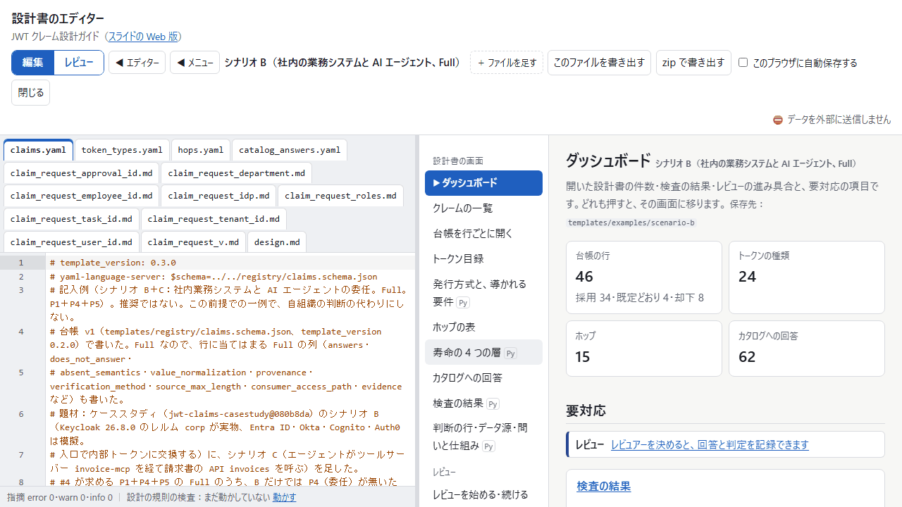

# JWT クレーム設計ガイド：組織で共用する独自クレームを、どう設計し、どう流し、どう治めるか

組織のサービスで共用する JWT の独自クレームを、設計し、設計書に書き、レビューし、検査するための資料と道具です。解説のスライド（全 159 枚）と、スライドに沿って設計書を書くためのテンプレート・エディター・検査の道具があります。設計書は、どのクレームを、誰が発行し、誰が読み、いつまで有効にするかを決めて書く文書です。

| したいこと | 入口 |
| --- | --- |
| [**読む**](#読む) | [スライドの Web 版](https://takenori-kusaka.github.io/jwt-claims-guide/)：独自クレームの設計・伝搬・検証・ガバナンスの解説です（全 159 枚、スライドごとに解説つき）。[PDF・PPTX](slides/) と [Docswell](https://www.docswell.com/s/takenori_kusaka/ZWR7NJ-jwt-claims-guide) もあります |
| [**書く**](#書く) | [設計書のエディター](https://takenori-kusaka.github.io/jwt-claims-guide/claims/)：ブラウザで設計書を書き、その場で検査します。インストールは要りません<br>[テンプレートの始め方](templates/GETTING_STARTED.md)：手元のファイルとコマンドで書く手順です（[テンプレート一式](templates/README.md)） |
| [**レビューする**](#レビューする) | [人に渡す短い一覧](templates/review/short_list.md)：レビュアーが答える問いだけを並べた一覧です（[レビューの手順](templates/review/procedure.md)）<br>[設計書のエディター](https://takenori-kusaka.github.io/jwt-claims-guide/claims/)の「設計書をレビューする」：確かめた結果を記録します |
| [**検査する**](#検査する) | [claim-lint](#検査する)：設計書の書き忘れと食い違いを見つけるコマンドです。`python tools/claim_lint <設計書のディレクトリ>`（[規則の一覧](tools/claim_lint/RULES.md)）<br>[CI の設定](.github/workflows/claims.yml)：同じ検査を、プルリクエストのたびに自動で行う例です |

[](https://takenori-kusaka.github.io/jwt-claims-guide/claims/)

設計書のエディターで、記入例を開いた画面です。左の YAML を直すと、右の表と検査の結果が変わります。

## 読む

認証認可とマイクロサービスの設計を任された、新任のテックリーダーに向けた解説のスライドです。主題は、OpenID Connect や OAuth の標準クレームそのものではありません。**組織のあらゆるサービスで共用する独自クレーム**の設計・伝搬・検証・ガバナンスです。既存のクレームと重複・衝突しないように、標準クレームの地図と、4 つの IdP（Microsoft Entra ID・Keycloak・Auth0/Okta・Amazon Cognito）の実際を前提として扱います。

- Web 版：https://takenori-kusaka.github.io/jwt-claims-guide/
- PDF / PPTX：[slides/](slides/)
- Docswell：https://www.docswell.com/s/takenori_kusaka/ZWR7NJ-jwt-claims-guide
- Part ごとの内容：下の「[構成](#構成)」

**中心の主張**：クレームは、1 つの発行者が書き、多数のサービスが読む「契約」です。名前空間・型・意味と意味しないこと・書き手・寿命・持ち主を決め、台帳に載せてから足す。受け手は、署名・発行者・宛先・期限・種類を確かめてから読む。トークンは発行時点の写しなので、変わりやすい権限や関係は載せずに都度判定する。銀の弾丸はなく、どの組織でも外せない共通の基準の上で、何に重点を置き、何を見送るかを、見直しの条件とともに決める。

関連する資料（別のリポジトリ）：

- ケーススタディ（実測。67 ケースの攻撃・正規の要求と除去実験）：https://github.com/Takenori-Kusaka/jwt-claims-casestudy
- ケーススタディのスライド（49 枚、Web 版）：https://takenori-kusaka.github.io/jwt-claims-casestudy/ （Docswell：https://www.docswell.com/s/takenori_kusaka/KJWMVQ-jwt-claims-casestudy ）
- 付録：JWT クレーム一覧（xlsx、805 行、3 ケースの採否つき）：https://github.com/Takenori-Kusaka/jwt-claims-casestudy/blob/main/catalog/jwt-claims-catalog.xlsx

## 書く

設計書は、1 つのディレクトリに置くファイルの組です。設計書の本体（`design.md`）と、台帳（クレームの一覧などを書く YAML。`claims.yaml` など）からなります。

始め方は 2 つあります。どちらも同じファイルを作るので、途中で行き来できます。

| 始め方 | 向いている場合 | 最初にすること |
| --- | --- | --- |
| エディターで書く | まず試したい。Python を入れずに始めたい | [設計書のエディター](https://takenori-kusaka.github.io/jwt-claims-guide/claims/)を開き、「空の雛形から始める」を押す |
| 手元で書く（コマンド） | 自分のリポジトリで、PR と CI に載せて書きたい | このリポジトリを clone し、下の「手元で書く」のコマンドを実行する |

エディターだけで、書く・検査する・レビューを記録する、まで進めます。clone と Python が要るのは、コマンドを使うときです（CI での検査、台帳から作る表の書き込みなど）。

書き方の見本は、2 つの記入例です。[templates/examples/](templates/examples/) にあり、エディターの「サンプルを開く」でも読めます。

- シナリオ A：マルチテナントの SaaS
- シナリオ B：社内の業務システムと AI エージェント

### 設計書のエディター

https://takenori-kusaka.github.io/jwt-claims-guide/claims/

ブラウザだけで動きます。インストールもログインも要りません。

できること：

- 設計書の YAML を書く。書いた内容を、表として読む
- 書きながら検査する。書式の誤りはすぐに出ます。claim-lint と同じ検査も、ブラウザの中で動きます
- 記入例を開いて、書き方を見る
- 設計書をレビューし、その記録をファイルに書き出す

始め方：

1. 上の URL を開きます。最初は何も開いていません
2. 最初の画面で、始め方を 1 つ選びます
   - 見てみる：「サンプルを開く」（記入例）
   - 新しく書く：「空の雛形から始める」（空の設計書）
   - 手元の設計書を開く：「ファイルを開く」「フォルダを開く」、またはドラッグ＆ドロップ
   - レビューする：「設計書をレビューする」
3. 書き終えたら、ファイルか zip で書き出します。書き出したファイルは、自分のリポジトリの、設計書を置くディレクトリ（例：`designs/my-service/`）にコミットします

データの扱い：

- 開いたファイルと書いた内容は、ブラウザの中だけで扱います。外部には送信しません（リンクを押して別のページに移るときを除く）
- 保存は、ファイルへの書き出しで行います。自動保存は、自分で有効にしたときだけ、そのブラウザの中に保存します
- claim-lint と同じ検査を初めて使うときは、このサイトから十数 MB を読み込みます（数秒かかります）

仕組み・確かめ方・ビルドの方法は [docs/claims/README.md](docs/claims/README.md) にあります。

### 手元で書く

Python 3.12 が要ります。このリポジトリを clone し、その中で実行します。

```bash
python -m pip install --require-hashes --no-deps -r tools/requirements-ci.txt   # 依存を入れる（最初の 1 回）
python tools/new_design.py designs/my-service        # 空の設計書を作る
python tools/claim_lint designs/my-service           # 検査する。指摘の一覧が、これから書くことの一覧になる
```

- `designs/my-service` は、設計書を置くディレクトリです。clone の外（自分のリポジトリの中）のパスでもかまいません
- 続きの手順は [templates/GETTING_STARTED.md](templates/GETTING_STARTED.md) にあります。書く量を決め、最初の欄を書き、検査するところまで進みます
- 書く量は 2 段階です。**Lite** は欄を減らした形、**Full** は全部の欄を書く形です。5 つの問いで決めます（[templates/README.md](templates/README.md) の「Lite と Full の判定」）。決める前は、Full の形（上のコマンド）で始めます。Lite と決まっていれば、`python tools/new_design.py designs/my-service --profile lite` で作ります
- テンプレートの全体は [templates/README.md](templates/README.md)、用語は [templates/glossary.md](templates/glossary.md) です
- `templates/` のファイルは CC0 です。社内の設計書にそのまま写せます

## レビューする

レビュアーは、全部の問いには答えません。人の判断が要る問いだけに答えます。エディターだけでレビューするなら、下の 3. から始められます（エディターにも、同じ選び方の問いが出ます）。1. と 4. のコマンドには、clone と Python 3.12 が要ります（「[手元で書く](#手元で書く)」の 1 行目で依存を入れる）。

1. **答える問いを出す**：`python tools/review_triage.py --design designs/my-service` を実行します。その設計書で答える問いが、1 枚の Markdown として画面に出ます。問いの全体は [人に渡す短い一覧](templates/review/short_list.md) にあります
2. **手順に沿って読む**：[レビューの手順](templates/review/procedure.md) に、読む順序と時間の目安があります
3. **記録する**：[設計書のエディター](https://takenori-kusaka.github.io/jwt-claims-guide/claims/)の最初の画面で「設計書をレビューする」を押します
   - 選ぶもの：設計書のディレクトリのファイル（フォルダごと選べます。前のレビューの記録があれば、一緒に選びます）
   - 書き出すもの：レビューの記録のファイル（`review.yaml`）
   - 置く場所：設計書と同じディレクトリ。設計書と同じ PR にコミットします
4. **記録を確かめる**（CI に入れるとき）：`python tools/review_record.py check designs/my-service/review.yaml --design designs/my-service` が、記録の形と、記録した後に中身が変わった設計書の行を確かめます

- 記録の例は、エディターの「サンプルを開く：シナリオ B」で読めます。この例の記録は LLM が書いたもので、操作と形の見本です（人による点検は未実施）
- エディターにはログインがありません。レビュアーの名前は自己申告です。承認は、GitHub の PR のレビューで行います
- レビューの教材の全体（判断の木・対比表・専門家に回す基準・レポートの様式）は [templates/review/README.md](templates/review/README.md) にあります

## 検査する

claim-lint は、設計書の書き忘れ・理由の欠落・ファイルの間の食い違いを見つけるコマンドです。clone と Python 3.12 が要ります（「[手元で書く](#手元で書く)」の 1 行目で依存を入れる）。

```bash
python tools/claim_lint designs/my-service                   # Full の設計書を検査する
python tools/claim_lint designs/my-service --profile lite    # Lite の設計書を検査する
python tools/claim_lint render designs/my-service --write    # 設計書の本体（design.md）のうち、台帳から作る表を書き込む
python tools/claim_lint render designs/my-service --check    # その表が、今の台帳と合っているかを確かめる（CI 向け）
```

- 指摘には error・warn・info があります。error を 0 件にしてから、レビューに出します
- 規則の意味は [tools/claim_lint/RULES.md](tools/claim_lint/RULES.md) にあります
- 設計書のエディターでも、同じ検査がブラウザの中で動きます
- PR に付ける、書き手の自己点検のチェックリストは [.github/PULL_REQUEST_TEMPLATE/design_doc.md](.github/PULL_REQUEST_TEMPLATE/design_doc.md) です

**CI に入れる**：見本は [.github/workflows/claims.yml](.github/workflows/claims.yml) です。このリポジトリは、記入例を上と同じコマンドで、push と PR のたびに検査しています。自分のリポジトリの CI では、このリポジトリも checkout し、依存を入れてから、同じコマンドを自分の設計書のディレクトリに向けて実行します。配布用のパッケージや、そのまま使える Action は、まだありません。

## 構成

### 成果物の一覧

| 場所 | 中身 |
| --- | --- |
| [slides/](slides/) | スライドの PDF と PPTX |
| [docs/](docs/) | 公開している Web ページ。スライドの Web 版と、設計書のエディター（[docs/claims/](docs/claims/)） |
| [templates/](templates/) | 設計書のテンプレート一式（CC0）。主なもの：設計書の本体、記入例（[examples/](templates/examples/)）、レビューの教材（[review/](templates/review/)）、YAML の書式の定義（[registry/](templates/registry/)）。全部の一覧は [templates/README.md](templates/README.md) |
| [tools/](tools/) | 検査と生成の道具。claim-lint（[tools/claim_lint/](tools/claim_lint/)）、空の設計書を作る `new_design.py`、レビューの問いを出す `review_triage.py`、レビューの記録を確かめる `review_record.py` など |
| [.github/](.github/) | CI の設定（[workflows/](.github/workflows/)）と、設計書の PR のテンプレート |
| [research/](research/) | 調査と記録。調査メモ（[notes/](research/notes/)）、テンプレートの調査と試行（[template-design/](research/template-design/)・[pilot/](research/pilot/)）、点検の記録（[reviews/](research/reviews/)）、エディターの記録（[claims-editor/](research/claims-editor/)） |
| [deck/](deck/) | スライドのソース |

### スライドの Part

| Part | 内容 |
| --- | --- |
| 0 | 導入：クレームはサービス間の契約、事故の例（Storm-0558、CVE-2025-55241、nOAuth、GitHub の sub） |
| 1 | 基礎：JWT の構造、検証の順序、危険なヘッダー、署名鍵のローテーション、クライアントが作る JWT、ID トークンとアクセストークン、ライブラリの既定値 |
| 2 | 既存のクレームの地図：16 の用途ごとの標準クレームと、独自クレームが要る隙間、SAML の属性 |
| 3 | 4 つの IdP の実際：利用者キー・テナント・aud・ロールの位置・独自クレームの規則、最近の変更 |
| 4 | 独自クレームの設計原則：載せるか問い合わせるか、名前空間、型、不変の ID、書き手、サイズ、前方互換 |
| 5 | 権限の表現：利用者・ワークロード・システム、RBAC/ABAC/関係ベース、マルチテナント、BOLA |
| 6 | 流れ：どこで足し、どこで絞るか（発行時フック、グラントの種類、入口での交換、Transaction Tokens、ヘッダー、証跡） |
| 7 | データ層：行単位の制御、DB の文脈と信頼境界、接続プール、トークンでの DB 認証、マスキング |
| 8 | 有効期限・リフレッシュ・失効・非同期処理（寿命の 4 つの層、再発行の契機、ログアウト、トークンより長く生きる接続・キャッシュ・複製） |
| 9 | 機微情報・最小化・ログ |
| 10 | AI エージェントのアクセスポリシー：委任（act）、ツールごとのスコープ、承認の証拠、MCP の認可 |
| 11 | ガバナンス：クレームの台帳、スキーマと契約テスト、変更の手順、追加前の 25 の質問 |
| 12 | 実践：アンチパターン、レビューの観点、重点と見送り、主張と根拠の対応、参考文献 |

## 根拠

各スライドの下に、仕様・公的な指針・日本語の書籍の 3 種類の根拠を示しています（調査基準日 2026-11-17）。

- 仕様：RFC 7519・8725・9068・8693・9700・7662・9396 など、OpenID Connect Core、Transaction Tokens（草案 11）、MCP 認可仕様（2026-07-28）
- 公的な指針：NIST IR 8587・SP 800-63C-4・SP 800-162、OWASP ASVS 5.0・JWT Cheat Sheet、デジタル庁 DS-212・DS-511、CSRB 報告書（Storm-0558）
- 日本語の書籍（章・印刷ページで引用）：『OpenID Connect入門』（技術評論社 2026）、『デジタルアイデンティティのすべて』（オライリー・ジャパン 2024、考え方の根拠として引用）、『実践 Keycloak』（オライリー・ジャパン 2022）、『セキュアAPI』（翔泳社 2026）

調査メモ（仕様・IdP・事故事例・公的な指針・独自クレームの実例・データ層・マイクロサービスの流れ）は [research/notes/](research/notes/) にあります。設計書テンプレート構想の調査（レポート・調査ノート・未検証点の表）は [research/template-design/report.md](research/template-design/report.md) にあります（人による点検は未実施）。書籍の章・印刷ページとの対応表（書籍ノート 10〜13）も公開しています。書籍の文の引用は、出典の章・印刷ページを明記し、ノートの本文を主・引用を従とし、必要最小限の短い引用に限っています（点検の記録：[research/reviews/book-quotes-2026-11-22.md](research/reviews/book-quotes-2026-11-22.md)）。全スライドは、作成とは別の担当が一次資料に当たって事実を点検し、指摘を反映しています。

クレーム設計の構造化と機械検査の先行事例の調査（レポート・調査ノート）は [research/claims-as-code/report.md](research/claims-as-code/report.md) にあります（人による点検は未実施）。

## 前提と限界

- 製品の挙動（特に各 IdP）は 2026 年 11 月時点の公式文書によります。変わりうるので、採用前に現行の文書で確かめてください。
- 草案（Transaction Tokens、ID-JAG など）は、名前や規則が変わりえます。
- 一次資料に記載がなく筆者の推奨・提案として示したもの（契約テスト、監査の指標など）は、スライド上で「筆者の推奨」「筆者の提案」と明示しています。

## このリポジトリを直す人へ

ここから下は、スライド・テンプレート・道具を直す人に向けた説明です。使うだけなら、読まなくてかまいません。

### 直した後の確認

```bash
python tools/template_check.py                  # テンプレートの形
python tools/review_check.py                    # レビューの教材の形
python tools/trace_check.py                     # スライドと成果物の対応表
python tools/check_slide_refs.py templates      # スライドへの参照が実在するか
python tools/build_claims_viewer.py --check     # エディターのデータが、元のファイルと合っているか
python -m pytest -q tools/tests                 # すべてのテスト（ブラウザを使うテストは、Playwright が無ければ飛ばす）
```

エディターのビルドとテストは [docs/claims/README.md](docs/claims/README.md) にあります。

### スライドのビルド

```bash
cd deck && npm install                       # pptxgenjs など（deck/node_modules。lock ファイルは管理しない）
cd deck && node build.js                     # PPTX と deck/slide_ids.json を書く
cd deck && node build.js --ids-only          # deck/slide_ids.json だけを書く（PPTX は書かない）
cd deck && node build.js --ids-only --register   # 新しいスライドの ID を台帳に登録する
python tools/build_web_slides.py             # docs/（slides.json・index.html・slide_ids.csv）を作る
python tools/check_slide_refs.py [ファイルやディレクトリ ...]   # スライド ID・台帳・参照を確かめる
python -m unittest discover -s tools/tests -v                  # ID の仕組みのテスト（node と Playwright がなければ一部を飛ばす）
python tools/tests/cmp_pptx.py before.pptx after.pptx          # 2 つのビルドで描画に関わる部分が同じかを比べる
```

`build_web_slides.py` は、`docs/slides/` に書き出し済みの PNG があれば WebP に変換し、なければ既存の画像に触れずに `slides.json` と `index.html` だけを作り直します（PNG の書き出しには PowerPoint が要ります：`deck/export.ps1`）。`deck/package-lock.json` は `.gitignore` に入れています。依存は `package.json` の範囲指定で入れ、成果物が変わっていないことは `cmp_pptx.py` で出力を比べて確かめるためです。

### スライドの固定 ID

各スライドには、番号とは別の ID があります（例：`p04-carry-or-query`）。スライドを足して番号がずれても、ID は変わりません。根拠としてスライドを参照するときは、番号ではなく ID を使ってください。

#### ID の規則
- 形式は `pNN-<slug>` です。`slug` は英小文字と数字の語を `-` でつないだものです
- `pNN` は、ID を初めて付けたときに、そのスライドを定義していた Part の番号です（`deck/pNN.js`）。**接頭辞は発行時に固定**します。後でスライドを別の Part に移しても、ID は変えません
  - ビルドは、台帳にない新しい ID に限って、接頭辞と Part が合っているかを確かめます
- 一度付けた ID は変えず、使い回しもしません。スライドを削除したら、台帳でその ID を `retired` にします（欠番）

#### 定義と台帳
- **定義**：`deck/p*.js` の各スライドに `id` を書きます。書き方は次の 3 通りです。ID は画面には出ません
  - `L.content(title, { id: '…', … })`
  - `L.divider(…, notes, { id: '…' })`
  - `L.slide({ id: '…', … })`
- **台帳**：`deck/slide_ids_registry.json` は、発行したすべての ID の記録です。追記だけを行い、行を消しません。ID ごとに次を書きます
  - `issued`：発行日
  - `title`：最初のタイトル
  - タイトルを意図して変えたとき：`retitled` に `{"date", "title"}` を追記します
  - 削除したとき：`retired`（日付）と `reason` を足します
- **新しいスライドを足したとき**：`node build.js --ids-only --register` で台帳に登録します
- **ビルドが失敗する場合**：
  - `id` がない
  - 形式が違う
  - 重複している
  - 台帳にない（`--register` なしの場合）
  - `retired` の ID を使っている
  - 台帳にある有効な ID が、どのスライドにもない（改名や削除を `retired` にせずに行った場合）
  - 新しい ID の接頭辞が、定義している Part と合わない

#### 一覧
- `deck/slide_ids.json`：ビルドが出力します。`title` は `deck/p*.js` に書いたタイトルです
- `docs/slides.json`：`id` 欄があります
- 番号との対応表 [docs/slide_ids.csv](docs/slide_ids.csv)：列は `n,id,title,source_title` です。番号で書いた既存の参照を ID に置き換えるときに使います
  - `title` は、Web 版と `slides.json` に出るタイトルです（PPTX のタイトル枠）
  - `source_title` は、`deck/p*.js` に書いたタイトルです
  - 表紙と Part の扉の 13 枚だけは、2 つが違います（例：`PART 1` と `基礎：JWT の構造と検証`）

#### Web 版
- `https://takenori-kusaka.github.io/jwt-claims-guide/#p04-carry-or-query` で、そのスライドが開きます
- 従来の、番号で指す `#s47` の形も開けます。ただし、番号はずれるので、文書には書かないでください
- 見つからない ID や壊れたハッシュのときは、1 枚目を開き、見つからなかったことを表示します

#### 文書からの参照
参照は `slide:<id>` と書きます（例：`slide:p04-carry-or-query`）。文法は次のとおりです。

```
ref    = "slide:" id [ ".R" 1*DIGIT ]          ; "slide" は小文字、":" の前後に空白を入れない
id     = "p" 2DIGIT "-" word *( "-" word )     ; word = 1*( a-z / 0-9 )
```

- `slide:` の直前が英数字・`_`・`-` のときは、参照とみなしません
- ID は、`slide:` の後の英数字・`_`・`-` の並びです。それ以外の文字（`.`・`,`・`)`・空白・日本語など）で終わります
  - `_` や英大文字を含むときと、末尾が `-` のときは、形式違いのエラーになります
- ID の直後の `.R<数字>` は、要件の番号です（例：`slide:p06-narrow-downstream.R1`。要件の ID の書き方は `templates/trace/README.md`）。番号の部分は検証しません
- `.` の後がそれ以外のときは、参照は ID で終わります。そのため、文末の `.` は問題ありません
- `slide:` の後に英数字が続かないとき（`slide:<id>` のような書式の説明）は、参照とみなしません
- 参照に見えて形が違うものは、エラーにします。対象は、`slide` の大文字小文字が違うものと、`:` の前後に空白があるもので、後ろに ID らしい文字列か番号が続く場合です
- Web 版の URL（`takenori-kusaka.github.io/jwt-claims-guide/#…`）も検査します。番号で指す形（`#sNN`）と、存在しない ID はエラーです

#### 確かめ方
`python tools/check_slide_refs.py templates research` のように、調べるファイルやディレクトリを渡します。次の 1 つでも外れれば、終了コード 1 で失敗します。

- ID がそろって一意であること
- `deck/slide_ids.json` が `deck/p*.js` の宣言と一致していること（古くないこと）
- 枚数が `deck/p*.js` で宣言した数と同じであること（`--expect N` でも指定できます）
- `docs/slides.json` と一致していること
- 台帳の規則：
  - 未登録の ID・`retired` の再使用・消えた ID がないこと
  - タイトルが台帳のタイトルから大きく変わっていないこと（類似度 0.6 未満は失敗）
  - 他の ID の台帳のタイトルに、より近くないこと（ID の付け替えの検出）
- 渡した中の参照が、すべて実在の ID を指していること

スキャンの対象：
- ディレクトリは、`.md` `.markdown` `.txt` `.rst` `.adoc` `.yaml` `.yml` `.json` `.csv` `.tsv` `.py` `.js` `.ts` `.html` `.toml` `.rego` `.cel` を再帰的に調べます。`--ext` で拡張子を足せます
- 直接渡したファイルは、拡張子によらず調べます
- UTF-8 でないファイルは、エラーにします
- `.xlsx` などのバイナリは調べません

`--base origin/main` を付けると、台帳がその版から追記だけで変わっていることも確かめます（エントリの削除や、`issued`・`title`・`retired` の書き換えを検出します）。

## ライセンス

スライド・文章は CC BY 4.0、コードは MIT です（[LICENSE-CONTENT.md](LICENSE-CONTENT.md)、[LICENSE](LICENSE)）。本資料は生成AI（Claude）を使って作成し、筆者が確認して公開しています。
