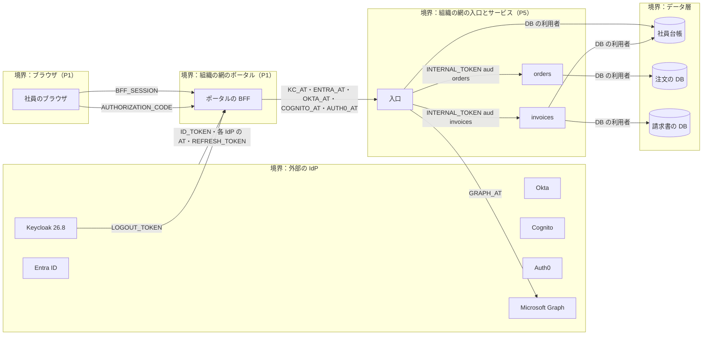
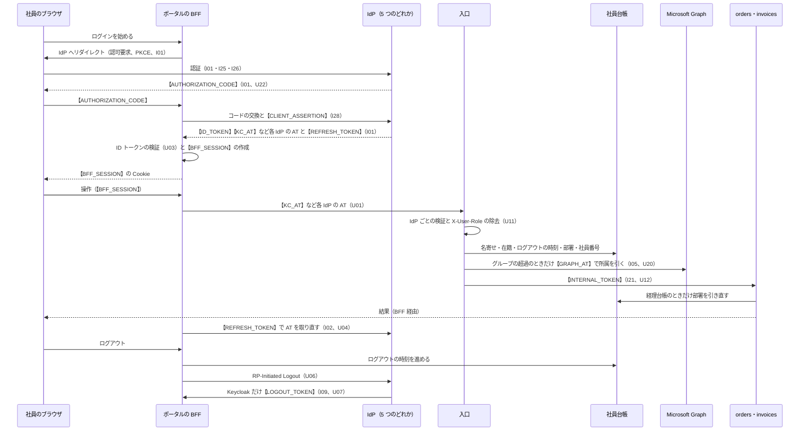

<!-- template_version: 0.3.0 -->
# 設計書：シナリオ B 社内業務システム（パイロット #9、Full、ブラインド記入）

| 欄 | 値 |
| --- | --- |
| 版 | 0.1（初版。前の版は無い） |
| Lite／Full | Full。5 問の答え：境界を越える Yes・マルチテナント No・委任・交換（入口での作り直し）Yes・新しい発行者（入口）Yes・規制 No（`catalog_answers.yaml` の `lite_criteria`） |
| 使うプロファイル | P1（ブラウザ ↔ ポータルの BFF）、P5（入口 → 注文・請求書のサービス）。P4 は使わない（エージェントが無い） |
| 作成方法 | 生成 AI（Claude Opus 5.5）が、要求の概要（brief-B）とテンプレートだけを読んで書いた（ブラインド記入）。**LLM による記入で、人による検証ではない** |

使うモジュール：M_token_validation（いつも）、M_authz_pdp（認可のクレームがある）、M_privacy_minimization（個人情報のクレームがある）、M_idp_keycloak（主な IdP）。M_sender_constraint（送信者制約なし・公開クライアントなし）、M_multitenancy（No）、M_data_layer（DB の文脈にクレームを写さない）は使わない。各モジュールとプロファイルの記入欄は付録 D、要求の「あいまいな点」の決定は付録 E。

以下、テンプレート（`templates/00_core.md`）の説明を残したまま、記入欄を埋めた。

<!-- 以下はテンプレートの本文 -->

> テンプレートです。候補と検討の問いだけを載せ、採否の理由の見本は載せません（理由の写し書きを防ぐため。#4 の方針）。判断は台帳（`claims.yaml`・`token_types.yaml`・`hops.yaml`・`catalog_answers.yaml`）に 1 回だけ書き、ここからは ID で参照します。

- 使う場面：JWT のクレームを設計するすべての設計書の本体です。プロファイル（`profiles/`）とモジュール（`modules/`）は、この文書の節から参照する判断の部品です
- 書き方：[README.md](README.md) の「Lite と Full の判定」で Lite か Full かを決めてから書きます。見出しの〔〕は、その節の扱いです
  - 〔Lite：手で書く〕：Lite でも Full でも、書き手が書く節（5 つ。`research/template-design/gate1.md` の 10.）
  - 〔Lite：生成〕：`python tools/claim_lint render <設計書のディレクトリ> --write` が台帳から書く節。手で書かない
  - 〔Full だけ〕：Lite では書かない節
- 生成の区間：`<!-- render:<節>:begin -->` と `<!-- render:<節>:end -->` の間は render が書き直します（`tools/claim_lint/RENDER.md`）。区間の中を手で直すと CI（`render --check`）が失敗します。台帳を直してから生成し直してください
- 項目 ID：各節の `項目 ID：` の値（`template:00_core#<アンカー>`）は、レビュー教材（#5）と対応表（#22）が参照する固定の ID です。設計書に写すときも、見出しの直前のアンカーを消さないでください
- 記入例：Lite は [examples/scenario-a/design.md](examples/scenario-a/design.md)、Full は `examples/scenario-b/design.md`（#4 の 2 つ目の PR）
- 作成方法：本資料は生成AI（Claude）を使って作成し、筆者が確認して公開しています。人による点検は未実施

設計書の冒頭には、次の 4 行を書きます（手で書く）。

| 欄 | 書くこと |
| --- | --- |
| 版 | 設計書の版と、前の版（13. の差分の起点） |
| Lite／Full | README の 5 問の答えと判定。1 つでも Yes なら Full |
| 使うプロファイル | P1・P4・P5 のどれを、どの境界で使うか（2. の図と同じ） |
| 作成方法 | 生成 AI を使ったか。使ったなら、その旨と人の確認の範囲 |

## 1. CI の結果〔Lite：生成〕

項目 ID：`template:00_core#ci-results`

決めること：なし（記録の欄）。claim_lint の件数と全部の指摘、R8 のサイズの計算を貼ります。error が 0 件でない設計書は、レビューに回しません。warning の抑止には、行ごとの理由が要ります（`templates/CONTRIBUTING.md` の 2.）。

<!-- render:ci-result:begin -->
`python tools/claim_lint research/pilot/scenario-b --also-scan research/pilot/scenario-b/design.md`（profile full）：**error 0、warn 2、info 16**（claims 24・token_types 23・catalog_events 62）。OK

| 規則 | 重大度 | 対象 | 内容 |
| --- | --- | --- | --- |
| `R3` | info | `idp` | IdP keycloak の一覧（keycloak-settings・keycloak-grant-types）とカタログの差集合は 0 件 |
| `R3b` | info | `I11` | hook_invoked unknown：書き手が確かめた（Keycloak は SSO の再利用でも同じプロトコルマッパーで AT を作る前提（M_idp_keycloak の 1. を読んだだけで実測していない）） |
| `R3b` | info | `I25` | hook_invoked unknown：書き手が確かめた（Keycloak の初回のログインも I01 と同じマッパーで AT を作る前提（subject_state_matrix.md の active の行の「推論」による。実測していない）） |
| `R3b` | info | `I26` | hook_invoked unknown：書き手が確かめた（Keycloak の資格情報の変更の後のログインも I01 と同じマッパーで AT を作る前提（実測していない）） |
| `R6` | info | `pairwise` | 2 因子の組 36 個をすべて検討した（主体 2・発行イベント 9） |
| `R8` | info | `KC_AT` | 最悪 1778 バイト（ヘッダーの行で 1800）／上限 32768（gw-nginx-32k）= 5% |
| `R8` | info | `ENTRA_AT` | 最悪 19122 バイト（ヘッダーの行で 19144）／上限 32768（gw-nginx-32k）= 58% |
| `R8` | info | `OKTA_AT` | 最悪 19142 バイト（ヘッダーの行で 19164）／上限 32768（gw-nginx-32k）= 58% |
| `R8` | info | `COGNITO_AT` | 最悪 1619 バイト（ヘッダーの行で 1641）／上限 32768（gw-nginx-32k）= 5% |
| `R8` | info | `AUTH0_AT` | 最悪 2802 バイト（ヘッダーの行で 2824）／上限 32768（gw-nginx-32k）= 9% |
| `R8` | info | `GRAPH_AT` | 最悪 449 バイト（ヘッダーの行で 471）／上限 16384（graph-header-16k）= 3% |
| `R8` | info | `INTERNAL_TOKEN` | 最悪 1168 バイト（ヘッダーの行で 1190）／上限 8192（nginx-large-client-header-buffers）= 15% |
| `R8` | info | `C-scope` | KC_AT・COGNITO_AT・AUTH0_AT の両方に載る（重複の候補） |
| `R8` | info | `C-groups` | ENTRA_AT・OKTA_AT の両方に載る（重複の候補） |
| `L2` | info | `idp` | IdP keycloak の、書き換えを許さないクレームの一覧が tools/claim_lint/idp_reserved.yaml にない。L2 は確かめていない（IdP モジュール #4 で手で確かめる） |
| `L62` | info | `E-client-credentials.1` | 宣言から確かめられない（{'path': 'claims[usage=identifier].carried_in', 'op': 'absent', 'value': 'grant:client_credentials'}）。レビューで確かめる：client credentials で出す AT に、利用者のクレーム（usage が identifier の利用者の属性）を載せない |
| `L69` | warn | `C-groups` | 細かい権限の一覧（エンドポイント・操作ごとの許可）を配列のクレームで載せている。粗いロールか scope に留め、細かい判断は PDP に問い合わせる |
| `L11` | warn | `C-sub-unread` | AT に sub を載せるのに、認可の判断に使う宣言（enforced_at）がない。載せるなら判断に使い、使わないなら載せない（OWASP ASVS 5.0.0 10.3.2） |

R8 KC_AT：ヘッダー 83・ペイロード 992・署名 256 バイト（ceil(4/3*83) + ceil(4/3*992) + ceil(4/3*256) + 2 = 111 + 1323 + 342 + 2 = 1778; + 7 (Bearer) = 1785）。gw-nginx-32k 1800／32768 バイト

R8 ENTRA_AT：ヘッダー 125・ペイロード 13958・署名 256 バイト（ceil(4/3*125) + ceil(4/3*13958) + ceil(4/3*256) + 2 = 167 + 18611 + 342 + 2 = 19122; + 7 (Bearer) = 19129）。gw-nginx-32k 19144／32768 バイト

R8 OKTA_AT：ヘッダー 67・ペイロード 14031・署名 256 バイト（ceil(4/3*67) + ceil(4/3*14031) + ceil(4/3*256) + 2 = 90 + 18708 + 342 + 2 = 19142; + 7 (Bearer) = 19149）。gw-nginx-32k 19164／32768 バイト

R8 COGNITO_AT：ヘッダー 68・ペイロード 888・署名 256 バイト（ceil(4/3*68) + ceil(4/3*888) + ceil(4/3*256) + 2 = 91 + 1184 + 342 + 2 = 1619; + 7 (Bearer) = 1626）。gw-nginx-32k 1641／32768 バイト

R8 AUTH0_AT：ヘッダー 71・ペイロード 1772・署名 256 バイト（ceil(4/3*71) + ceil(4/3*1772) + ceil(4/3*256) + 2 = 95 + 2363 + 342 + 2 = 2802; + 7 (Bearer) = 2809）。gw-nginx-32k 2824／32768 バイト

R8 GRAPH_AT：ヘッダー 76・ペイロード 2・署名 256 バイト（ceil(4/3*76) + ceil(4/3*2) + ceil(4/3*256) + 2 = 102 + 3 + 342 + 2 = 449; + 7 (Bearer) = 456）。graph-header-16k 471／16384 バイト

R8 INTERNAL_TOKEN：ヘッダー 81・ペイロード 729・署名 64 バイト（ceil(4/3*81) + ceil(4/3*729) + ceil(4/3*64) + 2 = 108 + 972 + 86 + 2 = 1168; + 7 (Bearer) = 1175）。nginx-large-client-header-buffers 1190／8192 バイト
<!-- render:ci-result:end -->

根拠：templates/CONTRIBUTING.md の 2.、tools/claim_lint/RULES.md、tools/claim_lint/RENDER.md の 1.

## 2. 範囲と信頼の境界〔Lite：手で書く〕

項目 ID：`template:00_core#scope-boundary`
<!-- req:p06-validation-split.R8 -->

決めること：この設計書が扱う範囲（どのクライアント・発行者・サービス・データ層までか）と、信頼の境界（ブラウザ・入口・サービスの網・DB・外部の IdP・取引先）。境界ごとに、使うプロファイル（P1・P4・P5）を書きます。範囲の外にしたものは、外にした前提を書きます。

| 観点 | 検討の問い | 根拠 |
| --- | --- | --- |
| 境界 | トークンが越える境界はどこか。境界の外側の部品（ブラウザ・取引先・外部の IdP）は何を読めるか | slide:p07-trust-boundary、slide:p09-jws-is-readable |
| 入口 | 外の形式のトークンを、内側に持ち込むか。入口で交換・作り直すか | slide:p06-edge-exchange、slide:p11-translation-layer |
| 書き手 | クレームはどの段階（① 認証時〜⑥ 承認・同意）で、誰が書くか | slide:p06-stage-map |
| データ層 | DB の文脈を設定するのは誰か。DB は何を信じるか | slide:p07-three-db-paths、slide:p07-trust-boundary |
| 範囲の外 | 扱わない部品・経路と、その前提が崩れる条件は何か | templates/CONTRIBUTING.md の 2. |

図（mermaid の flowchart か、画像）：境界を subgraph で囲み、境界ごとにプロファイルの名前を書きます。矢印にはトークン目録の ID（5.）を書きます。

記入欄：

| 境界 | 使うプロファイル | 中の部品 | 境界を越えるトークン（目録の ID） | 範囲の外にしたものと前提（書き手が書く） |
| --- | --- | --- | --- | --- |
| ブラウザ ↔ ポータル | P1 | 社員のブラウザ、ポータルの BFF | BFF_SESSION（Cookie）、AUTHORIZATION_CODE（リダイレクトの URL） | SPA がトークンを持つ構成は範囲の外。ブラウザに AT・ID トークンを出さない前提が崩れたら P1 の 1. を書き直す |
| 外部の IdP ↔ ポータル | P1 | 5 つの IdP、ポータルの BFF | ID_TOKEN・各 IdP の AT・REFRESH_TOKEN（トークンの応答）、LOGOUT_TOKEN（Keycloak）、CLIENT_ASSERTION | IdP の内部の設定の詳細（Entra のトークンの寿命のポリシーなど）は前提として 12. に書き、確かめていない |
| ポータル → 入口 | P5 | ポータルの BFF、入口 | KC_AT・ENTRA_AT・OKTA_AT・COGNITO_AT・AUTH0_AT（Bearer） | 入口を通らずにサービスへ届く経路は、ネットワークで閉じる。閉じられなくても、サービスは内部トークンが無ければ拒む（B7） |
| 入口 → サービス | P5 | 入口、orders、invoices | INTERNAL_TOKEN（宛先 1 つ、30 秒） | サービスからサービスへの呼び出しは無い。生まれたら Txn-Token を見直す |
| 入口 → Microsoft Graph | P5 | 入口、Graph | GRAPH_AT（client credentials） | Graph の障害時は Entra の超過した利用者を拒む（正規の要求が落ちうる。3.1） |
| サービス → データ層 | —（M_data_layer は使わない） | 社員台帳、注文の DB、請求書の DB | なし（DB の利用者で接続し、トークンで接続しない） | DB の行単位の制御は使わず、サービスが sub・社員番号を問い合わせの条件に入れる。社員台帳は人事の権威ある情報源で、異動・退職・ログアウトの時刻を即時に持つ前提 |

根拠：slide:p07-trust-boundary、slide:p06-stage-map、slide:p06-edge-exchange、research/template-design/gate1.md の 10.

### 2.1 主体の種類〔Lite：手で書く（2. の中で）〕

項目 ID：`template:00_core#principals`
<!-- req:p05-three-principals.R1 -->

決めること：この設計に出てくる主体を、利用者・ワークロード・システム（基盤）に分け、それぞれをトークンのどのクレームで表すか。RFC 9068 の `sub` は利用者にもクライアントにもなるので、受け手が区別できる手段を書きます。

| 主体の種類 | 例 | 検討の問い | 表し方の候補 | 根拠 |
| --- | --- | --- | --- | --- |
| 利用者 | 社員・顧客・取引先の担当者 | 安定したキーは何か（iss と sub の組、Entra は oid＋tid） | IdP の `sub`、組織の `user_id` | slide:p05-three-principals、slide:p02-user-identifier |
| ワークロード | サービス・ジョブ・エージェント | 利用者のトークンと区別できるか | client credentials の `sub`・`client_id`、SPIFFE ID、マネージド ID | slide:p05-three-principals、RFC 9700 §4.15.1 |
| システム・基盤 | 運用者・バッチ・クラウドのサービス | 誰の操作かが監査に残るか | サービスの ID、委任のトークンの `act` | slide:p05-system-privileges |

記入欄：

| 主体 | 種類 | 表すクレーム（台帳の ID） | 利用者のトークンと区別する手段（書き手が書く） |
| --- | --- | --- | --- |
| 社員（一般社員・管理者・経理・営業・契約社員） | 利用者 | C-sub（内部トークンでは組織の利用者の ID）、C-employee-id、C-department、C-roles | IdP ごとの不変のキー（Keycloak・Cognito・Auth0 は sub、Entra は tid＋oid、Okta は uid）を社員台帳の名寄せの表で組織の ID に替える |
| ポータルの BFF | ワークロード | C-azp（Keycloak）、C-client-id（Cognito・Auth0）、Okta の cid・Entra の azp（入口の設定で照合） | 利用者の AT の azp・client_id がポータルであることを入口が確かめる。BFF 自身はサービスを呼ぶトークンを持たない |
| 入口 | ワークロード | 内部トークンの C-iss、GRAPH_AT | 内部トークンの iss は入口、sub は利用者。Graph の AT は宛先が Graph で、サービスは受けない |
| システム・基盤 | システム | なし | 夜間バッチ・運用者の代理操作が無い（2.2）。管理操作は admins のロールの社員が自分で行う |

根拠：slide:p05-three-principals、RFC 9068 §2.2、RFC 9700 §4.15.1、templates/catalog/subject_state_matrix.md

### 2.2 システムの権限〔Full だけ〕

項目 ID：`template:00_core#system-privileges`
<!-- req:p05-system-privileges.R1 req:p05-system-privileges.R3 req:p05-system-privileges.R7 req:p05-cross-tenant.R3 req:p05-system-privileges.R5 -->

決めること：夜間バッチ・運用者の操作・緊急時の特権（break-glass）・基盤の操作のそれぞれで、どの主体がどのトークンで動くか。利用者の権限を借りないこと、運用者は実行者として名を残すことを、場面ごとに確かめます。

| 場面 | 検討の問い | 候補 | 根拠 |
| --- | --- | --- | --- |
| 夜間バッチ | 利用者の権限を借りていないか | client credentials のトークン（`sub` はクライアント） | slide:p05-system-privileges、catalog:issue_events |
| 運用者の操作 | 運用者が利用者として振る舞っていないか | 交換で得た委任のトークン（`sub` に利用者、`act` に運用者） | slide:p05-system-privileges、RFC 8693 §4.1 |
| テナントをまたぐ運用者 | 承認と期限を確かめ、顧客と運用者の両方を記録するか | 委任のトークン＋承認の ID | slide:p05-cross-tenant、template:modules/M_multitenancy#operator-access |
| 緊急時の特権 | 承認と短い期限があるか | `may_act`・`act`、承認の ID（RAR・CIBA） | slide:p05-system-privileges、RFC 8693 §4.4 |
| 基盤の操作 | 管理者も権限を編集できない ID か | サービスにリンクされたロール | slide:p05-system-privileges |

記入欄：

| 場面 | 主体とトークン（目録の ID） | クレームで示すこと（台帳の ID） | 確かめ方（書き手が書く） |
| --- | --- | --- | --- |
| 夜間バッチ | 無い | — | 要求に夜間の処理が無い。足すときは client credentials のトークンを目録に足し、利用者の権限を借りない |
| 運用者の操作 | 無い（Keycloak の Impersonate を誰にも与えない。I19 は対象外） | — | 運用者が社員として操作する要求が出たら、交換による委任のトークン（act）を検討する |
| テナントをまたぐ運用者 | 該当なし（テナントが無い） | — | — |
| 緊急時の特権 | 無い | — | 管理者のアカウントの紛失時は IdP の管理画面で対応し、業務システムの特権のトークンを作らない |
| 基盤の操作 | 入口の Graph の呼び出し（GRAPH_AT） | 利用者のクレームを載せない | アプリの権限を GroupMember.Read.All だけにし、証明書の資格情報を鍵の保管庫に置く |

根拠：slide:p05-system-privileges、slide:p05-cross-tenant、RFC 8693 §4.1・§4.4、NIST IR 8587 §5.3.1.6

## 3. 既定から外れた点〔Lite：手で書く〕

項目 ID：`template:00_core#deviations`
<!-- req:p12-priorities-deferrals.R3 -->

決めること：既定（IdP モジュールの既定の回答、発行方式の既定の組み合わせ（BFF＋認可コード＋PKCE）、共通の基準）から外れた判断の要約です。1 行に 1 つ、外れた点と、それを書いた台帳の行の ID を書きます。理由そのものは台帳の行（`rationale`・`assumption`・`revisit_trigger`）に書き、ここには写しません。

| 既定の出どころ | 検討の問い | 根拠 |
| --- | --- | --- |
| 発行方式の既定の組み合わせ | 4. の選択のうち、既定（機密の BFF・認可コード＋PKCE・送信者制約なし・JWT の AT・RT のローテーション）と違うものはどれか | templates/registry/README.md の 3.3、research/template-design/gate1.md の 10. |
| IdP モジュールの既定の回答 | カタログへの回答（11.）で、既定の回答を引き継がなかったイベントはどれか | template:modules/M_idp_keycloak#catalog-defaults |
| 共通の基準 | 3.2 の共通の基準のうち、満たさないものはあるか（あるなら Full にし、レビューで専門家に回す） | slide:p12-priorities-deferrals |
| ケーススタディの判定 | 記入例として作るとき、ケーススタディの判定と違う行はどれか | templates/casestudy-deviations.yaml |

記入欄：

| 外れた点 | 既定 | この設計の値 | 書いた台帳の行の ID | 見直しの条件（書き手が書く） |
| --- | --- | --- | --- | --- |
| クライアント認証 | 既定の組み合わせに定めなし | private_key_jwt（Cognito だけ client_secret_basic） | `issuance_profile.client_auth`、CLIENT_ASSERTION | Cognito が鍵によるクライアント認証に対応したとき |
| grant に client credentials を足した | 認可コード＋PKCE・refresh | 入口が Graph のために client credentials を使う | `issuance_profile.grants`、GRAPH_AT | Entra のアプリロールに切り替えたとき（Graph が要らなくなる） |
| RT の方式 | ローテーション＋再利用の検知 | ローテーション（再利用の検知は確かめていない） | `issuance_profile.rt_strategy`、REFRESH_TOKEN | 5 つの IdP の再利用の検知を確かめたとき |
| 入口での作り直し | IdP の AT をそのままサービスに渡す | 入口が内部トークン（30 秒、宛先 1 つ）に作り直す | INTERNAL_TOKEN、H7・H8 | サービス間の呼び出しが生まれたとき |
| 部署・社員番号の出どころ | IdP のクレーム | 社員台帳（入口が要求ごとに引く） | C-department、C-employee-id、C-idp-department（却下）、C-auth0-employee-number（却下） | 社員台帳を要求ごとに引く費用が許せなくなったとき |
| Keycloak の既定の回答 | M_idp_keycloak の既定の回答 | Full なので引き継がず、すべて手で答えた。I03・I04・I08・I10 を対象外（クライアントの設定で止める） | `catalog_answers.yaml` | — |
| Keycloak の既定のクライアントスコープ | profile・email が既定で付く | ポータルのクライアントから profile・email を外す | C-email（却下） | ポータルが氏名・メールを表示することにしたとき |
| 入口の nginx のヘッダーの上限 | 8 KiB（nginx の既定） | 32 KiB | 目録の `size.path`（gw-nginx-32k） | Entra のグループの上限を超えないと確かめたとき（8 KiB に戻す） |

根拠：research/template-design/gate1.md の 10.、templates/registry/README.md の 2.、slide:p12-priorities-deferrals

### 3.1 重点と見送り〔Lite：手で書く（3. の中で）〕

項目 ID：`template:00_core#priorities-deferrals`
<!-- req:p12-priorities-deferrals.R3 req:p12-priorities-deferrals.R4 req:p12-priorities-deferrals.R5 -->

決めること：組織の種類（マルチテナント SaaS・社内業務・AI エージェントの委任）に応じて、共通の基準の上に何を重点とし、何を見送るか。見送るものには「何が起きたら見直すか」を必ず書きます。

| 組織の種類 | 重点の候補（ガイド） | 見送りの候補（ガイド） | 根拠 |
| --- | --- | --- | --- |
| マルチテナント SaaS | テナントと発行者の照合、テナント単位の鍵、データ側のテナント照合、SET LOCAL と行単位の制御 | 細かい権限のトークン化 | slide:p12-priorities-deferrals |
| 社内業務システム | 入口での正規化、ヘッダーの除去、重要な操作の鮮度確認、groups 超過の解決 | JWE、送信者制約 | slide:p12-priorities-deferrals |
| AI エージェントの委任 | act の連鎖を正しく読む、宛先に束縛した交換、承認の束縛、タスク単位の短命トークン、深さの組織規則 | 標準による深さの強制 | slide:p12-priorities-deferrals |

記入欄：

| 区分（重点・見送り） | 項目 | 効果と費用（未検証の点を含む）（書き手が書く） | 見直しの条件（書き手が書く） | 台帳の行の ID |
| --- | --- | --- | --- | --- |
| 重点 | 入口での正規化（IdP ごとの検証の規則と、組織の内部トークンへの作り直し） | B1〜B3・B10・B13〜B17・B21 をまとめて扱う。費用は入口の IdP ごとの設定 5 つと、名寄せの表の管理。実装での確かめはしていない | IdP を足すとき（規則を 1 つ足す） | INTERNAL_TOKEN、C-sub、C-roles、H2〜H8 |
| 重点 | ヘッダーの除去（X-User-Role とその変種を捨て、サービスはヘッダーを読まない） | B4〜B7 を扱う。費用は小さい（入口の設定とサービスの修正）。現状の入口からの移行の間は守れない（12.） | 現状の入口を止めたとき（移行の完了） | H2〜H8 の forwarded_headers・validates |
| 重点 | 重要な操作の鮮度確認（経理台帳は invoices が社員台帳を要求ごとに引き、内部トークンの jti を 1 回だけ受ける。ログアウトは入口が社員台帳のログアウトの時刻で止める） | B11・B12 を遅れ 0 で扱う。費用は社員台帳への問い合わせ（入口で毎要求、invoices で経理台帳の要求ごと）。社員台帳が止まると全操作が止まる | 社員台帳の可用性が業務の要求を満たさないとき | C-department、C-iat、INTERNAL_TOKEN の revocation |
| 重点 | groups の超過の解決（Entra は Graph で引く） | B8 を拒み、B9 を受ける。費用は Graph への依存と遅れ。Graph の障害では B9 の正規の要求が落ちる | 障害が業務に響いたとき（Entra のアプリロールに切り替える） | C-groups、GRAPH_AT、H9 |
| 重点 | 値が欠けたときに既定値を使わない | B15・B19・B20 を扱う。正規の利用者がロールなしで動く場面がある（設定の誤りが見えにくい）ので、ロールが空の内部トークンを入口が記録する | ロールが空の要求が多いと分かったとき | C-roles、C-department、C-auth0-roles の absent_semantics |
| 見送り | 送信者制約（DPoP・mTLS） | B23（漏れたトークンの別の端末からの再送）を防がない。AT は BFF と入口のサーバーにしかなく、漏れる経路は限られると見た（未検証）。代わりに AT を 5〜10 分、内部トークンを 30 秒にした | B23 の型の悪用が観測されたとき、AT を端末・ブラウザに置く構成にしたとき、監査で求められたとき | C-cnf、DPOP_PROOF、`issuance_profile.sender_constraint` |
| 見送り | JWE | 内部トークンは組織の網の中だけで、読まれて困るクレーム（confidential_from）が無い。社員番号・部署は入口とサービスとログに見える | 内部トークンを組織の外の部品（外部のメッシュ・委託先）が中継するとき | 全クレームの confidential_from が [] |
| 見送り | 管理操作を重要な操作に含めること | 管理者のロールの剥奪は最悪 665 秒遅れる（Entra の AT の受け入れの上限＋内部トークン） | 管理操作の誤用の事故、監査の指摘 | C-roles |

根拠：slide:p12-priorities-deferrals、jwt-claims-casestudy@080b8da（results/summary.md の「見送りの代償と重点の費用」）

### 3.2 共通の基準〔Lite：手で書く（満たさないものがあるときだけ）〕

項目 ID：`template:00_core#baseline`
<!-- req:p12-priorities-deferrals.R1 req:p12-priorities-deferrals.R2 -->

決めること：どの組織でも外さない基準を、この設計が満たしているか。IdP の差は入口で正規化してから基準を当て、正規の要求を落とさないこと（B9・B16 のような誤拒否）も確かめます。

| 基準 | 確かめる欄 | 根拠 |
| --- | --- | --- |
| 受け入れの検証（alg・iss・aud・exp・typ） | トークン目録の `alg_allowlist`・`issuers`・`required_claims`・`typ`、template:modules/M_token_validation#validation-order | slide:p12-priorities-deferrals、slide:p01-validation-order |
| 必須の欠落は拒否 | 台帳の `on_missing`、目録の `required_claims` | slide:p04-reject-missing-required |
| 型の固定 | 台帳の `type`・`shape` | slide:p04-type |
| 不変の ID | 台帳の `identifier_properties`・`paired_id` | slide:p04-immutable-identifiers |
| 組織の名前空間 | 台帳の `namespace`・最上位の `namespaces` | slide:p04-namespace |
| ログにトークン全文と個人情報を残さない | 台帳の `log_policy`、目録の `log_policy` | slide:p09-logs-traces |
| IdP の差を入口で正規化してから当てる | template:profiles/P5_internal_propagation#edge-conversion | slide:p04-reject-missing-required、slide:p03-absorb-idp-differences |

記入欄：

| 基準 | 満たすか | 満たさないときの理由と、回した先（専門家・追跡 issue）（書き手が書く） |
| --- | --- | --- |
| 受け入れの検証（alg・iss・aud・exp・typ） | 満たす（Cognito の AT は aud の代わりに client_id と token_use を確かめる） | Cognito の AT の required_claims を宣言できない（L27 が aud を求める）ので、照合は台帳の enforced_at とホップ H5 の validates に書いた |
| 必須の欠落は拒否 | 満たす（ロール・部署の欠落は拒否ではなく「無し」として扱い、既定値を使わない） | — |
| 型の固定 | 満たす（社員番号は文字列に固定） | — |
| 不変の ID | 満たす（Okta は uid、Entra は tid＋oid。Okta の sub・upn・email を使わない） | — |
| 組織の名前空間 | 満たす（https://claims.example.com/） | — |
| ログにトークン全文と個人情報を残さない | 満たす（jti だけ。社員の ID・社員番号はハッシュ。部署・ロールは値で残す） | 部署・ロールを値で残すのは監査のため。M_privacy_minimization の 7. |
| IdP の差を入口で正規化してから当てる | 満たす（入口の IdP ごとの規則の後に、必須の確かめを内部トークンに当てる） | — |

根拠：slide:p12-priorities-deferrals、jwt-claims-casestudy@080b8da（results/summary.md の除去実験）

## 4. 発行方式の選択〔Lite：生成（既定の組み合わせから外れた点だけ 3. に手で書く）〕

項目 ID：`template:00_core#issuance-profile`
<!-- req:p06-grant-types.R1 req:p08-rotation.R2 req:p09-url-browser.R2 -->

決めること：クライアントの種類・クライアント認証・grant・送信者制約・AT の形式・RT の方式・要求の保護・準拠するプロファイル。値と理由は `token_types.yaml` の `issuance_profile` に書き、この節は render が生成します。選択ごとに台帳で必要になるもの（`templates/registry/issuance_effects.yaml`）と、それを満たしている台帳の行も表示されます。**トークン目録（5.）とクレームの表は、この選択の結果として読めるように書きます**（例：送信者制約を DPoP にすると、AT に `cnf.jkt` の行と、目録に DPoP の proof の行が要る）。

| 項目 | 検討の問い | 候補（スキーマの値） | 部品 | 根拠 |
| --- | --- | --- | --- | --- |
| クライアントの種類 | トークンをサーバー側で持てるか | public・confidential・fapi | template:profiles/P1_human_web#bff-vs-spa | slide:p06-grant-types、slide:p08-rotation |
| クライアント認証 | 秘密を持てるか。鍵で認証するか | private_key_jwt・tls_client_auth・client_secret_* など | — | OpenID Connect Core 1.0 §9、RFC 8705 §2.1 |
| grant | 主体は誰で、どこで認証したか | 認可コード＋PKCE・client credentials・token exchange・CIBA・device・refresh・JWT bearer | template:profiles/P4_ai_agent_delegation#delegation-mode | slide:p06-grant-types |
| 送信者制約 | 漏れたトークンをそのまま使われてよいか | none・dpop・mtls | template:modules/M_sender_constraint#dpop-vs-mtls | RFC 9449 §1、RFC 8705 §1 |
| AT の形式 | 受け手が手元で検証するか、問い合わせるか | jwt・opaque_introspection・phantom | template:modules/M_authz_pdp#carry-or-query | slide:p01-self-contained-vs-reference |
| RT の方式 | RT が漏れたときに何で止めるか | rotation_reuse_detection・rotation・sender_constrained・none | template:modules/M_sender_constraint#rt-rotation | RFC 9700 §4.14.2 |
| 要求の保護 | 認可要求を改ざん・漏えいから守るか | par・jar・rar・resource_indicators | template:profiles/P1_human_web#url-exposure | RFC 9126 §1、RFC 9396 §2、RFC 8707 §2 |
| 準拠するプロファイル | 規制・業界の要求があるか | none・fapi2_security・oauth2_1 | — | FAPI 2.0 Security Profile（Final）§5.3.2.1 |

<!-- render:issuance-profile:begin -->
`token_types.yaml` の `issuance_profile`。既定の組み合わせから外れた点の理由は、手で書く節（既定から外れた点）に書く。

| 項目 | 選択 | 理由 | 根拠 |
| --- | --- | --- | --- |
| クライアントの種類 | 機密（`confidential`） | 社員用のポータルはサーバー側の BFF とし、AT・RT・ID トークンをサーバーに留める。ブラウザには BFF のセッションの Cookie だけを渡す。5 つの IdP のどれでも、ポータルは機密クライアントとして登録する | `slide:p06-grant-types` RFC 9700 §2.1.1 |
| クライアント認証 | `private_key_jwt` | 共有の秘密をポータルと入口のサーバーに置かないため、鍵で認証する。Keycloak・Entra（証明書の資格情報）・Okta・Auth0 は private_key_jwt を受ける。Cognito のアプリクライアントはクライアントシークレットだけなので、Cognito に限り client_secret_basic を使い、シークレットは秘密の保管庫に置く（3. の逸脱に書く） | OpenID Connect Core 1.0 §9 `slide:p01-client-made-jwts` |
| grant | 認可コード＋PKCE（`authorization_code_pkce`）、リフレッシュ（`refresh_token`）、client credentials（`client_credentials`） | 社員のログインは認可コード＋PKCE、AT の取り直しは RT。client_credentials は、入口が Entra のグループの超過を Microsoft Graph で解決するためだけに使う（入口自身のトークン。利用者のクレームを載せない）。トークン交換は使わない（入口は IdP と交換せず、自分で内部トークンを作り直す） | `slide:p06-grant-types` RFC 6749 §4.4 |
| 送信者制約 | なし（`none`） | 社内業務システムの重点は入口での正規化・ヘッダーの除去・鮮度の確認・groups の超過の解決で、送信者制約は見送りの候補（ガイドの重点と見送り）。トークンは BFF と入口のサーバーの中に留まり、ブラウザに出ない。B23（漏れたトークンの別の端末からの再送）は防がない。見直しの条件は 3.1 と ACCESS 系の行の revisit_trigger に書いた | `slide:p12-priorities-deferrals` RFC 9449 §1 |
| AT の形式 | JWT（`jwt`） | 5 つの IdP の AT はどれも JWT で、入口が手元で検証する（不透明な AT を出す phantom token の型ではない）。内側のサービスは IdP のトークンを受けない。入口が IdP ごとの規則で検証・正規化し、組織の内部トークン（INTERNAL_TOKEN）に作り直して渡す（hops の H7・H8、kind は reissue）。サービスは内部トークンの署名・宛先・期限だけを共通の部品で確かめる（7. の曖昧な点 1 の決定） | `slide:p06-edge-exchange` `slide:p03-absorb-idp-differences` |
| RT の方式 | ローテーション（`rotation`） | RT は BFF のサーバーにだけ置く機密クライアントの RT。ローテーションは各 IdP の設定で有効にするが、再利用の検知を全 IdP で確かめていないので rotation とした（検知は unverified） | RFC 9700 §4.14.2 `slide:p08-rotation` |
| 要求の保護 | なし | 社内の機密クライアントで、認可要求に機微な値を入れない。PAR・JAR は 5 つの IdP のすべてが対応しているかを確かめておらず、使わない。resource indicators も Entra・Cognito で使えないため、宛先は IdP ごとの scope と aud の設定で絞る | RFC 9126 §1 RFC 8707 §2 |
| 適合のプロファイル | なし（`none`） | 金融・医療などの規制の対象ではなく、FAPI に準拠する要求がない。給与明細は個人情報だが、規制の対象のプロファイルを要求する根拠は要求に無い | FAPI 2.0 Security Profile（Final）§5.3.2.1 |

選択から導かれる要件（`templates/registry/issuance_effects.yaml`）：条件が成り立つ行は 1 件／全 13 件。**次の表は検査ではない。** render が `check` を簡易に読み取った表示で、検査の正は `tools/claim_lint/RULES.md` の L62〜L64（#6）。「満たしている行」は、要件の場所にある台帳の行。

| 行 | 要件 | 台帳で必要になるもの | 簡易な読み取り（正は L62） | 満たしている行 | 規則 |
| --- | --- | --- | --- | --- | --- |
| `E-client-credentials` | `E-client-credentials.1` | client credentials で出す AT に、利用者のクレーム（usage が identifier の利用者の属性）を載せない | 判定できない | `C-sub`・`C-employee-id` | `L62` |
| `E-client-credentials` | `E-client-credentials.2` | sub はクライアントを表す。利用者の sub と区別する手段（別のトークン種別・別の iss・区別のクレーム）を宣言する | 満たす | `KC_AT`・`ENTRA_AT`・`OKTA_AT`・`COGNITO_AT`・`AUTH0_AT`・`GRAPH_AT` | `L62` |
<!-- render:issuance-profile:end -->

根拠：templates/registry/README.md の 3.3 と 7.、templates/registry/issuance_effects.yaml、tools/claim_lint/RENDER.md の 5.

## 5. トークン目録〔Lite：生成〕

項目 ID：`template:00_core#token-inventory`
<!-- req:p08-token-types-lifetimes.R4 -->

決めること：どのトークンを、誰が誰に向けて、どの形式・寿命で発行し、誰が読めて、JWE を使うか。カタログの 17 種類（`templates/catalog/token_kinds.yaml`）のすべてに、採用・既定どおり・却下＋理由を付けます。値は `token_types.yaml` の `token_types` に書き、この節は render が生成します。目録の ID は、シーケンス図（7.）の矢印、ホップの表（8.）、ライフサイクル表（9.）、台帳の `carried_in` で同じものを使います。

| 列 | 検討の問い | 根拠 |
| --- | --- | --- |
| 発行 → 宛先・持つ者 | 宛先（`aud`）と持つ者（`holder`）は誰か。ID トークンを API に送っていないか | slide:p01-id-token-vs-access-token |
| 形式（typ・alg） | 種類の違うトークンを `typ` で区別できるか | slide:p01-validation-order、RFC 9068 §2.1 |
| 寿命（idle と最大） | 種類ごとに上限を決めたか。1 つの数字で語っていないか | slide:p08-token-types-lifetimes |
| 保存場所・運び方 | URL・ブラウザに残らないか | slide:p09-url-browser、slide:p08-copies-outlive-token |
| 読める相手・JWE | 読まれてはいけないクレームを、読める相手に届くトークンに載せていないか | slide:p09-jws-is-readable、template:modules/M_privacy_minimization#protection-table |

<!-- render:token-inventory:begin -->
`token_types.yaml` の 23 行（却下 9）。種類の名前は `templates/catalog/token_kinds.yaml`。

| ID | 種類 | 採否 | 発行 → 宛先（aud） | 持ち手 | 形式 | 寿命 | 保存場所 | 運び方 | 読める相手 | JWE | 理由 |
| --- | --- | --- | --- | --- | --- | --- | --- | --- | --- | --- | --- |
| `KC_AT` | アクセストークン | 採用 | Keycloak 26.8（レルム corp） → orders・invoices | portal-bff | jwt（JWT（Keycloak の AT。aud が API の宛先であることと azp で ID トークンと区別する）、RS256） | 300 秒（時計のずれ 30 秒） | BFF のサーバー | Authorization: Bearer | `bff`・`gateway` | なし | 社内の主な IdP（Keycloak 26.8、レルム corp）の AT。ポータルの BFF が入口に送り、入口が検証して内部トークンに作り直す。サービスには渡さない |
| `ENTRA_AT` | アクセストークン | 採用 | Entra ID（自社のテナント） → api://orders・api://invoices | portal-bff | jwt（JWT（ヘッダー）＋ver=2.0 と scp・aud で AT と区別する（Entra の AT）、RS256） | 600 秒（時計のずれ 30 秒） | BFF のサーバー | Authorization: Bearer | `bff`・`gateway` | なし | Entra ID（マルチテナント型のアプリ登録）で認証した社員の AT。入口が自社のテナントの発行者だけを受け、oid＋tid で利用者を決め、groups（超過なら Graph で解決）からロールを作る |
| `OKTA_AT` | アクセストークン | 採用 | Okta（カスタム認可サーバー default） → api://default | portal-bff | jwt（application/okta-internal-at+jwt またはヘッダーの typ が無い Okta の AT（ver=1 と cid で区別する）、RS256） | 300 秒（時計のずれ 30 秒） | BFF のサーバー | Authorization: Bearer | `bff`・`gateway` | なし | Okta（カスタム認可サーバー default）の AT。入口は sub（再利用されうるログイン名）ではなく uid で利用者を決める。部署はインラインフックの値を使わず社員台帳から引く |
| `COGNITO_AT` | アクセストークン | 採用 | Amazon Cognito（自社のユーザープール） → portal のアプリクライアント（client_id で照合） | portal-bff | jwt（JWT（ヘッダー）＋ペイロードの token_use=access で区別する、RS256） | 300 秒（時計のずれ 30 秒） | BFF のサーバー | Authorization: Bearer | `bff`・`gateway` | なし | Cognito の AT。aud が無いので、入口は client_id をポータルのアプリクライアントの ID と照合し、token_use=access を必須にする（B16 を受け、B17 を拒む）。custom:* の属性は本人が書き換えられるので認可に使わない |
| `AUTH0_AT` | アクセストークン | 採用 | Auth0（自社のテナント） → https://api.example.com | portal-bff | jwt（at+jwt、RS256） | 300 秒（時計のずれ 30 秒） | BFF のサーバー | Authorization: Bearer | `bff`・`gateway` | なし | Auth0（RFC 9068 プロファイル）の AT。ロールは Action で組織の名前空間つきの名前（C-auth0-roles）として足す。名前空間の無い roles は Auth0 が黙って外すので使わず、無ければ拒む（B20 で既定のロールを使わない） |
| `GRAPH_AT` | アクセストークン | 採用 | Entra ID（自社のテナント） → https://graph.microsoft.com | gateway | jwt（JWT（Graph 宛て。入口は検証せず Graph に渡すだけ）、RS256） | 3600 秒（時計のずれ 30 秒） | サービスのメモリ | Authorization: Bearer | `gateway` | なし | 入口が Entra のグループの超過（_claim_names・_claim_sources）を解決するために、Microsoft Graph を自分の権限（client credentials、アプリの権限 GroupMember.Read.All）で呼ぶ AT。利用者の権限を借りない |
| `ID_TOKEN` | ID トークン | 採用 | 5 つの IdP（Keycloak・Entra ID・Okta・Cognito・Auth0） → portal・client-app | portal-bff | jwt（JWT（ID トークン。aud がポータルのクライアントで、API の宛先でないことで区別する）、RS256） | 300 秒（時計のずれ 30 秒） | BFF のサーバー | トークンの応答 | `bff` | なし | ポータルの BFF がログインの応答で検証し、BFF のセッションを作るためだけに使う。API には送らない。入口は ID トークンを拒む（B2・B17） |
| `REFRESH_TOKEN` | リフレッシュトークン | 採用 | 5 つの IdP → 各 IdP のトークンエンドポイント | portal-bff | opaque | idle 1800 秒、最大 36000 秒 | BFF のサーバー | トークンの応答 | `bff` | なし | ポータルの BFF が AT を取り直すために使う。BFF のサーバーにだけ置き、ブラウザに出さない |
| `BFF_SESSION` | セッション（IdP のセッション session_idp と、RP・BFF のセッション session_rp の 2 層） | 採用 | portal-bff → portal-bff | browser | opaque | idle 1800 秒、最大 36000 秒 | BFF のサーバー | Cookie | `browser`・`bff` | なし | ブラウザとポータルの BFF の間のセッション。Cookie（HttpOnly・Secure・SameSite=Lax）にはセッションの ID だけを入れる |
| `IDP_SESSION` | セッション（IdP のセッション session_idp と、RP・BFF のセッション session_rp の 2 層） | 採用 | 5 つの IdP → 各 IdP | browser | opaque | idle 1800 秒、最大 36000 秒 | IdP | Cookie | `browser`・`idp` | なし | 各 IdP の SSO のセッション。ポータルのログアウトで RP-Initiated Logout を送り終える |
| `AUTHORIZATION_CODE` | 認可コード | 採用 | 5 つの IdP → portal | portal-bff | opaque | 60 秒 | なし | リダイレクトの query | `browser`・`bff` | なし | 認可コード＋PKCE のログインで使う。1 回だけ使え、PKCE の検証子と組でだけ交換できる |
| `INTERNAL_TOKEN` | 内部トークン（入口で外部のトークンを検証し、作り直したもの） | 採用 | gateway（入口） → orders・invoices | gateway | jwt（internal+jwt、ES256） | 30 秒（時計のずれ 5 秒） | サービスのメモリ | Authorization: Bearer | `gateway`・`api` | なし | 入口が IdP の AT を検証・正規化してから作る、組織の内部トークン。宛先は 1 つのサービス、寿命 30 秒。サービスはこれだけを受け、ヘッダー（X-User-Role など）を一切信じない（B4〜B7） |
| `LOGOUT_TOKEN` | ログアウトトークン（Back-Channel Logout の Logout Token） | 採用 | Keycloak 26.8（レルム corp） → portal | portal-bff | jwt（logout+jwt、RS256） | 120 秒（時計のずれ 30 秒） | なし | バックチャネルの POST | `bff`・`idp` | なし | Keycloak の Back-Channel Logout で、IdP 側で終えたセッションをポータルの BFF に伝える。BFF はセッションを消し、社員台帳のログアウトの時刻を進める |
| `CLIENT_ASSERTION` | クライアントの assertion（private_key_jwt・client_secret_jwt） | 採用 | portal-bff・gateway（クライアント自身） → 各 IdP のトークンエンドポイント | portal-bff | jwt（JWT（クライアントの assertion。トークンエンドポイントだけが受ける）、RS256・PS256） | 60 秒（時計のずれ 30 秒） | なし | フォームの本文 | `bff`・`gateway`・`idp` | なし | ポータル（Cognito を除く 4 つの IdP）と入口（Graph の client credentials）が private_key_jwt でクライアント認証する |
| `TXN_TOKEN` | Transaction Token（Txn-Token） | 却下 | — | — | jwt | — | — | — | — | — | サービスからサービスへの呼び出しが無く、入口 → サービスの 1 段だけ。内部トークン（INTERNAL_TOKEN）で足り、TTS を置く費用に見合わない。できなくなること：複数のサービスにまたがる取引の識別子（txn）を改変されずに運ぶこと |
| `ID_JAG` | ID-JAG（Identity Assertion JWT Authorization Grant） | 却下 | — | — | jwt | — | — | — | — | — | 取引先・別のドメインのサービスを、SSO 済みの社員として呼ぶ経路が無い。できなくなること：ドメインをまたぐ認可グラント |
| `DPOP_PROOF` | DPoP の proof | 却下 | — | — | jwt | — | — | — | — | — | 送信者制約を見送る（issuance_profile.sender_constraint）。できなくなること：漏れた AT の別の端末からの再送を止めること（B23） |
| `JAR_REQUEST_OBJECT` | 署名つきの認可要求（JAR の Request Object） | 却下 | — | — | jwt | — | — | — | — | — | 認可要求に改ざんされて困る値（RAR など）を入れない。できなくなること：認可要求の改ざんの検出 |
| `JARM_RESPONSE` | 署名つきの認可応答（JARM） | 却下 | — | — | jwt | — | — | — | — | — | 認可コード＋PKCE と state で足りる。できなくなること：認可応答の署名による改ざんの検出 |
| `WORKLOAD_JWT` | 汎用の JWT（ワークロードの ID のトークン・アサーショングラントに出す JWT など） | 却下 | — | — | jwt | — | — | — | — | — | 入口とサービスの間の通信相手は、メッシュの mTLS（ワークロードの証明書）で確かめ、ワークロードの ID のトークンは使わない。できなくなること：トークンの層でのワークロードの識別 |
| `SET` | Security Event Token（SET。SSF・CAEP の通知） | 却下 | — | — | jwt | — | — | — | — | — | 共有シグナル（SSF・CAEP）を受ける仕組みを作らない。ログアウト・異動の反映は社員台帳の問い合わせ（db_lookup）で行う。できなくなること：IdP 側の失効の即時の受信 |
| `STATUS_LIST` | 状態リストのトークン（Token Status List） | 却下 | — | — | jwt | — | — | — | — | — | 内部トークンは 30 秒で、状態リストを置く必要が無い。できなくなること：個々のトークンの失効の配布 |
| `INTROSPECTION_JWT` | JWT 形式のイントロスペクションの応答 | 却下 | — | — | jwt | — | — | — | — | — | IdP のイントロスペクションを使わない（5 つの IdP で手段がそろわないため、社員台帳の問い合わせに寄せた）。できなくなること：IdP の側でのトークンの有効性の確認 |
<!-- render:token-inventory:end -->

根拠：slide:p08-token-types-lifetimes、templates/registry/README.md の 3.2、templates/catalog/token_kinds.yaml、tools/claim_lint/RENDER.md の 1.

### 5.1 寿命の上限の方針〔Full だけ〕

項目 ID：`template:00_core#lifetime-policy`
<!-- req:p08-token-types-lifetimes.R4 req:p08-choosing-lifetime.R2 req:p08-choosing-lifetime.R4 req:p08-decision-table.R1 -->

決めること：種類ごとの寿命の上限を、組織の規則として文書にします。上限を超える種別には、例外を認める手順（誰が承認し、どこに記録するか）を書きます。上限のファイルは `tools/claim_lint/lifetime_caps.yaml` の形（#6 の L23。自組織のファイルに替えられる）です。

| 種類 | 指針の数値 | 検討の問い | 根拠 |
| --- | --- | --- | --- |
| アクセストークン・ID トークン | 1 時間以内とすべき | 剥奪の許容時間（9.2）から見て短いか | NIST IR 8587 §5.3.1.1、slide:p08-choosing-lifetime |
| 対話用の RT・セッション | 再認証の上限（AAL2 は 24 時間・無操作 1 時間） | RT の最大寿命が再認証の上限を超えないか | NIST SP 800-63B-4 §2.2.3、slide:p08-token-types-lifetimes |
| 認可コードなどのアサーションの参照 | 5 分以内（FAPI 2.0 は 60 秒） | — | NIST SP 800-63C-4 §4.11.1、FAPI 2.0 Security Profile（Final）§5.3.2.1 |
| Txn-Token | 分以下 | 元のトークンより長くするか（仕様は許す） | draft-ietf-oauth-transaction-tokens-11 §6、slide:p08-token-types-lifetimes |

記入欄：

| 種類 | 組織の上限（秒） | 例外を認める手順（承認者・記録先）（書き手が書く） | 例外にした種別（目録の ID と `lifetime_exception`） |
| --- | --- | --- | --- |
| アクセストークン（社員） | 600 | 情報システム部の ID 基盤チームの長が承認し、この台帳の PR に記録する | なし（KC・Okta・Cognito・Auth0 は 300、Entra は 600） |
| アクセストークン（入口自身、Graph） | 3600 | 同上 | なし（GRAPH_AT は 3600。Microsoft の既定で、上限の中） |
| ID トークン | 300 | 同上 | なし |
| RT・セッション | 最大 36000・無操作 1800 | 同上 | なし |
| 認可コード | 60 | 同上 | なし |
| 内部トークン | 30 | 入口の持ち主の承認と、invoices の jti の受け入れの期間（35 秒）の見直し | なし |
| ログアウトトークン | 120 | 同上 | なし |

根拠：slide:p08-choosing-lifetime、slide:p08-token-types-lifetimes、NIST IR 8587 §5.3.1.1

## 6. 問い × 仕組み〔Lite：手で書く〕

項目 ID：`template:00_core#question-mechanism`

決めること：ユースケースごとに、答えるべき問い（`templates/registry/questions.yaml` の 11 問。スライドと同じ文言）のそれぞれに、どの仕組み（クレーム・トークン・通信の層）で答えるか。**選ばなかった問いには「不要」と理由を書きます。** 取り違えやすい問いは別々の行にします：「誰が代理して実行しているか」（`act`）、「どのワークロードが Txn-Token を求めたか」（`req_wl`）、「どの取引か」（Txn-Token の `txn`）、「直接の通信相手は誰か」（mTLS・SPIFFE などのワークロードの ID。トークンのクレームでは代えられない）。

| 問い（questions.yaml の ID） | 仕組みの候補 | 取り違えやすい相手 | 根拠 |
| --- | --- | --- | --- |
| 誰の権限で（`q-sub`） | `sub` | `act`（代理している者） | slide:p05-one-request-carries、RFC 8693 §4.1 |
| 誰が代理して実行しているか（`q-actor`） | `act`（最も外側が今の行為者） | 入れ子の `act`（過去の行為者）、`sub` | slide:p10-four-questions、RFC 8693 §4.1 |
| どのワークロードが Txn-Token を求めたか（`q-req-wl`） | Txn-Token の `req_wl` | `act`、通信の相手 | draft-ietf-oauth-transaction-tokens-11 §9.2 |
| 直接の通信相手は誰か（`q-peer`） | mTLS・SPIFFE の ID（通信の層） | `act`・`req_wl` | slide:p05-one-request-carries |
| どこを経由したか（`q-via`） | 証跡（ログ・トレース） | `act` の連鎖 | slide:p06-audit-trail |
| どの取引か（`q-txn`） | Txn-Token の `txn` | 承認の ID | draft-ietf-oauth-transaction-tokens-11 §9.2 |
| 誰が利用者か（`q-user`） | `sub` と組織の `user_id` | 表示名・メール | slide:p02-user-identifier |
| どのエージェント・クライアントか（`q-agent`） | `client_id`・`azp`・`act` | `sub` | slide:p02-delegation-client、slide:p10-agent-identity |
| 何が承認されたか（`q-authorized`） | `scope`・`authorization_details`・承認の ID | `roles` | slide:p10-human-approval-evidence、RFC 9396 §2 |
| どのリソース向けか（`q-resource`） | `aud`（resource indicator で絞る） | `scope` | slide:p06-narrow-downstream、RFC 8707 §2 |
| 誰が持つべきか（`q-holder`） | 送信者制約（`cnf`） | `sub` | template:modules/M_sender_constraint#dpop-vs-mtls、RFC 9449 §6.1 |

記入欄（ユースケースごとに 1 表。問いの行は 11 行すべて書く）：

| ユースケース | 問い（ID） | 要るか | 仕組み（台帳の行の ID か、クレームでない仕組み） | 不要の理由・照合する場所（書き手が書く） |
| --- | --- | --- | --- | --- |
| UC1 注文を読む・編集・管理操作・社内文書（orders） | q-sub | 要る | C-sub（内部トークン） | orders が注文の持ち主と照合 |
| UC1 | q-actor | 不要 | — | 代理の実行者がいない |
| UC1 | q-req-wl | 不要 | — | Txn-Token を使わない |
| UC1 | q-peer | 要る | メッシュの mTLS（入口の証明書） | orders は入口の証明書の接続だけを受ける（B7） |
| UC1 | q-via | 要る | 入口の監査ログ（IdP の iss・jti・経路） | トークンのクレームでは答えない |
| UC1 | q-txn | 不要 | — | 1 つのサービスで終わる |
| UC1 | q-user | 要る | C-sub（組織の利用者の ID） | 入口が名寄せの表で決める。Okta の sub を使わない（B13） |
| UC1 | q-agent | 要る | C-azp・C-client-id（入口で照合） | 入口がポータルのクライアントだけを受ける。内部トークンには載せない |
| UC1 | q-authorized | 要る | C-scope（入口で照合） | 経路のサービスの scope。利用者の操作の可否は C-roles・C-department で、q-authorized の答えにしない |
| UC1 | q-resource | 要る | C-aud | 入口は IdP ごとの宛先、orders は aud=orders（B3） |
| UC1 | q-holder | 不要 | — | 送信者制約を見送る（3.1） |
| UC2 経理台帳・給与明細・請求書の承認（invoices） | q-sub | 要る | C-sub（内部トークン） | invoices が操作者として記録 |
| UC2 | q-actor | 不要 | — | 代理の実行者がいない |
| UC2 | q-req-wl | 不要 | — | Txn-Token を使わない |
| UC2 | q-peer | 要る | メッシュの mTLS | invoices は入口の証明書の接続だけを受ける |
| UC2 | q-via | 要る | 入口と invoices の監査ログ | 経理台帳の操作は jti・sub のハッシュで記録 |
| UC2 | q-txn | 不要 | — | 経理台帳の要求は 1 回で終わる |
| UC2 | q-user | 要る | C-sub、C-employee-id | 給与明細は社員番号の文字列で完全一致（B22） |
| UC2 | q-agent | 要る | C-azp・C-client-id（入口で照合） | UC1 と同じ |
| UC2 | q-authorized | 要る | C-scope（入口で照合） | 経理台帳の可否は社員台帳の部署（invoices が引き直す）で決め、トークンの値を使わない（B11） |
| UC2 | q-resource | 要る | C-aud | invoices は aud=invoices |
| UC2 | q-holder | 不要 | — | 送信者制約を見送る。経理台帳は jti を 1 回だけ受けて再送を止める（内部トークンだけ） |

台帳の `answers`・`does_not_answer`（Full の列）を書けば、次の区間に確かめ用の表が生成されます。手で書いた表と食い違えば、どちらかが誤りです（#18 の L12・L13 が台帳の側を確かめる）。

<!-- render:question-mechanism:begin -->
`templates/registry/questions.yaml` の問いごとに、台帳の `answers`・`does_not_answer` を引いた。「不要」の理由は台帳に列がないので、手で書く表に書く。

| ID | 問い | 問いの一覧の仕組み | 答える台帳の行（answers） | 答えに使わない行（does_not_answer） | 照合する場所 |
| --- | --- | --- | --- | --- | --- |
| `q-sub` | 誰の権限で | `sub` | `sub` | — | `gateway`・`portal-bff`・`orders`・`invoices` |
| `q-actor` | 誰が代理して実行しているか | `act` | — | — | — |
| `q-req-wl` | どのワークロードが Txn-Token を求めたか | `req_wl` | — | — | — |
| `q-peer` | 直接の通信相手は誰か | `mTLS の相手の ID（SPIFFE の X.509-SVID など）` | — | — | — |
| `q-via` | どこを経由したか | `経由を示す別の属性（AWS FAS の aws:CalledVia に当たるもの）`・`ネストした act` | — | — | — |
| `q-txn` | どの取引か | `txn` | — | — | — |
| `q-user` | 誰が利用者か | `iss と sub の組` | `sub`・`employee_id` | `azp`・`client_id`・`scope` | `gateway`・`portal-bff`・`orders`・`invoices` |
| `q-agent` | どのエージェント・クライアントか | `client_id`・`azp`・`act.sub`・`req_wl` | `azp`・`client_id` | `sub`・`employee_id` | `gateway` |
| `q-authorized` | 何が承認されたか | `scope`・`authorization_details`・`acr・amr・auth_time` | `scope` | `roles` | `gateway` |
| `q-resource` | どのリソース向けか | `aud`・`resource（RFC 8707）` | `aud` | — | `gateway`・`portal-bff`・`orders`・`invoices` |
| `q-holder` | 誰が持つべきか | `cnf` | — | — | — |
| `q-iss` | 誰が発行したか、信頼する発行者か（pending） | `iss（許可リストと完全一致）、iss ごとの鍵` | — | — | — |
| `q-typ` | どの種類・目的のトークンか（pending） | `ヘッダーの typ（at+jwt・txntoken+jwt・logout+jwt など）` | — | — | — |
| `q-auth-strength` | どの強さで、いつ認証されたか（pending） | `acr・amr・auth_time` | — | — | — |
| `q-still-valid` | 今も有効か（pending） | `exp、失効の手段（イントロスペクション・状態リスト・SSF/CAEP・Back-Channel Logout）、剥奪が反映されるまでに許す時間` | — | — | — |
<!-- render:question-mechanism:end -->

根拠：slide:p05-one-request-carries、slide:p10-four-questions、templates/registry/questions.yaml、research/template-design/gate1.md の 10.

## 7. シーケンス図〔Full だけ〕

項目 ID：`template:00_core#sequence`

決めること：主な流れ（ログイン・API の呼び出し・交換・リフレッシュ・ログアウト・失効）を、矢印ごとにカタログのイベント ID（`I01` など。`templates/catalog/`）とトークン目録の ID を付けて描きます。**目録に無いトークンを矢印に書かない**でください（#6 の L21 が、目録・ホップ・カタログへの回答との食い違いを見る。図の参照の書き方は `【<目録の ID>】`）。

- 矢印の【】は目録の ID。`各 IdP の AT` は KC_AT・ENTRA_AT・OKTA_AT・COGNITO_AT・AUTH0_AT の 5 つで、IdP によって 1 つだけ

- mermaid の文の中で `;` を使わない（文の区切りとして読まれ、GitHub で描画されない。`tools/check_mermaid.py`）

根拠：templates/catalog/issue_events.yaml、templates/catalog/use_events.yaml、slide:p06-stage-map、tools/check_mermaid.py

## 8. ホップごとの表〔Lite：生成（交換・作り直しのホップがあれば手で書く）〕

項目 ID：`template:00_core#hop-table`
<!-- req:p12-review-viewpoints.R7 -->

決めること：経路のホップごとに、運ぶトークン・`aud`・`scope`・寿命・運ぶ独自クレーム・交換を担うサービス・受け手の検証。**規則：下流は `aud`・`scope`・寿命・独自クレームのどれでも上流を超えない。** 超える場合（Txn-Token は仕様上、元より長くてよい）は `narrowing_exception` に理由を書きます。値は `hops.yaml` に書き、この節は render が生成します。交換・作り直しのホップの `aud`・`scope`・`max_lifetime`・`custom_claims`・`exchanger` は Lite でも手で書きます。

| 観点 | 検討の問い | 根拠 |
| --- | --- | --- |
| 宛先 | 交換のたびに `aud` を 1 つの宛先に絞っているか | slide:p06-narrow-downstream、RFC 8707 §2 |
| 範囲 | `scope`・`authorization_details` が上流より広がっていないか | slide:p06-narrow-downstream、RFC 9396 §9.1 |
| 寿命 | 下流のトークンが上流より長く生きないか | slide:p06-narrow-downstream、draft-ietf-oauth-transaction-tokens-11 §6 |
| 独自クレーム | 下流の受け手が読まないクレームを運んでいないか | slide:p11-pre-add-questions-2 |
| 誰が検証するか | 入口で検証しても、各サービスで検証するか | slide:p06-validation-split |
| ヘッダーへの転記 | 同名のヘッダーを入口で捨てているか | slide:p06-header-forwarding |

<!-- render:hop-table:begin -->
`hops.yaml` の宣言。トークンのないホップの「運ぶトークン」は —。

| ホップ | 種類 | 運ぶトークン | aud | scope | 寿命 | 運ぶ独自クレーム | 交換するサービス | 検証 | 検証・照合すること |
| --- | --- | --- | --- | --- | --- | --- | --- | --- | --- |
| H1 browser → portal-bff | `browser` | `BFF_SESSION` | `portal-bff` | — | 36000 秒 | — | — | `local` | Cookie のセッションの ID が BFF のセッションの表にある 無操作 1800 秒・最大 36000 秒を超えていない 状態を変える要求は SameSite と CSRF の対策の値を確かめる |
| H2 portal-bff → gateway | `entry` | `KC_AT` | `orders`・`invoices` | `orders`・`invoices` | 300 秒 | `azp`・`scope` | — | `local` | iss が Keycloak のレルム corp と完全一致 alg が RS256（JWKS の鍵で署名を確かめる） aud が経路のサービス（orders か invoices）を含む azp が portal exp・iat（exp − iat ≤ 300） iat が社員台帳のログアウトの時刻より後 （iss sub）が社員台帳の名寄せの表にあり在籍している X-User-Role とその変種（大小・_ と -）の要求ヘッダーを捨てる |
| H3 portal-bff → gateway | `entry` | `ENTRA_AT` | `api://orders`・`api://invoices` | `orders`・`invoices` | 600 秒 | `groups` | — | `local` | iss が自社のテナントの iss と完全一致（別のテナントを拒む） alg が RS256 aud が経路の api://orders か api://invoices scp が経路のサービスを含む exp・iat（exp − iat ≤ 600） iat が社員台帳のログアウトの時刻より後 tid と oid が社員台帳の名寄せの表にあり在籍している groups が無く _claim_names があれば Graph で所属を引く X-User-Role とその変種の要求ヘッダーを捨てる |
| H4 portal-bff → gateway | `entry` | `OKTA_AT` | `api://default` | `orders`・`invoices` | 300 秒 | `groups` | — | `local` | iss が Okta の default 認可サーバーと完全一致 alg が RS256 aud が api://default scp が経路のサービスを含む（aud が共通のため） cid がポータルのクライアント ID exp・iat（exp − iat ≤ 300） iat が社員台帳のログアウトの時刻より後 uid（sub ではない）が社員台帳の名寄せの表にあり在籍している X-User-Role とその変種の要求ヘッダーを捨てる |
| H5 portal-bff → gateway | `entry` | `COGNITO_AT` | — | `orders`・`invoices` | 300 秒 | `client_id`・`scope` | — | `local` | iss が自社のユーザープールと完全一致 alg が RS256 token_use が access（ID トークンを拒む） client_id がポータルのアプリクライアント（aud の代わり） scope が経路のサービスを含む exp・iat（exp − iat ≤ 300） iat が社員台帳のログアウトの時刻より後 （iss sub）が社員台帳の名寄せの表にあり在籍している custom:* の属性を読まない X-User-Role とその変種の要求ヘッダーを捨てる |
| H6 portal-bff → gateway | `entry` | `AUTH0_AT` | `https://api.example.com` | `orders`・`invoices` | 300 秒 | `client_id`・`scope`・`roles` | — | `local` | iss が自社の Auth0 のテナントと完全一致 typ が at+jwt alg が RS256 aud が https://api.example.com scope が経路のサービスを含む client_id がポータル exp・iat（exp − iat ≤ 300） iat が社員台帳のログアウトの時刻より後 （iss sub）が社員台帳の名寄せの表にあり在籍している X-User-Role とその変種の要求ヘッダーを捨てる |
| H7 gateway → orders | `reissue` | `INTERNAL_TOKEN` | `orders` | — | 30 秒 | `roles`・`department` | gateway | `local` | iss が入口と完全一致 typ が internal+jwt alg が ES256 aud が orders だけ exp − iat ≤ 30（ずれ 5 秒） 要求ヘッダーの X-User-Role などを読まない 接続の相手がメッシュの mTLS で入口であること |
| H8 gateway → invoices | `reissue` | `INTERNAL_TOKEN` | `invoices` | — | 30 秒 | `roles`・`employee_id` | gateway | `local` | iss が入口と完全一致 typ が internal+jwt alg が ES256 aud が invoices だけ exp − iat ≤ 30（ずれ 5 秒） 経理台帳では jti を 1 回だけ受け、社員台帳の部署を引き直す 要求ヘッダーの X-User-Role などを読まない 接続の相手がメッシュの mTLS で入口であること |
| H9 gateway → graph | `service` | `GRAPH_AT` | `https://graph.microsoft.com` | `https://graph.microsoft.com/.default` | 3600 秒 | — | — | `local` | Graph が入口の AT を検証する（入口の側の検証ではない） |
| H10 gateway → directory-db | `db_connection` | — | — | — | — | — | — | `none` | 社員台帳の読み取り専用の DB 利用者で接続する（利用者のトークンでは接続しない） |
| H11 invoices → directory-db | `db_connection` | — | — | — | — | — | — | `none` | 社員台帳の読み取り専用の DB 利用者で接続する。経理台帳の要求ごとに sub の部署を引く |
| H12 orders → orders-db | `db_connection` | — | — | — | — | — | — | `none` | サービスの DB 利用者で接続し、問い合わせの条件に内部トークンの sub を入れる |
| H13 invoices → invoices-db | `db_connection` | — | — | — | — | — | — | `none` | サービスの DB 利用者で接続し、給与明細は内部トークンの社員番号で絞る |
<!-- render:hop-table:end -->

矢印ごとの表（シーケンス図の読み物。載るトークン × 受け手が確かめるクレーム × 書き手）：

<!-- render:arrow-table:begin -->
ホップの受け手（`to`）が `enforced_at` で確かめるクレームを、ホップのトークン（トークンのないホップでは `custom_claims`）から引いた。トークンのあるホップの書き手は `authoritative_writer`。トークンのないホップでは、値を書くのは送り手（`from`）なので、書き手の列には送り手と、台帳の `integrity_until`（書き先と、署名の保護が外れる境界）を出す。

| ホップ | トークン | 確かめるクレーム | 書き手 | 確かめること | aud | 寿命 |
| --- | --- | --- | --- | --- | --- | --- |
| `H1` | `BFF_SESSION` | — | — | — | `portal-bff` | 36000 秒 |
| `H2` | `KC_AT` | `iss` | ② 各 IdP（AT・ID トークン・ログアウトトークンの発行時） ③ 入口（内部トークンの作り直し） | 5 つの IdP の iss のどれかと完全一致。Entra は自社の tid の iss だけ | `orders`・`invoices` | 300 秒 |
| `H2` | `KC_AT` | `sub` | ② 各 IdP（AT・ID トークンの発行時） ③ 入口（社員台帳の名寄せの表で組織の利用者の ID に替える） | （iss・不変のキー）が社員台帳の名寄せの表にあり、在籍していること | `orders`・`invoices` | 300 秒 |
| `H2` | `KC_AT` | `aud` | ② 各 IdP（要求された scope・クライアントの設定から） ③ 入口（経路の 1 つのサービスにする） | 経路のサービスに当たる IdP ごとの宛先の値を含む。Okta は aud が共通なので scope の orders・invoices も照合する。ID トークン（aud がポータルのクライアント）を拒む | `orders`・`invoices` | 300 秒 |
| `H2` | `KC_AT` | `exp` | ② 各 IdP ③ 入口 | exp を過ぎていない。exp − iat が目録の max_lifetime 以下 | `orders`・`invoices` | 300 秒 |
| `H2` | `KC_AT` | `iat` | ② 各 IdP ③ 入口 | iat が社員台帳のログアウトの時刻より後 | `orders`・`invoices` | 300 秒 |
| `H2` | `KC_AT` | `jti` | ② 各 IdP ③ 入口 | ログに jti だけを残す | `orders`・`invoices` | 300 秒 |
| `H2` | `KC_AT` | `azp` | ② Keycloak | azp が portal | `orders`・`invoices` | 300 秒 |
| `H2` | `KC_AT` | `scope` | ② 各 IdP（要求された scope と同意） | 経路のサービスの scope（orders・invoices）を含む。Okta・Entra は scp で同じことを確かめる | `orders`・`invoices` | 300 秒 |
| `H3` | `ENTRA_AT` | `iss` | ② 各 IdP（AT・ID トークン・ログアウトトークンの発行時） ③ 入口（内部トークンの作り直し） | 5 つの IdP の iss のどれかと完全一致。Entra は自社の tid の iss だけ | `api://orders`・`api://invoices` | 600 秒 |
| `H3` | `ENTRA_AT` | `aud` | ② 各 IdP（要求された scope・クライアントの設定から） ③ 入口（経路の 1 つのサービスにする） | 経路のサービスに当たる IdP ごとの宛先の値を含む。Okta は aud が共通なので scope の orders・invoices も照合する。ID トークン（aud がポータルのクライアント）を拒む | `api://orders`・`api://invoices` | 600 秒 |
| `H3` | `ENTRA_AT` | `exp` | ② 各 IdP ③ 入口 | exp を過ぎていない。exp − iat が目録の max_lifetime 以下 | `api://orders`・`api://invoices` | 600 秒 |
| `H3` | `ENTRA_AT` | `iat` | ② 各 IdP ③ 入口 | iat が社員台帳のログアウトの時刻より後 | `api://orders`・`api://invoices` | 600 秒 |
| `H3` | `ENTRA_AT` | `groups` | ② Entra ID・Okta（グループの所属から） | 写しの表にあるグループだけを組織のロールに替える。超過なら Graph で引き、Graph が失敗すれば拒む | `api://orders`・`api://invoices` | 600 秒 |
| `H4` | `OKTA_AT` | `iss` | ② 各 IdP（AT・ID トークン・ログアウトトークンの発行時） ③ 入口（内部トークンの作り直し） | 5 つの IdP の iss のどれかと完全一致。Entra は自社の tid の iss だけ | `api://default` | 300 秒 |
| `H4` | `OKTA_AT` | `aud` | ② 各 IdP（要求された scope・クライアントの設定から） ③ 入口（経路の 1 つのサービスにする） | 経路のサービスに当たる IdP ごとの宛先の値を含む。Okta は aud が共通なので scope の orders・invoices も照合する。ID トークン（aud がポータルのクライアント）を拒む | `api://default` | 300 秒 |
| `H4` | `OKTA_AT` | `exp` | ② 各 IdP ③ 入口 | exp を過ぎていない。exp − iat が目録の max_lifetime 以下 | `api://default` | 300 秒 |
| `H4` | `OKTA_AT` | `iat` | ② 各 IdP ③ 入口 | iat が社員台帳のログアウトの時刻より後 | `api://default` | 300 秒 |
| `H4` | `OKTA_AT` | `jti` | ② 各 IdP ③ 入口 | ログに jti だけを残す | `api://default` | 300 秒 |
| `H4` | `OKTA_AT` | `groups` | ② Entra ID・Okta（グループの所属から） | 写しの表にあるグループだけを組織のロールに替える。超過なら Graph で引き、Graph が失敗すれば拒む | `api://default` | 300 秒 |
| `H5` | `COGNITO_AT` | `iss` | ② 各 IdP（AT・ID トークン・ログアウトトークンの発行時） ③ 入口（内部トークンの作り直し） | 5 つの IdP の iss のどれかと完全一致。Entra は自社の tid の iss だけ | `portal のアプリクライアント（client_id で照合）` | 300 秒 |
| `H5` | `COGNITO_AT` | `sub` | ② 各 IdP（AT・ID トークンの発行時） ③ 入口（社員台帳の名寄せの表で組織の利用者の ID に替える） | （iss・不変のキー）が社員台帳の名寄せの表にあり、在籍していること | `portal のアプリクライアント（client_id で照合）` | 300 秒 |
| `H5` | `COGNITO_AT` | `exp` | ② 各 IdP ③ 入口 | exp を過ぎていない。exp − iat が目録の max_lifetime 以下 | `portal のアプリクライアント（client_id で照合）` | 300 秒 |
| `H5` | `COGNITO_AT` | `iat` | ② 各 IdP ③ 入口 | iat が社員台帳のログアウトの時刻より後 | `portal のアプリクライアント（client_id で照合）` | 300 秒 |
| `H5` | `COGNITO_AT` | `jti` | ② 各 IdP ③ 入口 | ログに jti だけを残す | `portal のアプリクライアント（client_id で照合）` | 300 秒 |
| `H5` | `COGNITO_AT` | `client_id` | ② Cognito・Auth0 | ポータルのクライアント ID と完全一致。Cognito は加えて token_use が access | `portal のアプリクライアント（client_id で照合）` | 300 秒 |
| `H5` | `COGNITO_AT` | `scope` | ② 各 IdP（要求された scope と同意） | 経路のサービスの scope（orders・invoices）を含む。Okta・Entra は scp で同じことを確かめる | `portal のアプリクライアント（client_id で照合）` | 300 秒 |
| `H6` | `AUTH0_AT` | `iss` | ② 各 IdP（AT・ID トークン・ログアウトトークンの発行時） ③ 入口（内部トークンの作り直し） | 5 つの IdP の iss のどれかと完全一致。Entra は自社の tid の iss だけ | `https://api.example.com` | 300 秒 |
| `H6` | `AUTH0_AT` | `sub` | ② 各 IdP（AT・ID トークンの発行時） ③ 入口（社員台帳の名寄せの表で組織の利用者の ID に替える） | （iss・不変のキー）が社員台帳の名寄せの表にあり、在籍していること | `https://api.example.com` | 300 秒 |
| `H6` | `AUTH0_AT` | `aud` | ② 各 IdP（要求された scope・クライアントの設定から） ③ 入口（経路の 1 つのサービスにする） | 経路のサービスに当たる IdP ごとの宛先の値を含む。Okta は aud が共通なので scope の orders・invoices も照合する。ID トークン（aud がポータルのクライアント）を拒む | `https://api.example.com` | 300 秒 |
| `H6` | `AUTH0_AT` | `exp` | ② 各 IdP ③ 入口 | exp を過ぎていない。exp − iat が目録の max_lifetime 以下 | `https://api.example.com` | 300 秒 |
| `H6` | `AUTH0_AT` | `iat` | ② 各 IdP ③ 入口 | iat が社員台帳のログアウトの時刻より後 | `https://api.example.com` | 300 秒 |
| `H6` | `AUTH0_AT` | `jti` | ② 各 IdP ③ 入口 | ログに jti だけを残す | `https://api.example.com` | 300 秒 |
| `H6` | `AUTH0_AT` | `client_id` | ② Cognito・Auth0 | ポータルのクライアント ID と完全一致。Cognito は加えて token_use が access | `https://api.example.com` | 300 秒 |
| `H6` | `AUTH0_AT` | `scope` | ② 各 IdP（要求された scope と同意） | 経路のサービスの scope（orders・invoices）を含む。Okta・Entra は scp で同じことを確かめる | `https://api.example.com` | 300 秒 |
| `H6` | `AUTH0_AT` | `https://claims.example.com/.roles` | ② Auth0 の Action（post-login） | 写しの表にあるロールだけを組織のロールに替える | `https://api.example.com` | 300 秒 |
| `H7` | `INTERNAL_TOKEN` | `iss` | ② 各 IdP（AT・ID トークン・ログアウトトークンの発行時） ③ 入口（内部トークンの作り直し） | 入口の iss と完全一致 | `orders` | 30 秒 |
| `H7` | `INTERNAL_TOKEN` | `sub` | ② 各 IdP（AT・ID トークンの発行時） ③ 入口（社員台帳の名寄せの表で組織の利用者の ID に替える） | 注文の持ち主が sub と一致する行だけを返す | `orders` | 30 秒 |
| `H7` | `INTERNAL_TOKEN` | `aud` | ② 各 IdP（要求された scope・クライアントの設定から） ③ 入口（経路の 1 つのサービスにする） | aud が orders だけ | `orders` | 30 秒 |
| `H7` | `INTERNAL_TOKEN` | `exp` | ② 各 IdP ③ 入口 | exp を過ぎていない。exp − iat が 30 秒以下 | `orders` | 30 秒 |
| `H7` | `INTERNAL_TOKEN` | `iat` | ② 各 IdP ③ 入口 | iat が未来でない | `orders` | 30 秒 |
| `H7` | `INTERNAL_TOKEN` | `roles` | ③ 入口（内部トークンの作り直し） | 管理操作は admins、編集は editor を含むこと | `orders` | 30 秒 |
| `H7` | `INTERNAL_TOKEN` | `https://claims.example.com/.department` | ③ 入口（社員台帳から引く） | 社内文書は sales か finance のときだけ | `orders` | 30 秒 |
| `H8` | `INTERNAL_TOKEN` | `iss` | ② 各 IdP（AT・ID トークン・ログアウトトークンの発行時） ③ 入口（内部トークンの作り直し） | 入口の iss と完全一致 | `invoices` | 30 秒 |
| `H8` | `INTERNAL_TOKEN` | `sub` | ② 各 IdP（AT・ID トークンの発行時） ③ 入口（社員台帳の名寄せの表で組織の利用者の ID に替える） | 請求書・経理台帳の操作者を sub で記録し、給与明細は sub の社員番号と照合する | `invoices` | 30 秒 |
| `H8` | `INTERNAL_TOKEN` | `aud` | ② 各 IdP（要求された scope・クライアントの設定から） ③ 入口（経路の 1 つのサービスにする） | aud が invoices だけ | `invoices` | 30 秒 |
| `H8` | `INTERNAL_TOKEN` | `exp` | ② 各 IdP ③ 入口 | exp を過ぎていない。exp − iat が 30 秒以下 | `invoices` | 30 秒 |
| `H8` | `INTERNAL_TOKEN` | `iat` | ② 各 IdP ③ 入口 | iat が未来でない | `invoices` | 30 秒 |
| `H8` | `INTERNAL_TOKEN` | `jti` | ② 各 IdP ③ 入口 | 経理台帳の要求で内部トークンの jti を 35 秒の間 1 回だけ受ける | `invoices` | 30 秒 |
| `H8` | `INTERNAL_TOKEN` | `roles` | ③ 入口（内部トークンの作り直し） | 請求書の承認は approver を含むこと（経理台帳と給与明細はロールでなく台帳と本人で判断する） | `invoices` | 30 秒 |
| `H8` | `INTERNAL_TOKEN` | `https://claims.example.com/.employee_id` | ③ 入口（社員台帳から引く） | 給与明細の行の社員番号と文字列で完全一致 | `invoices` | 30 秒 |
| `H9` | `GRAPH_AT` | — | — | — | `https://graph.microsoft.com` | 3600 秒 |
| `H10` | — | — | — | — | — | — |
| `H11` | — | — | — | — | — | — |
| `H12` | — | — | — | — | — | — |
| `H13` | — | — | — | — | — | — |
<!-- render:arrow-table:end -->

根拠：slide:p06-narrow-downstream、templates/registry/README.md の 3.4、RFC 8693 §5

## 9. ライフサイクル表〔Lite：手で書く〕

項目 ID：`template:00_core#lifecycle`
<!-- req:p02-auth-strength-session.R5 req:p08-async-processing.R4 req:p08-downstream-after-expiry.R3 -->

決めること：寿命の 4 つの層（トークン・クレームの値の鮮度・セッションと RT・クレームの定義）を、別々に書きます。9.1 はトークン種別とセッション層と接続ごと、9.2 はクレームごと、9.3 はクレームの定義ごとです。4 つは独立に動きます（AT が 5 分でも、セッションが 10 時間なら 10 時間トークンを得られる）。

<!-- heading-only -->
### 9.1 トークン・セッション・接続

| 列 | 検討の問い | 根拠 |
| --- | --- | --- |
| 寿命（idle と最大） | 種類ごとに決めたか（5.1 の上限の中か） | slide:p08-token-types-lifetimes |
| リフレッシュ | リフレッシュで属性・ロールが再評価されるか（IdP ごとに違う） | slide:p08-refresh-reevaluation |
| RT のローテーションと再利用の検知 | 古い RT の再利用で系列を失効させるか。確かめたか | slide:p08-rotation、RFC 9700 §4.14.2 |
| 失効の手段 | exp まで待つ・イントロスペクション・状態リスト・SSF/CAEP・Back-Channel Logout のどれか | slide:p08-revocation-propagation、slide:p08-logout |
| 剥奪が届くまでに許す時間 | 受け手が止めるまでの最悪の秒数は何秒か | slide:p08-revocation-propagation |
| 長時間の処理 | 非同期の処理・期限切れの後の下流の呼び出しで、トークンをどう扱うか | slide:p08-async-processing、slide:p08-downstream-after-expiry |

記入欄：

| 層・種別（目録の ID） | 寿命（idle／最大） | リフレッシュ | RT のローテーションと再利用の検知 | 失効の手段 | 剥奪が届くまでの秒数 | 長時間の処理での扱い（書き手が書く） |
| --- | --- | --- | --- | --- | --- | --- |
| KC_AT・OKTA_AT・COGNITO_AT・AUTH0_AT | —／300 秒 | RT で取り直す | — | exp まで。停止・退職・ログアウトは入口が社員台帳を要求ごとに引いて止める | 停止・退職・ログアウトは 0 秒、ロールの剥奪は 330 秒 | 非同期の処理は無い |
| ENTRA_AT | —／600 秒（トークンの寿命のポリシーの前提） | RT で取り直す | — | 同上 | 停止・ログアウトは 0 秒、グループの剥奪は 630 秒 | 同上 |
| GRAPH_AT | —／3600 秒 | client credentials で取り直す | — | exp まで | 入口の資格情報の無効化は 3600 秒 | — |
| ID_TOKEN | —／300 秒 | 使わない | — | ログインのときだけ使う | — | — |
| REFRESH_TOKEN | 1800 秒／36000 秒 | 取り直しで新しい RT | ローテーションあり・再利用の検知は確かめていない | ログアウトで捨てる、停止の後の取り直しの失敗 | 0 秒（ログアウト）、330 秒（停止） | — |
| BFF_SESSION | 1800 秒／36000 秒 | 操作で無操作の期限を延ばす | — | ログアウトで削除、Keycloak のログアウトトークン | 0 秒（ポータルのログアウト）、5 秒（Keycloak） | — |
| IDP_SESSION | 1800 秒／36000 秒（各 IdP の設定の前提） | IdP の設定 | — | RP-Initiated Logout | 0 秒（ポータルからのログアウト）。IdP 側だけのログアウトは Keycloak 以外は伝わらない（12.） | — |
| AUTHORIZATION_CODE | —／60 秒 | — | — | 1 回だけ | 0 秒 | — |
| INTERNAL_TOKEN | —／30 秒 | 要求ごとに作り直す | — | exp まで。経理台帳は jti を 1 回だけ受け、部署を引き直す | 35 秒（経理台帳は 0 秒） | 内部トークンの期限の後に下流を呼ばない |
| LOGOUT_TOKEN | —／120 秒 | — | — | jti を 1 回だけ | 0 秒 | — |
| CLIENT_ASSERTION | —／60 秒 | — | — | 1 回だけ（IdP が確かめる） | 0 秒 | — |

確かめ用の生成の表（4 つの層。寿命が鮮度の許容を超える行に「超える」と出る）：

<!-- render:lifecycle:begin -->
slide:p08-four-lifetimes の 4 層を、台帳の列から引いた（`templates/registry/README.md` の 6.）。長時間の処理と剥奪の反映の書き方は、手で書くライフサイクル表に書く。

2. の `volatility` は「値が変わってから反映されるまでに許す秒数」（`templates/registry/README.md` の 3.）で、0 は即時の反映が要ること、`never` はトークンの寿命の間に値が変わらないことを表す。載るトークンの受け入れの最大（寿命＋時計のずれ）がこれを超える行に「超える」と出し、目録の `revocation` のうち遅れが許容以内の手段（`exp_only` を除く）を並べる。その手段がこのクレームの変化に効くかは機械では読まないので、台帳の `on_revoke` で確かめる。検査の正は L5（#6）で、この表は検査ではない。

**1. トークンの寿命**

| トークン | 寿命 | 時計のずれ | 寿命を変えられる主体 | ホップでの寿命 |
| --- | --- | --- | --- | --- |
| `KC_AT` | 300 秒 | 30 秒 | `platform` | H2 300 秒 |
| `ENTRA_AT` | 600 秒 | 30 秒 | `platform` | H3 600 秒 |
| `OKTA_AT` | 300 秒 | 30 秒 | `platform` | H4 300 秒 |
| `COGNITO_AT` | 300 秒 | 30 秒 | `platform` | H5 300 秒 |
| `AUTH0_AT` | 300 秒 | 30 秒 | `platform` | H6 300 秒 |
| `GRAPH_AT` | 3600 秒 | 30 秒 | `platform` | H9 3600 秒 |
| `ID_TOKEN` | 300 秒 | 30 秒 | `platform` | — |
| `AUTHORIZATION_CODE` | 60 秒 | — | `platform` | — |
| `INTERNAL_TOKEN` | 30 秒 | 5 秒 | `platform` | H7 30 秒 H8 30 秒 |
| `LOGOUT_TOKEN` | 120 秒 | 30 秒 | `platform` | — |
| `CLIENT_ASSERTION` | 60 秒 | 30 秒 | `platform` | — |

**2. クレームの値の鮮度（受け手のいる行）**

| クレーム | 載るトークン | 受け入れの最大 | 反映までに許す秒数 | 反映の遅れ | 再計算 | 受け入れの最大と許容 | 許容以内の失効の手段（目録） | 剥奪・停止のとき（台帳） |
| --- | --- | --- | --- | --- | --- | --- | --- | --- |
| `iss` | `KC_AT`・`ENTRA_AT`・`OKTA_AT`・`COGNITO_AT`・`AUTH0_AT`・`ID_TOKEN`・`LOGOUT_TOKEN`・`INTERNAL_TOKEN` | 630 秒 | `never` | 0 秒 | `never` | 寿命の間に変わらない（never） | — | 発行者を外すときは入口・BFF・サービスの設定から外し、再起動する |
| `sub` | `KC_AT`・`COGNITO_AT`・`AUTH0_AT`・`ID_TOKEN`・`INTERNAL_TOKEN` | 330 秒 | `never` | 0 秒 | `login`・`refresh`・`reissue` | 寿命の間に変わらない（never） | — | 退職・停止は社員台帳の在籍の状態で入口が要求ごとに拒む（db_lookup） |
| `aud` | `KC_AT`・`ENTRA_AT`・`OKTA_AT`・`AUTH0_AT`・`ID_TOKEN`・`LOGOUT_TOKEN`・`INTERNAL_TOKEN` | 630 秒 | `never` | 0 秒 | `login`・`refresh`・`reissue` | 寿命の間に変わらない（never） | — | 宛先を変えるときは入口の経路の設定を変える |
| `exp` | `KC_AT`・`ENTRA_AT`・`OKTA_AT`・`COGNITO_AT`・`AUTH0_AT`・`ID_TOKEN`・`LOGOUT_TOKEN`・`INTERNAL_TOKEN` | 630 秒 | `never` | 0 秒 | `login`・`refresh`・`reissue` | 寿命の間に変わらない（never） | — | 寿命の設定を短くする |
| `iat` | `KC_AT`・`ENTRA_AT`・`OKTA_AT`・`COGNITO_AT`・`AUTH0_AT`・`ID_TOKEN`・`LOGOUT_TOKEN`・`INTERNAL_TOKEN` | 630 秒 | `never` | 0 秒 | `login`・`refresh`・`reissue` | 寿命の間に変わらない（never） | — | ログアウトの時刻を進めると、それより前の iat の AT を入口が拒む |
| `jti` | `KC_AT`・`OKTA_AT`・`COGNITO_AT`・`AUTH0_AT`・`LOGOUT_TOKEN`・`INTERNAL_TOKEN` | 330 秒 | `never` | 0 秒 | `login`・`refresh`・`reissue` | 寿命の間に変わらない（never） | — | 該当なし（トークンごとの値） |
| `azp` | `KC_AT` | 330 秒 | `never` | 0 秒 | `login`・`refresh` | 寿命の間に変わらない（never） | — | クライアントを無効にする |
| `client_id` | `COGNITO_AT`・`AUTH0_AT` | 330 秒 | `never` | 0 秒 | `login`・`refresh` | 寿命の間に変わらない（never） | — | アプリクライアントを消す |
| `scope` | `KC_AT`・`COGNITO_AT`・`AUTH0_AT` | 330 秒 | `never` | 0 秒 | `login`・`refresh` | 寿命の間に変わらない（never） | — | クライアントスコープの割り当てを外す（次の取り直しで反映） |
| `groups` | `ENTRA_AT`・`OKTA_AT` | 630 秒 | 900 秒 | 630 秒 | `login`・`refresh` | — | — | グループから外す。次の取り直しで反映し、最悪は Entra の AT の受け入れの上限（630 秒） |
| `https://claims.example.com/.roles` | `AUTH0_AT` | 330 秒 | 900 秒 | 330 秒 | `login`・`refresh` | — | — | ロールを外す。次の取り直しで反映（最悪 330 秒） |
| `roles` | `INTERNAL_TOKEN` | 35 秒 | 900 秒 | 665 秒 | `reissue` | — | — | IdP でロール・グループを外す。最悪は IdP の AT の受け入れの上限（Entra で 630 秒）＋内部トークンの 35 秒 |
| `https://claims.example.com/.employee_id` | `INTERNAL_TOKEN` | 35 秒 | `never` | 0 秒 | `reissue` | 寿命の間に変わらない（never） | — | 退職は在籍の状態で入口が拒む |
| `https://claims.example.com/.department` | `INTERNAL_TOKEN` | 35 秒 | 60 秒 | 35 秒 | `reissue` | — | — | 社員台帳を更新すると、次の要求から反映（内部トークンの受け入れの上限 35 秒）。経理台帳は invoices が要求ごとに引き直す（遅れ 0） |
| `nonce` | `ID_TOKEN` | 330 秒 | `never` | 0 秒 | `login` | 寿命の間に変わらない（never） | — | 該当なし（ログインごとの値） |
| `sid` | `LOGOUT_TOKEN` | 150 秒 | `never` | 0 秒 | `never` | 寿命の間に変わらない（never） | — | 該当なし（セッションごとの値） |
| `events` | `LOGOUT_TOKEN` | 150 秒 | `never` | 0 秒 | `never` | 寿命の間に変わらない（never） | — | 該当なし |

**3. セッションと RT の寿命**

| セッション・RT・接続 | idle | 最大 | ローテーション | 再利用の検知 | 失効の手段（遅れ） |
| --- | --- | --- | --- | --- | --- |
| `REFRESH_TOKEN` | 1800 秒 | 36000 秒 | あり | `unverified` | RP-Initiated Logout（0 秒） リフレッシュの失敗（330 秒） |
| `BFF_SESSION` | 1800 秒 | 36000 秒 | — | — | セッションの削除（0 秒） Back-Channel Logout（5 秒） |
| `IDP_SESSION` | 1800 秒 | 36000 秒 | — | — | RP-Initiated Logout（0 秒） |
| `H10（db_connection）` | — | 3600 秒 | — | — | — |
| `H11（db_connection）` | — | 3600 秒 | — | — | — |
| `H12（db_connection）` | — | 3600 秒 | — | — | — |
| `H13（db_connection）` | — | 3600 秒 | — | — | — |

**4. クレームの定義の寿命**

| クレーム | 状態 | 廃止の期限 | 持ち主 | 変更を決める者 |
| --- | --- | --- | --- | --- |
| `iss` | `active` | — | 情報システム部 ID 基盤チーム | IETF（RFC 7519） |
| `sub` | `active` | — | 情報システム部 ID 基盤チーム | IETF（RFC 7519） |
| `sub` | `active` | — | 情報システム部 ID 基盤チーム | — |
| `aud` | `active` | — | 情報システム部 ID 基盤チーム | IETF（RFC 7519） |
| `exp` | `active` | — | 情報システム部 ID 基盤チーム | IETF（RFC 7519） |
| `iat` | `active` | — | 情報システム部 ID 基盤チーム | IETF（RFC 7519） |
| `jti` | `active` | — | 情報システム部 ID 基盤チーム | IETF（RFC 7519） |
| `azp` | `active` | — | 情報システム部 ID 基盤チーム | OpenID Foundation |
| `client_id` | `active` | — | 情報システム部 ID 基盤チーム | IETF（RFC 8693） |
| `scope` | `active` | — | 情報システム部 ID 基盤チーム | IETF（RFC 8693） |
| `groups` | `active` | — | 情報システム部 ID 基盤チーム | IETF（RFC 7643・RFC 9068） |
| `https://claims.example.com/.roles` | `active` | — | 情報システム部 ID 基盤チーム | 情報システム部 ID 基盤チーム |
| `roles` | `active` | — | 情報システム部 ID 基盤チーム | IETF（RFC 7643・RFC 9068） |
| `https://claims.example.com/.employee_id` | `active` | — | 人事部 | 情報システム部 ID 基盤チーム |
| `https://claims.example.com/.department` | `active` | — | 人事部 | 情報システム部 ID 基盤チーム |
| `nonce` | `active` | — | 情報システム部 ID 基盤チーム | OpenID Foundation |
| `sid` | `active` | — | 情報システム部 ID 基盤チーム | OpenID Foundation |
| `events` | `active` | — | 情報システム部 ID 基盤チーム | IETF（RFC 8417） |

名前空間 `https://claims.example.com/` の構造の版：—
<!-- render:lifecycle:end -->

根拠：slide:p08-four-lifetimes、slide:p08-token-types-lifetimes、slide:p08-refresh-reevaluation、slide:p08-rotation、slide:p08-revocation-propagation、slide:p08-async-processing、templates/registry/README.md の 6.

#### DB・ブローカーの接続の層

項目 ID：`template:00_core#lifecycle-db-connection`
<!-- req:p07-lifetime-mismatch.R4 req:p07-lifetime-mismatch.R3 -->

決めること：DB・メッセージブローカーへの接続の寿命と、トークンの寿命の関係。多くの DB でトークンは「接続を開く鍵」で、失効やロールの剥奪は開いた接続に届きません。接続の最大寿命をトークンの寿命以下にするか、利用者のクレームを取引ごとに注入するか、すぐ止めるなら DB 側の主体を削除するかを決めます。既存の接続に再認証を強制できる製品では、それを有効にするかを決めます（Kafka の `connections.max.reauth.ms` は既定で 0、つまり再認証しない）。値は `hops.yaml` の `db_connection`・`broker_connection` のホップの `connection_max_lifetime` に書きます。

| 製品の例 | 開いた接続への影響（ガイドの表） | 根拠 |
| --- | --- | --- |
| RDS・Aurora の IAM 認証 | 影響しない（認証時だけ使う） | slide:p07-lifetime-mismatch |
| Cloud SQL の IAM 認証 | 影響しない（期限の後に失敗するのは新しい接続だけ） | slide:p07-lifetime-mismatch |
| Azure Database for PostgreSQL（Entra） | 削除した利用者も最大 60 分は入れる。DB 側で削除すれば即時 | slide:p07-lifetime-mismatch |
| Kafka | 既定（`connections.max.reauth.ms` が 0）では切断しない。正の値にすると、期限内に再認証しない接続をブローカーが切る（スライドの表の「しなければ切断」は、正の値にした場合の意味） | slide:p07-lifetime-mismatch、Kafka 4.4 Broker Configs「connections.max.reauth.ms」 |

記入欄：

| 接続（ホップの ID） | 接続の最大寿命 | 開くときに使うトークン（目録の ID）と寿命 | 剥奪を開いた接続に届かせる手段（書き手が書く） |
| --- | --- | --- | --- |
| H10 入口 → 社員台帳 | 3600 秒 | トークンを使わない（読み取り専用の DB の利用者） | 利用者の剥奪は接続でなく問い合わせの結果で効く。DB の利用者の剥奪は DB 側で利用者を消す |
| H11 invoices → 社員台帳 | 3600 秒 | 同上 | 同上 |
| H12 orders → 注文の DB | 3600 秒 | 同上（サービスの DB の利用者） | 利用者の権限は問い合わせの条件（sub）で効く |
| H13 invoices → 請求書の DB | 3600 秒 | 同上 | 同上 |

根拠：slide:p07-lifetime-mismatch、NIST IR 8587 §4.1.4、ASVS v5.0.0-8.3.2

利用者のクレームを取引ごとに注入する方法は template:modules/M_data_layer#pool-context にあります。

### 9.2 クレームの鮮度の表〔Lite：生成（寿命が許容を超える行の対策だけ手で書く）〕

項目 ID：`template:00_core#freshness`
<!-- req:p08-stale-claims.R1 req:p08-reissue-triggers.R2 req:p08-four-lifetimes.R1 -->

決めること：クレームを発行時点の写しとみなし、クレームごとに「値が変わってから反映されるまでに許す時間」（台帳の `volatility`）と、載るトークンの寿命（受け入れの上限＝`max_lifetime`＋`max_clock_skew`）を並べます。**寿命のほうが長いクレームには対策を書きます。** 外部の IdP の属性を取り込むなら、取り込み方（初回だけか、毎回か）も値の鮮度として書きます。

| 対策の候補 | 中身 | 台帳・目録の列 | 根拠 |
| --- | --- | --- | --- |
| 寿命を縮める | そのクレームが載る種別の寿命を、許容の時間以下にする | 目録の `max_lifetime` | slide:p08-stale-claims |
| 問い合わせに切り替える | 重要な判断で PDP・DB・イントロスペクションに都度問い合わせる | 台帳の `on_revoke`・`enforced_at` | slide:p08-stale-claims、template:modules/M_authz_pdp#carry-or-query |
| 失効を伝える | CAEP の token-claims-change などのイベントで受け手に伝える | 目録の `revocation` | slide:p08-stale-claims、slide:p08-revocation-propagation |
| 再発行の契機 | 利用者の状態が変わったら新しいトークンを取り直す | 台帳の `recompute_trigger` | slide:p08-reissue-triggers |

記入欄（生成の表で「超える」と出た行だけ）：

| クレーム（台帳の ID） | 反映までに許す秒数 | 載る種別と受け入れの上限（秒） | 対策（書き手が書く） | 対策を書いた台帳・目録の列 |
| --- | --- | --- | --- | --- |
| （生成の表で「超える」の行は無い） | — | — | 経理台帳の部署（B11）はトークンの値を使わず、invoices が要求ごとに社員台帳を引く（遅れ 0）。ログアウト（B12）は入口が社員台帳のログアウトの時刻と AT の iat を比べる（遅れ 0） | C-department の enforced_at・on_revoke、INTERNAL_TOKEN の revocation（db_lookup・one_time_use）、C-iat の enforced_at |

根拠：slide:p08-stale-claims、slide:p08-four-lifetimes、slide:p08-reissue-triggers、templates/registry/README.md の 6.、tools/claim_lint/RENDER.md の 1.

### 9.3 クレームの定義の寿命〔Full だけ（廃止予定の行があれば Lite でも書く）〕

項目 ID：`template:00_core#definition-lifecycle`
<!-- req:p00-claims-are-contracts.R8 req:p04-forward-compatibility.R3 req:p04-forward-compatibility.R4 req:p11-why-govern.R1 req:p11-change-procedure.R1 req:p11-change-procedure.R3 req:p11-change-procedure.R4 req:p11-change-procedure.R5 req:p11-pre-add-questions-2.R11 req:p11-pre-add-questions-2.R12 req:p08-four-lifetimes.R1 req:p12-review-viewpoints.R16 -->

決めること：クレームの追加・変更・廃止を、API の変更と同じ重さの手順で扱います。トークンの中身（名前・型・形）の変更は破壊的変更です。手順は「受け手が先、発行者が後」です。

1. **受け手が先**：全受け手に事前に通知し、受け手を新旧の両方を受け入れるよう直す。新しい**制限**のクレームは、古い受け手が無視して効かない前提で、受け手の対応を先に済ませる
2. **選択制**：希望する受け手から新形式を出す。新形式を事前に確かめるプレビューの手段を用意する（Keycloak なら template:modules/M_idp_keycloak#token-preview）
3. **期日で既定**：日付を事前に告知し、互換期間は新旧を並行して発行する（期間を短く見積もらない）
4. **旧形式を廃止**：台帳の `status` を `deprecated`（`sunset_on` に期日）から `sunset` に進める。期日を過ぎても読む受け手がいれば #6 の L18 が出る

| 列 | 検討の問い | 根拠 |
| --- | --- | --- |
| `status`・`sunset_on` | 廃止予定のクレームに期日があるか | slide:p11-change-procedure、slide:p11-registry-fields |
| `consumers`・`consumers_migration` | 全受け手を把握し、移行の状況を受け手ごとに持っているか | slide:p11-change-procedure、slide:p11-why-govern |
| `alt` | 代わりの行はどれか | templates/registry/README.md の 3.1 |
| 互換期間 | 古い形式で出した最後のトークンの受け入れの上限が過ぎてから、古い形式を読むのをやめるか | slide:p11-change-procedure、slide:p04-forward-compatibility |

記入欄（廃止予定・変更中のクレームごと）：

| クレーム（台帳の ID） | 状態と期日 | 代わりの行 | 受け手ごとの移行の状況 | 並行発行の期間と、古い形式を読むのをやめる時点（書き手が書く） |
| --- | --- | --- | --- | --- |
| （台帳に deprecated の行は無い） | — | — | — | 現状の入口の X-User-Role（クレームではなくヘッダー）からの移行：(1) サービスを内部トークンも受けるように直す（受け手が先）、(2) 新しい入口を並行して動かし、X-User-Role を捨てる、(3) 全サービスが内部トークンだけを受けるようにしてから、X-User-Role を読むコードを消す。(1)〜(3) の間は B4〜B7 を防げない（12.） |

新しい共有クレームを足すときは、[claim_request.md](claim_request.md)（追加前の 25 問）を Lite でも書きます。

根拠：slide:p11-change-procedure、slide:p11-why-govern、slide:p04-forward-compatibility、slide:p00-claims-are-contracts、NIST SP 800-162 §3.3.3

## 10. 判断の行〔Lite：生成〕

項目 ID：`template:00_core#decisions`
<!-- req:p11-ownership.R5 req:p11-pre-add-questions-2.R14 -->

決めること：なし（台帳から生成する ADR の行）。クレームの候補ごとの採否（却下の種類）・代わりの行・理由・前提・根拠 ID・裏付け・見直しの条件です。追加・変更・廃止はレビューの場（PR）で決め、決定・理由・却下した案をこの行に残します。追加前の 25 問の回答は、ここ（台帳の 1 行）と `claim_request_<名前>.md` の両方から辿れるようにします。データ源の表も添えます。

<!-- render:decision-rows:begin -->
`claims.yaml` の 24 行（採用 17・既定どおり 1・却下 6）。根拠 ID は `refs`、裏付けは `evidence`（ケーススタディの実測など）。

| ID | 候補 | 採否 | 代わりの行 | 理由 | 前提 | 根拠 ID | 裏付け | 見直しの条件 |
| --- | --- | --- | --- | --- | --- | --- | --- | --- |
| `C-iss` | `iss` | 採用 | — | 受け手は発行者ごとに検証の規則（鍵・宛先・種類の確かめ方）を切り替える。入口は 5 つの IdP の iss を完全一致で照合し、Entra は自社のテナントの iss だけを受ける（B10）。サービスは入口の iss だけを受ける（B7） | 受け入れる発行者は、入口の設定に固定した 5 つの IdP と入口だけ | RFC 7519 §4.1.1 `slide:p03-entra-oid-tid` | — | IdP を足す・外すとき、Entra で別のテナントを受けるとき |
| `C-sub` | `sub` | 採用 | — | 入口は Keycloak・Cognito・Auth0 では iss＋sub、Entra では tid＋oid、Okta では uid を、社員台帳の名寄せの表で組織の利用者の ID に写し、内部トークンの sub にする（Okta の sub は再利用されるので使わない。B13・B14）。サービスは内部トークンの sub で本人のデータを引く | 社員台帳が、IdP ごとの不変のキーと組織の利用者の ID の対応（名寄せの表）を持つ。名寄せは人事の手続きでだけ変える | `slide:p02-user-identifier` `slide:p03-confusing-differences` | — | IdP の不変のキーが変わったとき（Okta の uid が AT に入らない設定など）、名寄せの表を IdP の属性から自動で作ることにしたとき |
| `C-sub-unread` | `sub` | 既定どおり | — | Okta の AT の sub はログイン名（メール形式）で、退職の後に別の人へ再利用されうる。Entra の AT の sub はアプリごとの仮名。どちらも IdP が既定で出すが、入口は読まない（Okta は uid、Entra は tid＋oid を使う） | — | `slide:p02-user-identifier` | — | — |
| `C-aud` | `aud` | 採用 | — | 入口は経路（注文・請求書）ごとに、IdP ごとの宛先の値（Keycloak の orders・invoices、Entra の api://orders・api://invoices、Auth0 の https://api.example.com）を照合する。請求書宛ての AT を注文の経路で拒む（B3）。内部トークンの aud は 1 つのサービスで、サービスは自分の名前と照合する | BFF はサービスごとに別の AT を取る（Keycloak はクライアントスコープの Audience マッパーで 1 つの宛先にする） | RFC 7519 §4.1.3 `slide:p06-narrow-downstream` | — | 1 つの AT で複数のサービスを呼ぶ構成にしたとき |
| `C-exp` | `exp` | 採用 | — | 受け手は exp を過ぎたトークンを拒む（許すずれは目録の max_clock_skew）。入口は exp − iat が種別ごとの寿命の上限を超えるトークンも拒む | 受け手の時計は NTP で合わせ、ずれは 30 秒以内 | RFC 7519 §4.1.4 | — | ずれが 30 秒を超える受け手が出たとき |
| `C-iat` | `iat` | 採用 | — | 入口は IdP の AT の iat を、社員台帳のログアウトの時刻と比べ、ログアウトより前に出た AT を拒む（B12。どの IdP でも同じ方法で止める） | ログアウト（ポータルのログアウトと Keycloak の Back-Channel Logout）のたびに、BFF が社員台帳のログアウトの時刻を進める | RFC 7519 §4.1.6 `slide:p08-logout` | — | ポータルを通らない IdP 側のログアウトを止める必要が出たとき |
| `C-jti` | `jti` | 採用 | — | ログには全文の代わりに jti だけを残す。経理台帳（重要な操作）では invoices が内部トークンの jti を 1 回だけ受ける。ログアウトトークンの jti の再利用を BFF が拒む | 内部トークンの jti は入口が UUID で作る | RFC 7519 §4.1.7 | — | 内部トークンを複数の要求で使い回すことにしたとき |
| `C-azp` | `azp` | 採用 | — | 入口は Keycloak の AT の azp がポータル（portal）であることを確かめ、ほかのクライアントが取った AT を受けない | Keycloak で注文・請求書のサービスを呼んでよいクライアントはポータルだけ | OpenID Connect Core 1.0 §2 `slide:p02-registered-claims` | — | ほかのクライアント（バッチなど）がサービスを呼ぶとき |
| `C-client-id` | `client_id` | 採用 | — | Cognito の AT には aud が無いので、入口は client_id をポータルのアプリクライアントの ID と照合して宛先の確認に代える（B16 を受ける）。Auth0 の AT でもポータルのクライアントだけを受ける | Cognito のポータルのアプリクライアントは、注文・請求書のサービスのためだけに使う | RFC 9068 §2.2 `slide:p03-cognito-token-use` | — | Cognito で同じアプリクライアントをほかの API にも使うとき |
| `C-scope` | `scope` | 採用 | — | 入口は経路ごとに orders・invoices の scope を求め、宛先の確認を補う（Cognito は aud が無く、Okta は aud が共通のため）。利用者の権限の判断にはロール（C-roles）を使う | BFF はサービスごとに 1 つの scope で AT を取る | RFC 9068 §2.2.3 `slide:p03-absorb-idp-differences` | — | scope を細かい操作の単位に分けるとき |
| `C-groups` | `groups` | 採用 | — | 入口は IdP ごとの写しの表で、グループを組織のロール（C-roles）に替える。Entra で groups が消えて _claim_names・_claim_sources があるときは、Microsoft Graph（GRAPH_AT）で所属を引いてから替える。B9 の管理者は受け、B8 の一般社員は admins を得ない | Entra のグループの超過の上限は 200（模擬の値）。Okta の groups は Everyone を含むようにグループの絞り込みを設定する | `slide:p03-entra-scp-roles-groups` `slide:p02-roles-groups-entitlements` | — | Graph の遅れ・障害で正規の要求が落ちるとき（Entra のアプリロールに切り替える） |
| `C-auth0-roles` | `https://claims.example.com/.roles` | 採用 | — | Auth0 は名前空間の無い予約名を黙って外すので、Action は組織の名前空間つきの名前で書く。入口はこれを写しの表で組織のロールに替える。無いときは既定のロール（editor）を使わず、ロールを空にする（B20） | Action は Auth0 の管理者だけが変えられる | `slide:p03-auth0-namespace` `slide:p04-namespace` | — | Auth0 が名前空間なしのクレームの扱いを変えたとき |
| `C-roles` | `roles` | 採用 | — | 入口が IdP ごとのロール・グループ（Keycloak の realm_access.roles、Entra・Okta の groups、Cognito の cognito:groups、Auth0 の名前空間つきの roles）を組織の語彙に替えて書く。orders は admins で管理操作、editor で編集を許す。custom:* の属性は使わない（B18）。元の値が無ければ空にし、既定のロールを使わない（B19・B20） | 写しの表は情報システム部が管理し、IdP の管理者は組織のロールを直接書けない | `slide:p03-absorb-idp-differences` `slide:p04-reject-missing-required` | — | 管理操作を重要な操作に含めることにしたとき（社員台帳の問い合わせに切り替える） |
| `C-employee-id` | `https://claims.example.com/.employee_id` | 採用 | — | invoices は給与明細を社員番号で引く。入口は社員番号を IdP からではなく社員台帳から組織の利用者の ID で引き、数字の文字列で書く。IdP が数値で出す社員番号（Auth0）は使わない（B22。2^53 を超える値を JavaScript が丸めて別の社員の明細を引くことを防ぐ） | 社員番号は退職の後も再利用しない | `slide:p04-type` `slide:p04-immutable-identifiers` | — | 社員番号の体系を変えるとき |
| `C-department` | `https://claims.example.com/.department` | 採用 | — | orders は社内文書を、部署が sales か finance の社員に許す。入口は部署を IdP（Okta のフック・Cognito の custom:* の属性・Keycloak の属性）からではなく社員台帳から要求ごとに引くので、フックの打ち切りや本人の書き換えの影響を受けない（B15・B18）。無ければ既定の部署を使わず、部署で絞る操作を拒む | 社員台帳は異動を発令の時点で反映する。入口は社員台帳をキャッシュしない | `slide:p04-split-by-writer` `slide:p08-stale-claims` | — | 入口で社員台帳の応答をキャッシュすることにしたとき、社内文書を重要な操作に含めるとき |
| `C-nonce` | `nonce` | 採用 | — | BFF は ID トークンの nonce を、認可要求で送った値と照合する | BFF はログインごとに nonce を作り、セッションに留める | OpenID Connect Core 1.0 §3.1.3.7 | — | ログインの方式を変えるとき |
| `C-sid` | `sid` | 採用 | — | BFF はログアウトトークンの sid で、終えるべき BFF のセッションを探す | BFF はログインのときに Keycloak の sid をセッションに覚える | OpenID Connect Back-Channel Logout 1.0 §2.4 | — | Keycloak がログアウトトークンに sid を入れない設定になったとき |
| `C-events` | `events` | 採用 | — | BFF は events に Back-Channel Logout のイベントの種類があることを確かめ、ほかの JWT をログアウトトークンとして受けない | Keycloak のログアウトトークンは仕様どおりの events を持つ | OpenID Connect Back-Channel Logout 1.0 §2.4 | — | 共有シグナル（SET）を受けることにしたとき |
| `C-cognito-custom-role` | `custom:role` | 却下（禁止） | `C-roles` | Cognito の custom:* の属性は、書き込みを許すと利用者本人が書き換えられる。認可に使えば、本人が admins を書いて管理操作を呼べる（B18）。できなくなること：Cognito の属性でロールを渡すこと（cognito:groups を使う） | Cognito のロールは管理者が設定するグループ（cognito:groups）だけで表す | `slide:p04-split-by-writer` `slide:p03-cognito-token-use` | — | custom:* の属性の書き込みを全クライアントで禁じたと確かめたとき |
| `C-auth0-plain-roles` | `roles` | 却下（IdP が出さない） | `C-auth0-roles` | Auth0 は Action が名前空間なしの予約名（roles）で足した値を黙って外す。これに頼ると値が無くなり、既定のロールが使われる（B20）。できなくなること：なし（名前空間つきの名前で同じ値を運ぶ） | Auth0 の名前空間の規則は変わらない | `slide:p03-auth0-namespace` | — | Auth0 が名前空間なしの roles を出すようになったとき |
| `C-auth0-employee-number` | `https://claims.example.com/.employee_number` | 却下（禁止） | `C-employee-id` | Auth0 が社員番号を数値で出すと、2^53 を超える値は JavaScript で丸まり、別の社員の給与明細を引ける（B22）。できなくなること：IdP から社員番号を受け取ること（社員台帳から引く） | 社員番号は社員台帳にある | `slide:p04-type` | — | 社員台帳を引けない受け手が社員番号を要るとき |
| `C-idp-department` | `department` | 却下（代替あり） | `C-department` | IdP が出す部署（Keycloak の利用者の属性、Okta のインラインフック、Cognito の custom:* の属性）は、フックの打ち切りで欠ける（B15）、本人が書き換えられる（B18）、異動の後に古いまま残る（B11）。できなくなること：なし（入口が社員台帳から引いて内部トークンに書く） | 入口が社員台帳を要求ごとに引ける | `slide:p04-split-by-writer` `slide:p08-stale-claims` | — | 社員台帳が止まったときにも社内文書を開く必要が出たとき |
| `C-email` | `email` | 却下（不要） | — | ポータルはログイン画面で氏名・メールを表示しない（7. の曖昧な点 9 の決定）。識別子にも使わない。できなくなること：ID トークンからの表示名・メールの表示（要るなら社員台帳から BFF が引く） | 各 IdP のクライアントで profile・email の scope を求めない（Keycloak は既定のクライアントスコープから外す） | `slide:p09-do-not-carry` | — | ポータルが氏名・メールを表示することにしたとき |
| `C-cnf` | `cnf` | 却下（不要） | — | 送信者制約を見送る（issuance_profile.sender_constraint）。できなくなること：漏れた AT の別の端末からの再送を止めること（B23） | AT は BFF と入口のサーバーの中に留まる | RFC 9449 §6.1 `slide:p12-priorities-deferrals` | — | B23 の型の悪用が観測されたとき、AT を端末に置くとき |
<!-- render:decision-rows:end -->

<!-- render:data-sources:begin -->
載せる行（採用・既定どおり）の `source_system`・`authoritative_writer`・発行の契機。

| ID | クレーム | データ源 | 書き手（段階） | 発行の契機 | 再計算 | 反映までに許す秒数 | 反映の遅れ |
| --- | --- | --- | --- | --- | --- | --- | --- |
| `C-iss` | `iss` | 各 IdP と入口の設定 | ② 各 IdP（AT・ID トークン・ログアウトトークンの発行時）（設定できる主体：platform） ③ 入口（内部トークンの作り直し）（設定できる主体：platform） | `I01`・`I02`・`I09`・`I21` | `never` | `never` | 0 秒 |
| `C-sub` | `sub` | 各 IdP の利用者の ID と、社員台帳の名寄せの表 | ② 各 IdP（AT・ID トークンの発行時）（設定できる主体：platform） ③ 入口（社員台帳の名寄せの表で組織の利用者の ID に替える）（設定できる主体：platform） | `I01`・`I02`・`I21` | `login`・`refresh`・`reissue` | `never` | 0 秒 |
| `C-sub-unread` | `sub` | Okta のログイン名・Entra のアプリごとの仮名 | ② Okta・Entra ID（設定できる主体：platform） | `I01`・`I02` | — | `never` | 0 秒 |
| `C-aud` | `aud` | 各 IdP の API・クライアントスコープの設定と、入口の経路の設定 | ② 各 IdP（要求された scope・クライアントの設定から）（設定できる主体：platform） ③ 入口（経路の 1 つのサービスにする）（設定できる主体：platform） | `I01`・`I02`・`I09`・`I21` | `login`・`refresh`・`reissue` | `never` | 0 秒 |
| `C-exp` | `exp` | 発行者の時計と寿命の設定 | ② 各 IdP（設定できる主体：platform） ③ 入口（設定できる主体：platform） | `I01`・`I02`・`I09`・`I21` | `login`・`refresh`・`reissue` | `never` | 0 秒 |
| `C-iat` | `iat` | 発行者の時計 | ② 各 IdP（設定できる主体：platform） ③ 入口（設定できる主体：platform） | `I01`・`I02`・`I09`・`I21` | `login`・`refresh`・`reissue` | `never` | 0 秒 |
| `C-jti` | `jti` | 発行者の乱数 | ② 各 IdP（設定できる主体：platform） ③ 入口（設定できる主体：platform） | `I01`・`I02`・`I09`・`I21` | `login`・`refresh`・`reissue` | `never` | 0 秒 |
| `C-azp` | `azp` | Keycloak のクライアントの登録 | ② Keycloak（設定できる主体：platform） | `I01`・`I02` | `login`・`refresh` | `never` | 0 秒 |
| `C-client-id` | `client_id` | Cognito・Auth0 のクライアントの登録 | ② Cognito・Auth0（設定できる主体：platform） | `I01`・`I02` | `login`・`refresh` | `never` | 0 秒 |
| `C-scope` | `scope` | 各 IdP のクライアントスコープ・API の設定 | ② 各 IdP（要求された scope と同意）（設定できる主体：platform） | `I01`・`I02` | `login`・`refresh` | `never` | 0 秒 |
| `C-groups` | `groups` | Entra ID・Okta のグループ | ② Entra ID・Okta（グループの所属から）（設定できる主体：platform） | `I01`・`I02` | `login`・`refresh` | 900 秒 | 630 秒 |
| `C-auth0-roles` | `https://claims.example.com/.roles` | Auth0 のロールの割り当て | ② Auth0 の Action（post-login）（設定できる主体：platform） | `I01`・`I02` | `login`・`refresh` | 900 秒 | 330 秒 |
| `C-roles` | `roles` | 各 IdP のロール・グループと、入口の写しの表 | ③ 入口（内部トークンの作り直し）（設定できる主体：platform） | `I21` | `reissue` | 900 秒 | 665 秒 |
| `C-employee-id` | `https://claims.example.com/.employee_id` | 社員台帳（人事システム） | ③ 入口（社員台帳から引く）（設定できる主体：platform） | `I21` | `reissue` | `never` | 0 秒 |
| `C-department` | `https://claims.example.com/.department` | 社員台帳（人事システム） | ③ 入口（社員台帳から引く）（設定できる主体：platform） | `I21` | `reissue` | 60 秒 | 35 秒 |
| `C-nonce` | `nonce` | BFF が作る乱数 | ① 各 IdP（認可要求の値を写す）（設定できる主体：platform） | `I01` | `login` | `never` | 0 秒 |
| `C-sid` | `sid` | Keycloak のセッション | ② Keycloak（設定できる主体：platform） | `I09` | `never` | `never` | 0 秒 |
| `C-events` | `events` | Keycloak | ② Keycloak（設定できる主体：platform） | `I09` | `never` | `never` | 0 秒 |
<!-- render:data-sources:end -->

根拠：slide:p11-ownership、slide:p11-pre-add-questions-2、templates/registry/README.md の 3.1、tools/claim_lint/RENDER.md の 1.

## 11. カタログへの回答〔Lite：生成（集計）〕

項目 ID：`template:00_core#catalog-answers`

決めること：カタログ（`templates/catalog/issue_events.yaml`・`use_events.yaml`）の全イベントに「該当」か「対象外」を `catalog_answers.yaml` で答えます。この節は集計（件数と、**対象外の件数と割合**）と行の一覧を生成します。

- 「対象外」には、起きない前提（`assumption`）と、その前提が崩れる条件（`breaks_when`）を書きます
- IdP モジュールの既定の回答を引き継げるのは、Lite で、カタログの行に `lite_inherit: true` の印があるイベントだけです（クライアントの設定のスイッチ 1 つで止めていて、指摘が出ていないもの。template:modules/M_idp_keycloak#catalog-defaults）。引き継ぐ行にも、どの設定を、どこで、いつ確かめたかの 1 欄（`setting_checked`）を書きます。指摘が出た行、レルム・クライアントの既定に依存する行、利用イベントは手で書きます
- 既定の回答を変えるときだけ、理由を書きます
- カタログの外を問う欄（`outside_enumeration`）に、探した範囲を書きます（R9）

<!-- render:catalog-summary:begin -->
`catalog_answers.yaml`：全 62 件（発行 34・利用 28）のうち 62 件に回答。該当 23 件、**対象外 39 件／全 62 件（63%）**。

**該当**

| イベント | 名前 | トークン | メモ |
| --- | --- | --- | --- |
| `I01` | 認可コード＋PKCE での対話ログイン（AT・ID トークン・RT・認可コードの発行。PAR を含む） | `KC_AT`・`ENTRA_AT`・`OKTA_AT`・`COGNITO_AT`・`AUTH0_AT`・`ID_TOKEN`・`REFRESH_TOKEN`・`AUTHORIZATION_CODE`・`IDP_SESSION`・`BFF_SESSION` | 社員のログイン。5 つの IdP のどれでも認可コード＋PKCE |
| `I02` | リフレッシュトークンでの再発行（ローテーションを含む） | `KC_AT`・`ENTRA_AT`・`OKTA_AT`・`COGNITO_AT`・`AUTH0_AT`・`REFRESH_TOKEN` | BFF が RT で AT を取り直す |
| `I05` | Client Credentials（サービスアカウント・M2M）での発行 | `GRAPH_AT` | 入口が Entra のグループの超過の解決のために Graph の AT を取る。利用者のクレームを載せない |
| `I09` | Back-Channel Logout のログアウトトークンの発行 | `LOGOUT_TOKEN` | Keycloak の Back-Channel Logout だけ |
| `I11` | サイレント再認証（prompt=none）・SSO セッションの再利用での発行 | `KC_AT`・`ENTRA_AT`・`OKTA_AT`・`COGNITO_AT`・`AUTH0_AT`・`ID_TOKEN`・`AUTHORIZATION_CODE`・`BFF_SESSION` | BFF のセッションが切れても IdP の SSO のセッションが残っていれば再利用する |
| `I21` | 入口での作り直し（外部のトークンを検証して内部トークンを出す。phantom token・Passport・ext_authz） | `INTERNAL_TOKEN` | 入口が要求ごとに内部トークンを作る |
| `I25` | サインアップ・招待・初回ログインでの発行 | `KC_AT`・`ENTRA_AT`・`OKTA_AT`・`COGNITO_AT`・`AUTH0_AT`・`ID_TOKEN`・`REFRESH_TOKEN`・`IDP_SESSION`・`BFF_SESSION` | 入社した社員の初回のログイン。社員台帳の名寄せの表が先に要る |
| `I26` | 資格情報の変更（パスワードの変更・リセット、MFA の登録）の後の発行 | `KC_AT`・`ENTRA_AT`・`OKTA_AT`・`COGNITO_AT`・`AUTH0_AT`・`ID_TOKEN`・`IDP_SESSION` | パスワードのリセット・MFA の登録の後のログイン |
| `I28` | クライアントの assertion の作成（private_key_jwt・client_secret_jwt でのクライアント認証） | `CLIENT_ASSERTION` | ポータルと入口の private_key_jwt |
| `U01` | API が Authorization ヘッダーの Bearer で AT を受けて検証する | `KC_AT`・`ENTRA_AT`・`OKTA_AT`・`COGNITO_AT`・`AUTH0_AT`・`INTERNAL_TOKEN` | 入口が IdP の AT を、サービスが内部トークンを Bearer で受けて検証する |
| `U03` | RP（BFF・クライアント）がログインの応答で ID トークンを検証し、読む | `ID_TOKEN` | BFF が ID トークンを検証して BFF のセッションを作る。氏名・メールは読まない |
| `U04` | BFF・クライアントがリフレッシュトークンを提示して AT を取り直す | `REFRESH_TOKEN` | BFF が RT を提示して AT を取り直す |
| `U06` | RP が利用者のログアウトを IdP に送る（RP-Initiated Logout） | `IDP_SESSION`・`BFF_SESSION`・`REFRESH_TOKEN` | ポータルのログアウトで RP-Initiated Logout を送り、社員台帳のログアウトの時刻を進める |
| `U07` | RP が Back-Channel Logout のログアウトトークンを受けて検証する | `LOGOUT_TOKEN` | BFF が Keycloak のログアウトトークンを検証してセッションを消す |
| `U09` | 受け手が未知の kid を見て JWKS を取り直す（署名鍵のローテーションと JWKS のキャッシュ） | `KC_AT`・`ENTRA_AT`・`OKTA_AT`・`COGNITO_AT`・`AUTH0_AT`・`ID_TOKEN`・`LOGOUT_TOKEN`・`INTERNAL_TOKEN` | 未知の kid で JWKS を取り直す（最短 60 秒、内部トークンは 30 秒） |
| `U11` | 入口が外部のトークンを検証し、ヘッダーに転記して内側へ渡す | `INTERNAL_TOKEN` | 入口は IdP のトークンの値をヘッダーに転記しない（内部トークンに作り直す）。外から来た X-User-Role とその変種は捨てる（B4〜B6）。現状の入口はこのイベントに当たる |
| `U12` | サービス間で文脈を伝搬する（Txn-Token・mTLS・SPIFFE） | `INTERNAL_TOKEN` | 入口 → サービスで利用者の文脈を内部トークンで運び、通信の相手はメッシュの mTLS で確かめる |
| `U14` | ログ・監査・トレースにクレームを残す | `KC_AT`・`ENTRA_AT`・`OKTA_AT`・`COGNITO_AT`・`AUTH0_AT`・`INTERNAL_TOKEN`・`BFF_SESSION` | 監査ログに jti・iss・ハッシュ化した利用者の ID を残し、トークンの全文と部署・社員番号の値は残さない |
| `U15` | クライアント・運用者が失効のエンドポイント（RFC 7009）や管理の操作でトークン・セッションを失効させる | `REFRESH_TOKEN`・`BFF_SESSION` | ログアウトで RT を捨て、可能な IdP では失効のエンドポイントを呼ぶ。管理者は社員台帳のログアウトの時刻を進めて止める |
| `U20` | 取引先の API（信頼ドメインをまたぐ）を呼ぶ | `GRAPH_AT` | 入口が Microsoft Graph（組織の外のサービス）を呼んでグループの超過を解決する |
| `U21` | 判断や検証の結果をキャッシュする | `ENTRA_AT`・`GRAPH_AT`・`INTERNAL_TOKEN` | 入口は Graph の結果を利用者ごとに AT の残りの寿命まで、JWKS を目録の秒数だけキャッシュする。社員台帳の応答はキャッシュしない |
| `U22` | ブラウザ・URL にトークンを置く・通す | `AUTHORIZATION_CODE`・`BFF_SESSION` | URL に載るのは認可コード（60 秒・1 回だけ）だけ。AT・ID トークンはブラウザに出ない |
| `U27` | 受け手が拒否して再挑戦を求める（WWW-Authenticate、insufficient_user_authentication） | `KC_AT`・`ENTRA_AT`・`OKTA_AT`・`COGNITO_AT`・`AUTH0_AT` | 入口は 401（WWW-Authenticate の invalid_token）で拒み、BFF は取り直すかログインし直させる。insufficient_user_authentication は使わない |

**対象外**

| イベント | 名前 | 起きない前提 | 前提が崩れる条件 |
| --- | --- | --- | --- |
| `I03` | 軽量アクセストークン（Keycloak の lightweight access token）での発行 | Keycloak のポータルのクライアントで軽量アクセストークンを有効にしない。入口は AT の中の azp・aud・sub を手元で読む | クライアントの設定で Always use lightweight access token を有効にしたとき、またはトークンのサイズを減らすために軽量の AT を選んだとき |
| `I04` | Resource Owner Password Credentials（ROPC）など、トークンエンドポイントに利用者の資格情報を直接送る発行 | 5 つの IdP のポータルのクライアントで ROPC（Direct Access Grants）を無効にし、パスワードをトークンエンドポイントに送らない | 移行の都合や試験の自動化のために Direct Access Grants を有効にしたとき |
| `I06` | トークン交換（RFC 8693。委任・なりすまし・エージェントの委任）での発行 | 入口は IdP とトークンを交換せず、自分の鍵で内部トークンを作り直す。どのクライアントにも token exchange を許さない | サービスが利用者の代わりに別の API を呼ぶ機能を足し、RFC 8693 の交換を使うことにしたとき |
| `I07` | Device Authorization Grant（RFC 8628。入力の限られた端末）での発行 | 入力の限られた端末からのログインは無く、ポータルはブラウザだけで使う | 会議室の端末・工場の端末から業務システムを使う要求が出たとき |
| `I08` | オフラインアクセス（offline_access スコープ）でのオフラインの RT の発行 | ポータルは offline_access を求めず、社員が使っていない間に API を呼ぶ処理が無い | 夜間に社員の代わりに処理を走らせる機能を足し、オフラインの RT を求めたとき |
| `I10` | implicit・hybrid（フロントチャネルでトークンを返す応答）での発行 | 5 つの IdP のポータルのクライアントで implicit・hybrid の応答を無効にし、トークンをフロントチャネルで返さない | SPA がトークンを直接受け取る構成に変えたとき、IdP の既定で implicit が有効なまま残っていたと分かったとき |
| `I12` | 追加認証（step-up。RFC 9470）での発行 | 経理台帳・給与明細でも追加の認証を求めない。重要な操作の守りは社員台帳の鮮度の確認で行う（付録 B） | 監査で経理台帳の操作に多要素の再認証を求められたとき、なりすましの事故が起きたとき |
| `I13` | CIBA（別の端末での承認）での発行 | 別の端末での承認の流れが無い。承認は請求書のサービスの画面の中で、approver のロールで行う | 高額の支払いの承認を承認者の携帯で行う要求が出たとき |
| `I14` | 承認・同意の内容（RAR の authorization_details）を載せた発行 | 細かい承認の内容をトークンに載せない。操作の可否はサービスがロールと社員台帳で判断する | 操作ごとの同意（RAR の authorization_details）を IdP で取る要求が出たとき |
| `I15` | JWT のアサーショングラント（RFC 7523。ドメインをまたぐ JWT、ワークロードの JWT）での発行 | ドメインをまたぐ JWT やワークロードの JWT で AT を取る経路が無い | 別の組織の IdP の JWT を受けて AT を出す連携を始めたとき |
| `I16` | ID-JAG（ドメインをまたぐ、SSO 済みの利用者の認可グラント）の発行と、それを使った AT の発行 | 社外の SaaS を SSO 済みの社員として呼ぶ機能が無い（ID_JAG を却下） | 社外の SaaS の API を社員として呼ぶ機能を足すとき |
| `I17` | 外部の IdP を経由したログイン（ブローカー）と、初回の取り込み（JIT プロビジョニング） | 5 つの IdP はポータルに直接つなぎ、Keycloak のブローカーを経由させない。名寄せは入口と社員台帳で行う | IdP を 1 つにまとめるために Keycloak のブローカーで他の IdP を取り込むことにしたとき |
| `I18` | アカウントの名寄せ・リンク（既存の利用者と外部の ID を結びつけた後の発行） | IdP の側で既存の利用者と外部の ID を結びつけない。結びつけは人事の手続きで社員台帳の名寄せの表に書く | IdP の側の自動のリンク（メールの一致など）を有効にしたとき |
| `I19` | 管理者・運用者の代理操作（Keycloak の Impersonate、break-glass）での発行 | Keycloak の Impersonate の権限を誰にも与えず、ほかの IdP の代理操作の機能も使わない | ヘルプデスクが社員の画面を代理で操作する要求が出たとき（2.2 の運用者の操作を書き直す） |
| `I20` | ワークロードの ID の発行（Kubernetes のサービスアカウントのトークン、CI の OIDC、SPIFFE の JWT-SVID） | 入口とサービスの間はメッシュの X.509 の証明書で確かめ、ワークロードの JWT（JWT-SVID など）を使わない | メッシュの外のワークロードが JWT でサービスを呼ぶことにしたとき |
| `I22` | Txn-Token の発行と作り直し（Transaction Token Service） | サービスからサービスへの呼び出しが無く、Transaction Token Service を置かない | 注文のサービスが請求書のサービスを呼ぶなど、サービス間の呼び出しが生まれたとき |
| `I23` | 共有シグナル（SET。SSF・CAEP）の発行 | IdP から共有シグナルを受けない。停止・退職は社員台帳の在籍の状態で入口が止める | IdP 側だけで起きる停止（リスクの検知など）を社員台帳より先に反映する必要が出たとき |
| `I24` | テナント・組織の切り替えに伴う再発行 | 組織は社内の 1 つで、テナント・組織の切り替えの操作が無い | グループ会社を別のテナントとして受け入れることにしたとき |
| `I27` | 状態リスト（Token Status List）の発行と、トークンへの status の埋め込み | 内部トークンは 30 秒で、状態リストを置かない（STATUS_LIST を却下） | 内部トークンの寿命を延ばし、個々のトークンを失効させる必要が出たとき |
| `I29` | 送信者制約つきの発行（DPoP・mTLS で AT・RT を鍵に束縛する。cnf） | 送信者制約を見送り、AT・RT を鍵に束縛しない（B23 を防がない判断） | 漏れた AT の再送（B23 の型）が観測されたとき、AT を端末に置く構成にしたとき |
| `I30` | DPoP の proof の作成 | DPoP を使わないので、クライアントは DPoP の proof を作らない | 送信者制約を DPoP で入れることにしたとき |
| `I31` | 署名つきの認可要求（JAR の Request Object）の作成 | 認可要求に改ざんされて困る値を入れず、JAR の Request Object を作らない | 認可要求に承認の内容や機微な値を入れることにしたとき |
| `I32` | 署名つきの認可応答（JARM）の発行 | 認可応答は認可コード＋PKCE と state で守り、JARM を使わない | FAPI などの準拠が求められたとき |
| `I33` | JWT 形式のイントロスペクションの応答（RFC 9701）の発行 | IdP のイントロスペクションを使わない。鮮度の確認は社員台帳の問い合わせで行う | IdP の管理者による個々のトークンの失効を受け手に反映する必要が出たとき |
| `I34` | OID4VCI の Pre-Authorized Code での発行（検証可能な資格情報の発行のための AT） | 検証可能な資格情報（社員証の VC など）を発行しない | 社員証をデジタルの資格情報として発行する計画が始まったとき |
| `U02` | API がテナントを決め、DB の文脈（SET LOCAL など）を設定して行を絞る（RLS・接続プール） | テナントが無く、DB の行単位の制御（RLS・SET LOCAL）を使わない。サービスは内部トークンの sub・社員番号を問い合わせの条件に入れて絞る | 部署ごとに DB の行単位の制御を入れることにしたとき（M_data_layer を使う） |
| `U05` | 受け手がトークンイントロスペクションで有効性とクレームを問い合わせる | 入口もサービスも IdP のイントロスペクションを呼ばない（INTROSPECTION_JWT を却下） | 社員台帳で表せない失効を反映するためにイントロスペクションを使うことにしたとき |
| `U08` | クライアントが AT で UserInfo を呼ぶ | ポータルは氏名・メールを表示せず、UserInfo を呼ばない | ポータルが氏名・メールを表示することにしたとき |
| `U10` | 受け手が AT をトークン交換の subject_token として提示する | どの受け手も AT をトークン交換の subject_token として出さない | 交換を使う機能を足すとき（I06 と同じ） |
| `U13` | 非同期の処理（キュー・イベント・ワークフロー）で主体を引き継ぐ | キュー・イベント・ワークフローの非同期の処理が無い | 請求書の作成を非同期の処理にするなど、キューを使い始めたとき（P5 の 4. を書く） |
| `U16` | 受け手が状態リスト（Token Status List）で失効を確かめる | 状態リストを使わない（I27 と同じ前提） | 状態リストを使うことにしたとき |
| `U17` | 受け手が SET（SSF・CAEP）を受けて、トークンを拒み、セッションを終える | 共有シグナルを受けない（I23 と同じ前提） | 共有シグナルを受けることにしたとき |
| `U18` | RP が Front-Channel Logout の要求（iframe の iss・sid）を受けてセッションを終える | Front-Channel Logout を使わない。Keycloak は Back-Channel Logout、ほかは RP-Initiated Logout だけ | Back-Channel Logout に対応しない IdP の側のログアウトを、ブラウザ経由で受ける必要が出たとき |
| `U19` | 応答・Webhook を署名して返す・受ける（RFC 9421） | Webhook や署名つきの応答を出さず、受けない（付録 C） | 経理台帳の結果を外部のシステムへ Webhook で送ることにしたとき |
| `U23` | 長時間の接続（WebSocket・gRPC のストリーム・SSE）で、途中でトークンの期限が切れる | WebSocket・gRPC のストリーム・SSE の長い接続を使わない | 経理台帳の画面に即時の更新（SSE など）を足すとき |
| `U24` | クラウドの STS で JWT を使って資格情報を得る（AssumeRoleWithWebIdentity など） | クラウドの STS で JWT を資格情報に替えない | サービスがクラウドの資源を社員の JWT で使うことにしたとき |
| `U25` | エージェントがツール（MCP のサーバー）を呼ぶ | AI エージェントが社員の代わりにツールを呼ぶ機能が無い（P4 を使わない） | エージェントの機能を足すとき（シナリオ C の範囲） |
| `U26` | 送信者制約つきのトークンを使う（DPoP の proof・mTLS の証明書と cnf を照合する） | 送信者制約を見送るので、cnf と proof・証明書の照合をしない | 送信者制約を入れることにしたとき |
| `U28` | 分析基盤・データウェアハウスにクレームを複製する | クレームを分析基盤・データウェアハウスに複製しない | 操作のログを分析基盤に送ることにしたとき（M_privacy_minimization の 7. を見直す） |
<!-- render:catalog-summary:end -->

根拠：tools/claim_lint/RULES.md の R2・R9、research/template-design/gate1.md の 10.、templates/CONTRIBUTING.md の 2.

## 12. 書き手が自信のない点〔Lite：手で書く〕

項目 ID：`template:00_core#uncertain`

決めること：書き手が確かめていない点、実測していない IdP の挙動、根拠が筆者の提案だけの判断、レビュアーに見てほしい点。レビュアーはここから読み始めます。

| 観点 | 検討の問い | 根拠 |
| --- | --- | --- |
| 実測 | IdP の挙動（リフレッシュでの再評価、RT の再利用の検知、交換で出たトークンの `act`）を確かめたか | slide:p03-recent-changes、slide:p08-refresh-reevaluation |
| 草案 | 草案に依存する行に、版と見直しの条件があるか | slide:p10-guidance-standards |
| 専門家 | 専門家に回すべき行（独自の暗号・委任の深さが 2 以上・テナントをまたぐ交換）はあるか | slide:p12-review-viewpoints |

記入欄：

| 点 | 確かめていないこと（書き手が書く） | 確かめ方の案（書き手が書く） | 関係する台帳・目録の ID |
| --- | --- | --- | --- |
| Entra の AT の寿命 | トークンの寿命のポリシーで 600 秒にできるか、模擬の Entra が従うか。CAE を宣言しないと寿命が延びないか | 実際のテナントで設定し、AT の exp − iat を測る | ENTRA_AT |
| RT の再利用の検知 | 5 つの IdP のどれで再利用の検知が効くか | IdP ごとに同じ RT を 2 回使って系列が失効するかを試す | REFRESH_TOKEN |
| IdP 側だけのログアウト | Keycloak 以外の IdP でポータルを通らずにログアウトしたとき、ポータルと入口に伝わらない（社員台帳のログアウトの時刻が進まない） | Okta・Entra の共有シグナル（SSF）か Back-Channel Logout の対応を調べる | LOGOUT_TOKEN、SET（却下） |
| 社員台帳の前提 | 異動・退職・ログアウトの時刻を即時に持つ人事の台帳が存在すること、入口の要求ごとの問い合わせに耐えること | 人事システムの持ち主に確かめ、負荷の試験をする | C-department、C-employee-id、C-sub |
| 名寄せの表の作り方 | 入社の手続きで IdP ごとの不変のキー（Okta の uid・Entra の oid）を先に得られるか | 入社の手続きの流れを人事・情報システム部と確かめる | C-sub |
| 移行の間の守り | 現状の入口から移る間、X-User-Role を信じるサービスが残る（B4〜B7） | 移行の手順（9.3）を計画にし、サービスごとの切り替えの日を決める | H2〜H8 |
| Graph の解決 | 模擬の Entra の _claim_sources が指す先と、Graph の応答の遅れ | 模擬の Entra で B8・B9 を試す | C-groups、GRAPH_AT |
| Okta の AT の typ | Okta のカスタム認可サーバーの AT のヘッダーの typ の値（目録に書いた値は推測） | 発行された AT を見る | OKTA_AT |
| Cognito の client_secret | Cognito のポータルだけ共有の秘密を使う（private_key_jwt に対応していない前提） | Cognito の最新の文書で確かめる | `issuance_profile.client_auth` |
| L16 と作り直し | 内部トークンの独自クレームが上流の AT に無いので、作り直しのホップ（H7・H8）に upstream を書かなかった。下流ほど絞る検査（寿命・宛先）が機械で走らない | レビューで H7・H8 の寿命・宛先が上流より狭いことを手で確かめる（30 秒 ＜ 300 秒、宛先 1 つ） | H7・H8 |
| B23 を防がない | 漏れたトークンの再送を止めない判断の妥当性 | レビューで専門家に回す（slide:p12-review-viewpoints） | C-cnf、DPOP_PROOF |

根拠：research/template-design/gate1.md の 10.、slide:p12-review-viewpoints

## 13. 前の版との差分

項目 ID：`template:00_core#diff`

決めること：なし（版の記録）。前の版から変えた判断と、その PR を書きます。台帳の破壊的変更は `python tools/claim_lint diff --base <git ref> <設計書>`（#6 の L10）で確かめます。

| 版 | 変えたこと | 台帳の行の ID | PR |
| --- | --- | --- | --- |
| 0.1 | 初版（パイロット #9 のブラインド記入） | すべて | パイロットの PR（#9 を参照） |

根拠：templates/CONTRIBUTING.md の 4.、slide:p11-why-govern

<!-- heading-only -->
## 付録（Full だけ）

### A. 運用で測る指標〔Full だけ〕

項目 ID：`template:00_core#operational-metrics`
<!-- req:p11-audit-metrics.R3 req:p11-audit-metrics.R6 req:p11-audit-metrics.R7 -->

決めること：台帳と実際の発行のずれ、検証の失敗、トークンの使用パターンを、どの指標・周期・持ち主で測るか。

| 指標 | 測り方の候補 | 根拠 |
| --- | --- | --- |
| 共通の検証ライブラリの採用率と版 | 依存関係の走査 | slide:p11-audit-metrics |
| `aud`・型の検証失敗の件数 | 受け手の拒否ログの集約 | slide:p11-audit-metrics |
| 台帳と実際の発行のずれ | 発行側の検査用スキーマ（`schemas/*.issuer.schema.json`）での検証 | slide:p11-audit-metrics、tools/claim_lint/RENDER.md の 4. |
| トークンの使用パターン | 発行・利用の監視 | NIST IR 8587 §5.3.1.4、slide:p11-audit-metrics |

記入欄：

| 指標 | 周期 | 持ち主 | しきい値と、超えたときの対応（書き手が書く） |
| --- | --- | --- | --- |
| 組織共通の検証部品の採用率と版（orders・invoices・入口・BFF） | リリースごと | 情報システム部 ID 基盤チーム | 100% でなければリリースを止める |
| 入口の拒否の件数（IdP ごと、理由ごと：iss・aud・種類・ログアウトの後・名寄せなし） | 日ごと | 入口の持ち主 | 前週の 3 倍を超えたら IdP の設定の変更・攻撃を調べる |
| X-User-Role とその変種の要求ヘッダーの件数 | 日ごと | 入口の持ち主 | 1 件でもあれば送り元を調べる（B4〜B6 の試み） |
| ロールが空の内部トークンの件数 | 日ごと | 情報システム部 ID 基盤チーム | 増えたら IdP のフック・Action・グループの設定を調べる（B19・B20） |
| Graph の呼び出しの失敗の件数 | 時間ごと | 入口の持ち主 | 1% を超えたら Entra のアプリロールへの切り替えを検討 |
| 台帳と実際の発行のずれ（schemas/*.issuer.schema.json での内部トークンの検証） | リリースごと | 入口の持ち主 | 1 件でもずれたらリリースを止める |
| 経理台帳の jti の再利用の拒否の件数 | 日ごと | invoices の持ち主 | 1 件でもあれば内部トークンの漏えいを調べる |

根拠：slide:p11-audit-metrics、NIST IR 8587 §5.3.1.4

### B. 追加認証〔Full だけ〕

項目 ID：`template:00_core#step-up`
<!-- req:p02-auth-strength-session.R6 -->

決めること：高リスクの操作ごとに、受け手が要求する認証の強さ（`acr`・`max_age`）と、足りないときの応答（`insufficient_user_authentication`）。

| 観点 | 検討の問い | 根拠 |
| --- | --- | --- |
| 操作 | どの操作が高リスクか | slide:p06-step-up-approval |
| 要求 | 受け手はどの `acr`・`max_age` を求めるか | RFC 9470 §3、slide:p02-auth-strength-session |
| 応答 | 足りないとき `insufficient_user_authentication` で追加の認証を求めるか | RFC 9470 §3 |

記入欄：

| 操作 | 求める `acr`・`max_age` | 照合する受け手 | 足りないときの扱い（書き手が書く） |
| --- | --- | --- | --- |
| 経理台帳・給与明細 | 求めない（要求に追加認証が無い。5 つの IdP で acr の値がそろわない） | — | 追加認証を求める要求が出たら、IdP ごとの acr の写しを入口に足し、insufficient_user_authentication（RFC 9470）を返す。見直しの条件は I12 の breaks_when |

根拠：slide:p06-step-up-approval、slide:p02-auth-strength-session、RFC 9470 §3

### C. 結果・応答の完全性〔Full だけ〕

項目 ID：`template:00_core#result-integrity`
<!-- req:p06-return-results.R1 req:p06-return-results.R4 req:p06-flow-partner-events.R3 -->

決めること：処理結果・サービス間の応答・Webhook を、JWT（自己完結した主張）・HTTP メッセージ署名（RFC 9421）・参照型のどれで返すか。RFC 9421 なら、署名する部分（`@method`・`@path`・`Content-Digest`）と `created`・`keyid` の必須を決めます。

| 方式 | 向いている場面（ガイド） | 根拠 |
| --- | --- | --- |
| JWT | 自己完結した主張を返すとき | slide:p06-return-results |
| HTTP メッセージ署名 | 本文そのものの完全性を守るとき（Webhook・取引先の API） | RFC 9421 §2、slide:p06-flow-partner-events |
| 参照型 | 結果を受け手が取りに来るとき | slide:p06-return-results |

記入欄：

| 結果・応答 | 方式 | 署名する部分と必須のパラメータ（書き手が書く） |
| --- | --- | --- |
| サービスの応答（入口 → BFF） | 署名しない（メッシュの mTLS と TLS で守る） | Webhook・取引先への応答が無い（U19 は対象外）。外部へ結果を送るときに RFC 9421 を検討する |

根拠：slide:p06-return-results、slide:p06-flow-partner-events、RFC 9421 §2

<!-- 以下は設計書に足した付録（テンプレートの 00_core に無い節）。Full でプロファイル・モジュールの記入欄を書く場所がテンプレートに無いので、ここに置いた（author-log.md の欠陥） -->
## 付録 D. プロファイルとモジュールの記入欄（Full）

判断そのものは台帳にあり、ここでは台帳・目録の ID で参照する。

### D.1 P1_human_web

| 節 | 決めること | 決めたこと | 理由 | 台帳・目録の ID |
| --- | --- | --- | --- | --- |
| 1. BFF と SPA | トークンを持つ場所 | 機密の BFF がサーバーに持ち、ブラウザには Cookie のセッションの ID だけ | 5 つの IdP の AT・RT をブラウザに出さず、漏れる経路を減らす（送信者制約を見送る前提） | `issuance_profile.client_type`、BFF_SESSION、REFRESH_TOKEN |
| 1. | API を呼ぶ者 | BFF が入口を呼ぶ。ブラウザは入口を直接呼ばない | 入口が受けるのは BFF の Bearer だけにできる | H1・H2〜H6 |
| 2. URL から外す | 認可コード | URL のクエリ（60 秒、1 回だけ、PKCE） | 認可コード＋PKCE の仕様どおり | AUTHORIZATION_CODE |
| 2. | AT・ID トークン | トークンの応答の本文だけ。URL・フラグメントに載せない（implicit を無効） | I10 を対象外にした前提 | ID_TOKEN、KC_AT など |
| 3. ログインと ID トークン | ID トークンの使い道 | BFF がログインのときに検証し、セッションを作るだけ。API に送らない | 入口が ID トークンを拒む（B2・B17） | ID_TOKEN、C-nonce |
| 3. | 氏名・メールの表示 | 表示しない（profile・email の scope を求めない） | 要求に表示が無い（付録 E の 9） | C-email |
| 4. セッションとログアウト | 寿命 | 無操作 30 分・最大 10 時間 | NIST SP 800-63B-4 の AAL2 の再認証の上限の中 | BFF_SESSION、IDP_SESSION |
| 4. | ログアウト | BFF のセッションを消し、社員台帳のログアウトの時刻を進め、RP-Initiated Logout を送る。Keycloak は Back-Channel Logout も受ける | 残ったトークンでの操作（B12）を入口で止めるため | LOGOUT_TOKEN、C-iat、C-sid |
| 5. 追加認証への入り口 | 追加認証 | 使わない | 付録 B | — |

### D.2 P5_internal_propagation

| IdP | 利用者のキーの作り方 | ロール・宛先の写し方 | 理由 | 台帳の ID |
| --- | --- | --- | --- | --- |
| Keycloak | iss＋sub → 名寄せの表 → 組織の利用者の ID | realm_access.roles → 写しの表 → roles。aud は orders・invoices | Keycloak の sub は不変 | C-sub、C-roles、C-aud、C-azp |
| Entra ID | 自社の tid の iss＋oid → 名寄せの表 | groups（超過なら Graph）→ 写しの表 → roles。aud は api://orders・api://invoices | sub はアプリごとの仮名。別のテナントの iss を受けない（B10） | C-sub、C-groups、C-roles、C-aud |
| Okta | iss＋uid → 名寄せの表（sub を使わない） | groups → 写しの表 → roles。aud が共通なので scp で経路を確かめる | sub はログイン名で再利用される（B13・B14） | C-sub、C-sub-unread、C-groups |
| Cognito | iss＋sub → 名寄せの表 | cognito:groups → 写しの表 → roles（custom:* の属性を読まない）。aud の代わりに client_id と token_use=access | aud が無い（B16 を受け、B17 を拒む）。custom:* は本人が書ける（B18） | C-sub、C-client-id、C-cognito-custom-role |
| Auth0 | iss＋sub → 名寄せの表 | https://claims.example.com/roles → 写しの表 → roles。無ければ空（B20） | 名前空間なしの roles は黙って外れる | C-auth0-roles、C-auth0-plain-roles |

| 決めること | 決めたこと | 理由 | 台帳・目録の ID |
| --- | --- | --- | --- |
| 交換するか | 入口で作り直す（内部トークン、30 秒、宛先 1 つ）。IdP とは交換しない | サービスに IdP の差を持ち込まない | `issuance_profile.at_format`、H7・H8、INTERNAL_TOKEN |
| グループの超過 | Graph で解決してから必須を確かめる。Graph の失敗は拒む | B8 を拒み B9 を受ける | C-groups（overflow_strategy：問い合わせに切り替える） |
| 内部トークンの形 | 入口が ES256 で署名する JWT（typ: internal+jwt） | 種類を typ で分け、サービスは 1 つの規則で受ける | INTERNAL_TOKEN |
| Txn-Token（2.） | 使わない | サービス間の呼び出しが無い | TXN_TOKEN（却下） |
| サービス間の呼び出し（3.）入口 → orders・invoices | 通信相手はメッシュの mTLS、利用者は内部トークンの sub | 入口を通らない経路（B7）を、ネットワークと内部トークンの両方で止める | H7・H8、C-sub |
| 非同期の処理（4.） | 無い | 要求にキュー・イベントが無い | U13（対象外） |

### D.3 M_token_validation

| 節 | 受け手・種別 | 決めたこと | 理由 | 台帳・目録の ID |
| --- | --- | --- | --- | --- |
| 1. 検証の順序 | 入口・BFF・サービス | 組織共通の検証部品で、alg の許可リスト → 鍵（kid）→ 署名 → iss → aud → 時刻 → 種類の順に確かめ、署名の前にペイロードを使わない | 種類の取り違え・鍵の注入を防ぐ | 目録の各行 |
| 2. 発行者 | 入口 | 5 つの IdP の iss を完全一致。Entra は自社の tid の iss だけ。鍵は各 iss の JWKS だけから取る | B10、別の発行者の同名のクレームを信じない | 目録の `issuers`、C-iss |
| 2. | orders・invoices | 入口の iss だけ | B7（IdP の AT を直接受けない） | INTERNAL_TOKEN |
| 3. alg | IdP の AT・ID トークン | RS256 だけ | 各 IdP の既定 | 目録の `alg_allowlist` |
| 3. | 内部トークン | ES256 だけ | 入口が鍵を選べ、署名が短い | INTERNAL_TOKEN |
| 4. 危険なパラメータ | すべて | jku・x5u をたどらず、jwk・x5c を信頼しない | 鍵の注入 | 目録の `key_source.header_key_params: reject` |
| 5. aud | 入口 | 経路ごとに IdP の宛先の値（Okta は scp も、Cognito は client_id） | B3・B16 | C-aud、C-scope、C-client-id |
| 5. | orders・invoices | aud が自分の名前だけ | 宛先 1 つの内部トークン | C-aud |
| 6. 時刻 | IdP の AT | ずれ 30 秒、exp − iat ≤ 種別の寿命 | 寿命を延ばしたトークンを受けない | C-exp、C-iat |
| 6. | 内部トークン | ずれ 5 秒、exp − iat ≤ 30 | 同じ網の中の時計 | INTERNAL_TOKEN |
| 7. typ | Keycloak・Entra の AT | ヘッダーの typ は JWT なので、aud（API の宛先）と azp・scp で ID トークンと区別する | ID トークンを API で拒む（B2） | KC_AT、ENTRA_AT |
| 7. | Cognito の AT | token_use=access | B17 | COGNITO_AT |
| 7. | Auth0 の AT | typ=at+jwt | RFC 9068 | AUTH0_AT |
| 7. | 内部トークン | typ=internal+jwt | 種類を分ける（RFC 8725 §3.11） | INTERNAL_TOKEN |
| 8. 鍵のローテーション | Keycloak | 90 日、公開して 1 日後に使い、旧鍵は 1 日残す | AT の寿命より十分長い | KC_AT |
| 8. | 入口 | 30 日、公開して 1 時間後に使い、旧鍵は 1 時間残す | サービスの JWKS のキャッシュ（300 秒）より長い | INTERNAL_TOKEN |
| 8. | Entra・Okta・Cognito・Auth0 | IdP に任せ、入口は取り直すだけ | 周期を組織で決められない | 目録の `key_rotation.note` |
| 9. JWKS と知らない kid | 入口 | キャッシュ 600〜3600 秒、取り直しは最短 60 秒、失敗時は最後の鍵を使う | IdP の障害で全停止しない | 目録の `unknown_kid`・`jwks_cache_ttl` |
| 9. | orders・invoices | キャッシュ 300 秒、取り直しは最短 30 秒、失敗時は拒む | 入口と同じ網で、失敗は異常 | INTERNAL_TOKEN |
| 10. ライブラリ | すべて | 組織共通の検証部品（版はこの設計では決めていない）。alg・iss・aud・typ を明示し、既定に頼らない | ライブラリの既定の差 | 目録の各行 |
| 11. 共通の部品 | 内部トークンの検証 | 1 つの部品を orders・invoices が使う。IdP ごとの規則は入口の部品だけが持つ | 規則を 1 か所に | INTERNAL_TOKEN |
| 12. ネストした JWT | — | 使わない（JWE を見送る） | 3.1 | 全行の `jwe.used: false` |

### D.4 M_authz_pdp

| 節 | 対象 | 決めたこと | 理由 | 台帳の ID |
| --- | --- | --- | --- | --- |
| 1. モデル | 注文を読む | 認証済みの社員なら許す（本人のデータ） | 要求のとおり | C-sub |
| 1. | 管理操作 | RBAC（admins） | 要求のとおり | C-roles |
| 1. | 編集 | RBAC（editor）。既定のロールを使わない | B20 | C-roles |
| 1. | 社内文書 | ABAC（部署が sales・finance） | 要求のとおり | C-department |
| 1. | 経理台帳 | ABAC（社員台帳の部署が finance）を invoices が要求ごとに問い合わせる | 重要な操作（B11・B12） | C-sub（台帳の問い合わせのキー） |
| 1. | 給与明細 | 本人（社員番号の一致） | 要求のとおり | C-employee-id |
| 2. 載せるか問い合わせるか | ロール | 載せる（内部トークン） | 変化が遅く、件数が少ない | C-roles |
| 2. | 部署 | 載せる（社内文書）、経理台帳は問い合わせる | 重要な操作だけ遅れ 0 | C-department |
| 2. | Entra のグループ | 超過のときだけ問い合わせ（Graph） | 上限 200 を超えると消える | C-groups |
| 3. オブジェクト単位 | 注文 | orders が注文の持ち主と sub を照合。違えば 404 | BOLA | C-sub |
| 3. | 給与明細 | invoices が明細の社員番号と照合。違えば 404 | B22 | C-employee-id |
| 4. 3 層 | 粗い権限 | scope（入口で経路を確かめる） | IdP ごとの差を入口で吸収 | C-scope |
| 4. | 取引単位 | 無い（Txn-Token を使わない） | — | — |
| 4. | オブジェクト単位 | サービスの DB の問い合わせで sub・社員番号 | — | C-sub、C-employee-id |
| 5. PEP・PDP | ロール | 出どころは IdP、入口が写しの表で替える | IdP の管理者が組織のロールを直接書けない | C-roles |
| 5. | 部署・社員番号・在籍・ログアウトの時刻 | 出どころは社員台帳（人事） | IdP の値はフックの打ち切り・本人の書き換えで信用できない | C-department、C-employee-id |

### D.5 M_privacy_minimization

| 節 | 決めること | 決めたこと | 理由 | 台帳・目録の ID |
| --- | --- | --- | --- | --- |
| 1. 個人情報保護法 | 区分 | 社員の ID・社員番号・部署・ロール・グループは個人情報。要配慮個人情報は扱わない | 社員を識別できる | 各行の `pii_category` |
| 1. | 第三者提供・越境 | トークンを社外に出さない。IdP（クラウド）は委託として扱う（確かめていない） | Graph の呼び出しは自社のテナントの中 | GRAPH_AT |
| 2. 保護の要件 | 読まれてはいけない相手 | どのクレームにも無い（confidential_from は空） | 内部トークンは組織の網の中だけで、AT はブラウザに出ない | 全行の `confidential_from` |
| 3. 保護の順 | 氏名・メール | 載せない | 使わない | C-email |
| 4. 派生値 | 部署の代わりの派生値 | 使わない（部署のコードそのもの） | 受け手が 1 つで、コードは機微でない | C-department |
| 5. API で渡す | 給与の金額など | トークンに載せず、invoices の DB から返す | — | — |
| 6. 社内の ID と外部の ID | 外部に出す ID | 無い。組織の利用者の ID は内部トークンだけ | — | C-sub |
| 7. 監査ログ | 残す | iss・jti・経路・結果、部署・ロールの値、社員の ID と社員番号のハッシュ | 監査に要る | 各行の `log_policy` |
| 7. | 伏せる | トークンの全文、グループの一覧、ID トークン | 量が多く、目的が無い | C-groups、ID_TOKEN |
| 8. ログ自体の保護 | 保管と閲覧 | 監査ログは情報システム部だけが読める保管先に 1 年置く（この設計の値） | 社員の操作の記録は個人情報 | — |

### D.6 M_idp_keycloak

| 節 | 決めること | 決めたこと | 理由 | 台帳・目録の ID |
| --- | --- | --- | --- | --- |
| 1. 契機 | クレームの計算 | ログイン・取り直しで計算される前提。入口は部署を Keycloak から取らない | 異動の反映を取り直しに頼らない | C-idp-department |
| 2. マッパー | 使うマッパー | Audience（orders・invoices をクライアントスコープごとに）、realm roles | 宛先を 1 つずつにする | C-aud、C-roles |
| 2. | 外すスコープ | profile・email を既定のクライアントスコープから外す | 氏名・メールを載せない | C-email |
| 3. Full Scope Allowed | ロールの絞り込み | ポータルのクライアントで Full Scope Allowed を切り、組織のロールだけを載せる | AT に関係ないロールを載せない | C-roles |
| 4. 軽量 AT | 使うか | 使わない | 入口が AT の中を手元で読む | I03（対象外） |
| 5. 外せないクレーム | 既定のクレーム | iss・sub・aud・exp・iat・jti・azp・scope・sid・typ。読まないものは台帳に書いていない（12. ではなく欠陥として記録） | — | C-iss など |
| 6. カタログの既定の回答 | 引き継ぎ | Full なので引き継がない。I03・I04・I08・I10 はクライアントの設定で止める | — | `catalog_answers.yaml` |
| 7. aud | Audience マッパー | orders 用と invoices 用のクライアントスコープに 1 つずつ | B3 | C-aud |
| 8. トークン交換 | 使うか | 使わない（token exchange の権限を与えない） | — | I06（対象外） |
| 9. RT | 設定 | Revoke Refresh Token を有効（ローテーション）、SSO の無操作 30 分・最大 10 時間 | — | REFRESH_TOKEN、IDP_SESSION |
| 10. イントロスペクション | 使うか | 使わない（社員台帳で鮮度を確かめる） | 5 つの IdP で手段をそろえる | INTROSPECTION_JWT（却下） |
| 11. 上限と黙った欠落 | ロールの数 | 組織のロールは 4 種類で上限に届かない | — | C-roles |
| 12. 発行前の確かめ | Evaluate | 設定を変えたら Client scopes の Evaluate で AT の中身を確かめる | 発行のずれを防ぐ | 付録 A |
| 13. ブローカー | 使うか | 使わない（5 つの IdP をポータルに直接つなぐ） | 名寄せは社員台帳で行う | I17（対象外） |

## 付録 E. 要求の「あいまいな点」（brief の 7.）の決定

| # | あいまいな点 | 決めたこと | 理由 | 台帳・目録の ID |
| --- | --- | --- | --- | --- |
| 1 | 内側のサービスが受けるトークン | 入口が IdP の AT を検証して、組織の内部トークン（30 秒、宛先 1 つ、ES256）に作り直す。サービスは IdP のトークンとヘッダーを受けない | 5 つの IdP の差を入口の 1 か所で吸収し、ヘッダーの偽装（B4〜B7）を構造で止める | INTERNAL_TOKEN、H7・H8 |
| 2 | 重要な操作の範囲 | 経理台帳だけ。管理操作は含めない（剥奪は最悪 665 秒） | 出典が明示するのは経理台帳だけ。管理操作まで社員台帳の問い合わせにすると、ロールの出どころ（IdP）と二重になる | C-roles の revisit_trigger、3.1 |
| 3 | 異動・ログアウトの反映の速さ | 経理台帳は 0 秒（invoices が要求ごとに社員台帳を引き、内部トークンの jti を 1 回だけ受ける）。ログアウト・停止・退職は全操作で 0 秒（入口が要求ごとに引く）。社内文書の部署は 60 秒まで許す | 「直後」を、変更の後の最初の要求から効くと読んだ | C-department、C-iat、INTERNAL_TOKEN |
| 4 | トークンの寿命 | 社員の AT 300 秒（Entra は 600 秒）、内部トークン 30 秒、ID トークン 300 秒、RT・セッション 無操作 1800 秒・最大 36000 秒、認可コード 60 秒 | NIST IR 8587 の 1 時間以内の中で短めにした。Entra は設定できる最短に近い値 | 目録、5.1 |
| 5 | B23（盗まれたトークンの再送） | 防がない（送信者制約を見送る） | トークンがブラウザ・端末に出ない構成で、費用（5 つの IdP の DPoP・mTLS の対応の差）に見合わないと判断。見直しの条件は 3.1 | C-cnf、DPOP_PROOF |
| 6 | 値が欠けたときの扱い | 既定値を使わない。ロールが無ければ空、部署が無ければ部署で絞る操作を拒む。必須（iss・sub・aud・exp・社員番号など）が無ければ拒む。Entra の超過は Graph で解決 | 既定値が B15・B20 の原因 | C-roles、C-department、C-groups の absent_semantics |
| 7 | 社員番号の型 | 数字だけの文字列。IdP の値を使わず、社員台帳から入口が書く | B22（2^53 を超える値の丸め） | C-employee-id、C-auth0-employee-number（却下） |
| 8 | Entra のグループの超過 | groups が無く _claim_names があれば、入口が Graph で所属を引いてからロールに替える | B8（拒否）と B9（受け入れ）の両立 | C-groups、GRAPH_AT |
| 9 | 個人情報（氏名・メール） | ポータルは表示しない。profile・email の scope を求めない | 出典に使い道が無い。迷ったら載せない（slide:p09-do-not-carry） | C-email（却下） |
