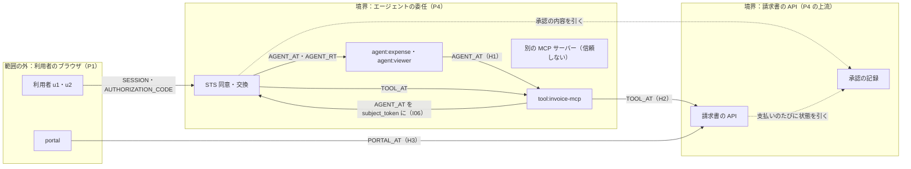
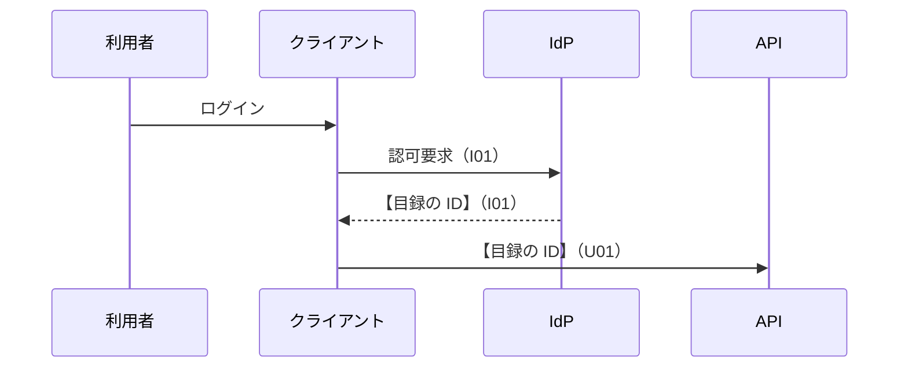

<!-- template_version: 0.3.0 -->
# シナリオ C：AI エージェントの委任（請求書）の JWT クレームの設計書（Lite）

> テンプレートです。候補と検討の問いだけを載せ、採否の理由の見本は載せません（理由の写し書きを防ぐため。#4 の方針）。判断は台帳（`claims.yaml`・`token_types.yaml`・`hops.yaml`・`catalog_answers.yaml`）に 1 回だけ書き、ここからは ID で参照します。

- 使う場面：JWT のクレームを設計するすべての設計書の本体です。プロファイル（`profiles/`）とモジュール（`modules/`）は、この文書の節から参照する判断の部品です
- 書き方：[README.md](README.md) の「Lite と Full の判定」で Lite か Full かを決めてから書きます。見出しの〔〕は、その節の扱いです
  - 〔Lite：手で書く〕：Lite でも Full でも、書き手が書く節（5 つ。`research/template-design/gate1.md` の 10.）
  - 〔Lite：生成〕：`python tools/claim_lint render <設計書のディレクトリ> --write` が台帳から書く節。手で書かない
  - 〔Full だけ〕：Lite では書かない節
- 生成の区間：`<!-- render:<節>:begin -->` と `<!-- render:<節>:end -->` の間は render が書き直します（`tools/claim_lint/RENDER.md`）。区間の中を手で直すと CI（`render --check`）が失敗します。台帳を直してから生成し直してください
- 項目 ID：各節の `項目 ID：` の値（`template:00_core#<アンカー>`）は、レビュー教材（#5）と対応表（#22）が参照する固定の ID です。設計書に写すときも、見出しの直前のアンカーを消さないでください
- 記入例：Lite は [examples/scenario-a/design.md](examples/scenario-a/design.md)、Full は `examples/scenario-b/design.md`（#4 の 2 つ目の PR）
- 作成方法：本資料は生成AI（Claude）を使って作成し、筆者が確認して公開しています。人による点検は未実施

設計書の冒頭には、次の 4 行を書きます（手で書く）。

| 欄 | 書くこと |
| --- | --- |
| 版 | 設計書の版と、前の版（13. の差分の起点） |
| Lite／Full | README の 5 問の答えと判定。1 つでも Yes なら Full |
| 使うプロファイル | P1・P4・P5 のどれを、どの境界で使うか（2. の図と同じ） |
| 作成方法 | 生成 AI を使ったか。使ったなら、その旨と人の確認の範囲 |

この設計書の冒頭の 4 行：

| 欄 | この設計 |
| --- | --- |
| 版 | 0.1（初版。前の版なし）。パイロット #9 のブラインド記入 |
| Lite／Full | 5 問：境界を越える No・マルチテナント No・委任・交換 **Yes**・新しい発行者 **Yes**・規制 No。**判定は Full**。パイロットの指示で Lite の欄で書いた。Full で足す節は 12. の最後の行 |
| 使うプロファイル | P4（エージェント → MCP のツールサーバー → 請求書の API の経路）。P1（ポータルの利用者のログイン）は範囲の外 |
| 作成方法 | LLM（Claude）による記入。人による検証ではない。要求の概要（brief-C）とテンプレートだけを読み、記入例とケーススタディは読んでいない |

## 1. CI の結果〔Lite：生成〕

項目 ID：`template:00_core#ci-results`

決めること：なし（記録の欄）。claim_lint の件数と全部の指摘、R8 のサイズの計算を貼ります。error が 0 件でない設計書は、レビューに回しません。warning の抑止には、行ごとの理由が要ります（`templates/CONTRIBUTING.md` の 2.）。

<!-- render:ci-result:begin -->
`python tools/claim_lint research/pilot/scenario-c --also-scan research/pilot/scenario-c/design.md`（profile full）：**error 53、warn 1、info 9**（claims 21・token_types 19・catalog_events 62）。FAIL

| 規則 | 重大度 | 対象 | 内容 |
| --- | --- | --- | --- |
| `R1` | error | `C-iss` | 必須の列 issuers が空 |
| `R1` | error | `C-iss` | 必須の列 issue_events が空 |
| `R1` | error | `C-iss` | 必須の列 overflow_strategy が空 |
| `R1` | error | `C-iss` | 必須の列 propagation_delay が空 |
| `R1` | error | `C-iss` | 必須の列 status が空 |
| `R1` | error | `C-sub` | 必須の列 issuers が空 |
| `R1` | error | `C-sub` | 必須の列 issue_events が空 |
| `R1` | error | `C-sub` | 必須の列 overflow_strategy が空 |
| `R1` | error | `C-sub` | 必須の列 propagation_delay が空 |
| `R1` | error | `C-sub` | 必須の列 status が空 |
| `R1` | error | `C-aud` | 必須の列 issuers が空 |
| `R1` | error | `C-aud` | 必須の列 issue_events が空 |
| `R1` | error | `C-aud` | 必須の列 overflow_strategy が空 |
| `R1` | error | `C-aud` | 必須の列 propagation_delay が空 |
| `R1` | error | `C-aud` | 必須の列 status が空 |
| `R1` | error | `C-exp` | 必須の列 issuers が空 |
| `R1` | error | `C-exp` | 必須の列 issue_events が空 |
| `R1` | error | `C-exp` | 必須の列 overflow_strategy が空 |
| `R1` | error | `C-exp` | 必須の列 propagation_delay が空 |
| `R1` | error | `C-exp` | 必須の列 status が空 |
| `R1` | error | `C-iat` | 必須の列 issuers が空 |
| `R1` | error | `C-iat` | 必須の列 issue_events が空 |
| `R1` | error | `C-iat` | 必須の列 overflow_strategy が空 |
| `R1` | error | `C-iat` | 必須の列 propagation_delay が空 |
| `R1` | error | `C-iat` | 必須の列 status が空 |
| `R1` | error | `C-jti` | 必須の列 issuers が空 |
| `R1` | error | `C-jti` | 必須の列 issue_events が空 |
| `R1` | error | `C-jti` | 必須の列 overflow_strategy が空 |
| `R1` | error | `C-jti` | 必須の列 propagation_delay が空 |
| `R1` | error | `C-jti` | 必須の列 status が空 |
| `R1` | error | `C-client-id` | 必須の列 issuers が空 |
| `R1` | error | `C-client-id` | 必須の列 issue_events が空 |
| `R1` | error | `C-client-id` | 必須の列 overflow_strategy が空 |
| `R1` | error | `C-client-id` | 必須の列 propagation_delay が空 |
| `R1` | error | `C-client-id` | 必須の列 status が空 |
| `R1` | error | `C-scope` | 必須の列 issuers が空 |
| `R1` | error | `C-scope` | 必須の列 issue_events が空 |
| `R1` | error | `C-scope` | 必須の列 propagation_delay が空 |
| `R1` | error | `C-scope` | 必須の列 status が空 |
| `R1` | error | `C-act` | 必須の列 issuers が空 |
| `R1` | error | `C-act` | 必須の列 issue_events が空 |
| `R1` | error | `C-act` | 必須の列 overflow_strategy が空 |
| `R1` | error | `C-act` | 必須の列 propagation_delay が空 |
| `R1` | error | `C-act` | 必須の列 status が空 |
| `R1` | error | `C-cnf` | 必須の列 issuers が空 |
| `R1` | error | `C-cnf` | 必須の列 issue_events が空 |
| `R1` | error | `C-cnf` | 必須の列 overflow_strategy が空 |
| `R1` | error | `C-cnf` | 必須の列 propagation_delay が空 |
| `R1` | error | `C-cnf` | 必須の列 status が空 |
| `R1` | error | `C-authorization-details` | 必須の列 issuers が空 |
| `R1` | error | `C-authorization-details` | 必須の列 issue_events が空 |
| `R1` | error | `C-authorization-details` | 必須の列 propagation_delay が空 |
| `R1` | error | `C-authorization-details` | 必須の列 status が空 |
| `R6` | info | `pairwise` | 2 因子の組 29 個をすべて検討した（主体 2・発行イベント 6） |
| `R8` | info | `AGENT_AT` | 最悪 1717 バイト（ヘッダーの行で 1739）／上限 8192（internal-http-header-field）= 21% |
| `R8` | info | `TOOL_AT` | 最悪 1717 バイト（ヘッダーの行で 1739）／上限 8192（internal-http-header-field）= 21% |
| `R8` | info | `PORTAL_AT` | 最悪 925 バイト（ヘッダーの行で 947）／上限 8192（internal-http-header-field）= 12% |
| `R8` | info | `C-scope` | AGENT_AT・TOOL_AT・PORTAL_AT の両方に載る（重複の候補） |
| `R8` | info | `C-act` | AGENT_AT・TOOL_AT の両方に載る（重複の候補） |
| `R8` | info | `C-authorization-details` | AGENT_AT・TOOL_AT の両方に載る（重複の候補） |
| `L2` | info | `idp` | IdP org-sts の、書き換えを許さないクレームの一覧が tools/claim_lint/idp_reserved.yaml にない。L2 は確かめていない（IdP モジュール #4 で手で確かめる） |
| `L15` | warn | `token_type AGENT_RT` | 送信者制約（mtls）なのに、台帳に AGENT_RT に載る cnf の行がない |
| `L16` | info | `hop H2` | aud を上流（H1）の https://invoice-mcp.example.com/mcp から、行き先の 1 つの宛先 https://invoices.example.com に替える（aud_replacement。理由：ツールサーバー宛ての AGENT_AT を、STS の交換で請求書の API の 1 つの宛先に置き換える（パススルーの禁止。MCP の必須チェック 3）） |

R8 AGENT_AT：ヘッダー 103・ペイロード 1118・署名 64 バイト（ceil(4/3*103) + ceil(4/3*1118) + ceil(4/3*64) + 2 = 138 + 1491 + 86 + 2 = 1717; + 7 (Bearer) = 1724）。internal-http-header-field 1739／8192 バイト

R8 TOOL_AT：ヘッダー 103・ペイロード 1118・署名 64 バイト（ceil(4/3*103) + ceil(4/3*1118) + ceil(4/3*64) + 2 = 138 + 1491 + 86 + 2 = 1717; + 7 (Bearer) = 1724）。internal-http-header-field 1739／8192 バイト

R8 PORTAL_AT：ヘッダー 103・ペイロード 524・署名 64 バイト（ceil(4/3*103) + ceil(4/3*524) + ceil(4/3*64) + 2 = 138 + 699 + 86 + 2 = 925; + 7 (Bearer) = 932）。internal-http-header-field 947／8192 バイト
<!-- render:ci-result:end -->

根拠：templates/CONTRIBUTING.md の 2.、tools/claim_lint/RULES.md、tools/claim_lint/RENDER.md の 1.

## 2. 範囲と信頼の境界〔Lite：手で書く〕

項目 ID：`template:00_core#scope-boundary`
<!-- req:p06-validation-split.R8 -->

決めること：この設計書が扱う範囲（どのクライアント・発行者・サービス・データ層までか）と、信頼の境界（ブラウザ・入口・サービスの網・DB・外部の IdP・取引先）。境界ごとに、使うプロファイル（P1・P4・P5）を書きます。範囲の外にしたものは、外にした前提を書きます。

| 観点 | 検討の問い | 根拠 |
| --- | --- | --- |
| 境界 | トークンが越える境界はどこか。境界の外側の部品（ブラウザ・取引先・外部の IdP）は何を読めるか | slide:p07-trust-boundary、slide:p09-jws-is-readable |
| 入口 | 外の形式のトークンを、内側に持ち込むか。入口で交換・作り直すか | slide:p06-edge-exchange、slide:p11-translation-layer |
| 書き手 | クレームはどの段階（① 認証時〜⑥ 承認・同意）で、誰が書くか | slide:p06-stage-map |
| データ層 | DB の文脈を設定するのは誰か。DB は何を信じるか | slide:p07-three-db-paths、slide:p07-trust-boundary |
| 範囲の外 | 扱わない部品・経路と、その前提が崩れる条件は何か | templates/CONTRIBUTING.md の 2. |

図（mermaid の flowchart か、画像）：境界を subgraph で囲み、境界ごとにプロファイルの名前を書きます。矢印にはトークン目録の ID（5.）を書きます。

記入欄：

| 境界 | 使うプロファイル | 中の部品 | 境界を越えるトークン（目録の ID） | 範囲の外にしたものと前提（書き手が書く） |
| --- | --- | --- | --- | --- |
| エージェントの委任 | P4 | STS（同意画面・トークン端点・交換）、agent:expense、agent:viewer、tool:invoice-mcp、ほかの MCP サーバー | AGENT_AT（STS → エージェント → ツール）、AGENT_RT（STS ↔ エージェント）、AUTHORIZATION_CODE・SESSION（利用者のブラウザ ↔ STS） | 利用者のログインの手段は STS の既存のログイン（範囲の外）。MCP サーバーは社内にあるが、1 つが悪意を持つ前提で信頼しない（C13）。STDIO の MCP は扱わない（HTTP だけ） |
| 請求書の API | P4 の上流（ツールの先） | 請求書の API、承認の記録（承認のサービス）、請求書の DB | TOOL_AT（ツール → 請求書の API）、PORTAL_AT（ポータル → 請求書の API） | 承認のサービスが人の承認をどう確かめるかは範囲の外（記録が正しい前提。崩れる条件：承認の記録をエージェントが書けるようになったとき）。DB はアプリの照会で持ち主を絞り、トークンで接続しない |
| 利用者のブラウザ・ポータル | P1（範囲の外） | 利用者のブラウザ、portal、console:admin | PORTAL_AT（受け手の検証だけ範囲に入れる） | ポータル・管理コンソールのログインとセッションは P1 の別の設計。この設計は「ポータルの利用者のトークンをエージェントが借りられない」（C12）ことだけを扱う。管理コンソールは委任の行為者として STS が許さない（I19） |

根拠：slide:p07-trust-boundary、slide:p06-stage-map、slide:p06-edge-exchange、research/template-design/gate1.md の 10.

### 2.1 主体の種類〔Lite：手で書く（2. の中で）〕

項目 ID：`template:00_core#principals`
<!-- req:p05-three-principals.R1 -->

決めること：この設計に出てくる主体を、利用者・ワークロード・システム（基盤）に分け、それぞれをトークンのどのクレームで表すか。RFC 9068 の `sub` は利用者にもクライアントにもなるので、受け手が区別できる手段を書きます。

| 主体の種類 | 例 | 検討の問い | 表し方の候補 | 根拠 |
| --- | --- | --- | --- | --- |
| 利用者 | 社員・顧客・取引先の担当者 | 安定したキーは何か（iss と sub の組、Entra は oid＋tid） | IdP の `sub`、組織の `user_id` | slide:p05-three-principals、slide:p02-user-identifier |
| ワークロード | サービス・ジョブ・エージェント | 利用者のトークンと区別できるか | client credentials の `sub`・`client_id`、SPIFFE ID、マネージド ID | slide:p05-three-principals、RFC 9700 §4.15.1 |
| システム・基盤 | 運用者・バッチ・クラウドのサービス | 誰の操作かが監査に残るか | サービスの ID、委任のトークンの `act` | slide:p05-system-privileges |

記入欄：

| 主体 | 種類 | 表すクレーム（台帳の ID） | 利用者のトークンと区別する手段（書き手が書く） |
| --- | --- | --- | --- |
| 利用者（u1・u2） | 利用者 | C-sub | sub は STS の利用者台帳の変わらない ID。エージェントのトークンでは sub が利用者でも act があり、client_id はエージェント。act の無いトークン（PORTAL_AT）は client_id と mTLS の相手が一致するときだけ受け入れる |
| agent:expense・agent:viewer | ワークロード | C-act（AGENT_AT では最も外側）、C-client-id、C-cnf | STS のクライアントとして登録し、組織の PKI の証明書で認証する（エージェントごとに別の証明書。共有しない）。利用者のトークンを借りる経路は cnf で閉じる |
| tool:invoice-mcp | ワークロード | C-act（TOOL_AT では最も外側）、C-client-id、C-cnf | 交換の actor は mTLS の主体で決め、要求の値で決めない。自分の広い ID で上流を読む経路（client credentials）は作らない |
| portal | ワークロード | C-client-id、C-cnf | 利用者自身の操作の経路。act を持たない |
| console:admin | システム・基盤 | （台帳の行なし） | この設計の STS は管理コンソールを委任の行為者として許さない。受け手は連鎖の行為者のすべてが方針で許す操作だけを通すので、過去の行為者の権限は使われない（C4） |

根拠：slide:p05-three-principals、RFC 9068 §2.2、RFC 9700 §4.15.1、templates/catalog/subject_state_matrix.md

<!-- heading-only -->
### 2.3 MCP の認可の必須チェック表（P4 の 1.。Lite でも記入）

00_core にこの表の置き場所が無いので、P4 の 1.（template:profiles/P4_ai_agent_delegation#mcp-checklist）の記入欄をここに写した。確かめた結果は、どれも「設計で決めた」で、実装・試験で確かめたものではない。

| # | 確かめ方 | 確かめた結果 | 台帳・目録・試験の ID |
| --- | --- | --- | --- |
| 1 | エージェントの認可要求とトークン要求に resource=https://invoice-mcp.example.com/mcp を入れる。STS は resource が無い・2 つ以上の要求を拒否する | 設計で決めた（未試験） | `hops[H1].aud`、`issuance_profile.request_protection`（resource_indicators）、C-aud |
| 2 | ツールサーバーは aud が自分の URI で、cnf が mTLS の相手と一致するトークンだけを受け入れる | 設計で決めた（未試験） | `token_types[AGENT_AT].aud`、C-aud・C-cnf の `enforced_at` |
| 3 | ツールサーバーは上流に TOOL_AT（交換で得た別のトークン）だけを使う。請求書の API は aud と cnf で AGENT_AT を拒む | 設計で決めた（未試験） | `hops[H2].exchanger`、TOOL_AT |
| 4 | 固定のクライアント ID のプロキシを置かない（ツールサーバーは第三者の AS へ転送しない） | 該当なし（プロキシが無い） | — |
| 5 | エージェントは認可応答の iss を https://sts.example.com と文字列比較する。STS はメタデータで authorization_response_iss_parameter_supported を宣言する | 設計で決めた（未試験） | 目録の JARM_RESPONSE（却下の理由） |
| 6 | エージェントは PKCE の S256 を使う。STS のメタデータの code_challenge_methods_supported に S256 を載せる | 設計で決めた（未試験） | `issuance_profile.grants`（authorization_code_pkce） |
| 7 | 公開クライアントが無い（エージェントは機密クライアント）。それでも RT は証明書に束縛し、ローテーションする | 設計で決めた。再利用の検知は未確認（unverified） | `token_types[AGENT_RT].rt_rotation`、`issuance_profile.rt_strategy` |
| 8 | AGENT_AT は Authorization ヘッダーだけで送り、ツールサーバーはクエリの access_token を拒否する | 設計で決めた（未試験） | `token_types[AGENT_AT].transport` |
| 9 | ツールサーバーは /.well-known/oauth-protected-resource に resource と authorization_servers（STS）を公開する | 設計で決めた（未試験） | — |

### 2.2 システムの権限〔Full だけ〕

項目 ID：`template:00_core#system-privileges`
<!-- req:p05-system-privileges.R1 req:p05-system-privileges.R3 req:p05-system-privileges.R7 req:p05-cross-tenant.R3 req:p05-system-privileges.R5 -->

決めること：夜間バッチ・運用者の操作・緊急時の特権（break-glass）・基盤の操作のそれぞれで、どの主体がどのトークンで動くか。利用者の権限を借りないこと、運用者は実行者として名を残すことを、場面ごとに確かめます。

| 場面 | 検討の問い | 候補 | 根拠 |
| --- | --- | --- | --- |
| 夜間バッチ | 利用者の権限を借りていないか | client credentials のトークン（`sub` はクライアント） | slide:p05-system-privileges、catalog:issue_events |
| 運用者の操作 | 運用者が利用者として振る舞っていないか | 交換で得た委任のトークン（`sub` に利用者、`act` に運用者） | slide:p05-system-privileges、RFC 8693 §4.1 |
| テナントをまたぐ運用者 | 承認と期限を確かめ、顧客と運用者の両方を記録するか | 委任のトークン＋承認の ID | slide:p05-cross-tenant、template:modules/M_multitenancy#operator-access |
| 緊急時の特権 | 承認と短い期限があるか | `may_act`・`act`、承認の ID（RAR・CIBA） | slide:p05-system-privileges、RFC 8693 §4.4 |
| 基盤の操作 | 管理者も権限を編集できない ID か | サービスにリンクされたロール | slide:p05-system-privileges |

記入欄：

| 場面 | 主体とトークン（目録の ID） | クレームで示すこと（台帳の ID） | 確かめ方（書き手が書く） |
| --- | --- | --- | --- |
|  |  |  |  |

根拠：slide:p05-system-privileges、slide:p05-cross-tenant、RFC 8693 §4.1・§4.4、NIST IR 8587 §5.3.1.6

## 3. 既定から外れた点〔Lite：手で書く〕

項目 ID：`template:00_core#deviations`
<!-- req:p12-priorities-deferrals.R3 -->

決めること：既定（IdP モジュールの既定の回答、発行方式の既定の組み合わせ（BFF＋認可コード＋PKCE）、共通の基準）から外れた判断の要約です。1 行に 1 つ、外れた点と、それを書いた台帳の行の ID を書きます。理由そのものは台帳の行（`rationale`・`assumption`・`revisit_trigger`）に書き、ここには写しません。

| 既定の出どころ | 検討の問い | 根拠 |
| --- | --- | --- |
| 発行方式の既定の組み合わせ | 4. の選択のうち、既定（機密の BFF・認可コード＋PKCE・送信者制約なし・JWT の AT・RT のローテーション）と違うものはどれか | templates/registry/README.md の 3.3、research/template-design/gate1.md の 10. |
| IdP モジュールの既定の回答 | カタログへの回答（11.）で、既定の回答を引き継がなかったイベントはどれか | template:modules/M_idp_keycloak#catalog-defaults |
| 共通の基準 | 3.2 の共通の基準のうち、満たさないものはあるか（あるなら Full にし、レビューで専門家に回す） | slide:p12-priorities-deferrals |
| ケーススタディの判定 | 記入例として作るとき、ケーススタディの判定と違う行はどれか | templates/casestudy-deviations.yaml |

記入欄：

| 外れた点 | 既定 | この設計の値 | 書いた台帳の行の ID | 見直しの条件（書き手が書く） |
| --- | --- | --- | --- | --- |
| 送信者制約 | なし | mTLS（端から端まで） | `issuance_profile.sender_constraint`、C-cnf | TLS を途中で終端する入口・メッシュを置くとき（DPoP を見直す） |
| クライアント認証 | （既定の組み合わせは BFF の秘密） | tls_client_auth | `issuance_profile.client_auth` | 証明書を持てないワークロードがエージェントになるとき |
| grant | 認可コード＋PKCE（と RT） | 認可コード＋PKCE・RT・トークン交換。client credentials は作らない | `issuance_profile.grants`、H2 | 利用者のいない定期の処理を足すとき |
| RT の方式 | ローテーション | 送信者制約（加えてローテーション。再利用の検知は未確認） | `issuance_profile.rt_strategy`、AGENT_RT | 再利用の検知を試験で確かめたとき（rotation_reuse_detection に直す） |
| 要求の保護 | なし | resource indicators・RAR | `issuance_profile.request_protection`、C-authorization-details | 承認の詳細をブラウザから隠す必要が出たとき（PAR・JAR） |
| IdP モジュールの既定の回答 | Keycloak の既定 | Keycloak を使わない（組織の STS。引き継ぎなし） | `catalog_answers.yaml` の idp | STS を Keycloak に置き換えるとき（委任の交換はプレビューの機能） |
| 共通の基準 | すべて満たす | すべて満たす（3.2 は書かない） | — | — |

根拠：research/template-design/gate1.md の 10.、templates/registry/README.md の 2.、slide:p12-priorities-deferrals

### 3.1 重点と見送り〔Lite：手で書く（3. の中で）〕

項目 ID：`template:00_core#priorities-deferrals`
<!-- req:p12-priorities-deferrals.R3 req:p12-priorities-deferrals.R4 req:p12-priorities-deferrals.R5 -->

決めること：組織の種類（マルチテナント SaaS・社内業務・AI エージェントの委任）に応じて、共通の基準の上に何を重点とし、何を見送るか。見送るものには「何が起きたら見直すか」を必ず書きます。

| 組織の種類 | 重点の候補（ガイド） | 見送りの候補（ガイド） | 根拠 |
| --- | --- | --- | --- |
| マルチテナント SaaS | テナントと発行者の照合、テナント単位の鍵、データ側のテナント照合、SET LOCAL と行単位の制御 | 細かい権限のトークン化 | slide:p12-priorities-deferrals |
| 社内業務システム | 入口での正規化、ヘッダーの除去、重要な操作の鮮度確認、groups 超過の解決 | JWE、送信者制約 | slide:p12-priorities-deferrals |
| AI エージェントの委任 | act の連鎖を正しく読む、宛先に束縛した交換、承認の束縛、タスク単位の短命トークン、深さの組織規則 | 標準による深さの強制 | slide:p12-priorities-deferrals |

記入欄：

| 区分（重点・見送り） | 項目 | 効果と費用（未検証の点を含む）（書き手が書く） | 見直しの条件（書き手が書く） | 台帳の行の ID |
| --- | --- | --- | --- | --- |
| 重点 | act の連鎖を正しく読む | 最も外側の act を mTLS の相手と照合し、入れ子の行為者は権限を削るだけ（C4・C12）。費用：受け手ごとに行為者の方針の表を持つ | 行為者が増えて方針の表を受け手で持てなくなったとき | C-act、C-client-id |
| 重点 | 宛先に束縛した交換 | aud を 1 つにし、交換で置き換え、cnf で束縛（C2・C13・C15）。費用：ツールの呼び出しごとに交換の往復（未測定） | 交換の往復が請求書の API の応答時間の目標を超えるとき | C-aud、C-cnf、H2 |
| 重点 | 承認の束縛 | 承認の記録から authorization_details を作り、受け手が完全一致で照合し、記録を消費する（C5・C6・C7・C8）。費用：支払いのたびの DB の照会 | 承認のサービスの可用性が支払いの目標を下回るとき | C-authorization-details |
| 重点 | タスク単位の短命トークン | AGENT_AT 300 秒・TOOL_AT 60 秒、RT は委任ごと（C9・C14）。費用：取り直しと交換の回数 | 取り消しの反映の目標（120 秒）を変えるとき | AGENT_AT、TOOL_AT、AGENT_RT |
| 重点 | 深さの組織規則 | 深さ 2 まで（利用者 → エージェント → ツール）。3 以上は交換と受け入れの両方で拒否（C10・C11）。標準の根拠はなく組織の規則 | 3 段以上の正規の用途が出たとき | C-act、`token_types[].max_delegation_depth` |
| 見送り | 標準による深さの強制 | RFC 8693 は深さを定めないので、組織の規則で強制する（上の行）。未検証：ほかの実装が連鎖を縮めて渡す場合 | 標準・草案が深さの表し方を定めたとき | C-act |
| 見送り | SSF・CAEP による即時の失効 | AGENT_AT は最悪 330 秒残るが、請求書には 90 秒で届かなくなる | AGENT_AT だけで完結する操作（ツールが上流を呼ばない操作）が増えたとき | SECURITY_EVENT_TOKEN |
| 見送り | Txn-Token | 上流が 1 段なので act と jti で足りる | 請求書の API が別のサービスを呼ぶとき | TXN_TOKEN、C-txn |
| 見送り | 組織の独自クレーム（タスク ID・承認 ID） | 標準のクレームだけで済み、追加前の 25 問と受け手の契約を増やさない。費用：受け手がタスクを特定するには STS の記録を引く | 受け手の側でタスク単位の回数・金額の上限を数えるとき | C-org-task-id、C-org-approval-id |

根拠：slide:p12-priorities-deferrals、jwt-claims-casestudy@080b8da（results/summary.md の「見送りの代償と重点の費用」）

### 3.2 共通の基準〔Lite：手で書く（満たさないものがあるときだけ）〕

項目 ID：`template:00_core#baseline`
<!-- req:p12-priorities-deferrals.R1 req:p12-priorities-deferrals.R2 -->

決めること：どの組織でも外さない基準を、この設計が満たしているか。IdP の差は入口で正規化してから基準を当て、正規の要求を落とさないこと（B9・B16 のような誤拒否）も確かめます。

| 基準 | 確かめる欄 | 根拠 |
| --- | --- | --- |
| 受け入れの検証（alg・iss・aud・exp・typ） | トークン目録の `alg_allowlist`・`issuers`・`required_claims`・`typ`、template:modules/M_token_validation#validation-order | slide:p12-priorities-deferrals、slide:p01-validation-order |
| 必須の欠落は拒否 | 台帳の `on_missing`、目録の `required_claims` | slide:p04-reject-missing-required |
| 型の固定 | 台帳の `type`・`shape` | slide:p04-type |
| 不変の ID | 台帳の `identifier_properties`・`paired_id` | slide:p04-immutable-identifiers |
| 組織の名前空間 | 台帳の `namespace`・最上位の `namespaces` | slide:p04-namespace |
| ログにトークン全文と個人情報を残さない | 台帳の `log_policy`、目録の `log_policy` | slide:p09-logs-traces |
| IdP の差を入口で正規化してから当てる | template:profiles/P5_internal_propagation#edge-conversion | slide:p04-reject-missing-required、slide:p03-absorb-idp-differences |

記入欄：

| 基準 | 満たすか | 満たさないときの理由と、回した先（専門家・追跡 issue）（書き手が書く） |
| --- | --- | --- |
| （すべて） | 満たす | 満たさない基準が無いので書かない（Lite の 3.2 の規則）。受け入れの検証は目録の alg_allowlist・issuers・required_claims・typ、ログは台帳の log_policy |

根拠：slide:p12-priorities-deferrals、jwt-claims-casestudy@080b8da（results/summary.md の除去実験）

## 4. 発行方式の選択〔Lite：生成（既定の組み合わせから外れた点だけ 3. に手で書く）〕

項目 ID：`template:00_core#issuance-profile`
<!-- req:p06-grant-types.R1 req:p08-rotation.R2 req:p09-url-browser.R2 -->

決めること：クライアントの種類・クライアント認証・grant・送信者制約・AT の形式・RT の方式・要求の保護・準拠するプロファイル。値と理由は `token_types.yaml` の `issuance_profile` に書き、この節は render が生成します。選択ごとに台帳で必要になるもの（`templates/registry/issuance_effects.yaml`）と、それを満たしている台帳の行も表示されます。**トークン目録（5.）とクレームの表は、この選択の結果として読めるように書きます**（例：送信者制約を DPoP にすると、AT に `cnf.jkt` の行と、目録に DPoP の proof の行が要る）。

| 項目 | 検討の問い | 候補（スキーマの値） | 部品 | 根拠 |
| --- | --- | --- | --- | --- |
| クライアントの種類 | トークンをサーバー側で持てるか | public・confidential・fapi | template:profiles/P1_human_web#bff-vs-spa | slide:p06-grant-types、slide:p08-rotation |
| クライアント認証 | 秘密を持てるか。鍵で認証するか | private_key_jwt・tls_client_auth・client_secret_* など | — | OpenID Connect Core 1.0 §9、RFC 8705 §2.1 |
| grant | 主体は誰で、どこで認証したか | 認可コード＋PKCE・client credentials・token exchange・CIBA・device・refresh・JWT bearer | template:profiles/P4_ai_agent_delegation#delegation-mode | slide:p06-grant-types |
| 送信者制約 | 漏れたトークンをそのまま使われてよいか | none・dpop・mtls | template:modules/M_sender_constraint#dpop-vs-mtls | RFC 9449 §1、RFC 8705 §1 |
| AT の形式 | 受け手が手元で検証するか、問い合わせるか | jwt・opaque_introspection・phantom | template:modules/M_authz_pdp#carry-or-query | slide:p01-self-contained-vs-reference |
| RT の方式 | RT が漏れたときに何で止めるか | rotation_reuse_detection・rotation・sender_constrained・none | template:modules/M_sender_constraint#rt-rotation | RFC 9700 §4.14.2 |
| 要求の保護 | 認可要求を改ざん・漏えいから守るか | par・jar・rar・resource_indicators | template:profiles/P1_human_web#url-exposure | RFC 9126 §1、RFC 9396 §2、RFC 8707 §2 |
| 準拠するプロファイル | 規制・業界の要求があるか | none・fapi2_security・oauth2_1 | — | FAPI 2.0 Security Profile（Final）§5.3.2.1 |

<!-- render:issuance-profile:begin -->
`token_types.yaml` の `issuance_profile`。既定の組み合わせから外れた点の理由は、手で書く節（既定から外れた点）に書く。

| 項目 | 選択 | 理由 | 根拠 |
| --- | --- | --- | --- |
| クライアントの種類 | 機密（`confidential`） | エージェント（agent:expense・agent:viewer）、MCP のツールサーバー（tool:invoice-mcp）、ポータル（portal）は、どれもサーバー側で動くワークロードで、 組織の PKI のクライアント証明書（mTLS）を持てる。ブラウザやエージェントの利用者の端末にはトークンを置かないので、公開クライアントは作らない | [RFC 6749 §2.1](https://www.rfc-editor.org/rfc/rfc6749#section-2.1) `slide:p10-agent-identity` |
| クライアント認証 | `tls_client_auth` | 要求の前提（呼び出し元はワークロードの ID（mTLS）で識別できる）に合わせ、STS へのクライアント認証も同じ証明書で行う。 秘密の共有（client_secret_*）はエージェントごとの資格情報の漏えい面を増やすので使わない。client assertion（private_key_jwt）も、鍵を 2 種類持つことになるので使わない | [RFC 8705 §2.1](https://www.rfc-editor.org/rfc/rfc8705#section-2.1) |
| grant | 認可コード＋PKCE（`authorization_code_pkce`）、リフレッシュ（`refresh_token`）、トークン交換（`token_exchange`） | 利用者がエージェントへの委任（タスク）に同意する場面は、STS の同意画面での認可コード＋PKCE（エージェントは利用者のトークンを受け取らず、 sub＝利用者・act＝エージェントの AT を直接受け取る）。タスクの間の取り直しは RT。ツールサーバーが上流の請求書の API を呼ぶときは、 受け取った AT を subject_token、自分の mTLS を actor として RFC 8693 の交換で上流向けの AT を得る（パススルーをしない。C2・C13・C15）。 client credentials はツールサーバーの「広い自分の ID」で上流を読む経路（現状の実装）を残すことになるので許さない | [RFC 8693 §2.1](https://www.rfc-editor.org/rfc/rfc8693#section-2.1) [RFC 7636 §4](https://www.rfc-editor.org/rfc/rfc7636#section-4) `slide:p10-agent-identity` |
| 送信者制約 | mTLS（`mtls`） | すべての AT・RT を、要求したワークロードの証明書に束縛する（cnf の x5t#S256）。ツールが受け取った AT をそのまま上流に渡す（C2）、 悪意ある MCP サーバー B が A に再送する（C13）、エージェントがポータルの利用者のトークンを借りる（C12）は、どれも提示した者の証明書が cnf と合わないので拒否できる。 組織の網の中だけで、すでにワークロードの証明書があるので、DPoP の鍵を別に管理しない | [RFC 8705 §3](https://www.rfc-editor.org/rfc/rfc8705#section-3) `slide:p08-rotation` |
| TLS の終端 | `end_to_end` | エージェント → ツールサーバー → 請求書の API の各ホップは、組織の網の中でワークロード同士が直接 mTLS を張る。途中の入口で TLS を終端しないので、 証明書をヘッダーで渡す経路（と、そのヘッダーの偽造）が生まれない | [RFC 8705 §6.5](https://www.rfc-editor.org/rfc/rfc8705#section-6.5) |
| AT の形式 | JWT（`jwt`） | 受け手（ツールサーバー・請求書の API）が手元で act・authorization_details・cnf を照合する。寿命を短く（エージェント向け 300 秒、上流向け 60 秒）し、 取り消しは交換のたびに STS が確かめるので、イントロスペクションを毎回の要求に入れない | `slide:p01-self-contained-vs-reference` [RFC 9068 §2](https://www.rfc-editor.org/rfc/rfc9068#section-2) |
| RT の方式 | 送信者制約（`sender_constrained`） | エージェントの RT は mTLS の証明書に束縛する（RFC 9700 §4.14.2 が挙げる 2 つの手段の 1 つ）。加えて STS はローテーションと再利用の検知も行う（目録の RT の行の rt_rotation）。 利用者が委任を取り消したら、その委任の RT の系列をすべて失効させる | [RFC 9700 §4.14.2](https://www.rfc-editor.org/rfc/rfc9700#section-4.14.2) |
| 要求の保護 | `resource_indicators`、`rar` | MCP の認可の仕様の MUST により、認可要求・トークン要求に resource を入れて宛先を 1 つに絞る（複数の MCP サーバー向けの広い宛先のトークンを作らない。C13）。 支払いは RFC 9396 の authorization_details（type: payment）で承認の内容を運び、受け手が要求の内容と照合する（C5・C6・C7）。 PAR・JAR は、同意の要求がブラウザを通るのが STS の同意画面への遷移だけで、改ざんされても STS が承認の記録から内容を埋め直すので、Lite では見送る | [RFC 8707 §2](https://www.rfc-editor.org/rfc/rfc8707#section-2) [RFC 9396 §2](https://www.rfc-editor.org/rfc/rfc9396#section-2) [MCP Authorization（2026-07-28）「Resource Parameter Implementation」](https://modelcontextprotocol.io/specification/2026-07-28/basic/authorization) |
| 適合のプロファイル | なし（`none`） | 社内の業務で、FAPI などの業界の規制の対象ではない（Lite の判定の regulated は No）。送信者制約と RAR は FAPI に合わせなくても上の理由で採る | [FAPI 2.0 Security Profile（Final）§5.3.2.1](https://openid.net/specs/fapi-security-profile-2_0-final.html) |

選択から導かれる要件（`templates/registry/issuance_effects.yaml`）：条件が成り立つ行は 4 件／全 13 件。**次の表は検査ではない。** render が `check` を簡易に読み取った表示で、検査の正は `tools/claim_lint/RULES.md` の L62〜L64（#6）。「満たしている行」は、要件の場所にある台帳の行。

| 行 | 要件 | 台帳で必要になるもの | 簡易な読み取り（正は L62） | 満たしている行 | 規則 |
| --- | --- | --- | --- | --- | --- |
| `E-mtls` | `E-mtls.1` | AT に cnf.x5t#S256（クライアント証明書の拇印）を載せる | 満たす | `C-cnf` | `L62`・`L15` |
| `E-mtls` | `E-mtls.2` | AT の受け手すべてが、TLS の相手の証明書の拇印と cnf を照合する | 満たす | `C-cnf` | `L62`・`L15` |
| `E-mtls` | `E-mtls.3` | TLS をどこで終端するか（tls_termination）を宣言する | 満たす | — | `L62`・`L15` |
| `E-token-exchange` | `E-token-exchange.1` | 委任なら act（最も外側が今の代理者）、交換を許す相手を事前に示すなら may_act を台帳に置く | 満たす | `C-act` | `L62`・`L16` |
| `E-token-exchange` | `E-token-exchange.2` | 交換のホップ（kind は exchange）で、aud・scope・寿命・独自クレームを上流より広げない（下流ほど絞る） | 満たす | `H2` | `L62`・`L16` |
| `E-rar` | `E-rar.1` | authorization_details の type の語彙を value_vocabulary で定め、持ち主を決める | 満たす | `C-authorization-details` | `L62`・`L16` |
| `E-rar` | `E-rar.2` | 宛先ごとに絞って入れる（ホップの authorization_details） | 満たす | `H1`・`H2` | `L62`・`L16` |
| `E-rar` | `E-rar.3` | 配列の上限（max_items）と 1 件の上限（max_bytes）を決める | 満たす | `C-authorization-details` | `L62`・`L16` |
| `E-rt-sender-constrained` | `E-rt-sender-constrained.1` | RT のローテーションは不要（送信者制約で RT の再送を防ぐ） | 満たす | — | `L15` |
<!-- render:issuance-profile:end -->

根拠：templates/registry/README.md の 3.3 と 7.、templates/registry/issuance_effects.yaml、tools/claim_lint/RENDER.md の 5.

## 5. トークン目録〔Lite：生成〕

項目 ID：`template:00_core#token-inventory`
<!-- req:p08-token-types-lifetimes.R4 -->

決めること：どのトークンを、誰が誰に向けて、どの形式・寿命で発行し、誰が読めて、JWE を使うか。カタログの 17 種類（`templates/catalog/token_kinds.yaml`）のすべてに、採用・既定どおり・却下＋理由を付けます。値は `token_types.yaml` の `token_types` に書き、この節は render が生成します。目録の ID は、シーケンス図（7.）の矢印、ホップの表（8.）、ライフサイクル表（9.）、台帳の `carried_in` で同じものを使います。

| 列 | 検討の問い | 根拠 |
| --- | --- | --- |
| 発行 → 宛先・持つ者 | 宛先（`aud`）と持つ者（`holder`）は誰か。ID トークンを API に送っていないか | slide:p01-id-token-vs-access-token |
| 形式（typ・alg） | 種類の違うトークンを `typ` で区別できるか | slide:p01-validation-order、RFC 9068 §2.1 |
| 寿命（idle と最大） | 種類ごとに上限を決めたか。1 つの数字で語っていないか | slide:p08-token-types-lifetimes |
| 保存場所・運び方 | URL・ブラウザに残らないか | slide:p09-url-browser、slide:p08-copies-outlive-token |
| 読める相手・JWE | 読まれてはいけないクレームを、読める相手に届くトークンに載せていないか | slide:p09-jws-is-readable、template:modules/M_privacy_minimization#protection-table |

<!-- render:token-inventory:begin -->
`token_types.yaml` の 19 行（却下 13）。種類の名前は `templates/catalog/token_kinds.yaml`。

| ID | 種類 | 採否 | 発行 → 宛先（aud） | 持ち手 | 形式 | 寿命 | 保存場所 | 運び方 | 読める相手 | JWE | 理由 |
| --- | --- | --- | --- | --- | --- | --- | --- | --- | --- | --- | --- |
| `AGENT_AT` | アクセストークン | 採用 | STS（https://sts.example.com） → https://invoice-mcp.example.com/mcp | エージェント（agent:expense・agent:viewer）。証明書に束縛（cnf） | jwt（at+jwt、ES256） | 300 秒（時計のずれ 30 秒） | サービスのメモリ | Authorization: Bearer | `client`・`api`・`idp` | なし | 利用者の同意（タスク）に基づき、STS がエージェントに出す委任の AT。sub は利用者、act.sub はエージェント、aud は MCP のツールサーバー 1 つ、 scope はタスクの範囲（読む・支払う）で、エージェントの方針と利用者の同意の積を超えない。支払いのときだけ承認の記録から作った authorization_details を載せる |
| `AGENT_RT` | リフレッシュトークン | 採用 | STS（https://sts.example.com） → https://sts.example.com | エージェント（agent:expense・agent:viewer）。証明書に束縛 | opaque | idle 3600 秒、最大 28800 秒 | サービスのメモリ | トークンの応答 | `client`・`idp` | — | タスクの間、エージェントが利用者に再び同意を求めずに AGENT_AT を取り直す。証明書に束縛し、利用者が委任を取り消すと系列ごと失効する。 AT を短くしても取り消しの起点を STS に集められる |
| `TOOL_AT` | アクセストークン | 採用 | STS（https://sts.example.com） → https://invoices.example.com | MCP のツールサーバー（tool:invoice-mcp）。証明書に束縛 | jwt（at+jwt、ES256） | 60 秒（時計のずれ 30 秒） | サービスのメモリ | Authorization: Bearer | `client`・`api`・`idp` | なし | ツールサーバーが上流の請求書の API を呼ぶための AT。ツールが受け取った AGENT_AT を subject_token にして STS で交換する。 sub は subject_token から写し（交換の要求で差し替えさせない。C15）、act はツール（外側）とエージェント（内側）の 2 段、aud は請求書の API 1 つ、 scope と authorization_details は subject_token の部分集合に限る（C14） |
| `PORTAL_AT` | アクセストークン | 採用 | STS（https://sts.example.com） → https://invoices.example.com | ポータル（portal）のサーバー。証明書に束縛 | jwt（at+jwt、ES256） | 600 秒（時計のずれ 30 秒） | BFF のサーバー | Authorization: Bearer | `bff`・`api`・`idp` | なし | 利用者が自分でポータルから請求書の API を使うときの AT（委任なし。act を持たない）。この設計の主題ではないが、請求書の API が受け入れるので目録に載せ、 エージェントが借りて使えない（C12）ことを cnf（ポータルの証明書）と「act の無い AT は client_id と mTLS の相手が一致するときだけ」の規則で確かめる |
| `ID_TOKEN` | ID トークン | 却下 | — | — | jwt | — | — | — | — | — | エージェントは利用者のログインの結果を読む RP ではなく、委任の AT だけを受け取る。ID トークンを出すと、エージェントが利用者の識別情報（と、誤って API に送れるトークン）を持つことになる。 却下で失うもの：エージェントが利用者の表示名・認証の時刻を知る手段（タスクに要らない） |
| `SESSION` | セッション（IdP のセッション session_idp と、RP・BFF のセッション session_rp の 2 層） | 採用 | STS（https://sts.example.com） → https://sts.example.com | 利用者のブラウザ（Cookie）と STS | opaque | idle 1800 秒、最大 28800 秒 | IdP | Cookie | `browser`・`idp` | — | 利用者が委任に同意する STS の同意画面のための、STS 側の利用者のセッション。同意のときだけ使い、エージェントには渡さない。 委任の取り消しの画面も同じセッションで使う |
| `AUTHORIZATION_CODE` | 認可コード | 採用 | STS（https://sts.example.com） → agent:expense・agent:viewer | エージェント（リダイレクトを受ける） | opaque | 60 秒 | なし | リダイレクトの query | `browser`・`client`・`idp` | — | 利用者が同意画面で委任を承認した結果を、エージェントに渡す 1 回限りの値。PKCE と組で使い、エージェントの証明書で交換する |
| `TXN_TOKEN` | Transaction Token（Txn-Token） | 却下 | — | — | jwt | — | — | — | — | — | 上流は請求書の API の 1 段だけで、その先にサービスの網の伝搬がない。取引（タスク）の相関は act の連鎖と jti を STS の監査ログで委任の記録に結ぶ。 却下で失うもの：請求書の API の先にサービスが増えたとき、要求ごとの文脈を改ざんされずに運ぶ手段（そのときは P5 を足して見直す） |
| `LOGOUT_TOKEN` | ログアウトトークン（Back-Channel Logout の Logout Token） | 却下 | — | — | jwt | — | — | — | — | — | エージェント・ツールサーバーは利用者のセッションを持たない RP で、ログアウトを知らせる相手がいない。委任の取り消しは STS の交換・取り直しの拒否で届かせる。 却下で失うもの：STS のログアウトを他の RP へ一斉に伝える手段 |
| `INTERNAL_TOKEN` | 内部トークン（入口で外部のトークンを検証し、作り直したもの） | 却下 | — | — | jwt | — | — | — | — | — | 入口で外部のトークンを作り直す構成ではない（組織は 1 つで、STS が直接、宛先ごとの AT を出す）。 却下で失うもの：入口でクレームを正規化して内側の形をそろえる手段 |
| `ID_JAG` | ID-JAG（Identity Assertion JWT Authorization Grant） | 却下 | — | — | jwt | — | — | — | — | — | 信頼ドメインをまたぐ委任がない（組織は 1 つ、発行者も STS の 1 つ）。却下で失うもの：別の組織の AS のトークンを SSO 済みの利用者として得る手段 |
| `DPOP_PROOF` | DPoP の proof | 却下 | — | — | jwt | — | — | — | — | — | 送信者制約は mTLS（issuance_profile.sender_constraint）。却下で失うもの：TLS を途中で終端する経路での送信者制約（そうなったら DPoP を見直す） |
| `CLIENT_ASSERTION` | クライアントの assertion（private_key_jwt・client_secret_jwt） | 却下 | — | — | jwt | — | — | — | — | — | クライアント認証は tls_client_auth。却下で失うもの：証明書を持てないクライアントの鍵による認証（今のクライアントはすべて証明書を持つ） |
| `JAR_REQUEST_OBJECT` | 署名つきの認可要求（JAR の Request Object） | 却下 | — | — | jwt | — | — | — | — | — | 同意の要求の改ざんは、STS が承認の記録とエージェントの方針から scope・authorization_details を決め直すことで無害にする。 却下で失うもの：認可要求のパラメータの完全性と、ブラウザからの秘匿 |
| `JARM_RESPONSE` | 署名つきの認可応答（JARM） | 却下 | — | — | jwt | — | — | — | — | — | 認可応答の iss は RFC 9207 の iss パラメータで照合する（MCP の必須チェック 5）。却下で失うもの：認可応答の全体への署名 |
| `JWT` | 汎用の JWT（ワークロードの ID のトークン・アサーショングラントに出す JWT など） | 却下 | — | — | jwt | — | — | — | — | — | 上の種類のほかに JWT を作らない（承認の記録は STS が DB で引き、別の署名つきの JWT にしない）。却下で失うもの：承認の記録を自己完結した署名つきの主張として運ぶ手段 |
| `SECURITY_EVENT_TOKEN` | Security Event Token（SET。SSF・CAEP の通知） | 却下 | — | — | jwt | — | — | — | — | — | 委任の取り消しは、TOOL_AT を 60 秒にして交換のたびに確かめることで 90 秒以内に請求書に届かなくなる。SSF・CAEP の受信の部品を、ツールサーバー・請求書の API に作らない。 却下で失うもの：AGENT_AT（300 秒）を寿命より前に止める手段 |
| `STATUS_LIST_TOKEN` | 状態リストのトークン（Token Status List） | 却下 | — | — | jwt | — | — | — | — | — | 取り消しは交換のたびの STS の確認で届かせる（上の行）。却下で失うもの：受け手が手元で失効を確かめる手段 |
| `INTROSPECTION_RESPONSE_JWT` | JWT 形式のイントロスペクションの応答 | 却下 | — | — | jwt | — | — | — | — | — | 受け手は JWT の AT を手元で検証し、イントロスペクションを使わない。却下で失うもの：イントロスペクションの応答の改ざんの防止 |
<!-- render:token-inventory:end -->

根拠：slide:p08-token-types-lifetimes、templates/registry/README.md の 3.2、templates/catalog/token_kinds.yaml、tools/claim_lint/RENDER.md の 1.

### 5.1 寿命の上限の方針〔Full だけ〕

項目 ID：`template:00_core#lifetime-policy`
<!-- req:p08-token-types-lifetimes.R4 req:p08-choosing-lifetime.R2 req:p08-choosing-lifetime.R4 req:p08-decision-table.R1 -->

決めること：種類ごとの寿命の上限を、組織の規則として文書にします。上限を超える種別には、例外を認める手順（誰が承認し、どこに記録するか）を書きます。上限のファイルは `tools/claim_lint/lifetime_caps.yaml` の形（#6 の L23。自組織のファイルに替えられる）です。

| 種類 | 指針の数値 | 検討の問い | 根拠 |
| --- | --- | --- | --- |
| アクセストークン・ID トークン | 1 時間以内とすべき | 剥奪の許容時間（9.2）から見て短いか | NIST IR 8587 §5.3.1.1、slide:p08-choosing-lifetime |
| 対話用の RT・セッション | 再認証の上限（AAL2 は 24 時間・無操作 1 時間） | RT の最大寿命が再認証の上限を超えないか | NIST SP 800-63B-4 §2.2.3、slide:p08-token-types-lifetimes |
| 認可コードなどのアサーションの参照 | 5 分以内（FAPI 2.0 は 60 秒） | — | NIST SP 800-63C-4 §4.11.1、FAPI 2.0 Security Profile（Final）§5.3.2.1 |
| Txn-Token | 分以下 | 元のトークンより長くするか（仕様は許す） | draft-ietf-oauth-transaction-tokens-11 §6、slide:p08-token-types-lifetimes |

記入欄：

| 種類 | 組織の上限（秒） | 例外を認める手順（承認者・記録先）（書き手が書く） | 例外にした種別（目録の ID と `lifetime_exception`） |
| --- | --- | --- | --- |
|  |  |  |  |

根拠：slide:p08-choosing-lifetime、slide:p08-token-types-lifetimes、NIST IR 8587 §5.3.1.1

## 6. 問い × 仕組み〔Lite：手で書く〕

項目 ID：`template:00_core#question-mechanism`

決めること：ユースケースごとに、答えるべき問い（`templates/registry/questions.yaml` の 11 問。スライドと同じ文言）のそれぞれに、どの仕組み（クレーム・トークン・通信の層）で答えるか。**選ばなかった問いには「不要」と理由を書きます。** 取り違えやすい問いは別々の行にします：「誰が代理して実行しているか」（`act`）、「どのワークロードが Txn-Token を求めたか」（`req_wl`）、「どの取引か」（Txn-Token の `txn`）、「直接の通信相手は誰か」（mTLS・SPIFFE などのワークロードの ID。トークンのクレームでは代えられない）。

| 問い（questions.yaml の ID） | 仕組みの候補 | 取り違えやすい相手 | 根拠 |
| --- | --- | --- | --- |
| 誰の権限で（`q-sub`） | `sub` | `act`（代理している者） | slide:p05-one-request-carries、RFC 8693 §4.1 |
| 誰が代理して実行しているか（`q-actor`） | `act`（最も外側が今の行為者） | 入れ子の `act`（過去の行為者）、`sub` | slide:p10-four-questions、RFC 8693 §4.1 |
| どのワークロードが Txn-Token を求めたか（`q-req-wl`） | Txn-Token の `req_wl` | `act`、通信の相手 | draft-ietf-oauth-transaction-tokens-11 §9.2 |
| 直接の通信相手は誰か（`q-peer`） | mTLS・SPIFFE の ID（通信の層） | `act`・`req_wl` | slide:p05-one-request-carries |
| どこを経由したか（`q-via`） | 証跡（ログ・トレース） | `act` の連鎖 | slide:p06-audit-trail |
| どの取引か（`q-txn`） | Txn-Token の `txn` | 承認の ID | draft-ietf-oauth-transaction-tokens-11 §9.2 |
| 誰が利用者か（`q-user`） | `sub` と組織の `user_id` | 表示名・メール | slide:p02-user-identifier |
| どのエージェント・クライアントか（`q-agent`） | `client_id`・`azp`・`act` | `sub` | slide:p02-delegation-client、slide:p10-agent-identity |
| 何が承認されたか（`q-authorized`） | `scope`・`authorization_details`・承認の ID | `roles` | slide:p10-human-approval-evidence、RFC 9396 §2 |
| どのリソース向けか（`q-resource`） | `aud`（resource indicator で絞る） | `scope` | slide:p06-narrow-downstream、RFC 8707 §2 |
| 誰が持つべきか（`q-holder`） | 送信者制約（`cnf`） | `sub` | template:modules/M_sender_constraint#dpop-vs-mtls、RFC 9449 §6.1 |

記入欄（ユースケースごとに 1 表。問いの行は 11 行すべて書く）：

| ユースケース | 問い（ID） | 要るか | 仕組み（台帳の行の ID か、クレームでない仕組み） | 不要の理由・照合する場所（書き手が書く） |
| --- | --- | --- | --- | --- |
| UC1 エージェントがツール経由で利用者の請求書を読む（C1・C11） | q-sub | 要る | C-sub | 請求書の API が請求書の持ち主（DB）と照合（C3・C15） |
| UC1 エージェントがツール経由で利用者の請求書を読む（C1・C11） | q-actor | 要る | C-act（最も外側） | 請求書の API・ツールが mTLS の相手と照合。入れ子は削る方向だけ（C4） |
| UC1 エージェントがツール経由で利用者の請求書を読む（C1・C11） | q-req-wl | 不要 | — | Txn-Token を使わない。要求したワークロードは act の最も外側と mTLS の相手で分かる |
| UC1 エージェントがツール経由で利用者の請求書を読む（C1・C11） | q-peer | 要る | mTLS の相手の証明書（クレームでない） | act・cnf と照合する相手。トークンのクレームでは代えない |
| UC1 エージェントがツール経由で利用者の請求書を読む（C1・C11） | q-via | 要る | STS の交換の監査ログ（クレームでない） | 交換の元の jti と出した jti、actor を残す。act の連鎖は経由の記録に使わない |
| UC1 エージェントがツール経由で利用者の請求書を読む（C1・C11） | q-txn | 要る | STS の委任の記録と jti の対応（クレームでない） | 監査で結ぶ。Txn-Token の txn は使わない |
| UC1 エージェントがツール経由で利用者の請求書を読む（C1・C11） | q-user | 要る | C-sub | 表示名・メールは載せない（C-email は却下） |
| UC1 エージェントがツール経由で利用者の請求書を読む（C1・C11） | q-agent | 要る | C-client-id、C-act | 行為者ごとの方針（読む・支払う・返金する）を当てる |
| UC1 エージェントがツール経由で利用者の請求書を読む（C1・C11） | q-authorized | 要る | C-scope | タスクの範囲。交換で広げない（C14） |
| UC1 エージェントがツール経由で利用者の請求書を読む（C1・C11） | q-resource | 要る | C-aud | ツールと請求書の API が自分の URI と一致を照合（C2・C13） |
| UC1 エージェントがツール経由で利用者の請求書を読む（C1・C11） | q-holder | 要る | C-cnf | mTLS の証明書の拇印と照合（C2・C12・C13） |
| UC2 エージェントが承認どおりに支払う（C8） | q-sub | 要る | C-sub | 請求書の API が請求書の持ち主（DB）と照合（C3・C15） |
| UC2 エージェントが承認どおりに支払う（C8） | q-actor | 要る | C-act（最も外側） | 請求書の API・ツールが mTLS の相手と照合。入れ子は削る方向だけ（C4） |
| UC2 エージェントが承認どおりに支払う（C8） | q-req-wl | 不要 | — | Txn-Token を使わない。要求したワークロードは act の最も外側と mTLS の相手で分かる |
| UC2 エージェントが承認どおりに支払う（C8） | q-peer | 要る | mTLS の相手の証明書（クレームでない） | act・cnf と照合する相手。トークンのクレームでは代えない |
| UC2 エージェントが承認どおりに支払う（C8） | q-via | 要る | STS の交換の監査ログ（クレームでない） | 交換の元の jti と出した jti、actor を残す。act の連鎖は経由の記録に使わない |
| UC2 エージェントが承認どおりに支払う（C8） | q-txn | 要る | STS の委任の記録と jti の対応（クレームでない）。支払いは authorization_details の approval_id | 監査で結ぶ。Txn-Token の txn は使わない |
| UC2 エージェントが承認どおりに支払う（C8） | q-user | 要る | C-sub | 表示名・メールは載せない（C-email は却下） |
| UC2 エージェントが承認どおりに支払う（C8） | q-agent | 要る | C-client-id、C-act | 行為者ごとの方針（読む・支払う・返金する）を当てる |
| UC2 エージェントが承認どおりに支払う（C8） | q-authorized | 要る | C-scope、C-authorization-details | 請求書の API が要求の請求書・金額・振込先を完全一致で照合し、承認の記録を消費（C5・C6・C7） |
| UC2 エージェントが承認どおりに支払う（C8） | q-resource | 要る | C-aud | ツールと請求書の API が自分の URI と一致を照合（C2・C13） |
| UC2 エージェントが承認どおりに支払う（C8） | q-holder | 要る | C-cnf | mTLS の証明書の拇印と照合（C2・C12・C13） |

台帳の `answers`・`does_not_answer`（Full の列）を書けば、次の区間に確かめ用の表が生成されます。手で書いた表と食い違えば、どちらかが誤りです（#18 の L12・L13 が台帳の側を確かめる）。

<!-- render:question-mechanism:begin -->
`templates/registry/questions.yaml` の問いごとに、台帳の `answers`・`does_not_answer` を引いた。「不要」の理由は台帳に列がないので、手で書く表に書く。

| ID | 問い | 問いの一覧の仕組み | 答える台帳の行（answers） | 答えに使わない行（does_not_answer） | 照合する場所 |
| --- | --- | --- | --- | --- | --- |
| `q-sub` | 誰の権限で | `sub` | `sub` | — | `invoices-api`・`tool:invoice-mcp`・`sts-token-exchange` |
| `q-actor` | 誰が代理して実行しているか | `act` | `act` | — | `invoices-api`・`tool:invoice-mcp`・`sts-token-exchange` |
| `q-req-wl` | どのワークロードが Txn-Token を求めたか | `req_wl` | — | — | — |
| `q-peer` | 直接の通信相手は誰か | `mTLS の相手の ID（SPIFFE の X.509-SVID など）` | — | — | — |
| `q-via` | どこを経由したか | `経由を示す別の属性（AWS FAS の aws:CalledVia に当たるもの）`・`ネストした act` | — | — | — |
| `q-txn` | どの取引か | `txn` | — | — | — |
| `q-user` | 誰が利用者か | `iss と sub の組` | `sub` | — | `invoices-api`・`tool:invoice-mcp`・`sts-token-exchange` |
| `q-agent` | どのエージェント・クライアントか | `client_id`・`azp`・`act.sub`・`req_wl` | `client_id` | — | `invoices-api`・`tool:invoice-mcp` |
| `q-authorized` | 何が承認されたか | `scope`・`authorization_details`・`acr・amr・auth_time` | `scope`・`authorization_details` | — | `invoices-api`・`sts-token-exchange`・`tool:invoice-mcp` |
| `q-resource` | どのリソース向けか | `aud`・`resource（RFC 8707）` | `aud` | — | `tool:invoice-mcp`・`invoices-api` |
| `q-holder` | 誰が持つべきか | `cnf` | `cnf` | — | `tool:invoice-mcp`・`invoices-api` |
| `q-iss` | 誰が発行したか、信頼する発行者か（pending） | `iss（許可リストと完全一致）、iss ごとの鍵` | — | — | — |
| `q-typ` | どの種類・目的のトークンか（pending） | `ヘッダーの typ（at+jwt・txntoken+jwt・logout+jwt など）` | — | — | — |
| `q-auth-strength` | どの強さで、いつ認証されたか（pending） | `acr・amr・auth_time` | — | — | — |
| `q-still-valid` | 今も有効か（pending） | `exp、失効の手段（イントロスペクション・状態リスト・SSF/CAEP・Back-Channel Logout）、剥奪が反映されるまでに許す時間` | — | — | — |
<!-- render:question-mechanism:end -->

根拠：slide:p05-one-request-carries、slide:p10-four-questions、templates/registry/questions.yaml、research/template-design/gate1.md の 10.

## 7. シーケンス図〔Full だけ〕

項目 ID：`template:00_core#sequence`

決めること：主な流れ（ログイン・API の呼び出し・交換・リフレッシュ・ログアウト・失効）を、矢印ごとにカタログのイベント ID（`I01` など。`templates/catalog/`）とトークン目録の ID を付けて描きます。**目録に無いトークンを矢印に書かない**でください（#6 の L21 が、目録・ホップ・カタログへの回答との食い違いを見る。図の参照の書き方は `【<目録の ID>】`）。

- mermaid の文の中で `;` を使わない（文の区切りとして読まれ、GitHub で描画されない。`tools/check_mermaid.py`）

根拠：templates/catalog/issue_events.yaml、templates/catalog/use_events.yaml、slide:p06-stage-map、tools/check_mermaid.py

## 8. ホップごとの表〔Lite：生成（交換・作り直しのホップがあれば手で書く）〕

項目 ID：`template:00_core#hop-table`
<!-- req:p12-review-viewpoints.R7 -->

決めること：経路のホップごとに、運ぶトークン・`aud`・`scope`・寿命・運ぶ独自クレーム・交換を担うサービス・受け手の検証。**規則：下流は `aud`・`scope`・寿命・独自クレームのどれでも上流を超えない。** 超える場合（Txn-Token は仕様上、元より長くてよい）は `narrowing_exception` に理由を書きます。値は `hops.yaml` に書き、この節は render が生成します。交換・作り直しのホップの `aud`・`scope`・`max_lifetime`・`custom_claims`・`exchanger` は Lite でも手で書きます。

| 観点 | 検討の問い | 根拠 |
| --- | --- | --- |
| 宛先 | 交換のたびに `aud` を 1 つの宛先に絞っているか | slide:p06-narrow-downstream、RFC 8707 §2 |
| 範囲 | `scope`・`authorization_details` が上流より広がっていないか | slide:p06-narrow-downstream、RFC 9396 §9.1 |
| 寿命 | 下流のトークンが上流より長く生きないか | slide:p06-narrow-downstream、draft-ietf-oauth-transaction-tokens-11 §6 |
| 独自クレーム | 下流の受け手が読まないクレームを運んでいないか | slide:p11-pre-add-questions-2 |
| 誰が検証するか | 入口で検証しても、各サービスで検証するか | slide:p06-validation-split |
| ヘッダーへの転記 | 同名のヘッダーを入口で捨てているか | slide:p06-header-forwarding |

<!-- render:hop-table:begin -->
`hops.yaml` の宣言。トークンのないホップの「運ぶトークン」は —。

| ホップ | 種類 | 運ぶトークン | aud | scope | 寿命 | 運ぶ独自クレーム | 交換するサービス | 検証 | 検証・照合すること |
| --- | --- | --- | --- | --- | --- | --- | --- | --- | --- |
| H1 agent → https://invoice-mcp.example.com/mcp | `service` | `AGENT_AT` | `https://invoice-mcp.example.com/mcp` | `invoices:read`・`invoices:pay` | 300 秒 | — | — | `local` | iss aud exp typ cnf（mTLS の相手の証明書） act の最も外側が mTLS の相手 scope にツールの操作 |
| H2 https://invoice-mcp.example.com/mcp → https://invoices.example.com | `exchange` | `TOOL_AT` | `https://invoices.example.com` | `invoices:read`・`invoices:pay` | 60 秒 | — | STS（https://sts.example.com のトークン交換。subject_token は AGENT_AT、actor はツールサーバーの mTLS） | `local` | iss aud exp と exp − iat ≤ 60 typ cnf（mTLS の相手の証明書） act の最も外側が mTLS の相手で深さ 2 以下 scope と行為者の方針 sub と請求書の持ち主 authorization_details と支払いの要求の一致と承認の記録の状態 |
| H3 portal → https://invoices.example.com | `service` | `PORTAL_AT` | `https://invoices.example.com` | `invoices:read`・`invoices:pay`・`invoices:refund` | 600 秒 | — | — | `local` | iss aud exp typ cnf（mTLS の相手の証明書） act が無いので client_id が mTLS の相手 sub と請求書の持ち主 |
<!-- render:hop-table:end -->

矢印ごとの表（シーケンス図の読み物。載るトークン × 受け手が確かめるクレーム × 書き手）：

<!-- render:arrow-table:begin -->
ホップの受け手（`to`）が `enforced_at` で確かめるクレームを、ホップのトークン（トークンのないホップでは `custom_claims`）から引いた。トークンのあるホップの書き手は `authoritative_writer`。トークンのないホップでは、値を書くのは送り手（`from`）なので、書き手の列には送り手と、台帳の `integrity_until`（書き先と、署名の保護が外れる境界）を出す。

| ホップ | トークン | 確かめるクレーム | 書き手 | 確かめること | aud | 寿命 |
| --- | --- | --- | --- | --- | --- | --- |
| `H1` | `AGENT_AT` | — | — | — | `https://invoice-mcp.example.com/mcp` | 300 秒 |
| `H2` | `TOOL_AT` | — | — | — | `https://invoices.example.com` | 60 秒 |
| `H3` | `PORTAL_AT` | — | — | — | `https://invoices.example.com` | 600 秒 |
<!-- render:arrow-table:end -->

根拠：slide:p06-narrow-downstream、templates/registry/README.md の 3.4、RFC 8693 §5

## 9. ライフサイクル表〔Lite：手で書く〕

項目 ID：`template:00_core#lifecycle`
<!-- req:p02-auth-strength-session.R5 req:p08-async-processing.R4 req:p08-downstream-after-expiry.R3 -->

決めること：寿命の 4 つの層（トークン・クレームの値の鮮度・セッションと RT・クレームの定義）を、別々に書きます。9.1 はトークン種別とセッション層と接続ごと、9.2 はクレームごと、9.3 はクレームの定義ごとです。4 つは独立に動きます（AT が 5 分でも、セッションが 10 時間なら 10 時間トークンを得られる）。

<!-- heading-only -->
### 9.1 トークン・セッション・接続

| 列 | 検討の問い | 根拠 |
| --- | --- | --- |
| 寿命（idle と最大） | 種類ごとに決めたか（5.1 の上限の中か） | slide:p08-token-types-lifetimes |
| リフレッシュ | リフレッシュで属性・ロールが再評価されるか（IdP ごとに違う） | slide:p08-refresh-reevaluation |
| RT のローテーションと再利用の検知 | 古い RT の再利用で系列を失効させるか。確かめたか | slide:p08-rotation、RFC 9700 §4.14.2 |
| 失効の手段 | exp まで待つ・イントロスペクション・状態リスト・SSF/CAEP・Back-Channel Logout のどれか | slide:p08-revocation-propagation、slide:p08-logout |
| 剥奪が届くまでに許す時間 | 受け手が止めるまでの最悪の秒数は何秒か | slide:p08-revocation-propagation |
| 長時間の処理 | 非同期の処理・期限切れの後の下流の呼び出しで、トークンをどう扱うか | slide:p08-async-processing、slide:p08-downstream-after-expiry |

記入欄：

| 層・種別（目録の ID） | 寿命（idle／最大） | リフレッシュ | RT のローテーションと再利用の検知 | 失効の手段 | 剥奪が届くまでの秒数 | 長時間の処理での扱い（書き手が書く） |
| --- | --- | --- | --- | --- | --- | --- |
| AGENT_AT | —／300 秒（ずれ 30 秒） | AGENT_RT で取り直す。取り直しで scope を委任と方針から決め直す | —（RT の行） | exp まで。請求書へは交換の拒否で止まる | 330 秒（ツールまで）。請求書へは 90 秒 | タスクは最大 8 時間。SSE のストリームは exp で閉じる（U23） |
| AGENT_RT | 3600 秒／28800 秒 | ローテーション | ローテーションする。再利用の検知は未確認（unverified） | 委任の取り消し・利用者の停止・資格情報の再設定で系列ごと失効 | 0 秒（次の取り直しから拒否） | 8 時間を超えるタスクは同意し直す |
| TOOL_AT | —／60 秒（ずれ 30 秒） | なし。呼び出しのたびに交換 | — | exp まで。交換のたびに委任の状態を確かめる | 90 秒 | ツールは TOOL_AT をタスクをまたいで使い回さない |
| PORTAL_AT | —／600 秒 | P1 の設計（範囲の外） | P1 の設計 | exp まで（P1 の設計） | 630 秒 | 範囲の外 |
| SESSION（STS） | 1800 秒／28800 秒 | 操作で無操作の期限を延ばす | — | ログアウトで削除。停止・資格情報の再設定でも削除 | 0 秒 | 委任はセッションと独立（セッションが切れても委任は続き、取り消しで止まる） |
| AUTHORIZATION_CODE | —／60 秒 | なし | — | 1 回限り。2 回目でそのコードから出したトークンを失効 | 0 秒 | — |

確かめ用の生成の表（4 つの層。寿命が鮮度の許容を超える行に「超える」と出る）：

<!-- render:lifecycle:begin -->
slide:p08-four-lifetimes の 4 層を、台帳の列から引いた（`templates/registry/README.md` の 6.）。長時間の処理と剥奪の反映の書き方は、手で書くライフサイクル表に書く。

2. の `volatility` は「値が変わってから反映されるまでに許す秒数」（`templates/registry/README.md` の 3.）で、0 は即時の反映が要ること、`never` はトークンの寿命の間に値が変わらないことを表す。載るトークンの受け入れの最大（寿命＋時計のずれ）がこれを超える行に「超える」と出し、目録の `revocation` のうち遅れが許容以内の手段（`exp_only` を除く）を並べる。その手段がこのクレームの変化に効くかは機械では読まないので、台帳の `on_revoke` で確かめる。検査の正は L5（#6）で、この表は検査ではない。

**1. トークンの寿命**

| トークン | 寿命 | 時計のずれ | 寿命を変えられる主体 | ホップでの寿命 |
| --- | --- | --- | --- | --- |
| `AGENT_AT` | 300 秒 | 30 秒 | `platform` | H1 300 秒 |
| `TOOL_AT` | 60 秒 | 30 秒 | `platform` | H2 60 秒 |
| `PORTAL_AT` | 600 秒 | 30 秒 | `platform` | H3 600 秒 |
| `AUTHORIZATION_CODE` | 60 秒 | — | `platform` | — |

**2. クレームの値の鮮度（受け手のいる行）**

| クレーム | 載るトークン | 受け入れの最大 | 反映までに許す秒数 | 反映の遅れ | 再計算 | 受け入れの最大と許容 | 許容以内の失効の手段（目録） | 剥奪・停止のとき（台帳） |
| --- | --- | --- | --- | --- | --- | --- | --- | --- |
| `iss` | `AGENT_AT`・`TOOL_AT`・`PORTAL_AT` | 630 秒 | `never` | — | — | 寿命の間に変わらない（never） | — | 変わらない値。発行者の切り替えは許可リストの変更で行う |
| `sub` | `AGENT_AT`・`TOOL_AT`・`PORTAL_AT` | 630 秒 | `never` | — | — | 寿命の間に変わらない（never） | — | 利用者の停止は委任の取り消しと同じく、RT の失効と交換の拒否で止める（9.1） |
| `aud` | `AGENT_AT`・`TOOL_AT`・`PORTAL_AT` | 630 秒 | `never` | — | — | 寿命の間に変わらない（never） | — | 変わらない値 |
| `exp` | `AGENT_AT`・`TOOL_AT`・`PORTAL_AT` | 630 秒 | `never` | — | — | 寿命の間に変わらない（never） | — | トークンごとの値。取り消しは exp を待たない手段で行う（目録の revocation） |
| `iat` | `AGENT_AT`・`TOOL_AT`・`PORTAL_AT` | 630 秒 | `never` | — | — | 寿命の間に変わらない（never） | — | トークンごとの値 |
| `jti` | `AGENT_AT`・`TOOL_AT`・`PORTAL_AT` | 630 秒 | `never` | — | — | 寿命の間に変わらない（never） | — | トークンごとの値 |
| `client_id` | `AGENT_AT`・`TOOL_AT`・`PORTAL_AT` | 630 秒 | `never` | — | — | 寿命の間に変わらない（never） | — | クライアントの登録の削除で、次の取り直し・交換から拒否 |
| `scope` | `AGENT_AT`・`TOOL_AT`・`PORTAL_AT` | 630 秒 | 900 秒 | — | — | — | — | 委任の取り消しで RT を失効させ、交換を拒否する（TOOL_AT は 90 秒以内に止まる） |
| `act` | `AGENT_AT`・`TOOL_AT` | 330 秒 | `never` | — | — | 寿命の間に変わらない（never） | — | トークンごとの値。行為者の登録の削除で、次の交換から拒否 |
| `cnf` | `AGENT_AT`・`TOOL_AT`・`PORTAL_AT` | 630 秒 | `never` | — | — | 寿命の間に変わらない（never） | — | 証明書の失効は PKI で行い、mTLS の確立で拒否される |
| `authorization_details` | `AGENT_AT`・`TOOL_AT` | 330 秒 | 0 秒 | — | — | 超える（AGENT_AT 330 秒・TOOL_AT 90 秒 > 許容 0 秒） | AGENT_AT：DB の確認（0 秒） TOOL_AT：DB の確認（0 秒） | 承認の取り消しは、請求書の API が支払いのたびに承認の記録を DB で引いて反映する（目録の db_lookup） |

**3. セッションと RT の寿命**

| セッション・RT・接続 | idle | 最大 | ローテーション | 再利用の検知 | 失効の手段（遅れ） |
| --- | --- | --- | --- | --- | --- |
| `AGENT_RT` | 3600 秒 | 28800 秒 | あり | `unverified` | 失効の端点（0 秒） リフレッシュの失敗（0 秒） |
| `SESSION` | 1800 秒 | 28800 秒 | — | — | セッションの削除（0 秒） |

**4. クレームの定義の寿命**

| クレーム | 状態 | 廃止の期限 | 持ち主 | 変更を決める者 |
| --- | --- | --- | --- | --- |
| `iss` | — | — | 認証基盤チーム（STS の持ち主） | — |
| `sub` | — | — | 認証基盤チーム（STS の持ち主） | — |
| `aud` | — | — | 認証基盤チーム（STS の持ち主） | — |
| `exp` | — | — | 認証基盤チーム（STS の持ち主） | — |
| `iat` | — | — | 認証基盤チーム（STS の持ち主） | — |
| `jti` | — | — | 認証基盤チーム（STS の持ち主） | — |
| `client_id` | — | — | 認証基盤チーム（STS の持ち主） | — |
| `scope` | — | — | 請求書の業務チーム（scope の語彙）と認証基盤チーム（発行） | — |
| `act` | — | — | 認証基盤チーム（STS の持ち主） | — |
| `cnf` | — | — | 認証基盤チーム（STS の持ち主） | — |
| `authorization_details` | — | — | 請求書の業務チーム（承認の type の定義）と認証基盤チーム（発行） | — |
<!-- render:lifecycle:end -->

根拠：slide:p08-four-lifetimes、slide:p08-token-types-lifetimes、slide:p08-refresh-reevaluation、slide:p08-rotation、slide:p08-revocation-propagation、slide:p08-async-processing、templates/registry/README.md の 6.

#### DB・ブローカーの接続の層

項目 ID：`template:00_core#lifecycle-db-connection`
<!-- req:p07-lifetime-mismatch.R4 req:p07-lifetime-mismatch.R3 -->

決めること：DB・メッセージブローカーへの接続の寿命と、トークンの寿命の関係。多くの DB でトークンは「接続を開く鍵」で、失効やロールの剥奪は開いた接続に届きません。接続の最大寿命をトークンの寿命以下にするか、利用者のクレームを取引ごとに注入するか、すぐ止めるなら DB 側の主体を削除するかを決めます。既存の接続に再認証を強制できる製品では、それを有効にするかを決めます（Kafka の `connections.max.reauth.ms` は既定で 0、つまり再認証しない）。値は `hops.yaml` の `db_connection`・`broker_connection` のホップの `connection_max_lifetime` に書きます。

| 製品の例 | 開いた接続への影響（ガイドの表） | 根拠 |
| --- | --- | --- |
| RDS・Aurora の IAM 認証 | 影響しない（認証時だけ使う） | slide:p07-lifetime-mismatch |
| Cloud SQL の IAM 認証 | 影響しない（期限の後に失敗するのは新しい接続だけ） | slide:p07-lifetime-mismatch |
| Azure Database for PostgreSQL（Entra） | 削除した利用者も最大 60 分は入れる。DB 側で削除すれば即時 | slide:p07-lifetime-mismatch |
| Kafka | 既定（`connections.max.reauth.ms` が 0）では切断しない。正の値にすると、期限内に再認証しない接続をブローカーが切る（スライドの表の「しなければ切断」は、正の値にした場合の意味） | slide:p07-lifetime-mismatch、Kafka 4.4 Broker Configs「connections.max.reauth.ms」 |

記入欄：

| 接続（ホップの ID） | 接続の最大寿命 | 開くときに使うトークン（目録の ID）と寿命 | 剥奪を開いた接続に届かせる手段（書き手が書く） |
| --- | --- | --- | --- |
| （なし） | — | — | 請求書の DB へはトークンで接続しない（アプリのサービスの資格情報で接続し、持ち主の条件で照会する）ので、この層は無い |

根拠：slide:p07-lifetime-mismatch、NIST IR 8587 §4.1.4、ASVS v5.0.0-8.3.2

利用者のクレームを取引ごとに注入する方法は template:modules/M_data_layer#pool-context にあります。

### 9.2 クレームの鮮度の表〔Lite：生成（寿命が許容を超える行の対策だけ手で書く）〕

項目 ID：`template:00_core#freshness`
<!-- req:p08-stale-claims.R1 req:p08-reissue-triggers.R2 req:p08-four-lifetimes.R1 -->

決めること：クレームを発行時点の写しとみなし、クレームごとに「値が変わってから反映されるまでに許す時間」（台帳の `volatility`）と、載るトークンの寿命（受け入れの上限＝`max_lifetime`＋`max_clock_skew`）を並べます。**寿命のほうが長いクレームには対策を書きます。** 外部の IdP の属性を取り込むなら、取り込み方（初回だけか、毎回か）も値の鮮度として書きます。

| 対策の候補 | 中身 | 台帳・目録の列 | 根拠 |
| --- | --- | --- | --- |
| 寿命を縮める | そのクレームが載る種別の寿命を、許容の時間以下にする | 目録の `max_lifetime` | slide:p08-stale-claims |
| 問い合わせに切り替える | 重要な判断で PDP・DB・イントロスペクションに都度問い合わせる | 台帳の `on_revoke`・`enforced_at` | slide:p08-stale-claims、template:modules/M_authz_pdp#carry-or-query |
| 失効を伝える | CAEP の token-claims-change などのイベントで受け手に伝える | 目録の `revocation` | slide:p08-stale-claims、slide:p08-revocation-propagation |
| 再発行の契機 | 利用者の状態が変わったら新しいトークンを取り直す | 台帳の `recompute_trigger` | slide:p08-reissue-triggers |

記入欄（生成の表で「超える」と出た行だけ）：

| クレーム（台帳の ID） | 反映までに許す秒数 | 載る種別と受け入れの上限（秒） | 対策（書き手が書く） | 対策を書いた台帳・目録の列 |
| --- | --- | --- | --- | --- |
| C-authorization-details | 0 秒（承認の取り消し・使用済みは即時） | AGENT_AT 330 秒・TOOL_AT 90 秒 | 支払いを実行する請求書の API が、支払いのたびに承認の記録を DB で引き、承認済み・未使用・持ち主が sub であることを確かめてから消費する | `token_types[].revocation`（db_lookup）、C-authorization-details の `enforced_at` |

根拠：slide:p08-stale-claims、slide:p08-four-lifetimes、slide:p08-reissue-triggers、templates/registry/README.md の 6.、tools/claim_lint/RENDER.md の 1.

### 9.3 クレームの定義の寿命〔Full だけ（廃止予定の行があれば Lite でも書く）〕

項目 ID：`template:00_core#definition-lifecycle`
<!-- req:p00-claims-are-contracts.R8 req:p04-forward-compatibility.R3 req:p04-forward-compatibility.R4 req:p11-why-govern.R1 req:p11-change-procedure.R1 req:p11-change-procedure.R3 req:p11-change-procedure.R4 req:p11-change-procedure.R5 req:p11-pre-add-questions-2.R11 req:p11-pre-add-questions-2.R12 req:p08-four-lifetimes.R1 req:p12-review-viewpoints.R16 -->

決めること：クレームの追加・変更・廃止を、API の変更と同じ重さの手順で扱います。トークンの中身（名前・型・形）の変更は破壊的変更です。手順は「受け手が先、発行者が後」です。

1. **受け手が先**：全受け手に事前に通知し、受け手を新旧の両方を受け入れるよう直す。新しい**制限**のクレームは、古い受け手が無視して効かない前提で、受け手の対応を先に済ませる
2. **選択制**：希望する受け手から新形式を出す。新形式を事前に確かめるプレビューの手段を用意する（Keycloak なら template:modules/M_idp_keycloak#token-preview）
3. **期日で既定**：日付を事前に告知し、互換期間は新旧を並行して発行する（期間を短く見積もらない）
4. **旧形式を廃止**：台帳の `status` を `deprecated`（`sunset_on` に期日）から `sunset` に進める。期日を過ぎても読む受け手がいれば #6 の L18 が出る

| 列 | 検討の問い | 根拠 |
| --- | --- | --- |
| `status`・`sunset_on` | 廃止予定のクレームに期日があるか | slide:p11-change-procedure、slide:p11-registry-fields |
| `consumers`・`consumers_migration` | 全受け手を把握し、移行の状況を受け手ごとに持っているか | slide:p11-change-procedure、slide:p11-why-govern |
| `alt` | 代わりの行はどれか | templates/registry/README.md の 3.1 |
| 互換期間 | 古い形式で出した最後のトークンの受け入れの上限が過ぎてから、古い形式を読むのをやめるか | slide:p11-change-procedure、slide:p04-forward-compatibility |

記入欄（廃止予定・変更中のクレームごと）：

| クレーム（台帳の ID） | 状態と期日 | 代わりの行 | 受け手ごとの移行の状況 | 並行発行の期間と、古い形式を読むのをやめる時点（書き手が書く） |
| --- | --- | --- | --- | --- |
|  |  |  |  |  |

新しい共有クレームを足すときは、[claim_request.md](claim_request.md)（追加前の 25 問）を Lite でも書きます。

根拠：slide:p11-change-procedure、slide:p11-why-govern、slide:p04-forward-compatibility、slide:p00-claims-are-contracts、NIST SP 800-162 §3.3.3

## 10. 判断の行〔Lite：生成〕

項目 ID：`template:00_core#decisions`
<!-- req:p11-ownership.R5 req:p11-pre-add-questions-2.R14 -->

決めること：なし（台帳から生成する ADR の行）。クレームの候補ごとの採否（却下の種類）・代わりの行・理由・前提・根拠 ID・裏付け・見直しの条件です。追加・変更・廃止はレビューの場（PR）で決め、決定・理由・却下した案をこの行に残します。追加前の 25 問の回答は、ここ（台帳の 1 行）と `claim_request_<名前>.md` の両方から辿れるようにします。データ源の表も添えます。

<!-- render:decision-rows:begin -->
`claims.yaml` の 21 行（採用 11・既定どおり 0・却下 10）。根拠 ID は `refs`、裏付けは `evidence`（ケーススタディの実測など）。

| ID | 候補 | 採否 | 代わりの行 | 理由 | 前提 | 根拠 ID | 裏付け | 見直しの条件 |
| --- | --- | --- | --- | --- | --- | --- | --- | --- |
| `C-iss` | `iss` | 採用 | — | 受け手（ツールサーバー・請求書の API・交換の STS）は許可リストの 1 つの iss と完全一致で照合し、その iss のメタデータの JWKS だけで署名を検証する | 発行者は STS の 1 つだけ | [RFC 9068 §4](https://www.rfc-editor.org/rfc/rfc9068#section-4) | — | 別の発行者（実物の IdP・取引先の AS）からのトークンを受け入れることになったとき |
| `C-sub` | `sub` | 採用 | — | 請求書の API は sub と請求書の持ち主（DB の行）を照合して、他人の請求書を読ませない（C3）。交換の STS は TOOL_AT の sub を subject_token から写し、 要求で差し替えさせない（C15） | 組織は 1 つで、利用者の ID は STS の中で一意 | [RFC 8693 §4.1](https://www.rfc-editor.org/rfc/rfc8693#section-4.1) `slide:p05-one-request-carries` | — | 別の組織の利用者を扱う（マルチテナントになる）とき |
| `C-aud` | `aud` | 採用 | — | 要求の resource（RFC 8707）で宛先を 1 つにし、配列にしない。ツールサーバーは自分宛てのトークンだけを受け入れ、請求書の API も自分宛てだけを受け入れる。 受け取った AGENT_AT を上流にそのまま渡す（C2）と、複数の MCP サーバー向けの広い宛先のトークンを別のサーバーに再送する（C13）を、宛先の違いで拒否する | STS は resource を 2 つ以上含む要求を拒否する | [RFC 8707 §2](https://www.rfc-editor.org/rfc/rfc8707#section-2) [MCP Authorization（2026-07-28）「Token Handling」](https://modelcontextprotocol.io/specification/2026-07-28/basic/authorization) | — | 1 つのタスクで複数の MCP サーバーを同じトークンで呼ぶ要望が出たとき（そのときもサーバーごとに取り直す） |
| `C-exp` | `exp` | 採用 | — | 受け手は exp と時計のずれ 30 秒で拒否する。寿命は STS の platform だけが決める | 受け手の時計は 30 秒以内に同期している | [RFC 9068 §2.2](https://www.rfc-editor.org/rfc/rfc9068#section-2.2) | — | — |
| `C-iat` | `iat` | 採用 | — | RFC 9068 の必須。受け手は exp − iat で寿命の上限を確かめる | 受け手の時計は 30 秒以内に同期している | [RFC 9068 §2.2](https://www.rfc-editor.org/rfc/rfc9068#section-2.2) | — | — |
| `C-jti` | `jti` | 採用 | — | 監査で、上流の呼び出し（TOOL_AT の jti）から、交換の元（AGENT_AT の jti）と委任の記録までたどる | STS の監査ログに、発行した jti・交換の元の jti・委任の ID を残す | [RFC 9068 §2.2](https://www.rfc-editor.org/rfc/rfc9068#section-2.2) `slide:p06-audit-trail` | — | — |
| `C-client-id` | `client_id` | 採用 | — | act の無い AT（PORTAL_AT）は、client_id が mTLS の相手と一致するときだけ受け入れる。エージェントがポータルの利用者のトークンを借りる経路（C12）を、 cnf と合わせて二重に閉じる | クライアントの ID と、そのワークロードの証明書の主体（SAN）は、STS のクライアントの登録で 1 対 1 に対応する | [RFC 9068 §2.2](https://www.rfc-editor.org/rfc/rfc9068#section-2.2) `slide:p02-delegation-client` | — | 1 つの証明書を複数のクライアントで共有する構成が出たとき |
| `C-scope` | `scope` | 採用 | — | STS は scope を「利用者の同意 ∩ 連鎖のすべての行為者の方針 ∩ subject_token の scope」で決め、交換で広げない（C14 のツールが返金を求める要求は拒否）。 請求書の API は操作が scope にあり、かつ連鎖のすべての行為者の方針で許されるときだけ通す（C4） | 操作は読む・支払う・返金するの 3 つで、ワイルドカードの scope は作らない | `slide:p10-per-tool-scopes` `slide:p10-token-exchange-not-narrowing` | — | 請求書の API の操作が増えたとき、または請求書ごとの細かい権限が要るとき |
| `C-act` | `act` | 採用 | — | 請求書の API とツールサーバーは、最も外側の act.sub を mTLS の相手と照合する（取り違えた・借りたトークンを拒否）。認可の判断は最も外側の行為者で行い、 入れ子の行為者の権限は足さない。加えて、入れ子の行為者のうち 1 人でも方針で許されない操作は拒否する（削る方向だけ。C4）。 深さが 2 を超える連鎖は、交換のときに STS が、受け入れのときに請求書の API が拒否する（C10） | 正規の連鎖は「利用者 → エージェント → ツールサーバー」の 2 段だけ | [RFC 8693 §4.1](https://www.rfc-editor.org/rfc/rfc8693#section-4.1) `slide:p10-delegation-chain-depth` 筆者の提案：委任の深さの上限を 2 にし、入れ子の act は権限を削る照合にだけ使う（#9） | — | ツールサーバーがさらに別のツール・エージェントを呼ぶ（3 段以上の）正規の用途が出たとき |
| `C-cnf` | `cnf` | 採用 | — | 受け手は mTLS の相手の証明書の拇印と cnf の x5t#S256 を照合する。ツールが受け取ったトークンの再送（C2・C13）と、エージェントによるポータルのトークンの借用（C12）を、 宛先が合っていても拒否できる | 各ホップは TLS を終端せずに端から端まで mTLS を張る | [RFC 8705 §3](https://www.rfc-editor.org/rfc/rfc8705#section-3) | — | 途中に TLS を終端する入口・メッシュを置くとき（DPoP を見直す） |
| `C-authorization-details` | `authorization_details` | 採用 | — | 請求書の API は、支払いの要求の請求書・金額・振込先を authorization_details と完全一致で照合し（C5・C6）、本文の承認の ID は使わない（C7）。 さらに支払いのたびに approval_id の承認の記録を DB で引き、状態が「承認済み・未使用」で持ち主が sub と一致することを確かめて消費する（同じ承認での二重払いを防ぐ） | 承認の記録は承認のサービスにあり、STS と請求書の API が読める | [RFC 9396 §2](https://www.rfc-editor.org/rfc/rfc9396#section-2) [RFC 9396 §9.1](https://www.rfc-editor.org/rfc/rfc9396#section-9.1) `slide:p10-human-approval-evidence` | — | 1 つのタスクで複数の支払いを承認する用途、または承認の記録を別の組織が持つとき |
| `C-may-act` | `may_act` | 却下（代替あり） | — | 誰が代理してよいかは、STS の方針の表（行為者ごとの操作と、代理を許す相手）で決める。subject_token に may_act を載せると、トークンごとに方針が散らばる。 却下で失うもの：トークンを見ただけで「次に誰が代理してよいか」を受け手が知る手段 | 交換を担うのは STS の 1 つだけで、方針の表を持てる | [RFC 8693 §4.4](https://www.rfc-editor.org/rfc/rfc8693#section-4.4) | — | 交換を担う部品が STS のほかに増えたとき |
| `C-azp` | `azp` | 却下（代替あり） | — | AT のクライアントは client_id（RFC 9068）で表す。却下で失うもの：なし（ID トークンを使わない） | ID トークンを出さない | [RFC 9068 §2.2](https://www.rfc-editor.org/rfc/rfc9068#section-2.2) | — | — |
| `C-nbf` | `nbf` | 却下（不要） | — | 発行してすぐ使うトークンだけで、先の時刻から有効にする用途がない。却下で失うもの：予約した時刻からの支払い | 予約の支払いはこの設計の範囲の外 | — | — | 予約した時刻に支払うタスクを扱うとき |
| `C-acr` | `acr` | 却下（不要） | — | 支払いの強い確認は、人の承認の記録（authorization_details）で行い、エージェントのトークンに認証の強さを載せない。 却下で失うもの：受け手が「同意のときの認証の強さ」で拒否する手段 | 承認のサービスが本人の承認を確かめている | — | — | 承認の記録を使わずに支払う操作が出たとき |
| `C-tenant` | `tid` | 却下（不要） | — | 組織は 1 つで、テナントを分けない（§7 の 9）。却下で失うもの：将来テナントを足すときの束縛のクレーム | 利用者・請求書・発行者が 1 つの組織に属する | — | — | 別の組織・子会社の請求書を扱うとき（M_multitenancy を使う） |
| `C-roles` | `roles` | 却下（代替あり） | — | 行為者ごとの操作は請求書の API の設定（方針の表）で持ち、利用者の権限は請求書の持ち主（DB）で決める。トークンに役割を載せると、連鎖の過去の行為者の役割で通す誤り（C4）を招く。 却下で失うもの：受け手が設定を持たずにトークンだけで判断する手段 | 行為者は 6 つで、方針の表は請求書の API の設定で持てる | `slide:p10-agent-identity` | — | — |
| `C-txn` | `txn` | 却下（不要） | — | Txn-Token を使わない（目録の TXN_TOKEN）。取引の相関は jti と STS の委任の記録、支払いは approval_id で行う。却下で失うもの：ホップをまたぐ要求ごとの ID | 請求書の API の先にサービスの伝搬がない | — | — | 請求書の API が別のサービスを呼ぶようになったとき |
| `C-org-task-id` | `org.task_id` | 却下（不要） | — | タスク（委任）の ID は STS の委任の記録にあり、jti と結んで監査ログに残す。組織の共有クレームを足すと追加前の 25 問と受け手の契約が増える。 却下で失うもの：受け手がトークンだけでタスクを特定し、タスクごとの監査を自分で結ぶ手段 | 監査はトークンの jti から STS の記録を引ける | `slide:p02-check-before-creating` | — | 受け手の側でタスク単位の上限（回数・金額）を数える必要が出たとき |
| `C-org-approval-id` | `org.approval_id` | 却下（代替あり） | — | 承認の ID は authorization_details の中（type payment の approval_id）に、金額・相手先と一緒に置く。単独の独自クレームにすると、ID だけを照合して内容を照合しない誤りを招く。 却下で失うもの：authorization_details を読めない受け手が承認の ID だけを読む手段 | 支払いを受ける受け手は請求書の API だけで、authorization_details を読める | [RFC 9396 §2](https://www.rfc-editor.org/rfc/rfc9396#section-2) | — | — |
| `C-email` | `email` | 却下（不要） | — | 受け手は利用者を sub で照合し、連絡先を使わない。載せるとエージェント・ツールが利用者の連絡先を得る。却下で失うもの：受け手からの利用者への通知 | 通知は請求書の業務のシステムが利用者台帳から行う | — | — | エージェントが利用者に直接連絡するタスクを足すとき |
<!-- render:decision-rows:end -->

<!-- render:data-sources:begin -->
載せる行（採用・既定どおり）の `source_system`・`authoritative_writer`・発行の契機。

| ID | クレーム | データ源 | 書き手（段階） | 発行の契機 | 再計算 | 反映までに許す秒数 | 反映の遅れ |
| --- | --- | --- | --- | --- | --- | --- | --- |
| `C-iss` | `iss` | STS の設定 | ② STS（設定できる主体：platform） | — | — | `never` | — |
| `C-sub` | `sub` | STS の利用者台帳 | ① STS（利用者の認証）（設定できる主体：platform） ③ STS（交換。subject_token から写すだけ）（設定できる主体：platform） | — | — | `never` | — |
| `C-aud` | `aud` | STS のリソースの登録 | ② STS（要求の resource から 1 つ）（設定できる主体：platform） ③ STS（交換の resource から 1 つ）（設定できる主体：platform） | — | — | `never` | — |
| `C-exp` | `exp` | STS の時計と目録の max_lifetime | ② STS（設定できる主体：platform） | — | — | `never` | — |
| `C-iat` | `iat` | STS の時計 | ② STS（設定できる主体：platform） | — | — | `never` | — |
| `C-jti` | `jti` | STS（UUID の生成） | ② STS（設定できる主体：platform） | — | — | `never` | — |
| `C-client-id` | `client_id` | STS のクライアントの登録 | ② STS（クライアント認証の結果）（設定できる主体：platform） | — | — | `never` | — |
| `C-scope` | `scope` | STS の委任（同意）の記録と、行為者ごとの方針の表 | ⑥ STS（同意画面で利用者が承認したタスクの範囲）（設定できる主体：platform） ③ STS（交換。subject_token の部分集合だけ）（設定できる主体：platform） | — | — | 900 秒 | — |
| `C-act` | `act` | STS のクライアントの登録と、交換の要求の mTLS の主体 | ⑥ STS（同意したエージェントを act.sub に）（設定できる主体：platform） ③ STS（交換。actor の mTLS の主体を外側に足し、subject_token の act を入れ子にする）（設定できる主体：platform） | — | — | `never` | — |
| `C-cnf` | `cnf` | 組織の PKI（ワークロードの証明書） | ② STS（トークン要求の mTLS の証明書から）（設定できる主体：platform） | — | — | `never` | — |
| `C-authorization-details` | `authorization_details` | 承認の記録（承認のサービス） | ⑥ STS（承認の記録から写す）（設定できる主体：platform） ③ STS（交換。subject_token の部分集合だけ）（設定できる主体：platform） | — | — | 0 秒 | — |
<!-- render:data-sources:end -->

根拠：slide:p11-ownership、slide:p11-pre-add-questions-2、templates/registry/README.md の 3.1、tools/claim_lint/RENDER.md の 1.

## 11. カタログへの回答〔Lite：生成（集計）〕

項目 ID：`template:00_core#catalog-answers`

決めること：カタログ（`templates/catalog/issue_events.yaml`・`use_events.yaml`）の全イベントに「該当」か「対象外」を `catalog_answers.yaml` で答えます。この節は集計（件数と、**対象外の件数と割合**）と行の一覧を生成します。

- 「対象外」には、起きない前提（`assumption`）と、その前提が崩れる条件（`breaks_when`）を書きます
- IdP モジュールの既定の回答を引き継げるのは、Lite で、カタログの行に `lite_inherit: true` の印があるイベントだけです（クライアントの設定のスイッチ 1 つで止めていて、指摘が出ていないもの。template:modules/M_idp_keycloak#catalog-defaults）。引き継ぐ行にも、どの設定を、どこで、いつ確かめたかの 1 欄（`setting_checked`）を書きます。指摘が出た行、レルム・クライアントの既定に依存する行、利用イベントは手で書きます
- 既定の回答を変えるときだけ、理由を書きます
- カタログの外を問う欄（`outside_enumeration`）に、探した範囲を書きます（R9）

<!-- render:catalog-summary:begin -->
`catalog_answers.yaml`：全 62 件（発行 34・利用 28）のうち 62 件に回答。該当 19 件、**対象外 43 件／全 62 件（69%）**。

**該当**

| イベント | 名前 | トークン | メモ |
| --- | --- | --- | --- |
| `I01` | 認可コード＋PKCE での対話ログイン（AT・ID トークン・RT・認可コードの発行。PAR を含む） | `AUTHORIZATION_CODE`・`AGENT_AT`・`AGENT_RT`・`SESSION`・`PORTAL_AT` | 利用者が STS の同意画面でタスクを承認し、エージェントが認可コード＋PKCE を mTLS で交換する。PORTAL_AT もポータルのログインで出るが、その流れは P1 の設計（範囲の外） |
| `I02` | リフレッシュトークンでの再発行（ローテーションを含む） | `AGENT_AT`・`AGENT_RT` | エージェントがタスクの間に AGENT_RT で AGENT_AT を取り直す。ローテーションし、委任の状態を確かめ直す |
| `I06` | トークン交換（RFC 8693。委任・なりすまし・エージェントの委任）での発行 | `TOOL_AT` | ツールサーバーが AGENT_AT を subject_token にして交換する。sub を写し、act を入れ子にし、深さ・取り消し・scope の部分集合を確かめる。RT は出さない |
| `I14` | 承認・同意の内容（RAR の authorization_details）を載せた発行 | `AGENT_AT`・`TOOL_AT` | 支払いのタスクで、STS が承認の記録から authorization_details（type payment）を作って AGENT_AT に載せ、交換で TOOL_AT に部分集合を写す |
| `I26` | 資格情報の変更（パスワードの変更・リセット、MFA の登録）の後の発行 | `AGENT_AT`・`AGENT_RT`・`SESSION` | 資格情報の再設定で STS はその利用者のすべての委任を取り消し、RT を失効させる。続けるときは同意のやり直しで新しい AGENT_AT・AGENT_RT を出す |
| `I29` | 送信者制約つきの発行（DPoP・mTLS で AT・RT を鍵に束縛する。cnf） | `AGENT_AT`・`AGENT_RT`・`TOOL_AT`・`PORTAL_AT` | すべての AT・RT を要求したワークロードの mTLS の証明書に束縛する（cnf の x5t#S256）。C2・C12・C13 を拒否する |
| `U01` | API が Authorization ヘッダーの Bearer で AT を受けて検証する | `AGENT_AT`・`TOOL_AT`・`PORTAL_AT` | ツールサーバーは AGENT_AT を、請求書の API は TOOL_AT と PORTAL_AT を Bearer で受け、iss・aud・exp・typ・cnf・act・scope を手元で検証する |
| `U04` | BFF・クライアントがリフレッシュトークンを提示して AT を取り直す | `AGENT_RT` | エージェントが AGENT_RT を mTLS で提示して取り直す。ローテーションし、委任の取り消しの後は拒否される |
| `U09` | 受け手が未知の kid を見て JWKS を取り直す（署名鍵のローテーションと JWKS のキャッシュ） | `AGENT_AT`・`TOOL_AT`・`PORTAL_AT` | ツールサーバー・請求書の API・STS は未知の kid で JWKS を取り直す（最短 60 秒、失敗時は最後に取れた鍵）。鍵は使う 1 日前に公開する |
| `U10` | 受け手が AT をトークン交換の subject_token として提示する | `AGENT_AT` | ツールサーバーが AGENT_AT を subject_token として STS に提示する。STS は subject_token の宛先がツールサーバー自身で、cnf が actor の証明書と同じことを確かめる |
| `U12` | サービス間で文脈を伝搬する（Txn-Token・mTLS・SPIFFE） | `TOOL_AT` | ツールサーバーから請求書の API へのサービス間の呼び出しで、mTLS（ワークロードの ID）と TOOL_AT の act で文脈を運ぶ。Txn-Token は使わない |
| `U13` | 非同期の処理（キュー・イベント・ワークフロー）で主体を引き継ぐ | `AGENT_AT`・`AGENT_RT` | エージェントのタスクは利用者の操作と非同期に続く。手元の AT が切れたら RT で取り直し、取り消しの後は取り直しが拒否されて止まる（最大 8 時間） |
| `U14` | ログ・監査・トレースにクレームを残す | `AGENT_AT`・`TOOL_AT`・`PORTAL_AT` | 監査ログには sub（ハッシュ）・act の連鎖・client_id・jti・approval_id を残し、トークンの全文と authorization_details の振込先は残さない |
| `U15` | クライアント・運用者が失効のエンドポイント（RFC 7009）や管理の操作でトークン・セッションを失効させる | `AGENT_RT` | 利用者が STS の画面で委任を取り消す（C9）。その委任の RT の系列を失効させ、以後の交換を拒否する |
| `U22` | ブラウザ・URL にトークンを置く・通す | `AUTHORIZATION_CODE`・`SESSION` | 認可コードだけがリダイレクトの URL を通る（60 秒・1 回限り・PKCE）。STS のセッションは Cookie。AT・RT は URL にもブラウザにも置かない |
| `U23` | 長時間の接続（WebSocket・gRPC のストリーム・SSE）で、途中でトークンの期限が切れる | `AGENT_AT` | MCP の SSE のストリームは AGENT_AT の exp で閉じ、エージェントは取り直した AT でつなぎ直す。ストリームの途中の要求も毎回検証する |
| `U25` | エージェントがツール（MCP のサーバー）を呼ぶ | `AGENT_AT` | エージェントが MCP のツールサーバーを AGENT_AT で呼ぶ。MCP の必須チェック表（設計書の 2. の P4 の表）で確かめる |
| `U26` | 送信者制約つきのトークンを使う（DPoP の proof・mTLS の証明書と cnf を照合する） | `AGENT_AT`・`TOOL_AT`・`PORTAL_AT` | 受け手は mTLS の相手の証明書の拇印と cnf の x5t#S256 を照合する |
| `U27` | 受け手が拒否して再挑戦を求める（WWW-Authenticate、insufficient_user_authentication） | `AGENT_AT`・`TOOL_AT` | scope に無い操作（返金など）は 403 と insufficient_scope で拒否する。ただしツールからの引き上げの要求はタスクの範囲を超えるので STS が拒否する（C14） |

**対象外**

| イベント | 名前 | 起きない前提 | 前提が崩れる条件 |
| --- | --- | --- | --- |
| `I03` | 軽量アクセストークン（Keycloak の lightweight access token）での発行 | 発行者は組織の STS で、Keycloak の軽量アクセストークンの機能を使わない | STS を Keycloak に置き換える（§7 の 8 の判断を変える）とき |
| `I04` | Resource Owner Password Credentials（ROPC）など、トークンエンドポイントに利用者の資格情報を直接送る発行 | STS は ROPC（password の grant）を実装しない。エージェントは利用者の資格情報を扱わない | 資格情報を直接送るクライアントを STS に載せる要望が出たとき |
| `I05` | Client Credentials（サービスアカウント・M2M）での発行 | STS は client credentials を実装せず、ツールサーバーの広い自分の ID で上流を読む経路をなくす | 利用者のいない定期の処理（集計など）をエージェント・ツールサーバーに足すとき |
| `I07` | Device Authorization Grant（RFC 8628。入力の限られた端末）での発行 | 入力の限られた端末のクライアントが無い。エージェントはサーバー側で動き、同意は利用者のブラウザで行う | 音声端末・CLI から利用者がエージェントに委任する画面を作るとき |
| `I08` | オフラインアクセス（offline_access スコープ）でのオフラインの RT の発行 | offline_access の scope を作らない。AGENT_RT の最大寿命は委任の期間（8 時間）で、利用者のいない長期の委任を出さない | 数日にわたるタスクを利用者の再同意なしで続けたい要望が出たとき |
| `I09` | Back-Channel Logout のログアウトトークンの発行 | ログアウトトークンを出さない（目録の LOGOUT_TOKEN は却下）。エージェントは利用者のセッションを持たない | エージェントが利用者のログイン状態に従って止まる必要が出たとき |
| `I10` | implicit・hybrid（フロントチャネルでトークンを返す応答）での発行 | STS は response_type=code だけを許し、フロントチャネルでトークンを返さない | トークンをブラウザで直接受け取るクライアントを STS に載せるとき |
| `I11` | サイレント再認証（prompt=none）・SSO セッションの再利用での発行 | STS はエージェントのクライアントに prompt=none を許さず、タスクごとに同意画面を出す（同意の使い回しを防ぐ） | 同じ範囲のタスクを利用者の操作なしで繰り返し始める要望が出たとき |
| `I12` | 追加認証（step-up。RFC 9470）での発行 | 支払いの強い確認は人の承認の記録で行い、RFC 9470 の追加認証の応答を使わない | 承認の記録を使わずに、利用者の再認証だけで支払いを許す操作を足すとき |
| `I13` | CIBA（別の端末での承認）での発行 | 人の承認は承認のサービスが記録し（この設計の範囲の外）、STS は記録を引くだけで CIBA で本人に確かめない | 承認のサービスをやめ、STS が支払いの承認を本人の端末に直接求めるとき |
| `I15` | JWT のアサーショングラント（RFC 7523。ドメインをまたぐ JWT、ワークロードの JWT）での発行 | JWT のアサーショングラントを実装しない。ワークロードの認証は mTLS（tls_client_auth） | 証明書を持てないワークロード（サーバーレスなど）がエージェントになるとき |
| `I16` | ID-JAG（ドメインをまたぐ、SSO 済みの利用者の認可グラント）の発行と、それを使った AT の発行 | 組織は 1 つで、別の組織の AS のトークンを得る必要がない | エージェントが他社の SaaS のツールを利用者の代わりに呼ぶとき |
| `I17` | 外部の IdP を経由したログイン（ブローカー）と、初回の取り込み（JIT プロビジョニング） | 利用者のログインは STS 自身で行い、外部の IdP を経由しない | 社外の協力者・取引先の担当者が委任する利用者になるとき |
| `I18` | アカウントの名寄せ・リンク（既存の利用者と外部の ID を結びつけた後の発行） | 外部の ID を利用者に結びつけない（外部の IdP を使わない） | 外部の IdP を足して、既存の利用者とのリンクが要るとき |
| `I19` | 管理者・運用者の代理操作（Keycloak の Impersonate、break-glass）での発行 | STS は管理者・運用者の代理操作（なりすまし）を実装せず、管理コンソールを委任の行為者として許さない（C4 の連鎖を STS が作らない） | 運用者が利用者の代わりに請求書を操作する業務を足すとき（2.2 の Full の節で扱う） |
| `I20` | ワークロードの ID の発行（Kubernetes のサービスアカウントのトークン、CI の OIDC、SPIFFE の JWT-SVID） | ワークロードの ID は組織の PKI の X.509 の証明書で、JWT の形のワークロードの ID（JWT-SVID・CI の OIDC）を使わない | エージェントを Kubernetes のサービスアカウントのトークンなど JWT で認証する基盤に移すとき |
| `I21` | 入口での作り直し（外部のトークンを検証して内部トークンを出す。phantom token・Passport・ext_authz） | 入口で外部のトークンを作り直す構成ではない。STS が宛先ごとの AT を直接出す | 請求書の API の前に入口（API ゲートウェイ）を置き、内部トークンに変えるとき |
| `I22` | Txn-Token の発行と作り直し（Transaction Token Service） | Txn-Token を使わない（目録の TXN_TOKEN は却下）。上流は請求書の API の 1 段 | 請求書の API がさらに別のサービスを呼ぶようになったとき |
| `I23` | 共有シグナル（SET。SSF・CAEP）の発行 | SSF・CAEP の SET を出さない。取り消しは TOOL_AT を 60 秒にして交換のたびに確かめる | 取り消しを 90 秒より早く届かせる要求が出たとき、または AGENT_AT だけで完結する操作が増えたとき |
| `I24` | テナント・組織の切り替えに伴う再発行 | 組織は 1 つで、テナント・組織の切り替えがない | 子会社などの別の組織の請求書を扱い、テナントを切り替えるとき |
| `I25` | サインアップ・招待・初回ログインでの発行 | 利用者の登録・招待は既存の利用者台帳の業務で、委任のトークンはログイン済みの利用者にだけ出す | エージェントへの委任を、登録の直後の初回ログインで同時に始める画面を作るとき |
| `I27` | 状態リスト（Token Status List）の発行と、トークンへの status の埋め込み | 状態リストを使わない（目録の STATUS_LIST_TOKEN は却下） | 受け手が交換を経ずに長い寿命のトークンの失効を確かめる必要が出たとき |
| `I28` | クライアントの assertion の作成（private_key_jwt・client_secret_jwt でのクライアント認証） | クライアント認証は tls_client_auth で、client assertion を作らない | 証明書を持てないクライアントを STS に載せるとき |
| `I30` | DPoP の proof の作成 | 送信者制約は mTLS で、DPoP の proof を作らない | TLS を途中で終端する入口・メッシュを経路に置くとき |
| `I31` | 署名つきの認可要求（JAR の Request Object）の作成 | 認可要求に Request Object を使わない。STS が承認の記録とエージェントの方針から内容を決め直す | 認可要求の内容をブラウザから隠す必要が出たとき（承認の詳細を要求に入れるなど） |
| `I32` | 署名つきの認可応答（JARM）の発行 | 認可応答は RFC 9207 の iss パラメータで照合し、JARM を使わない | 認可応答の全体の改ざんを防ぐ要求が出たとき |
| `I33` | JWT 形式のイントロスペクションの応答（RFC 9701）の発行 | イントロスペクションを使わず、受け手は JWT を手元で検証する | AT を不透明にしてイントロスペクションに切り替えるとき |
| `I34` | OID4VCI の Pre-Authorized Code での発行（検証可能な資格情報の発行のための AT） | 検証可能な資格情報（OID4VCI）を出さない | エージェントに検証可能な資格情報を持たせる計画が出たとき |
| `U02` | API がテナントを決め、DB の文脈（SET LOCAL など）を設定して行を絞る（RLS・接続プール） | 請求書の API はアプリの照会で持ち主（sub）を条件にし、DB の接続の文脈（SET LOCAL・RLS）を使わない | 請求書の DB に行単位の制御を入れる、または DB に利用者の文脈を渡すとき（M_data_layer） |
| `U03` | RP（BFF・クライアント）がログインの応答で ID トークンを検証し、読む | ID トークンを出さない（目録の ID_TOKEN は却下） | エージェントが利用者の表示名などのログインの結果を読む必要が出たとき |
| `U05` | 受け手がトークンイントロスペクションで有効性とクレームを問い合わせる | 受け手はイントロスペクションを使わない。取り消しは交換・取り直しで STS が確かめる | ツールサーバーが AGENT_AT（300 秒）を寿命より前に止める必要が出たとき |
| `U06` | RP が利用者のログアウトを IdP に送る（RP-Initiated Logout） | エージェント・ツールサーバーは RP として利用者をログアウトさせない。利用者は STS の画面で直接ログアウト・取り消しをする | ポータルのログアウトで委任も止めたい要望が出たとき（P1 の設計と合わせる） |
| `U07` | RP が Back-Channel Logout のログアウトトークンを受けて検証する | ログアウトトークンを受ける RP がいない（目録の LOGOUT_TOKEN は却下） | エージェントが利用者のセッションに従う必要が出たとき |
| `U08` | クライアントが AT で UserInfo を呼ぶ | UserInfo を呼ばない。エージェントに利用者の属性を渡さない | エージェントが利用者の連絡先・氏名を使うタスクを足すとき |
| `U11` | 入口が外部のトークンを検証し、ヘッダーに転記して内側へ渡す | 入口でトークンをヘッダーに転記しない。各ホップがトークンを直接検証する | 請求書の API の前に入口を置き、クレームをヘッダーで渡すとき |
| `U16` | 受け手が状態リスト（Token Status List）で失効を確かめる | 状態リストを使わない | 交換を経ずに受け手が失効を確かめる必要が出たとき |
| `U17` | 受け手が SET（SSF・CAEP）を受けて、トークンを拒み、セッションを終える | SET を受ける部品を作らない（I23 と同じ前提） | 取り消しを 90 秒より早く届かせる要求が出たとき |
| `U18` | RP が Front-Channel Logout の要求（iframe の iss・sid）を受けてセッションを終える | Front-Channel Logout を使わない。エージェントはブラウザのセッションを持たない | エージェントの画面をブラウザで利用者に見せるとき |
| `U19` | 応答・Webhook を署名して返す・受ける（RFC 9421） | 請求書の API の応答・Webhook に署名しない（社内の mTLS の中で返す） | 支払いの結果を取引先・銀行に Webhook で返すとき |
| `U20` | 取引先の API（信頼ドメインをまたぐ）を呼ぶ | 請求書の API は信頼ドメインをまたぐ取引先の API を呼ばない（この設計の範囲で） | 支払いの実行を外部の銀行の API に委ねるとき |
| `U21` | 判断や検証の結果をキャッシュする | 認可の判断と承認の記録の照会の結果をキャッシュしない（JWKS のキャッシュは U09） | 請求書の API の負荷で承認の記録の照会をキャッシュしたくなったとき |
| `U24` | クラウドの STS で JWT を使って資格情報を得る（AssumeRoleWithWebIdentity など） | クラウドの STS で資格情報を得ない（社内の網だけ） | ツールサーバー・請求書の API をクラウドの資源に移し、JWT でロールを引き受けるとき |
| `U28` | 分析基盤・データウェアハウスにクレームを複製する | クレームを分析基盤に複製しない | エージェントの利用の分析のために監査ログを分析基盤に流すとき |
<!-- render:catalog-summary:end -->

根拠：tools/claim_lint/RULES.md の R2・R9、research/template-design/gate1.md の 10.、templates/CONTRIBUTING.md の 2.

## 12. 書き手が自信のない点〔Lite：手で書く〕

項目 ID：`template:00_core#uncertain`

決めること：書き手が確かめていない点、実測していない IdP の挙動、根拠が筆者の提案だけの判断、レビュアーに見てほしい点。レビュアーはここから読み始めます。

| 観点 | 検討の問い | 根拠 |
| --- | --- | --- |
| 実測 | IdP の挙動（リフレッシュでの再評価、RT の再利用の検知、交換で出たトークンの `act`）を確かめたか | slide:p03-recent-changes、slide:p08-refresh-reevaluation |
| 草案 | 草案に依存する行に、版と見直しの条件があるか | slide:p10-guidance-standards |
| 専門家 | 専門家に回すべき行（独自の暗号・委任の深さが 2 以上・テナントをまたぐ交換）はあるか | slide:p12-review-viewpoints |

記入欄：

| 点 | 確かめていないこと（書き手が書く） | 確かめ方の案（書き手が書く） | 関係する台帳・目録の ID |
| --- | --- | --- | --- |
| STS の実装 | STS は組織で作るもので、どの挙動も実測していない（RT の再利用の検知、交換での深さ・取り消しの確認、resource の拒否、JSON の書き出しの空白） | 実装の後に runtime/negative_tests の型で C2〜C15 を拒否の試験にする | AGENT_RT、H2、`size.header.serializer_extra_bytes` |
| 深さの数え方 | 「2 段」を act の数（エージェントとツールで 2）と読んだ。要求の C11 が別の数え方なら上限がずれる | 要求の出し手に C11 の連鎖の中身を確かめる | C-act、`max_delegation_depth` |
| 入れ子の act の使い方 | RFC 8693 §4.1 は入れ子の act を情報としてだけ扱う。この設計は「権限を足さないが、削る照合に使う」とした。仕様の意図に反しないかは専門家に見てほしい | 専門家のレビュー（委任の深さが 2 以上は専門家に回す行） | C-act |
| 取り消しの反映 | 目標を 120 秒（請求書に届かなくなるまで）と決めたのは書き手。要求には数値が無い（§7 の 2） | 業務の持ち主に許容を確かめる | TOOL_AT、AGENT_AT |
| 寿命 | AGENT_AT 300 秒・TOOL_AT 60 秒・RT 8 時間は書き手の判断で、根拠はガイドの「分単位」と NIST の上限だけ（§7 の 3） | 交換の往復の負荷を測って見直す | AGENT_AT、TOOL_AT、AGENT_RT |
| 契機の一覧の出どころ | idp.trigger_list_source の URL は、STS がこれから公開するメタデータで、今は存在しない | STS の公開後に grant_types_supported と突き合わせる | `catalog_answers.yaml` の idp |
| Keycloak を使わない判断 | Keycloak 26.8 の委任の交換（act）はプレビューで既定は無効（M_idp_keycloak の 1.）なので、組織の STS を選んだ。Keycloak で同じ照合ができるかは確かめていない | 置き換えるなら M_idp_keycloak の 8. で実測する | `catalog_answers.yaml` の idp |
| 承認のサービス | 承認の記録が正しい（本人が承認した）前提を置いた。承認の確かめ方は範囲の外 | 承認のサービスの設計と合わせる | C-authorization-details |
| 振込先の口座の扱い | authorization_details に振込先（個人情報）を載せ、エージェント・ツールが読める。confidential_from を空にし、ログに残さない（log_policy）ことで扱った。JWE にするかは決めていない | M_privacy_minimization で見直す | C-authorization-details |
| Full で足すもの | この設計は 5 問で Full。Lite で書かなかったもの：2.2 システムの権限（console:admin）、5.1 寿命の上限の方針、7. シーケンス図（同意・交換・支払い・取り消し）、P4 の 2.〜9. の記入欄、9.3、付録 A・B、台帳の Full の列（absent_semantics・allowed_values・evidence・does_not_answer・jti_policy・long_running・目録の log_policy）、カタログの回答の厳格化（R2・R4 が error） | Full に書き直す | — |

根拠：research/template-design/gate1.md の 10.、slide:p12-review-viewpoints

## 13. 前の版との差分

項目 ID：`template:00_core#diff`

決めること：なし（版の記録）。前の版から変えた判断と、その PR を書きます。台帳の破壊的変更は `python tools/claim_lint diff --base <git ref> <設計書>`（#6 の L10）で確かめます。

| 版 | 変えたこと | 台帳の行の ID | PR |
| --- | --- | --- | --- |
| 0.1 | 初版（パイロット #9 のブラインド記入） | — | （この PR） |

根拠：templates/CONTRIBUTING.md の 4.、slide:p11-why-govern

<!-- heading-only -->
## 付録（Full だけ）

### A. 運用で測る指標〔Full だけ〕

項目 ID：`template:00_core#operational-metrics`
<!-- req:p11-audit-metrics.R3 req:p11-audit-metrics.R6 req:p11-audit-metrics.R7 -->

決めること：台帳と実際の発行のずれ、検証の失敗、トークンの使用パターンを、どの指標・周期・持ち主で測るか。

| 指標 | 測り方の候補 | 根拠 |
| --- | --- | --- |
| 共通の検証ライブラリの採用率と版 | 依存関係の走査 | slide:p11-audit-metrics |
| `aud`・型の検証失敗の件数 | 受け手の拒否ログの集約 | slide:p11-audit-metrics |
| 台帳と実際の発行のずれ | 発行側の検査用スキーマ（`schemas/*.issuer.schema.json`）での検証 | slide:p11-audit-metrics、tools/claim_lint/RENDER.md の 4. |
| トークンの使用パターン | 発行・利用の監視 | NIST IR 8587 §5.3.1.4、slide:p11-audit-metrics |

記入欄：

| 指標 | 周期 | 持ち主 | しきい値と、超えたときの対応（書き手が書く） |
| --- | --- | --- | --- |
|  |  |  |  |

根拠：slide:p11-audit-metrics、NIST IR 8587 §5.3.1.4

### B. 追加認証〔Full だけ〕

項目 ID：`template:00_core#step-up`
<!-- req:p02-auth-strength-session.R6 -->

決めること：高リスクの操作ごとに、受け手が要求する認証の強さ（`acr`・`max_age`）と、足りないときの応答（`insufficient_user_authentication`）。

| 観点 | 検討の問い | 根拠 |
| --- | --- | --- |
| 操作 | どの操作が高リスクか | slide:p06-step-up-approval |
| 要求 | 受け手はどの `acr`・`max_age` を求めるか | RFC 9470 §3、slide:p02-auth-strength-session |
| 応答 | 足りないとき `insufficient_user_authentication` で追加の認証を求めるか | RFC 9470 §3 |

記入欄：

| 操作 | 求める `acr`・`max_age` | 照合する受け手 | 足りないときの扱い（書き手が書く） |
| --- | --- | --- | --- |
|  |  |  |  |

根拠：slide:p06-step-up-approval、slide:p02-auth-strength-session、RFC 9470 §3

### C. 結果・応答の完全性〔Full だけ〕

項目 ID：`template:00_core#result-integrity`
<!-- req:p06-return-results.R1 req:p06-return-results.R4 req:p06-flow-partner-events.R3 -->

決めること：処理結果・サービス間の応答・Webhook を、JWT（自己完結した主張）・HTTP メッセージ署名（RFC 9421）・参照型のどれで返すか。RFC 9421 なら、署名する部分（`@method`・`@path`・`Content-Digest`）と `created`・`keyid` の必須を決めます。

| 方式 | 向いている場面（ガイド） | 根拠 |
| --- | --- | --- |
| JWT | 自己完結した主張を返すとき | slide:p06-return-results |
| HTTP メッセージ署名 | 本文そのものの完全性を守るとき（Webhook・取引先の API） | RFC 9421 §2、slide:p06-flow-partner-events |
| 参照型 | 結果を受け手が取りに来るとき | slide:p06-return-results |

記入欄：

| 結果・応答 | 方式 | 署名する部分と必須のパラメータ（書き手が書く） |
| --- | --- | --- |
|  |  |  |

根拠：slide:p06-return-results、slide:p06-flow-partner-events、RFC 9421 §2
