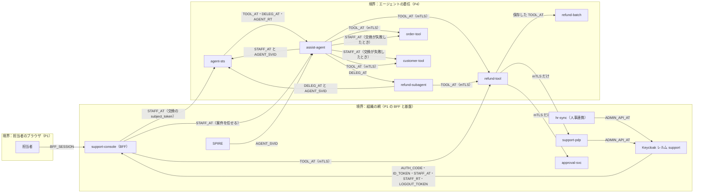
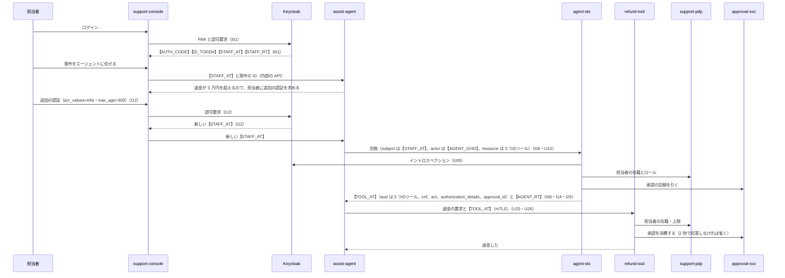
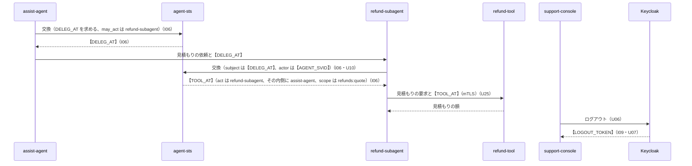

<!-- template_version: 0.7.0 -->
# みなと電機ストア サポートセンター：担当者のコンソールと案件エージェントの JWT クレームの設計書（Full）

> **意図的に誤りを含む教材。設計に使わない**

架空の家電通販「みなと電機ストア」のサポートセンターで、担当者（サポート担当）がコンソールで顧客の案件を扱い、AI エージェントが担当者の代わりに案件を進める仕組みの、トークンとクレームの設計です。判断の正は同じディレクトリの `claims.yaml`・`token_types.yaml`・`hops.yaml`・`catalog_answers.yaml` と `claim_request_*.md` で、この文書はその読み物です。

- 節の番号・アンカー・項目 ID は `templates/00_core.md`（0.7.0）と同じ。〔〕は 00_core の節の扱い
- 生成の区間：`<!-- render:<節>:begin -->`〜`end` の間は `python tools/claim_lint render <この設計書のディレクトリ> --write` が台帳から書き直す。手で直さない
- 当てはまらない記入欄は、表を消さずに「無い」と理由を書いた

| 欄 | この設計 |
| --- | --- |
| 版 | 1.0（初版。前の版なし） |
| Lite／Full | README の 5 問：境界を越える No・マルチテナント No・委任・交換 **Yes**・新しい発行者 **Yes**（agent-sts）・規制 No。**判定は Full**（`catalog_answers.yaml` の `lite_criteria`）。claim_lint は profile を付けずに（Full で）実行する |
| 使うプロファイル | 担当者のブラウザとコンソールの境界は P1、エージェント・サブエージェント・MCP のツールの境界は P4（2. の図）。モジュールは M_token_validation・M_sender_constraint・M_authz_pdp・M_privacy_minimization・M_idp_keycloak。記入欄は付録 D |
| 作成方法 | 生成 AI（Claude）を使って書いた。人による点検は未実施。Keycloak・SPIRE の挙動のうち確かめていないものは 12. に書いた |

## 1. CI の結果〔Lite：生成〕

項目 ID：`template:00_core#ci-results`

<!-- render:ci-result:begin -->
`python tools/claim_lint designs/target --also-scan designs/target/design.md`（profile full）：**error 0、warn 10、info 22**（claims 27・token_types 21・catalog_events 64）。OK

| 規則 | 重大度 | 対象 | 内容 |
| --- | --- | --- | --- |
| `R3` | info | `idp[keycloak]` | IdP keycloak の一覧（keycloak-settings・keycloak-grant-types）とカタログの差集合は 0 件 |
| `R3` | info | `idp[agent-sts]` | 発行者 agent-sts は組織が自分で作る（kind: self_built）。契機の一覧 5 項目は設計書が決め、すべてカタログのイベントか対象外にひもづく。まだ存在しない発行者（planned: true）なので、作った後に一覧を実装と突き合わせる。R3b と L2 は、この発行者を照合しない |
| `R6` | info | `pairwise` | 2 因子の組 75 個をすべて検討した（主体 3・発行イベント 13） |
| `R8` | info | `ADMIN_API_AT` | 最悪 1103 バイト（ヘッダーの行で 1125）／上限 8192（nginx-large-client-header-buffers）= 14% |
| `R8` | info | `TOOL_AT` | 最悪 3966 バイト（ヘッダーの行で 3988）／上限 8192（tool-http-header-field）= 49% |
| `R8` | info | `C-scope` | STAFF_AT・TOOL_AT・DELEG_AT の両方に載る（重複の候補） |
| `R8` | info | `C-act` | TOOL_AT・DELEG_AT の両方に載る（重複の候補） |
| `R8` | info | `C-customer-ref` | TOOL_AT・DELEG_AT の両方に載る（重複の候補） |
| `R8` | info | `C-groups` | STAFF_AT・TOOL_AT の両方に載る（重複の候補） |
| `L1b` | info | `C-kc-typ` | IdP keycloak が決めた名前 typ（名前空間なし・未登録。tools/claim_lint/idp_claims.yaml、https://github.com/keycloak/keycloak/blob/26.8.0/core/src/main/java/org/keycloak/util/TokenUtil.java）。STAFF_AT・ID_TOKEN・ADMIN_API_AT にだけ載り、下流のトークンとヘッダーへは名前のまま渡さない。一覧にある名前に組織の意味を載せていないかは、レビューで確かめる |
| `L2` | info | `idp[keycloak]` | IdP keycloak の、書き換えを許さないクレームの一覧が tools/claim_lint/idp_reserved.yaml にない。L2 は確かめていない（IdP モジュール #4 で手で確かめる） |
| `L16` | info | `hop H3` | 上流のトークンに無い独自クレームを、作り直しで足す（added_claims）：C-customer-contact（顧客の DB）、C-customer-ref（案件の管理）、C-approval-id（approval-svc） |
| `L16` | info | `hop H3` | aud を上流（H2）の https://agent-sts.minato-denki.example・https://order-tool.minato-denki.example/mcp・https://customer-tool.minato-denki.example/mcp から、行き先の 1 つの宛先 https://refund-tool.minato-denki.example/mcp に替える（aud_replacement。理由：agent-sts 宛ての STAFF_AT を、交換で refund-tool の 1 つの宛先に置き換える。ツールは STAFF_AT を受けない） |
| `L16` | warn | `hop H3` | authorization_details の https://minato-denki.example/rar/refund が上流（H2）に無い（下流ほど絞る。広げない） |
| `L16` | warn | `hop H3` | 寿命 1800 秒が上流（H2）の 600 秒を超える（下流ほど絞る。組織の規則、author-proposal。寿命の例外は Txn-Token の作り直しだけで、理由は 10 字以上） |
| `L16` | info | `hop H6` | 上流のトークンに無い独自クレームを、作り直しで足す（added_claims）：C-customer-contact（顧客の DB）、C-customer-ref（案件の管理） |
| `L16` | warn | `hop H6` | aud の https://refund-tool.minato-denki.example/mcp が上流（H5）に無い（下流ほど絞る。広げない） |
| `L16` | warn | `hop H6` | 寿命 1800 秒が上流（H5）の 600 秒を超える（下流ほど絞る。組織の規則、author-proposal。寿命の例外は Txn-Token の作り直しだけで、理由は 10 字以上） |
| `L16` | info | `hop H7` | 上流のトークンに無い独自クレームを、作り直しで足す（added_claims）：C-customer-contact（顧客の DB）、C-customer-ref（案件の管理） |
| `L16` | warn | `hop H7` | aud の https://refund-tool.minato-denki.example/mcp が上流（H5）に無い（下流ほど絞る。広げない） |
| `L16` | warn | `hop H7` | 寿命 1800 秒が上流（H5）の 600 秒を超える（下流ほど絞る。組織の規則、author-proposal。寿命の例外は Txn-Token の作り直しだけで、理由は 10 字以上） |
| `L16` | info | `hop H8` | 上流のトークンに無い独自クレームを、作り直しで足す（added_claims）：C-customer-contact（顧客の DB）、C-customer-ref（案件の管理）、C-approval-id（approval-svc） |
| `L16` | warn | `hop H8` | aud の https://refund-tool.minato-denki.example/mcp が上流（H5）に無い（下流ほど絞る。広げない） |
| `L16` | warn | `hop H8` | authorization_details の https://minato-denki.example/rar/refund が上流（H5）に無い（下流ほど絞る。広げない） |
| `L16` | warn | `hop H8` | 寿命 1800 秒が上流（H5）の 600 秒を超える（下流ほど絞る。組織の規則、author-proposal。寿命の例外は Txn-Token の作り直しだけで、理由は 10 字以上） |
| `L16` | info | `hop H9` | 上流のトークンに無い独自クレームを、作り直しで足す（added_claims）：C-case-id（案件の管理）、C-customer-ref（案件の管理） |
| `L16` | info | `hop H11` | 上流のトークンに無い独自クレームを、作り直しで足す（added_claims）：C-customer-contact（顧客の DB） |
| `L16` | info | `hop H11` | aud を上流（H10）の https://agent-sts.minato-denki.example から、行き先の 1 つの宛先 https://refund-tool.minato-denki.example/mcp に替える（aud_replacement。理由：agent-sts 宛ての DELEG_AT を、交換で refund-tool の 1 つの宛先に置き換える。refund-subagent の見積もりの要求だけに使う） |
| `L16` | warn | `hop H11` | 寿命 1800 秒が上流（H10）の 300 秒を超える（下流ほど絞る。組織の規則、author-proposal。寿命の例外は Txn-Token の作り直しだけで、理由は 10 字以上） |
| `L17` | info | `ID_TOKEN・AGENT_SVID` | 種類の違うトークン種別が同じ typ（jwt）を使うが、ペイロードの値と aud で区別する（kind_discriminator。RFC 8725 §3.12 の「必須クレームの値を変える」「aud を変える」）。typ は IdP が決め、設計では選べない。aud の列は自由記述なので、文字列が違っても同じ宛先を指していないかは、レビューで確かめる |
| `L27` | info | `token_type STAFF_AT` | at+jwt の REQUIRED の client_id（RFC 9068 §2.2）が無いことを、台帳の却下の行で逸脱として記録している |
| `L27` | info | `token_type ADMIN_API_AT` | at+jwt の REQUIRED の client_id（RFC 9068 §2.2）が無いことを、台帳の却下の行で逸脱として記録している |

R8 ADMIN_API_AT：ヘッダー 86・ペイロード 483・署名 256 バイト（ceil(4/3*86) + ceil(4/3*483) + ceil(4/3*256) + 2 = 115 + 644 + 342 + 2 = 1103; + 7 (Bearer) = 1110）。nginx-large-client-header-buffers 1125／8192 バイト

R8 TOOL_AT：ヘッダー 75・ペイロード 2833・署名 64 バイト（ceil(4/3*75) + ceil(4/3*2833) + ceil(4/3*64) + 2 = 100 + 3778 + 86 + 2 = 3966; + 7 (Bearer) = 3973）。tool-http-header-field 3988／8192 バイト
<!-- render:ci-result:end -->

warn の行ごとの理由（抑止はしていない。lint の出力のとおり）：

| 規則 | 対象 | 書き手の判断 |
| --- | --- | --- |
| `L16` | `hop H3`・`hop H8`（authorization_details） | 上流の STAFF_AT には承認の内容が無く、agent-sts が交換のときに approval-svc の承認の記録から `authorization_details` を作って足す。足すのは返金を 1 件の注文・金額に限る制限で、範囲を広げるものではない。STAFF_AT（Keycloak）に承認の内容を載せる手段が無いので、このホップの warn は受け入れる |
| `L16` | `hop H6`・`hop H7`・`hop H8`（aud） | エージェントの経路は、手順ごとの交換を 1 回にするため、3 つのツールの宛先を 1 つの TOOL_AT に入れた。上流の STAFF_AT の宛先に refund-tool が無いのは、返金のツールが STAFF_AT を直接受けないため（代わりの経路を作らない）。宛先は agent-sts に登録した 3 つのツールに限るので、受け入れる |
| `L16` | `hop H3`・`hop H6`・`hop H7`・`hop H8`・`hop H11`（寿命） | TOOL_AT は 1800 秒で、上流の STAFF_AT（600 秒）・DELEG_AT（300 秒）より長い。エージェントの 1 つの手順が、顧客への確認を待つ間に長くなり、途中で切れて交換し直すと手順をやり直すことになるため。理由は各ホップの `narrowing_exception` に書いた |

根拠：templates/CONTRIBUTING.md の 2.、tools/claim_lint/RULES.md、tools/claim_lint/RENDER.md の 1.

## 2. 範囲と信頼の境界〔Lite：手で書く〕

項目 ID：`template:00_core#scope-boundary`

### 要求の要約

設計の前提にした業務の要求（サポートセンターの業務要求書 2026-11 版の要約）です。6. のユースケースは、この ID を出どころとして書きます。

| ID | 要求 |
| --- | --- |
| REQ-01 | 担当者はブラウザのコンソールで案件を扱う。トークンをブラウザに置かない |
| REQ-02 | エージェントは担当者の代わりに案件を進める。担当者の権限を超えず、記録でエージェントの操作と担当者の操作を区別できる |
| REQ-03 | エージェントは返金額の計算（見積もり）をサブエージェントに任せてよい。委任は 2 段まで |
| REQ-04 | エージェントが使うツールは、注文の照会・返金・配送先の変更の 3 つ。照会できるのは案件の顧客の注文だけ |
| REQ-05 | 3 万円を超える返金は、責任者の承認（approval-svc）が要り、承認した注文・金額・通貨のとおりにだけ実行する。責任者は承認を取り下げられ、取り下げたら直ちに止まる |
| REQ-06 | 3 万円を超える返金は、担当者の 5 分以内の多要素認証も要る。コンソールからでもエージェントからでも同じ |
| REQ-07 | 担当者の退職・異動（人事の台帳）や refund-operator のロールの剥奪は、5 分以内に返金を止める。照会と配送先の変更は、ツールのトークンの寿命の分の遅れを許す |
| REQ-08 | 責任者は案件を引き継げる。誰が操作したかを監査で区別できる |
| REQ-09 | 案件ごとの操作と、返金ごとの承認を、監査でたどれる |
| REQ-10 | 返金の上限と担当者の区分（support_tier）は、人事の台帳の値に従う |
| REQ-11 | 返金は予約できる（最大 2 時間後に実行） |
| REQ-12 | 旧いマクロの道具が使う返金の口は、移行が終わるまで残す |
| REQ-13 | 顧客の個人情報は、必要な部品だけが扱う |

### 範囲

範囲は、担当者のブラウザ、コンソール（`support-console`。サーバー側の BFF）、Keycloak 26.8 のレルム `support`、交換のサービス `agent-sts`（この設計で作る）、エージェントの実行基盤 `assist-agent`、サブエージェント `refund-subagent`、MCP のツール `order-tool`・`refund-tool`・`customer-tool`、承認の記録 `approval-svc`、認可の判断点 `support-pdp`、予約の返金の実行 `refund-batch`、人事連携 `hr-sync`、ワークロードの ID の発行 SPIRE です。

| 境界 | 使うプロファイル | 中の部品 | 境界を越えるトークン（目録の ID） | 範囲の外にしたものと前提 |
| --- | --- | --- | --- | --- |
| 担当者のブラウザ | P1 | ブラウザ | BFF_SESSION（Cookie だけ）、AUTH_CODE（1 回限り） | 担当者のスマートフォン・ネイティブアプリ（P2）。担当者はブラウザだけで使う前提。スマートフォンの業務アプリを出すときに見直す |
| 組織の網（コンソールと基盤） | P1 | support-console・Keycloak・hr-sync・support-pdp・approval-svc・SPIRE | STAFF_AT・STAFF_RT・ID_TOKEN・LOGOUT_TOKEN・ADMIN_API_AT | 人事の台帳そのものと、案件の管理のシステムの中（別の設計書）。案件の管理は agent-sts に、案件の担当者と顧客の参照を返す API を持つ前提 |
| エージェントの委任 | P4 | agent-sts・assist-agent・refund-subagent・order-tool・refund-tool・customer-tool・refund-batch | TOOL_AT（エージェントの経路は 3 つのツールで 1 つ、mTLS で束縛）、AGENT_RT、DELEG_AT、AGENT_SVID | 決済代行の返金の API（refund-tool が決済代行の資格情報で呼び、このトークンを渡さない）。エージェントの言語モデルの提供元（トークンを渡さない前提。モデルへの入力にトークンを含めない） |
| データ層 | 無い：トークンで DB に接続しない | 注文の DB・顧客の DB は、各ツールが自分の資格情報で接続する | なし | ツールが利用者のトークンで DB に接続する構成にするとき（M_data_layer を使う） |

### 2.1 主体の種類〔Lite：手で書く（2. の中で）〕

項目 ID：`template:00_core#principals`

| 主体 | 種類 | 表すクレーム（台帳の ID） | 利用者のトークンと区別する手段 | 要求の言葉と、入る区分・入らない区分 |
| --- | --- | --- | --- | --- |
| 担当者（サポート担当） | 利用者 | `C-sub`（Keycloak の利用者 ID） | — | 「担当者」に入るのは、人事の台帳でサポートセンターに在籍し、refund-operator か support-agent のロールを持つ社員・契約社員・派遣社員。休職中・退職の手続き中は人事連携が Keycloak の利用者を無効にするので入らない（人事部に確かめた。2026-11-20） |
| 責任者（スーパーバイザー） | 利用者 | `C-sub`（自分の利用者 ID。案件を引き継ぐときは担当者の sub） | 担当者と同じ形。承認は approval-svc の画面で自分の ID で行う。案件の引き継ぎは Keycloak の impersonation で担当者として入る | 「責任者」は人事の台帳の職位がチームリーダー以上で、approval-svc の承認者のロールを持つ人。担当者が責任者を兼ねても、自分の返金は承認できない（approval-svc の規則） |
| assist-agent | ワークロード | `C-act`（最も外側の act.sub）、`C-client-id` | TOOL_AT の sub は担当者のまま、act に SPIFFE ID。agent-sts の交換が失敗したときだけ、照会と配送先の変更は STAFF_AT で直接呼ぶ（act は無い。返金は交換が要る） | — |
| refund-subagent | ワークロード | `C-act`（最も外側の act.sub）、内側の act に assist-agent | 委任の深さ 2。DELEG_AT の may_act に名前が入る（委任の相手の記録） | — |
| support-console | ワークロード | `C-azp`（STAFF_AT）、`C-client-id`（コンソールの経路の TOOL_AT） | コンソールの経路の TOOL_AT には act が無く、client_id が support-console | — |
| refund-batch・hr-sync・support-pdp | システム | refund-batch は SPIFFE ID と、予約のときに保存した TOOL_AT、hr-sync・support-pdp は ADMIN_API_AT の sub（サービスアカウント） | refund-batch は予約のときに保存した TOOL_AT の内容で動く | — |

### 2.2 システムの権限〔Full だけ〕

項目 ID：`template:00_core#system-privileges`

| 場面 | 主体とトークン（目録の ID） | クレームで示すこと（台帳の ID） | 確かめ方 |
| --- | --- | --- | --- |
| 夜間バッチ（予約の返金） | refund-batch。予約のときに refund-tool が保存した TOOL_AT | 保存した TOOL_AT の sub・approval_id・authorization_details | 予約のときに refund-tool が TOOL_AT を検証し、担当者・承認を確かめたので、実行の時点では保存した内容のとおりに返金する（期限は予約のときに確かめた）。approval-svc・support-pdp は引き直さない |
| 人事連携 | hr-sync。ADMIN_API_AT（manage-users） | ADMIN_API_AT の sub はサービスアカウント | 夜間の全件の同期と、退職・異動・ロールの変更の事象ごとの同期（120 秒以内）。support_tier の属性を書けるのは hr-sync だけ。返金の上限の属性（refund_limit_jpy）は、Keycloak のユーザープロファイルで担当者もアカウントの画面から編集できる（異動の直後に担当者が自分で直し、夜間の全件の同期で hr-sync が人事の台帳の値に書き戻す） |
| 運用者の操作（責任者の引き継ぎ） | 責任者。Keycloak の impersonation で得た担当者の STAFF_AT | `C-sub` は担当者 | 責任者のグループに realm-management の impersonation を与え、責任者は担当者として入って、担当者の画面と案件の割り当てのまま続ける（catalog の I19 は該当）。impersonation の開始は Keycloak の管理イベントに残る |
| 緊急時の特権 | 無い：返金の緊急の手作業は決済代行の管理画面で行い、この設計のトークンを使わない | — | 決済代行の管理画面の操作は、決済代行側の監査ログで見る（別の手順書） |
| 基盤の操作 | support-pdp。ADMIN_API_AT（view-users だけ） | ADMIN_API_AT の sub はサービスアカウント | 書き込みの権限を持たない。レルムの管理者もサービスアカウントの権限を変えるときは変更の記録を残す |

## 3. 既定から外れた点〔Lite：手で書く〕

項目 ID：`template:00_core#deviations`

| 外れた点 | 既定 | この設計の値 | 書いた台帳の行の ID | 見直しの条件 |
| --- | --- | --- | --- | --- |
| クライアント認証 | private_key_jwt など | tls_client_auth（Keycloak・agent-sts とも） | `issuance_profile.client_auth` | Keycloak の X509 Certificate のクライアント認証が使えない構成に変わったとき |
| 交換の発行者を足した | 既定の組み合わせに交換は無い | agent-sts の token exchange | `issuance_profile.grants`（exceptions） | エージェントが担当者のセッションの外で動く処理を足すとき |
| 送信者制約 | none | agent-sts の TOOL_AT は mtls。Keycloak の STAFF_AT・STAFF_RT は none | `issuance_profile.sender_constraint`、`token_types[]`（TOOL_AT・STAFF_AT） | STAFF_AT をサーバーの外（ブラウザ・端末）に出す構成にするとき |
| エージェントの RT | RT のローテーション | agent-sts は assist-agent に AGENT_RT（30 日、ローテーションなし、送信者制約なし）を出す | `issuance_profile.rt_strategy`・`grants`（exceptions）、`AGENT_RT` | 案件が 30 日を超えて続く運用が出たとき |
| AT の client_id | RFC 9068 §2.2 の必須 | Keycloak の STAFF_AT・ADMIN_API_AT に client_id が無い前提。azp で確かめる | `C-kc-client-id`（却下）、`C-azp` | Keycloak が client_id を出すようになったとき |
| ロールをトークンに載せない | IdP の roles のクライアントスコープ | ロールは PDP に問い合わせる。返金の権限はグループの表示名で決める | `C-roles`（却下）、`C-groups` | PDP の応答が遅く、ツールの呼び出しの遅れが問題になったとき |
| カタログの既定の回答 | Keycloak の既定（Full では引き継がない） | すべて手で書いた（11.） | `catalog_answers.yaml` | — |
| ケーススタディの判定 | 無い：記入例ではない（`scenario` はこの設計の名前で、ケーススタディと照合しない） | — | — | — |

### 3.1 重点と見送り〔Lite：手で書く（3. の中で）〕

項目 ID：`template:00_core#priorities-deferrals`

組織の種類は「AI エージェントの委任」と「社内業務システム」の両方に当たります。

| 区分（重点・見送り） | 項目 | 効果と費用（未検証の点を含む） | 見直しの条件 | 台帳の行の ID |
| --- | --- | --- | --- | --- |
| 重点 | act の連鎖を正しく読む（refund-tool は元の依頼元のエージェントで判断） | 最も外側の act.sub は mTLS の相手と照合し、refund-tool の許可リストは委任の元の assist-agent で当てる。サブエージェントを足しても refund-tool の許可リストを直さずに済む | 委任の深さを変えるとき | `C-act`、`TOOL_AT.max_delegation_depth` |
| 重点 | 交換の回数を抑える（エージェントの経路は 3 つのツールを 1 つの aud に） | 1 つの手順で照会と返金のように複数のツールを呼ぶので、交換を手順ごとに 1 回にする（1 案件で 10〜30 回の見込みが、手順の数まで減る。未計測）。宛先は登録した 3 つのツールに限る | ツールを 4 つ以上に増やすとき | `C-aud`、`hops.yaml` の H6〜H8 |
| 重点 | 承認の束縛（承認の記録から作った authorization_details） | 承認の無い 3 万円を超える返金を止める。承認の状態は agent-sts が交換のときに確かめ、refund-tool は返金のときに消費だけを呼ぶ | approval-svc の応答が遅いとき | `C-authorization-details`、`C-approval-id` |
| 重点 | 手順単位のトークン（1800 秒） | 顧客への確認を待つ長い手順でも途中で切れない。エージェントから漏れても 1830 秒で使えなくなる | 手順が 1800 秒を超える処理が出たとき | `TOOL_AT` |
| 重点 | 重要な操作の鮮度の確認（返金で PDP） | 剥奪を 150 秒で返金に届かせる（REQ-07）。費用は PDP の可用性への依存 | PDP を止めずに保守できない時間帯が出たとき | `C-sub`、`TOOL_AT.revocation` |
| 見送り | STAFF_AT の送信者制約 | Keycloak の STAFF_AT は support-console と assist-agent のサーバーの中だけにある。返金には agent-sts の交換（mTLS のクライアント認証）が要るので、STAFF_AT だけでは返金できない（照会と配送先の変更の代わりの経路は、組織の網の中の mTLS の相手からだけ）。DPoP を入れる費用（Keycloak の設定と BFF の鍵の管理）に見合わない | STAFF_AT をサーバーの外に出す構成にするとき、agent-sts が mTLS のクライアント認証をやめるとき | `issuance_profile.sender_constraint` |
| 見送り | JWE | ツールのトークンは組織の網の中だけを通り、顧客の連絡先は署名で改ざんを防げば足りる | ツールを社外の事業者に任せるとき | `C-customer-contact` |
| 見送り | 標準による深さの強制 | 標準が無いので、agent-sts の組織の規則（深さ 2）で強制する | 標準ができたとき | `TOOL_AT.max_delegation_depth` |

### 3.2 共通の基準〔Lite：手で書く（満たさないものがあるときだけ）〕

項目 ID：`template:00_core#baseline`

| 基準 | 満たすか | 満たさないときの理由と、回した先 |
| --- | --- | --- |
| 受け入れの検証（alg・iss・aud・exp・typ） | 満たす | — |
| 必須の欠落は拒否 | 満たす | — |
| 型の固定 | 満たす | — |
| 不変の ID | 満たす（sub は UUID、案件・顧客・承認は不透明な ID） | — |
| 組織の名前空間 | 満たす（https://minato-denki.example/claims/） | — |
| ログにトークン全文と個人情報を残さない | 満たす（トークンは jti だけ、sub・customer_ref は鍵つきのハッシュ） | — |
| IdP の差を入口で正規化してから当てる | 無い：入口を置かない。Keycloak の差（client_id が無い）は agent-sts が azp で吸収し、ツールには agent-sts のトークンだけが届く | — |

## 4. 発行方式の選択〔Lite：生成（既定の組み合わせから外れた点だけ 3. に手で書く）〕

項目 ID：`template:00_core#issuance-profile`

agent-sts が受ける要求の一覧（`catalog_answers.yaml` の `idp` の agent-sts の `trigger_list` の出どころ）：

| 要求 | 受けるか | 条件 |
| --- | --- | --- |
| `grant_type=urn:ietf:params:oauth:grant-type:token-exchange` | 受ける | subject_token は STAFF_AT（レルム support、aud に agent-sts、azp が support-console）か DELEG_AT。actor_token は AGENT_SVID（コンソールの経路では無し）。クライアントは信頼ドメインの SVID か support-console の証明書の mTLS で認証できればよい。`resource` は登録した 3 つのツールのどれか（エージェントの経路は 3 つをまとめて） |
| 交換の要求の `authorization_details` | 受ける | type が https://minato-denki.example/rar/refund のときだけ。approval-svc の承認の記録と照合して作り直す（要求の値をそのまま載せない） |
| `grant_type=refresh_token` | 受ける | assist-agent の AGENT_RT だけ。resource で指定したツールの TOOL_AT を出す |
| `grant_type=client_credentials` | 受けない | エージェント自身の権限のトークンを出さない |

<!-- render:issuance-profile:begin -->
`token_types.yaml` の `issuance_profile`。既定の組み合わせから外れた点の理由は、手で書く節（既定から外れた点）に書く。

| 項目 | 選択 | 理由 | 根拠 |
| --- | --- | --- | --- |
| クライアントの種類 | 機密（`confidential`） | support-console はサーバー側の BFF で、トークンをブラウザに出さない。agent-sts のクライアント（assist-agent・refund-subagent・support-console）も サーバー側のワークロードで、SPIRE の X.509-SVID かクライアント証明書を持てる。公開クライアントは作らない | [RFC 6749 §2.1](https://www.rfc-editor.org/rfc/rfc6749#section-2.1) `slide:p08-rotation` |
| クライアント認証 | `tls_client_auth` | support-console は Keycloak にも agent-sts にも、同じクライアント証明書で mTLS のクライアント認証をする（Keycloak の X509 Certificate の クライアント認証）。エージェントは X.509-SVID で agent-sts に認証する。共有の秘密（client_secret_*）を持たない | [RFC 8705 §2.1](https://www.rfc-editor.org/rfc/rfc8705#section-2.1) [Keycloak Server Administration Guide（26.8.2）「Confidential client credentials」](https://www.keycloak.org/docs/26.8.2/server_admin/index.html) |
| grant | 認可コード＋PKCE（`authorization_code_pkce`）、リフレッシュ（`refresh_token`）。例外：agent-sts は トークン交換（`token_exchange`）、リフレッシュ（`refresh_token`） | 担当者はコンソールで認可コード＋PKCE（S256）でログインし、support-console は RT で STAFF_AT を取り直す。Keycloak のトークン交換・client credentials・ Direct Access Grants は support-console で OFF【agent-sts の例外】agent-sts が受けるのは RFC 8693 のトークン交換と、assist-agent の RT の取り直し。案件が数日にわたるとき、エージェントは担当者の再ログインを 待たずに TOOL_AT を取り直す。client credentials は持たない（エージェント自身の権限でツールを呼ぶ経路を作らない） | [RFC 7636 §4](https://www.rfc-editor.org/rfc/rfc7636#section-4) `slide:p06-grant-types` [RFC 8693 §2.1](https://www.rfc-editor.org/rfc/rfc8693#section-2.1) |
| 送信者制約 | なし（`none`）。例外：agent-sts は mTLS（`mtls`） | Keycloak が出す STAFF_AT・STAFF_RT は送信者制約を付けない。どちらも support-console のサーバーの中にだけあり、ブラウザに出ない。 agent-sts は交換を求めたクライアントの mTLS 認証（support-console か、登録したエージェント）を求めるので、STAFF_AT だけを盗んでも返金はできない。 照会と配送先の変更のツールは、交換が失敗したときだけ STAFF_AT を受ける。寿命は 600 秒【agent-sts の例外】ツールのトークン（TOOL_AT）は、交換を求めたワークロードの証明書に束縛する（cnf の x5t#S256）。エージェントの実行基盤は外部の入力 （顧客の問い合わせの文）を読むので、トークンが外に出る経路を前提にする | `slide:p12-priorities-deferrals` [RFC 9700 §4.10.1](https://www.rfc-editor.org/rfc/rfc9700#section-4.10.1) [RFC 8705 §3](https://www.rfc-editor.org/rfc/rfc8705#section-3) |
| TLS の終端 | `end_to_end` | エージェント・support-console とツールの間は、組織の網の中で直接 mTLS を張る。入口で TLS を終端しないので、証明書をヘッダーで渡さない | [RFC 8705 §6.5](https://www.rfc-editor.org/rfc/rfc8705#section-6.5) |
| AT の形式 | JWT（`jwt`） | ツールは手元で act・cnf・authorization_details を照合する。返金の判断の新しさは、トークンでなく PDP と approval-svc への問い合わせで保つ | `slide:p01-self-contained-vs-reference` [RFC 9068 §2](https://www.rfc-editor.org/rfc/rfc9068#section-2) |
| RT の方式 | ローテーション＋再利用の検知（`rotation_reuse_detection`）。例外：agent-sts は なし（`none`） | STAFF_RT は support-console だけが持つ。Keycloak の Revoke Refresh Token を ON、再利用の回数を 0 にして、使うたびにローテーションする。 古い RT の再利用でセッションを終えることを試験で確かめる（design.md の 12.）【agent-sts の例外】assist-agent の RT（AGENT_RT）はローテーションせず、送信者制約も付けない。assist-agent と agent-sts の間は組織の網の中で、 ローテーションの競合（並行の手順が同じ RT を使う）で手順が止まるのを避け、運用を簡単にする | [RFC 9700 §4.14.2](https://www.rfc-editor.org/rfc/rfc9700#section-4.14.2) |
| 要求の保護 | `par`、`resource_indicators`、`rar` | support-console から Keycloak への認可要求は PAR で送り、URL に載るのは request_uri と認可コードだけにする。agent-sts への交換の要求には resource（RFC 8707）を 1 つ入れて宛先を絞り、返金では authorization_details（RFC 9396）を approval-svc の記録から作る | [RFC 9126 §2](https://www.rfc-editor.org/rfc/rfc9126#section-2) [RFC 8707 §2](https://www.rfc-editor.org/rfc/rfc8707#section-2) [RFC 9396 §2](https://www.rfc-editor.org/rfc/rfc9396#section-2) |
| 適合のプロファイル | なし（`none`） | 通販の社内のサポート業務で、FAPI などの業界の規制の対象ではない。返金の承認と追加の認証は、FAPI に合わせずに上の選択で行う | [FAPI 2.0 Security Profile（Final）§5.3.2.1](https://openid.net/specs/fapi-security-profile-2_0-final.html) |

選択から導かれる要件（`templates/registry/issuance_effects.yaml`）：条件が成り立つ行は 3 件／全 13 件。**次の表は検査ではない。** render が `check` を簡易に読み取った表示で、検査の正は `tools/claim_lint/RULES.md` の L62〜L64（#6）。「満たしている行」は、要件の場所にある台帳の行。

| 行 | 要件 | 台帳で必要になるもの | 簡易な読み取り（正は L62） | 満たしている行 | 規則 |
| --- | --- | --- | --- | --- | --- |
| `E-mtls` | `E-mtls.1` | AT に cnf.x5t#S256（クライアント証明書の拇印）を載せる | 満たす | `C-cnf` | `L62`・`L15` |
| `E-mtls` | `E-mtls.2` | AT の受け手すべてが、TLS の相手の証明書の拇印と cnf を照合する | 満たす | `C-cnf` | `L62`・`L15` |
| `E-mtls` | `E-mtls.3` | TLS をどこで終端するか（tls_termination）を宣言する | 満たす | — | `L62`・`L15` |
| `E-token-exchange` | `E-token-exchange.1` | 委任なら act（最も外側が今の代理者）、交換を許す相手を事前に示すなら may_act を台帳に置く | 満たす | `C-act` | `L62`・`L16` |
| `E-token-exchange` | `E-token-exchange.2` | 交換のホップ（kind は exchange）で、aud・scope・寿命・独自クレームを上流より広げない（下流ほど絞る） | 満たす | `H3`・`H6`・`H7`・`H8`・`H9`・`H11` | `L62`・`L16` |
| `E-rar` | `E-rar.1` | authorization_details の type の語彙を value_vocabulary で定め、持ち主を決める | 満たす | `C-authorization-details` | `L62`・`L16` |
| `E-rar` | `E-rar.2` | 宛先ごとに絞って入れる（ホップの authorization_details） | 満たす | `H3`・`H8` | `L62`・`L16` |
| `E-rar` | `E-rar.3` | 配列の上限（max_items）と 1 件の上限（max_bytes）を決める | 満たす | `C-authorization-details` | `L62`・`L16` |
<!-- render:issuance-profile:end -->

根拠：templates/registry/README.md の 3.3 と 7.、templates/registry/issuance_effects.yaml

## 5. トークン目録〔Lite：生成〕

項目 ID：`template:00_core#token-inventory`

<!-- render:token-inventory:begin -->
`token_types.yaml` の 21 行（却下 10）。種類の名前は `templates/catalog/token_kinds.yaml`。

| ID | 種類 | 採否 | 発行 → 宛先（aud） | 持ち手 | 形式 | 寿命 | 保存場所 | 運び方 | 読める相手 | JWE | 理由 |
| --- | --- | --- | --- | --- | --- | --- | --- | --- | --- | --- | --- |
| `BFF_SESSION` | セッション（IdP のセッション session_idp と、RP・BFF のセッション session_rp の 2 層） | 採用 | support-console（BFF） → — | ブラウザ（HttpOnly・Secure・SameSite=Lax の __Host- の Cookie） | opaque | idle 1800 秒、最大 28800 秒 | ブラウザ | Cookie | `browser`・`bff`・`api` | — | ブラウザは support-console の BFF のセッションの Cookie だけを持つ。トークンをブラウザに出さない |
| `AUTH_CODE` | 認可コード | 採用 | Keycloak（レルム support） → — | ブラウザを経由して support-console へ | opaque | 60 秒 | なし | リダイレクトの query | `browser`・`bff`・`idp` | — | 認可コード＋PKCE（S256）で Keycloak が出す。PAR で認可要求を送るので、URL に載るのは request_uri と認可コードだけ |
| `ID_TOKEN` | ID トークン | 採用 | Keycloak（レルム support） → support-console | support-console のサーバー。ブラウザには渡さない | jwt（JWT、RS256） | 600 秒（時計のずれ 30 秒） | BFF のサーバー | トークンの応答 | `bff`・`idp` | なし | support-console がログインを確かめ、画面に担当者の名前を出す。sid を BFF のセッションに結ぶ。追加の認証の後の acr・auth_time を確かめる |
| `STAFF_AT` | アクセストークン | 採用 | Keycloak（レルム support） → https://agent-sts.minato-denki.example・https://order-tool.minato-denki.example/mcp・https://customer-tool.minato-denki.example/mcp | support-console のサーバー。案件を任せている間は assist-agent のメモリにも置く | jwt（at+jwt、RS256） | 600 秒（時計のずれ 30 秒） | BFF のサーバー | フォームの本文 | `bff`・`client`・`idp`・`api` | なし | 担当者の権限を agent-sts に示す AT。support-console が持ち、案件をエージェントに任せるときは assist-agent に渡す。エージェントはふつう交換の subject_token に使う。 agent-sts の交換が失敗したとき（agent-sts の障害）は、照会と配送先の変更を止めないため、assist-agent が STAFF_AT で order-tool・customer-tool を直接呼ぶ。 そのため宛先に 2 つのツールも入れる（返金は agent-sts の交換が要る） |
| `STAFF_RT` | リフレッシュトークン | 採用 | Keycloak（レルム support） → https://sso.minato-denki.example/realms/support | support-console のサーバー | opaque | idle 1800 秒、最大 28800 秒 | BFF のサーバー | トークンの応答 | `bff`・`idp` | — | STAFF_AT を 600 秒にしたまま、セッションの間は担当者に再ログインさせない。support-console だけが持ち、エージェントには渡さない |
| `LOGOUT_TOKEN` | ログアウトトークン（Back-Channel Logout の Logout Token） | 採用 | Keycloak（レルム support） → support-console | support-console のサーバー（Back-Channel Logout の受け口） | jwt（logout+jwt、RS256） | 120 秒（時計のずれ 30 秒） | なし | バックチャネルの POST | `bff`・`idp` | なし | 担当者の無効化・セッションの削除を、support-console の BFF のセッションに届かせる。次のリフレッシュの失敗を待たない |
| `ADMIN_API_AT` | アクセストークン | 採用 | Keycloak（レルム support） → realm-management | hr-sync・support-pdp のサーバー | jwt（at+jwt、RS256） | 300 秒（時計のずれ 30 秒） | サービスのメモリ | Authorization: Bearer | `client`・`idp` | なし | 人事連携（hr-sync）と PDP（support-pdp）のサービスアカウントが、Keycloak の管理 API を呼ぶための AT（client credentials）。 hr-sync は利用者・ロール・属性の書き込み（manage-users）、support-pdp は読み取り（view-users）だけを持つ。agent-sts・ツールはこの AT を受けない |
| `TOOL_AT` | アクセストークン | 採用 | agent-sts → https://order-tool.minato-denki.example/mcp・https://refund-tool.minato-denki.example/mcp・https://customer-tool.minato-denki.example/mcp | assist-agent・refund-subagent・support-console のどれか（交換を求めた者。証明書に束縛） | jwt（at+jwt、ES256） | 1800 秒（時計のずれ 30 秒） | サービスのメモリ | Authorization: Bearer | `client`・`api` | なし | agent-sts が交換で出す、ツール宛ての AT（エージェントの経路は 3 つのツール宛て）。sub は担当者、最も外側の act.sub は今の行為者（エージェント）、 cnf は交換を求めたワークロードの証明書。scope は呼ぶツールの操作。返金では authorization_details と approval_id を載せる。コンソールの経路（act なし、client_id が support-console）でも同じ種別 |
| `DELEG_AT` | アクセストークン | 採用 | agent-sts → https://agent-sts.minato-denki.example | refund-subagent（assist-agent から受ける） | jwt（at+jwt、ES256） | 300 秒（時計のずれ 30 秒） | サービスのメモリ | フォームの本文 | `client`・`idp` | なし | assist-agent が返金の見積もりを refund-subagent に任せるとき、agent-sts が出す委任の AT。宛先は agent-sts だけで、may_act に refund-subagent を入れる。 refund-subagent はこれを subject_token にして、自分の actor_token で refund-tool 宛ての TOOL_AT に交換する |
| `AGENT_SVID` | 汎用の JWT（ワークロードの ID のトークン・アサーショングラントに出す JWT など） | 採用 | SPIRE（信頼ドメイン minato-denki.example） → https://agent-sts.minato-denki.example | assist-agent・refund-subagent（SPIRE のエージェントから受ける） | jwt（JWT、ES256） | 300 秒（時計のずれ 30 秒） | サービスのメモリ | フォームの本文 | `client`・`idp` | なし | エージェントの JWT-SVID。agent-sts への交換の actor_token に使い、sub（SPIFFE ID）を act.sub に写す。mTLS の X.509-SVID と同じ SPIFFE ID であることを確かめる |
| `AGENT_RT` | リフレッシュトークン | 採用 | agent-sts → https://agent-sts.minato-denki.example | assist-agent のサーバー | opaque | idle 2592000 秒、最大 2592000 秒 | サービスのメモリ | トークンの応答 | `client`・`idp` | — | 案件が数日にわたるとき、assist-agent が担当者の再ログインを待たずに TOOL_AT を取り直す。最初の交換で agent-sts が出し、assist-agent だけが持つ。 組織の網の中だけで使うので、ローテーションと送信者制約は付けない（運用を簡単にする） |
| `TXN_TOKEN` | Transaction Token（Txn-Token） | 却下 | — | — | jwt | — | — | — | — | — | ツールの先に、トークンで文脈を伝えるサービスの連鎖が無い。案件の相関は case_id、行為者は act で足りる |
| `INTERNAL_TOKEN` | 内部トークン（入口で外部のトークンを検証し、作り直したもの） | 却下 | — | — | jwt | — | — | — | — | — | 入口でトークンを作り直さない。ツール宛てのトークンは agent-sts が交換で直接出す |
| `ID_JAG` | ID-JAG（Identity Assertion JWT Authorization Grant） | 却下 | — | — | jwt | — | — | — | — | — | 信頼ドメインをまたいでツールを呼ばない。ツールはすべて組織の中にある |
| `DPOP_PROOF` | DPoP の proof | 却下 | — | — | jwt | — | — | — | — | — | 送信者制約は mTLS にした。エージェントの実行基盤とコンソールはどれも SPIRE の SVID かクライアント証明書を持ち、DPoP の鍵を別に管理しない |
| `CLIENT_ASSERTION` | クライアントの assertion（private_key_jwt・client_secret_jwt） | 却下 | — | — | jwt | — | — | — | — | — | クライアント認証は mTLS（tls_client_auth）にした。鍵を 2 種類持たない |
| `JAR_REQUEST_OBJECT` | 署名つきの認可要求（JAR の Request Object） | 却下 | — | — | jwt | — | — | — | — | — | 認可要求は PAR で support-console のサーバーから Keycloak に直接送る。ブラウザを通る要求の改ざんは PAR で防ぐ |
| `JARM_RESPONSE` | 署名つきの認可応答（JARM） | 却下 | — | — | jwt | — | — | — | — | — | 認可応答は認可コードと iss だけで、PKCE と PAR で守る。応答に署名する必要がない |
| `SECURITY_EVENT_TOKEN` | Security Event Token（SET。SSF・CAEP の通知） | 却下 | — | — | jwt | — | — | — | — | — | 人事連携からの変更は Keycloak の管理 API への書き込みで届け、SET を使わない。剥奪の反映は PDP の問い合わせで行う |
| `STATUS_LIST_TOKEN` | 状態リストのトークン（Token Status List） | 却下 | — | — | jwt | — | — | — | — | — | TOOL_AT は 1800 秒で、返金の判断は PDP と approval-svc に都度問い合わせる。状態リストで個々のトークンを止める必要がない |
| `INTROSPECTION_RESPONSE_JWT` | JWT 形式のイントロスペクションの応答 | 却下 | — | — | jwt | — | — | — | — | — | agent-sts は Keycloak のイントロスペクションを mTLS で直接呼び、応答を第三者に渡さないので、JSON の応答で足りる |
<!-- render:token-inventory:end -->

### 5.1 寿命の上限の方針〔Full だけ〕

項目 ID：`template:00_core#lifetime-policy`

組織の上限は `tools/claim_lint/lifetime_caps.yaml` の値をそのまま使います。

| 種類 | 組織の上限（秒） | 例外を認める手順（承認者・記録先） | 例外にした種別（目録の ID と `lifetime_exception`） |
| --- | --- | --- | --- |
| アクセストークン・ID トークン | 3600 | 認証基盤チームの責任者が承認し、`token_types.yaml` の `lifetime_exception` と PR に残す | 無い（STAFF_AT・ID_TOKEN は 600、TOOL_AT は 1800、DELEG_AT・ADMIN_API_AT は 300） |
| RT・セッション | 86400（無操作 3600） | 同上 | AGENT_RT（2592000 秒。`lifetime_exception`：認証基盤チームの責任者が 2026-11-20 に承認。案件が数日にわたるため）。STAFF_RT・BFF_SESSION は最大 28800、無操作 1800 |
| 認可コード | 600 | 同上 | 無い（AUTH_CODE は 60） |
| ログアウトトークン | 120 | 同上 | 無い（LOGOUT_TOKEN は 120） |
| 交換で出すトークン | 3600（アクセストークンと同じ） | 同上 | 無い（TOOL_AT は 1800 秒。上流の STAFF_AT より長いことは 8. と 1. の warn） |

## 6. 問い × 仕組み〔Lite：手で書く〕

項目 ID：`template:00_core#question-mechanism`

**ユースケース 1：エージェントが案件を進める（注文の照会・配送先の変更・返金）**。要求の出どころ：REQ-02・REQ-04・REQ-05・REQ-06・REQ-07・REQ-09

| ユースケース | 問い（ID） | 要るか | 仕組み（台帳の行の ID か、クレームでない仕組み） | 不要の理由・照合する場所 |
| --- | --- | --- | --- | --- |
| UC1 | q-sub | 要る | `C-sub` | refund-tool が PDP に担当者の在籍・ロール・上限を問い合わせる |
| UC1 | q-actor | 要る | `C-act`（最も外側の act.sub） | 各ツールが mTLS の相手と照合し、ツールごとの行為者の許可リストで判断 |
| UC1 | q-req-wl | 不要 | — | Txn-Token を使わない。交換を求めたワークロードは agent-sts が mTLS と AGENT_SVID で認証する |
| UC1 | q-peer | 要る | mTLS の相手の X.509-SVID（SPIFFE ID） | 各ツールが TLS の層で確かめ、`C-cnf` と `C-act` に照らす |
| UC1 | q-via | 要る | agent-sts の交換の監査ログと、各ツールの監査ログ | 交換の元の jti と出した jti を結ぶ |
| UC1 | q-txn | 要る | `C-case-id` | agent-sts の交換の監査ログ（ツールのトークンには載せない） |
| UC1 | q-user | 要る | `C-sub` | 監査ログ（鍵つきのハッシュ） |
| UC1 | q-agent | 要る | `C-act`、`C-client-id` | 各ツール |
| UC1 | q-authorized | 要る | `C-scope`、`C-authorization-details`、`C-approval-id` | scope は各ツール、承認は agent-sts（交換のとき）と refund-tool（消費） |
| UC1 | q-resource | 要る | `C-aud` | 各ツール（aud に自分の MCP の URI がある） |
| UC1 | q-holder | 要る | `C-cnf` | 各ツール |

**ユースケース 2：サブエージェントが返金を見積もる**。要求の出どころ：REQ-03

| ユースケース | 問い（ID） | 要るか | 仕組み | 不要の理由・照合する場所 |
| --- | --- | --- | --- | --- |
| UC2 | q-sub | 要る | `C-sub`（DELEG_AT から写す） | agent-sts |
| UC2 | q-actor | 要る | `C-act`（最も外側が refund-subagent、内側が assist-agent） | refund-tool。最も外側の act.sub を mTLS の相手と照合し、行為者の許可リストは元の依頼元のエージェント（内側の act.sub）で当てる |
| UC2 | q-req-wl | 不要 | — | UC1 と同じ |
| UC2 | q-peer | 要る | mTLS の相手の X.509-SVID | refund-tool、agent-sts |
| UC2 | q-via | 要る | act の連鎖と交換の監査ログ | agent-sts の交換の監査ログに act の連鎖を記録 |
| UC2 | q-txn | 要る | `C-case-id`（DELEG_AT） | agent-sts の交換の監査ログ |
| UC2 | q-user | 要る | `C-sub` | 監査ログ |
| UC2 | q-agent | 要る | `C-act`、`C-client-id` | refund-tool（許可リスト）。agent-sts は may_act を記録する |
| UC2 | q-authorized | 要る | `C-scope`（refunds:quote だけ） | refund-tool。見積もりは承認が要らない |
| UC2 | q-resource | 要る | `C-aud` | agent-sts（DELEG_AT）、refund-tool（TOOL_AT） |
| UC2 | q-holder | 要る | `C-cnf` | refund-tool |

**ユースケース 3：担当者がコンソールから返金する（予約の返金を含む）**。要求の出どころ：REQ-01・REQ-05・REQ-06・REQ-08・REQ-11

| ユースケース | 問い（ID） | 要るか | 仕組み | 不要の理由・照合する場所 |
| --- | --- | --- | --- | --- |
| UC3 | q-sub | 要る | `C-sub` | refund-tool（PDP）。予約は保存した TOOL_AT の sub で実行する |
| UC3 | q-actor | 不要 | — | 担当者自身の操作で、代理する者がいない（act が無いことを client_id と合わせて確かめる） |
| UC3 | q-req-wl | 不要 | — | Txn-Token を使わない |
| UC3 | q-peer | 要る | support-console のクライアント証明書（mTLS） | refund-tool |
| UC3 | q-via | 要る | refund-tool の監査ログ | 予約の返金は委任の記録の ID で、予約と実行を結ぶ |
| UC3 | q-txn | 要る | `C-case-id` | agent-sts の交換の監査ログ |
| UC3 | q-user | 要る | `C-sub` | 監査ログ |
| UC3 | q-agent | 要る | `C-client-id`（support-console） | refund-tool |
| UC3 | q-authorized | 要る | `C-scope`、`C-authorization-details`、`C-approval-id` | refund-tool と approval-svc（消費）。予約は保存した TOOL_AT の authorization_details のとおりに実行する |
| UC3 | q-resource | 要る | `C-aud` | refund-tool |
| UC3 | q-holder | 要る | `C-cnf` | refund-tool |

<!-- render:question-mechanism:begin -->
`templates/registry/questions.yaml` の問いごとに、台帳の `answers`・`does_not_answer` を引いた。「不要」の理由は台帳に列がないので、手で書く表に書く。

| ID | 問い | 問いの一覧の仕組み | 答える台帳の行（answers） | 答えに使わない行（does_not_answer） | 照合する場所 |
| --- | --- | --- | --- | --- | --- |
| `q-sub` | 誰の権限で | `sub` | `sub` | `act` | `support-console`・`agent-sts`・`order-tool`・`refund-tool`・`customer-tool` |
| `q-actor` | 誰が代理して実行しているか | `act` | `act` | `sub` | `agent-sts`・`order-tool`・`refund-tool`・`customer-tool` |
| `q-req-wl` | どのワークロードが Txn-Token を求めたか | `req_wl` | — | — | — |
| `q-peer` | 直接の通信相手は誰か | `mTLS の相手の ID（SPIFFE の X.509-SVID など）` | — | — | — |
| `q-via` | どこを経由したか | `経由を示す別の属性（AWS FAS の aws:CalledVia に当たるもの）`・`ネストした act` | — | — | — |
| `q-txn` | どの取引か | `txn` | `case_id` | — | `agent-sts` |
| `q-user` | 誰が利用者か | `iss と sub の組` | `sub` | — | `support-console`・`agent-sts`・`order-tool`・`refund-tool`・`customer-tool` |
| `q-agent` | どのエージェント・クライアントか | `client_id`・`azp`・`act.sub`・`req_wl` | `client_id`・`act` | — | `agent-sts`・`order-tool`・`refund-tool`・`customer-tool` |
| `q-authorized` | 何が承認されたか | `scope`・`authorization_details`・`acr・amr・auth_time` | `scope`・`authorization_details`・`approval_id` | — | `agent-sts`・`order-tool`・`refund-tool`・`customer-tool` |
| `q-resource` | どのリソース向けか | `aud`・`resource（RFC 8707）` | `aud` | — | `support-console`・`agent-sts`・`order-tool`・`refund-tool`・`customer-tool` |
| `q-holder` | 誰が持つべきか | `cnf` | `cnf` | — | `order-tool`・`refund-tool`・`customer-tool` |
| `q-iss` | 誰が発行したか、信頼する発行者か（pending） | `iss（許可リストと完全一致）、iss ごとの鍵` | — | — | — |
| `q-typ` | どの種類・目的のトークンか（pending） | `ヘッダーの typ（at+jwt・txntoken+jwt・logout+jwt など）` | — | — | — |
| `q-auth-strength` | どの強さで、いつ認証されたか（pending） | `acr・amr・auth_time` | — | — | — |
| `q-still-valid` | 今も有効か（pending） | `exp、失効の手段（イントロスペクション・状態リスト・SSF/CAEP・Back-Channel Logout）、剥奪が反映されるまでに許す時間` | — | — | — |
<!-- render:question-mechanism:end -->

根拠：slide:p05-one-request-carries、slide:p10-four-questions、templates/registry/questions.yaml

## 7. シーケンス図〔Full だけ〕

項目 ID：`template:00_core#sequence`

ログインと、エージェントの返金（3 万円を超える場合）：

サブエージェントの見積もりと、ログアウト：

根拠：templates/catalog/issue_events.yaml、templates/catalog/use_events.yaml、slide:p06-stage-map

## 8. ホップごとの表〔Lite：生成（交換・作り直しのホップがあれば手で書く）〕

項目 ID：`template:00_core#hop-table`

交換のホップ（H3・H6〜H9・H11）は、新しいトークンを出す agent-sts を `from` に書き、トークンを運ぶ者（support-console・assist-agent・refund-subagent）を括弧に書きました。コンソールの経路（H3）とサブエージェントの経路（H11）では、aud は交換で refund-tool の宛先に置き換わります（`aud_replacement`）。エージェントの経路（H6〜H8）では、3 つのツールの宛先と操作を 1 つの TOOL_AT に入れ、同じトークンで 3 つのツールを呼びます。scope は上流の部分集合です。TOOL_AT の寿命は 1800 秒で、上流より長くしました（1. の warn の理由）。H12・H13 は、交換が失敗したときの代わりの経路です。

<!-- render:hop-table:begin -->
`hops.yaml` の宣言。トークンのないホップの「運ぶトークン」は —。

| ホップ | 種類 | 運ぶトークン | aud | scope | 寿命 | 運ぶ独自クレーム | 交換するサービス | 検証 | 検証・照合すること |
| --- | --- | --- | --- | --- | --- | --- | --- | --- | --- |
| H1 担当者のブラウザ → support-console | `browser` | `BFF_SESSION` | `support-console` | — | 28800 秒 | — | — | `local` | Cookie の __Host- の接頭辞と SameSite BFF のセッションの無操作 1800 秒と最大 28800 秒 状態を変える要求の CSRF のトークン |
| H2 support-console → https://agent-sts.minato-denki.example（コンソールの経路の交換） | `service` | `STAFF_AT` | `https://agent-sts.minato-denki.example`・`https://order-tool.minato-denki.example/mcp`・`https://customer-tool.minato-denki.example/mcp` | `openid`・`orders:read`・`customer.shipping:write`・`refunds:quote`・`refunds:issue` | 600 秒 | — | — | `introspection` | 署名（レルム support の JWKS） iss がレルム support aud が agent-sts azp が support-console Keycloak のイントロスペクションで有効 mTLS の相手が support-console のクライアント証明書 |
| H3 https://agent-sts.minato-denki.example（発行。運ぶのは support-console） → https://refund-tool.minato-denki.example/mcp | `exchange` | `TOOL_AT` | `https://refund-tool.minato-denki.example/mcp` | `refunds:quote`・`refunds:issue` | 1800 秒 | `customer_ref（足す：案件の管理）`・`approval_id（足す：approval-svc）`・`customer_contact（足す：顧客の DB）` | agent-sts | `local` | 署名（agent-sts の JWKS） aud が refund-tool だけ mTLS の相手の証明書と cnf の x5t#S256 act が無いので client_id が support-console scope に操作がある groups に「返金担当」 PDP で担当者の在籍・返金の上限 3 万円を超えれば acr が mfa で auth_time から 300 秒以内 3 万円を超えれば authorization_details と approval_id があり、approval-svc で消費できる |
| H4 support-console → assist-agent | `service` | `STAFF_AT` | `https://agent-sts.minato-denki.example`・`https://order-tool.minato-denki.example/mcp`・`https://customer-tool.minato-denki.example/mcp` | `openid`・`orders:read`・`customer.shipping:write`・`refunds:quote`・`refunds:issue` | 600 秒 | — | — | `local` | mTLS の相手が support-console の証明書 案件の ID が要求の本文にある STAFF_AT は検証せずに保持する（宛先は agent-sts） |
| H12 assist-agent → https://order-tool.minato-denki.example/mcp（交換が失敗したときの代わりの経路） | `service` | `STAFF_AT` | `https://agent-sts.minato-denki.example`・`https://order-tool.minato-denki.example/mcp`・`https://customer-tool.minato-denki.example/mcp` | `openid`・`orders:read`・`customer.shipping:write`・`refunds:quote`・`refunds:issue` | 600 秒 | — | — | `local` | 署名（レルム support の JWKS） iss がレルム support aud に order-tool がある azp が support-console scope に orders:read mTLS の相手が assist-agent |
| H13 assist-agent → https://customer-tool.minato-denki.example/mcp（交換が失敗したときの代わりの経路） | `service` | `STAFF_AT` | `https://agent-sts.minato-denki.example`・`https://order-tool.minato-denki.example/mcp`・`https://customer-tool.minato-denki.example/mcp` | `openid`・`orders:read`・`customer.shipping:write`・`refunds:quote`・`refunds:issue` | 600 秒 | — | — | `local` | 署名（レルム support の JWKS） iss がレルム support aud に customer-tool がある azp が support-console scope に customer.shipping:write mTLS の相手が assist-agent |
| H5 assist-agent → https://agent-sts.minato-denki.example（エージェントの経路の交換） | `service` | `STAFF_AT` | `https://agent-sts.minato-denki.example`・`https://order-tool.minato-denki.example/mcp`・`https://customer-tool.minato-denki.example/mcp` | `openid`・`orders:read`・`customer.shipping:write`・`refunds:quote`・`refunds:issue` | 600 秒 | — | — | `introspection` | 署名（レルム support の JWKS） iss がレルム support aud が agent-sts azp が support-console Keycloak のイントロスペクションで有効 actor_token（AGENT_SVID）の sub と mTLS の相手の SPIFFE ID が同じ（信頼ドメインの SVID） 案件の担当者が sub |
| H6 https://agent-sts.minato-denki.example（発行。運ぶのは assist-agent） → https://order-tool.minato-denki.example/mcp | `exchange` | `TOOL_AT` | `https://order-tool.minato-denki.example/mcp`・`https://refund-tool.minato-denki.example/mcp`・`https://customer-tool.minato-denki.example/mcp` | `orders:read`・`customer.shipping:write`・`refunds:quote`・`refunds:issue` | 1800 秒 | `customer_ref（足す：案件の管理）`・`customer_contact（足す：顧客の DB）` | agent-sts | `local` | 署名（agent-sts の JWKS） aud に order-tool がある mTLS の相手の証明書と cnf の x5t#S256 最も外側の act.sub が mTLS の相手で assist-agent scope に orders:read 注文の ID で注文の DB を引く |
| H7 https://agent-sts.minato-denki.example（発行。運ぶのは assist-agent） → https://customer-tool.minato-denki.example/mcp | `exchange` | `TOOL_AT` | `https://order-tool.minato-denki.example/mcp`・`https://refund-tool.minato-denki.example/mcp`・`https://customer-tool.minato-denki.example/mcp` | `orders:read`・`customer.shipping:write`・`refunds:quote`・`refunds:issue` | 1800 秒 | `customer_ref（足す：案件の管理）`・`customer_contact（足す：顧客の DB）` | agent-sts | `local` | 署名（agent-sts の JWKS） aud に customer-tool がある mTLS の相手の証明書と cnf の x5t#S256 最も外側の act.sub が mTLS の相手で assist-agent scope に customer.shipping:write customer_ref で顧客の DB の行を引く |
| H8 https://agent-sts.minato-denki.example（発行。運ぶのは assist-agent） → https://refund-tool.minato-denki.example/mcp | `exchange` | `TOOL_AT` | `https://order-tool.minato-denki.example/mcp`・`https://refund-tool.minato-denki.example/mcp`・`https://customer-tool.minato-denki.example/mcp` | `orders:read`・`customer.shipping:write`・`refunds:quote`・`refunds:issue` | 1800 秒 | `customer_ref（足す：案件の管理）`・`approval_id（足す：approval-svc）`・`customer_contact（足す：顧客の DB）` | agent-sts | `local` | 署名（agent-sts の JWKS） aud に refund-tool がある mTLS の相手の証明書と cnf の x5t#S256 最も外側の act.sub が mTLS の相手で、操作ごとの行為者の許可リストにある（返金は assist-agent） scope に操作がある groups に「返金担当」 PDP で担当者の在籍・返金の上限 3 万円を超えれば authorization_details と approval_id があり、approval-svc で消費できる |
| H9 https://agent-sts.minato-denki.example（発行。運ぶのは assist-agent） → refund-subagent | `exchange` | `DELEG_AT` | `https://agent-sts.minato-denki.example` | `refunds:quote` | 300 秒 | `case_id（足す：案件の管理）`・`customer_ref（足す：案件の管理）` | agent-sts | `local` | refund-subagent は DELEG_AT を検証せずに保持する（宛先は agent-sts） assist-agent との間は mTLS |
| H10 refund-subagent → https://agent-sts.minato-denki.example（委任の 2 段目の交換） | `service` | `DELEG_AT` | `https://agent-sts.minato-denki.example` | `refunds:quote` | 300 秒 | `case_id`・`customer_ref` | — | `local` | 署名（agent-sts の JWKS） aud が agent-sts actor_token の sub と mTLS の相手の SPIFFE ID が同じ（信頼ドメインの SVID） 深さが 2 を超えない 委任の記録が取り消されていない PDP で担当者の在籍とロール |
| H11 https://agent-sts.minato-denki.example（発行。運ぶのは refund-subagent） → https://refund-tool.minato-denki.example/mcp | `exchange` | `TOOL_AT` | `https://refund-tool.minato-denki.example/mcp` | `refunds:quote` | 1800 秒 | `customer_ref`・`customer_contact（足す：顧客の DB）` | agent-sts | `local` | 署名（agent-sts の JWKS） aud が refund-tool だけ mTLS の相手の証明書と cnf の x5t#S256 最も外側の act.sub が mTLS の相手 内側の act.sub（元の依頼元の assist-agent）が行為者の許可リストにある scope に refunds:quote |
<!-- render:hop-table:end -->

矢印ごとの表：

<!-- render:arrow-table:begin -->
ホップの受け手（`to`）が `enforced_at` で確かめるクレームを、ホップのトークン（トークンのないホップでは `custom_claims`）から引いた。トークンのあるホップの書き手は `authoritative_writer`。トークンのないホップでは、値を書くのは送り手（`from`）なので、書き手の列には送り手と、台帳の `integrity_until`（書き先と、署名の保護が外れる境界）を出す。

受け手は、`enforced_at.service` の名前が `hops[].to` の文字列に含まれるかで結びつける（大文字と小文字は区別しない）。

**運ぶ行はあるのに、受け手に結びつく行が無いホップ：H4・H9**（2 件。理由は各行の「確かめること」）。受け手が何も確かめないホップなのか、名前の食い違いで結びつかないだけなのかを確かめる。

| ホップ | トークン | 確かめるクレーム | 書き手 | 確かめること | aud | 寿命 |
| --- | --- | --- | --- | --- | --- | --- |
| `H1` | `BFF_SESSION` | — | — | 結びつく行なし：このホップのトークンに載る台帳の行が無い（`carried_in`） | `support-console` | 28800 秒 |
| `H2` | `STAFF_AT` | `iss` | ② 各発行者（Keycloak・agent-sts・SPIRE）の設定 | subject_token の iss がレルム support、DELEG_AT なら自分、actor_token の iss が SPIRE と完全一致 | `https://agent-sts.minato-denki.example`・`https://order-tool.minato-denki.example/mcp`・`https://customer-tool.minato-denki.example/mcp` | 600 秒 |
| `H2` | `STAFF_AT` | `sub` | ① Keycloak（ローカルの利用者の ID） ③ agent-sts（subject_token から写すだけ） | 出すトークンの sub は subject_token の sub と同じ。PDP で担当者が有効かを確かめる | `https://agent-sts.minato-denki.example`・`https://order-tool.minato-denki.example/mcp`・`https://customer-tool.minato-denki.example/mcp` | 600 秒 |
| `H2` | `STAFF_AT` | `aud` | ② Keycloak の Audience マッパー（STAFF_AT）、agent-sts（TOOL_AT・DELEG_AT）、SPIRE（AGENT_SVID） | subject_token・actor_token の aud が自分と一致。ほかの値が並ぶ配列も拒否 | `https://agent-sts.minato-denki.example`・`https://order-tool.minato-denki.example/mcp`・`https://customer-tool.minato-denki.example/mcp` | 600 秒 |
| `H2` | `STAFF_AT` | `exp` | ② 各発行者（寿命の設定は認証基盤チームだけが変える） | subject_token・actor_token が期限内か | `https://agent-sts.minato-denki.example`・`https://order-tool.minato-denki.example/mcp`・`https://customer-tool.minato-denki.example/mcp` | 600 秒 |
| `H2` | `STAFF_AT` | `iat` | ② 各発行者 | 未来の iat を拒否 | `https://agent-sts.minato-denki.example`・`https://order-tool.minato-denki.example/mcp`・`https://customer-tool.minato-denki.example/mcp` | 600 秒 |
| `H2` | `STAFF_AT` | `jti` | ② 各発行者 | 交換の元の jti を監査ログに記録する | `https://agent-sts.minato-denki.example`・`https://order-tool.minato-denki.example/mcp`・`https://customer-tool.minato-denki.example/mcp` | 600 秒 |
| `H2` | `STAFF_AT` | `azp` | ② Keycloak（要求したクライアント） | subject_token の azp が support-console（交換を許すクライアントの表） | `https://agent-sts.minato-denki.example`・`https://order-tool.minato-denki.example/mcp`・`https://customer-tool.minato-denki.example/mcp` | 600 秒 |
| `H2` | `STAFF_AT` | `scope` | ② Keycloak（support-console の要求したクライアントスコープ） ③ agent-sts（積に絞る） | 出す scope は要求・subject_token・PDP のロール・行為者の方針の積 | `https://agent-sts.minato-denki.example`・`https://order-tool.minato-denki.example/mcp`・`https://customer-tool.minato-denki.example/mcp` | 600 秒 |
| `H2` | `STAFF_AT` | `acr` | ① Keycloak（認証のフローの段） ③ agent-sts（subject_token から写すだけ） | actor の無い交換（コンソールの経路）で subject_token の acr を写すだけ（判断しない）。actor のある交換では写さない | `https://agent-sts.minato-denki.example`・`https://order-tool.minato-denki.example/mcp`・`https://customer-tool.minato-denki.example/mcp` | 600 秒 |
| `H2` | `STAFF_AT` | `groups` | ② Keycloak の Group Membership マッパー（グループの所属と名前はチームのリーダーが管理） ③ agent-sts（STAFF_AT から写すだけ） | STAFF_AT の groups を refund-tool 宛ての TOOL_AT に写す | `https://agent-sts.minato-denki.example`・`https://order-tool.minato-denki.example/mcp`・`https://customer-tool.minato-denki.example/mcp` | 600 秒 |
| `H3` | `TOOL_AT` | `iss` | ② 各発行者（Keycloak・agent-sts・SPIRE）の設定 | iss が agent-sts と完全一致。Keycloak のトークンは拒否 | `https://refund-tool.minato-denki.example/mcp` | 1800 秒 |
| `H3` | `TOOL_AT` | `sub` | ① Keycloak（ローカルの利用者の ID） ③ agent-sts（subject_token から写すだけ） | PDP に sub を渡し、担当者の在籍と返金の上限を問い合わせる（返金の権限は groups の「返金担当」で判断） | `https://refund-tool.minato-denki.example/mcp` | 1800 秒 |
| `H3` | `TOOL_AT` | `aud` | ② Keycloak の Audience マッパー（STAFF_AT）、agent-sts（TOOL_AT・DELEG_AT）、SPIRE（AGENT_SVID） | aud に自分の MCP の URI がある | `https://refund-tool.minato-denki.example/mcp` | 1800 秒 |
| `H3` | `TOOL_AT` | `exp` | ② 各発行者（寿命の設定は認証基盤チームだけが変える） | 期限内か（ずれ 30 秒）と exp − iat が 1800 秒以下 | `https://refund-tool.minato-denki.example/mcp` | 1800 秒 |
| `H3` | `TOOL_AT` | `iat` | ② 各発行者 | 未来の iat を拒否 | `https://refund-tool.minato-denki.example/mcp` | 1800 秒 |
| `H3` | `TOOL_AT` | `jti` | ② 各発行者 | 形式だけ確かめる。返金の要求の冪等キーとは別に扱う | `https://refund-tool.minato-denki.example/mcp` | 1800 秒 |
| `H3` | `TOOL_AT` | `client_id` | ③ agent-sts（mTLS で認証したクライアント） | act が無ければ support-console だけ許す。act があれば最も外側の act.sub の持ち主と一致 | `https://refund-tool.minato-denki.example/mcp` | 1800 秒 |
| `H3` | `TOOL_AT` | `scope` | ② Keycloak（support-console の要求したクライアントスコープ） ③ agent-sts（積に絞る） | 見積もりは refunds:quote、返金は refunds:issue が無ければ 403 | `https://refund-tool.minato-denki.example/mcp` | 1800 秒 |
| `H3` | `TOOL_AT` | `act` | ③ agent-sts（actor_token と mTLS の相手から作る。要求の値は使わない） | 最も外側の act.sub が mTLS の相手。元の依頼元のエージェントで判断する：act.act.sub（無ければ act.sub）が行為者の許可リスト（返金・見積もりとも assist-agent）にある | `https://refund-tool.minato-denki.example/mcp` | 1800 秒 |
| `H3` | `TOOL_AT` | `cnf` | ③ agent-sts（交換を求めた mTLS の相手の証明書から） | mTLS の相手の証明書の拇印と cnf の x5t#S256 が一致 | `https://refund-tool.minato-denki.example/mcp` | 1800 秒 |
| `H3` | `TOOL_AT` | `acr` | ① Keycloak（認証のフローの段） ③ agent-sts（subject_token から写すだけ） | act の無いトークン（コンソールの経路）の 3 万円を超える返金で acr が mfa でなければ 401 insufficient_user_authentication（acr_values=mfa・max_age=300） | `https://refund-tool.minato-denki.example/mcp` | 1800 秒 |
| `H3` | `TOOL_AT` | `auth_time` | ① Keycloak ③ agent-sts（subject_token から写すだけ） | act の無いトークンの 3 万円を超える返金で、今の時刻 − auth_time が 300 秒を超えれば 401 insufficient_user_authentication | `https://refund-tool.minato-denki.example/mcp` | 1800 秒 |
| `H3` | `TOOL_AT` | `authorization_details` | ⑥ agent-sts（approval-svc の承認の記録から。エージェントの申告では作らない） | 3 万円を超える返金で authorization_details と approval_id があるか。無ければ拒否 | `https://refund-tool.minato-denki.example/mcp` | 1800 秒 |
| `H3` | `TOOL_AT` | `https://minato-denki.example/claims/customer_ref` | ③ agent-sts（案件の管理から。要求の値は使わない） | 返金の対象の注文の顧客が customer_ref と一致 | `https://refund-tool.minato-denki.example/mcp` | 1800 秒 |
| `H3` | `TOOL_AT` | `https://minato-denki.example/claims/approval_id` | ⑥ agent-sts（approval-svc の記録から） | approval-svc の消費の API で、未使用なら使用済みにする。approval-svc が 2 秒で応答しなければ、消費の確認を省いて返金を進める | `https://refund-tool.minato-denki.example/mcp` | 1800 秒 |
| `H3` | `TOOL_AT` | `groups` | ② Keycloak の Group Membership マッパー（グループの所属と名前はチームのリーダーが管理） ③ agent-sts（STAFF_AT から写すだけ） | groups に表示名「返金担当」があれば返金を許す（設定の値と完全一致） | `https://refund-tool.minato-denki.example/mcp` | 1800 秒 |
| `H3` | `TOOL_AT` | `https://minato-denki.example/claims/customer_contact` | ③ agent-sts（案件の管理から引く） | 返金の知らせを顧客のメールに送るときだけ使う | `https://refund-tool.minato-denki.example/mcp` | 1800 秒 |
| `H4` | `STAFF_AT` | — | — | 結びつく行なし：受け手 `assist-agent` の名前を含む `enforced_at.service` が無い（運ぶ行の service：agent-sts・customer-tool・order-tool・refund-tool・support-console）。名前をそろえるか、受け手の確かめを台帳に書く | `https://agent-sts.minato-denki.example`・`https://order-tool.minato-denki.example/mcp`・`https://customer-tool.minato-denki.example/mcp` | 600 秒 |
| `H12` | `STAFF_AT` | `iss` | ② 各発行者（Keycloak・agent-sts・SPIRE）の設定 | iss が agent-sts か、交換が失敗したときの代わりの経路のレルム support と完全一致 | `https://agent-sts.minato-denki.example`・`https://order-tool.minato-denki.example/mcp`・`https://customer-tool.minato-denki.example/mcp` | 600 秒 |
| `H12` | `STAFF_AT` | `sub` | ① Keycloak（ローカルの利用者の ID） ③ agent-sts（subject_token から写すだけ） | 監査ログに記録する。照合は案件の customer_ref で行う | `https://agent-sts.minato-denki.example`・`https://order-tool.minato-denki.example/mcp`・`https://customer-tool.minato-denki.example/mcp` | 600 秒 |
| `H12` | `STAFF_AT` | `aud` | ② Keycloak の Audience マッパー（STAFF_AT）、agent-sts（TOOL_AT・DELEG_AT）、SPIRE（AGENT_SVID） | aud に自分の MCP の URI がある | `https://agent-sts.minato-denki.example`・`https://order-tool.minato-denki.example/mcp`・`https://customer-tool.minato-denki.example/mcp` | 600 秒 |
| `H12` | `STAFF_AT` | `exp` | ② 各発行者（寿命の設定は認証基盤チームだけが変える） | 期限内か（ずれ 30 秒）と exp − iat が 1800 秒以下 | `https://agent-sts.minato-denki.example`・`https://order-tool.minato-denki.example/mcp`・`https://customer-tool.minato-denki.example/mcp` | 600 秒 |
| `H12` | `STAFF_AT` | `iat` | ② 各発行者 | 未来の iat を拒否 | `https://agent-sts.minato-denki.example`・`https://order-tool.minato-denki.example/mcp`・`https://customer-tool.minato-denki.example/mcp` | 600 秒 |
| `H12` | `STAFF_AT` | `jti` | ② 各発行者 | 形式だけ確かめる | `https://agent-sts.minato-denki.example`・`https://order-tool.minato-denki.example/mcp`・`https://customer-tool.minato-denki.example/mcp` | 600 秒 |
| `H12` | `STAFF_AT` | `scope` | ② Keycloak（support-console の要求したクライアントスコープ） ③ agent-sts（積に絞る） | orders:read が無ければ 403 | `https://agent-sts.minato-denki.example`・`https://order-tool.minato-denki.example/mcp`・`https://customer-tool.minato-denki.example/mcp` | 600 秒 |
| `H13` | `STAFF_AT` | `iss` | ② 各発行者（Keycloak・agent-sts・SPIRE）の設定 | iss が agent-sts か、交換が失敗したときの代わりの経路のレルム support と完全一致 | `https://agent-sts.minato-denki.example`・`https://order-tool.minato-denki.example/mcp`・`https://customer-tool.minato-denki.example/mcp` | 600 秒 |
| `H13` | `STAFF_AT` | `sub` | ① Keycloak（ローカルの利用者の ID） ③ agent-sts（subject_token から写すだけ） | 監査ログに記録する。照合は案件の customer_ref で行う | `https://agent-sts.minato-denki.example`・`https://order-tool.minato-denki.example/mcp`・`https://customer-tool.minato-denki.example/mcp` | 600 秒 |
| `H13` | `STAFF_AT` | `aud` | ② Keycloak の Audience マッパー（STAFF_AT）、agent-sts（TOOL_AT・DELEG_AT）、SPIRE（AGENT_SVID） | aud に自分の MCP の URI がある | `https://agent-sts.minato-denki.example`・`https://order-tool.minato-denki.example/mcp`・`https://customer-tool.minato-denki.example/mcp` | 600 秒 |
| `H13` | `STAFF_AT` | `exp` | ② 各発行者（寿命の設定は認証基盤チームだけが変える） | 期限内か（ずれ 30 秒）と exp − iat が 1800 秒以下 | `https://agent-sts.minato-denki.example`・`https://order-tool.minato-denki.example/mcp`・`https://customer-tool.minato-denki.example/mcp` | 600 秒 |
| `H13` | `STAFF_AT` | `iat` | ② 各発行者 | 未来の iat を拒否 | `https://agent-sts.minato-denki.example`・`https://order-tool.minato-denki.example/mcp`・`https://customer-tool.minato-denki.example/mcp` | 600 秒 |
| `H13` | `STAFF_AT` | `jti` | ② 各発行者 | 形式だけ確かめる | `https://agent-sts.minato-denki.example`・`https://order-tool.minato-denki.example/mcp`・`https://customer-tool.minato-denki.example/mcp` | 600 秒 |
| `H13` | `STAFF_AT` | `scope` | ② Keycloak（support-console の要求したクライアントスコープ） ③ agent-sts（積に絞る） | customer.shipping:write が無ければ 403 | `https://agent-sts.minato-denki.example`・`https://order-tool.minato-denki.example/mcp`・`https://customer-tool.minato-denki.example/mcp` | 600 秒 |
| `H5` | `STAFF_AT` | `iss` | ② 各発行者（Keycloak・agent-sts・SPIRE）の設定 | subject_token の iss がレルム support、DELEG_AT なら自分、actor_token の iss が SPIRE と完全一致 | `https://agent-sts.minato-denki.example`・`https://order-tool.minato-denki.example/mcp`・`https://customer-tool.minato-denki.example/mcp` | 600 秒 |
| `H5` | `STAFF_AT` | `sub` | ① Keycloak（ローカルの利用者の ID） ③ agent-sts（subject_token から写すだけ） | 出すトークンの sub は subject_token の sub と同じ。PDP で担当者が有効かを確かめる | `https://agent-sts.minato-denki.example`・`https://order-tool.minato-denki.example/mcp`・`https://customer-tool.minato-denki.example/mcp` | 600 秒 |
| `H5` | `STAFF_AT` | `aud` | ② Keycloak の Audience マッパー（STAFF_AT）、agent-sts（TOOL_AT・DELEG_AT）、SPIRE（AGENT_SVID） | subject_token・actor_token の aud が自分と一致。ほかの値が並ぶ配列も拒否 | `https://agent-sts.minato-denki.example`・`https://order-tool.minato-denki.example/mcp`・`https://customer-tool.minato-denki.example/mcp` | 600 秒 |
| `H5` | `STAFF_AT` | `exp` | ② 各発行者（寿命の設定は認証基盤チームだけが変える） | subject_token・actor_token が期限内か | `https://agent-sts.minato-denki.example`・`https://order-tool.minato-denki.example/mcp`・`https://customer-tool.minato-denki.example/mcp` | 600 秒 |
| `H5` | `STAFF_AT` | `iat` | ② 各発行者 | 未来の iat を拒否 | `https://agent-sts.minato-denki.example`・`https://order-tool.minato-denki.example/mcp`・`https://customer-tool.minato-denki.example/mcp` | 600 秒 |
| `H5` | `STAFF_AT` | `jti` | ② 各発行者 | 交換の元の jti を監査ログに記録する | `https://agent-sts.minato-denki.example`・`https://order-tool.minato-denki.example/mcp`・`https://customer-tool.minato-denki.example/mcp` | 600 秒 |
| `H5` | `STAFF_AT` | `azp` | ② Keycloak（要求したクライアント） | subject_token の azp が support-console（交換を許すクライアントの表） | `https://agent-sts.minato-denki.example`・`https://order-tool.minato-denki.example/mcp`・`https://customer-tool.minato-denki.example/mcp` | 600 秒 |
| `H5` | `STAFF_AT` | `scope` | ② Keycloak（support-console の要求したクライアントスコープ） ③ agent-sts（積に絞る） | 出す scope は要求・subject_token・PDP のロール・行為者の方針の積 | `https://agent-sts.minato-denki.example`・`https://order-tool.minato-denki.example/mcp`・`https://customer-tool.minato-denki.example/mcp` | 600 秒 |
| `H5` | `STAFF_AT` | `acr` | ① Keycloak（認証のフローの段） ③ agent-sts（subject_token から写すだけ） | actor の無い交換（コンソールの経路）で subject_token の acr を写すだけ（判断しない）。actor のある交換では写さない | `https://agent-sts.minato-denki.example`・`https://order-tool.minato-denki.example/mcp`・`https://customer-tool.minato-denki.example/mcp` | 600 秒 |
| `H5` | `STAFF_AT` | `groups` | ② Keycloak の Group Membership マッパー（グループの所属と名前はチームのリーダーが管理） ③ agent-sts（STAFF_AT から写すだけ） | STAFF_AT の groups を refund-tool 宛ての TOOL_AT に写す | `https://agent-sts.minato-denki.example`・`https://order-tool.minato-denki.example/mcp`・`https://customer-tool.minato-denki.example/mcp` | 600 秒 |
| `H6` | `TOOL_AT` | `iss` | ② 各発行者（Keycloak・agent-sts・SPIRE）の設定 | iss が agent-sts か、交換が失敗したときの代わりの経路のレルム support と完全一致 | `https://order-tool.minato-denki.example/mcp`・`https://refund-tool.minato-denki.example/mcp`・`https://customer-tool.minato-denki.example/mcp` | 1800 秒 |
| `H6` | `TOOL_AT` | `sub` | ① Keycloak（ローカルの利用者の ID） ③ agent-sts（subject_token から写すだけ） | 監査ログに記録する。照合は案件の customer_ref で行う | `https://order-tool.minato-denki.example/mcp`・`https://refund-tool.minato-denki.example/mcp`・`https://customer-tool.minato-denki.example/mcp` | 1800 秒 |
| `H6` | `TOOL_AT` | `aud` | ② Keycloak の Audience マッパー（STAFF_AT）、agent-sts（TOOL_AT・DELEG_AT）、SPIRE（AGENT_SVID） | aud に自分の MCP の URI がある | `https://order-tool.minato-denki.example/mcp`・`https://refund-tool.minato-denki.example/mcp`・`https://customer-tool.minato-denki.example/mcp` | 1800 秒 |
| `H6` | `TOOL_AT` | `exp` | ② 各発行者（寿命の設定は認証基盤チームだけが変える） | 期限内か（ずれ 30 秒）と exp − iat が 1800 秒以下 | `https://order-tool.minato-denki.example/mcp`・`https://refund-tool.minato-denki.example/mcp`・`https://customer-tool.minato-denki.example/mcp` | 1800 秒 |
| `H6` | `TOOL_AT` | `iat` | ② 各発行者 | 未来の iat を拒否 | `https://order-tool.minato-denki.example/mcp`・`https://refund-tool.minato-denki.example/mcp`・`https://customer-tool.minato-denki.example/mcp` | 1800 秒 |
| `H6` | `TOOL_AT` | `jti` | ② 各発行者 | 形式だけ確かめる | `https://order-tool.minato-denki.example/mcp`・`https://refund-tool.minato-denki.example/mcp`・`https://customer-tool.minato-denki.example/mcp` | 1800 秒 |
| `H6` | `TOOL_AT` | `client_id` | ③ agent-sts（mTLS で認証したクライアント） | act が無ければ拒否（コンソールの経路は order-tool を呼ばない）。act があれば最も外側の act.sub の持ち主と一致 | `https://order-tool.minato-denki.example/mcp`・`https://refund-tool.minato-denki.example/mcp`・`https://customer-tool.minato-denki.example/mcp` | 1800 秒 |
| `H6` | `TOOL_AT` | `scope` | ② Keycloak（support-console の要求したクライアントスコープ） ③ agent-sts（積に絞る） | orders:read が無ければ 403 | `https://order-tool.minato-denki.example/mcp`・`https://refund-tool.minato-denki.example/mcp`・`https://customer-tool.minato-denki.example/mcp` | 1800 秒 |
| `H6` | `TOOL_AT` | `act` | ③ agent-sts（actor_token と mTLS の相手から作る。要求の値は使わない） | 最も外側の act.sub が mTLS の相手で、order-tool の行為者の許可リスト（assist-agent）にある | `https://order-tool.minato-denki.example/mcp`・`https://refund-tool.minato-denki.example/mcp`・`https://customer-tool.minato-denki.example/mcp` | 1800 秒 |
| `H6` | `TOOL_AT` | `cnf` | ③ agent-sts（交換を求めた mTLS の相手の証明書から） | mTLS の相手の証明書の拇印と cnf の x5t#S256 が一致 | `https://order-tool.minato-denki.example/mcp`・`https://refund-tool.minato-denki.example/mcp`・`https://customer-tool.minato-denki.example/mcp` | 1800 秒 |
| `H6` | `TOOL_AT` | `https://minato-denki.example/claims/customer_ref` | ③ agent-sts（案件の管理から。要求の値は使わない） | 形式だけ確かめる（注文は注文の ID で引く） | `https://order-tool.minato-denki.example/mcp`・`https://refund-tool.minato-denki.example/mcp`・`https://customer-tool.minato-denki.example/mcp` | 1800 秒 |
| `H6` | `TOOL_AT` | `https://minato-denki.example/claims/customer_contact` | ③ agent-sts（案件の管理から引く） | 照会の回答の控えを顧客のメールに送るときだけ使う | `https://order-tool.minato-denki.example/mcp`・`https://refund-tool.minato-denki.example/mcp`・`https://customer-tool.minato-denki.example/mcp` | 1800 秒 |
| `H7` | `TOOL_AT` | `iss` | ② 各発行者（Keycloak・agent-sts・SPIRE）の設定 | iss が agent-sts か、交換が失敗したときの代わりの経路のレルム support と完全一致 | `https://order-tool.minato-denki.example/mcp`・`https://refund-tool.minato-denki.example/mcp`・`https://customer-tool.minato-denki.example/mcp` | 1800 秒 |
| `H7` | `TOOL_AT` | `sub` | ① Keycloak（ローカルの利用者の ID） ③ agent-sts（subject_token から写すだけ） | 監査ログに記録する。照合は案件の customer_ref で行う | `https://order-tool.minato-denki.example/mcp`・`https://refund-tool.minato-denki.example/mcp`・`https://customer-tool.minato-denki.example/mcp` | 1800 秒 |
| `H7` | `TOOL_AT` | `aud` | ② Keycloak の Audience マッパー（STAFF_AT）、agent-sts（TOOL_AT・DELEG_AT）、SPIRE（AGENT_SVID） | aud に自分の MCP の URI がある | `https://order-tool.minato-denki.example/mcp`・`https://refund-tool.minato-denki.example/mcp`・`https://customer-tool.minato-denki.example/mcp` | 1800 秒 |
| `H7` | `TOOL_AT` | `exp` | ② 各発行者（寿命の設定は認証基盤チームだけが変える） | 期限内か（ずれ 30 秒）と exp − iat が 1800 秒以下 | `https://order-tool.minato-denki.example/mcp`・`https://refund-tool.minato-denki.example/mcp`・`https://customer-tool.minato-denki.example/mcp` | 1800 秒 |
| `H7` | `TOOL_AT` | `iat` | ② 各発行者 | 未来の iat を拒否 | `https://order-tool.minato-denki.example/mcp`・`https://refund-tool.minato-denki.example/mcp`・`https://customer-tool.minato-denki.example/mcp` | 1800 秒 |
| `H7` | `TOOL_AT` | `jti` | ② 各発行者 | 形式だけ確かめる | `https://order-tool.minato-denki.example/mcp`・`https://refund-tool.minato-denki.example/mcp`・`https://customer-tool.minato-denki.example/mcp` | 1800 秒 |
| `H7` | `TOOL_AT` | `client_id` | ③ agent-sts（mTLS で認証したクライアント） | act が無ければ拒否。act があれば最も外側の act.sub の持ち主と一致 | `https://order-tool.minato-denki.example/mcp`・`https://refund-tool.minato-denki.example/mcp`・`https://customer-tool.minato-denki.example/mcp` | 1800 秒 |
| `H7` | `TOOL_AT` | `scope` | ② Keycloak（support-console の要求したクライアントスコープ） ③ agent-sts（積に絞る） | customer.shipping:write が無ければ 403 | `https://order-tool.minato-denki.example/mcp`・`https://refund-tool.minato-denki.example/mcp`・`https://customer-tool.minato-denki.example/mcp` | 1800 秒 |
| `H7` | `TOOL_AT` | `act` | ③ agent-sts（actor_token と mTLS の相手から作る。要求の値は使わない） | 最も外側の act.sub が mTLS の相手で、customer-tool の行為者の許可リスト（assist-agent）にある | `https://order-tool.minato-denki.example/mcp`・`https://refund-tool.minato-denki.example/mcp`・`https://customer-tool.minato-denki.example/mcp` | 1800 秒 |
| `H7` | `TOOL_AT` | `cnf` | ③ agent-sts（交換を求めた mTLS の相手の証明書から） | mTLS の相手の証明書の拇印と cnf の x5t#S256 が一致 | `https://order-tool.minato-denki.example/mcp`・`https://refund-tool.minato-denki.example/mcp`・`https://customer-tool.minato-denki.example/mcp` | 1800 秒 |
| `H7` | `TOOL_AT` | `https://minato-denki.example/claims/customer_ref` | ③ agent-sts（案件の管理から。要求の値は使わない） | customer_ref で顧客の DB の行を引き、その顧客の配送先だけを変える | `https://order-tool.minato-denki.example/mcp`・`https://refund-tool.minato-denki.example/mcp`・`https://customer-tool.minato-denki.example/mcp` | 1800 秒 |
| `H7` | `TOOL_AT` | `https://minato-denki.example/claims/customer_contact` | ③ agent-sts（案件の管理から引く） | 配送先の変更の確認を顧客の電話番号に SMS で送るときだけ使う | `https://order-tool.minato-denki.example/mcp`・`https://refund-tool.minato-denki.example/mcp`・`https://customer-tool.minato-denki.example/mcp` | 1800 秒 |
| `H8` | `TOOL_AT` | `iss` | ② 各発行者（Keycloak・agent-sts・SPIRE）の設定 | iss が agent-sts と完全一致。Keycloak のトークンは拒否 | `https://order-tool.minato-denki.example/mcp`・`https://refund-tool.minato-denki.example/mcp`・`https://customer-tool.minato-denki.example/mcp` | 1800 秒 |
| `H8` | `TOOL_AT` | `sub` | ① Keycloak（ローカルの利用者の ID） ③ agent-sts（subject_token から写すだけ） | PDP に sub を渡し、担当者の在籍と返金の上限を問い合わせる（返金の権限は groups の「返金担当」で判断） | `https://order-tool.minato-denki.example/mcp`・`https://refund-tool.minato-denki.example/mcp`・`https://customer-tool.minato-denki.example/mcp` | 1800 秒 |
| `H8` | `TOOL_AT` | `aud` | ② Keycloak の Audience マッパー（STAFF_AT）、agent-sts（TOOL_AT・DELEG_AT）、SPIRE（AGENT_SVID） | aud に自分の MCP の URI がある | `https://order-tool.minato-denki.example/mcp`・`https://refund-tool.minato-denki.example/mcp`・`https://customer-tool.minato-denki.example/mcp` | 1800 秒 |
| `H8` | `TOOL_AT` | `exp` | ② 各発行者（寿命の設定は認証基盤チームだけが変える） | 期限内か（ずれ 30 秒）と exp − iat が 1800 秒以下 | `https://order-tool.minato-denki.example/mcp`・`https://refund-tool.minato-denki.example/mcp`・`https://customer-tool.minato-denki.example/mcp` | 1800 秒 |
| `H8` | `TOOL_AT` | `iat` | ② 各発行者 | 未来の iat を拒否 | `https://order-tool.minato-denki.example/mcp`・`https://refund-tool.minato-denki.example/mcp`・`https://customer-tool.minato-denki.example/mcp` | 1800 秒 |
| `H8` | `TOOL_AT` | `jti` | ② 各発行者 | 形式だけ確かめる。返金の要求の冪等キーとは別に扱う | `https://order-tool.minato-denki.example/mcp`・`https://refund-tool.minato-denki.example/mcp`・`https://customer-tool.minato-denki.example/mcp` | 1800 秒 |
| `H8` | `TOOL_AT` | `client_id` | ③ agent-sts（mTLS で認証したクライアント） | act が無ければ support-console だけ許す。act があれば最も外側の act.sub の持ち主と一致 | `https://order-tool.minato-denki.example/mcp`・`https://refund-tool.minato-denki.example/mcp`・`https://customer-tool.minato-denki.example/mcp` | 1800 秒 |
| `H8` | `TOOL_AT` | `scope` | ② Keycloak（support-console の要求したクライアントスコープ） ③ agent-sts（積に絞る） | 見積もりは refunds:quote、返金は refunds:issue が無ければ 403 | `https://order-tool.minato-denki.example/mcp`・`https://refund-tool.minato-denki.example/mcp`・`https://customer-tool.minato-denki.example/mcp` | 1800 秒 |
| `H8` | `TOOL_AT` | `act` | ③ agent-sts（actor_token と mTLS の相手から作る。要求の値は使わない） | 最も外側の act.sub が mTLS の相手。元の依頼元のエージェントで判断する：act.act.sub（無ければ act.sub）が行為者の許可リスト（返金・見積もりとも assist-agent）にある | `https://order-tool.minato-denki.example/mcp`・`https://refund-tool.minato-denki.example/mcp`・`https://customer-tool.minato-denki.example/mcp` | 1800 秒 |
| `H8` | `TOOL_AT` | `cnf` | ③ agent-sts（交換を求めた mTLS の相手の証明書から） | mTLS の相手の証明書の拇印と cnf の x5t#S256 が一致 | `https://order-tool.minato-denki.example/mcp`・`https://refund-tool.minato-denki.example/mcp`・`https://customer-tool.minato-denki.example/mcp` | 1800 秒 |
| `H8` | `TOOL_AT` | `acr` | ① Keycloak（認証のフローの段） ③ agent-sts（subject_token から写すだけ） | act の無いトークン（コンソールの経路）の 3 万円を超える返金で acr が mfa でなければ 401 insufficient_user_authentication（acr_values=mfa・max_age=300） | `https://order-tool.minato-denki.example/mcp`・`https://refund-tool.minato-denki.example/mcp`・`https://customer-tool.minato-denki.example/mcp` | 1800 秒 |
| `H8` | `TOOL_AT` | `auth_time` | ① Keycloak ③ agent-sts（subject_token から写すだけ） | act の無いトークンの 3 万円を超える返金で、今の時刻 − auth_time が 300 秒を超えれば 401 insufficient_user_authentication | `https://order-tool.minato-denki.example/mcp`・`https://refund-tool.minato-denki.example/mcp`・`https://customer-tool.minato-denki.example/mcp` | 1800 秒 |
| `H8` | `TOOL_AT` | `authorization_details` | ⑥ agent-sts（approval-svc の承認の記録から。エージェントの申告では作らない） | 3 万円を超える返金で authorization_details と approval_id があるか。無ければ拒否 | `https://order-tool.minato-denki.example/mcp`・`https://refund-tool.minato-denki.example/mcp`・`https://customer-tool.minato-denki.example/mcp` | 1800 秒 |
| `H8` | `TOOL_AT` | `https://minato-denki.example/claims/customer_ref` | ③ agent-sts（案件の管理から。要求の値は使わない） | 返金の対象の注文の顧客が customer_ref と一致 | `https://order-tool.minato-denki.example/mcp`・`https://refund-tool.minato-denki.example/mcp`・`https://customer-tool.minato-denki.example/mcp` | 1800 秒 |
| `H8` | `TOOL_AT` | `https://minato-denki.example/claims/approval_id` | ⑥ agent-sts（approval-svc の記録から） | approval-svc の消費の API で、未使用なら使用済みにする。approval-svc が 2 秒で応答しなければ、消費の確認を省いて返金を進める | `https://order-tool.minato-denki.example/mcp`・`https://refund-tool.minato-denki.example/mcp`・`https://customer-tool.minato-denki.example/mcp` | 1800 秒 |
| `H8` | `TOOL_AT` | `groups` | ② Keycloak の Group Membership マッパー（グループの所属と名前はチームのリーダーが管理） ③ agent-sts（STAFF_AT から写すだけ） | groups に表示名「返金担当」があれば返金を許す（設定の値と完全一致） | `https://order-tool.minato-denki.example/mcp`・`https://refund-tool.minato-denki.example/mcp`・`https://customer-tool.minato-denki.example/mcp` | 1800 秒 |
| `H8` | `TOOL_AT` | `https://minato-denki.example/claims/customer_contact` | ③ agent-sts（案件の管理から引く） | 返金の知らせを顧客のメールに送るときだけ使う | `https://order-tool.minato-denki.example/mcp`・`https://refund-tool.minato-denki.example/mcp`・`https://customer-tool.minato-denki.example/mcp` | 1800 秒 |
| `H9` | `DELEG_AT` | — | — | 結びつく行なし：受け手 `refund-subagent` の名前を含む `enforced_at.service` が無い（運ぶ行の service：agent-sts・customer-tool・order-tool・refund-tool・support-console）。名前をそろえるか、受け手の確かめを台帳に書く | `https://agent-sts.minato-denki.example` | 300 秒 |
| `H10` | `DELEG_AT` | `iss` | ② 各発行者（Keycloak・agent-sts・SPIRE）の設定 | subject_token の iss がレルム support、DELEG_AT なら自分、actor_token の iss が SPIRE と完全一致 | `https://agent-sts.minato-denki.example` | 300 秒 |
| `H10` | `DELEG_AT` | `sub` | ① Keycloak（ローカルの利用者の ID） ③ agent-sts（subject_token から写すだけ） | 出すトークンの sub は subject_token の sub と同じ。PDP で担当者が有効かを確かめる | `https://agent-sts.minato-denki.example` | 300 秒 |
| `H10` | `DELEG_AT` | `aud` | ② Keycloak の Audience マッパー（STAFF_AT）、agent-sts（TOOL_AT・DELEG_AT）、SPIRE（AGENT_SVID） | subject_token・actor_token の aud が自分と一致。ほかの値が並ぶ配列も拒否 | `https://agent-sts.minato-denki.example` | 300 秒 |
| `H10` | `DELEG_AT` | `exp` | ② 各発行者（寿命の設定は認証基盤チームだけが変える） | subject_token・actor_token が期限内か | `https://agent-sts.minato-denki.example` | 300 秒 |
| `H10` | `DELEG_AT` | `iat` | ② 各発行者 | 未来の iat を拒否 | `https://agent-sts.minato-denki.example` | 300 秒 |
| `H10` | `DELEG_AT` | `jti` | ② 各発行者 | 交換の元の jti を監査ログに記録する | `https://agent-sts.minato-denki.example` | 300 秒 |
| `H10` | `DELEG_AT` | `client_id` | ③ agent-sts（mTLS で認証したクライアント） | 交換の監査ログに記録する | `https://agent-sts.minato-denki.example` | 300 秒 |
| `H10` | `DELEG_AT` | `scope` | ② Keycloak（support-console の要求したクライアントスコープ） ③ agent-sts（積に絞る） | 出す scope は要求・subject_token・PDP のロール・行為者の方針の積 | `https://agent-sts.minato-denki.example` | 300 秒 |
| `H10` | `DELEG_AT` | `act` | ③ agent-sts（actor_token と mTLS の相手から作る。要求の値は使わない） | actor_token の sub と mTLS の相手の SPIFFE ID が同じで、信頼ドメインの SVID であること。DELEG_AT の act を内側に写す。深さ 3 になる交換は拒否 | `https://agent-sts.minato-denki.example` | 300 秒 |
| `H10` | `DELEG_AT` | `may_act` | ③ agent-sts（委任の表から） | 交換の監査ログに may_act を記録する（照合しない） | `https://agent-sts.minato-denki.example` | 300 秒 |
| `H10` | `DELEG_AT` | `https://minato-denki.example/claims/case_id` | ③ agent-sts（案件の管理で割り当てを確かめた値） | 案件の管理で、案件の担当者が sub と一致するか。交換の監査ログに残す | `https://agent-sts.minato-denki.example` | 300 秒 |
| `H10` | `DELEG_AT` | `https://minato-denki.example/claims/customer_ref` | ③ agent-sts（案件の管理から。要求の値は使わない） | DELEG_AT の customer_ref を、出す TOOL_AT にそのまま写す | `https://agent-sts.minato-denki.example` | 300 秒 |
| `H11` | `TOOL_AT` | `iss` | ② 各発行者（Keycloak・agent-sts・SPIRE）の設定 | iss が agent-sts と完全一致。Keycloak のトークンは拒否 | `https://refund-tool.minato-denki.example/mcp` | 1800 秒 |
| `H11` | `TOOL_AT` | `sub` | ① Keycloak（ローカルの利用者の ID） ③ agent-sts（subject_token から写すだけ） | PDP に sub を渡し、担当者の在籍と返金の上限を問い合わせる（返金の権限は groups の「返金担当」で判断） | `https://refund-tool.minato-denki.example/mcp` | 1800 秒 |
| `H11` | `TOOL_AT` | `aud` | ② Keycloak の Audience マッパー（STAFF_AT）、agent-sts（TOOL_AT・DELEG_AT）、SPIRE（AGENT_SVID） | aud に自分の MCP の URI がある | `https://refund-tool.minato-denki.example/mcp` | 1800 秒 |
| `H11` | `TOOL_AT` | `exp` | ② 各発行者（寿命の設定は認証基盤チームだけが変える） | 期限内か（ずれ 30 秒）と exp − iat が 1800 秒以下 | `https://refund-tool.minato-denki.example/mcp` | 1800 秒 |
| `H11` | `TOOL_AT` | `iat` | ② 各発行者 | 未来の iat を拒否 | `https://refund-tool.minato-denki.example/mcp` | 1800 秒 |
| `H11` | `TOOL_AT` | `jti` | ② 各発行者 | 形式だけ確かめる。返金の要求の冪等キーとは別に扱う | `https://refund-tool.minato-denki.example/mcp` | 1800 秒 |
| `H11` | `TOOL_AT` | `client_id` | ③ agent-sts（mTLS で認証したクライアント） | act が無ければ support-console だけ許す。act があれば最も外側の act.sub の持ち主と一致 | `https://refund-tool.minato-denki.example/mcp` | 1800 秒 |
| `H11` | `TOOL_AT` | `scope` | ② Keycloak（support-console の要求したクライアントスコープ） ③ agent-sts（積に絞る） | 見積もりは refunds:quote、返金は refunds:issue が無ければ 403 | `https://refund-tool.minato-denki.example/mcp` | 1800 秒 |
| `H11` | `TOOL_AT` | `act` | ③ agent-sts（actor_token と mTLS の相手から作る。要求の値は使わない） | 最も外側の act.sub が mTLS の相手。元の依頼元のエージェントで判断する：act.act.sub（無ければ act.sub）が行為者の許可リスト（返金・見積もりとも assist-agent）にある | `https://refund-tool.minato-denki.example/mcp` | 1800 秒 |
| `H11` | `TOOL_AT` | `cnf` | ③ agent-sts（交換を求めた mTLS の相手の証明書から） | mTLS の相手の証明書の拇印と cnf の x5t#S256 が一致 | `https://refund-tool.minato-denki.example/mcp` | 1800 秒 |
| `H11` | `TOOL_AT` | `acr` | ① Keycloak（認証のフローの段） ③ agent-sts（subject_token から写すだけ） | act の無いトークン（コンソールの経路）の 3 万円を超える返金で acr が mfa でなければ 401 insufficient_user_authentication（acr_values=mfa・max_age=300） | `https://refund-tool.minato-denki.example/mcp` | 1800 秒 |
| `H11` | `TOOL_AT` | `auth_time` | ① Keycloak ③ agent-sts（subject_token から写すだけ） | act の無いトークンの 3 万円を超える返金で、今の時刻 − auth_time が 300 秒を超えれば 401 insufficient_user_authentication | `https://refund-tool.minato-denki.example/mcp` | 1800 秒 |
| `H11` | `TOOL_AT` | `authorization_details` | ⑥ agent-sts（approval-svc の承認の記録から。エージェントの申告では作らない） | 3 万円を超える返金で authorization_details と approval_id があるか。無ければ拒否 | `https://refund-tool.minato-denki.example/mcp` | 1800 秒 |
| `H11` | `TOOL_AT` | `https://minato-denki.example/claims/customer_ref` | ③ agent-sts（案件の管理から。要求の値は使わない） | 返金の対象の注文の顧客が customer_ref と一致 | `https://refund-tool.minato-denki.example/mcp` | 1800 秒 |
| `H11` | `TOOL_AT` | `https://minato-denki.example/claims/approval_id` | ⑥ agent-sts（approval-svc の記録から） | approval-svc の消費の API で、未使用なら使用済みにする。approval-svc が 2 秒で応答しなければ、消費の確認を省いて返金を進める | `https://refund-tool.minato-denki.example/mcp` | 1800 秒 |
| `H11` | `TOOL_AT` | `groups` | ② Keycloak の Group Membership マッパー（グループの所属と名前はチームのリーダーが管理） ③ agent-sts（STAFF_AT から写すだけ） | groups に表示名「返金担当」があれば返金を許す（設定の値と完全一致） | `https://refund-tool.minato-denki.example/mcp` | 1800 秒 |
| `H11` | `TOOL_AT` | `https://minato-denki.example/claims/customer_contact` | ③ agent-sts（案件の管理から引く） | 返金の知らせを顧客のメールに送るときだけ使う | `https://refund-tool.minato-denki.example/mcp` | 1800 秒 |
<!-- render:arrow-table:end -->

根拠：slide:p06-narrow-downstream、templates/registry/README.md の 3.4、RFC 8693 §5

## 9. ライフサイクル表〔Lite：手で書く〕

項目 ID：`template:00_core#lifecycle`

<!-- heading-only -->
### 9.1 トークン・セッション・接続

| 層・種別（目録の ID） | 寿命（idle／最大） | リフレッシュ | RT のローテーションと再利用の検知 | 失効の手段 | 剥奪が届くまでの秒数 | 長時間の処理での扱い |
| --- | --- | --- | --- | --- | --- | --- |
| BFF_SESSION | 1800／28800 | 操作で idle を延ばす | — | ログアウト・Back-Channel Logout | 0 | 予約の返金はセッションに依らない |
| Keycloak のセッション | 1800／28800 | 利用で idle を延ばす | — | ログアウト・管理 API での削除（hr-sync） | 0 | — |
| STAFF_RT | 1800／28800 | 使うたびにローテーション | ローテーションあり。再利用の検知は確かめていない（12.） | ログアウト・失効の端点・セッションの削除 | 0 | エージェントに渡さない |
| STAFF_AT | —／600 | support-console が STAFF_RT で取り直す | — | agent-sts のイントロスペクション（0 秒）と PDP（150 秒） | 交換は 0〜150、手元は 630 | エージェントは最初の交換で AGENT_RT を受け、その後は AGENT_RT で TOOL_AT を取り直す |
| TOOL_AT | —／1800 | 手順ごとに交換するか、AGENT_RT で取り直す | RT は AGENT_RT（ローテーションなし） | 返金は PDP（150 秒）。照会・配送先の変更・承認の取り下げは exp まで | 返金 150、照会 1830 | 予約の返金では、refund-tool が予約のときの TOOL_AT を保存し、refund-batch がその内容で実行する |
| AGENT_RT | 2592000／2592000 | なし（同じ RT を使い続ける） | ローテーションなし・再利用の検知なし | 案件を閉じたときの失効の端点 | 0（案件を閉じたとき） | 案件が数日にわたっても、担当者の再ログインを待たずに続ける |
| DELEG_AT | —／300 | なし | RT なし | 交換で agent-sts が PDP を確かめる | 交換 150、手元 330 | 見積もりが 300 秒を超えるときは、assist-agent が出し直す |
| AGENT_SVID | —／300 | SPIRE のエージェントが出し直す | — | SPIRE の登録の取り消し | 330 | — |
| ADMIN_API_AT | —／300 | client credentials で取り直す | RT なし | サービスアカウントの無効化 | 330 | — |
| ID_TOKEN・LOGOUT_TOKEN・AUTH_CODE | 600・120・60 | — | — | 保存しない・1 回限り | — | — |

確かめ用の生成の表：

<!-- render:lifecycle:begin -->
slide:p08-four-lifetimes の 4 層を、台帳の列から引いた（`templates/registry/README.md` の 6.）。長時間の処理と剥奪の反映の書き方は、手で書くライフサイクル表に書く。

2. の `volatility` は「値が変わってから反映されるまでに許す秒数」（`templates/registry/README.md` の 3.）で、0 は即時の反映が要ること、`never` はトークンの寿命の間に値が変わらないことを表す。載るトークンの受け入れの最大（寿命＋時計のずれ）がこれを超える行に「超える」と出し、目録の `revocation` のうち遅れが許容以内の手段（`exp_only` を除く）を並べる。その手段がこのクレームの変化に効くかは機械では読まないので、台帳の `on_revoke` で確かめる。検査の正は L5（#6）で、この表は検査ではない。

**1. トークンの寿命**

| トークン | 寿命 | 時計のずれ | 寿命を変えられる主体 | ホップでの寿命 |
| --- | --- | --- | --- | --- |
| `AUTH_CODE` | 60 秒 | — | `platform` | — |
| `ID_TOKEN` | 600 秒 | 30 秒 | `platform` | — |
| `STAFF_AT` | 600 秒 | 30 秒 | `platform` | H2 600 秒 H4 600 秒 H12 600 秒 H13 600 秒 H5 600 秒 |
| `LOGOUT_TOKEN` | 120 秒 | 30 秒 | `platform` | — |
| `ADMIN_API_AT` | 300 秒 | 30 秒 | `platform` | — |
| `TOOL_AT` | 1800 秒 | 30 秒 | `platform` | H3 1800 秒 H6 1800 秒 H7 1800 秒 H8 1800 秒 H11 1800 秒 |
| `DELEG_AT` | 300 秒 | 30 秒 | `platform` | H9 300 秒 H10 300 秒 |
| `AGENT_SVID` | 300 秒 | 30 秒 | `platform` | — |

**2. クレームの値の鮮度（受け手のいる行）**

| クレーム | 載るトークン | 受け入れの最大 | 反映までに許す秒数 | 反映の遅れ | 再計算 | 受け入れの最大と許容 | 許容以内の失効の手段（目録） | 剥奪・停止のとき（台帳） |
| --- | --- | --- | --- | --- | --- | --- | --- | --- |
| `iss` | `STAFF_AT`・`ID_TOKEN`・`LOGOUT_TOKEN`・`TOOL_AT`・`DELEG_AT`・`AGENT_SVID`・`ADMIN_API_AT` | 1830 秒 | `never` | 0 秒 | `never` | 寿命の間に変わらない（never） | — | 変わらない値。発行者の切り替えは受け手の許可リストの変更で行う |
| `sub` | `STAFF_AT`・`ID_TOKEN`・`LOGOUT_TOKEN`・`TOOL_AT`・`DELEG_AT`・`AGENT_SVID`・`ADMIN_API_AT` | 1830 秒 | `never` | 0 秒 | `never` | 寿命の間に変わらない（never） | — | 担当者の削除・無効化は、refund-tool の PDP への問い合わせ（返金）と agent-sts の交換の拒否（全ツール）で止める |
| `aud` | `STAFF_AT`・`ID_TOKEN`・`LOGOUT_TOKEN`・`TOOL_AT`・`DELEG_AT`・`AGENT_SVID`・`ADMIN_API_AT` | 1830 秒 | `never` | 0 秒 | `never` | 寿命の間に変わらない（never） | — | 変わらない値 |
| `exp` | `STAFF_AT`・`ID_TOKEN`・`LOGOUT_TOKEN`・`TOOL_AT`・`DELEG_AT`・`AGENT_SVID`・`ADMIN_API_AT` | 1830 秒 | `never` | 0 秒 | `never` | 寿命の間に変わらない（never） | — | トークンごとの値。止めるのは目録の revocation の手段 |
| `iat` | `STAFF_AT`・`ID_TOKEN`・`LOGOUT_TOKEN`・`TOOL_AT`・`DELEG_AT`・`AGENT_SVID`・`ADMIN_API_AT` | 1830 秒 | `never` | 0 秒 | `never` | 寿命の間に変わらない（never） | — | トークンごとの値 |
| `jti` | `STAFF_AT`・`ID_TOKEN`・`LOGOUT_TOKEN`・`TOOL_AT`・`DELEG_AT`・`ADMIN_API_AT` | 1830 秒 | `never` | 0 秒 | `never` | 寿命の間に変わらない（never） | — | トークンごとの値 |
| `azp` | `STAFF_AT`・`ID_TOKEN`・`ADMIN_API_AT` | 630 秒 | `never` | 0 秒 | `never` | 寿命の間に変わらない（never） | — | 変わらない値 |
| `client_id` | `TOOL_AT`・`DELEG_AT` | 1830 秒 | `never` | 0 秒 | `exchange` | 寿命の間に変わらない（never） | — | 変わらない値。クライアントの登録を外すと、次の交換から出なくなる |
| `scope` | `STAFF_AT`・`TOOL_AT`・`DELEG_AT` | 1830 秒 | 1980 秒 | 1980 秒 | `exchange` | — | — | ロールの剥奪は、次の交換で agent-sts が PDP を引いて scope から外す（最悪で人事連携 120 秒＋PDP のキャッシュ 30 秒＋TOOL_AT の 1830 秒） |
| `act` | `TOOL_AT`・`DELEG_AT` | 1830 秒 | `never` | 0 秒 | `exchange` | 寿命の間に変わらない（never） | — | エージェントの登録の取り消しは、agent-sts の交換の拒否で止める（手元の TOOL_AT は最悪 1830 秒） |
| `may_act` | `DELEG_AT` | 330 秒 | `never` | 0 秒 | `exchange` | 寿命の間に変わらない（never） | — | 記録の値。出した DELEG_AT は最悪 330 秒 |
| `cnf` | `TOOL_AT` | 1830 秒 | `never` | 0 秒 | `exchange` | 寿命の間に変わらない（never） | — | 証明書の失効は SPIRE の更新で起きる。TOOL_AT は 1800 秒なので、証明書の更新（SVID の寿命 1 時間）の間に取り直す |
| `acr` | `STAFF_AT`・`ID_TOKEN`・`TOOL_AT` | 1830 秒 | `never` | 0 秒 | `login` | 寿命の間に変わらない（never） | — | ログインごとの値。リフレッシュでは変わらない |
| `auth_time` | `STAFF_AT`・`ID_TOKEN`・`TOOL_AT` | 1830 秒 | `never` | 0 秒 | `login` | 寿命の間に変わらない（never） | — | ログインごとの値 |
| `authorization_details` | `TOOL_AT` | 1830 秒 | 1830 秒 | 1830 秒 | `exchange` | — | — | 承認の取り下げは、agent-sts が次の交換で載せなくなり、出した TOOL_AT はその期限で止まる |
| `https://minato-denki.example/claims/case_id` | `DELEG_AT` | 330 秒 | `never` | 0 秒 | `exchange` | 寿命の間に変わらない（never） | — | 案件の割り当ての変更は、次の交換で agent-sts が拒否する |
| `https://minato-denki.example/claims/customer_ref` | `TOOL_AT`・`DELEG_AT` | 1830 秒 | `never` | 0 秒 | `exchange` | 寿命の間に変わらない（never） | — | 変わらない値 |
| `https://minato-denki.example/claims/approval_id` | `TOOL_AT` | 1830 秒 | `never` | 0 秒 | `exchange` | 寿命の間に変わらない（never） | — | ID そのものは変わらない。承認の取り下げは、TOOL_AT の期限で止まる（agent-sts は取り下げた承認を次の交換で載せない） |
| `nonce` | `ID_TOKEN` | 630 秒 | `never` | 0 秒 | `login` | 寿命の間に変わらない（never） | — | 要求ごとの値 |
| `sid` | `ID_TOKEN`・`LOGOUT_TOKEN`・`STAFF_AT` | 630 秒 | `never` | 0 秒 | `login` | 寿命の間に変わらない（never） | — | セッションごとの値 |
| `events` | `LOGOUT_TOKEN` | 150 秒 | `never` | 0 秒 | `never` | 寿命の間に変わらない（never） | — | トークンごとの値 |
| `name` | `ID_TOKEN` | 630 秒 | 86400 秒 | 600 秒 | `login` | — | — | 表示だけなので、次のログインで新しい名前になる |
| `groups` | `STAFF_AT`・`TOOL_AT` | 1830 秒 | 2460 秒 | 2460 秒 | `login`・`refresh`・`exchange` | — | — | グループから外すと、次の STAFF_AT と次の交換から外れる。手元の TOOL_AT はその期限まで（最悪で STAFF_AT の 630 秒＋TOOL_AT の 1830 秒） |
| `https://minato-denki.example/claims/customer_contact` | `TOOL_AT` | 1830 秒 | 86400 秒 | 1830 秒 | `exchange` | — | — | 連絡先の変更は、次の交換から新しい値になる |

**3. セッションと RT の寿命**

| セッション・RT・接続 | idle | 最大 | ローテーション | 再利用の検知 | 失効の手段（遅れ） |
| --- | --- | --- | --- | --- | --- |
| `BFF_SESSION` | 1800 秒 | 28800 秒 | — | — | セッションの削除（0 秒） Back-Channel Logout（0 秒） |
| `STAFF_RT` | 1800 秒 | 28800 秒 | あり | `unverified` | RP-Initiated Logout（0 秒） セッションの削除（0 秒） 失効の端点（0 秒） ローテーション（0 秒） |
| `AGENT_RT` | 2592000 秒 | 2592000 秒 | なし | `no` | 失効の端点（0 秒） |

**4. クレームの定義の寿命**

| クレーム | 状態 | 廃止の期限 | 持ち主 | 変更を決める者 |
| --- | --- | --- | --- | --- |
| `iss` | `active` | — | 認証基盤チーム | IETF（RFC 7519） |
| `sub` | `active` | — | 認証基盤チーム | IETF（RFC 7519） |
| `aud` | `active` | — | 認証基盤チーム | IETF（RFC 7519） |
| `exp` | `active` | — | 認証基盤チーム | IETF（RFC 7519） |
| `iat` | `active` | — | 認証基盤チーム | IETF（RFC 7519） |
| `jti` | `active` | — | 認証基盤チーム | IETF（RFC 7519） |
| `azp` | `active` | — | 認証基盤チーム | OpenID Foundation |
| `client_id` | `active` | — | 認証基盤チーム | IETF（RFC 8693） |
| `scope` | `active` | — | サポートセンターのシステム担当 | 認証基盤チーム（台帳の持ち主） |
| `act` | `active` | — | 認証基盤チーム | IETF（RFC 8693） |
| `may_act` | `active` | — | 認証基盤チーム | IETF（RFC 8693） |
| `cnf` | `active` | — | 認証基盤チーム | IETF（RFC 8705） |
| `acr` | `active` | — | 認証基盤チーム | OpenID Foundation |
| `auth_time` | `active` | — | 認証基盤チーム | OpenID Foundation |
| `authorization_details` | `active` | — | サポートセンターのシステム担当 | 認証基盤チーム（台帳の持ち主） |
| `https://minato-denki.example/claims/case_id` | `active` | — | サポートセンターのシステム担当 | 認証基盤チーム（台帳の持ち主） |
| `https://minato-denki.example/claims/customer_ref` | `active` | — | サポートセンターのシステム担当 | 認証基盤チーム（台帳の持ち主） |
| `https://minato-denki.example/claims/approval_id` | `active` | — | サポートセンターのシステム担当 | 認証基盤チーム（台帳の持ち主） |
| `nonce` | `active` | — | 認証基盤チーム | OpenID Foundation |
| `sid` | `active` | — | 認証基盤チーム | OpenID Foundation |
| `events` | `active` | — | 認証基盤チーム | OpenID Foundation |
| `name` | `active` | — | 人事部（人事の台帳） | OpenID Foundation |
| `typ` | `active` | — | 認証基盤チーム | Keycloak（製品） |
| `groups` | `active` | — | サポートセンターの運用チーム | IETF（RFC 9068） |
| `https://minato-denki.example/claims/customer_contact` | `active` | — | サポートセンターのシステム担当 | 認証基盤チーム（台帳の持ち主） |

名前空間 `https://minato-denki.example/claims/` の構造の版：—
<!-- render:lifecycle:end -->

#### DB・ブローカーの接続の層

項目 ID：`template:00_core#lifecycle-db-connection`

| 接続（ホップの ID） | 接続の最大寿命 | 開くときに使うトークン（目録の ID）と寿命 | 剥奪を開いた接続に届かせる手段 |
| --- | --- | --- | --- |
| 無い：トークンで DB・ブローカーに接続しない | — | — | 注文の DB・顧客の DB には各ツールが自分の資格情報で接続し、担当者の剥奪は PDP と agent-sts で止める |

### 9.2 クレームの鮮度の表〔Lite：生成（寿命が許容を超える行の対策だけ手で書く）〕

項目 ID：`template:00_core#freshness`

| クレーム（台帳の ID） | 反映までに許す秒数 | 載る種別と受け入れの上限（秒） | 対策 | 対策を書いた台帳・目録の列 |
| --- | --- | --- | --- | --- |
| `C-scope` | 1980（人事連携 120＋PDP のキャッシュ 30＋TOOL_AT の 1830） | STAFF_AT 630 | agent-sts は STAFF_AT の scope をそのまま使わず、交換のたびに PDP のロールで絞り直す。STAFF_AT は agent-sts のイントロスペクションでセッションの終了も確かめる | `STAFF_AT.revocation`（introspection・db_lookup）、`C-scope.on_revoke` |
| `C-authorization-details` | 1830（TOOL_AT の寿命） | TOOL_AT 1830 | 承認の取り下げは、agent-sts が次の交換で載せなくなり、出した TOOL_AT はその期限で止まる。refund-tool は返金のときに approval-svc の消費の API を呼ぶ（2 秒で応答しなければ省く） | `C-authorization-details.on_revoke` |
| 担当者の在籍（トークンに載せない） | 300（REQ-07） | — | refund-tool は返金のたびに PDP に問い合わせる（人事連携 120 秒＋PDP のキャッシュ 30 秒＝150 秒）。人事連携の事象の同期が止まったときは、夜間の全件の同期まで遅れるので、hr-sync の監視で 10 分の遅れを警報にする | `TOOL_AT.revocation`（db_lookup 150 秒）、付録 A |

### 9.3 クレームの定義の寿命〔Full だけ（廃止予定の行があれば Lite でも書く）〕

項目 ID：`template:00_core#definition-lifecycle`

| クレーム（台帳の ID） | 状態と期日 | 代わりの行 | 受け手ごとの移行の状況 | 並行発行の期間と、古い形式を読むのをやめる時点 |
| --- | --- | --- | --- | --- |
| 無い：廃止予定・変更中のクレームは無い（初版） | — | — | — | 組織の名前空間のクレームを変えるときは、受け手が新旧の両方を受けるようにしてから agent-sts が新しい形で出し、TOOL_AT の受け入れの上限（1830 秒）と配備の周期（2 週間）の長いほうより後に古い形をやめる |

新しく足した共有クレーム 3 つ（`C-case-id`・`C-customer-ref`・`C-approval-id`）の追加前の 25 問は `claim_request_case_id.md`・`claim_request_customer_ref.md`・`claim_request_approval_id.md` です。

## 10. 判断の行〔Lite：生成〕

項目 ID：`template:00_core#decisions`

<!-- render:decision-rows:begin -->
`claims.yaml` の 27 行（採用 24・既定どおり 1・却下 2）。根拠 ID は `refs`、裏付けは `evidence`（ケーススタディの実測など）。

| ID | 候補 | 採否 | 代わりの行 | 理由 | 前提 | 根拠 ID | 裏付け | 見直しの条件 |
| --- | --- | --- | --- | --- | --- | --- | --- | --- |
| `C-iss` | `iss` | 採用 | — | 受け手ごとに受け入れる発行者を固定する。refund-tool は agent-sts だけ、order-tool・customer-tool は agent-sts と、交換が失敗したときの代わりの経路の Keycloak のレルム support、agent-sts は subject_token に Keycloak のレルム support、actor_token に SPIRE だけ、support-console は Keycloak のレルム support だけを受ける。返金のツールが Keycloak のトークンを直接受けないことで、担当者のトークンをエージェントがそのまま返金に使う経路を閉じる | 発行者は 3 つで、受け手ごとに受け入れる発行者を設定で固定する | [RFC 8725 §3.8](https://www.rfc-editor.org/rfc/rfc8725#section-3.8) `slide:p00-incident-signature-valid` | — | 別の発行者（取引先の AS、別のレルム）のトークンを受ける受け手が出たとき |
| `C-sub` | `sub` | 採用 | — | agent-sts は交換で sub を subject_token から写すだけで、要求の値で差し替えさせない。refund-tool は sub で PDP に担当者の状態とロールを問い合わせ、 監査ログの「誰の権限で」に残す。同じ担当者を Keycloak の中で作り直したときは別の sub になり、古い sub の権限は引き継がれない | 担当者は Keycloak のレルム support のローカルの利用者で、外部の IdP から取り込まない | [RFC 8693 §4.1](https://www.rfc-editor.org/rfc/rfc8693#section-4.1) `slide:p02-user-identifier` | — | 外部の IdP（グループ会社の IdP など）から担当者を取り込むことになったとき |
| `C-aud` | `aud` | 採用 | — | agent-sts は交換の要求の resource（RFC 8707）で宛先を決める。エージェントの経路では、手順ごとの交換を減らすため、登録した 3 つのツールを 1 つの TOOL_AT の aud に入れる（1 つの手順で照会と返金のように複数のツールを呼ぶことが多い）。STAFF_AT の宛先を agent-sts だけにするので、 担当者のトークンをツールに直接出しても宛先の違いで拒否される | agent-sts は、登録した 3 つのツールのほかの resource を拒否する。Keycloak の Audience マッパーは agent-sts だけを入れる | [RFC 8707 §2](https://www.rfc-editor.org/rfc/rfc8707#section-2) [MCP Authorization（2026-07-28）「Token Handling」](https://modelcontextprotocol.io/specification/2026-07-28/basic/authorization) | — | 1 回の手順で複数のツールを同じトークンで呼びたいという要望が出たとき（その場合もツールごとに交換する） |
| `C-exp` | `exp` | 採用 | — | 受け手は exp と時計のずれ 30 秒で拒否する。ツールのトークンは 1800 秒（エージェントの手順が顧客への確認を待つ間に長くなるため、 subject_token の残りには合わせない） | 受け手の時計は NTP で 30 秒以内にそろっている | [RFC 9068 §2.2](https://www.rfc-editor.org/rfc/rfc9068#section-2.2) `slide:p06-narrow-downstream` | — | 受け手を組織の網の外（時計を管理できない場所）に置くとき |
| `C-iat` | `iat` | 採用 | — | 受け手は exp − iat で寿命の上限を確かめる。未来の iat（ずれ 30 秒を超える）は拒否する | 受け手の時計は 30 秒以内にそろっている | [RFC 9068 §2.2](https://www.rfc-editor.org/rfc/rfc9068#section-2.2) | — | 受け手を組織の網の外に置くとき |
| `C-jti` | `jti` | 採用 | — | 監査で、ツールの呼び出し（TOOL_AT の jti）から、交換の元（STAFF_AT・DELEG_AT の jti）と行為者までたどる。ログアウトトークンは jti で再送を拒否する | 各発行者は UUID の v4 で jti を作る | [RFC 9068 §2.2](https://www.rfc-editor.org/rfc/rfc9068#section-2.2) `slide:p06-audit-trail` | — | 発行者が jti を出さない設定に変わったとき |
| `C-azp` | `azp` | 採用 | — | Keycloak 26.8 の AT は RFC 9068 の client_id を出さない（C-kc-client-id）。agent-sts は subject_token の azp が support-console であることを確かめ、 ほかのクライアントが得た担当者のトークンを交換に使わせない | レルム support で担当者がログインするクライアントは support-console と approval-console の 2 つで、approval-console のトークンは agent-sts を宛先にしない | [OpenID Connect Core 1.0 §2](https://openid.net/specs/openid-connect-core-1_0.html#IDToken) `slide:p02-delegation-client` | — | 担当者がログインするクライアントを足すとき |
| `C-kc-client-id` | `client_id` | 却下（IdP が出さない） | `C-azp` | Keycloak 26.8 のレルム support の AT は client_id を出さない前提で、agent-sts は azp で求めたクライアントを確かめる。RFC 9068 §2.2 の必須からの逸脱 | Keycloak の AT の中身は、レルム support のテスト用の利用者で発行したトークンで確かめる（design.md の 12.） | [RFC 9068 §2.2](https://www.rfc-editor.org/rfc/rfc9068#section-2.2) | — | Keycloak が AT に client_id を出すようになったとき（そのときは agent-sts の照合を client_id に移す） |
| `C-client-id` | `client_id` | 採用 | — | ツールは、act が無いトークンの client_id が support-console であること（コンソールから担当者自身が操作した）を確かめる。act があるトークンでは、 client_id は最も外側の act.sub の持ち主のクライアントと同じで、食い違えば拒否する | agent-sts のクライアントは SPIFFE ID で表し、資格情報を共有しない | [RFC 8693 §4.3](https://www.rfc-editor.org/rfc/rfc8693#section-4.3) [RFC 9068 §2.2](https://www.rfc-editor.org/rfc/rfc9068#section-2.2) | — | エージェントの実行基盤を複数のエージェントで共有するとき |
| `C-scope` | `scope` | 採用 | — | agent-sts は、交換の要求の scope、subject_token の scope、PDP が返す担当者のロールで許される操作、行為者の方針の積だけを出す。 ツールは自分の操作の scope が無ければ 403（insufficient_scope）にする。ワイルドカードは作らない | ツールごとの操作が 1〜2 個で、scope の語彙が増えない | [RFC 8693 §2.1](https://www.rfc-editor.org/rfc/rfc8693#section-2.1) `slide:p10-per-tool-scopes` | — | ツールの操作が増え、1 つのツールで 4 つを超える scope が要るとき |
| `C-act` | `act` | 採用 | — | ツールは最も外側の act.sub を mTLS の相手の SPIFFE ID と照合する。order-tool・customer-tool は最も外側の act.sub で行為者を判断する。 refund-tool は、元の依頼元のエージェントで判断する：入れ子の act があれば act.act.sub（委任の元の assist-agent）、無ければ act.sub を、 行為者の許可リスト（返金・見積もりとも assist-agent）と照合する。サブエージェントを足しても、refund-tool の許可リストを直さずに済む | 委任の深さは 2 まで（assist-agent → refund-subagent）。agent-sts は 3 段目の交換を拒否する | [RFC 8693 §4.1](https://www.rfc-editor.org/rfc/rfc8693#section-4.1) `slide:p10-four-questions` `slide:p10-delegation-chain-depth` | — | refund-subagent がさらに別のエージェントに任せる要望が出たとき |
| `C-may-act` | `may_act` | 採用 | — | assist-agent が refund-subagent に見積もりを任せるとき、agent-sts は may_act に refund-subagent を入れた DELEG_AT を出し、委任の相手を記録に残す。 交換を求めるクライアントは、信頼ドメインの SVID で mTLS の認証ができればよく、agent-sts は交換の口で may_act や行為者の表と照合しない。 何をしてよいかは、ツールの scope と行為者の許可リストで決める | assist-agent が任せる相手は、DELEG_AT を求める交換の要求の相手（refund-subagent）で決まる | [RFC 8693 §4.4](https://www.rfc-editor.org/rfc/rfc8693#section-4.4) `slide:p02-delegation-client` | — | 任せる相手のエージェントを足すとき |
| `C-cnf` | `cnf` | 採用 | — | ツールは mTLS の相手の証明書の拇印と cnf の x5t#S256 を照合する。TOOL_AT が漏れても、持つべきワークロードの鍵が無ければ使えない | エージェントとツールの間は、組織の網の中で端から端まで mTLS を張り、途中で TLS を終端しない | [RFC 8705 §3.1](https://www.rfc-editor.org/rfc/rfc8705#section-3.1) `slide:p08-rotation` | — | ツールの手前に TLS を終端する入口を置くとき |
| `C-acr` | `acr` | 採用 | — | 3 万円を超える返金では、mfa の認証を求める（RFC 9470）。コンソールの経路では、agent-sts が subject_token の acr を TOOL_AT に写し、refund-tool が判断する。 エージェントの経路では、assist-agent が返金の金額を見て、3 万円を超えるときに担当者に再ログインを求めてから交換する（agent-sts は actor のある交換で acr を写さない） | Keycloak のブラウザのフローは、acr_values=mfa の要求で TOTP を求める（LoA 2 の段） | [RFC 9470 §3](https://www.rfc-editor.org/rfc/rfc9470#section-3) [Keycloak Server Administration Guide（26.8.2）「ACR to Level of Authentication (LoA) Mapping」](https://www.keycloak.org/docs/26.8.2/server_admin/index.html) `slide:p02-auth-strength-session` | — | 担当者の認証にパスキーを入れるとき（acr の語彙を見直す） |
| `C-auth-time` | `auth_time` | 採用 | — | 3 万円を超える返金では、auth_time から 300 秒以内であることを求める。コンソールの経路は refund-tool が確かめ、エージェントの経路は assist-agent が 担当者に再ログインを求める。リフレッシュで iat は新しくなるが auth_time は変わらないので、古いログインのまま返金できない | Keycloak の AT に auth_time が載る（max_age を付けたログインで確かめる。design.md の 12.） | [RFC 9470 §3](https://www.rfc-editor.org/rfc/rfc9470#section-3) [OpenID Connect Core 1.0 §3.1.2.1](https://openid.net/specs/openid-connect-core-1_0.html#AuthRequest) | — | Keycloak の版を上げて、AT の auth_time の扱いが変わったとき |
| `C-authorization-details` | `authorization_details` | 採用 | — | 3 万円を超える返金で、agent-sts は approval-svc の承認の記録から authorization_details を作る。エージェントの交換の要求の amount を、承認の記録の金額と 数値として比べ、合えば載せる（店の通貨は円だけなので通貨は持たない）。refund-tool は authorization_details と approval_id があること（承認済みの記録から agent-sts が載せたこと）を確かめる。中身は agent-sts が承認の記録どおりに作るので、refund-tool で要求の値と比べ直さない | 1 つの TOOL_AT で 1 件の返金だけを承認する | [RFC 9396 §2](https://www.rfc-editor.org/rfc/rfc9396#section-2) [RFC 9396 §9.1](https://www.rfc-editor.org/rfc/rfc9396#section-9.1) `slide:p10-human-approval-evidence` | — | 複数の注文の返金をまとめて 1 回で承認する要望が出たとき |
| `C-case-id` | `https://minato-denki.example/claims/case_id` | 採用 | — | agent-sts は、交換の要求の case_id が subject_token の担当者に割り当てられた案件であることを案件の管理で確かめ、交換の監査ログに残す。 案件ごとの操作は agent-sts の交換の監査ログでたどる。ツールのトークンには載せない（ツールは案件を知らなくても動く） | 案件は 1 人の担当者に割り当てられ、エージェントは 1 つの案件の中で動く | `slide:p06-audit-trail` 筆者の提案：案件の ID を交換で確かめ、交換の監査ログの相関に使う（#12） | — | 複数の案件をまとめて扱うエージェントを作るとき |
| `C-customer-ref` | `https://minato-denki.example/claims/customer_ref` | 採用 | — | refund-tool は、返金の対象の注文の顧客が customer_ref と一致するかを注文の DB で確かめる。customer-tool は customer_ref で顧客の DB の行を引く。 order-tool は監査ログのために受ける（照会は担当者が顧客から聞いた注文番号で引くので、scope で足りる） | customer_ref は案件の管理が案件ごとに持ち、顧客の DB の主キーと別の値 | `slide:p09-do-not-carry` 筆者の提案：顧客を不透明な参照で運び、受け手が顧客の DB と照合する（#12） | — | 顧客の DB を別のシステムに移すとき |
| `C-approval-id` | `https://minato-denki.example/claims/approval_id` | 採用 | — | agent-sts は交換のときに approval-svc で承認済みの記録を確かめ、approval_id を載せる。refund-tool は approval_id で approval-svc の消費の API （未使用なら使用済みに）を呼び、同じ承認で 2 回返金させない。承認と交換は agent-sts の交換の監査ログで結ぶ | approval-svc は承認の状態を引く API と、消費の条件つきの更新を持つ | `slide:p10-human-approval-evidence` 筆者の提案：承認の ID を交換で載せ、受け手が承認を消費する（#12） | — | approval-svc を別の製品に替えるとき |
| `C-nonce` | `nonce` | 採用 | — | support-console は ID トークンの nonce を、BFF のセッションに保存した値と照合し、別のログインの応答を受けない | support-console はログインの要求ごとに新しい nonce を作る | [OpenID Connect Core 1.0 §3.1.3.7](https://openid.net/specs/openid-connect-core-1_0.html#IDTokenValidation) | — | ログインの流れを PAR 以外に変えるとき |
| `C-sid` | `sid` | 採用 | — | support-console はログアウトトークンの sid で、消す BFF のセッションを探す | Keycloak の ID トークンとログアウトトークンに sid が載る | [OpenID Connect Back-Channel Logout 1.0 §2.4](https://openid.net/specs/openid-connect-backchannel-1_0.html#LogoutToken) | — | Back-Channel Logout をやめるとき |
| `C-events` | `events` | 採用 | — | support-console は events にログアウトのイベントがあり、nonce が無いことを確かめ、ID トークンと取り違えない | Keycloak のログアウトトークンが仕様どおりの events を持つ | [OpenID Connect Back-Channel Logout 1.0 §2.6](https://openid.net/specs/openid-connect-backchannel-1_0.html#Validation) | — | Back-Channel Logout をやめるとき |
| `C-name` | `name` | 採用 | — | コンソールの画面に担当者の名前を出す。ID トークンだけに載せ、AT とツールのトークンには載せない | Keycloak の名前のマッパーを ID トークンだけに付ける（Add to access token を OFF） | [OpenID Connect Core 1.0 §5.1](https://openid.net/specs/openid-connect-core-1_0.html#StandardClaims) `slide:p02-user-identifier` | — | ツールが担当者の名前を必要とする要望が出たとき（そのときも PDP で引く） |
| `C-kc-typ` | `typ` | 既定どおり | — | Keycloak が既定で出す。受け手は読まない（種類はヘッダーの typ と aud で確かめる）。R8 のサイズの計算のために行を置く | — | [RFC 8725 §3.11](https://www.rfc-editor.org/rfc/rfc8725#section-3.11) | — | — |
| `C-groups` | `groups` | 採用 | — | 返金の権限は、チームの運用に合わせてグループ「返金担当」に入っているかで決める。チームのリーダーが担当者をグループに出し入れするだけで、 返金を任せる人を変えられる。agent-sts は STAFF_AT の groups を refund-tool 宛ての TOOL_AT に写し、refund-tool は「返金担当」があるかを確かめる | チームのリーダーはチームのグループを管理でき、「返金担当」のグループの名前は変えない運用にする | [RFC 9068 §7.2.1](https://www.rfc-editor.org/rfc/rfc9068#section-7.2.1) `slide:p02-roles-groups-entitlements` | — | グループの名前を付け替える運用が出たとき |
| `C-roles` | `roles` | 却下（代替あり） | `C-scope` | ロールの剥奪を 5 分以内に返金に届かせるため、ロールをトークンに載せず、refund-tool と agent-sts が PDP に問い合わせる。 Keycloak のクライアントスコープ roles を support-console から外し、resource_access も出さない | PDP は Keycloak のロールの割り当てを 30 秒以内の新しさで返す | `slide:p04-carry-or-query` `slide:p08-stale-claims` | — | PDP の応答が遅く、ツールの呼び出しの遅れが問題になったとき |
| `C-customer-contact` | `https://minato-denki.example/claims/customer_contact` | 採用 | — | 3 つのツールはどれも、操作の結果を顧客に知らせる（照会の回答の控え・返金の知らせ・配送先の変更の確認）ために連絡先が要る。agent-sts が案件の管理から 引いて TOOL_AT に載せれば、各ツールが顧客の DB を引かずに済む。トークンは署名されているので、途中で書き換えられない | ツールのトークンはエージェントの実行基盤とツールの間だけを通り、ブラウザに出ない | [RFC 7515 §1](https://www.rfc-editor.org/rfc/rfc7515#section-1) 筆者の提案：顧客への連絡に使う連絡先を、交換でツールのトークンに載せる（#12） | — | ツールを社外の事業者に任せるとき |
<!-- render:decision-rows:end -->

<!-- render:data-sources:begin -->
載せる行（採用・既定どおり）の `source_system`・`authoritative_writer`・発行の契機。

| ID | クレーム | データ源 | 書き手（段階） | 発行の契機 | 再計算 | 反映までに許す秒数 | 反映の遅れ |
| --- | --- | --- | --- | --- | --- | --- | --- |
| `C-iss` | `iss` | 各発行者の設定（認証基盤チームが持つ） | ② 各発行者（Keycloak・agent-sts・SPIRE）の設定（設定できる主体：platform） | `I01`・`I02`・`I06`・`I09`・`I20` | `never` | `never` | 0 秒 |
| `C-sub` | `sub` | Keycloak のレルム support の利用者（人事の台帳から人事連携が作る。ID は Keycloak が割り当てる） | ① Keycloak（ローカルの利用者の ID）（設定できる主体：platform） ③ agent-sts（subject_token から写すだけ）（設定できる主体：platform） | `I01`・`I02`・`I06`・`I20` | `never` | `never` | 0 秒 |
| `C-aud` | `aud` | Keycloak のクライアントスコープ agent-sts-audience と、agent-sts のリソースの登録 | ② Keycloak の Audience マッパー（STAFF_AT）、agent-sts（TOOL_AT・DELEG_AT）、SPIRE（AGENT_SVID）（設定できる主体：platform） | `I01`・`I02`・`I06`・`I09`・`I20` | `never` | `never` | 0 秒 |
| `C-exp` | `exp` | 各発行者の時計とトークン目録の max_lifetime | ② 各発行者（寿命の設定は認証基盤チームだけが変える）（設定できる主体：platform） | `I01`・`I02`・`I06`・`I09`・`I20` | `never` | `never` | 0 秒 |
| `C-iat` | `iat` | 各発行者の時計 | ② 各発行者（設定できる主体：platform） | `I01`・`I02`・`I06`・`I09`・`I20` | `never` | `never` | 0 秒 |
| `C-jti` | `jti` | 各発行者の乱数 | ② 各発行者（設定できる主体：platform） | `I01`・`I02`・`I06`・`I09` | `never` | `never` | 0 秒 |
| `C-azp` | `azp` | Keycloak のクライアントの登録 | ② Keycloak（要求したクライアント）（設定できる主体：platform） | `I01`・`I02` | `never` | `never` | 0 秒 |
| `C-client-id` | `client_id` | agent-sts のクライアントの登録（SPIFFE ID と client_id の表） | ③ agent-sts（mTLS で認証したクライアント）（設定できる主体：platform） | `I06` | `exchange` | `never` | 0 秒 |
| `C-scope` | `scope` | agent-sts の方針の表と PDP（担当者のロール。人事の台帳から人事連携で Keycloak に届く） | ② Keycloak（support-console の要求したクライアントスコープ）（設定できる主体：platform） ③ agent-sts（積に絞る）（設定できる主体：platform） | `I01`・`I02`・`I06` | `exchange` | 1980 秒 | 1980 秒 |
| `C-act` | `act` | agent-sts が認証した actor_token（AGENT_SVID）の sub と、mTLS の相手の SPIFFE ID | ③ agent-sts（actor_token と mTLS の相手から作る。要求の値は使わない）（設定できる主体：platform） | `I06` | `exchange` | `never` | 0 秒 |
| `C-may-act` | `may_act` | agent-sts の委任の表（認証基盤チームが持つ） | ③ agent-sts（委任の表から）（設定できる主体：platform） | `I06` | `exchange` | `never` | 0 秒 |
| `C-cnf` | `cnf` | agent-sts への交換の要求の mTLS の相手の証明書 | ③ agent-sts（交換を求めた mTLS の相手の証明書から）（設定できる主体：platform） | `I06`・`I29` | `exchange` | `never` | 0 秒 |
| `C-acr` | `acr` | Keycloak の認証のフロー | ① Keycloak（認証のフローの段）（設定できる主体：platform） ③ agent-sts（subject_token から写すだけ）（設定できる主体：platform） | `I01`・`I06`・`I12` | `login` | `never` | 0 秒 |
| `C-auth-time` | `auth_time` | Keycloak の認証の記録 | ① Keycloak（設定できる主体：platform） ③ agent-sts（subject_token から写すだけ）（設定できる主体：platform） | `I01`・`I06`・`I12` | `login` | `never` | 0 秒 |
| `C-authorization-details` | `authorization_details` | approval-svc の承認の記録（責任者が承認する） | ⑥ agent-sts（approval-svc の承認の記録から。エージェントの申告では作らない）（設定できる主体：platform） | `I06`・`I14` | `exchange` | 1830 秒 | 1830 秒 |
| `C-case-id` | `https://minato-denki.example/claims/case_id` | 案件の管理（サポートセンターのシステム） | ③ agent-sts（案件の管理で割り当てを確かめた値）（設定できる主体：platform） | `I06` | `exchange` | `never` | 0 秒 |
| `C-customer-ref` | `https://minato-denki.example/claims/customer_ref` | 案件の管理（顧客の DB の参照を持つ） | ③ agent-sts（案件の管理から。要求の値は使わない）（設定できる主体：platform） | `I06` | `exchange` | `never` | 0 秒 |
| `C-approval-id` | `https://minato-denki.example/claims/approval_id` | approval-svc の承認の記録 | ⑥ agent-sts（approval-svc の記録から）（設定できる主体：platform） | `I06`・`I14` | `exchange` | `never` | 0 秒 |
| `C-nonce` | `nonce` | support-console の BFF のセッション | ① Keycloak（要求の nonce を写す）（設定できる主体：platform） | `I01` | `login` | `never` | 0 秒 |
| `C-sid` | `sid` | Keycloak のセッション | ① Keycloak（設定できる主体：platform） | `I01`・`I09` | `login` | `never` | 0 秒 |
| `C-events` | `events` | Keycloak | ② Keycloak（設定できる主体：platform） | `I09` | `never` | `never` | 0 秒 |
| `C-name` | `name` | 人事の台帳（人事連携が Keycloak の利用者の姓・名に写す。担当者は編集できない） | ① Keycloak の User Property マッパー（人事連携が書いた姓・名）（設定できる主体：platform） | `I01` | `login` | 86400 秒 | 600 秒 |
| `C-kc-typ` | `typ` | Keycloak | ② Keycloak（設定できる主体：platform） | `I01`・`I02` | `never` | `never` | 0 秒 |
| `C-groups` | `groups` | Keycloak のグループ（チームのリーダーが管理する） | ② Keycloak の Group Membership マッパー（グループの所属と名前はチームのリーダーが管理）（設定できる主体：platform・tenant_admin） ③ agent-sts（STAFF_AT から写すだけ）（設定できる主体：platform） | `I01`・`I02`・`I06` | `login`・`refresh`・`exchange` | 2460 秒 | 2460 秒 |
| `C-customer-contact` | `https://minato-denki.example/claims/customer_contact` | 顧客の DB（案件の管理が引く） | ③ agent-sts（案件の管理から引く）（設定できる主体：platform） | `I06` | `exchange` | 86400 秒 | 1830 秒 |
<!-- render:data-sources:end -->

## 11. カタログへの回答〔Lite：生成（集計）〕

項目 ID：`template:00_core#catalog-answers`

<!-- render:catalog-summary:begin -->
`catalog_answers.yaml`：全 64 件（発行 34・利用 30）のうち 64 件に回答。該当 32 件、**対象外 32 件／全 64 件（50%）**。

**該当**

| イベント | 名前 | トークン | メモ |
| --- | --- | --- | --- |
| `I01` | 認可コード＋PKCE での対話ログイン（AT・ID トークン・RT・認可コードの発行。PAR を含む） | `AUTH_CODE`・`ID_TOKEN`・`STAFF_AT`・`STAFF_RT`・`BFF_SESSION` | 担当者のコンソールへのログイン（PAR・認可コード＋PKCE・mTLS のクライアント認証） |
| `I02` | リフレッシュトークンでの再発行（ローテーションを含む） | `STAFF_AT`・`STAFF_RT`・`AGENT_RT`・`TOOL_AT` | support-console が STAFF_RT で STAFF_AT を取り直す（使うたびにローテーション）。assist-agent は AGENT_RT で agent-sts から TOOL_AT を取り直す（ローテーションなし、30 日） |
| `I05` | Client Credentials（サービスアカウント・M2M）での発行 | `ADMIN_API_AT` | 人事連携（hr-sync）と PDP（support-pdp）のサービスアカウントが、Keycloak の管理 API を呼ぶためだけに client credentials で ADMIN_API_AT を得る。 agent-sts・ツールはこの AT を受けない（管理 API の権限は hr-sync が manage-users、support-pdp が view-users だけ）。support-console の Service account roles は OFF |
| `I06` | トークン交換（RFC 8693。委任・なりすまし・エージェントの委任）での発行 | `TOOL_AT`・`DELEG_AT` | agent-sts の RFC 8693 の交換（エージェントの経路・コンソールの経路・サブエージェントへの委任）。Keycloak の Standard Token Exchange は support-console で OFF にし、Keycloak では交換しない |
| `I09` | Back-Channel Logout のログアウトトークンの発行 | `LOGOUT_TOKEN` | support-console の Backchannel logout URL を設定し、セッションの終了（無効化・パスワードの再設定・管理者の削除）を BFF のセッションに届ける |
| `I11` | サイレント再認証（prompt=none）・SSO セッションの再利用での発行 | `STAFF_AT`・`ID_TOKEN` | Keycloak のセッションが残っている間の再ログインは認証を省く。auth_time は元のログインのままなので、3 万円を超える返金の判断（auth_time から 300 秒）は 変わらない。support-console は prompt=none を使わない |
| `I12` | 追加認証（step-up。RFC 9470）での発行 | `STAFF_AT`・`ID_TOKEN` | 3 万円を超える返金で、コンソールの経路では refund-tool が insufficient_user_authentication を返し、エージェントの経路では assist-agent が求めて、コンソールが acr_values=mfa・max_age=300 で認証し直してもらう |
| `I14` | 承認・同意の内容（RAR の authorization_details）を載せた発行 | `TOOL_AT` | agent-sts が approval-svc の承認の記録から authorization_details を作り、refund-tool 宛ての TOOL_AT に載せる。Keycloak は authorization_details を出さない |
| `I19` | 管理者・運用者の代理操作（Keycloak の Impersonate、break-glass）での発行 | `STAFF_AT`・`ID_TOKEN`・`STAFF_RT` | 責任者が案件を引き継ぐときは、Keycloak の impersonation（責任者のグループに realm-management の impersonation を与える）で担当者として コンソールに入り、担当者の画面と案件の割り当てのまま続ける。出るトークンは担当者のものと同じ。impersonation の開始は Keycloak の管理イベントに残る |
| `I20` | ワークロードの ID の発行（Kubernetes のサービスアカウントのトークン、CI の OIDC、SPIFFE の JWT-SVID） | `AGENT_SVID` | SPIRE が assist-agent・refund-subagent・refund-batch に X.509-SVID と JWT-SVID を出す。JWT-SVID は交換の actor_token にだけ使う |
| `I25` | サインアップ・招待・初回ログインでの発行 | `STAFF_AT`・`ID_TOKEN`・`STAFF_RT` | 人事連携が作った担当者の初回のログイン（必須の操作でパスワードと TOTP を登録）。出るトークンはほかのログインと同じ |
| `I26` | 資格情報の変更（パスワードの変更・リセット、MFA の登録）の後の発行 | `STAFF_AT`・`ID_TOKEN`・`STAFF_RT` | パスワードの再設定・TOTP の登録し直しの後のログイン。ほかのセッションを消し、ログアウトトークンを出す |
| `I29` | 送信者制約つきの発行（DPoP・mTLS で AT・RT を鍵に束縛する。cnf） | `TOOL_AT` | agent-sts が交換を求めたワークロードの証明書に TOOL_AT を束縛する（cnf の x5t#S256）。Keycloak の STAFF_AT は束縛しない |
| `U01` | API が Authorization ヘッダーの Bearer で AT を受けて検証する | `TOOL_AT`・`STAFF_AT` | 各ツールが Authorization の Bearer で TOOL_AT を受け、mTLS の相手の証明書と cnf を照合する。交換が失敗したときは、order-tool・customer-tool が STAFF_AT を受ける |
| `U03` | RP（BFF・クライアント）がログインの応答で ID トークンを検証し、読む | `ID_TOKEN` | support-console がログインと追加の認証の応答で ID トークンを検証する（nonce・azp・sid・acr・auth_time） |
| `U04` | BFF・クライアントがリフレッシュトークンを提示して AT を取り直す | `STAFF_RT`・`STAFF_AT` | support-console が STAFF_RT で STAFF_AT を取り直し、案件を任せている assist-agent に渡す |
| `U05` | 受け手がトークンイントロスペクションで有効性とクレームを問い合わせる | `STAFF_AT` | agent-sts は交換のたびに Keycloak のイントロスペクションで STAFF_AT が有効かを確かめる（キャッシュしない） |
| `U06` | RP が利用者のログアウトを IdP に送る（RP-Initiated Logout） | `BFF_SESSION`・`STAFF_RT` | コンソールのログアウトで、BFF のセッションを消し、RT を失効させ、RP-Initiated Logout を送る |
| `U07` | RP が Back-Channel Logout のログアウトトークンを受けて検証する | `LOGOUT_TOKEN` | support-console がログアウトトークンを検証し（iss・aud・iat・jti・events・sid、nonce が無い）、BFF のセッションを消す |
| `U09` | 受け手が未知の kid を見て JWKS を取り直す（署名鍵のローテーションと JWKS のキャッシュ） | `STAFF_AT`・`ID_TOKEN`・`LOGOUT_TOKEN`・`TOOL_AT`・`DELEG_AT`・`AGENT_SVID` | 受け手は JWKS を 3600 秒キャッシュし、未知の kid の取り直しは 300 秒に 1 回まで。新しい鍵は署名に使う 3900 秒より前に公開する |
| `U10` | 受け手が AT をトークン交換の subject_token として提示する | `STAFF_AT`・`DELEG_AT` | assist-agent と support-console が STAFF_AT を、refund-subagent が DELEG_AT を agent-sts の交換の subject_token に出す |
| `U12` | サービス間で文脈を伝搬する（Txn-Token・mTLS・SPIFFE） | — | エージェントとツール、refund-tool と approval-svc・PDP、refund-batch と refund-tool の間は SPIFFE の X.509-SVID の mTLS で相手を確かめる |
| `U13` | 非同期の処理（キュー・イベント・ワークフロー）で主体を引き継ぐ | — | 予約の返金（最大 2 時間後）は、refund-tool が予約のときに検証した TOOL_AT を委任の記録と一緒に保存し、refund-batch が実行の時点で、保存した TOOL_AT の sub・approval_id・authorization_details のとおりに返金する（期限は予約のときに確かめた）。担当者・ロール・承認は予約のときに確かめたので、実行の時点では approval-svc と PDP を引き直さない |
| `U14` | ログ・監査・トレースにクレームを残す | `TOOL_AT` | 各ツールは sub を監査ログに記録する（鍵つきのハッシュ）。act の連鎖・approval_id・case_id・jti は agent-sts が交換の監査ログに記録する。トークンの全文は記録しない |
| `U15` | クライアント・運用者が失効のエンドポイント（RFC 7009）や管理の操作でトークン・セッションを失効させる | `STAFF_RT` | ログアウトで support-console が RT を失効の端点に送る。人事連携は無効化のときに利用者のセッションを消す |
| `U20` | 取引先の API（信頼ドメインをまたぐ）を呼ぶ | — | refund-tool が決済代行の返金の API を、決済代行が発行した資格情報で呼ぶ。担当者・エージェントのトークンは渡さない |
| `U21` | 判断や検証の結果をキャッシュする | — | PDP の応答を 30 秒、JWKS を 3600 秒キャッシュする。approval-svc の承認の状態とイントロスペクションの応答はキャッシュしない |
| `U22` | ブラウザ・URL にトークンを置く・通す | `AUTH_CODE`・`BFF_SESSION` | URL に載るのは PAR の request_uri と認可コードだけ。ブラウザには HttpOnly の Cookie だけ |
| `U25` | エージェントがツール（MCP のサーバー）を呼ぶ | `TOOL_AT` | assist-agent・refund-subagent が MCP のツールを、ツールごとの TOOL_AT で呼ぶ |
| `U26` | 送信者制約つきのトークンを使う（DPoP の proof・mTLS の証明書と cnf を照合する） | `TOOL_AT` | ツールは mTLS の相手の証明書の拇印と cnf の x5t#S256 を照合する |
| `U27` | 受け手が拒否して再挑戦を求める（WWW-Authenticate、insufficient_user_authentication） | `TOOL_AT` | refund-tool はコンソールの経路の 3 万円を超える返金で acr・auth_time が足りなければ 401 と insufficient_user_authentication（acr_values=mfa・max_age=300）を返す。scope が足りなければ 403 と insufficient_scope |
| `U29` | 移行の期間に、受け手が旧い経路（旧い入口・旧いヘッダー・旧いトークンや資格情報）の要求も受け続ける | `BFF_SESSION` | 旧いマクロの道具が使う refund-tool の /v1/refund を受け続ける。マクロはコンソールにログインしたブラウザの BFF_SESSION の Cookie を送り、refund-tool は support-console のセッション確認の API で Cookie が有効かを確かめる。/v1/refund は承認の照合をしない（マクロは定型の少額の返金にだけ使う）。 口を閉じる日は、マクロの置き換えの目処が立った時点で決める |

**対象外**

| イベント | 名前 | 起きない前提 | 前提が崩れる条件 |
| --- | --- | --- | --- |
| `I03` | 軽量アクセストークン（Keycloak の lightweight access token）での発行 | support-console に軽量アクセストークンの executor を当てるクライアントポリシーを作らない。STAFF_AT の sub・scope・azp は agent-sts が読む | レルムの管理者が use-lightweight-access-token の executor をレルム全体のポリシーに足したとき |
| `I04` | Resource Owner Password Credentials（ROPC）など、トークンエンドポイントに利用者の資格情報を直接送る発行 | support-console の Capability config で Direct Access Grants を OFF にし、担当者のパスワードをクライアントに送らせない | 古い業務の道具のために Direct Access Grants を ON にするクライアントを足したとき |
| `I07` | Device Authorization Grant（RFC 8628。入力の限られた端末）での発行 | support-console の Capability config で OAuth 2.0 Device Authorization Grant を OFF にする。担当者はブラウザだけで使う | 倉庫の端末など入力の限られた端末からコンソールを使うとき |
| `I08` | オフラインアクセス（offline_access スコープ）でのオフラインの RT の発行 | support-console の Client scopes から offline_access を外し、オフラインの RT を出さない。担当者のセッションの外でトークンを使わない | 担当者がログアウトした後も動く処理を、担当者のトークンで行うことにしたとき |
| `I10` | implicit・hybrid（フロントチャネルでトークンを返す応答）での発行 | support-console の Capability config で Implicit Flow を OFF にし、応答の型は code だけにする | フロントチャネルでトークンを受けるクライアントを足したとき |
| `I13` | CIBA（別の端末での承認）での発行 | 責任者の承認は approval-svc の画面で行い、CIBA を使わない。support-console の Capability config で OIDC CIBA Grant を OFF にする | 責任者がスマートフォンで承認する仕組みを入れるとき |
| `I15` | JWT のアサーショングラント（RFC 7523。ドメインをまたぐ JWT、ワークロードの JWT）での発行 | support-console の Capability config で JWT Authorization Grant を OFF にする。エージェントの JWT-SVID は agent-sts の交換の actor_token にだけ使い、Keycloak に送らない | ワークロードの JWT で Keycloak のトークンを得る処理を足すとき |
| `I16` | ID-JAG（ドメインをまたぐ、SSO 済みの利用者の認可グラント）の発行と、それを使った AT の発行 | 機能 identity-assertion-jwt を有効にしない。信頼ドメインをまたいでツールを呼ばない | 社外の MCP サーバーを使うとき |
| `I17` | 外部の IdP を経由したログイン（ブローカー）と、初回の取り込み（JIT プロビジョニング） | 担当者はレルム support のローカルの利用者で、外部の IdP を Identity Brokering に登録しない | グループ会社の IdP でログインする担当者を受け入れるとき |
| `I18` | アカウントの名寄せ・リンク（既存の利用者と外部の ID を結びつけた後の発行） | 外部の ID と結びつけないので、名寄せ・リンクが起きない。人事連携は社員番号で利用者を探して更新する | 外部の IdP を足したとき |
| `I21` | 入口での作り直し（外部のトークンを検証して内部トークンを出す。phantom token・Passport・ext_authz） | ツールの手前に入口を置かず、入口でトークンを作り直さない。agent-sts は交換のサービスで、入口ではない | ツールを社外に公開するための入口を置くとき |
| `I22` | Txn-Token の発行と作り直し（Transaction Token Service） | Txn-Token を使わない。ツールの先にトークンで文脈を伝えるサービスの連鎖が無い | ツールの先に複数のサービスを呼ぶ処理を足すとき |
| `I23` | 共有シグナル（SET。SSF・CAEP）の発行 | 担当者の変更は人事連携が Keycloak の管理 API で書き込み、SET を出さない。剥奪は PDP の問い合わせで届く | 人事の台帳が SSF の送信者になったとき |
| `I24` | テナント・組織の切り替えに伴う再発行 | 組織は 1 つで、Keycloak の organization の機能を使わない。support-console の Client scopes に organization を付けない | グループ会社のサポートセンターを同じレルムに入れるとき |
| `I27` | 状態リスト（Token Status List）の発行と、トークンへの status の埋め込み | 状態リストを使わない。TOOL_AT は 1800 秒で、返金の判断は PDP と approval-svc に都度問い合わせる | 寿命の長いトークンを出すとき |
| `I28` | クライアントの assertion の作成（private_key_jwt・client_secret_jwt でのクライアント認証） | クライアント認証は mTLS（tls_client_auth）で、private_key_jwt・client_secret_jwt の assertion を作らない | Keycloak の X509 Certificate のクライアント認証が使えない構成に変わったとき |
| `I30` | DPoP の proof の作成 | 送信者制約は mTLS で、DPoP の proof を作らない | ブラウザやモバイルから直接ツールを呼ぶクライアントを作るとき |
| `I31` | 署名つきの認可要求（JAR の Request Object）の作成 | 認可要求は PAR でサーバーから直接送り、JAR の Request Object を作らない | 要求の内容を第三者に証明する必要が出たとき |
| `I32` | 署名つきの認可応答（JARM）の発行 | 認可応答に JARM を使わない。応答はコードと iss だけで、PKCE と PAR で守る | FAPI に合わせる必要が出たとき |
| `I33` | JWT 形式のイントロスペクションの応答（RFC 9701）の発行 | agent-sts は Keycloak のイントロスペクションの応答を JSON で受け、JWT の応答を求めない | イントロスペクションの応答を別のサービスに渡す必要が出たとき |
| `I34` | OID4VCI の Pre-Authorized Code での発行（検証可能な資格情報の発行のための AT） | 機能 oid4vc-vci を有効にしない。検証可能な資格情報を出さない | 担当者の資格を資格情報として出すとき |
| `U02` | API がテナントを決め、DB の文脈（SET LOCAL など）を設定して行を絞る（RLS・接続プール） | テナントが無く、DB の文脈（SET LOCAL など）で行を絞らない。order-tool は customer_ref で注文の DB を引き、顧客の一致を確かめる | 複数の店舗をテナントとして分けるとき |
| `U08` | クライアントが AT で UserInfo を呼ぶ | support-console は UserInfo を呼ばない。表示名は ID トークンの name で足りる | ID トークンに無い属性を画面に出すとき |
| `U11` | 入口が外部のトークンを検証し、ヘッダーに転記して内側へ渡す | 入口でトークンをヘッダーに転記しない。ツールは TOOL_AT をそのまま検証する | ツールの手前に入口を置くとき |
| `U16` | 受け手が状態リスト（Token Status List）で失効を確かめる | 状態リストを使わない | 寿命の長いトークンを出すとき |
| `U17` | 受け手が SET（SSF・CAEP）を受けて、トークンを拒み、セッションを終える | SET を受けない。剥奪は PDP の問い合わせで届く | 人事の台帳が SSF の送信者になったとき |
| `U18` | RP が Front-Channel Logout の要求（iframe の iss・sid）を受けてセッションを終える | Front-Channel Logout を使わない（support-console の Front channel logout を OFF）。ログアウトは Back-Channel Logout で届ける | ブラウザの中だけで動くクライアントを足すとき |
| `U19` | 応答・Webhook を署名して返す・受ける（RFC 9421） | 応答・Webhook に署名しない。ツールの応答は mTLS の上で返す | 決済代行からの返金の結果の通知を Webhook で受けるとき |
| `U23` | 長時間の接続（WebSocket・gRPC のストリーム・SSE）で、途中でトークンの期限が切れる | ツールの呼び出しは要求と応答の 1 往復で、応答の後にストリームを開いたままにしない | ツールが長い SSE のストリームで結果を返すようになったとき |
| `U24` | クラウドの STS で JWT を使って資格情報を得る（AssumeRoleWithWebIdentity など） | クラウドの STS で JWT を資格情報に替えない | ツールをクラウドの関数で動かすとき |
| `U28` | 分析基盤・データウェアハウスにクレームを複製する | 監査ログは監査の基盤に置き、分析基盤に複製しない | 返金の分析のために監査ログを分析基盤に写すとき |
| `U30` | 試験用の発行者・鍵・時計・口（認証を飛ばす口、時刻を進める口、試験の利用者）が本番に残り、受け手がそれを受け入れる | 本番の agent-sts・ツールは試験用の発行者・鍵・時計の口・認証を飛ばす口を持たない。試験用の設定は本番のビルドに含めず、配備の前の検査で、 受け入れる iss が許可リストの値だけであることを確かめる | 本番の障害の調査のために、試験用の口を一時的に開ける手順を作るとき |
<!-- render:catalog-summary:end -->

## 12. 書き手が自信のない点〔Lite：手で書く〕

項目 ID：`template:00_core#uncertain`

| 点 | 確かめていないこと | 確かめ方の案 | 関係する台帳・目録の ID |
| --- | --- | --- | --- |
| Keycloak の AT の中身 | Keycloak 26.8 のレルム support の AT に client_id が無いこと、auth_time・acr・sid が載ること、ヘッダーの typ が at+jwt であること | レルム support の試験の利用者でログインし、発行された STAFF_AT を読む | `STAFF_AT`、`C-kc-client-id`、`C-auth-time` |
| RT の再利用の検知 | Revoke Refresh Token を ON・再利用の回数 0 にしたとき、古い RT の再利用でセッション（系列）が終わるか。終わらなければ、再利用は失敗するだけで、盗んだ側の新しい RT は生きる | 試験で、ローテーションの後に古い RT を使い、新しい RT が使えなくなるかを見る | `STAFF_RT.rt_rotation` |
| ログアウトトークンの exp・sub | Keycloak 26.8 のログアウトトークンに exp と sub が載るか | Back-Channel Logout の受け口で、試験の利用者のログアウトトークンを読む | `LOGOUT_TOKEN` |
| 管理 API の AT の aud | サービスアカウントの AT の aud に realm-management が入るか | hr-sync の試験のサービスアカウントで AT を得て読む | `ADMIN_API_AT` |
| ほかの端末からのサインアウト | パスワードの再設定でほかのセッションが消え、Back-Channel Logout が送られるか | 試験の利用者で再設定し、support-console の受け口を見る | `catalog_answers.yaml` の I26、subject_states の credential-change |
| 人事連携の遅れ | 事象の同期が 120 秒以内に Keycloak に届くこと（hr-sync の設計の目標で、測っていない） | 本番の前に、退職の事象から Keycloak の無効化までの時間を 1 週間測る | `C-scope.volatility`、9.2 |
| SPIRE の JWT-SVID | OIDC Discovery Provider で JWKS を出し、jwt_issuer で iss を入れられること、JWT-SVID の既定の寿命 | SPIRE の版の文書と試験の配備で確かめる | `AGENT_SVID` |
| agent-sts の書き出し | agent-sts の JWT の書き出しに空白が入らないこと（R8 の serializer_extra_bytes を 0 にした） | 実装の試験で、出したトークンの長さを測る | `TOOL_AT.size` |
| 専門家に回す点 | 委任の深さが 2（`templates/review/escalation.md` の delegation-depth）。深さの上限の規則と、根元からの一括失効（担当者のセッションの終了で、委任の全体が止まること）の妥当性 | 認証基盤チームの責任者のレビューに回す | `TOOL_AT.max_delegation_depth`、`DELEG_AT`、付録 D の P4 の 7.・9. |

## 13. 前の版との差分

項目 ID：`template:00_core#diff`

| 版 | 変えたこと | 台帳の行の ID | PR |
| --- | --- | --- | --- |
| 1.0 | 初版 | — | — |

<!-- heading-only -->
## 付録（A〜C は Full だけ。D は Lite でも書く）

### A. 運用で測る指標〔Full だけ〕

項目 ID：`template:00_core#operational-metrics`

| 指標 | 周期 | 持ち主 | しきい値と、超えたときの対応 |
| --- | --- | --- | --- |
| 共通の検証部品の採用率と版（agent-sts・3 つのツール） | 配備ごと | 認証基盤チーム | 4 つすべてが同じ版。古い版が残れば配備を止める |
| aud・typ・cnf の検証の失敗の件数 | 毎時 | サポートセンターのシステム担当 | 1 時間に 20 件を超えたら調べる（漏れたトークンの使い回しの兆候） |
| 台帳と実際の発行のずれ | 毎日 | 認証基盤チーム | agent-sts の出したトークンを `schemas/TOOL_AT.issuer.schema.json` で検証し、1 件でも違えば調べる |
| 承認の照合の失敗（金額・注文の不一致、取り下げ後の要求） | 毎時 | サポートセンターのシステム担当 | 1 件でも出たら、その案件のエージェントの手順を調べる |
| 人事連携の事象の同期の遅れ | 5 分ごと | 人事システムの担当 | 10 分を超えたら警報。REQ-07 の 5 分を守れないので、返金を止めるかを責任者が決める |
| PDP・approval-svc の応答の失敗の件数 | 毎時 | サポートセンターのシステム担当 | 返金の拒否が 1 時間に 10 件を超えたら調べる |

### B. 追加認証〔Full だけ〕

項目 ID：`template:00_core#step-up`

| 操作 | 求める `acr`・`max_age` | 照合する受け手 | 足りないときの扱い |
| --- | --- | --- | --- |
| 3 万円を超える返金（コンソールの経路・エージェントの経路・予約） | acr が mfa、auth_time から 300 秒以内（max_age=300） | コンソールの経路は refund-tool（agent-sts が acr・auth_time を写す）。エージェントの経路は assist-agent（返金の金額を見て判断する。agent-sts は actor のある交換で acr を写さない） | コンソールの経路：401 と WWW-Authenticate の error="insufficient_user_authentication"、acr_values="mfa"、max_age=300（RFC 9470 §3）。エージェントの経路：assist-agent が交換の前に担当者に再ログインを求め、新しい STAFF_AT で交換する。予約の返金は、予約のときの判断で実行する |
| 3 万円以下の返金・見積もり・照会・配送先の変更 | 求めない（ログインの acr のまま） | — | — |

### C. 結果・応答の完全性〔Full だけ〕

項目 ID：`template:00_core#result-integrity`

| 結果・応答 | 方式 | 署名する部分と必須のパラメータ |
| --- | --- | --- |
| ツールの応答（注文の内容・見積もりの額・返金の結果） | 無い：署名しない。エージェントとツールの間は mTLS で、応答はその接続の上で返る | 応答を別の部品に渡して証明する必要が出たら、RFC 9421 の @status と Content-Digest を署名する |
| 決済代行の返金の結果の通知 | 無い：通知を受けない（refund-tool が結果を取りに行く参照型） | 決済代行が Webhook を送るようになったら、その仕様の署名を検証する（U19 を見直す） |

### D. プロファイルとモジュールの記入欄〔Lite・Full：手で書く（Lite は、Lite でも記入とされた項目だけ）〕

項目 ID：`template:00_core#profile-fill-ins`

<!-- fill-ins:begin -->
#### P1_human_web：1. BFF とトークンを持つ SPA の判断表〔Full：記入／Lite：参照〕

項目：`template:profiles/P1_human_web#bff-vs-spa`（問いと候補は、テンプレートのこの項目にある）

| 決めること | 選んだ候補 | 理由 | 台帳・目録の ID |
| --- | --- | --- | --- |
| 構成 | BFF（support-console） | 担当者のブラウザは顧客の問い合わせの文や添付を表示するので、スクリプトの混入でトークンを盗まれる前提にする。トークンをサーバーに置く | `issuance_profile.client_type` |
| AT の置き場所 | BFF のサーバー（bff_server）。案件を任せている間は assist-agent のメモリ | ブラウザに出さない | `token_types[].stored_at`（STAFF_AT の行） |
| RT の置き場所 | BFF のサーバー。ローテーション（再利用の検知は 12.） | エージェントにも渡さない | `token_types[].stored_at`・`rt_rotation`（STAFF_RT の行）、`issuance_profile.rt_strategy` |
| Cookie の守り | HttpOnly・Secure・SameSite=Lax・__Host- の接頭辞。状態を変える要求は CSRF のトークンも確かめる | Cookie だけがブラウザの資格情報 | `token_types[].note`（BFF_SESSION の行）、`hops.yaml` の H1 |
| ID トークンの置き場所 | BFF のサーバー。検証の後は保存しない | ブラウザに出さない | `token_types[].stored_at`・`visible_to`（ID_TOKEN の行） |
| 運び方 | ブラウザとは Cookie、Keycloak とはトークンの応答の本文、agent-sts とは交換の要求の本文 | Authorization ヘッダーでツールに出すのは agent-sts の TOOL_AT だけ | `token_types[].transport` |

#### P1_human_web：2. トークンと認可のパラメータを URL から外す〔Full：記入／Lite：参照〕

項目：`template:profiles/P1_human_web#url-exposure`（問いと候補は、テンプレートのこの項目にある）

| 場面 | 選んだ運び方 | 理由 | 台帳・目録の ID |
| --- | --- | --- | --- |
| 認可要求 | PAR（URL には request_uri だけ） | 要求の scope・acr_values を URL とブラウザの履歴に残さない | `issuance_profile.request_protection` |
| 認可応答 | 認可コードと iss をクエリで（1 回限り、60 秒） | PKCE で横取りを防ぐ | `token_types[].transport`（AUTH_CODE の行） |
| API の呼び出し | ブラウザからは Cookie だけ | トークンを URL にもブラウザにも置かない | `token_types[].transport`（BFF_SESSION の行） |
| ログ | トークンは jti だけ。URL のクエリ（code・state）はアクセスログで伏せる | 認可コードの使い回しの手がかりを残さない | `token_types[].log_policy` |

#### P1_human_web：3. ログインと ID トークンの扱い〔Full：記入／Lite：参照〕

項目：`template:profiles/P1_human_web#login-id-token`（問いと候補は、テンプレートのこの項目にある）

| 観点 | 決めたこと | 理由 | 台帳・目録の ID |
| --- | --- | --- | --- |
| 検証 | iss・aud・exp・iat・jti・nonce・azp・sid。追加の認証の後は acr・auth_time も | 別のログインの応答を受けない | `token_types[].required_claims`（ID_TOKEN の行） |
| 載せる属性 | name だけ（表示用）。メール・電話は載せない | 画面に出すのは名前だけ | `claims[].carried_in`・`confidential_from`（C-name） |
| 認証の強さ | acr（pwd・mfa）と auth_time を載せ、返金の判断は refund-tool が行う | コンソールは確かめて画面に戻すだけ | `claims[]`（C-acr・C-auth-time） |

#### P1_human_web：4. セッションとログアウト〔Full：記入／Lite：参照〕

項目：`template:profiles/P1_human_web#session-logout`（問いと候補は、テンプレートのこの項目にある）

| 観点 | 決めたこと | 理由 | 台帳・目録の ID |
| --- | --- | --- | --- |
| 寿命 | BFF のセッション・Keycloak のセッション・RT とも無操作 1800 秒、最大 28800 秒（1 日の勤務） | 3 つをそろえ、どれかが先に切れて残りが生きることを避ける | `token_types[].idle_timeout`・`max_lifetime`（BFF_SESSION・STAFF_RT の行） |
| IdP からの通知 | Back-Channel Logout（LOGOUT_TOKEN） | hr-sync の無効化を BFF のセッションに届ける | `token_types[]`（LOGOUT_TOKEN の行）、`catalog_answers.yaml` の I09・U07 |
| ログアウトの後の AT | STAFF_AT は exp まで残るが、agent-sts のイントロスペクションで交換が止まる。手元の TOOL_AT は最悪 1830 秒 | 返金のツールは STAFF_AT を受けない | `token_types[].revocation`（STAFF_AT・TOOL_AT の行） |

#### P1_human_web：5. 追加認証への入り口〔Full：記入／Lite：参照〕

項目：`template:profiles/P1_human_web#step-up-hook`（問いと候補は、テンプレートのこの項目にある）

| 観点 | 決めたこと | 理由 | 台帳・目録の ID |
| --- | --- | --- | --- |
| 応答の受け方 | コンソールの経路では、refund-tool の 401 insufficient_user_authentication を support-console が受ける。エージェントの経路では、assist-agent が返金の金額を見て、担当者にコンソールの画面で acr_values=mfa・max_age=300 の再ログインを求める | エージェントの経路は、返金の手順を組む assist-agent が金額を知っているので、401 を待たずに求める（往復を 1 回減らす）。入り口はコンソールの 1 つ | `claims[]`（C-acr の `enforced_at`） |

#### P4_ai_agent_delegation：1. MCP の認可の必須チェック表〔Full：記入〕

項目：`template:profiles/P4_ai_agent_delegation#mcp-checklist`（問いと候補は、テンプレートのこの項目にある）

| # | 確かめ方 | 確かめた結果 | 台帳・目録・試験の ID |
| --- | --- | --- | --- |
| 1 | エージェントは agent-sts への交換の要求に `resource`（ツールの MCP の URI）を入れる。エージェントの経路では 3 つのツールをまとめて入れる。この設計のエージェントは Keycloak に認可要求を出さない（担当者のログインはコンソール） | 設計で満たす。交換の要求の試験で、登録していない resource を agent-sts が拒否することを確かめる | `hops[].aud`（H6〜H8・H11）、`issuance_profile.request_protection` |
| 2 | 各ツールは aud に自分の MCP の URI があるトークンを受ける。refund-tool は STAFF_AT を拒否する。order-tool・customer-tool は、交換が失敗したときの代わりの経路で STAFF_AT も受ける | 設計で満たす（aud に自分がある。iss は agent-sts、照会と配送先の変更はレルム support も） | `token_types[].aud`（TOOL_AT・STAFF_AT）、`claims[].enforced_at`（C-aud・C-iss） |
| 3 | ツールは上流にトークンを渡さない。注文の DB・顧客の DB・approval-svc・PDP は各ツールの資格情報（mTLS）で呼ぶ | 設計で満たす（ツールから先のトークンのホップが無い） | `hops[].exchanger`（ツールから上流へのホップは無い） |
| 4 | 無い：固定のクライアント ID で第三者の AS に転送するプロキシを置かない | 当てはまらない | — |
| 5 | 無い：エージェントは認可コードの流れを使わない（認可応答を受けない）。support-console は認可応答の iss を確かめる | エージェントには当てはまらない。support-console は Keycloak の iss を照合する | `token_types[].issuers`（ID_TOKEN） |
| 6 | 担当者のログインは support-console の認可コード＋PKCE（S256）。エージェントは使わない | 設計で満たす | `issuance_profile.grants`（authorization_code_pkce） |
| 7 | 公開クライアントは無い。STAFF_RT は機密のクライアントの support-console だけが持ち、ローテーションする | 当てはまらない（公開クライアントが無い）。ローテーションは行う | `token_types[].rt_rotation`（STAFF_RT）、`issuance_profile.rt_strategy` |
| 8 | エージェントは TOOL_AT を Authorization ヘッダーで送り、クエリに入れない | 設計で満たす | `token_types[].transport`（TOOL_AT は authorization_bearer） |
| 9 | 各ツールは Protected Resource Metadata（RFC 9728）を公開し、authorization_servers に agent-sts だけを書く | 実装で満たす（配備の前の検査で、3 つのツールのメタデータを確かめる） | 配備の前の検査の手順 |

#### P4_ai_agent_delegation：2. エージェントの ID〔Full：記入〕

項目：`template:profiles/P4_ai_agent_delegation#agent-identity`（問いと候補は、テンプレートのこの項目にある）

| 観点 | 決めたこと | 理由 | 台帳・目録の ID |
| --- | --- | --- | --- |
| 登録 | 信頼ドメインの SVID を持つワークロードは、SPIFFE ID を client_id として agent-sts で交換できる（登録の表を持たない）。資格情報を共有しない。担当者のトークンを act なしで使うのは、交換が失敗したときの照会と配送先の変更だけ（代わりの経路） | エージェントの操作は act で担当者の操作と区別する（REQ-02）。交換の障害で照会を止めない | `claims[]`（C-client-id・C-act） |
| 認証の手段 | X.509-SVID の mTLS（tls_client_auth）と、actor_token の JWT-SVID。agent-sts は両方の SPIFFE ID が同じことを確かめる | 秘密を持たせない。SVID は SPIRE が 1 時間ごとに出し直す | `issuance_profile.client_auth`、`AGENT_SVID` |

#### P4_ai_agent_delegation：3. 自律・委任・なりすましの型〔Full：記入〕

項目：`template:profiles/P4_ai_agent_delegation#delegation-mode`（問いと候補は、テンプレートのこの項目にある）

| 操作 | 型 | 理由 | 台帳の ID（`answers` に q-sub・q-actor） |
| --- | --- | --- | --- |
| 注文の照会・配送先の変更・返金（assist-agent） | 委任（sub は担当者、act.sub は assist-agent） | 担当者の権限の範囲で動く | `C-sub`、`C-act` |
| 返金の見積もり（refund-subagent） | 委任の委任（sub は担当者、最も外側の act.sub は refund-subagent、内側に assist-agent） | 見積もりだけを任せる（REQ-03） | `C-sub`、`C-act`、`C-may-act` |
| コンソールからの返金 | 担当者自身（act なし、client_id は support-console） | 代理する者がいない | `C-sub`、`C-client-id` |
| 交換が失敗したときの照会・配送先の変更（assist-agent） | 担当者のトークン（STAFF_AT のまま、act なし） | agent-sts の障害で照会と配送先の変更を止めない。返金は交換が要る | `C-sub`、`hops.yaml` の H12・H13 |
| 予約の返金の実行 | 委任（予約のときの TOOL_AT を保存し、その sub と act のまま実行） | 予約のときに確かめた内容で実行する（REQ-11） | `C-sub`、`C-act` |
| 責任者の引き継ぎ | Keycloak の impersonation（トークンは担当者のものと同じ）。トークン交換の impersonation は使わない | 担当者の画面と案件の割り当てのまま続けられる。誰が impersonation したかは Keycloak の管理イベントでたどる（REQ-08） | `catalog_answers.yaml` の I19 |

#### P4_ai_agent_delegation：4. 交換の方針（may_act と委任の理由）〔Full：記入〕

項目：`template:profiles/P4_ai_agent_delegation#delegation-policy`（問いと候補は、テンプレートのこの項目にある）

| 観点 | 決めたこと | 理由 | 台帳の ID |
| --- | --- | --- | --- |
| 代理してよい者 | agent-sts は、信頼ドメインの SVID で mTLS の認証ができたクライアントの交換を受ける。actor_token の sub と mTLS の相手が同じことを確かめ、act に入れる。may_act は委任の相手の記録として DELEG_AT に入れ、交換の口では照合しない。何をしてよいかは、ツールの scope と行為者の許可リストで決める | SVID を持つのは組織の中のワークロードだけ。エージェントを足すたびに agent-sts の表を直さずに済む | `C-may-act`、`C-act` |
| 評価する者 | agent-sts | 交換の口を 1 つにする | `hops[].exchanger` |
| 委任の理由・承認者 | 委任の理由は案件（case_id）。返金の承認者は approval-svc の記録で、トークンには approval_id だけを載せる | 承認者の名前をトークンに載せない | `C-case-id`、`C-approval-id` |
| 許す宛先 | 3 つのツールの MCP の URI だけを agent-sts のリソースの表に登録し、それ以外の resource の交換は拒否する。エージェントの申告の resource でも、表に無ければ出さない | 入力の文に紛れた指示で宛先を変えさせない | `hops[].aud`、`issuance_profile.request_protection` |

#### P4_ai_agent_delegation：5. 人の承認〔Full：記入〕

項目：`template:profiles/P4_ai_agent_delegation#human-approval`（問いと候補は、テンプレートのこの項目にある）

| 観点 | 決めたこと | 理由 | 台帳の ID |
| --- | --- | --- | --- |
| 承認を確かめる者 | 責任者が approval-svc の画面で、自分のログインで承認する。CIBA は使わない（エージェントに承認を判断させない） | 承認の画面に注文・金額・通貨と案件を出し、責任者が自分で確かめる | `issuance_profile.grants`（ciba は無い） |
| 承認の内容 | authorization_details（type・order_id・amount は円の数値）と approval_id | 店の通貨は円だけなので通貨を持たない。agent-sts が交換の要求の金額を承認の記録と数値で比べる | `C-authorization-details`、`C-approval-id` |
| 受け手の照合 | refund-tool は、3 万円を超える返金で authorization_details と approval_id があることを確かめる（agent-sts が承認済みの記録から、記録どおりに載せたもの）。要求の値とは比べ直さない。承認の取り下げは、agent-sts が次の交換で載せなくなることで反映する | 承認の中身を作るのは agent-sts の 1 か所にし、refund-tool で比べ直す手間を省く | `claims[].enforced_at`（C-authorization-details・C-approval-id） |
| 消費の競合と再送 | approval-svc の条件つきの更新（未使用なら使用済み）で 1 回だけ消費する。approval_id を冪等キーにし、再試行には前の結果を返す。決済代行への返金が失敗したら、承認を未使用に戻す。approval-svc が 2 秒で応答しなければ、消費の確認を省いて返金を進める（セールの期間に返金を止めないため） | 同じ承認で 2 回返金させない。セールの期間の可用性を優先する | `claims[].enforced_at`（C-approval-id） |

#### P4_ai_agent_delegation：6. ツールごとのスコープと引き上げ〔Full：記入〕

項目：`template:profiles/P4_ai_agent_delegation#tool-scopes`（問いと候補は、テンプレートのこの項目にある）

| ツール | 最初のスコープ | 引き上げの方針 | 台帳・目録の ID |
| --- | --- | --- | --- |
| order-tool | orders:read | 引き上げない（照会だけ） | `C-scope`、`TOOL_AT.max_lifetime`（1800 秒） |
| customer-tool | customer.shipping:write | 引き上げない。連絡先の閲覧の操作は作らない | `C-scope` |
| refund-tool | refunds:quote | 返金を決めたら refunds:issue を含めて交換し直す。足りなければ 403 insufficient_scope。サブエージェントには refunds:quote だけ | `C-scope`、`hops.yaml` の H8・H11 |
| すべて | ワイルドカードを作らない。エージェントの経路は手順ごとに 1 回交換し、3 つのツールの宛先と操作を 1 つの TOOL_AT（1800 秒）にまとめる。取り直しは AGENT_RT | — | `TOOL_AT`、`AGENT_RT` |

#### P4_ai_agent_delegation：7. 委任の連鎖の深さ〔Full：記入〕

項目：`template:profiles/P4_ai_agent_delegation#delegation-depth`（問いと候補は、テンプレートのこの項目にある）

| 観点 | 決めたこと | 理由 | 台帳・目録の ID |
| --- | --- | --- | --- |
| 上限 | 2（assist-agent → refund-subagent）。agent-sts が交換のときに 3 段目を拒否し、ツールも深さ 2 を超える act を拒否する | 見積もりのほかに任せる仕事が無い。深さ 2 は `templates/review/escalation.md` の delegation-depth に当たるので、12. で専門家に回す | `token_types[].max_delegation_depth`（TOOL_AT・DELEG_AT） |
| 認可に使う act | 最も外側の act.sub は mTLS の相手との照合に使う。refund-tool は元の依頼元のエージェントで判断する：入れ子の act があれば act.act.sub（委任の元の assist-agent）、無ければ act.sub を、行為者の許可リスト（返金・見積もりとも assist-agent）に当てる。order-tool・customer-tool は最も外側の act.sub で判断する | サブエージェントは assist-agent の代わりに動くので、委任の元のエージェントの許可で足りる。サブエージェントを足しても refund-tool の許可リストを直さずに済む | `C-act`（answers は q-actor） |

#### P4_ai_agent_delegation：8. 監査の相関〔Full：記入〕

項目：`template:profiles/P4_ai_agent_delegation#audit-correlation`（問いと候補は、テンプレートのこの項目にある）

| 記録する項目 | 記録の仕方 | 理由 | 台帳の ID |
| --- | --- | --- | --- |
| 誰の権限で | sub を鍵つきのハッシュで、agent-sts と全ツールが記録する | 担当者を監査の担当だけが特定できる | `C-sub.log_policy` |
| 誰が実行したか | 最も外側の act.sub と、act の連鎖の全体（agent-sts の交換の監査ログ）。ツールの監査ログは sub だけ | エージェントと担当者の操作を区別する（REQ-02）。ツールのログを小さくする | `C-act.log_policy`、`C-client-id` |
| どの取引か | case_id と jti（agent-sts の交換の監査ログ）。agent-sts は交換の元の jti と出した jti を結ぶ。case_id はツールのトークンに載せない | 案件ごとにたどる（REQ-09） | `C-case-id`、`C-jti` |
| 何の承認か | approval_id（agent-sts の交換の監査ログ） | 承認と交換を結ぶ（REQ-09） | `C-approval-id` |

#### P4_ai_agent_delegation：9. 委任の一括失効〔Full：記入〕

項目：`template:profiles/P4_ai_agent_delegation#chain-revocation`（問いと候補は、テンプレートのこの項目にある）

| 観点 | 決めたこと | 理由 | 台帳・目録の ID |
| --- | --- | --- | --- |
| 止める手段 | 担当者の Keycloak のセッションが終わる（ログアウト・無効化）と、agent-sts のイントロスペクションで STAFF_AT の交換が止まり、DELEG_AT の交換も PDP と委任の記録で止まる。assist-agent の AGENT_RT は、案件を閉じたときに assist-agent が失効の端点に送る | エージェントは案件の間、AGENT_RT で担当者の再ログインを待たずに続けられる | `token_types[].revocation`（STAFF_AT・TOOL_AT・DELEG_AT の行） |
| 許す遅れ | 交換は 0〜150 秒、手元の TOOL_AT は最悪 1830 秒、DELEG_AT は 330 秒。返金は PDP で 150 秒 | REQ-07 の返金の 5 分の内側。照会はツールのトークンの寿命の分の遅れを許す | `token_types[].revocation[].delay_seconds` |

#### M_token_validation：1. 検証の順序〔Full：記入／Lite：参照〕

項目：`template:modules/M_token_validation#validation-order`（問いと候補は、テンプレートのこの項目にある）

| 受け手 | 順序を守る仕組み | 理由 | 台帳・目録の ID |
| --- | --- | --- | --- |
| agent-sts・order-tool・refund-tool・customer-tool | 組織の共通の検証部品（11.）が、typ → alg（許可リスト）→ kid と iss の JWKS → 署名 → iss → aud → exp・nbf・iat → 必須クレーム → cnf の順に確かめ、各サービスは通った後に act・scope・業務の照合をする | 順序の誤り（署名の前に中身を信じる）をサービスごとに作らない | `token_types[].required_claims`、`hops[].validates` |
| support-console | OIDC のライブラリの ID トークンの検証（nonce・azp を明示）と、ログアウトトークンの検証（events・nonce の不在） | ID トークンとログアウトトークンを取り違えない | `token_types[].required_claims`（ID_TOKEN・LOGOUT_TOKEN） |

#### M_token_validation：2. 発行者（iss）〔Full：記入／Lite：参照〕

項目：`template:modules/M_token_validation#issuer`（問いと候補は、テンプレートのこの項目にある）

| 受け手 | 受け入れる発行者と鍵の取得元 | 理由 | 台帳・目録の ID |
| --- | --- | --- | --- |
| ツール 3 つ | refund-tool は agent-sts だけ。order-tool・customer-tool は agent-sts と、交換が失敗したときの代わりの経路のレルム support。鍵はそれぞれのメタデータの jwks_uri | 返金のツールは担当者のトークンを直接受けない。交換の障害で照会と配送先の変更を止めない | `token_types[].issuers`（TOOL_AT・STAFF_AT）、`C-iss` |
| agent-sts | subject_token はレルム support（STAFF_AT）か自分（DELEG_AT）、actor_token は SPIRE。それぞれのメタデータの jwks_uri | 種類ごとに発行者を 1 つに固定する | `token_types[].issuers`（STAFF_AT・DELEG_AT・AGENT_SVID） |
| support-console | レルム support だけ | — | `token_types[].issuers`（ID_TOKEN・LOGOUT_TOKEN） |

#### M_token_validation：3. アルゴリズム（alg）〔Full：記入／Lite：参照〕

項目：`template:modules/M_token_validation#alg`（問いと候補は、テンプレートのこの項目にある）

| 種別 | 許可する alg | 理由 | 台帳・目録の ID |
| --- | --- | --- | --- |
| STAFF_AT・ID_TOKEN・LOGOUT_TOKEN・ADMIN_API_AT | RS256 | レルム support の署名鍵（RSA 2048） | `token_types[].alg_allowlist` |
| TOOL_AT・DELEG_AT・AGENT_SVID | ES256 | agent-sts と SPIRE の署名鍵（P-256）。none と HS* は許さない | `token_types[].alg_allowlist` |

#### M_token_validation：4. ヘッダーの危険なパラメータ〔Full：記入／Lite：参照〕

項目：`template:modules/M_token_validation#header-params`（問いと候補は、テンプレートのこの項目にある）

| 決めること | 決めたこと | 理由 | 台帳・目録の ID |
| --- | --- | --- | --- |
| 鍵の取得元 | iss のメタデータの jwks_uri だけ（AGENT_SVID は設定した SPIRE の jwks_uri）。ヘッダーの jku・x5u・jwk・x5c はたどらず信頼しない | ヘッダーの値で鍵を差し替えさせない | `token_types[].key_source` |

#### M_token_validation：5. 宛先（aud）〔Full：記入／Lite：参照〕

項目：`template:modules/M_token_validation#audience`（問いと候補は、テンプレートのこの項目にある）

| 受け手 | 自分を表す値 | 理由 | 台帳・目録の ID |
| --- | --- | --- | --- |
| order-tool・refund-tool・customer-tool | それぞれの MCP の URI（https://order-tool.minato-denki.example/mcp など）。aud の配列に自分の URI があればよい（エージェントの経路の TOOL_AT は 3 つのツールを並べる） | 手順ごとの交換を 1 回にする | `token_types[].aud`（TOOL_AT）、`hops[].aud`、`C-aud` |
| agent-sts | https://agent-sts.minato-denki.example | STAFF_AT・DELEG_AT・AGENT_SVID の宛先 | `token_types[].aud`（STAFF_AT・DELEG_AT・AGENT_SVID） |
| support-console | support-console（クライアント ID） | ID トークン・ログアウトトークン | `token_types[].aud`（ID_TOKEN・LOGOUT_TOKEN） |

#### M_token_validation：6. 時刻（exp・nbf・iat）〔Full：記入／Lite：参照〕

項目：`template:modules/M_token_validation#time`（問いと候補は、テンプレートのこの項目にある）

| 種別 | 許すずれ・寿命の確かめ方・時刻を比べる箇所と時計・1 回だけ受ける値の記録先 | 理由 | 台帳・目録の ID |
| --- | --- | --- | --- |
| すべての JWT | ずれ 30 秒。ツールは exp − iat が 1800 秒以下（TOOL_AT）を確かめる。時計は組織の NTP。ログアウトトークンの jti は support-console のセッションの保存先に 120 秒 | 発行者の設定の誤りで長いトークンが出ても受けない | `token_types[].max_clock_skew`・`max_lifetime`・`jti_policy`、`C-exp`・`C-iat` |

#### M_token_validation：7. 種類（typ）〔Full：記入／Lite：参照〕

項目：`template:modules/M_token_validation#typ`（問いと候補は、テンプレートのこの項目にある）

| 種別 | 確かめる値 | 理由 | 台帳・目録の ID |
| --- | --- | --- | --- |
| STAFF_AT・TOOL_AT・DELEG_AT・ADMIN_API_AT | at+jwt。同じ typ の 4 つは iss と aud で分ける（refund-tool は TOOL_AT の iss だけを受ける） | AT を ID トークンとして受けさせない | `token_types[].typ` |
| ID_TOKEN・AGENT_SVID | JWT（発行者が決める）。aud で区別する（support-console と agent-sts で重ならない） | typ を設計で選べない | `token_types[].typ`、`token_types[].kind_discriminator` |
| LOGOUT_TOKEN | logout+jwt | — | `token_types[].typ` |

#### M_token_validation：8. 鍵のローテーション〔Full：記入／Lite：参照〕

項目：`template:modules/M_token_validation#key-rotation`（問いと候補は、テンプレートのこの項目にある）

| 発行者 | 周期と待つ時間・鍵の保管と持ち主・漏えい時の手順と目標の分数 | 理由 | 台帳・目録の ID |
| --- | --- | --- | --- |
| Keycloak（レルム support） | 90 日。新しい鍵を 3900 秒前に公開し、古い鍵は 660 秒残す。鍵は Keycloak の中（認証基盤チーム）。漏えい時は鍵を無効にし、30 分以内に全セッションを消す | 受け手の JWKS のキャッシュ 3600 秒と取り直しの間隔 300 秒の和より前に公開する | `token_types[].key_rotation`（STAFF_AT ほか） |
| agent-sts | 30 日。3900 秒前に公開し、古い鍵は 1860 秒残す。鍵は HSM（認証基盤チーム）。漏えい時は鍵を外し、15 分以内に全ツールの JWKS を取り直させる | 古い鍵は TOOL_AT の受け入れの上限（1830 秒）より長く残す | `token_types[].key_rotation`（TOOL_AT・DELEG_AT）、`signing_key_scope`、`unknown_kid`、`jwks_cache_ttl` |
| SPIRE | SPIRE の既定に従う（12.） | — | `token_types[].key_rotation`（AGENT_SVID） |

#### M_token_validation：9. JWKS のキャッシュと知らない kid〔Full：記入／Lite：参照〕

項目：`template:modules/M_token_validation#jwks-cache`（問いと候補は、テンプレートのこの項目にある）

| 受け手 | TTL・間隔・失敗時 | 理由 | 台帳・目録の ID |
| --- | --- | --- | --- |
| すべての受け手 | TTL 3600 秒、未知の kid での取り直しは 300 秒に 1 回、負のキャッシュ 300 秒、取り直しに失敗したら最後に取れた JWKS を使う | 知らない kid の連打で発行者に負荷をかけさせない | `token_types[].jwks_cache_ttl`・`unknown_kid` |

#### M_token_validation：10. 検証ライブラリと明示の設定〔Full：記入／Lite：参照〕

項目：`template:modules/M_token_validation#library-config`（問いと候補は、テンプレートのこの項目にある）

| 受け手 | ライブラリと版 | 明示した設定 | 理由 | 台帳・目録の ID |
| --- | --- | --- | --- | --- |
| agent-sts・ツール 3 つ | 組織の共通の検証部品（minato-jwt-guard 1.x。中で使う JOSE のライブラリの版は部品の README に固定） | alg の許可リスト、iss の許可リスト、aud、ずれ 30 秒、typ、必須クレーム、ヘッダーの鍵のパラメータの拒否 | ライブラリの既定に頼らない | `claims[].enforced_at`、`token_types[].alg_allowlist`・`max_clock_skew` |
| support-console | OIDC のライブラリ（BFF の枠組みの版に固定） | 同上に nonce・azp | — | 同上 |

#### M_token_validation：11. 組織共通の検証部品〔Full：記入／Lite：参照〕

項目：`template:modules/M_token_validation#shared-validator`（問いと候補は、テンプレートのこの項目にある）

| 決めること | 決めたこと | 理由 | 台帳の ID |
| --- | --- | --- | --- |
| 配るか・部品の名前と版 | 配る。minato-jwt-guard 1.x を agent-sts と 3 つのツールで使う | 4 つの受け手の検証をそろえる | `claims[].consumer_access_path`（書いていない。全受け手が同じ部品のため） |
| 固定する項目 | iss・alg・typ・aud・ずれ・必須クレーム・cnf の照合・act の取り出し（最も外側と、委任の元） | 委任の読み方を部品で固定し、ツールごとに書かせない | — |

#### M_token_validation：12. ネストした JWT（署名＋暗号化）〔Full：記入／Lite：参照〕

項目：`template:modules/M_token_validation#nested-jwt`（問いと候補は、テンプレートのこの項目にある）

| 種別 | 外側と内側の検証の設定 | 理由 | 台帳・目録の ID |
| --- | --- | --- | --- |
| 無い：JWE を使わない | — | 読まれてはいけない値をトークンに載せない（3.1） | `token_types[].jwe`（どれも used: false） |

#### M_sender_constraint：1. DPoP と mTLS の選び方〔Full：記入／Lite：参照〕

項目：`template:modules/M_sender_constraint#dpop-vs-mtls`（問いと候補は、テンプレートのこの項目にある）

| 決めること | 選んだ候補 | 理由 | 台帳・目録の ID |
| --- | --- | --- | --- |
| 束縛するか・方式 | TOOL_AT を mTLS で束縛（cnf の x5t#S256）。STAFF_AT・STAFF_RT・DELEG_AT は束縛しない | 呼び出し元はすべて SVID かクライアント証明書を持つワークロード。STAFF_AT を見送る理由は 3.1 | `issuance_profile.sender_constraint`、`token_types[].sender_constraint` |
| 束縛するトークン | TOOL_AT | ツールを呼べるのは TOOL_AT だけ | `token_types[]`（TOOL_AT の行） |
| 照合する受け手 | order-tool・refund-tool・customer-tool | — | `claims[].enforced_at`（C-cnf） |

#### M_sender_constraint：2. 入口で TLS を終端するときの証明書の渡し方〔Full：記入／Lite：参照〕

項目：`template:modules/M_sender_constraint#tls-termination`（問いと候補は、テンプレートのこの項目にある）

| 決めること | 決めたこと | 理由 | 台帳の ID |
| --- | --- | --- | --- |
| 終端の場所 | 端から端まで（end_to_end）。ツールが自分で TLS を終端する | 証明書をヘッダーで渡す経路を作らない | `issuance_profile.tls_termination` |
| 渡すヘッダー・同名を捨てる・書ける者 | 無い：入口で終端しないのでヘッダーで渡さない | — | `issuance_profile.forwarded_cert_header`（書かない） |

#### M_sender_constraint：3. DPoP の nonce と、使い回した proof の拒否〔Full：記入／Lite：参照〕

項目：`template:modules/M_sender_constraint#dpop-nonce-jti`（問いと候補は、テンプレートのこの項目にある）

| 決めること | 決めたこと | 理由 | 台帳・目録の ID |
| --- | --- | --- | --- |
| 照合する項目 | 無い：DPoP を使わない | mTLS を選んだ | `token_types[]`（DPOP_PROOF は却下） |
| `jti` の再送・`iat` の窓 | 無い：同上 | — | — |
| nonce | 無い：同上 | — | — |

#### M_sender_constraint：4. RT のローテーションとの関係〔Full：記入／Lite：参照〕

項目：`template:modules/M_sender_constraint#rt-rotation`（問いと候補は、テンプレートのこの項目にある）

| 決めること | 決めたこと | 理由 | 台帳・目録の ID |
| --- | --- | --- | --- |
| RT の守り方 | STAFF_RT はローテーションと、mTLS のクライアント認証（support-console の証明書が無ければ使えない）。assist-agent の AGENT_RT は、組織の網の中だけで使うので、ローテーションも送信者制約も付けない | 運用を簡単にする（並行の手順が同じ RT を使っても止まらない） | `issuance_profile.rt_strategy`、`token_types[].rt_rotation`・`sender_constraint`（STAFF_RT） |
| 証明書・鍵の更新 | SVID は SPIRE が 1 時間ごとに出し直す。TOOL_AT は 1800 秒なので、更新の前の証明書に束縛した TOOL_AT は寿命の内に切れる。support-console の証明書は 90 日で更新し、更新の後は新しい証明書で交換し直す | 証明書の更新でツールの呼び出しが止まらない | `token_types[].sender_constraint`・`max_lifetime`（TOOL_AT）、`C-cnf` |

#### M_sender_constraint：5. 選択で台帳・目録がどう変わるか

項目：`template:modules/M_sender_constraint#registry-effects`（問いと候補は、テンプレートのこの項目にある）

| 選択 | 足した・直した行 | 理由 |
| --- | --- | --- |
| TOOL_AT を mTLS で束縛 | `C-cnf` を足し、TOOL_AT の required_claims に cnf を入れた。`issuance_profile.tls_termination` を end_to_end にした。DPOP_PROOF を却下にした | 受け手が照合する行を台帳に置く |

#### M_authz_pdp：1. RBAC・ABAC・関係ベース（併用）の判断表〔Full：記入／Lite：参照〕

項目：`template:modules/M_authz_pdp#model-choice`（問いと候補は、テンプレートのこの項目にある）

| 操作 | 選んだモデル | 理由 | 入力のクレーム（台帳の ID） |
| --- | --- | --- | --- |
| 注文の照会 | RBAC（support-agent のロール。agent-sts が交換で scope に変える） | 担当者は顧客から聞いた注文番号で照会するので、注文の ID で引けば足りる | `C-scope` |
| 配送先の変更 | RBAC＋オブジェクト単位（案件の顧客だけ） | 同上 | `C-scope`、`C-customer-ref` |
| 返金 | グループ（groups の表示名「返金担当」）＋ABAC（返金の上限・金額・承認・acr・auth_time）。上限は PDP に都度問い合わせる | 返金を任せる人を、チームのリーダーがグループで決める。上限は人事の台帳に従う（REQ-10） | `C-groups`、`C-sub`、`C-scope`、`C-authorization-details`、`C-acr`、`C-auth-time` |
| 見積もり | RBAC（行為者の許可リスト）＋scope | 見積もりは承認が要らない | `C-act`、`C-scope` |

#### M_authz_pdp：2. 載せるか、問い合わせるか〔Full：記入／Lite：参照〕

項目：`template:modules/M_authz_pdp#carry-or-query`（問いと候補は、テンプレートのこの項目にある）

| 候補 | 載せる・問い合わせる | 理由 | 台帳の ID |
| --- | --- | --- | --- |
| クライアントのロール（refund-operator・support-agent） | 問い合わせる（PDP） | 剥奪を 150 秒で届かせる | `C-roles`（却下） |
| グループ | 載せる（返金の権限） | チームのリーダーがグループで返金を任せる人を決める | `C-groups` |
| 返金の上限・support_tier | 問い合わせる（PDP が Keycloak の属性を引く） | 人事の台帳の値をその都度使う | 台帳の行なし（トークンに載せない） |
| 承認の状態 | 載せる（agent-sts が交換のときに approval-svc で確かめ、承認済みのときだけ載せる） | 返金のたびに approval-svc の状態を引かずに済む | `C-approval-id` |
| 承認の内容 | 載せる（authorization_details） | agent-sts が承認の記録どおりに作る | `C-authorization-details` |
| 顧客の連絡先 | 載せる（agent-sts が案件の管理から引く） | 各ツールが顧客の DB を引かずに顧客に知らせられる | `C-customer-contact` |

#### M_authz_pdp：3. オブジェクト単位の認可（BFLA・BOLA）〔Full：記入／Lite：参照〕

項目：`template:modules/M_authz_pdp#object-level`（問いと候補は、テンプレートのこの項目にある）

| オブジェクト | 照合の仕方 | 失敗の応答 | 理由 | 台帳の ID |
| --- | --- | --- | --- | --- |
| 注文（refund-tool） | 注文の DB で、返金の対象の注文の顧客が customer_ref と一致するか | 404（存在を知らせない） | 返金は案件の顧客の注文だけ。照会（order-tool）は orders:read の scope があれば、注文の ID のとおりに返す | `C-customer-ref.enforced_at` |
| 顧客の配送先（customer-tool） | customer_ref で引いた顧客の行だけを変える。要求に顧客の ID を受けない | 400 | 同上 | `C-customer-ref.enforced_at` |
| 案件（agent-sts） | 案件の管理で、案件の担当者が sub と一致するか | 交換を拒否（invalid_request） | 担当者が持たない案件をエージェントに進めさせない | `C-case-id.enforced_at` |
| 承認（agent-sts） | 交換のときに、承認の記録の担当者・注文・金額（数値）が交換の要求と一致するか | 交換を拒否 | 別の案件の承認を流用させない | `C-authorization-details.enforced_at` |

#### M_authz_pdp：4. 粗い権限・取引単位・オブジェクト単位の 3 層〔Full：記入／Lite：参照〕

項目：`template:modules/M_authz_pdp#layers`（問いと候補は、テンプレートのこの項目にある）

| 層 | 使うクレーム | 理由 | 台帳の ID |
| --- | --- | --- | --- |
| 粗い | scope（ツールの操作）と、act（行為者の許可リスト。refund-tool は委任の元のエージェント） | ツールの入口で弾く | `C-scope`、`C-act` |
| 取引単位 | authorization_details と approval_id（返金 1 件） | 承認した 1 件だけを実行する | `C-authorization-details`、`C-approval-id` |
| オブジェクト単位 | customer_ref と case_id（DB と案件の管理で照合） | 案件の顧客だけを扱う | `C-customer-ref`、`C-case-id` |

#### M_authz_pdp：5. PEP・PDP の分担と判断の入力の出どころ〔Full：記入／Lite：参照〕

項目：`template:modules/M_authz_pdp#pep-pdp-inputs`（問いと候補は、テンプレートのこの項目にある）

| 判断の入力 | 出どころ | 理由 | 台帳の ID |
| --- | --- | --- | --- |
| 担当者の在籍（有効か） | support-pdp が Keycloak の管理 API で引く（人事連携が書く。30 秒キャッシュ） | トークンより新しい | `C-sub.source_system` |
| 返金の権限 | STAFF_AT の groups（チームのリーダーが管理するグループ「返金担当」。agent-sts が TOOL_AT に写す） | PDP を引かずに refund-tool が判断できる | `C-groups` |
| 返金の上限（refund_limit_jpy）・support_tier | 同上（Keycloak のユーザープロファイルの属性。support_tier は hr-sync だけが書く。refund_limit_jpy は担当者もアカウントの画面で編集でき、夜間の全件の同期で hr-sync が人事の台帳の値に書き戻す） | 異動の直後に、夜間の同期を待たずに上限を直せる。値は夜間の同期で人事の台帳にそろう（REQ-10） | 台帳の行なし（PDP の入力） |
| 承認の状態 | agent-sts が交換のときに approval-svc で引いた状態（承認済みのときだけトークンに載る） | 返金のときは消費だけを呼ぶ | `C-approval-id.source_system` |
| 金額・注文 | 交換の要求（agent-sts が承認の記録と数値で比べる） | refund-tool では比べ直さない | `C-authorization-details` |

PEP は refund-tool（と agent-sts の交換）で、PDP は support-pdp です。support-pdp が応答しないときは、返金を拒否します（照会は agent-sts の交換の時点の判断で続く）。

#### M_privacy_minimization：1. 個人情報保護法の判断表〔Lite・Full：記入〕

項目：`template:modules/M_privacy_minimization#appi-table`（問いと候補は、テンプレートのこの項目にある）

| 決めること | 選んだ候補 | 理由 | 台帳・目録の ID |
| --- | --- | --- | --- |
| クレームごとの区分 | 個人情報：sub（担当者）・name（担当者）・customer_ref（顧客の DB と容易に照合できる）・customer_contact（顧客のメールと電話番号）・authorization_details（注文と金額）。ほかは該当なし。要配慮個人情報は無い | 担当者も顧客も個人 | `claims[].pii_category` |
| 社外の受け手 | 無い：トークンは社外に出ない（決済代行には refund-tool が注文と金額だけを API で渡す。トークンではない） | — | `claims[].recipients_external`（書いていない） |
| 国外への移転 | 無い：すべて国内のデータセンター。エージェントの言語モデルにはトークンを渡さない | — | `claims[].cross_border`（書いていない） |

#### M_privacy_minimization：2. 保護の要件表〔Lite：生成／Full：生成と確かめ〕

項目：`template:modules/M_privacy_minimization#protection-table`（問いと候補は、テンプレートのこの項目にある）

| 決めること | 選んだ候補 | 理由 | 台帳・目録の ID |
| --- | --- | --- | --- |
| 読まれてはいけない相手 | name はログ（logs）。ほかは改ざん防止だけで足りる（[]） | ツールのトークンに読まれて困る値を載せない | `claims[].confidential_from` |
| 落ち着いた手段 | name は「載せない」（ログに書かない）。顧客の連絡先は改ざん防止だけで足りる（confidential_from は []） | — | `claims[].confidentiality_measure` |
| 署名の保護が外れる場所 | sub・customer_ref は監査ログに鍵つきのハッシュで写す（監査の基盤の中） | — | `claims[].integrity_until` |

生成の結果（10. の判断の行と 9.2）を確かめた。L65 の指摘は無い。

#### M_privacy_minimization：3. 機微な値の保護の順〔Full：記入／Lite：参照〕

項目：`template:modules/M_privacy_minimization#protection-order`（問いと候補は、テンプレートのこの項目にある）

| 決めること | 選んだ候補 | 理由 | 台帳・目録の ID |
| --- | --- | --- | --- |
| クレームごとの落ち着いた手段 | 顧客の連絡先は TOOL_AT に載せ、署名で改ざんを防ぐ（ツールが顧客に結果を知らせるため）。担当者の名前は ID トークンだけ | ツールのトークンは組織の網の中だけを通る | `C-customer-contact`、`C-customer-ref`、`C-name` |
| JWE を使う種別と復号できる相手 | 無い | — | `token_types[].jwe` |

#### M_privacy_minimization：4. 派生値〔Full：記入／Lite：参照〕

項目：`template:modules/M_privacy_minimization#derived-values`（問いと候補は、テンプレートのこの項目にある）

| 決めること | 選んだ候補 | 理由 | 台帳・目録の ID |
| --- | --- | --- | --- |
| 値か派生値か | 無い：派生値を載せる行は無い（返金の上限は載せずに PDP が判断する） | — | — |
| 派生値の書き手 | 無い | — | — |

#### M_privacy_minimization：5. 機微な属性を API で渡す〔Full：記入／Lite：参照〕

項目：`template:modules/M_privacy_minimization#sensitive-via-api`（問いと候補は、テンプレートのこの項目にある）

| 決めること | 選んだ候補 | 理由 | 台帳・目録の ID |
| --- | --- | --- | --- |
| API で渡す属性と受け手 | 無い：顧客の連絡先は TOOL_AT で 3 つのツールに渡す | 各ツールが顧客の DB を引かずに顧客に知らせられる | `C-customer-contact` |
| API のトークンの送信者制約 | customer-tool 宛ての TOOL_AT は mTLS で束縛 | — | `token_types[].sender_constraint`（TOOL_AT） |
| 受け手が持つ期間 | 各ツールは連絡先を要求の処理の間だけメモリに持ち、保存しない | — | — |

#### M_privacy_minimization：6. 社内の ID と外部に出す ID〔Full：記入／Lite：参照〕

項目：`template:modules/M_privacy_minimization#identifier-sectors`（問いと候補は、テンプレートのこの項目にある）

| 決めること | 選んだ候補 | 理由 | 台帳・目録の ID |
| --- | --- | --- | --- |
| 種別ごとの sub の種類 | public（社内だけで使う） | 社外の受け手が無い | `token_types[].subject_type` |
| 外部の受け手と目的 | 無い | — | `claims[].recipients_external` |
| 識別子の性質 | sub は UUID（stable、再割り当てなし）、case_id・customer_ref・approval_id は不透明な ID | 照合は不変の ID で行う | `claims[].identifier_properties` |

#### M_privacy_minimization：7. 監査ログに残す項目と伏せる項目〔Full：記入／Lite：参照〕

項目：`template:modules/M_privacy_minimization#audit-log`（問いと候補は、テンプレートのこの項目にある）

| 決めること | 選んだ候補 | 理由 | 台帳・目録の ID |
| --- | --- | --- | --- |
| クレームごとのログの方針 | 各ツールは sub（鍵つきのハッシュ）だけを記録する。act・case_id・approval_id・jti は agent-sts が交換の監査ログに値のまま記録する。name・cnf・nonce は記録しない | 監査に要るものだけ | `claims[].log_policy` |
| 種別ごとのトークンのログの方針 | どの種別も全文を記録しない（jti だけ。ID トークン・AGENT_SVID は記録しない） | — | `token_types[].log_policy` |
| 承認・取引の相関に使う ID | agent-sts の交換の監査ログの case_id・approval_id・jti | — | `C-case-id`・`C-approval-id`・`C-jti` |
| 記録するヘッダーの許可リスト | traceparent・要求の ID だけ。Authorization・Cookie は記録しない | — | — |

#### M_privacy_minimization：8. 監査ログ自体の保護〔Full：記入／Lite：参照〕

項目：`template:modules/M_privacy_minimization#audit-log-protection`（問いと候補は、テンプレートのこの項目にある）

| 決めること | 選んだ候補 | 理由 | 台帳・目録の ID |
| --- | --- | --- | --- |
| 読める者 | 監査の担当とサポートセンターの責任者。書き込みは各サービスの追記だけ | — | — |
| 保存期間 | 2 年（返金の記録の保存の規程に合わせる） | — | — |
| 主体のハッシュの方式と鍵の持ち主 | HMAC-SHA256。鍵は監査の担当が鍵管理のサービスで持ち、1 年ごとに替える（古い鍵は保存期間の間残す） | 鍵を持つ監査の担当だけが、担当者・顧客からハッシュを作って検索できる | `claims[].log_policy: ハッシュ化して記録`（C-sub・C-customer-ref） |

#### M_idp_keycloak：1. 契機：いつクレームが計算されるか〔Full：記入／Lite：参照〕

項目：`template:modules/M_idp_keycloak#triggers`（問いと候補は、テンプレートのこの項目にある）

| 決めること | 選んだ候補 | 理由 | 台帳・目録の ID |
| --- | --- | --- | --- |
| クレームを作る契機（発行イベント） | ログイン（I01）・リフレッシュ（I02）・追加の認証（I12）・初回のログイン（I25）・資格情報の変更（I26）。Keycloak が書くのは登録名と azp・sid・typ だけ | 独自クレームは agent-sts が交換で書く | `claims[].issue_events`、`claims[].recompute_trigger` |
| リフレッシュで計算し直されることの前提 | ロールを載せないので、リフレッシュでの再評価に依存しない。acr・auth_time はリフレッシュで変わらない前提 | 再評価の有無で剥奪の速さが変わらない設計にする | `claims[].propagation_delay` |
| 使うトークン交換の版と機能 | 無い：Keycloak のトークン交換を使わない（Standard Token Exchange を OFF） | 交換は agent-sts だけ | `catalog_answers.yaml` の I06 |

#### M_idp_keycloak：2. プロトコルマッパーとクライアントスコープ〔Full：記入／Lite：参照〕

項目：`template:modules/M_idp_keycloak#mappers-scopes`（問いと候補は、テンプレートのこの項目にある）

| 決めること | 選んだ候補 | 理由 | 台帳・目録の ID |
| --- | --- | --- | --- |
| クレームごとのマッパー・型・載せるトークン | Audience マッパー（agent-sts・order-tool・customer-tool を AT にだけ）、User Property マッパー（姓・名から name を ID トークンにだけ）、acr の LoA のマッパー（既定の acr のスコープ）、Group Membership マッパー（groups を AT に） | 載せるものを ID トークンと AT で分ける | `claims[].authoritative_writer`、`claims[].type`、`claims[].carried_in` |
| クライアントに付けるスコープ（Default・Optional） | Default：basic・acr・agent-sts-audience。Optional：orders:read・customer.shipping:write・refunds:quote・refunds:issue。profile・email・roles・web-origins・offline_access・organization は外す | ロール・メール・オフラインの RT を出さない | `claims[].assumption` |
| グループの形 | Group Membership マッパー（Full group path を OFF）で、グループの表示名の配列を STAFF_AT に載せる | refund-tool が「返金担当」を確かめる | `C-groups`（`shape`） |

#### M_idp_keycloak：3. ロールの絞り込み（Full Scope Allowed）〔Full：記入／Lite：参照〕

項目：`template:modules/M_idp_keycloak#client-scope`（問いと候補は、テンプレートのこの項目にある）

| 決めること | 選んだ候補 | 理由 | 台帳・目録の ID |
| --- | --- | --- | --- |
| Full Scope Allowed と強制の方法 | support-console は Full Scope Allowed を OFF、roles のスコープも外す。ロールはトークンに出ない | PDP に問い合わせる | `C-roles`（却下）の `assumption` |
| ロールの名前空間（レルム・クライアント） | クライアントのロール（support-console の refund-operator・support-agent）。変わらない名前で、割り当ては hr-sync だけ | 表示名に依らない | `C-roles`（却下）、PDP の入力 |

#### M_idp_keycloak：4. 軽量アクセストークン〔Full：記入／Lite：参照〕

項目：`template:modules/M_idp_keycloak#lightweight-at`（問いと候補は、テンプレートのこの項目にある）

| 決めること | 選んだ候補 | 理由 | 台帳・目録の ID |
| --- | --- | --- | --- |
| 軽量 AT を使うか | 使わない | agent-sts が STAFF_AT の sub・scope・azp・acr・auth_time を手元で読む | `catalog:issue_events#I03` への回答 |
| 落ちるクレームの受け手の取得方法 | 無い：使わないので落ちない | — | `token_types[].required_claims`（STAFF_AT） |

#### M_idp_keycloak：5. 外せないクレーム〔Lite・Full：記入（台帳の既定どおりの行）〕

項目：`template:modules/M_idp_keycloak#immutable-claims`（問いと候補は、テンプレートのこの項目にある）

答えは台帳の既定どおりの行（`C-kc-typ`）と、登録名の行に書いた。

#### M_idp_keycloak：6. カタログの既定の回答（設定のスイッチと引き継ぎの印）〔Lite・Full：記入〕

項目：`template:modules/M_idp_keycloak#catalog-defaults`（問いと候補は、テンプレートのこの項目にある）

| 決めること | 選んだ候補 | 理由 | 台帳・目録の ID |
| --- | --- | --- | --- |
| 引き継ぐ行と、確かめた設定（setting_checked） | 無い：Full なので引き継がない。I03・I04・I05・I07 も手で書いた | — | `catalog_answers.yaml` の `answers[]` |
| 既定から変えた行と理由 | I05 を「該当」にした（hr-sync・support-pdp のサービスアカウント） | 管理 API を呼ぶため | `catalog_answers.yaml` の I05 |

#### M_idp_keycloak：7. aud の設定（Audience マッパー）〔Full：記入／Lite：参照〕

項目：`template:modules/M_idp_keycloak#audience-mapper`（問いと候補は、テンプレートのこの項目にある）

| 決めること | 選んだ候補 | 理由 | 台帳・目録の ID |
| --- | --- | --- | --- |
| aud を入れる方法とスコープ | クライアントスコープ agent-sts-audience（Default）に、Included Custom Audience が agent-sts・order-tool・customer-tool の URI の Audience マッパーを 3 つ置き、Add to access token だけを ON。refund-tool の URI は入れない | 交換が失敗したときの代わりの経路で、照会と配送先の変更を続ける。返金は宛先で拒否される | `token_types[].aud`（STAFF_AT）、`C-aud` |

#### M_idp_keycloak：8. トークン交換の絞り込み〔Full：記入／Lite：参照〕

項目：`template:modules/M_idp_keycloak#token-exchange-downscope`（問いと候補は、テンプレートのこの項目にある）

| 決めること | 選んだ候補 | 理由 | 台帳・目録の ID |
| --- | --- | --- | --- |
| 交換を許すクライアントと割り当てるスコープ | 無い：Keycloak では交換しない。絞り込みは agent-sts（scope は要求・STAFF_AT・PDP・行為者の方針の積、aud は登録したツール） | Keycloak の交換は元に無い宛先を出しうる（slide:p10-token-exchange-not-narrowing） | `hops[].exchanger`（agent-sts）、`hops[].scope` |
| downscope の executor | 無い：同上 | — | `hops[].narrowing_exception` |
| act の扱い | agent-sts が作る | — | `C-act`、`catalog:issue_events#I06` への回答 |

#### M_idp_keycloak：9. リフレッシュトークンの設定〔Full：記入／Lite：参照〕

項目：`template:modules/M_idp_keycloak#refresh-token-settings`（問いと候補は、テンプレートのこの項目にある）

| 決めること | 選んだ候補 | 理由 | 台帳・目録の ID |
| --- | --- | --- | --- |
| Revoke Refresh Token | ON、Refresh Token Max Reuse は 0 | 使うたびにローテーション。再利用の検知の挙動は 12. | `token_types[].rt_rotation`（STAFF_RT）、`issuance_profile.rt_strategy` |
| 交換で RT を出すか | Keycloak では交換しない。agent-sts は assist-agent に AGENT_RT を出す | 案件が数日にわたるため | `token_types[]`（STAFF_RT の `max_lifetime`） |

#### M_idp_keycloak：10. イントロスペクション〔Full：記入／Lite：参照〕

項目：`template:modules/M_idp_keycloak#introspection`（問いと候補は、テンプレートのこの項目にある）

| 決めること | 選んだ候補 | 理由 | 台帳・目録の ID |
| --- | --- | --- | --- |
| 問い合わせる受け手と資格情報 | agent-sts が、交換のたびに STAFF_AT をレルム support のイントロスペクションに送る。agent-sts は Keycloak の機密のクライアント（mTLS で認証） | セッションの終了・利用者の無効化を交換に 0 秒で届ける | `hops[].validates`（H2・H5 の mode: introspection） |
| キャッシュの秒数 | 0（キャッシュしない） | — | `token_types[].introspection_cache_ttl`（書いていない） |

#### M_idp_keycloak：11. 上限と、黙った欠落〔Full：記入／Lite：参照〕

項目：`template:modules/M_idp_keycloak#limits`（問いと候補は、テンプレートのこの項目にある）

| 決めること | 選んだ候補 | 理由 | 台帳・目録の ID |
| --- | --- | --- | --- |
| クレームが欠けたときの受け手の挙動 | 必須クレームは拒否（required_claims）。acr・auth_time が無ければ追加の認証を求める | 欠けたまま通さない | `claims[].on_missing`、`token_types[].required_claims` |
| サイズの最悪と経路の上限 | STAFF_AT は本文で運ぶので対象外。ADMIN_API_AT は nginx の 8192 バイトの 12%。TOOL_AT は 20% | 余裕が大きい | `token_types[].size`、`claims[].max_bytes` |
| 大小の扱いを確かめた結果 | グループの表示名は Keycloak の値のまま、refund-tool の設定の「返金担当」と完全一致で比べる | — | `template:00_core#uncertain` |

#### M_idp_keycloak：12. 発行前の確かめ（Evaluate）〔Full：記入／Lite：参照〕

項目：`template:modules/M_idp_keycloak#token-preview`（問いと候補は、テンプレートのこの項目にある）

| 決めること | 選んだ候補 | 理由 | 台帳・目録の ID |
| --- | --- | --- | --- |
| 発行前に確かめる手段 | support-console の Client scopes の Evaluate で、試験の利用者の AT と ID トークンを生成して確かめる。設定の変更の PR ごとに行う | ロール・メールが出ていないことを発行の前に見る | `template:00_core#definition-lifecycle` |
| 確かめる利用者・スコープ | 試験の担当者（refund-operator あり・なし）、scope は Optional の 4 つをすべて | ロールの有無でトークンが変わらないことを見る | — |

#### M_idp_keycloak：13. 外部の IdP の取り込み（ブローカー）〔Full だけ〕

項目：`template:modules/M_idp_keycloak#broker-mapping`（問いと候補は、テンプレートのこの項目にある）

| 決めること | 選んだ候補 | 理由 | 台帳・目録の ID |
| --- | --- | --- | --- |
| 取り込む属性と写す先のクレーム | 無い：外部の IdP を使わない（担当者は人事連携で作るローカルの利用者） | — | `claims[].upstream_issuer`（書いていない） |
| 取り込みの方式 | 無い：同上 | — | — |
<!-- fill-ins:end -->

根拠：research/template-design/pilot.md の 6. と 7.、templates/README.md の「プロファイルとモジュールの組み合わせ方」
