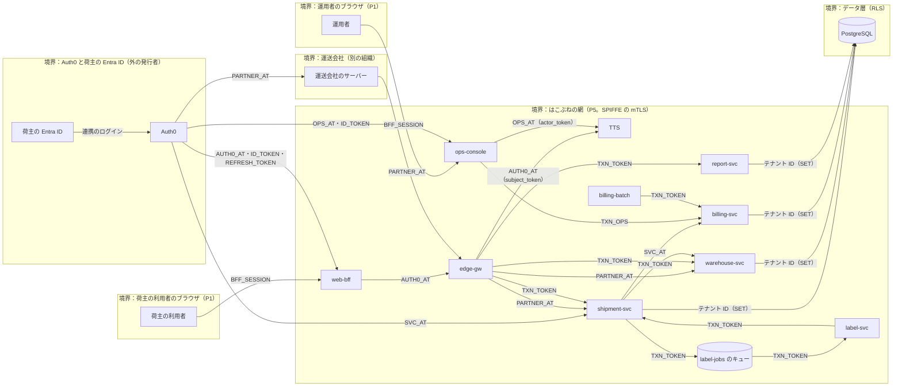
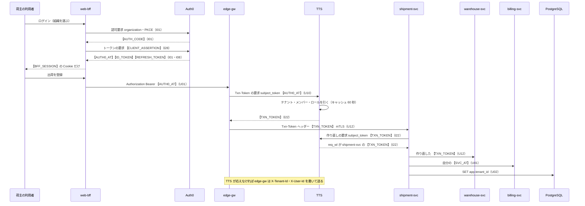
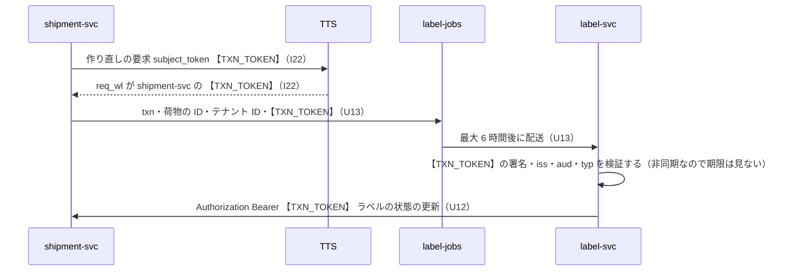
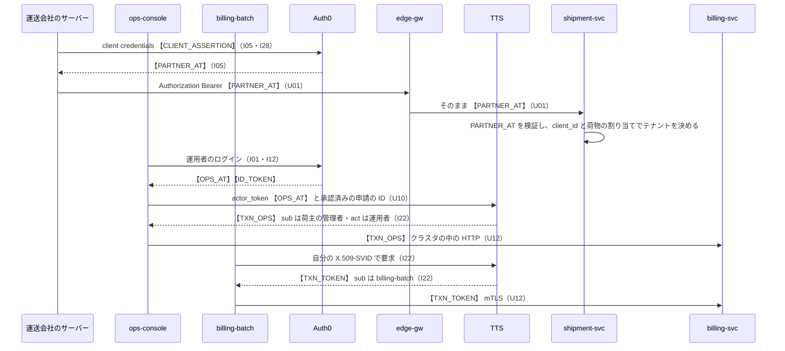

<!-- template_version: 0.7.0 -->
# 設計書（Full）：はこぶね　荷主向けの出荷管理 SaaS（Auth0 の Organizations、Entra ID の連携、Transaction Token Service）

> **意図的に誤りを含む教材。設計に使わない**

> 架空の物流 SaaS「はこぶね」の JWT のクレームの設計書です。荷主（出荷する会社）ごとにテナントを分け、入口（edge-gw）の内側では Auth0 の AT を使わず、はこぶねが作る Transaction Token Service（TTS）の Txn-Token と mTLS で運びます。判断は台帳（`claims.yaml`・`token_types.yaml`・`hops.yaml`・`catalog_answers.yaml`）に 1 回だけ書き、この文書からは ID で参照します。

| 欄 | 内容 |
| --- | --- |
| 版 | 0.1.0（最初の版）。テンプレートは `templates/00_core.md`（0.7.0）。節の番号は 00_core と同じ |
| Lite／Full | **Full**。README の 5 問のうち「境界を越えるか」（運送会社のサーバーが AT を持つ。荷主の Entra ID の値を受け入れる）・「マルチテナントか」・「委任・トークン交換があるか」（入口での Txn-Token への作り直し、運用者の代理）・「新しい発行者か」（TTS）が Yes。「規制の対象か」は No。`catalog_answers.yaml` の `lite_criteria` |
| 使うプロファイル | 荷主の利用者と運用者のブラウザの境界は P1、edge-gw の内側（サービスの網・キュー・DB）は P5。モジュールは M_token_validation・M_multitenancy・M_data_layer・M_authz_pdp・M_privacy_minimization。運送会社の M2M の口は、P3（後回しの #21）の代わりに P5 の入口の変換の行として書いた（12.）。記入欄は付録 D |
| 作成方法 | 生成 AI（Claude）を使って作成した。人による点検は未実施 |

- 生成の区間：`<!-- render:<節>:begin -->`〜`end` の間は `python tools/claim_lint render <この設計書のディレクトリ> --write` が台帳から書き直します。手で直しません
- 要求の出どころ：はこぶねの要求書（以下「要求」）の 3 節（荷主・運送会社・運用者の操作）、5 節（テナントの停止は 15 分以内に効く）、6 節（同じメールの人が 2 つの荷主にいても別の利用者）。要求に無いものを設計で足したときは、その場所に書きます

## 1. CI の結果〔Lite：生成〕

項目 ID：`template:00_core#ci-results`

<!-- render:ci-result:begin -->
`python tools/claim_lint designs/target --also-scan designs/target/design.md`（profile full）：**error 0、warn 5、info 19**（claims 25・token_types 22・catalog_events 64）。OK

| 規則 | 重大度 | 対象 | 内容 |
| --- | --- | --- | --- |
| `R3` | info | `idp[auth0]` | IdP auth0 の一覧（auth0-protocol・auth0-trigger・auth0-grant）とカタログの差集合は 0 件 |
| `R3` | info | `idp[hakobune-tts]` | 発行者 hakobune-tts は組織が自分で作る（kind: self_built）。契機の一覧 4 項目は設計書が決め、すべてカタログのイベントか対象外にひもづく。まだ存在しない発行者（planned: true）なので、作った後に一覧を実装と突き合わせる。R3b と L2 は、この発行者を照合しない |
| `R3b` | warn | `I18` | auth0 のこの発行で post-login（Actions） が呼ばれるかは unknown（カタログ）。独自クレーム C-org-roles・C-entra が載ることを確かめて hook_checked に書く（IdP が複数なので、auth0 の名前を含む文か、IdP ごとの対応 {auth0: …} で書く） |
| `R3b` | warn | `I26` | auth0 のこの発行で post-change-password・password-reset-post-challenge・post-login（Actions） が呼ばれるかは unknown（カタログ）。独自クレーム C-org-roles・C-entra が載ることを確かめて hook_checked に書く（IdP が複数なので、auth0 の名前を含む文か、IdP ごとの対応 {auth0: …} で書く） |
| `R6` | info | `pairwise` | 2 因子の組 70 個をすべて検討した（主体 3・発行イベント 13） |
| `R8` | info | `AUTH0_AT` | 最悪 3462 バイト（ヘッダーの行で 3484）／上限 8192（nginx-large-client-header-buffers）= 43% |
| `R8` | info | `PARTNER_AT` | 最悪 1310 バイト（ヘッダーの行で 1332）／上限 8192（nginx-large-client-header-buffers）= 16% |
| `R8` | info | `OPS_AT` | 最悪 1310 バイト（ヘッダーの行で 3380）／上限 16384（nodejs-max-http-header-size）= 21% |
| `R8` | info | `SVC_AT` | 最悪 1310 バイト（ヘッダーの行で 3380）／上限 16384（nodejs-max-http-header-size）= 21% |
| `R8` | info | `TXN_TOKEN` | 最悪 1836 バイト（ヘッダーの行で 3884）／上限 16384（nodejs-max-http-header-size）= 24% |
| `R8` | info | `TXN_OPS` | 最悪 1931 バイト（ヘッダーの行で 3979）／上限 16384（nodejs-max-http-header-size）= 24% |
| `R8` | info | `C-scope` | AUTH0_AT・PARTNER_AT・OPS_AT・SVC_AT・TXN_TOKEN・TXN_OPS の両方に載る（重複の候補） |
| `R8` | info | `C-tenant-id` | TXN_TOKEN・TXN_OPS の両方に載る（重複の候補） |
| `R8` | info | `C-tenant-name` | TXN_TOKEN・TXN_OPS の両方に載る（重複の候補） |
| `L1b` | info | `C-org-id` | IdP auth0 が決めた名前 org_id（名前空間なし・未登録。tools/claim_lint/idp_claims.yaml、https://auth0.com/docs/secure/tokens/access-tokens/access-token-profiles）。AUTH0_AT にだけ載り、下流のトークンとヘッダーへは名前のまま渡さない。一覧にある名前に組織の意味を載せていないかは、レビューで確かめる |
| `L1b` | warn | `C-req-wl` | 未登録の名前 req_wl は草案（draft-ietf-oauth-transaction-tokens-11 §9.2）が定める名前（tools/claim_lint/draft_claims.yaml）。登録の前なので、草案の版（spec_version）と、登録・改名されたときの見直しの条件を確かめる |
| `L1b` | warn | `C-tctx` | 未登録の名前 tctx は草案（draft-ietf-oauth-transaction-tokens-11 §9.2.3）が定める名前（tools/claim_lint/draft_claims.yaml）。登録の前なので、草案の版（spec_version）と、登録・改名されたときの見直しの条件を確かめる |
| `L1b` | warn | `C-rctx` | 未登録の名前 rctx は草案（draft-ietf-oauth-transaction-tokens-11 §9.2.2）が定める名前（tools/claim_lint/draft_claims.yaml）。登録の前なので、草案の版（spec_version）と、登録・改名されたときの見直しの条件を確かめる |
| `L2` | info | `idp[auth0]` | IdP auth0 の、書き換えを許さないクレームの一覧が tools/claim_lint/idp_reserved.yaml にない。L2 は確かめていない（IdP モジュール #4 で手で確かめる） |
| `L27` | info | `token_type AUTH0_AT` | at+jwt の REQUIRED の jti（RFC 9068 §2.2）が無いことを、台帳の却下の行で逸脱として記録している |
| `L27` | info | `token_type PARTNER_AT` | at+jwt の REQUIRED の jti（RFC 9068 §2.2）が無いことを、台帳の却下の行で逸脱として記録している |
| `L27` | info | `token_type OPS_AT` | at+jwt の REQUIRED の jti（RFC 9068 §2.2）が無いことを、台帳の却下の行で逸脱として記録している |
| `L27` | info | `token_type SVC_AT` | at+jwt の REQUIRED の jti（RFC 9068 §2.2）が無いことを、台帳の却下の行で逸脱として記録している |
| `L62` | info | `E-client-credentials.1` | 宣言から確かめられない（{'path': 'claims[usage=identifier].carried_in', 'op': 'absent', 'value': 'grant:client_credentials'}）。レビューで確かめる：client credentials で出す AT に、利用者のクレーム（usage が identifier の利用者の属性）を載せない |

R8 AUTH0_AT：ヘッダー 103・ペイロード 2235・署名 256 バイト（ceil(4/3*103) + ceil(4/3*2235) + ceil(4/3*256) + 2 = 138 + 2980 + 342 + 2 = 3462; + 7 (Bearer) = 3469）。nginx-large-client-header-buffers 3484／8192 バイト

R8 PARTNER_AT：ヘッダー 103・ペイロード 621・署名 256 バイト（ceil(4/3*103) + ceil(4/3*621) + ceil(4/3*256) + 2 = 138 + 828 + 342 + 2 = 1310; + 7 (Bearer) = 1317）。nginx-large-client-header-buffers 1332／8192 バイト

R8 OPS_AT：ヘッダー 103・ペイロード 621・署名 256 バイト（ceil(4/3*103) + ceil(4/3*621) + ceil(4/3*256) + 2 = 138 + 828 + 342 + 2 = 1310; + 7 (Bearer) = 1317）。nodejs-max-http-header-size 3380／16384 バイト

R8 SVC_AT：ヘッダー 103・ペイロード 621・署名 256 バイト（ceil(4/3*103) + ceil(4/3*621) + ceil(4/3*256) + 2 = 138 + 828 + 342 + 2 = 1310; + 7 (Bearer) = 1317）。nodejs-max-http-header-size 3380／16384 バイト

R8 TXN_TOKEN：ヘッダー 81・ペイロード 1230・署名 64 バイト（ceil(4/3*81) + ceil(4/3*1230) + ceil(4/3*64) + 2 = 108 + 1640 + 86 + 2 = 1836）。nodejs-max-http-header-size 3884／16384 バイト

R8 TXN_OPS：ヘッダー 81・ペイロード 1301・署名 64 バイト（ceil(4/3*81) + ceil(4/3*1301) + ceil(4/3*64) + 2 = 108 + 1735 + 86 + 2 = 1931）。nodejs-max-http-header-size 3979／16384 バイト
<!-- render:ci-result:end -->

warn の行ごとの理由（`templates/CONTRIBUTING.md` の 2.）：

| 規則・対象 | 残す理由 |
| --- | --- |
| `R3b`・`I26` | パスワードの変更・MFA の登録の後のトークンで post-login の Action が動くかを確かめていない。動かなければ `org_roles`・`entra` が欠け、TTS はロールなしとして scope を出さない（拒否の側に倒れる。`C-org-roles` の `absent_semantics`）。確かめ方は 12. |
| `R3b`・`I18` | 名寄せの後のログインで post-login の Action が動くかを確かめていない。動かなければ `org_roles`・`entra` が欠け、TTS は scope を出さない（拒否の側に倒れる）。I26 と同じ扱い |
| `L1b`・`C-req-wl`・`C-tctx`・`C-rctx` | Transaction Tokens の草案（-11）が定める名前で、組織の名前空間に移せない。`spec_version` と見直しの条件（草案の版が変わったとき）を書いた |

## 2. 範囲と信頼の境界〔Lite：手で書く〕

項目 ID：`template:00_core#scope-boundary`

範囲は、荷主の画面（web-bff）・運用の画面（ops-console）・運送会社の partner API・edge-gw・TTS・内側の 5 つのサービス（shipment-svc・warehouse-svc・billing-svc・label-svc・report-svc）・夜間の締めの処理（billing-batch）・キュー（label-jobs）・PostgreSQL（出荷の DB・請求の DB・読み取りの複製）です。Auth0 と、荷主の Entra ID は範囲の外の発行者として扱い、設定と受け入れの規則だけを書きます。

記入欄：

| 境界 | 使うプロファイル | 中の部品 | 境界を越えるトークン（目録の ID） | 範囲の外にしたものと前提 |
| --- | --- | --- | --- | --- |
| 荷主の利用者のブラウザ | P1 | ブラウザ | `BFF_SESSION`（Cookie）、`AUTH_CODE`（URL）、`AUTH0_SESSION`（Auth0 の Cookie） | ブラウザにはトークンを渡さない。スマートフォンのアプリは無い（作るときは P2 で書き足す） |
| 運用者のブラウザ | P1 | 社内の管理端末のブラウザ | `BFF_SESSION`、`AUTH_CODE`、`AUTH0_SESSION` | 運用者は運用者用の Auth0 の接続でログインし、荷主の組織のメンバーにならない |
| Auth0 と荷主の Entra ID | —（外の発行者） | Auth0 のテナント（カスタムドメイン login.hakobune.example）、荷主の Entra ID | `AUTH0_AT`・`PARTNER_AT`・`OPS_AT`・`SVC_AT`・`ID_TOKEN`・`REFRESH_TOKEN`・`CLIENT_ASSERTION` | Entra ID ははこぶねに直接トークンを出さない（Auth0 の Entra の接続の上流）。Auth0 の内部の動きは製品の文書による（確かめていない点は 12.） |
| 運送会社 | P5（入口の変換の行。P3 は #21） | 運送会社のサーバー | `PARTNER_AT`、`CLIENT_ASSERTION`、Webhook（付録 C） | 運送会社のサーバーの中のトークンの扱いは、連携の仕様（はこぶねが出す）で求めるだけで、はこぶねは確かめられない |
| はこぶねの網 | P5 | web-bff・ops-console・edge-gw・TTS・5 つのサービス・billing-batch・キュー | 外の AT は edge-gw と TTS で止まる（partner の口の `PARTNER_AT` だけは shipment-svc・warehouse-svc まで届く）。内側は `TXN_TOKEN`・`TXN_OPS` と、shipment-svc が請求を書く `SVC_AT` | すべての部品は SPIFFE の X.509-SVID を持ち、メッシュの mTLS で話す（ops-console → billing-svc だけは、同じクラスタの中の HTTP）。網の外からサービスに直接届く経路は無い（メッシュの入口は edge-gw だけ） |
| データ層 | P5（M_data_layer） | PostgreSQL（出荷の DB・請求の DB・読み取りの複製） | トークンは届かない。テナント ID の値だけを SET で写す | 移行のジョブ（db-migrate）と、report-svc（テナントをまたぐ集計）が BYPASSRLS の役割を持つ |

テナントをまたぐ集計（運用者向けの売上・出荷量の集計）は report-svc が作ります（要求に無い。運用チームの求めで足した）。report-svc は毎晩、テナントごとの帳票の写しを社内の共有の保存先に書き出します（U28）。

### 2.1 主体の種類〔Lite：手で書く（2. の中で）〕

項目 ID：`template:00_core#principals`

| 主体 | 種類 | 表すクレーム（台帳の ID） | 利用者のトークンと区別する手段 | 要求の言葉と、入る区分・入らない区分 |
| --- | --- | --- | --- | --- |
| 荷主の利用者 | 利用者 | `C-sub`（TTS が割り当てた usr_ の ID。名寄せした人は荷主をまたいで同じ）、`C-tenant-id`、Auth0 の側は `C-sub`（user_id）・`C-org-id`・`C-entra` | — | 要求の「利用者」は、荷主の管理者が Auth0 の組織に招待した人（荷主の社員・荷主が委託した倉庫の担当者）。退会の手続き中の人は荷主の管理者がメンバーを止めた時点で入らない |
| 荷主の管理者 | 利用者（ロールが違う） | `C-org-roles`（admin）、`C-entra`（groups の admin） | ロールの名前と scope（`billing:admin` など）で分ける | 要求の「管理者」は、Auth0 の組織のロールか、Entra のアプリのロール・グループに admin を持つ人 |
| 運送会社 | ワークロード（別の組織のサーバー） | `C-client-id`、`C-sub`（client_id に @clients を付けた値） | 別の aud（partner の口）の `PARTNER_AT`。内側にも PARTNER_AT のまま届くので、受け手は aud で分ける | 要求の「運送会社」は、契約が有効で運送会社の登録の表に載る会社だけ。契約が止まった会社は入らない |
| はこぶねのサービス | ワークロード | mTLS の SPIFFE ID（q-peer）、`C-req-wl` | トークンのクレームでは表さず、通信の層で確かめる | — |
| 運用者 | システム（運用者） | `OPS_AT` の `C-sub`、`TXN_OPS` の `C-act` | 運用者の AT は別の aud（運用の口）。内側では act のある `TXN_OPS` だけで、ops-console の mTLS の ID と組 | 要求の「運用者」ははこぶねの運用チームの社員で、運用者の名簿に載る人だけ。委託先の作業者は入らない（名簿に載せない） |
| 夜間の締めの処理 | システム（バッチ） | `TXN_TOKEN` の `C-sub`（billing-batch の SPIFFE ID） | sub がワークロードの SPIFFE ID で、scope が `billing:close` だけ | 利用者の ID を借りない |

### 2.2 システムの権限〔Full だけ〕

項目 ID：`template:00_core#system-privileges`

| 場面 | 主体とトークン（目録の ID） | クレームで示すこと（台帳の ID） | 確かめ方 |
| --- | --- | --- | --- |
| 夜間バッチ | billing-batch が自分の X.509-SVID で TTS に求める `TXN_TOKEN`（草案 §8.2。テナントごとに 1 つ） | `C-sub` は billing-batch の SPIFFE ID、`C-scope` は `billing:close`、`C-tenant-id` は締めるテナント | billing-svc は req_wl が billing-batch で、sub がその ID と同じであることを確かめる。利用者の sub を名乗らない（TTS は billing-batch の要求に利用者の主体を書かない） |
| 運用者の操作 | ops-console が TTS に求める `TXN_OPS` | `C-sub` は依頼した荷主の管理者、`C-act` の sub は運用者、`C-tctx` の approval_id は申請の ID | TTS が申請の承認と期限を確かめ、billing-svc が act と申請の記録を確かめる（H19） |
| テナントをまたぐ運用者 | 同じ `TXN_OPS`。1 つの申請は 1 つのテナント | `C-tenant-id` は申請のテナント | 別のテナントには別の申請が要る。TTS は申請のテナントと要求のテナントが違えば出さない |
| 緊急時の特権 | break-glass の申請（荷主の管理者が承認、最大 60 分）の間だけ `TXN_OPS` を出す | `C-tctx` の approval_id、`C-act` | 申請は ops-console で運用者が出し、荷主の管理者が web-bff で承認する（承認の前に max_age=0 で認証し直す。`C-auth-time`）。荷主の管理者がいない障害の時の手順は運用の規程で別に決め、この設計の範囲の外 |
| 基盤の操作 | db-migrate（BYPASSRLS の役割）。トークンを使わない | — | CI/CD の承認つきのジョブでだけ動き、サービスの網からは接続の資格情報を持たない |

## 3. 既定から外れた点〔Lite：手で書く〕

項目 ID：`template:00_core#deviations`

| 外れた点 | 既定 | この設計の値 | 書いた台帳の行の ID | 見直しの条件 |
| --- | --- | --- | --- | --- |
| クライアント認証 | 既定の組み合わせに定めなし（秘密の共有が多い） | private_key_jwt（web-bff・ops-console・運送会社） | `issuance_profile.client_auth`、`CLIENT_ASSERTION` | 運送会社が鍵を扱えないと分かったとき |
| grant | 認可コード＋PKCE と refresh | client credentials（運送会社）と、TTS のトークン交換の形の要求を足す | `issuance_profile.grants` | 運送会社の連携の形が変わったとき |
| 送信者制約 | none | none（既定どおり。見送りの理由を 3.1 に書く） | `issuance_profile.sender_constraint` | 3.1 の見直しの条件 |
| 要求の保護 | 定めなし | 使わない（PAR・JAR を Auth0 の契約で使えるかは未確認） | `issuance_profile.request_protection` | 認可要求に承認の内容を載せるとき |
| AT の寿命 | Auth0 の既定（API の設定の既定値） | 600 秒（荷主・運用者）。運送会社は 86400 秒（寿命の例外） | `AUTH0_AT`・`PARTNER_AT`・`OPS_AT` の `max_lifetime` | テナントの停止の要求が 15 分から変わったとき |
| RFC 9068 の jti | 必須（RFC 9068 §2.2） | 必須にしない | `C-jti`（却下の行） | Auth0 が jti を必ず出すと確かめたとき |
| 入口の内側のトークン | 内部トークン（phantom） | Txn-Token（草案 -11）。組織独自の内部トークンは作らない | `TXN_TOKEN`・`INTERNAL_TOKEN`（却下） | 草案の版が変わったとき |
| Txn-Token の起点のホップ | 上流のホップと比べる | H6・H7・H8・H19・H20 は upstream を置かない（aud が信頼ドメインで比べられない） | `hops.yaml` の H6〜H8・H19・H20 | 機械の検査が信頼ドメインの aud を扱えるようになったとき |
| IdP モジュールの既定の回答 | M_idp_keycloak の既定 | Auth0 のモジュールが無い（#21）ので、64 件すべてを手で答えた | `catalog_answers.yaml` | Auth0 のモジュールができたとき |
| ケーススタディの判定 | — | 記入例ではないので照合しない | — | — |

### 3.1 重点と見送り〔Lite：手で書く（3. の中で）〕

項目 ID：`template:00_core#priorities-deferrals`

| 区分（重点・見送り） | 項目 | 効果と費用（未検証の点を含む） | 見直しの条件 | 台帳の行の ID |
| --- | --- | --- | --- | --- |
| 重点 | テナントは変わらない ID（Auth0 の組織の ID・運送の割り当て・申請の記録）から TTS が決め、データ側でも照合する | 表示名・メールのドメインでの取り違えを防ぐ。TTS がテナントの台帳を毎回引く費用（キャッシュ 60 秒） | テナントの数が増え、台帳の問い合わせが TTS の遅れの主因になったとき | `C-tenant-id`、`C-org-id` |
| 重点 | RLS と、各サービスが書く SET app.tenant_id | テナントの行の絞り込みを DB に任せる。各サービスが接続を借りたときに書き、返すときに戻す | DB の接続の部品を替えるとき | `C-tenant-id` の `integrity_until`、H14〜H17 |
| 重点 | 内側は Txn-Token。各サービスが下流を呼ぶ前に TTS で作り直し、受け手は req_wl で呼び出し元を確かめる | 外の AT を内側に入れない。呼び出し元の確かめを、署名されたトークンの値にまとめる（TTS への要求がホップごとに増える） | 草案の版が変わったとき | `TXN_TOKEN`、`C-req-wl`、H6〜H13 |
| 重点 | ロールの語彙を IdP をまたいで 1 つにする（admin・shipper・viewer） | Auth0 の組織のロールと Entra のアプリのロール・グループを同じ名前で扱い、荷主ごとの対応の表を持たない | ロールの名前を足すとき | `C-org-roles`、`C-entra` |
| 重点 | TTS が止まっても出荷を止めない（縮退の運転） | TTS が応えない間は、edge-gw が検証した AT の値を X-Tenant-Id・X-User-Id のヘッダーに書いて内側に送り、各サービスはそのヘッダーで処理する | TTS の可用性の目標を満たせると分かったとき | U11 の回答、H6 の note |
| 見送り | 送信者制約（DPoP・mTLS） | 盗まれた AT を 10 分の間は使える。AT はサーバーにだけあり、内側に入らない。運送会社の連携の部品を直す費用を避けた | 運送会社の AT の漏えいが起きたとき。Auth0 の DPoP を本番で使えると確かめたとき | `issuance_profile.sender_constraint`、`DPOP_PROOF` |
| 見送り | Back-Channel Logout・SSF/CAEP | Auth0・Entra での停止は、TTS の毎回の確認とメンバーの停止で届かせる。Entra での無効化は次の Auth0 での取り直しまで知らない | 荷主から Entra での無効化を即時に効かせる要求が出たとき | `LOGOUT_TOKEN`・`SECURITY_EVENT_TOKEN` |
| 見送り | JWE | 網の中だけを通り、氏名・メールを Txn-Token に載せない。申告価格は契約上の機密だが、網の外に出ない | Txn-Token を網の外の部品に渡すとき | `C-tctx` の note |
| 見送り | 認証の強さ（acr）での追加認証 | 承認には max_age=0 の認証し直しだけを求める。MFA を必須にするかは Auth0 の MFA の方針で決める（トークンでは確かめない） | 承認に MFA を確かめる要求が出たとき | `C-auth-time` |

### 3.2 共通の基準〔Lite：手で書く（満たさないものがあるときだけ）〕

項目 ID：`template:00_core#baseline`

| 基準 | 満たすか | 満たさないときの理由と、回した先 |
| --- | --- | --- |
| 受け入れの検証（alg・iss・aud・exp・typ） | 満たす | 目録の `alg_allowlist`・`issuers`・`required_claims`・`typ`。受け手は共通の検証部品で確かめる |
| 必須の欠落は拒否 | 満たす | 目録の `required_claims` と台帳の `on_missing`。RFC 9068 の jti だけは必須にしない（`C-jti`。12.） |
| 型の固定 | 満たす | 台帳の `type`・`shape` |
| 不変の ID | 満たす | `C-tenant-id`・`C-org-id`・`C-entra`・`C-sub`。UPN と Auth0 の組織の表示名は却下の行 |
| 組織の名前空間 | 満たす | https://hakobune.example/claims/（`namespaces`）。草案の名前（req_wl・tctx・rctx）は名前空間なし（1. の warn の理由） |
| ログにトークン全文と個人情報を残さない | 満たす | 目録の `log_policy` はすべて記録しない。sub・entra はハッシュ |
| IdP の差を入口で正規化してから当てる | 満たす | TTS が Auth0 のデータベースの接続・Entra の連携・M2M を 1 つの形（はこぶねの主体の ID とテナント ID）にする（付録 D の P5 の 1.） |

## 4. 発行方式の選択〔Lite：生成（既定の組み合わせから外れた点だけ 3. に手で書く）〕

項目 ID：`template:00_core#issuance-profile`

<!-- render:issuance-profile:begin -->
`token_types.yaml` の `issuance_profile`。既定の組み合わせから外れた点の理由は、手で書く節（既定から外れた点）に書く。

| 項目 | 選択 | 理由 | 根拠 |
| --- | --- | --- | --- |
| クライアントの種類 | 機密（`confidential`） | 荷主の画面（web-bff）と運用の画面（ops-console）はサーバーで動く BFF で、トークンをブラウザに渡さない。運送会社の連携はそれぞれのサーバーからの M2M で、どれも秘密鍵をサーバーに置ける | `slide:p06-grant-types` [RFC 9700 §2.1](https://www.rfc-editor.org/rfc/rfc9700#section-2.1) |
| クライアント認証 | `private_key_jwt` | 共有の秘密を Auth0 と運送会社の両方に置かない。漏れたときに鍵の差し替えだけで済むよう、クライアントごとに公開鍵を登録する | [OpenID Connect Core 1.0 §9](https://openid.net/specs/openid-connect-core-1_0.html#ClientAuthentication) `slide:p01-client-made-jwts` |
| grant | 認可コード＋PKCE（`authorization_code_pkce`）、リフレッシュ（`refresh_token`）、client credentials（`client_credentials`）、トークン交換（`token_exchange`） | 荷主の利用者と運用者は認可コード＋PKCE。web-bff だけが RT で AT を取り直す。運送会社と shipment-svc（請求の書き込み）は client credentials。TTS は Txn-Token の要求をトークン交換の形で受ける（Auth0 のトークン交換は使わない） | `slide:p06-grant-types` [draft-ietf-oauth-transaction-tokens-11 §11.1](https://www.ietf.org/archive/id/draft-ietf-oauth-transaction-tokens-11.txt) |
| 送信者制約 | なし（`none`） | Auth0 の AT は Bearer のまま使う。AT を持つのは web-bff・ops-console のサーバーと運送会社のサーバーだけで、ブラウザに出ない。 外の AT は edge-gw より内側に入らず（内側は Txn-Token と mTLS）、寿命は 10 分。運送会社の連携の部品を DPoP・mTLS に対応させる費用に対して、 盗まれた AT を使える時間と範囲が小さいので見送った | `slide:p12-priorities-deferrals` [RFC 9449 §1](https://www.rfc-editor.org/rfc/rfc9449#section-1) |
| AT の形式 | JWT（`jwt`） | edge-gw と TTS が手元で検証する。外の AT は入口の内側に入らないので、内側の受け手のための不透明な AT は要らない | `slide:p01-self-contained-vs-reference` |
| RT の方式 | ローテーション＋再利用の検知（`rotation_reuse_detection`） | web-bff の RT は使うたびに替え、古い RT の再利用で系列を止める。RT はサーバーにだけ置く | [RFC 9700 §4.14.2](https://www.rfc-editor.org/rfc/rfc9700#section-4.14.2) |
| 要求の保護 | なし | 認可要求に機微な値を載せない（宛先は Auth0 の audience、組織は organization の引数だけ）。PAR・JAR は Auth0 の契約の範囲を確かめてから決める（12.） | `slide:p09-url-browser` |
| 適合のプロファイル | なし（`none`） | 金融・医療の規制の対象ではない。荷主の取引の情報は契約上の機密として扱うが、FAPI の適合は求められていない | [FAPI 2.0 Security Profile（Final）§5.3.2.1](https://openid.net/specs/fapi-security-profile-2_0-final.html) |

選択から導かれる要件（`templates/registry/issuance_effects.yaml`）：条件が成り立つ行は 2 件／全 13 件。**次の表は検査ではない。** render が `check` を簡易に読み取った表示で、検査の正は `tools/claim_lint/RULES.md` の L62〜L64（#6）。「満たしている行」は、要件の場所にある台帳の行。

| 行 | 要件 | 台帳で必要になるもの | 簡易な読み取り（正は L62） | 満たしている行 | 規則 |
| --- | --- | --- | --- | --- | --- |
| `E-client-credentials` | `E-client-credentials.1` | client credentials で出す AT に、利用者のクレーム（usage が identifier の利用者の属性）を載せない | 判定できない | `C-sub`・`C-client-id`・`C-org-id`・`C-entra` | `L62` |
| `E-client-credentials` | `E-client-credentials.2` | sub はクライアントを表す。利用者の sub と区別する手段（別のトークン種別・別の iss・区別のクレーム）を宣言する | 満たす | `AUTH0_AT`・`PARTNER_AT`・`OPS_AT`・`SVC_AT` | `L62` |
| `E-token-exchange` | `E-token-exchange.1` | 委任なら act（最も外側が今の代理者）、交換を許す相手を事前に示すなら may_act を台帳に置く | 満たす | `C-act` | `L62`・`L16` |
| `E-token-exchange` | `E-token-exchange.2` | 交換のホップ（kind は exchange）で、aud・scope・寿命・独自クレームを上流より広げない（下流ほど絞る） | 満たす | `H9` | `L62`・`L16` |
<!-- render:issuance-profile:end -->

TTS が受ける要求（`catalog_answers.yaml` の `idp` の hakobune-tts の `trigger_list` と同じ）：

| 要求したワークロード | subject_token・actor_token | 出すトークン | TTS が確かめること |
| --- | --- | --- | --- |
| edge-gw（荷主の口） | subject_token＝`AUTH0_AT` | `TXN_TOKEN` | AT の検証、org_id からテナント（Entra の連携の利用者は mail のドメイン）、(iss, sub) から利用者、org_id のメンバー、ロールの名前から scope、経路の表から tctx |
| ops-console | actor_token＝`OPS_AT`、申請の ID | `TXN_OPS` | 運用者の名簿、申請の承認・期限・テナント・運用者 |
| billing-batch | なし（自分の X.509-SVID。草案 §8.2） | `TXN_TOKEN` | 要求したワークロードが billing-batch であること |
| 内側の各サービス（下流を呼ぶ前） | subject_token＝`TXN_TOKEN` | `TXN_TOKEN`（req_wl を要求したサービスに替える） | TXN_TOKEN の検証（期限内）。scope・sub・txn・テナント ID・tctx は変えない |

どの要求でも、TTS は要求したワークロードを mTLS の相手の SPIFFE ID で認証し（草案 §11.5）、その ID を req_wl に書きます。

## 5. トークン目録〔Lite：生成〕

項目 ID：`template:00_core#token-inventory`

<!-- render:token-inventory:begin -->
`token_types.yaml` の 22 行（却下 10）。種類の名前は `templates/catalog/token_kinds.yaml`。

| ID | 種類 | 採否 | 発行 → 宛先（aud） | 持ち手 | 形式 | 寿命 | 保存場所 | 運び方 | 読める相手 | JWE | 理由 |
| --- | --- | --- | --- | --- | --- | --- | --- | --- | --- | --- | --- |
| `AUTH0_AT` | アクセストークン | 採用 | Auth0（はこぶねの Auth0 テナント。カスタムドメイン login.hakobune.example） → https://api.hakobune.example | web-bff（サーバー） | jwt（at+jwt、RS256） | 600 秒（時計のずれ 30 秒） | BFF のサーバー | Authorization: Bearer | `bff`・`gateway`・`idp` | なし | 荷主の利用者が web-bff から edge-gw を呼ぶための AT。edge-gw が受けて、TTS が Txn-Token に作り直す。内側のサービスはこの AT を見ない |
| `PARTNER_AT` | アクセストークン | 採用 | Auth0（AUTH0_AT と同じテナント） → https://partner-api.hakobune.example | 運送会社のサーバー | jwt（at+jwt、RS256） | 86400 秒（時計のずれ 30 秒） | RP のサーバー | Authorization: Bearer | `external_rp`・`gateway`・`api`・`idp` | なし | 運送会社のサーバーが client credentials で取り、運送の状況・入荷の連絡を partner API（edge-gw）に送る。edge-gw が受けて、そのまま shipment-svc・warehouse-svc に渡し、両サービスが自分で検証する（運送会社の呼び出しは単純で回数が多いので、TTS を通さない） |
| `OPS_AT` | アクセストークン | 採用 | Auth0（AUTH0_AT と同じテナント。運用者用の接続） → https://ops.hakobune.example | ops-console（サーバー） | jwt（at+jwt、RS256） | 600 秒（時計のずれ 30 秒） | BFF のサーバー | Authorization: Bearer | `bff`・`idp` | なし | 運用者（はこぶねの社員）が ops-console にログインして得る AT。ops-console が TTS に break-glass の Txn-Token（TXN_OPS）を求めるときに、行為者のトークン（actor_token）として出す |
| `SVC_AT` | アクセストークン | 採用 | Auth0（AUTH0_AT と同じテナント） → https://billing.hakobune.internal | shipment-svc | jwt（at+jwt、RS256） | 600 秒（時計のずれ 30 秒） | サービスのメモリ | Authorization: Bearer | `api`・`idp` | なし | shipment-svc が請求を書くための AT。shipment-svc が自分の client credentials で Auth0 から取り、billing-svc に送る |
| `ID_TOKEN` | ID トークン | 採用 | Auth0 → hakobune-web-bff・hakobune-ops-console | web-bff・ops-console（サーバー） | jwt（JWT、RS256） | 600 秒（時計のずれ 30 秒） | BFF のサーバー | トークンの応答 | `bff`・`idp` | なし | web-bff と ops-console がログインの結果を受け取り、セッションを作る。API には送らない |
| `REFRESH_TOKEN` | リフレッシュトークン | 採用 | Auth0 → — | web-bff（サーバー） | opaque | idle 1800 秒、最大 28800 秒 | BFF のサーバー | トークンの応答 | `bff`・`idp` | — | web-bff が利用者を毎回ログインさせずに、10 分の AT を取り直す。運用者（ops-console）には出さない |
| `AUTH0_SESSION` | セッション（IdP のセッション session_idp と、RP・BFF のセッション session_rp の 2 層） | 採用 | Auth0 → — | 利用者のブラウザ（Auth0 のドメインの Cookie） | opaque | idle 1800 秒、最大 28800 秒 | IdP | Cookie | `browser`・`idp` | — | Auth0 のログインのセッション。BFF のセッションが切れたときの再ログインで使われる |
| `BFF_SESSION` | セッション（IdP のセッション session_idp と、RP・BFF のセッション session_rp の 2 層） | 採用 | web-bff・ops-console → — | ブラウザ（Cookie）。中身はサーバーの保存先にある | opaque | idle 1800 秒、最大 28800 秒 | BFF のサーバー | Cookie | `browser`・`bff` | — | ブラウザと web-bff・ops-console の間のセッション。ブラウザにはセッションの ID の Cookie だけを渡し、トークンを渡さない |
| `AUTH_CODE` | 認可コード | 採用 | Auth0 → — | ブラウザを通って web-bff・ops-console に届く | opaque | 60 秒 | なし | リダイレクトの query | `browser`・`bff`・`idp` | — | web-bff・ops-console のログイン（認可コード＋PKCE） |
| `TXN_TOKEN` | Transaction Token（Txn-Token） | 採用 | TTS（はこぶねが作る Transaction Token Service） → hakobune.internal | edge-gw・billing-batch と、下流を呼ぶ各サービスが TTS から受け取る。label-svc はキューのメッセージから受け取る | jwt（txntoken+jwt、ES256） | 300 秒（時計のずれ 30 秒） | サービスのメモリ | Txn-Token のヘッダー | `gateway`・`api` | なし | edge-gw の内側で、利用者（または運送会社・夜間の締めの処理）とテナントと取引の文脈を運ぶ。内側のサービスはこれだけを受け、外の AT を受けない |
| `TXN_OPS` | Transaction Token（Txn-Token） | 採用 | TTS → hakobune.internal | ops-console（サーバー） | jwt（txntoken+jwt、ES256） | 300 秒（時計のずれ 30 秒） | サービスのメモリ | Txn-Token のヘッダー | `bff`・`api` | なし | 運用者が荷主の管理者に代わって請求の設定を直すときの Txn-Token。sub は依頼した荷主の管理者、act は運用者で、break-glass の申請の承認があるときだけ TTS が出す |
| `MSG_CTX` | 汎用の JWT（ワークロードの ID のトークン・アサーショングラントに出す JWT など） | 却下 | — | — | jwt | — | — | — | — | — | 組織独自の JWT を作らない。キューのメッセージには TXN_TOKEN をそのまま入れ、label-svc が取り出したときに検証する。できなくなるのは、キューで待つ間だけ使える取引の文脈を、別のトークンとして持つこと |
| `CLIENT_ASSERTION` | クライアントの assertion（private_key_jwt・client_secret_jwt） | 採用 | 各クライアント（web-bff・ops-console・運送会社のサーバー） → https://login.hakobune.example/oauth/token | 各クライアント | jwt（(absent)、RS256） | 60 秒（時計のずれ 30 秒） | なし | フォームの本文 | `bff`・`external_rp`・`idp` | なし | web-bff・ops-console・運送会社のサーバーが、Auth0 のトークンの端点で private_key_jwt のクライアント認証に使う |
| `LOGOUT_TOKEN` | ログアウトトークン（Back-Channel Logout の Logout Token） | 却下 | — | — | jwt | — | — | — | — | — | Back-Channel Logout を受けない。Auth0 で利用者・組織を止めたとき、BFF のセッションは残るが、そのセッションからの要求は TTS が毎回テナント・メンバーの状態を引いて拒むので、ログアウトの通知が無くても 15 分の要求を満たす。できなくなるのは、Auth0 での操作をきっかけに BFF のセッションをすぐ消すこと |
| `INTERNAL_TOKEN` | 内部トークン（入口で外部のトークンを検証し、作り直したもの） | 却下 | — | — | jwt | — | — | — | — | — | 入口の内側は Txn-Token（TXN_TOKEN）だけで運ぶ。組織独自の内部トークンを並べると、受け手の検証の設定が 2 つになり、どちらで判断したかが割れる。できなくなるのは、Txn-Token の草案に無い形を内部で自由に決めること |
| `ID_JAG` | ID-JAG（Identity Assertion JWT Authorization Grant） | 却下 | — | — | jwt | — | — | — | — | — | 別の組織の IdP に、はこぶねの利用者として SSO 済みの認可を持ち込む経路が無い。できなくなるのは、運送会社の API を利用者の名で呼ぶこと（呼ぶ必要が無い） |
| `DPOP_PROOF` | DPoP の proof | 却下 | — | — | jwt | — | — | — | — | — | 送信者制約を見送った（issuance_profile.sender_constraint）ので、DPoP の proof を作らない。できなくなるのは、盗まれた AT を使わせないこと（10 分の寿命と、AT を内側に入れない設計で代える） |
| `JAR_REQUEST_OBJECT` | 署名つきの認可要求（JAR の Request Object） | 却下 | — | — | jwt | — | — | — | — | — | 認可要求に機微な値や改ざんされて困る値を載せない（organization の引数は Auth0 が組織のメンバーかを確かめる）。できなくなるのは、認可要求の改ざんの検出 |
| `JARM_RESPONSE` | 署名つきの認可応答（JARM） | 却下 | — | — | jwt | — | — | — | — | — | 認可応答は認可コードだけで、PKCE と state で守る。できなくなるのは、認可応答そのものの署名の検証 |
| `SECURITY_EVENT_TOKEN` | Security Event Token（SET。SSF・CAEP の通知） | 却下 | — | — | jwt | — | — | — | — | — | SSF・CAEP の受信を作らない。止める処理は TTS が発行のたびに状態を引くことで代える。できなくなるのは、Entra の側の利用者の無効化を、はこぶねが即時に知ること（次の Auth0 のログイン・取り直しまで知らない） |
| `STATUS_LIST_TOKEN` | 状態リストのトークン（Token Status List） | 却下 | — | — | jwt | — | — | — | — | — | 状態リストを出さない。止めるときは発行の側（Auth0・TTS）で止めるので、個別の失効を配る仕組みは要らない。できなくなるのは、発行済みの 1 枚を名指しで止めること |
| `INTROSPECTION_RESPONSE_JWT` | JWT 形式のイントロスペクションの応答 | 却下 | — | — | jwt | — | — | — | — | — | AT は JWT で、edge-gw と TTS が手元で検証する。イントロスペクションを使わない。できなくなるのは、Auth0 に問い合わせて AT の現在の有効性を知ること |
<!-- render:token-inventory:end -->

### 5.1 寿命の上限の方針〔Full だけ〕

項目 ID：`template:00_core#lifetime-policy`

| 種類 | 組織の上限（秒） | 例外を認める手順（承認者・記録先） | 例外にした種別（目録の ID と `lifetime_exception`） |
| --- | --- | --- | --- |
| アクセストークン | 600（`tools/claim_lint/lifetime_caps.yaml` の 3600 より短くする） | 基盤チームの責任者が承認し、この表と目録の `lifetime_exception` に書く | `PARTNER_AT`（86400 秒。基盤チームの責任者が 2026-11-27 に承認） |
| ID トークン | 600 | 同上 | 無い |
| RT・セッション | 最大 28800・無操作 1800（運用者のセッションは最大 3600・無操作 900） | 同上 | 無い |
| 認可コード | 60 | — | 無い |
| Txn-Token | 300 | 同上。延ばすのは草案 §13.15 の作り直しだけで、この設計では作り直しで延ばさない | 無い |

## 6. 問い × 仕組み〔Lite：手で書く〕

項目 ID：`template:00_core#question-mechanism`

UC1：荷主の利用者が出荷を登録する（ラベルの作成まで）。要求の 3.1 節。

| ユースケース | 問い（ID） | 要るか | 仕組み（台帳の行の ID か、クレームでない仕組み） | 不要の理由・照合する場所 |
| --- | --- | --- | --- | --- |
| UC1 | 誰の権限で（q-sub） | 要る | `C-sub`（TXN_TOKEN） | shipment-svc・warehouse-svc・label-svc が記録し、荷物の一覧を sub とテナントで絞る |
| UC1 | 誰が代理して実行しているか（q-actor） | 不要 | — | 利用者本人の操作。act を載せない（act のある Txn-Token を受けるのは billing-svc の運用の口だけ） |
| UC1 | どのワークロードが Txn-Token を求めたか（q-req-wl） | 要る | `C-req-wl` | 直前の呼び出し元（edge-gw・shipment-svc・label-svc）であること。監査に残す |
| UC1 | 直接の通信相手は誰か（q-peer） | 要る | `C-req-wl`（メッシュの mTLS は通信の暗号化） | 受け手ごとの呼び出し元の一覧と req_wl を照合する（H6・H7・H9・H13） |
| UC1 | どこを経由したか（q-via） | 不要 | — | トークンに載せない。txn で監査ログとトレースを相関させる |
| UC1 | どの取引か（q-txn） | 要る | `C-txn`、`C-tctx` | txn は監査の相関、tctx は値の照合（shipment_id・quantity・declared_value） |
| UC1 | 誰が利用者か（q-user） | 要る | `C-sub`、`C-org-id`・`C-entra`（TTS だけ） | TTS がメンバーの表で引く（Entra の連携の利用者は mail で引く） |
| UC1 | どのエージェント・クライアントか（q-agent） | 要る | `C-client-id`（AUTH0_AT） | edge-gw と TTS が web-bff の client_id だけを受ける |
| UC1 | 何が承認されたか（q-authorized） | 要る | `C-scope`（TTS が絞った値） | 各サービスが API ごとに確かめる |
| UC1 | どのリソース向けか（q-resource） | 要る | `C-aud`、`C-tenant-id` | aud は口と信頼ドメイン、テナントは保存データと照合 |
| UC1 | 誰が持つべきか（q-holder） | 不要 | — | 送信者制約を見送った（3.1）。内側は mTLS |

UC2：運送会社が運送の状況・入荷を送る（partner API）。要求の 3.2 節。

| ユースケース | 問い（ID） | 要るか | 仕組み（台帳の行の ID か、クレームでない仕組み） | 不要の理由・照合する場所 |
| --- | --- | --- | --- | --- |
| UC2 | 誰の権限で（q-sub） | 要る | `C-sub`（PARTNER_AT の client_id@clients） | 運送会社そのものの権限。利用者はいない |
| UC2 | 誰が代理して実行しているか（q-actor） | 不要 | — | 代理は無い |
| UC2 | どのワークロードが Txn-Token を求めたか（q-req-wl） | 不要 | — | Txn-Token を使わない（PARTNER_AT をそのまま受ける） |
| UC2 | 直接の通信相手は誰か（q-peer） | 要る | 運送会社とは TLS、edge-gw → サービスは mTLS | 運送会社の識別は client_id（次の行） |
| UC2 | どこを経由したか（q-via） | 不要 | — | UC1 と同じ |
| UC2 | どの取引か（q-txn） | 不要 | — | Txn-Token を使わない。要求の ID で監査を相関させる |
| UC2 | 誰が利用者か（q-user） | 不要 | — | 利用者はいない（client credentials） |
| UC2 | どのエージェント・クライアントか（q-agent） | 要る | `C-client-id`（PARTNER_AT） | shipment-svc・warehouse-svc が運送会社の登録の表で引く |
| UC2 | 何が承認されたか（q-authorized） | 要る | `C-scope`（carrier:status・carrier:arrival） | 割り当てた荷物だけ（shipment-svc・warehouse-svc が割り当てを引く） |
| UC2 | どのリソース向けか（q-resource） | 要る | `C-aud`（partner の口）。テナントは荷物の割り当てで決める | 運送会社の AT は荷主の口では受けない |
| UC2 | 誰が持つべきか（q-holder） | 不要 | — | UC1 と同じ。漏えいの扱いは 3.1 |

UC3：運用者が荷主の管理者に代わって請求の設定を直す（break-glass）。要求の 3.4 節。

| ユースケース | 問い（ID） | 要るか | 仕組み（台帳の行の ID か、クレームでない仕組み） | 不要の理由・照合する場所 |
| --- | --- | --- | --- | --- |
| UC3 | 誰の権限で（q-sub） | 要る | `C-sub`（TXN_OPS では依頼した荷主の管理者） | billing-svc が申請の記録の依頼者と照合 |
| UC3 | 誰が代理して実行しているか（q-actor） | 要る | `C-act` | act.sub が運用者の名簿にあり、申請の運用者と一致すること |
| UC3 | どのワークロードが Txn-Token を求めたか（q-req-wl） | 要る | `C-req-wl` | ops-console であること（監査） |
| UC3 | 直接の通信相手は誰か（q-peer） | 不要 | — | ops-console と billing-svc は同じクラスタの中にあり、代理は act と申請の記録で確かめる（H19） |
| UC3 | どこを経由したか（q-via） | 不要 | — | UC1 と同じ |
| UC3 | どの取引か（q-txn） | 要る | `C-txn`、`C-tctx`（approval_id） | 申請の記録を引く |
| UC3 | 誰が利用者か（q-user） | 要る | `C-sub` | 荷主の管理者。運用者を利用者として扱わない |
| UC3 | どのエージェント・クライアントか（q-agent） | 要る | `C-client-id`（OPS_AT） | TTS が ops-console の client_id だけを受ける |
| UC3 | 何が承認されたか（q-authorized） | 要る | `C-scope`（billing:admin）、`C-tctx` の approval_id | 申請の範囲（請求の設定）だけ |
| UC3 | どのリソース向けか（q-resource） | 要る | `C-aud`、`C-tenant-id`（申請のテナント） | 1 つの申請は 1 つのテナント |
| UC3 | 誰が持つべきか（q-holder） | 不要 | — | TXN_OPS は ops-console のサーバーの中だけ |

UC4：夜間の締めの処理が請求を締める。要求の 3.5 節。

| ユースケース | 問い（ID） | 要るか | 仕組み（台帳の行の ID か、クレームでない仕組み） | 不要の理由・照合する場所 |
| --- | --- | --- | --- | --- |
| UC4 | 誰の権限で（q-sub） | 要る | `C-sub`（billing-batch の SPIFFE ID） | 利用者の権限を借りない |
| UC4 | 誰が代理して実行しているか（q-actor） | 不要 | — | 代理は無い（自分の権限） |
| UC4 | どのワークロードが Txn-Token を求めたか（q-req-wl） | 要る | `C-req-wl` | billing-batch であること |
| UC4 | 直接の通信相手は誰か（q-peer） | 要る | `C-req-wl` | billing-svc の締めの API は req_wl が billing-batch のときだけ受ける |
| UC4 | どこを経由したか（q-via） | 不要 | — | UC1 と同じ |
| UC4 | どの取引か（q-txn） | 要る | `C-txn` | テナントごとの締めを 1 取引として記録 |
| UC4 | 誰が利用者か（q-user） | 不要 | — | 利用者はいない |
| UC4 | どのエージェント・クライアントか（q-agent） | 不要 | — | Auth0 のクライアントを使わない。ワークロードの ID は q-peer |
| UC4 | 何が承認されたか（q-authorized） | 要る | `C-scope`（billing:close） | 締めの API だけ |
| UC4 | どのリソース向けか（q-resource） | 要る | `C-aud`、`C-tenant-id` | テナントごとに 1 つの Txn-Token |
| UC4 | 誰が持つべきか（q-holder） | 不要 | — | 網の中だけ |

UC5：荷主の利用者が帳票（出荷の一覧・請求の明細）を見る。要求の 3.3 節。

| ユースケース | 問い（ID） | 要るか | 仕組み（台帳の行の ID か、クレームでない仕組み） | 不要の理由・照合する場所 |
| --- | --- | --- | --- | --- |
| UC5 | 誰の権限で（q-sub） | 要る | `C-sub` | 帳票の出力の記録 |
| UC5 | 誰が代理して実行しているか（q-actor） | 不要 | — | 本人の操作 |
| UC5 | どのワークロードが Txn-Token を求めたか（q-req-wl） | 要る | `C-req-wl` | edge-gw であること |
| UC5 | 直接の通信相手は誰か（q-peer） | 要る | `C-req-wl` | report-svc は req_wl が edge-gw のときだけ受ける |
| UC5 | どこを経由したか（q-via） | 不要 | — | UC1 と同じ |
| UC5 | どの取引か（q-txn） | 要る | `C-txn` | 監査の相関 |
| UC5 | 誰が利用者か（q-user） | 要る | `C-sub` | UC1 と同じ |
| UC5 | どのエージェント・クライアントか（q-agent） | 要る | `C-client-id` | UC1 と同じ |
| UC5 | 何が承認されたか（q-authorized） | 要る | `C-scope`（reports:read） | report-svc が確かめる |
| UC5 | どのリソース向けか（q-resource） | 要る | `C-tenant-id` | report-svc が問い合わせの引数 tenant_id に入れて絞る |
| UC5 | 誰が持つべきか（q-holder） | 不要 | — | UC1 と同じ |

<!-- render:question-mechanism:begin -->
`templates/registry/questions.yaml` の問いごとに、台帳の `answers`・`does_not_answer` を引いた。「不要」の理由は台帳に列がないので、手で書く表に書く。

| ID | 問い | 問いの一覧の仕組み | 答える台帳の行（answers） | 答えに使わない行（does_not_answer） | 照合する場所 |
| --- | --- | --- | --- | --- | --- |
| `q-sub` | 誰の権限で | `sub` | `sub` | `act` | `web-bff`・`ops-console`・`tts`・`shipment-svc`・`warehouse-svc`・`billing-svc`・`label-svc`・`report-svc` |
| `q-actor` | 誰が代理して実行しているか | `act` | `act` | `sub`・`txn`・`req_wl` | `billing-svc` |
| `q-req-wl` | どのワークロードが Txn-Token を求めたか | `req_wl` | `req_wl` | `txn` | `shipment-svc`・`warehouse-svc`・`billing-svc`・`label-svc`・`report-svc` |
| `q-peer` | 直接の通信相手は誰か | `mTLS の相手の ID（SPIFFE の X.509-SVID など）` | — | `sub`・`act` | — |
| `q-via` | どこを経由したか | `経由を示す別の属性（AWS FAS の aws:CalledVia に当たるもの）`・`ネストした act` | — | — | — |
| `q-txn` | どの取引か | `txn` | `txn`・`tctx` | — | `tts`・`shipment-svc`・`warehouse-svc`・`billing-svc`・`label-svc`・`report-svc` |
| `q-user` | 誰が利用者か | `iss と sub の組` | `sub`・`org_id` | — | `web-bff`・`ops-console`・`tts`・`shipment-svc`・`warehouse-svc`・`billing-svc`・`label-svc`・`report-svc` |
| `q-agent` | どのエージェント・クライアントか | `client_id`・`azp`・`act.sub`・`req_wl` | `client_id` | — | `edge-gw`・`tts`・`shipment-svc`・`warehouse-svc`・`billing-svc` |
| `q-authorized` | 何が承認されたか | `scope`・`authorization_details`・`acr・amr・auth_time` | `scope` | `tctx` | `edge-gw`・`tts`・`shipment-svc`・`warehouse-svc`・`billing-svc`・`label-svc`・`report-svc` |
| `q-resource` | どのリソース向けか | `aud`・`resource（RFC 8707）` | `aud`・`tenant_id` | `scope` | `web-bff`・`ops-console`・`edge-gw`・`tts`・`shipment-svc`・`warehouse-svc`・`billing-svc`・`label-svc`・`report-svc`・`postgres` |
| `q-holder` | 誰が持つべきか | `cnf` | — | — | — |
| `q-iss` | 誰が発行したか、信頼する発行者か（pending） | `iss（許可リストと完全一致）、iss ごとの鍵` | — | — | — |
| `q-typ` | どの種類・目的のトークンか（pending） | `ヘッダーの typ（at+jwt・txntoken+jwt・logout+jwt など）` | — | — | — |
| `q-auth-strength` | どの強さで、いつ認証されたか（pending） | `acr・amr・auth_time` | — | — | — |
| `q-still-valid` | 今も有効か（pending） | `exp、失効の手段（イントロスペクション・状態リスト・SSF/CAEP・Back-Channel Logout）、剥奪が反映されるまでに許す時間` | — | — | — |
<!-- render:question-mechanism:end -->

## 7. シーケンス図〔Full だけ〕

項目 ID：`template:00_core#sequence`

ログインと出荷の登録（UC1）：

ラベルの作成（キューを通る。UC1 の続き）：

運送会社の連絡（UC2）、運用者の代理（UC3）、夜間の締め（UC4）：

## 8. ホップごとの表〔Lite：生成（交換・作り直しのホップがあれば手で書く）〕

項目 ID：`template:00_core#hop-table`

交換のホップ（H6・H7・H8・H13・H19・H20）は TTS が新しい Txn-Token を出すホップで、`aud`・`scope`・`max_lifetime`・`custom_claims`・`exchanger` を手で書きました。H6〜H8・H19・H20 は upstream を置いていません（3.）。そのため機械の検査（L16）は、外の AT から Txn-Token への絞り込みを見ません。代わりに次を手で確かめました：Txn-Token の scope は、上流の AT（H2・H3・H18）の scope の部分集合で、経路ごとに絞る（H8 は reports:read だけ）。寿命は 300 秒で、上流の 600 秒より短い。テナント ID は上流の AT に無く、TTS がテナントの台帳から足す（外の値をそのまま写さない）。

<!-- render:hop-table:begin -->
`hops.yaml` の宣言。トークンのないホップの「運ぶトークン」は —。

| ホップ | 種類 | 運ぶトークン | aud | scope | 寿命 | 運ぶ独自クレーム | 交換するサービス | 検証 | 検証・照合すること |
| --- | --- | --- | --- | --- | --- | --- | --- | --- | --- |
| H1 ブラウザ（荷主の利用者） → web-bff | `browser` | `BFF_SESSION` | — | — | 28800 秒 | — | — | `local` | セッションの Cookie（__Host-、Secure・HttpOnly・SameSite=Lax） 無操作 1800 秒・最大 28800 秒 書き込みの要求は CSRF のトークンも確かめる |
| H2 web-bff → edge-gw | `entry` | `AUTH0_AT` | `https://api.hakobune.example` | `shipments:read`・`shipments:write`・`inventory:read`・`inventory:write`・`billing:read`・`billing:admin`・`reports:read` | 600 秒 | `org_roles`・`entra` | — | `local` | 署名（RS256、Auth0 の JWKS）・typ が at+jwt・iss・aud が https://api.hakobune.example・exp client_id が web-bff であること 検証した AT を TTS への要求の subject_token にだけ使い、内側のサービスに渡さない |
| H3 運送会社のサーバー → edge-gw | `entry` | `PARTNER_AT` | `https://partner-api.hakobune.example` | `carrier:status`・`carrier:arrival` | 600 秒 | — | — | `local` | 署名・typ が at+jwt・iss・aud が https://partner-api.hakobune.example・exp 検証した AT を TTS への要求の subject_token にだけ使い、内側のサービスに渡さない |
| H4 edge-gw → tts | `entry` | `AUTH0_AT` | `https://api.hakobune.example` | `shipments:read`・`shipments:write`・`inventory:read`・`inventory:write`・`billing:read`・`billing:admin`・`reports:read` | 600 秒 | `org_roles`・`entra` | — | `local` | edge-gw を mTLS の相手の SPIFFE ID で認証する（Txn-Token を求めてよいワークロードの一覧） subject_token の AT を TTS も検証する（署名・typ・iss・aud・exp） org_id でテナントの台帳を引いてテナント ID を決める。(iss, sub) で利用者を引き、org_id でメンバーが有効なこと Entra の連携の利用者は、entra の mail のドメインが、その荷主に登録したドメインと一致すること org_roles と entra の groups のロールの名前（admin・shipper・viewer）を、はこぶねのロールに替える |
| H5 edge-gw → shipment-svc | `service` | `PARTNER_AT` | `https://partner-api.hakobune.example` | `carrier:status` | 600 秒 | — | — | `local` | edge-gw は検証した PARTNER_AT をそのまま shipment-svc に渡す（運送会社の呼び出しは単純で回数が多いので、TTS を通さない） shipment-svc が PARTNER_AT を自分で検証する（署名・typ が at+jwt・iss・aud が https://partner-api.hakobune.example・exp） client_id で運送会社の登録を引き、要求の荷物の割り当てからテナントを決める |
| H21 edge-gw → warehouse-svc | `service` | `PARTNER_AT` | `https://partner-api.hakobune.example` | `carrier:arrival` | 600 秒 | — | — | `local` | edge-gw は検証した PARTNER_AT をそのまま warehouse-svc に渡す warehouse-svc が PARTNER_AT を自分で検証する（署名・typ・iss・aud・exp） client_id で運送会社の登録を引き、入荷の連絡の荷物の割り当てからテナントを決める |
| H6 edge-gw → shipment-svc | `exchange` | `TXN_TOKEN` | `hakobune.internal` | `shipments:read`・`shipments:write`・`billing:read`・`labels:write` | 300 秒 | `tenant_id` | tts | `local` | req_wl が edge-gw か label-svc であること（受け付ける呼び出し元の一覧。メッシュの mTLS は通信を暗号化する） Txn-Token ヘッダーの値だけを Txn-Token として読む（Authorization ヘッダーは読まない） 共通の検証部品で typ が txntoken+jwt・iss・aud・exp・必須のクレーム tctx の operation・shipment_id・quantity・declared_value を要求の本文と照合する テナント ID を保存データのテナントと照合する |
| H7 edge-gw → warehouse-svc | `exchange` | `TXN_TOKEN` | `hakobune.internal` | `inventory:read`・`inventory:write` | 300 秒 | `tenant_id` | tts | `local` | req_wl が edge-gw か shipment-svc であること Txn-Token ヘッダーだけを読む。共通の検証部品で typ・iss・aud・exp 引き当ての個数は要求の本文の quantity を使う（個数は shipment-svc が入口の値と照合している） テナント ID を在庫・入荷の記録のテナントと照合する |
| H8 edge-gw → report-svc | `exchange` | `TXN_TOKEN` | `hakobune.internal` | `reports:read` | 300 秒 | `tenant_id` | tts | `local` | req_wl が edge-gw であること Txn-Token ヘッダーだけを読む。共通の検証部品で typ・iss・aud・exp テナント ID を問い合わせの引数 tenant_id に入れる |
| H9 shipment-svc → warehouse-svc | `exchange` | `TXN_TOKEN` | `hakobune.internal` | `shipments:read`・`shipments:write`・`billing:read`・`labels:write` | 300 秒 | `tenant_id` | tts | `local` | shipment-svc は受けた Txn-Token を subject_token にして TTS に作り直しを求め、req_wl が shipment-svc の Txn-Token を渡す warehouse-svc は req_wl が shipment-svc であることを確かめる（直前の呼び出し元） warehouse-svc は要求の本文の shipment_id・quantity で引き当てる |
| H10 shipment-svc → billing-svc | `service` | `SVC_AT` | `https://billing.hakobune.internal` | `billing:write` | 600 秒 | — | — | `local` | shipment-svc は自分の client credentials で取った SVC_AT（scope は billing:write。テナントを限らない）で請求を書く。利用者の Txn-Token は渡さない billing-svc は SVC_AT を検証し（署名・typ・iss・aud・exp）、client_id が shipment-svc であることを確かめる 請求の記録のテナントは要求の本文の tenant_id で決める |
| H11 shipment-svc → ブローカー（label-jobs のキュー） | `broker_connection` | `TXN_TOKEN` | `hakobune.internal` | `labels:write` | 300 秒 | `tenant_id` | tts | `none` | shipment-svc は TTS で作り直した TXN_TOKEN（req_wl は shipment-svc、scope は labels:write）をメッセージに入れる ブローカーへの接続は shipment-svc の X.509-SVID の mTLS。ブローカーはトークンを読まない |
| H12 ブローカー（label-jobs のキュー） → label-svc | `broker_connection` | `TXN_TOKEN` | `hakobune.internal` | `labels:write` | 300 秒 | `tenant_id` | — | `none` | label-svc は自分の X.509-SVID でブローカーに接続する 取り出したメッセージの TXN_TOKEN を検証する（署名・typ・iss・aud。非同期なので期限は見ない。取り出すのは最大 6 時間後） |
| H13 label-svc → shipment-svc | `service` | `TXN_TOKEN` | `hakobune.internal` | `labels:write` | 300 秒 | `tenant_id` | — | `local` | label-svc の HTTP の部品は、メッセージの TXN_TOKEN を Authorization の Bearer で shipment-svc に送る（ラベルの状態の更新） shipment-svc のラベルの状態の口は label-svc と同じ検証の部品を使い、Authorization の値を受ける（非同期の結果なので期限は見ない） shipment-svc は req_wl が shipment-svc（キューに入れた自分）であること、scope が labels:write、tctx の shipment_id が要求の荷物と一致することを確かめる |
| H14 shipment-svc → postgres（出荷の DB） | `db_connection` | — | — | — | — | `tenant_id` | — | `none` | サービスのアプリのコードが、接続を借りたときに SET app.tenant_id を検証した Txn-Token の値で書く（接続を返すときに RESET する） DB の役割 app_shipment は RLS の対象（BYPASSRLS なし） |
| H15 warehouse-svc → postgres（出荷の DB） | `db_connection` | — | — | — | — | `tenant_id` | — | `none` | サービスのアプリのコードが SET app.tenant_id を書く DB の役割 app_warehouse は RLS の対象 |
| H16 billing-svc → postgres（請求の DB） | `db_connection` | — | — | — | — | `tenant_id` | — | `none` | サービスのアプリのコードが SET app.tenant_id を書く DB の役割 app_billing は RLS の対象 |
| H17 report-svc → postgres（出荷の DB の読み取りの複製） | `db_connection` | — | — | — | — | `tenant_id` | — | `none` | report-svc はプールの役割 app_report（BYPASSRLS）で接続し、問い合わせの引数の tenant_id で行を絞る（運用者向けのテナントをまたぐ集計の帳票のため） 荷主の利用者の帳票では、Txn-Token のテナント ID を問い合わせの引数 tenant_id に入れる。帳票の自由検索（任意の SQL）も同じ接続で流す |
| H18 ops-console → tts | `entry` | `OPS_AT` | `https://ops.hakobune.example` | `ops:break-glass` | 600 秒 | — | — | `local` | ops-console を mTLS の相手の SPIFFE ID で認証する actor_token の OPS_AT を検証する（署名・typ・iss・aud が https://ops.hakobune.example・exp）。sub が運用者の名簿にあること break-glass の申請が荷主の管理者に承認済みで、期限（最大 60 分）の内で、申請の運用者が OPS_AT の sub と一致すること |
| H19 ops-console → billing-svc | `exchange` | `TXN_OPS` | `hakobune.internal` | `billing:read`・`billing:admin` | 300 秒 | `tenant_id`・`tenant_name` | tts | `local` | ops-console から billing-svc へは、同じクラスタの中の HTTP で送る（メッシュを通さない。代理の操作の画面は呼び出しが多く、暗号化の負荷を避ける） 共通の検証部品を、act を許す設定で使う。act.sub が運用者の名簿にあり、入れ子が無いこと tctx の approval_id で申請の記録を引き、承認済み・期限内・同じテナント・同じ運用者であること |
| H20 billing-batch → billing-svc | `exchange` | `TXN_TOKEN` | `hakobune.internal` | `billing:close` | 300 秒 | `tenant_id`・`tenant_name` | tts | `local` | billing-batch は自分の X.509-SVID で TTS に Txn-Token を求める（草案 §8.2。利用者の代理ではない）。sub は billing-batch の SPIFFE ID テナントごとに 1 つの Txn-Token を求める billing-svc は req_wl が billing-batch で、sub がその SPIFFE ID、scope が billing:close であることを確かめる |
<!-- render:hop-table:end -->

矢印ごとの表（シーケンス図の読み物。載るトークン × 受け手が確かめるクレーム × 書き手）：

<!-- render:arrow-table:begin -->
ホップの受け手（`to`）が `enforced_at` で確かめるクレームを、ホップのトークン（トークンのないホップでは `custom_claims`）から引いた。トークンのあるホップの書き手は `authoritative_writer`。トークンのないホップでは、値を書くのは送り手（`from`）なので、書き手の列には送り手と、台帳の `integrity_until`（書き先と、署名の保護が外れる境界）を出す。

受け手は、`enforced_at.service` の名前が `hops[].to` の文字列に含まれるかで結びつける（大文字と小文字は区別しない）。

**運ぶ行はあるのに、受け手に結びつく行が無いホップ：H11**（1 件。理由は各行の「確かめること」）。受け手が何も確かめないホップなのか、名前の食い違いで結びつかないだけなのかを確かめる。

| ホップ | トークン | 確かめるクレーム | 書き手 | 確かめること | aud | 寿命 |
| --- | --- | --- | --- | --- | --- | --- |
| `H1` | `BFF_SESSION` | — | — | 結びつく行なし：このホップのトークンに載る台帳の行が無い（`carried_in`） | — | 28800 秒 |
| `H2` | `AUTH0_AT` | `iss` | ② 発行者（Auth0・TTS） | AUTH0_AT・PARTNER_AT の iss が Auth0 のカスタムドメインと一致すること | `https://api.hakobune.example` | 600 秒 |
| `H2` | `AUTH0_AT` | `aud` | ② 発行者（Auth0 は要求の audience、TTS は信頼ドメイン） | 荷主の口は https://api.hakobune.example、partner の口は https://partner-api.hakobune.example だけを受ける（口ごとに 1 つ） | `https://api.hakobune.example` | 600 秒 |
| `H2` | `AUTH0_AT` | `exp` | ② 発行者 | 期限とずれ 30 秒 | `https://api.hakobune.example` | 600 秒 |
| `H2` | `AUTH0_AT` | `iat` | ② 発行者 | 30 秒より先の時刻なら拒否 | `https://api.hakobune.example` | 600 秒 |
| `H2` | `AUTH0_AT` | `client_id` | ② Auth0（クライアントの登録） | 荷主の口では web-bff の client_id だけを受ける | `https://api.hakobune.example` | 600 秒 |
| `H2` | `AUTH0_AT` | `scope` | ② Auth0（クライアントが求めた範囲。API の登録の範囲を超えない） ④ TTS（経路の表と荷主のロールで絞る） | 口ごとの語彙に無い値だけの AT は TTS に送らずに拒む | `https://api.hakobune.example` | 600 秒 |
| `H3` | `PARTNER_AT` | `iss` | ② 発行者（Auth0・TTS） | AUTH0_AT・PARTNER_AT の iss が Auth0 のカスタムドメインと一致すること | `https://partner-api.hakobune.example` | 600 秒 |
| `H3` | `PARTNER_AT` | `aud` | ② 発行者（Auth0 は要求の audience、TTS は信頼ドメイン） | 荷主の口は https://api.hakobune.example、partner の口は https://partner-api.hakobune.example だけを受ける（口ごとに 1 つ） | `https://partner-api.hakobune.example` | 600 秒 |
| `H3` | `PARTNER_AT` | `exp` | ② 発行者 | 期限とずれ 30 秒 | `https://partner-api.hakobune.example` | 600 秒 |
| `H3` | `PARTNER_AT` | `iat` | ② 発行者 | 30 秒より先の時刻なら拒否 | `https://partner-api.hakobune.example` | 600 秒 |
| `H3` | `PARTNER_AT` | `client_id` | ② Auth0（クライアントの登録） | 荷主の口では web-bff の client_id だけを受ける | `https://partner-api.hakobune.example` | 600 秒 |
| `H3` | `PARTNER_AT` | `scope` | ② Auth0（クライアントが求めた範囲。API の登録の範囲を超えない） ④ TTS（経路の表と荷主のロールで絞る） | 口ごとの語彙に無い値だけの AT は TTS に送らずに拒む | `https://partner-api.hakobune.example` | 600 秒 |
| `H4` | `AUTH0_AT` | `iss` | ② 発行者（Auth0・TTS） | 受けた subject_token・actor_token の iss が Auth0 か TTS 自身であること | `https://api.hakobune.example` | 600 秒 |
| `H4` | `AUTH0_AT` | `sub` | ② Auth0（利用者・クライアントの登録） ④ TTS（はこぶねの利用者の台帳から引いた ID） | (iss, sub) で利用者 ID を引き、org_id のメンバーの表で有効なメンバーのときだけ出す。運用者（OPS_AT）は運用者の名簿を引く | `https://api.hakobune.example` | 600 秒 |
| `H4` | `AUTH0_AT` | `aud` | ② 発行者（Auth0 は要求の audience、TTS は信頼ドメイン） | subject_token の aud が要求の経路の口と合うこと。OPS_AT は https://ops.hakobune.example だけ | `https://api.hakobune.example` | 600 秒 |
| `H4` | `AUTH0_AT` | `exp` | ② 発行者 | 期限の切れた subject_token（AT・TXN_TOKEN）からは発行しない | `https://api.hakobune.example` | 600 秒 |
| `H4` | `AUTH0_AT` | `iat` | ② 発行者 | 30 秒より先の時刻なら拒否 | `https://api.hakobune.example` | 600 秒 |
| `H4` | `AUTH0_AT` | `client_id` | ② Auth0（クライアントの登録） | 荷主の口・運用の口では web-bff・ops-console の client_id だけ | `https://api.hakobune.example` | 600 秒 |
| `H4` | `AUTH0_AT` | `scope` | ② Auth0（クライアントが求めた範囲。API の登録の範囲を超えない） ④ TTS（経路の表と荷主のロールで絞る） | 経路の表が求める scope が AT の scope とロールから許される範囲にあるときだけ、その範囲に絞って出す。広げない | `https://api.hakobune.example` | 600 秒 |
| `H4` | `AUTH0_AT` | `org_id` | ① Auth0（組織のメンバーのログイン） | テナントの台帳で org_id を引き、そのテナント ID で発行する。台帳に無い org_id は拒否 | `https://api.hakobune.example` | 600 秒 |
| `H4` | `AUTH0_AT` | `https://hakobune.example/claims/org_roles` | ② Auth0 の post-login の Action（はこぶねの基盤チームが持つ） | admin を含めば荷主の管理者、shipper なら出荷担当、viewer なら閲覧として scope を出す。知らない名前は捨てる | `https://api.hakobune.example` | 600 秒 |
| `H4` | `AUTH0_AT` | `https://hakobune.example/claims/entra` | ② Auth0 の post-login の Action（はこぶねの基盤チームが持つ） | mail でメンバーの表を引き、mail のドメインを荷主に登録したドメインと照合してテナントを決める。初回は mail で荷主の管理者の招待の記録と突き合わせる groups の名前を org_roles と同じ語彙（admin・shipper・viewer）として読む。admin があれば荷主の管理者 | `https://api.hakobune.example` | 600 秒 |
| `H5` | `PARTNER_AT` | `iss` | ② 発行者（Auth0・TTS） | TTS の iss の Txn-Token と、partner の口から届く Auth0 の iss の PARTNER_AT だけを受ける | `https://partner-api.hakobune.example` | 600 秒 |
| `H5` | `PARTNER_AT` | `sub` | ② Auth0（利用者・クライアントの登録） ④ TTS（はこぶねの利用者の台帳から引いた ID） | 荷物の作成者・更新者として記録し、利用者の荷物の一覧を sub とテナントで絞る | `https://partner-api.hakobune.example` | 600 秒 |
| `H5` | `PARTNER_AT` | `aud` | ② 発行者（Auth0 は要求の audience、TTS は信頼ドメイン） | Txn-Token は hakobune.internal、PARTNER_AT は https://partner-api.hakobune.example であること | `https://partner-api.hakobune.example` | 600 秒 |
| `H5` | `PARTNER_AT` | `exp` | ② 発行者 | 期限とずれ 30 秒。exp − iat が 300 秒を超えるものは受けない | `https://partner-api.hakobune.example` | 600 秒 |
| `H5` | `PARTNER_AT` | `iat` | ② 発行者 | exp − iat の確かめに使う | `https://partner-api.hakobune.example` | 600 秒 |
| `H5` | `PARTNER_AT` | `client_id` | ② Auth0（クライアントの登録） | 運送会社の登録の表で client_id から運送会社を引き、有効な契約のときだけ受ける | `https://partner-api.hakobune.example` | 600 秒 |
| `H5` | `PARTNER_AT` | `scope` | ② Auth0（クライアントが求めた範囲。API の登録の範囲を超えない） ④ TTS（経路の表と荷主のロールで絞る） | API ごとに必要な scope がなければ 403 | `https://partner-api.hakobune.example` | 600 秒 |
| `H21` | `PARTNER_AT` | `iss` | ② 発行者（Auth0・TTS） | TTS の iss の Txn-Token と、partner の口から届く Auth0 の iss の PARTNER_AT だけを受ける | `https://partner-api.hakobune.example` | 600 秒 |
| `H21` | `PARTNER_AT` | `sub` | ② Auth0（利用者・クライアントの登録） ④ TTS（はこぶねの利用者の台帳から引いた ID） | 在庫の操作の記録に sub を残す | `https://partner-api.hakobune.example` | 600 秒 |
| `H21` | `PARTNER_AT` | `aud` | ② 発行者（Auth0 は要求の audience、TTS は信頼ドメイン） | Txn-Token は hakobune.internal、PARTNER_AT は https://partner-api.hakobune.example であること | `https://partner-api.hakobune.example` | 600 秒 |
| `H21` | `PARTNER_AT` | `exp` | ② 発行者 | 期限とずれ 30 秒。exp − iat が 300 秒を超えるものは受けない | `https://partner-api.hakobune.example` | 600 秒 |
| `H21` | `PARTNER_AT` | `iat` | ② 発行者 | exp − iat の確かめに使う | `https://partner-api.hakobune.example` | 600 秒 |
| `H21` | `PARTNER_AT` | `client_id` | ② Auth0（クライアントの登録） | 運送会社の登録の表で client_id から運送会社を引き、有効な契約のときだけ受ける | `https://partner-api.hakobune.example` | 600 秒 |
| `H21` | `PARTNER_AT` | `scope` | ② Auth0（クライアントが求めた範囲。API の登録の範囲を超えない） ④ TTS（経路の表と荷主のロールで絞る） | API ごとに必要な scope がなければ 403 | `https://partner-api.hakobune.example` | 600 秒 |
| `H6` | `TXN_TOKEN` | `iss` | ② 発行者（Auth0・TTS） | TTS の iss の Txn-Token と、partner の口から届く Auth0 の iss の PARTNER_AT だけを受ける | `hakobune.internal` | 300 秒 |
| `H6` | `TXN_TOKEN` | `sub` | ② Auth0（利用者・クライアントの登録） ④ TTS（はこぶねの利用者の台帳から引いた ID） | 荷物の作成者・更新者として記録し、利用者の荷物の一覧を sub とテナントで絞る | `hakobune.internal` | 300 秒 |
| `H6` | `TXN_TOKEN` | `aud` | ② 発行者（Auth0 は要求の audience、TTS は信頼ドメイン） | Txn-Token は hakobune.internal、PARTNER_AT は https://partner-api.hakobune.example であること | `hakobune.internal` | 300 秒 |
| `H6` | `TXN_TOKEN` | `exp` | ② 発行者 | 期限とずれ 30 秒。exp − iat が 300 秒を超えるものは受けない | `hakobune.internal` | 300 秒 |
| `H6` | `TXN_TOKEN` | `iat` | ② 発行者 | exp − iat の確かめに使う | `hakobune.internal` | 300 秒 |
| `H6` | `TXN_TOKEN` | `scope` | ② Auth0（クライアントが求めた範囲。API の登録の範囲を超えない） ④ TTS（経路の表と荷主のロールで絞る） | API ごとに必要な scope がなければ 403 | `hakobune.internal` | 300 秒 |
| `H6` | `TXN_TOKEN` | `txn` | ④ TTS | 監査ログに記録する | `hakobune.internal` | 300 秒 |
| `H6` | `TXN_TOKEN` | `req_wl` | ④ TTS（要求したワークロードの mTLS の相手の ID） | 直前の呼び出し元として、受け付ける一覧（edge-gw・shipment-svc・label-svc）にあること。監査に記録する | `hakobune.internal` | 300 秒 |
| `H6` | `TXN_TOKEN` | `https://hakobune.example/claims/tenant_id` | ④ TTS（テナントの台帳。荷主の口は org_id、partner の口は荷物の割り当て、運用の口は申請の記録から引く） | 荷物を ID で取り出すとき、保存データのテナントと一致すること（違えば 404） | `hakobune.internal` | 300 秒 |
| `H6` | `TXN_TOKEN` | `tctx` | ④ TTS（経路の表。値は edge-gw が渡した要求の本文から） | operation が API の操作と一致すること。shipment_id・quantity・declared_value が要求の本文と一致すること（違えば 409 で拒否し、監査に記録する） | `hakobune.internal` | 300 秒 |
| `H7` | `TXN_TOKEN` | `iss` | ② 発行者（Auth0・TTS） | TTS の iss の Txn-Token と、partner の口から届く Auth0 の iss の PARTNER_AT だけを受ける | `hakobune.internal` | 300 秒 |
| `H7` | `TXN_TOKEN` | `sub` | ② Auth0（利用者・クライアントの登録） ④ TTS（はこぶねの利用者の台帳から引いた ID） | 在庫の操作の記録に sub を残す | `hakobune.internal` | 300 秒 |
| `H7` | `TXN_TOKEN` | `aud` | ② 発行者（Auth0 は要求の audience、TTS は信頼ドメイン） | Txn-Token は hakobune.internal、PARTNER_AT は https://partner-api.hakobune.example であること | `hakobune.internal` | 300 秒 |
| `H7` | `TXN_TOKEN` | `exp` | ② 発行者 | 期限とずれ 30 秒。exp − iat が 300 秒を超えるものは受けない | `hakobune.internal` | 300 秒 |
| `H7` | `TXN_TOKEN` | `iat` | ② 発行者 | exp − iat の確かめに使う | `hakobune.internal` | 300 秒 |
| `H7` | `TXN_TOKEN` | `scope` | ② Auth0（クライアントが求めた範囲。API の登録の範囲を超えない） ④ TTS（経路の表と荷主のロールで絞る） | API ごとに必要な scope がなければ 403 | `hakobune.internal` | 300 秒 |
| `H7` | `TXN_TOKEN` | `txn` | ④ TTS | 監査ログに記録する | `hakobune.internal` | 300 秒 |
| `H7` | `TXN_TOKEN` | `req_wl` | ④ TTS（要求したワークロードの mTLS の相手の ID） | 直前の呼び出し元として、受け付ける一覧（edge-gw・shipment-svc）にあること。監査に記録する | `hakobune.internal` | 300 秒 |
| `H7` | `TXN_TOKEN` | `https://hakobune.example/claims/tenant_id` | ④ TTS（テナントの台帳。荷主の口は org_id、partner の口は荷物の割り当て、運用の口は申請の記録から引く） | 在庫・入荷の記録のテナントと一致すること | `hakobune.internal` | 300 秒 |
| `H8` | `TXN_TOKEN` | `iss` | ② 発行者（Auth0・TTS） | 共通の検証部品が TTS の iss だけを受ける | `hakobune.internal` | 300 秒 |
| `H8` | `TXN_TOKEN` | `sub` | ② Auth0（利用者・クライアントの登録） ④ TTS（はこぶねの利用者の台帳から引いた ID） | 帳票の出力の記録に sub を残す | `hakobune.internal` | 300 秒 |
| `H8` | `TXN_TOKEN` | `aud` | ② 発行者（Auth0 は要求の audience、TTS は信頼ドメイン） | aud が hakobune.internal であること | `hakobune.internal` | 300 秒 |
| `H8` | `TXN_TOKEN` | `exp` | ② 発行者 | 期限とずれ 30 秒 | `hakobune.internal` | 300 秒 |
| `H8` | `TXN_TOKEN` | `scope` | ② Auth0（クライアントが求めた範囲。API の登録の範囲を超えない） ④ TTS（経路の表と荷主のロールで絞る） | reports:read がなければ 403 | `hakobune.internal` | 300 秒 |
| `H8` | `TXN_TOKEN` | `txn` | ④ TTS | 監査ログに記録する | `hakobune.internal` | 300 秒 |
| `H8` | `TXN_TOKEN` | `req_wl` | ④ TTS（要求したワークロードの mTLS の相手の ID） | 直前の呼び出し元として edge-gw であること | `hakobune.internal` | 300 秒 |
| `H8` | `TXN_TOKEN` | `https://hakobune.example/claims/tenant_id` | ④ TTS（テナントの台帳。荷主の口は org_id、partner の口は荷物の割り当て、運用の口は申請の記録から引く） | 帳票の問い合わせの引数 tenant_id に Txn-Token のテナント ID を入れて絞る | `hakobune.internal` | 300 秒 |
| `H9` | `TXN_TOKEN` | `iss` | ② 発行者（Auth0・TTS） | TTS の iss の Txn-Token と、partner の口から届く Auth0 の iss の PARTNER_AT だけを受ける | `hakobune.internal` | 300 秒 |
| `H9` | `TXN_TOKEN` | `sub` | ② Auth0（利用者・クライアントの登録） ④ TTS（はこぶねの利用者の台帳から引いた ID） | 在庫の操作の記録に sub を残す | `hakobune.internal` | 300 秒 |
| `H9` | `TXN_TOKEN` | `aud` | ② 発行者（Auth0 は要求の audience、TTS は信頼ドメイン） | Txn-Token は hakobune.internal、PARTNER_AT は https://partner-api.hakobune.example であること | `hakobune.internal` | 300 秒 |
| `H9` | `TXN_TOKEN` | `exp` | ② 発行者 | 期限とずれ 30 秒。exp − iat が 300 秒を超えるものは受けない | `hakobune.internal` | 300 秒 |
| `H9` | `TXN_TOKEN` | `iat` | ② 発行者 | exp − iat の確かめに使う | `hakobune.internal` | 300 秒 |
| `H9` | `TXN_TOKEN` | `scope` | ② Auth0（クライアントが求めた範囲。API の登録の範囲を超えない） ④ TTS（経路の表と荷主のロールで絞る） | API ごとに必要な scope がなければ 403 | `hakobune.internal` | 300 秒 |
| `H9` | `TXN_TOKEN` | `txn` | ④ TTS | 監査ログに記録する | `hakobune.internal` | 300 秒 |
| `H9` | `TXN_TOKEN` | `req_wl` | ④ TTS（要求したワークロードの mTLS の相手の ID） | 直前の呼び出し元として、受け付ける一覧（edge-gw・shipment-svc）にあること。監査に記録する | `hakobune.internal` | 300 秒 |
| `H9` | `TXN_TOKEN` | `https://hakobune.example/claims/tenant_id` | ④ TTS（テナントの台帳。荷主の口は org_id、partner の口は荷物の割り当て、運用の口は申請の記録から引く） | 在庫・入荷の記録のテナントと一致すること | `hakobune.internal` | 300 秒 |
| `H10` | `SVC_AT` | `iss` | ② 発行者（Auth0・TTS） | TTS の iss の Txn-Token と、Auth0 の iss の SVC_AT（shipment-svc）だけを受ける | `https://billing.hakobune.internal` | 600 秒 |
| `H10` | `SVC_AT` | `sub` | ② Auth0（利用者・クライアントの登録） ④ TTS（はこぶねの利用者の台帳から引いた ID） | 請求の操作の記録に sub を残す。sub がワークロードの ID のときは billing-batch の ID だけを受ける | `https://billing.hakobune.internal` | 600 秒 |
| `H10` | `SVC_AT` | `aud` | ② 発行者（Auth0 は要求の audience、TTS は信頼ドメイン） | Txn-Token は hakobune.internal、SVC_AT は https://billing.hakobune.internal であること | `https://billing.hakobune.internal` | 600 秒 |
| `H10` | `SVC_AT` | `exp` | ② 発行者 | 期限とずれ 30 秒。exp − iat が 300 秒を超えるものは受けない | `https://billing.hakobune.internal` | 600 秒 |
| `H10` | `SVC_AT` | `iat` | ② 発行者 | exp − iat の確かめに使う | `https://billing.hakobune.internal` | 600 秒 |
| `H10` | `SVC_AT` | `client_id` | ② Auth0（クライアントの登録） | SVC_AT の client_id が shipment-svc のクライアントであること | `https://billing.hakobune.internal` | 600 秒 |
| `H10` | `SVC_AT` | `scope` | ② Auth0（クライアントが求めた範囲。API の登録の範囲を超えない） ④ TTS（経路の表と荷主のロールで絞る） | API ごとに必要な scope がなければ 403。billing:admin は TXN_OPS（運用者の代理）か荷主の管理者のロールから絞ったものだけ。請求の書き込みは SVC_AT の billing:write | `https://billing.hakobune.internal` | 600 秒 |
| `H11` | `TXN_TOKEN` | — | — | 結びつく行なし：受け手 `ブローカー（label-jobs のキュー）` の名前を含む `enforced_at.service` が無い（運ぶ行の service：billing-svc・edge-gw・label-svc・ops-console・postgres・report-svc・shipment-svc・tts・warehouse-svc・web-bff）。名前をそろえるか、受け手の確かめを台帳に書く | `hakobune.internal` | 300 秒 |
| `H12` | `TXN_TOKEN` | `iss` | ② 発行者（Auth0・TTS） | 共通の検証部品が TTS の iss だけを受ける | `hakobune.internal` | 300 秒 |
| `H12` | `TXN_TOKEN` | `sub` | ② Auth0（利用者・クライアントの登録） ④ TTS（はこぶねの利用者の台帳から引いた ID） | ラベルの作成者として記録する | `hakobune.internal` | 300 秒 |
| `H12` | `TXN_TOKEN` | `aud` | ② 発行者（Auth0 は要求の audience、TTS は信頼ドメイン） | aud が hakobune.internal であること | `hakobune.internal` | 300 秒 |
| `H12` | `TXN_TOKEN` | `exp` | ② 発行者 | キューから出したメッセージの Txn-Token は期限を見ない（非同期で、取り出すまで最大 6 時間かかる） | `hakobune.internal` | 300 秒 |
| `H12` | `TXN_TOKEN` | `scope` | ② Auth0（クライアントが求めた範囲。API の登録の範囲を超えない） ④ TTS（経路の表と荷主のロールで絞る） | labels:write がなければ処理しない | `hakobune.internal` | 300 秒 |
| `H12` | `TXN_TOKEN` | `txn` | ④ TTS | 同じ txn と荷物の ID のラベルを 2 回作らない（キューの再配送への備え） | `hakobune.internal` | 300 秒 |
| `H12` | `TXN_TOKEN` | `req_wl` | ④ TTS（要求したワークロードの mTLS の相手の ID） | 監査に記録する | `hakobune.internal` | 300 秒 |
| `H12` | `TXN_TOKEN` | `https://hakobune.example/claims/tenant_id` | ④ TTS（テナントの台帳。荷主の口は org_id、partner の口は荷物の割り当て、運用の口は申請の記録から引く） | ラベルを作る荷物のテナントと一致すること（shipment-svc の応答で確かめる） | `hakobune.internal` | 300 秒 |
| `H12` | `TXN_TOKEN` | `tctx` | ④ TTS（経路の表。値は edge-gw が渡した要求の本文から） | operation が label.create で、shipment_id がメッセージの荷物と一致すること | `hakobune.internal` | 300 秒 |
| `H13` | `TXN_TOKEN` | `iss` | ② 発行者（Auth0・TTS） | TTS の iss の Txn-Token と、partner の口から届く Auth0 の iss の PARTNER_AT だけを受ける | `hakobune.internal` | 300 秒 |
| `H13` | `TXN_TOKEN` | `sub` | ② Auth0（利用者・クライアントの登録） ④ TTS（はこぶねの利用者の台帳から引いた ID） | 荷物の作成者・更新者として記録し、利用者の荷物の一覧を sub とテナントで絞る | `hakobune.internal` | 300 秒 |
| `H13` | `TXN_TOKEN` | `aud` | ② 発行者（Auth0 は要求の audience、TTS は信頼ドメイン） | Txn-Token は hakobune.internal、PARTNER_AT は https://partner-api.hakobune.example であること | `hakobune.internal` | 300 秒 |
| `H13` | `TXN_TOKEN` | `exp` | ② 発行者 | 期限とずれ 30 秒。exp − iat が 300 秒を超えるものは受けない | `hakobune.internal` | 300 秒 |
| `H13` | `TXN_TOKEN` | `iat` | ② 発行者 | exp − iat の確かめに使う | `hakobune.internal` | 300 秒 |
| `H13` | `TXN_TOKEN` | `scope` | ② Auth0（クライアントが求めた範囲。API の登録の範囲を超えない） ④ TTS（経路の表と荷主のロールで絞る） | API ごとに必要な scope がなければ 403 | `hakobune.internal` | 300 秒 |
| `H13` | `TXN_TOKEN` | `txn` | ④ TTS | 監査ログに記録する | `hakobune.internal` | 300 秒 |
| `H13` | `TXN_TOKEN` | `req_wl` | ④ TTS（要求したワークロードの mTLS の相手の ID） | 直前の呼び出し元として、受け付ける一覧（edge-gw・shipment-svc・label-svc）にあること。監査に記録する | `hakobune.internal` | 300 秒 |
| `H13` | `TXN_TOKEN` | `https://hakobune.example/claims/tenant_id` | ④ TTS（テナントの台帳。荷主の口は org_id、partner の口は荷物の割り当て、運用の口は申請の記録から引く） | 荷物を ID で取り出すとき、保存データのテナントと一致すること（違えば 404） | `hakobune.internal` | 300 秒 |
| `H13` | `TXN_TOKEN` | `tctx` | ④ TTS（経路の表。値は edge-gw が渡した要求の本文から） | operation が API の操作と一致すること。shipment_id・quantity・declared_value が要求の本文と一致すること（違えば 409 で拒否し、監査に記録する） | `hakobune.internal` | 300 秒 |
| `H14` | — | `https://hakobune.example/claims/tenant_id` | shipment-svc（トークンなし。書き先：PostgreSQL の app.tenant_id（接続を借りたときの SET））。各サービスのアプリのコードが、検証した Txn-Token の値で書く | RLS の方針が current_setting('app.tenant_id') と行の tenant_id を比べる。設定が無ければ 0 行 | — | — |
| `H15` | — | `https://hakobune.example/claims/tenant_id` | warehouse-svc（トークンなし。書き先：PostgreSQL の app.tenant_id（接続を借りたときの SET））。各サービスのアプリのコードが、検証した Txn-Token の値で書く | RLS の方針が current_setting('app.tenant_id') と行の tenant_id を比べる。設定が無ければ 0 行 | — | — |
| `H16` | — | `https://hakobune.example/claims/tenant_id` | billing-svc（トークンなし。書き先：PostgreSQL の app.tenant_id（接続を借りたときの SET））。各サービスのアプリのコードが、検証した Txn-Token の値で書く | RLS の方針が current_setting('app.tenant_id') と行の tenant_id を比べる。設定が無ければ 0 行 | — | — |
| `H17` | — | `https://hakobune.example/claims/tenant_id` | report-svc（トークンなし。書き先：PostgreSQL の app.tenant_id（接続を借りたときの SET））。各サービスのアプリのコードが、検証した Txn-Token の値で書く | RLS の方針が current_setting('app.tenant_id') と行の tenant_id を比べる。設定が無ければ 0 行 | — | — |
| `H18` | `OPS_AT` | `iss` | ② 発行者（Auth0・TTS） | 受けた subject_token・actor_token の iss が Auth0 か TTS 自身であること | `https://ops.hakobune.example` | 600 秒 |
| `H18` | `OPS_AT` | `sub` | ② Auth0（利用者・クライアントの登録） ④ TTS（はこぶねの利用者の台帳から引いた ID） | (iss, sub) で利用者 ID を引き、org_id のメンバーの表で有効なメンバーのときだけ出す。運用者（OPS_AT）は運用者の名簿を引く | `https://ops.hakobune.example` | 600 秒 |
| `H18` | `OPS_AT` | `aud` | ② 発行者（Auth0 は要求の audience、TTS は信頼ドメイン） | subject_token の aud が要求の経路の口と合うこと。OPS_AT は https://ops.hakobune.example だけ | `https://ops.hakobune.example` | 600 秒 |
| `H18` | `OPS_AT` | `exp` | ② 発行者 | 期限の切れた subject_token（AT・TXN_TOKEN）からは発行しない | `https://ops.hakobune.example` | 600 秒 |
| `H18` | `OPS_AT` | `iat` | ② 発行者 | 30 秒より先の時刻なら拒否 | `https://ops.hakobune.example` | 600 秒 |
| `H18` | `OPS_AT` | `client_id` | ② Auth0（クライアントの登録） | 荷主の口・運用の口では web-bff・ops-console の client_id だけ | `https://ops.hakobune.example` | 600 秒 |
| `H18` | `OPS_AT` | `scope` | ② Auth0（クライアントが求めた範囲。API の登録の範囲を超えない） ④ TTS（経路の表と荷主のロールで絞る） | 経路の表が求める scope が AT の scope とロールから許される範囲にあるときだけ、その範囲に絞って出す。広げない | `https://ops.hakobune.example` | 600 秒 |
| `H19` | `TXN_OPS` | `iss` | ② 発行者（Auth0・TTS） | TTS の iss の Txn-Token と、Auth0 の iss の SVC_AT（shipment-svc）だけを受ける | `hakobune.internal` | 300 秒 |
| `H19` | `TXN_OPS` | `sub` | ② Auth0（利用者・クライアントの登録） ④ TTS（はこぶねの利用者の台帳から引いた ID） | 請求の操作の記録に sub を残す。sub がワークロードの ID のときは billing-batch の ID だけを受ける | `hakobune.internal` | 300 秒 |
| `H19` | `TXN_OPS` | `aud` | ② 発行者（Auth0 は要求の audience、TTS は信頼ドメイン） | Txn-Token は hakobune.internal、SVC_AT は https://billing.hakobune.internal であること | `hakobune.internal` | 300 秒 |
| `H19` | `TXN_OPS` | `exp` | ② 発行者 | 期限とずれ 30 秒。exp − iat が 300 秒を超えるものは受けない | `hakobune.internal` | 300 秒 |
| `H19` | `TXN_OPS` | `iat` | ② 発行者 | exp − iat の確かめに使う | `hakobune.internal` | 300 秒 |
| `H19` | `TXN_OPS` | `scope` | ② Auth0（クライアントが求めた範囲。API の登録の範囲を超えない） ④ TTS（経路の表と荷主のロールで絞る） | API ごとに必要な scope がなければ 403。billing:admin は TXN_OPS（運用者の代理）か荷主の管理者のロールから絞ったものだけ。請求の書き込みは SVC_AT の billing:write | `hakobune.internal` | 300 秒 |
| `H19` | `TXN_OPS` | `txn` | ④ TTS | 監査ログに記録する。請求の行に txn を残す | `hakobune.internal` | 300 秒 |
| `H19` | `TXN_OPS` | `req_wl` | ④ TTS（要求したワークロードの mTLS の相手の ID） | 直前の呼び出し元として、受け付ける一覧（ops-console・billing-batch）にあること。監査に記録する | `hakobune.internal` | 300 秒 |
| `H19` | `TXN_OPS` | `https://hakobune.example/claims/tenant_id` | ④ TTS（テナントの台帳。荷主の口は org_id、partner の口は荷物の割り当て、運用の口は申請の記録から引く） | 請求の記録のテナントと一致すること。料金の表は C-tenant-name で選ぶ。shipment-svc の SVC_AT での書き込みでは、要求の本文の tenant_id で請求の記録を書く | `hakobune.internal` | 300 秒 |
| `H19` | `TXN_OPS` | `tctx` | ④ TTS（経路の表。値は edge-gw が渡した要求の本文から） | operation が請求の操作と一致すること。declared_value が請求の明細の申告価格と一致すること。TXN_OPS では approval_id で申請の記録を引き、承認済み・期限内・同じテナントであること | `hakobune.internal` | 300 秒 |
| `H19` | `TXN_OPS` | `rctx` | ④ TTS | ingress が partner の取引では、請求の書き込みの API を拒む（読み取りの明細の照会だけ） | `hakobune.internal` | 300 秒 |
| `H19` | `TXN_OPS` | `act` | ③ TTS（OPS_AT の sub と申請の記録） | act.sub が運用者の名簿にあり、approval_id の申請の運用者と一致すること。入れ子の act は拒否。act があれば運用者の代理の操作として扱う | `hakobune.internal` | 300 秒 |
| `H19` | `TXN_OPS` | `https://hakobune.example/claims/tenant_name` | ④ TTS（テナントの台帳の表示名） | 料金の表を tenant_name で選ぶ（料金の表の名前と一致すること）。請求書の宛名に使う | `hakobune.internal` | 300 秒 |
| `H20` | `TXN_TOKEN` | `iss` | ② 発行者（Auth0・TTS） | TTS の iss の Txn-Token と、Auth0 の iss の SVC_AT（shipment-svc）だけを受ける | `hakobune.internal` | 300 秒 |
| `H20` | `TXN_TOKEN` | `sub` | ② Auth0（利用者・クライアントの登録） ④ TTS（はこぶねの利用者の台帳から引いた ID） | 請求の操作の記録に sub を残す。sub がワークロードの ID のときは billing-batch の ID だけを受ける | `hakobune.internal` | 300 秒 |
| `H20` | `TXN_TOKEN` | `aud` | ② 発行者（Auth0 は要求の audience、TTS は信頼ドメイン） | Txn-Token は hakobune.internal、SVC_AT は https://billing.hakobune.internal であること | `hakobune.internal` | 300 秒 |
| `H20` | `TXN_TOKEN` | `exp` | ② 発行者 | 期限とずれ 30 秒。exp − iat が 300 秒を超えるものは受けない | `hakobune.internal` | 300 秒 |
| `H20` | `TXN_TOKEN` | `iat` | ② 発行者 | exp − iat の確かめに使う | `hakobune.internal` | 300 秒 |
| `H20` | `TXN_TOKEN` | `scope` | ② Auth0（クライアントが求めた範囲。API の登録の範囲を超えない） ④ TTS（経路の表と荷主のロールで絞る） | API ごとに必要な scope がなければ 403。billing:admin は TXN_OPS（運用者の代理）か荷主の管理者のロールから絞ったものだけ。請求の書き込みは SVC_AT の billing:write | `hakobune.internal` | 300 秒 |
| `H20` | `TXN_TOKEN` | `txn` | ④ TTS | 監査ログに記録する。請求の行に txn を残す | `hakobune.internal` | 300 秒 |
| `H20` | `TXN_TOKEN` | `req_wl` | ④ TTS（要求したワークロードの mTLS の相手の ID） | 直前の呼び出し元として、受け付ける一覧（ops-console・billing-batch）にあること。監査に記録する | `hakobune.internal` | 300 秒 |
| `H20` | `TXN_TOKEN` | `https://hakobune.example/claims/tenant_id` | ④ TTS（テナントの台帳。荷主の口は org_id、partner の口は荷物の割り当て、運用の口は申請の記録から引く） | 請求の記録のテナントと一致すること。料金の表は C-tenant-name で選ぶ。shipment-svc の SVC_AT での書き込みでは、要求の本文の tenant_id で請求の記録を書く | `hakobune.internal` | 300 秒 |
| `H20` | `TXN_TOKEN` | `tctx` | ④ TTS（経路の表。値は edge-gw が渡した要求の本文から） | operation が請求の操作と一致すること。declared_value が請求の明細の申告価格と一致すること。TXN_OPS では approval_id で申請の記録を引き、承認済み・期限内・同じテナントであること | `hakobune.internal` | 300 秒 |
| `H20` | `TXN_TOKEN` | `rctx` | ④ TTS | ingress が partner の取引では、請求の書き込みの API を拒む（読み取りの明細の照会だけ） | `hakobune.internal` | 300 秒 |
| `H20` | `TXN_TOKEN` | `https://hakobune.example/claims/tenant_name` | ④ TTS（テナントの台帳の表示名） | 料金の表を tenant_name で選ぶ（料金の表の名前と一致すること）。請求書の宛名に使う | `hakobune.internal` | 300 秒 |
<!-- render:arrow-table:end -->

H11（shipment-svc → キュー）は、受け手のブローカーがトークンを読まないので、結びつく行がありません（メッセージの TXN_TOKEN を読むのは label-svc）。

## 9. ライフサイクル表〔Lite：手で書く〕

項目 ID：`template:00_core#lifecycle`

<!-- heading-only -->
### 9.1 トークン・セッション・接続

| 層・種別（目録の ID） | 寿命（idle／最大） | リフレッシュ | RT のローテーションと再利用の検知 | 失効の手段 | 剥奪が届くまでの秒数 | 長時間の処理での扱い |
| --- | --- | --- | --- | --- | --- | --- |
| `AUTH0_AT` | —／600 | `REFRESH_TOKEN` で取り直す | — | exp まで。メンバーを外した後は TTS が拒む | メンバーを外した後の取り直しまで 630。その後の内側の処理は 330 | 使わない（入口で Txn-Token に替える） |
| `PARTNER_AT` | —／86400 | client credentials で取り直す | — | exp まで。shipment-svc・warehouse-svc が運送会社の登録を毎回引く | 運送会社の停止は 60。AT そのものは 86430 | 使わない |
| `SVC_AT` | —／600 | client credentials で取り直す | — | exp まで | 630 | 使わない |
| `OPS_AT` | —／600 | 無い（再ログイン） | — | exp まで。TTS が運用者の名簿と申請を毎回引く | 申請の取り消しは 330（TXN_OPS の残り） | 使わない |
| `ID_TOKEN` | —／600 | 無い | — | ログインのときだけ使う | — | 使わない |
| `REFRESH_TOKEN` | 1800／28800 | 使うたびに替わる | ローテーションあり・再利用の検知は未確認（12.） | ローテーション、失効の端点、取り直しの失敗 | 0（ログアウト）。Auth0 での利用者の停止は次の取り直し | 使わない |
| `AUTH0_SESSION` | 1800／28800 | — | — | RP-Initiated Logout、管理の操作での削除 | 0 | — |
| `BFF_SESSION` | 1800／28800（ops-console は 900／3600） | 操作のたびに無操作の時計を戻す | — | ログアウト、テナントの停止の応答で削除 | 0（ログアウト）。テナントの停止は次の API の呼び出しのとき | — |
| `AUTH_CODE` | —／60 | — | — | 1 回だけ | 0 | — |
| `TXN_TOKEN` | —／300 | 無い（下流を呼ぶ前に各サービスが作り直す） | — | exp まで。発行のたびにメンバーの状態を引く | 390 | キューのメッセージに入れて運ぶ。label-svc は期限を見ない（最大 6 時間） |
| `TXN_OPS` | —／300 | 無い（操作のたびに求める） | — | exp まで。申請の取り消しは次の発行で効く。billing-svc も申請を引く | 0（billing-svc が申請を引く） | 使わない |
| `CLIENT_ASSERTION` | —／60 | — | — | 1 回だけ（Auth0 が jti の再送を拒む前提） | 0 | — |

テナントの停止（要求の 5 節）：テナントを止めるときは、Auth0 の組織からメンバーを外します。外した後の AT の取り直しから、TTS はメンバーなしとして TXN_TOKEN を出しません。edge-gw は、テナントの解決と認可の判断を利用者ごとに 24 時間キャッシュし、TTS とテナントの台帳への問い合わせを減らします（U21）。帳票の写しは毎晩、共有の保存先に書き出し、2 年残します（U28）。

確かめ用の生成の表（4 つの層。寿命が鮮度の許容を超える行に「超える」と出る）：

<!-- render:lifecycle:begin -->
slide:p08-four-lifetimes の 4 層を、台帳の列から引いた（`templates/registry/README.md` の 6.）。長時間の処理と剥奪の反映の書き方は、手で書くライフサイクル表に書く。

2. の `volatility` は「値が変わってから反映されるまでに許す秒数」（`templates/registry/README.md` の 3.）で、0 は即時の反映が要ること、`never` はトークンの寿命の間に値が変わらないことを表す。載るトークンの受け入れの最大（寿命＋時計のずれ）がこれを超える行に「超える」と出し、目録の `revocation` のうち遅れが許容以内の手段（`exp_only` を除く）を並べる。その手段がこのクレームの変化に効くかは機械では読まないので、台帳の `on_revoke` で確かめる。検査の正は L5（#6）で、この表は検査ではない。

**1. トークンの寿命**

| トークン | 寿命 | 時計のずれ | 寿命を変えられる主体 | ホップでの寿命 |
| --- | --- | --- | --- | --- |
| `AUTH0_AT` | 600 秒 | 30 秒 | `platform` | H2 600 秒 H4 600 秒 |
| `PARTNER_AT` | 86400 秒 | 30 秒 | `platform` | H3 600 秒 H5 600 秒 H21 600 秒 |
| `OPS_AT` | 600 秒 | 30 秒 | `platform` | H18 600 秒 |
| `SVC_AT` | 600 秒 | 30 秒 | `platform` | H10 600 秒 |
| `ID_TOKEN` | 600 秒 | 30 秒 | `platform` | — |
| `AUTH_CODE` | 60 秒 | — | `platform` | — |
| `TXN_TOKEN` | 300 秒 | 30 秒 | `platform` | H6 300 秒 H7 300 秒 H8 300 秒 H9 300 秒 H11 300 秒 H12 300 秒 H13 300 秒 H20 300 秒 |
| `TXN_OPS` | 300 秒 | 30 秒 | `platform` | H19 300 秒 |
| `CLIENT_ASSERTION` | 60 秒 | 30 秒 | `platform` | — |

**2. クレームの値の鮮度（受け手のいる行）**

| クレーム | 載るトークン | 受け入れの最大 | 反映までに許す秒数 | 反映の遅れ | 再計算 | 受け入れの最大と許容 | 許容以内の失効の手段（目録） | 剥奪・停止のとき（台帳） |
| --- | --- | --- | --- | --- | --- | --- | --- | --- |
| `iss` | `AUTH0_AT`・`PARTNER_AT`・`OPS_AT`・`SVC_AT`・`ID_TOKEN`・`TXN_TOKEN`・`TXN_OPS` | 86430 秒 | `never` | 0 秒 | `never` | 寿命の間に変わらない（never） | — | 該当なし（発行者を替えるときは受け手の許可の設定を先に足す） |
| `sub` | `AUTH0_AT`・`PARTNER_AT`・`OPS_AT`・`SVC_AT`・`ID_TOKEN`・`TXN_TOKEN`・`TXN_OPS` | 86430 秒 | `never` | 0 秒 | `reissue` | 寿命の間に変わらない（never） | — | メンバーを外すと、TTS の次の発行から拒む（状態のキャッシュは 60 秒まで） |
| `aud` | `AUTH0_AT`・`PARTNER_AT`・`OPS_AT`・`SVC_AT`・`ID_TOKEN`・`TXN_TOKEN`・`TXN_OPS` | 86430 秒 | `never` | 0 秒 | `never` | 寿命の間に変わらない（never） | — | 該当なし |
| `exp` | `AUTH0_AT`・`PARTNER_AT`・`OPS_AT`・`SVC_AT`・`ID_TOKEN`・`TXN_TOKEN`・`TXN_OPS` | 86430 秒 | `never` | 0 秒 | `never` | 寿命の間に変わらない（never） | — | 該当なし |
| `iat` | `AUTH0_AT`・`PARTNER_AT`・`OPS_AT`・`SVC_AT`・`ID_TOKEN`・`TXN_TOKEN`・`TXN_OPS` | 86430 秒 | `never` | 0 秒 | `never` | 寿命の間に変わらない（never） | — | 該当なし |
| `client_id` | `AUTH0_AT`・`PARTNER_AT`・`OPS_AT`・`SVC_AT` | 86430 秒 | `never` | 0 秒 | `never` | 寿命の間に変わらない（never） | — | 運送会社の契約を止めると、TTS が運送会社の登録を引いて次の発行から拒む |
| `scope` | `AUTH0_AT`・`PARTNER_AT`・`OPS_AT`・`SVC_AT`・`TXN_TOKEN`・`TXN_OPS` | 86430 秒 | 900 秒 | 630 秒 | `refresh`・`reissue` | 超える（PARTNER_AT 86430 秒 > 許容 900 秒） | PARTNER_AT：DB の確認（60 秒） | ロールを外すと、TTS の次の発行から絞った範囲に入らない（AUTH0_AT の org_roles が替わるのは次の取り直し。最大 630 秒） |
| `org_id` | `AUTH0_AT` | 630 秒 | `never` | 0 秒 | `login` | 寿命の間に変わらない（never） | — | テナントを止めると、Auth0 の組織からメンバーを外し、TTS はメンバーなしとして次の発行から拒む |
| `https://hakobune.example/claims/org_roles` | `AUTH0_AT` | 630 秒 | 900 秒 | 630 秒 | `login`・`refresh` | — | — | ロールを外すと、次の取り直し（最大 630 秒）で AT から消える |
| `https://hakobune.example/claims/entra` | `AUTH0_AT` | 630 秒 | 28800 秒 | 28800 秒 | `login` | — | — | グループを外しても、次の Entra を通るログインまで AT に残る（最大 28800 秒）。すぐ止めるときは、荷主の管理者がはこぶねの画面でメンバーを止める（TTS が次の発行から拒む） |
| `nonce` | `ID_TOKEN` | 630 秒 | `never` | 0 秒 | `login` | 寿命の間に変わらない（never） | — | 該当なし |
| `auth_time` | `ID_TOKEN` | 630 秒 | `never` | 0 秒 | `login` | 寿命の間に変わらない（never） | — | 該当なし |
| `email` | `ID_TOKEN` | 630 秒 | 86400 秒 | 28800 秒 | `login` | — | — | 該当なし（表示だけ） |
| `txn` | `TXN_TOKEN`・`TXN_OPS` | 330 秒 | `never` | 0 秒 | `never` | 寿命の間に変わらない（never） | — | 該当なし |
| `req_wl` | `TXN_TOKEN`・`TXN_OPS` | 330 秒 | `never` | 0 秒 | `reissue` | 寿命の間に変わらない（never） | — | 該当なし |
| `https://hakobune.example/claims/tenant_id` | `TXN_TOKEN`・`TXN_OPS` | 330 秒 | `never` | 0 秒 | `reissue` | 寿命の間に変わらない（never） | — | テナントの停止は、Auth0 の組織からメンバーを外して行う（次の AT から TTS がメンバーなしとして拒む） |
| `tctx` | `TXN_TOKEN`・`TXN_OPS` | 330 秒 | `never` | 0 秒 | `reissue` | 寿命の間に変わらない（never） | — | 該当なし（取引ごとの値） |
| `rctx` | `TXN_TOKEN`・`TXN_OPS` | 330 秒 | `never` | 0 秒 | `reissue` | 寿命の間に変わらない（never） | — | 該当なし |
| `act` | `TXN_OPS` | 330 秒 | `never` | 0 秒 | `exchange` | 寿命の間に変わらない（never） | — | 申請を取り消すと、TTS が次の発行から拒む。billing-svc も approval_id で申請を引く |
| `https://hakobune.example/claims/tenant_name` | `TXN_TOKEN`・`TXN_OPS` | 330 秒 | 86400 秒 | 330 秒 | `reissue` | — | — | 該当なし（表示名を変えると、次の発行から新しい名前になる） |

**3. セッションと RT の寿命**

| セッション・RT・接続 | idle | 最大 | ローテーション | 再利用の検知 | 失効の手段（遅れ） |
| --- | --- | --- | --- | --- | --- |
| `REFRESH_TOKEN` | 1800 秒 | 28800 秒 | あり | `unverified` | ローテーション（0 秒） 失効の端点（0 秒） リフレッシュの失敗（0 秒） |
| `AUTH0_SESSION` | 1800 秒 | 28800 秒 | — | — | RP-Initiated Logout（0 秒） セッションの削除（0 秒） |
| `BFF_SESSION` | 1800 秒 | 28800 秒 | — | — | セッションの削除（0 秒） |
| `H11（broker_connection）` | — | 3600 秒 | — | — | — |
| `H12（broker_connection）` | — | 3600 秒 | — | — | — |
| `H14（db_connection）` | — | 1800 秒 | — | — | — |
| `H15（db_connection）` | — | 1800 秒 | — | — | — |
| `H16（db_connection）` | — | 1800 秒 | — | — | — |
| `H17（db_connection）` | — | 1800 秒 | — | — | — |

**4. クレームの定義の寿命**

| クレーム | 状態 | 廃止の期限 | 持ち主 | 変更を決める者 |
| --- | --- | --- | --- | --- |
| `iss` | `active` | — | はこぶね 基盤チーム（ID とトークン） | IETF（RFC 7519） |
| `sub` | `active` | — | はこぶね 基盤チーム（ID とトークン） | IETF（RFC 7519） |
| `aud` | `active` | — | はこぶね 基盤チーム（ID とトークン） | IETF（RFC 7519） |
| `exp` | `active` | — | はこぶね 基盤チーム（ID とトークン） | IETF（RFC 7519） |
| `iat` | `active` | — | はこぶね 基盤チーム（ID とトークン） | IETF（RFC 7519） |
| `client_id` | `active` | — | はこぶね 基盤チーム（ID とトークン） | IETF（RFC 9068） |
| `scope` | `active` | — | はこぶね 基盤チーム（ID とトークン） | IETF（RFC 8693） |
| `org_id` | `active` | — | はこぶね 基盤チーム（ID とトークン） | Auth0（製品が決めた名前） |
| `https://hakobune.example/claims/org_roles` | `active` | — | はこぶね 基盤チーム（ID とトークン） | はこぶね 基盤チーム（ID とトークン） |
| `https://hakobune.example/claims/entra` | `active` | — | はこぶね 基盤チーム（ID とトークン） | はこぶね 基盤チーム（ID とトークン） |
| `nonce` | `active` | — | はこぶね 基盤チーム（ID とトークン） | OpenID Foundation（OpenID Connect Core 1.0） |
| `auth_time` | `active` | — | はこぶね 基盤チーム（ID とトークン） | OpenID Foundation（OpenID Connect Core 1.0） |
| `email` | `active` | — | はこぶね 基盤チーム（ID とトークン） | OpenID Foundation（OpenID Connect Core 1.0） |
| `txn` | `active` | — | はこぶね 基盤チーム（ID とトークン） | IETF（draft-ietf-oauth-transaction-tokens-11） |
| `req_wl` | `active` | — | はこぶね 基盤チーム（ID とトークン） | IETF（draft-ietf-oauth-transaction-tokens-11） |
| `https://hakobune.example/claims/tenant_id` | `active` | — | はこぶね 基盤チーム（ID とトークン） | はこぶね 基盤チーム（ID とトークン） |
| `tctx` | `active` | — | はこぶね 基盤チーム（ID とトークン） | IETF（draft-ietf-oauth-transaction-tokens-11） |
| `rctx` | `active` | — | はこぶね 基盤チーム（ID とトークン） | IETF（draft-ietf-oauth-transaction-tokens-11） |
| `act` | `active` | — | はこぶね 運用チーム（運用者の名簿） | IETF（RFC 8693） |
| `https://hakobune.example/claims/tenant_name` | `active` | — | はこぶね 基盤チーム（ID とトークン） | はこぶね 基盤チーム（ID とトークン） |

名前空間 `https://hakobune.example/claims/` の構造の版：—
<!-- render:lifecycle:end -->

#### DB・ブローカーの接続の層

項目 ID：`template:00_core#lifecycle-db-connection`

| 接続（ホップの ID） | 接続の最大寿命 | 開くときに使うトークン（目録の ID）と寿命 | 剥奪を開いた接続に届かせる手段 |
| --- | --- | --- | --- |
| H14・H15・H16・H17（サービス → PostgreSQL） | 1800 秒 | トークンを使わない（DB の役割の資格情報と、網の中の TLS） | 利用者・テナントの剥奪は接続ではなく取引に効かせる。各サービスが接続を借りるたびに、検証した Txn-Token のテナント ID を SET で書くので、停止したテナントの新しい Txn-Token が出なくなった時点で、どの接続でもそのテナントの取引は始まらない |
| H11・H12（shipment-svc・label-svc → ブローカー） | 3600 秒 | トークンを使わない（X.509-SVID の mTLS。SVID の寿命は 1 時間で自動で替わる） | サービスの接続の剥奪は SVID の失効とメッシュの許可で行う。メッセージの中の TXN_TOKEN は label-svc が検証する |

### 9.2 クレームの鮮度の表〔Lite：生成（寿命が許容を超える行の対策だけ手で書く）〕

項目 ID：`template:00_core#freshness`

| クレーム（台帳の ID） | 反映までに許す秒数 | 載る種別と受け入れの上限（秒） | 対策 | 対策を書いた台帳・目録の列 |
| --- | --- | --- | --- | --- |
| 無い：生成の表で「超える」と出た行が無い | — | — | — | — |

外部の IdP の属性の取り込み：Entra の tid・oid・groups は、Entra を通るログインのたびに Auth0 が取り込み、Action が写します（初回だけではない）。RT での取り直しでは Entra に問い合わせないので、groups の変化は最大 28800 秒（RT と Auth0 のセッションの最大）届きません。要求は役割の変更の遅れを決めていないので、28800 秒を許容として `C-entra` の `volatility` に書き、急ぐ剥奪はメンバーの停止で行います（荷主の管理者向けの手順に書く）。

### 9.3 クレームの定義の寿命〔Full だけ（廃止予定の行があれば Lite でも書く）〕

項目 ID：`template:00_core#definition-lifecycle`

| クレーム（台帳の ID） | 状態と期日 | 代わりの行 | 受け手ごとの移行の状況 | 並行発行の期間と、古い形式を読むのをやめる時点 |
| --- | --- | --- | --- | --- |
| 無い：最初の版で、廃止予定・変更中の行が無い。すべて `active` | — | — | — | 変えるときは、受け手が先・発行者が後の順で、TXN_TOKEN は 300 秒、AUTH0_AT は RT の最大 28800 秒を過ぎるまで並べて出す（claim_request の問 24） |

共有クレーム 4 つ（`C-tenant-id`・`C-tenant-name`・`C-org-roles`・`C-entra`）の追加前の 25 問は、`claim_request_tenant_id.md`・`claim_request_tenant_name.md`・`claim_request_org_roles.md`・`claim_request_entra.md` にあります。

## 10. 判断の行〔Lite：生成〕

項目 ID：`template:00_core#decisions`

<!-- render:decision-rows:begin -->
`claims.yaml` の 25 行（採用 20・既定どおり 0・却下 5）。根拠 ID は `refs`、裏付けは `evidence`（ケーススタディの実測など）。

| ID | 候補 | 採否 | 代わりの行 | 理由 | 前提 | 根拠 ID | 裏付け | 見直しの条件 |
| --- | --- | --- | --- | --- | --- | --- | --- | --- |
| `C-iss` | `iss` | 採用 | — | 受け手は種別ごとに許す発行者を 1 つに決め、ほかの発行者のトークンを受けない | Auth0 のテナントは 1 つで、荷主の組織はその中の Organizations で分ける | [RFC 7519 §4.1.1](https://www.rfc-editor.org/rfc/rfc7519#section-4.1.1) `slide:p04-single-issuer` | — | 地域ごとに Auth0 のテナントを分けるとき |
| `C-sub` | `sub` | 採用 | — | 利用者の照合・監査・持ち主の照合のキー。TTS は (iss, sub) から、はこぶねの利用者 ID を引く | Auth0 の自動のアカウントの名寄せ（確かめたメールが同じ利用者を 1 つにする）を有効にする | [RFC 7519 §4.1.2](https://www.rfc-editor.org/rfc/rfc7519#section-4.1.2) [draft-ietf-oauth-transaction-tokens-11 §9.2](https://www.ietf.org/archive/id/draft-ietf-oauth-transaction-tokens-11.txt) `slide:p02-user-identifier` | — | 名寄せをやめるとき。利用者 ID の割り当て方を変えるとき |
| `C-aud` | `aud` | 採用 | — | 利用者の AT・運送会社の AT・運用者の AT を宛先で分け、別の口に出されたトークンを受けない | 3 つの口（荷主の API・partner API・運用）に別の audience を Auth0 に登録する | [RFC 7519 §4.1.3](https://www.rfc-editor.org/rfc/rfc7519#section-4.1.3) [draft-ietf-oauth-transaction-tokens-11 §9.2](https://www.ietf.org/archive/id/draft-ietf-oauth-transaction-tokens-11.txt) | — | 口を足すとき。信頼ドメインを分けるとき |
| `C-exp` | `exp` | 採用 | — | 受け手は期限を過ぎたトークンを受けない。ただし、キューを通った非同期の処理は期限を見ない（label-svc） | サービスの時計は NTP で 1 秒以内にそろう | [RFC 7519 §4.1.4](https://www.rfc-editor.org/rfc/rfc7519#section-4.1.4) [draft-ietf-oauth-transaction-tokens-11 §13.15](https://www.ietf.org/archive/id/draft-ietf-oauth-transaction-tokens-11.txt) | — | 時計のずれの監視で 30 秒を超えたとき |
| `C-iat` | `iat` | 採用 | — | 未来の時刻のトークンを拒み、TTS のトークンでは exp − iat で寿命の上限を確かめる | 発行者の時計がそろう | [RFC 7519 §4.1.6](https://www.rfc-editor.org/rfc/rfc7519#section-4.1.6) | — | 時計のずれの監視で 30 秒を超えたとき |
| `C-client-id` | `client_id` | 採用 | — | shipment-svc・warehouse-svc が、運送会社の AT（PARTNER_AT）から運送会社を決める。荷主の AT では、web-bff 以外のクライアントが取った AT を受けない | Auth0 のアクセストークンのプロファイルを RFC 9068 にし、client_id を出す（12.） | [RFC 9068 §2.2](https://www.rfc-editor.org/rfc/rfc9068#section-2.2) `slide:p02-delegation-client` | — | Auth0 のプロファイルを替えるとき |
| `C-scope` | `scope` | 採用 | — | 各サービスは TTS のトークンの scope で操作を許すかを決める。Auth0 の AT の scope は TTS が絞るときの上限としてだけ使う | TTS の経路の表（口・HTTP のメソッド・パスごとの scope）が、各サービスの API と同じ版で配られる | [RFC 8693 §4.2](https://www.rfc-editor.org/rfc/rfc8693#section-4.2) [draft-ietf-oauth-transaction-tokens-11 §9.2.1](https://www.ietf.org/archive/id/draft-ietf-oauth-transaction-tokens-11.txt) `slide:p05-scope-vs-role` | — | scope の語彙を足すとき。経路の表とサービスの版がずれたとき |
| `C-org-id` | `org_id` | 採用 | — | TTS が、組織の ID からはこぶねのテナント ID を引く。表示名・メールのドメインではテナントを決めない | 荷主のテナント 1 つに Auth0 の組織を 1 つ作り、組織の ID をテナントの台帳に持つ | [Auth0 Docs「Access Token Profiles」（2026-11-25 に tools/claim_lint/idp_claims.yaml で確認）](https://auth0.com/docs/secure/tokens/access-tokens/access-token-profiles) `slide:p05-multitenancy` | — | 1 つの荷主に複数の組織を作るとき |
| `C-org-roles` | `https://hakobune.example/claims/org_roles` | 採用 | — | TTS が scope を絞るときの入力。Entra の連携の利用者のアプリのロール・グループと同じ名前の語彙で受け、どの IdP から来ても同じ名前は同じロールとして扱う | post-login の Action が、組織でのロールの名前を書く（書き方の確認は 12.） | `slide:p02-roles-groups-entitlements` `slide:p05-scope-vs-role` | — | ロールの数が 10 を超えるとき。Auth0 の Actions の扱いが変わったとき |
| `C-entra` | `https://hakobune.example/claims/entra` | 採用 | — | TTS が、連携の利用者の mail でメンバーの表を引き、mail のドメインでその荷主を決める（荷主の管理者の招待の手間を減らす）。 groups の名前（admin など）を org_roles と同じ語彙でロールに替える。tid・oid は記録に残す | Auth0 の Entra の接続の利用者の情報に tid・oid・mail・アプリのロールとグループの名前が入り、Action から読める（12.）。荷主の Entra の管理者が、はこぶねのアプリに割り当てるグループを 20 以下にする | `slide:p03-entra-oid-tid` `slide:p03-absorb-idp-differences` `slide:p03-entra-scp-roles-groups` | — | Auth0 の Entra の接続の仕様が変わったとき。割り当てるグループが 20 を超える荷主が出たとき |
| `C-nonce` | `nonce` | 採用 | — | ID トークンを、BFF が出した認可要求の応答だと確かめる | BFF がログインごとに乱数を作り、サーバーのセッションに置く | [OpenID Connect Core 1.0 §3.1.3.7](https://openid.net/specs/openid-connect-core-1_0.html#IDTokenValidation) | — | 認可要求の作り方を替えるとき |
| `C-auth-time` | `auth_time` | 採用 | — | 荷主の管理者が break-glass の申請を承認するとき、運用者が申請を出すとき、直前（300 秒以内）に認証し直したことを確かめる | 承認と申請のログインは max_age=0 で求める | [OpenID Connect Core 1.0 §3.1.2.1](https://openid.net/specs/openid-connect-core-1_0.html#AuthRequest) `slide:p06-step-up-approval` | — | 承認に MFA の強さ（acr）を求めるとき |
| `C-email` | `email` | 採用 | — | web-bff と ops-console が画面の右上に表示する。照合・名寄せには使わない | 表示のためだけに ID トークンに載せ、AT と TTS のトークンには載せない | [OpenID Connect Core 1.0 §5.1](https://openid.net/specs/openid-connect-core-1_0.html#StandardClaims) `slide:p02-user-identifier` | — | メールを AT に載せる要求が出たとき |
| `C-txn` | `txn` | 採用 | — | edge-gw からサービス・キュー・label-svc まで同じ ID で監査を相関させる。作り直しでも同じ値を引き継ぐ | TTS が UUID を作り、作り直しでは変えない | [draft-ietf-oauth-transaction-tokens-11 §9.2](https://www.ietf.org/archive/id/draft-ietf-oauth-transaction-tokens-11.txt) [draft-ietf-oauth-transaction-tokens-11 §13.15](https://www.ietf.org/archive/id/draft-ietf-oauth-transaction-tokens-11.txt) `slide:p06-audit-trail` | — | Transaction Tokens の草案の版が変わったとき |
| `C-req-wl` | `req_wl` | 採用 | — | 受け手は req_wl を、受け付ける呼び出し元の一覧と照合する。呼び出し元の確かめを、署名で守られたトークンの値 1 つにまとめ、メッシュの設定ごとの許可の一覧を持たない | TTS は、要求したワークロードの mTLS の相手の ID を req_wl に書く（草案は書き方を定めていない） | [draft-ietf-oauth-transaction-tokens-11 §9.2](https://www.ietf.org/archive/id/draft-ietf-oauth-transaction-tokens-11.txt) [draft-ietf-oauth-transaction-tokens-11 §12.2](https://www.ietf.org/archive/id/draft-ietf-oauth-transaction-tokens-11.txt) `slide:p05-one-request-carries` | — | Transaction Tokens の草案の版が変わったとき。取引を始めてよいワークロードを足すとき |
| `C-tenant-id` | `https://hakobune.example/claims/tenant_id` | 採用 | — | 各サービスが保存データのテナントと照合し、DB の文脈（SET app.tenant_id）に写して RLS で行を絞る | テナント ID はテナントを作るときに 1 回だけ決め、変えない・使い回さない | `slide:p05-multitenancy` `slide:p07-row-level-security` | — | テナントの統合・分割の要求が出たとき |
| `C-tctx` | `tctx` | 採用 | — | 取引の値を入口で 1 回だけ決め、値を使うサービスが要求の本文と照合する（途中のサービスが本文を書き換えても、入口で決めた値から外れた処理をしない） | edge-gw が要求の本文から値を取り出して request_details で TTS に渡し、TTS が経路の表の型と上限で確かめて書く | [draft-ietf-oauth-transaction-tokens-11 §9.2.3](https://www.ietf.org/archive/id/draft-ietf-oauth-transaction-tokens-11.txt) `slide:p04-split-by-writer` `slide:p06-transaction-tokens` | — | Transaction Tokens の草案の版が変わったとき。tctx に項目を足すとき |
| `C-rctx` | `rctx` | 採用 | — | billing-svc が、partner の口から始まった取引で請求を書き換えないように、入口の種類を確かめる | TTS が、要求したワークロードと経路から ingress を決める（edge-gw の申告をそのまま書かない） | [draft-ietf-oauth-transaction-tokens-11 §9.2.2](https://www.ietf.org/archive/id/draft-ietf-oauth-transaction-tokens-11.txt) `slide:p06-access-context` | — | 口を足すとき。Transaction Tokens の草案の版が変わったとき |
| `C-act` | `act` | 採用 | — | 運用者の代理の操作を、荷主の管理者の名と運用者の名の両方で監査に残し、billing-svc が代理の操作だと分かるようにする | TTS は、break-glass の申請が承認済み・期限内で、OPS_AT の sub が申請の運用者と一致するときだけ act を書く | [RFC 8693 §4.1](https://www.rfc-editor.org/rfc/rfc8693#section-4.1) `slide:p05-system-privileges` `slide:p10-delegation-chain-depth` | — | 代理を 2 段以上にするとき。運用者の代理を請求以外に広げるとき |
| `C-org-name` | `org_name` | 却下（禁止） | — | Auth0 の組織の表示名は荷主の管理者が変えられる。テナントの判定・料金の選択に使えば、名前を変えるだけで別のテナント・別の料金の扱いになる。できなくなるのは、AT から表示名を読むこと（表示は web-bff がテナントの台帳から引く） | 表示名を要る画面は web-bff がテナントの台帳から引く | `slide:p04-immutable-identifiers` `slide:p00-incident-signature-valid` | — | なし（表示名で判断する設計は採らない） |
| `C-tenant-name` | `https://hakobune.example/claims/tenant_name` | 採用 | — | billing-svc が、請求書の宛名と料金の表の選択に使う。料金の表は荷主の表示名ごとに作ってあり、請求書の宛名と同じ名前でそろえる | 表示名は荷主ごとに重ならないよう、申し込みのときに確かめる | `slide:p02-claims-by-purpose` [draft-ietf-oauth-transaction-tokens-11 §9.2](https://www.ietf.org/archive/id/draft-ietf-oauth-transaction-tokens-11.txt) | — | 料金の表の管理の仕方を替えるとき。Transaction Tokens の草案の版が変わったとき |
| `C-upn` | `upn` | 却下（禁止） | `C-entra` | Entra の UPN を連携の利用者のキーにしない。UPN は改名・使い回しがある。キーは entra の mail（Auth0 の利用者の情報の email） | 連携の利用者は C-entra の tid・oid で引ける | `slide:p03-entra-oid-tid` `slide:p02-user-identifier` | — | Auth0 の Entra の接続が oid を渡さなくなったとき |
| `C-permissions` | `permissions` | 却下（代替あり） | `C-scope` | Auth0 の RBAC の permissions を AT に載せない。権限は TTS が org_roles・entra の groups と経路の表から scope に絞る。permissions を載せると、内側の判断が Auth0 の設定と TTS の表の 2 か所に割れる | Auth0 の API の設定で「Add Permissions in the Access Token」を有効にしない | [Auth0 Docs「Access Token Profiles」（2026-11-25 に tools/claim_lint/idp_claims.yaml で確認）](https://auth0.com/docs/secure/tokens/access-tokens/access-token-profiles) `slide:p05-scope-vs-role` | — | TTS を通らない API を作るとき |
| `C-roles` | `roles` | 却下（代替あり） | `C-scope` | Txn-Token にロールを載せない。TTS がロールから scope を絞り、サービスは scope だけで判断する。ロールも載せると、サービスごとにロールの読み方がずれる | サービスの判断が scope と tctx とテナントの照合で足りる | [RFC 7643 §4.1.2](https://www.rfc-editor.org/rfc/rfc7643#section-4.1.2) `slide:p05-role-explosion` | — | サービスがロールでしか判断できない機能を作るとき |
| `C-jti` | `jti` | 却下（不要） | — | Auth0 の AT（AUTH0_AT・PARTNER_AT・OPS_AT）で jti を必須にしない。RFC 9068 §2.2 は jti を REQUIRED とするが、edge-gw と TTS は AT の再送を jti で検知しない（AT は 10 分で、内側には入らない）。Auth0 の RFC 9068 のプロファイルが jti を必ず出すかを確かめていないので、必須にすると 正規の要求を落とすおそれがある。できなくなるのは、AT の 1 枚ごとの再送の検知と、jti での監査の相関（監査は txn で相関させる） | AT は web-bff・ops-console・運送会社のサーバーだけが持ち、10 分で切れる | [RFC 9068 §2.2](https://www.rfc-editor.org/rfc/rfc9068#section-2.2) `slide:p02-registered-claims` | — | Auth0 が jti を必ず出すと確かめたとき（そのときは required_claims に足す）。AT の再送の検知が要る事故が起きたとき |
<!-- render:decision-rows:end -->

<!-- render:data-sources:begin -->
載せる行（採用・既定どおり）の `source_system`・`authoritative_writer`・発行の契機。

| ID | クレーム | データ源 | 書き手（段階） | 発行の契機 | 再計算 | 反映までに許す秒数 | 反映の遅れ |
| --- | --- | --- | --- | --- | --- | --- | --- |
| `C-iss` | `iss` | 発行者の設定 | ② 発行者（Auth0・TTS）（設定できる主体：platform） | `I01`・`I02`・`I05`・`I22` | `never` | `never` | 0 秒 |
| `C-sub` | `sub` | Auth0 の利用者・クライアントの登録と、はこぶねのテナントの台帳（メンバーの表。TTS だけが書く） | ② Auth0（利用者・クライアントの登録）（設定できる主体：platform） ④ TTS（はこぶねの利用者の台帳から引いた ID）（設定できる主体：platform） | `I01`・`I02`・`I05`・`I22` | `reissue` | `never` | 0 秒 |
| `C-aud` | `aud` | Auth0 の API の登録と TTS の設定 | ② 発行者（Auth0 は要求の audience、TTS は信頼ドメイン）（設定できる主体：platform） | `I01`・`I02`・`I05`・`I22` | `never` | `never` | 0 秒 |
| `C-exp` | `exp` | 発行者の時計と寿命の設定 | ② 発行者（設定できる主体：platform） | `I01`・`I02`・`I05`・`I22` | `never` | `never` | 0 秒 |
| `C-iat` | `iat` | 発行者の時計 | ② 発行者（設定できる主体：platform） | `I01`・`I02`・`I05`・`I22` | `never` | `never` | 0 秒 |
| `C-client-id` | `client_id` | Auth0 のアプリケーションの登録と、はこぶねの運送会社の登録の表（client_id と運送会社の ID の対応） | ② Auth0（クライアントの登録）（設定できる主体：platform） | `I01`・`I02`・`I05` | `never` | `never` | 0 秒 |
| `C-scope` | `scope` | Auth0 の API の登録と、TTS の経路の表・ロールの表 | ② Auth0（クライアントが求めた範囲。API の登録の範囲を超えない）（設定できる主体：platform） ④ TTS（経路の表と荷主のロールで絞る）（設定できる主体：platform） | `I01`・`I02`・`I05`・`I22` | `refresh`・`reissue` | 900 秒 | 630 秒 |
| `C-org-id` | `org_id` | Auth0 の Organizations（作るのははこぶねの申し込みの処理だけ） | ① Auth0（組織のメンバーのログイン）（設定できる主体：platform） | `I01`・`I02`・`I24` | `login` | `never` | 0 秒 |
| `C-org-roles` | `https://hakobune.example/claims/org_roles` | Auth0 の組織のメンバーのロール（荷主の管理者がはこぶねの画面で割り当て、はこぶねが Auth0 の管理の API で書く） | ② Auth0 の post-login の Action（はこぶねの基盤チームが持つ）（設定できる主体：platform） | `I01`・`I02`・`I11`・`I24`・`I25` | `login`・`refresh` | 900 秒 | 630 秒 |
| `C-entra` | `https://hakobune.example/claims/entra` | 荷主の Entra ID（Auth0 の Entra の接続を通る）。グループは荷主の Entra の管理者が持ち、Auth0 に届くのは Entra を通ったログインのときだけ | ② Auth0 の post-login の Action（はこぶねの基盤チームが持つ）（設定できる主体：platform） | `I01`・`I02`・`I17` | `login` | 28800 秒 | 28800 秒 |
| `C-nonce` | `nonce` | BFF の乱数 | ① web-bff・ops-console（認可要求）（設定できる主体：platform） | `I01`・`I11`・`I12` | `login` | `never` | 0 秒 |
| `C-auth-time` | `auth_time` | Auth0 の認証の記録 | ① Auth0（設定できる主体：platform） | `I01`・`I12` | `login` | `never` | 0 秒 |
| `C-email` | `email` | Auth0 の利用者の情報（Entra の連携では Entra の mail・upn） | ① Auth0（データベースの接続は本人、Entra の連携は荷主の Entra）（設定できる主体：platform・end_user・tenant_admin） | `I01`・`I17` | `login` | 86400 秒 | 28800 秒 |
| `C-txn` | `txn` | TTS の乱数 | ④ TTS（設定できる主体：platform） | `I22` | `never` | `never` | 0 秒 |
| `C-req-wl` | `req_wl` | TTS に接続したワークロードの X.509-SVID | ④ TTS（要求したワークロードの mTLS の相手の ID）（設定できる主体：platform） | `I22` | `reissue` | `never` | 0 秒 |
| `C-tenant-id` | `https://hakobune.example/claims/tenant_id` | はこぶねのテナントの台帳（申し込みの処理だけが書く） | ④ TTS（テナントの台帳。荷主の口は org_id、partner の口は荷物の割り当て、運用の口は申請の記録から引く）（設定できる主体：platform） | `I22` | `reissue` | `never` | 0 秒 |
| `C-tctx` | `tctx` | 入口の要求の本文（edge-gw が取り出す）と TTS の経路の表。approval_id は break-glass の申請の記録 | ④ TTS（経路の表。値は edge-gw が渡した要求の本文から）（設定できる主体：platform） | `I22` | `reissue` | `never` | 0 秒 |
| `C-rctx` | `rctx` | TTS（要求したワークロードの ID と、subject_token の aud） | ④ TTS（設定できる主体：platform） | `I22` | `reissue` | `never` | 0 秒 |
| `C-act` | `act` | 運用者の名簿と break-glass の申請の記録 | ③ TTS（OPS_AT の sub と申請の記録）（設定できる主体：platform） | `I22` | `exchange` | `never` | 0 秒 |
| `C-tenant-name` | `https://hakobune.example/claims/tenant_name` | はこぶねのテナントの台帳（表示名は荷主の管理者が画面で変えられる） | ④ TTS（テナントの台帳の表示名）（設定できる主体：platform・tenant_admin） | `I22` | `reissue` | 86400 秒 | 330 秒 |
<!-- render:data-sources:end -->

## 11. カタログへの回答〔Lite：生成（集計）〕

項目 ID：`template:00_core#catalog-answers`

<!-- render:catalog-summary:begin -->
`catalog_answers.yaml`：全 64 件（発行 34・利用 30）のうち 64 件に回答。該当 30 件、**対象外 34 件／全 64 件（53%）**。

**該当**

| イベント | 名前 | トークン | メモ |
| --- | --- | --- | --- |
| `I01` | 認可コード＋PKCE での対話ログイン（AT・ID トークン・RT・認可コードの発行。PAR を含む） | `AUTH0_AT`・`ID_TOKEN`・`REFRESH_TOKEN`・`AUTH_CODE`・`AUTH0_SESSION`・`BFF_SESSION`・`OPS_AT` | 荷主の利用者は organization の引数つきで web-bff から、運用者は運用者用の接続で ops-console からログインする。どちらも認可コード＋PKCE |
| `I02` | リフレッシュトークンでの再発行（ローテーションを含む） | `AUTH0_AT`・`REFRESH_TOKEN` | web-bff だけが RT で取り直す。post-login の Action が org_roles を書き直す |
| `I05` | Client Credentials（サービスアカウント・M2M）での発行 | `PARTNER_AT`・`SVC_AT` | 運送会社のサーバーと shipment-svc（請求の書き込み）が client credentials で取る。credentials-exchange の Action で独自クレームを足さない（PARTNER_AT に組織の名前空間のクレームは無い） |
| `I08` | オフラインアクセス（offline_access スコープ）でのオフラインの RT の発行 | `REFRESH_TOKEN` | Auth0 では RT を offline_access の要求で出す。web-bff だけが求め、RT はサーバーに置き、使うたびに替わる |
| `I11` | サイレント再認証（prompt=none）・SSO セッションの再利用での発行 | `AUTH0_AT`・`ID_TOKEN`・`AUTH_CODE`・`BFF_SESSION` | BFF のセッションが切れた後の再ログインで、Auth0 のセッションが残っていれば認証の画面を出さずに発行される |
| `I12` | 追加認証（step-up。RFC 9470）での発行 | `ID_TOKEN`・`AUTH0_SESSION` | break-glass の申請の承認（荷主の管理者）と申請（運用者）の前に max_age=0 で認証し直させ、auth_time を確かめる。acr の値は使わない |
| `I17` | 外部の IdP を経由したログイン（ブローカー）と、初回の取り込み（JIT プロビジョニング） | `AUTH0_AT`・`ID_TOKEN`・`REFRESH_TOKEN`・`AUTH0_SESSION`・`BFF_SESSION` | 荷主の Entra ID を Auth0 の Entra の接続で連携する。初回のログインでは、Entra の mail で荷主の管理者の招待の記録と突き合わせてメンバーを作る |
| `I18` | アカウントの名寄せ・リンク（既存の利用者と外部の ID を結びつけた後の発行） | `AUTH0_AT`・`ID_TOKEN`・`AUTH0_SESSION` | Auth0 の自動のアカウントの名寄せ（確かめたメールが同じ利用者を 1 つにする）を有効にする。同じ人が 2 つの荷主にいても 1 人の利用者として扱い、荷主ごとにログインを分けなくてよい |
| `I22` | Txn-Token の発行と作り直し（Transaction Token Service） | `TXN_TOKEN`・`TXN_OPS` | TTS が、edge-gw（荷主の口）、内側の各サービス（下流を呼ぶ前の作り直し）、ops-console（break-glass）、billing-batch（自分の ID）の要求で出す。発行のたびにメンバー・申請の状態を引く。TTS が落ちている間は、edge-gw が縮退の運転に切り替える（U11） |
| `I24` | テナント・組織の切り替えに伴う再発行 | `AUTH0_AT`・`ID_TOKEN`・`REFRESH_TOKEN`・`BFF_SESSION` | 2 つの荷主の組織に招待された人は、organization の引数を替えてログインし直す。web-bff は前のテナントのセッションを消す |
| `I25` | サインアップ・招待・初回ログインでの発行 | `AUTH0_AT`・`ID_TOKEN`・`REFRESH_TOKEN`・`AUTH0_SESSION`・`BFF_SESSION` | 荷主の管理者が Auth0 の組織の招待で利用者を招く。初回のログインで TTS が利用者 ID を割り当てる（名寄せした人は既存の ID） |
| `I26` | 資格情報の変更（パスワードの変更・リセット、MFA の登録）の後の発行 | `AUTH0_AT`・`ID_TOKEN`・`REFRESH_TOKEN`・`AUTH0_SESSION` | パスワードの変更・MFA の登録の後の発行。Action が動かないと org_roles が欠け、TTS はロールなしとして scope を出さない（拒否の側に倒れる） |
| `I28` | クライアントの assertion の作成（private_key_jwt・client_secret_jwt でのクライアント認証） | `CLIENT_ASSERTION` | web-bff・ops-console・運送会社のサーバーが、Auth0 のトークンの端点で private_key_jwt のクライアント認証に使う |
| `U01` | API が Authorization ヘッダーの Bearer で AT を受けて検証する | `AUTH0_AT`・`PARTNER_AT`・`SVC_AT` | edge-gw が Authorization の Bearer で受けて検証する。内側では shipment-svc・warehouse-svc が partner の口の PARTNER_AT を、billing-svc が shipment-svc の SVC_AT を Bearer で受ける |
| `U02` | API がテナントを決め、DB の文脈（SET LOCAL など）を設定して行を絞る（RLS・接続プール） | `TXN_TOKEN`・`TXN_OPS` | テナントは TXN_TOKEN のテナント ID で決め、各サービスが接続を借りたときに SET app.tenant_id を書く。RLS が行を絞る |
| `U03` | RP（BFF・クライアント）がログインの応答で ID トークンを検証し、読む | `ID_TOKEN` | web-bff・ops-console が iss・aud・exp・nonce を確かめる |
| `U04` | BFF・クライアントがリフレッシュトークンを提示して AT を取り直す | `REFRESH_TOKEN` | web-bff が RT を出して AUTH0_AT を取り直す。RT は使うたびに替わる |
| `U06` | RP が利用者のログアウトを IdP に送る（RP-Initiated Logout） | `ID_TOKEN`・`AUTH0_SESSION`・`BFF_SESSION` | web-bff・ops-console のログアウトで BFF_SESSION を消し、RT を失効させ、Auth0 の logout の端点に送る |
| `U09` | 受け手が未知の kid を見て JWKS を取り直す（署名鍵のローテーションと JWKS のキャッシュ） | `AUTH0_AT`・`PARTNER_AT`・`OPS_AT`・`SVC_AT`・`ID_TOKEN`・`TXN_TOKEN`・`TXN_OPS` | 未知の kid では JWKS を取り直す（最短の間隔 60 秒、TTS の鍵は 30 秒）。TTS の鍵の取り直しに失敗したら拒む |
| `U10` | 受け手が AT をトークン交換の subject_token として提示する | `AUTH0_AT`・`OPS_AT` | edge-gw は AUTH0_AT を subject_token、ops-console は OPS_AT を actor_token にして TTS に出す。TTS も AT を検証する |
| `U11` | 入口が外部のトークンを検証し、ヘッダーに転記して内側へ渡す | `AUTH0_AT` | TTS が応えないとき（縮退の運転）、edge-gw は検証した AUTH0_AT の値から X-Tenant-Id・X-User-Id のヘッダーを書いて内側に送り、各サービスは Txn-Token の無い要求をこのヘッダーで処理する。TTS の障害の間も荷主の出荷を止めない |
| `U12` | サービス間で文脈を伝搬する（Txn-Token・mTLS・SPIFFE） | `TXN_TOKEN`・`TXN_OPS` | Txn-Token ヘッダーで渡す。各サービスは下流を呼ぶ前に TTS で作り直し（req_wl を自分にする）、受け手は req_wl で呼び出し元を確かめる |
| `U13` | 非同期の処理（キュー・イベント・ワークフロー）で主体を引き継ぐ | `TXN_TOKEN` | キューには TXN_TOKEN をそのまま入れ、label-svc は最大 6 時間後に取り出して検証する（非同期なので期限を見ない） |
| `U14` | ログ・監査・トレースにクレームを残す | `TXN_TOKEN`・`TXN_OPS`・`AUTH0_AT` | トークンの全体はログに残さない（草案 §15.2）。txn・テナント ID・sub の HMAC・act.sub を監査ログに残す |
| `U15` | クライアント・運用者が失効のエンドポイント（RFC 7009）や管理の操作でトークン・セッションを失効させる | `REFRESH_TOKEN`・`AUTH0_SESSION` | web-bff がログアウトで RT を失効の端点に送る。運用者は Auth0 の管理の操作で利用者のセッションを消せる |
| `U19` | 応答・Webhook を署名して返す・受ける（RFC 9421） | — | 運送会社への荷物の状態の通知（Webhook）を RFC 9421 の HTTP メッセージ署名で送る（付録 C）。トークンは運ばない |
| `U21` | 判断や検証の結果をキャッシュする | `TXN_TOKEN` | TTS はメンバーの状態を 60 秒までキャッシュする。edge-gw は、テナントの解決と認可の判断（org_id からテナント ID、利用者を通してよいか）を利用者ごとに 24 時間キャッシュし、TTS とテナントの台帳への問い合わせを減らす |
| `U22` | ブラウザ・URL にトークンを置く・通す | `AUTH_CODE` | URL を通るのは認可コードだけ（60 秒・1 回だけ）。AT・ID トークンはブラウザに出さない |
| `U27` | 受け手が拒否して再挑戦を求める（WWW-Authenticate、insufficient_user_authentication） | `AUTH0_AT` | edge-gw は期限切れ・形の違う AT に 401 と WWW-Authenticate を返し、web-bff は RT で取り直す。承認の前の認証し直しは web-bff の画面で求める（max_age=0） |
| `U28` | 分析基盤・データウェアハウスにクレームを複製する | — | report-svc が毎晩、テナントごとの出荷と請求の帳票の写しを、社内の共有の保存先（帳票の保管のバケット）に書き出す。運用と営業が荷主の問い合わせに答えるときに使う。写しは 2 年残し、テナントの停止では消さない（契約が終わった後の問い合わせにも答えるため） |

**対象外**

| イベント | 名前 | 起きない前提 | 前提が崩れる条件 |
| --- | --- | --- | --- |
| `I03` | 軽量アクセストークン（Keycloak の lightweight access token）での発行 | Auth0 には Keycloak の軽量アクセストークンに当たる発行の形が無く、AT の形はアクセストークンのプロファイル（RFC 9068）で 1 つに決まる | Auth0 のアクセストークンのプロファイルを替えるとき、または AT の大きさを減らすためにクレームを落とす設定を使うとき |
| `I04` | Resource Owner Password Credentials（ROPC）など、トークンエンドポイントに利用者の資格情報を直接送る発行 | Auth0 のすべてのアプリケーションで Password の grant を許さない（RFC 9700 §2.4 が ROPC を使わないよう求めている） | 運送会社などが、利用者のパスワードを預かってトークンを取る連携を求めたとき |
| `I06` | トークン交換（RFC 8693。委任・なりすまし・エージェントの委任）での発行 | Auth0 のトークン交換（Custom Token Exchange）を使わない。交換の形の要求は TTS だけが受ける（I22） | Auth0 で別のトークンから AT を取る連携（外部の IdP のトークンの持ち込みなど）を足すとき |
| `I07` | Device Authorization Grant（RFC 8628。入力の限られた端末）での発行 | 入力の限られた端末からのログインが無い（荷主は Web の画面、運送会社はサーバー）。Device Code の grant を許さない | 倉庫の端末・ハンディ端末から荷主の利用者がログインする機能を足すとき |
| `I09` | Back-Channel Logout のログアウトトークンの発行 | Back-Channel Logout を使わない（LOGOUT_TOKEN は却下）。BFF のセッションの終わりは、ログアウトと、TTS での拒否の応答で行う | Auth0 での利用者の停止をきっかけに、BFF のセッションをすぐ消す要求が出たとき |
| `I10` | implicit・hybrid（フロントチャネルでトークンを返す応答）での発行 | 応答の型は code だけで、implicit・hybrid を許さない（RFC 9700 §2.1.2） | ブラウザだけで動く画面を足し、フロントチャネルでトークンを受けるとき |
| `I13` | CIBA（別の端末での承認）での発行 | 別の端末での承認（CIBA）を使わない。break-glass の承認は荷主の管理者が web-bff の画面で行う | 承認を荷主の管理者のスマートフォンへの通知で行う要求が出たとき |
| `I14` | 承認・同意の内容（RAR の authorization_details）を載せた発行 | 承認の内容を RAR の authorization_details で AT に載せない。取引の値は TTS が tctx に書く | 運送会社に、荷主の承認つきで特定の荷物の操作を許すとき |
| `I15` | JWT のアサーショングラント（RFC 7523。ドメインをまたぐ JWT、ワークロードの JWT）での発行 | JWT のアサーショングラントで Auth0 から AT を取らない。ワークロードは TTS に mTLS で求める | 別のクラウドのワークロードの ID で Auth0 の AT を取る連携を足すとき |
| `I16` | ID-JAG（ドメインをまたぐ、SSO 済みの利用者の認可グラント）の発行と、それを使った AT の発行 | 別の組織の IdP に、はこぶねの利用者の SSO 済みの認可を持ち込まない（ID_JAG は却下） | 運送会社の API を荷主の利用者の名で呼ぶ要求が出たとき |
| `I19` | 管理者・運用者の代理操作（Keycloak の Impersonate、break-glass）での発行 | Auth0 の管理の操作での代理ログイン（利用者になりすますログイン）を使わない。運用者の代理は TTS が出す TXN_OPS（I22）で、運用者は自分の ID のまま操作する | 運用の手順に、Auth0 で荷主の利用者としてログインする作業を入れるとき |
| `I20` | ワークロードの ID の発行（Kubernetes のサービスアカウントのトークン、CI の OIDC、SPIFFE の JWT-SVID） | ワークロードの ID は SPIFFE の X.509-SVID だけで、JWT-SVID・Kubernetes のサービスアカウントのトークンを受け手が受けない | mTLS の通らない経路（クラウドの関数など）にワークロードの JWT を渡すとき |
| `I21` | 入口での作り直し（外部のトークンを検証して内部トークンを出す。phantom token・Passport・ext_authz） | 入口は組織独自の内部トークンを作らない（INTERNAL_TOKEN は却下）。入口での作り直しは TTS の Txn-Token（I22）だけ | Txn-Token に替えて組織独自の内部トークンを使うとき |
| `I23` | 共有シグナル（SET。SSF・CAEP）の発行 | SSF・CAEP の送信も受信もしない（SECURITY_EVENT_TOKEN は却下） | 荷主から、Entra での利用者の無効化を即時に効かせる要求が出たとき |
| `I27` | 状態リスト（Token Status List）の発行と、トークンへの status の埋め込み | 状態リストを出さない（STATUS_LIST_TOKEN は却下）。寿命の短いトークンだけを受け手に渡す | 寿命が 15 分を超える JWT を内側の受け手に渡すとき |
| `I29` | 送信者制約つきの発行（DPoP・mTLS で AT・RT を鍵に束縛する。cnf） | 送信者制約を見送った（issuance_profile.sender_constraint が none）。cnf を載せない | 運送会社の AT の漏えいが起きたとき、または Auth0 の DPoP・mTLS の束縛を使うと決めたとき |
| `I30` | DPoP の proof の作成 | DPoP を使わない（DPOP_PROOF は却下） | I29 の前提が崩れたとき |
| `I31` | 署名つきの認可要求（JAR の Request Object）の作成 | 認可要求を Request Object で署名しない（JAR_REQUEST_OBJECT は却下） | 認可要求に承認の内容を載せるとき |
| `I32` | 署名つきの認可応答（JARM）の発行 | 認可応答を JARM で署名しない（JARM_RESPONSE は却下） | 認可応答の混同・改ざんが問題になったとき |
| `I33` | JWT 形式のイントロスペクションの応答（RFC 9701）の発行 | イントロスペクションを使わない（INTROSPECTION_RESPONSE_JWT は却下） | 不透明な AT に替えるとき |
| `I34` | OID4VCI の Pre-Authorized Code での発行（検証可能な資格情報の発行のための AT） | 検証可能な資格情報（OID4VCI）を出さない | 荷主・運送会社に資格情報（認定の証明など）を出す機能を足すとき |
| `U05` | 受け手がトークンイントロスペクションで有効性とクレームを問い合わせる | 受け手はイントロスペクションを使わず、JWT を手元で検証する | 不透明な AT に替えるとき |
| `U07` | RP が Back-Channel Logout のログアウトトークンを受けて検証する | Back-Channel Logout を受けない（I09 と同じ） | I09 の前提が崩れたとき |
| `U08` | クライアントが AT で UserInfo を呼ぶ | web-bff は ID_TOKEN の email を表示に使い、UserInfo を呼ばない | 表示の属性を増やし、UserInfo で取るとき |
| `U16` | 受け手が状態リスト（Token Status List）で失効を確かめる | 状態リストを使わない（I27 と同じ） | I27 の前提が崩れたとき |
| `U17` | 受け手が SET（SSF・CAEP）を受けて、トークンを拒み、セッションを終える | SET を受けない（I23 と同じ） | I23 の前提が崩れたとき |
| `U18` | RP が Front-Channel Logout の要求（iframe の iss・sid）を受けてセッションを終える | Front-Channel Logout を使わない。BFF のセッションはログアウトと TTS の拒否で終える | Auth0 の外の RP とはこぶねの画面の間で SSO のログアウトをそろえる要求が出たとき |
| `U20` | 取引先の API（信頼ドメインをまたぐ）を呼ぶ | はこぶねから運送会社の API を呼ばない（運送会社が partner API を呼び、はこぶねは Webhook で知らせるだけ）。ラベルは label-svc が自分で作る | 運送会社の API で追跡番号・ラベルを取る連携を足すとき |
| `U23` | 長時間の接続（WebSocket・gRPC のストリーム・SSE）で、途中でトークンの期限が切れる | WebSocket・gRPC のストリーム・SSE の長い接続を持たない（荷主の画面は短い要求の繰り返し） | 荷物の状態を画面に押し出す機能を足すとき |
| `U24` | クラウドの STS で JWT を使って資格情報を得る（AssumeRoleWithWebIdentity など） | クラウドの STS で JWT を資格情報に替えない（DB への接続は DB の役割と網の中の mTLS） | DB・保存先への接続をクラウドの IAM の一時認証情報に替えるとき |
| `U25` | エージェントがツール（MCP のサーバー）を呼ぶ | AI エージェント・MCP のサーバーを持たない | 荷主向けの問い合わせのエージェントを足すとき |
| `U26` | 送信者制約つきのトークンを使う（DPoP の proof・mTLS の証明書と cnf を照合する） | 送信者制約を使わない（I29 と同じ） | I29 の前提が崩れたとき |
| `U29` | 移行の期間に、受け手が旧い経路（旧い入口・旧いヘッダー・旧いトークンや資格情報）の要求も受け続ける | 新しく作るサービスで、旧い入口・旧いヘッダー・旧い資格情報を受け続ける経路が無い | 既存の出荷管理の仕組みから荷主を移すために、旧い API を並行して受けるとき |
| `U30` | 試験用の発行者・鍵・時計・口（認証を飛ばす口、時刻を進める口、試験の利用者）が本番に残り、受け手がそれを受け入れる | 本番の受け手は試験用の発行者・鍵を設定に持たない（iss と JWKS は環境ごとに 1 つ）。認証を飛ばす口・時刻を進める口は本番のビルドに入れない | 本番で試験の利用者・試験の発行者を使う運用を始めるとき |
<!-- render:catalog-summary:end -->

## 12. 書き手が自信のない点〔Lite：手で書く〕

項目 ID：`template:00_core#uncertain`

| 点 | 確かめていないこと | 確かめ方の案 | 関係する台帳・目録の ID |
| --- | --- | --- | --- |
| Auth0 の AT の形 | RFC 9068 のアクセストークンのプロファイルで、ヘッダーの typ が at+jwt になり、client_id・org_id が載ること（`tools/claim_lint/idp_claims.yaml` の 2026-11-25 の確認による）。jti が必ず載るかは確かめていない | ステージングの Auth0 で、荷主・運送会社・運用者の AT を 1 枚ずつ取り、ヘッダーとペイロードを確かめる | `AUTH0_AT`・`PARTNER_AT`・`OPS_AT`、`C-jti` |
| Action で書く値 | post-login の Action から、組織でのロールの名前と、Entra の接続の利用者の tid・oid・mail・アプリのロールとグループの名前を読めるか。読めないなら、Action が Auth0 の管理の API を呼ぶか、TTS がはこぶねのメンバーの表から引く形に替える | Auth0 の Actions の event の文書と、ステージングでの試し | `C-org-roles`・`C-entra` |
| post-login が動く場面 | パスワードの変更・MFA の登録の後の発行（I26）で Action が動くか（1. の R3b） | ステージングでパスワードを変えた利用者の次の AT を確かめる | I26、`C-org-roles` |
| RT の再利用の検知 | Auth0 の RT のローテーションで、古い RT の再利用が系列を止めるか（`reuse_detection: unverified`） | ステージングで古い RT を出し、新しい RT も使えなくなるかを確かめる | `REFRESH_TOKEN` |
| 資格情報の変更 | パスワードの変更で Auth0 が RT・セッションを止めるか。止めない前提で 11. の行列を書いた | 同上 | `subject_states` の credential-change |
| private_key_jwt | 運送会社の M2M のクライアントで private_key_jwt を使える契約か。Auth0 が client assertion の jti の再送を拒むか | Auth0 の契約と文書を確かめる | `CLIENT_ASSERTION` |
| 署名鍵のローテーション | Auth0 の署名鍵の切り替えの手順（次の鍵を JWKS に載せてから切り替える）の細部と、書き出しの空白（R8 は 0 として計算） | 文書とステージングで確かめる | `AUTH0_AT` の `key_rotation`・`size` |
| req_wl の書き方 | 草案 -11 は TTS が req_wl に何を書くかを定めていない。はこぶねは要求したワークロードの SPIFFE ID を書く | 草案の版が変わったら読み直す | `C-req-wl` |
| 運送会社の口のプロファイル | P3（M2M の API 公開）・P6（取引先）のプロファイルが無い（#21）ので、P5 の入口の変換として書いた。運送会社の側の鍵の扱いの問いが漏れているかもしれない | #21 のプロファイルができたら書き直す | `PARTNER_AT`、H3・H5 |
| Entra のグループの遅れ | 28800 秒の遅れを要求の持ち主が認めるか（要求に数値が無い） | 要求の持ち主（営業と荷主の代表）に確かめる | `C-entra` |
| ops-console のセッション | BFF_SESSION の 1 行に web-bff の値を書き、ops-console の短い値は note にだけ書いた | 行を分けるかを決める | `BFF_SESSION` |

## 13. 前の版との差分

項目 ID：`template:00_core#diff`

| 版 | 変えたこと | 台帳の行の ID | PR |
| --- | --- | --- | --- |
| 0.1.0 | 最初の版 | すべて | — |

<!-- heading-only -->
## 付録（A〜C は Full だけ。D は Lite でも書く）

### A. 運用で測る指標〔Full だけ〕

項目 ID：`template:00_core#operational-metrics`

| 指標 | 周期 | 持ち主 | しきい値と、超えたときの対応 |
| --- | --- | --- | --- |
| 共通の検証部品（hakobune-txn-verifier）の版 | 毎日（依存関係の走査） | 基盤チーム | 2 つ前より古い版のサービスが 1 つでもあれば、そのサービスの持ち主に知らせ、次の配備で上げさせる |
| TTS の拒否の件数（テナントの停止・メンバーなし・Entra の tid の不一致・割り当てなし） | 5 分 | 基盤チーム | Entra の tid の不一致が 1 時間に 10 件を超えたら、荷主の連携の設定の誤りか攻撃かを調べる |
| tctx と要求の本文の食い違い（409） | 5 分 | 各サービスの持ち主 | 1 件でもあれば調べる（途中での書き換え、または入口の取り出しの誤り） |
| 発行したトークンと台帳のずれ | 配備のたび | 基盤チーム | `schemas/*.issuer.schema.json` で TTS の発行を検証し、外れたら配備を止める |
| TTS の遅れと失敗の割合 | 1 分 | 基盤チーム | 失敗が 1% を超えたら障害として扱う（入口は縮退の運転に切り替わっている） |

### B. 追加認証〔Full だけ〕

項目 ID：`template:00_core#step-up`

| 操作 | 求める `acr`・`max_age` | 照合する受け手 | 足りないときの扱い |
| --- | --- | --- | --- |
| 荷主の管理者が break-glass の申請を承認する | max_age=0（acr は求めない） | web-bff（`C-auth-time` が 300 秒以内） | web-bff が max_age=0 でログインし直させる。API の側（billing-svc）は承認の記録を引くので、承認の経路はこの 1 つだけ |
| 運用者が break-glass の申請を出す | max_age=0 | ops-console（`C-auth-time`） | 同上 |
| 荷主の管理者がロール・Entra のグループの対応を変える | max_age=0 | web-bff | 同上 |

### C. 結果・応答の完全性〔Full だけ〕

項目 ID：`template:00_core#result-integrity`

| 結果・応答 | 方式 | 署名する部分と必須のパラメータ |
| --- | --- | --- |
| 運送会社への荷物の状態の通知（Webhook） | HTTP メッセージ署名（RFC 9421） | `@method`・`@target-uri`・`content-digest`。`created`・`keyid` を必須にし、`created` から 300 秒を過ぎたものは受けないよう運送会社に求める。鍵ははこぶねの Webhook 用の鍵（運送会社に公開鍵を渡す） |
| サービス間の応答 | 署名しない | 網の中の mTLS で守る |
| 帳票 | 署名しない（参照型） | report-svc がその場で返す。毎晩の写しを共有の保存先に書き出す |

### D. プロファイルとモジュールの記入欄〔Lite・Full：手で書く（Lite は、Lite でも記入とされた項目だけ）〕

項目 ID：`template:00_core#profile-fill-ins`

<!-- fill-ins:begin -->
#### P1_human_web：1. BFF とトークンを持つ SPA の判断表〔Full：記入／Lite：参照〕

項目：`template:profiles/P1_human_web#bff-vs-spa`

| 決めること | 選んだ候補 | 理由 | 台帳・目録の ID |
| --- | --- | --- | --- |
| 構成 | BFF（web-bff・ops-console は機密のクライアント） | トークンをブラウザに置かない | `issuance_profile.client_type` |
| AT の置き場所 | BFF のサーバー（セッションの保存先） | ブラウザの JavaScript から読めない | `AUTH0_AT`・`OPS_AT` の `stored_at` |
| RT の置き場所 | web-bff のサーバー。使うたびに替わる。ops-console は RT を持たない | 運用者は短いセッションで再ログインさせる | `REFRESH_TOKEN` の `stored_at`・`rt_rotation`、`issuance_profile.rt_strategy` |
| Cookie の守り | __Host- の接頭辞、Secure・HttpOnly・SameSite=Lax、書き込みの要求は CSRF のトークンも確かめる | セッションの ID だけを持ち、別のサイトからの書き込みを防ぐ | `BFF_SESSION` の `note`、H1 |
| ID トークンの置き場所 | BFF のサーバー。ログインの後は保存しない | 表示の email は HTML に書く | `ID_TOKEN` の `stored_at`・`visible_to` |
| 運び方 | web-bff → edge-gw は Authorization の Bearer | edge-gw だけが外の AT を受ける | `AUTH0_AT` の `transport` |

#### P1_human_web：2. トークンと認可のパラメータを URL から外す〔Full：記入／Lite：参照〕

項目：`template:profiles/P1_human_web#url-exposure`

| 場面 | 選んだ運び方 | 理由 | 台帳・目録の ID |
| --- | --- | --- | --- |
| 認可要求 | URL の引数（client_id・redirect_uri・PKCE・state・organization）。機微な値は載せない | PAR・JAR は使わない（3.） | `issuance_profile.request_protection` |
| 認可応答 | 認可コードだけを URL で返す（60 秒・1 回だけ） | 応答の型は code だけ | `AUTH_CODE` の `transport` |
| API の呼び出し | URL にトークンを載せない（ヘッダーだけ） | アクセスログ・Referer に残さない | `AUTH0_AT` の `transport` |
| ログ | トークンは記録しない。edge-gw のアクセスログは Authorization の値を伏せる | 全文のトークンを残さない | 目録の `log_policy` |

#### P1_human_web：3. ログインと ID トークンの扱い〔Full：記入／Lite：参照〕

項目：`template:profiles/P1_human_web#login-id-token`

| 観点 | 決めたこと | 理由 | 台帳・目録の ID |
| --- | --- | --- | --- |
| 検証 | iss・aud（自分の client_id）・exp・iat・nonce。署名は Auth0 の JWKS | OpenID Connect Core 1.0 §3.1.3.7 | `ID_TOKEN` の `required_claims` |
| 載せる属性 | email だけ（表示）。氏名などは載せない | 表示のほかに使わない | `C-email` の `carried_in`・`confidential_from` |
| 認証の強さ | auth_time だけを読む（承認の前の認証し直し）。acr は読まない | 付録 B | `C-auth-time` |

#### P1_human_web：4. セッションとログアウト〔Full：記入／Lite：参照〕

項目：`template:profiles/P1_human_web#session-logout`

| 観点 | 決めたこと | 理由 | 台帳・目録の ID |
| --- | --- | --- | --- |
| 寿命 | BFF_SESSION・AUTH0_SESSION・REFRESH_TOKEN は無操作 1800 秒・最大 28800 秒（ops-console は 900／3600） | 1 日の業務の時間の中で、離席の後は再ログイン | `BFF_SESSION`・`AUTH0_SESSION`・`REFRESH_TOKEN` |
| IdP からの通知 | 受けない（Back-Channel Logout を使わない） | TTS の毎回の確認で内側は止まる（3.1） | `LOGOUT_TOKEN`（却下）、I09・U07 の回答 |
| ログアウトの後の AT | AT は exp まで有効だが、BFF のセッションと RT を消すので、ブラウザからは使えない | AT はサーバーにだけある | `AUTH0_AT` の `revocation` |

#### P1_human_web：5. 追加認証への入り口〔Full：記入／Lite：参照〕

項目：`template:profiles/P1_human_web#step-up-hook`

| 観点 | 決めたこと | 理由 | 台帳・目録の ID |
| --- | --- | --- | --- |
| 応答の受け方 | API は追加認証を求める応答を返さない。承認の画面の前に web-bff が auth_time を確かめ、足りなければ max_age=0 でログインし直させる | 追加認証が要る操作は承認だけで、画面の流れの中で求められる | `C-auth-time` の `enforced_at` |

#### P5_internal_propagation：1. 入口での変換〔Full：記入／Lite：参照〕

項目：`template:profiles/P5_internal_propagation#edge-conversion`

| IdP | 利用者のキーの作り方 | ロール・宛先の写し方 | 理由 | 台帳の ID |
| --- | --- | --- | --- | --- |
| Auth0（データベースの接続の荷主の利用者） | (iss, sub＝Auth0 の user_id) で利用者 ID（usr_）を引いて TXN_TOKEN の sub にし、org_id でメンバーの表を引く | org_roles のロールの名前（admin・shipper・viewer）でロールを決め、経路の表で scope を絞る | 名寄せした利用者は、荷主をまたいで同じ利用者 ID になる | `C-sub`、`C-org-id`、`C-org-roles` |
| Auth0 を通った荷主の Entra ID | Auth0 の利用者の情報のメール（Entra の mail）でメンバーの表を引き、メールのドメインで荷主のテナントを決める（荷主に登録したドメイン）。UPN は使わない | entra の groups のアプリのロール・グループの名前を、org_roles と同じ語彙で読む（admin は管理者） | メールで荷主と突き合わせると、荷主の管理者の招待の手間が少ない。ロールの語彙を 1 つにする | `C-entra`（`upstream_issuer`）、`C-upn`（却下） |
| Auth0（運送会社の M2M） | 作り直さない。shipment-svc・warehouse-svc が client_id で運送会社の登録を引き、テナントは要求の荷物の割り当てで決める | scope は partner の口の語彙（carrier:status・carrier:arrival）だけ。edge-gw は PARTNER_AT をそのまま shipment-svc・warehouse-svc に渡す | 運送会社の呼び出しは単純で回数が多いので、TTS を通さない | `C-client-id`、H3・H5・H21 |
| Auth0（運用者の接続） | OPS_AT の sub を運用者の名簿で引き、op_ の ID を TXN_OPS の act.sub にする | scope は申請の範囲（billing:read・billing:admin） | 運用者を荷主の利用者として扱わない | `C-act`、H18・H19 |

#### P5_internal_propagation：2. Transaction Token（Txn-Token）〔Full：記入／Lite：参照〕

項目：`template:profiles/P5_internal_propagation#txn-token`

| 決めること | 決めたこと | 理由 | 台帳・目録の ID |
| --- | --- | --- | --- |
| 取得する場所 | 入口（edge-gw）が求める（§8.1）。内部で始まる処理（billing-batch）と運用（ops-console）は自分で求める（§8.2）。内側の各サービスは下流を呼ぶ前に作り直しを求める | 外の AT を持つのは入口だけ | `TXN_TOKEN`・`TXN_OPS` の `issuer` |
| `tctx`・`rctx` の中身 | tctx は operation・shipment_id・quantity・declared_value・approval_id（TTS が経路の表と要求の本文から書く）。rctx は ingress だけ（要求元の IP は載せない） | 値を使うサービスが要求の本文と照合する。IP は個人に結びつくのでトークンに載せない | `C-tctx`・`C-rctx` の `authoritative_writer` |
| 運び方 | Txn-Token ヘッダーで渡す（§12.1）。各サービスは下流を呼ぶ前に TTS で作り直し、req_wl を自分にした Txn-Token を渡す。共通の検証部品は Txn-Token ヘッダーを読む（label-svc の経路だけは、1 つのミドルウェアで Authorization ヘッダーを使う。3. の label-svc の行） | AT と Txn-Token の取り違えを防ぐ（§13.13） | `TXN_TOKEN` の `transport`（txn_token_header） |
| 寿命 | 300 秒。作り直しで延ばさない。キューを越える処理は、メッセージに入れた Txn-Token を label-svc が期限を見ずに使う | 草案 §6 の分の単位。非同期の処理は待ち時間が読めないので期限を見ない | `TXN_TOKEN` の `max_lifetime`・`long_running`、H12 |

#### P5_internal_propagation：3. サービス間の呼び出し〔Full：記入／Lite：参照〕

項目：`template:profiles/P5_internal_propagation#service-to-service`

| 呼び出し（from → to） | 通信相手の確かめ方 | 利用者の確かめ方 | 理由 | 台帳の ID |
| --- | --- | --- | --- | --- |
| edge-gw → shipment-svc・warehouse-svc・report-svc | req_wl が edge-gw（受け手ごとの許可の一覧） | TXN_TOKEN の sub・scope・テナント ID・tctx | 入口を通った要求だけを受ける | H6・H7・H8 |
| shipment-svc → warehouse-svc | req_wl が shipment-svc（shipment-svc が TTS で作り直した Txn-Token） | 作り直した利用者の TXN_TOKEN（sub・テナント ID は同じ）。引き当ての個数は要求の本文の quantity | 作り直しで、req_wl が直前の呼び出し元を表す | H9、`C-req-wl` |
| shipment-svc → billing-svc | SVC_AT の client_id が shipment-svc | 利用者は確かめない。shipment-svc が自分の client credentials の SVC_AT（billing:write）で請求を書き、テナントは要求の本文の tenant_id | 請求は出荷の処理の結果で、利用者の scope に縛られずに書く | H10 |
| label-svc → shipment-svc | req_wl が shipment-svc（キューに入れた自分） | キューのメッセージの TXN_TOKEN。label-svc の HTTP の部品は Authorization の Bearer で送り、shipment-svc のラベルの状態の口も同じミドルウェア（Auth0 の AT と Txn-Token の両方を Authorization で受ける）で受ける | 検証の部品を 1 つにまとめる。キューを越えても元の利用者とテナントで処理する | H13 |
| ops-console → billing-svc | 確かめない（同じクラスタの中の HTTP。メッシュを通さない） | TXN_OPS の sub・act・approval_id | 代理は TTS が承認を確かめて書いた act で分かる。代理の操作の画面は呼び出しが多く、メッシュの暗号化の負荷を避けた | H19、`C-act` |
| billing-batch → billing-svc | req_wl が billing-batch | TXN_TOKEN の sub が billing-batch の SPIFFE ID で、scope が billing:close | バッチは利用者を名乗らない | H20 |

#### P5_internal_propagation：4. 非同期の処理（キュー・イベント）〔Full：記入／Lite：参照〕

項目：`template:profiles/P5_internal_propagation#async-messaging`

| 決めること | 決めたこと | 理由 | 台帳・目録の ID |
| --- | --- | --- | --- |
| メッセージの中身 | txn・荷物の ID・テナント ID・TXN_TOKEN。氏名・メールは入れない | label-svc が元の利用者とテナントで処理できるよう、Txn-Token をそのまま運ぶ | `TXN_TOKEN`、H11・H12 |
| ワーカーの認証 | label-svc は自分の X.509-SVID でブローカーに接続する | キューの読み手を label-svc に限る | `MSG_CTX`（却下）の `assumption`、H12 |
| 下流の呼び出し | メッセージの TXN_TOKEN で shipment-svc を呼ぶ。ラベルの作成は混む時間に後回しにするので、取り出すまで最大 6 時間かかる。非同期なので期限を見ない | 後回しにしたラベルも作れるようにする | `TXN_TOKEN` の `long_running`、H13 |

#### M_multitenancy：1. テナントの判定手段〔Full：記入／Lite：参照〕

項目：`template:modules/M_multitenancy#tenant-determination`

| 決めること | 選んだ候補 | 理由 | 台帳・目録の ID |
| --- | --- | --- | --- |
| テナントを決める手段（複数可） | 荷主の口：Auth0 の組織の ID（org_id）。Entra の連携の利用者はメールのドメイン。partner の口：荷物の割り当て（保存データ。shipment-svc・warehouse-svc が引く）。運用の口：申請の記録。内側：TTS が書いたテナント ID | 表示名は使わない | `AUTH0_AT`（`by: [org_id]`）、`TXN_TOKEN`（`by: [claim]`） |
| テナントのクレームの行 | `C-tenant-id`（TTS だけが書く） | 内側のすべての受け手が同じ値で判断する | `tenant_binding.claim`、`C-tenant-id` の `enforced_at` |
| iss（か aud）とテナントのクレームを照合する受け手 | 内側のすべてのサービス（TTS の iss のトークンでだけテナント ID を信じる）と TTS（Auth0 の iss の AT でだけ org_id を信じる） | テナント ID を書けるのは TTS だけ | `C-tenant-id`・`C-org-id` の `enforced_at` |
| テナントの切り替えと再発行 | 組織を替えてログインし直す。web-bff は前のテナントのセッションを消す | 1 つのセッションに 2 つのテナントを持たない | I24 の回答 |

#### M_multitenancy：2. テナント単位の署名鍵〔Full：記入／Lite：参照〕

項目：`template:modules/M_multitenancy#signing-keys`

| 決めること | 選んだ候補 | 理由 | 台帳・目録の ID |
| --- | --- | --- | --- |
| 署名鍵の単位 | 共有（Auth0 のテナントの鍵 1 組、TTS の鍵 1 組） | 発行者がテナントごとに分かれていない。テナントの分離は org_id とテナント ID とデータ層で行う | `signing_key_scope: shared` |
| 鍵と発行者の対応を受け手が確かめる方法 | 種別ごとに iss を 1 つに決め、その iss の JWKS だけから鍵を取る。ヘッダーの jku・x5u・jwk・x5c をたどらない | 鍵の取り違えを防ぐ | 目録の `issuers`・`key_source` |

#### M_multitenancy：3. データ層での絞り込み〔Full：記入／Lite：参照〕

項目：`template:modules/M_multitenancy#data-layer-filter`

| 決めること | 選んだ候補 | 理由 | 台帳・目録の ID |
| --- | --- | --- | --- |
| データ側でテナントを確かめる手段 | PostgreSQL の RLS（current_setting('app.tenant_id') と行の tenant_id）。値は各サービスが接続を借りたときに SET で書く | アプリの照合を忘れても行が混ざらない | `C-tenant-id` の `enforced_at`（postgres）・`integrity_until` |
| ID 指定の取り出しでの持ち主の照合 | 荷物・在庫・請求を ID で取り出すとき、保存データのテナントと Txn-Token のテナント ID を比べ、違えば 404 | 別の荷主の ID を推測されても存在を教えない | `C-tenant-id` の `enforced_at` |
| テナントの文脈が無いときの挙動 | テナント ID の無い Txn-Token は拒否。SET の無い接続では RLS が 0 行を返す | 文脈の欠けを「全テナント」と読まない | `C-tenant-id` の `on_missing` |

#### M_multitenancy：4. テナントをまたぐ場面〔Full：記入／Lite：参照〕

項目：`template:modules/M_multitenancy#cross-tenant`

| 決めること | 選んだ候補 | 理由 | 台帳・目録の ID |
| --- | --- | --- | --- |
| 複数テナントの利用者のキー | Auth0 の名寄せで、同じメールの人は 1 つの利用者 ID（usr_）にまとめる。どの荷主に属するかは荷主ごとのメンバーの表で持つ | 1 人で複数の荷主の仕事をする人（物流の代行会社の担当者）が、荷主ごとにログインを分けなくてよい | `C-sub` の `identifier_properties`、I18 の回答 |
| データアクセスのキーに含めるもの | テナント ID と利用者 ID の両方 | 利用者 ID だけでテナントを推し量らない | `C-tenant-id`・`C-sub` の `enforced_at` |
| 取引先に出す識別子 | 運送会社には荷物の ID と追跡番号だけを出し、荷主の利用者の ID を出さない | 運送会社は利用者を知る必要が無い | `PARTNER_AT` の `subject_type`、付録 C |

#### M_multitenancy：5. 運用者のテナント横断作業〔Full：記入／Lite：参照〕

項目：`template:modules/M_multitenancy#operator-access`

| 決めること | 選んだ候補 | 理由 | 台帳・目録の ID |
| --- | --- | --- | --- |
| 運用者のトークン | TXN_OPS（sub は依頼した荷主の管理者、act.sub は運用者、approval_id つき）。なりすましのログインは使わない | 運用者の操作を利用者の操作と見分ける | `TXN_OPS`、`C-act` |
| 承認と期限の確かめ方 | TTS が発行のたびに申請の承認と期限（最大 60 分）を確かめる。billing-svc も approval_id で申請を引く | 申請を取り消したら次の操作から止まる | H18・H19 の `validates`、`C-act`・`C-tctx` の `enforced_at` |
| 監査に残す項目 | sub（荷主の管理者）・act.sub（運用者）・approval_id・txn・テナント ID | 荷主にも運用者の操作を示せる | `C-act`・`C-txn` の `log_policy` |

#### M_data_layer：1. DB の文脈を設定する主体と、経路の選択〔Full：記入／Lite：参照〕

項目：`template:modules/M_data_layer#db-context-setter`

| 決めること | 選んだ候補 | 理由 | 台帳・目録の ID |
| --- | --- | --- | --- |
| 経路（A・B・C） | A（注入する）。DB はトークンを受けない | PostgreSQL は JWT を検証しない。サービスが検証した値を注入する | H14〜H17 |
| DB の文脈を設定する主体（図に書く） | 各サービスのアプリのコード（2. の図の「テナント ID（SET）」）。検証した Txn-Token の値を、接続を借りたときに SET app.tenant_id で書く。report-svc の帳票の自由検索は、同じ接続で利用者の SQL を流す | 各サービスが自分の取引の文脈を持つ | `C-tenant-id` の `integrity_until` |
| 使う製品と、行の権限を評価する者 | PostgreSQL 16 の RLS（DB のポリシーが評価する） | アプリの照合と二重にする | `C-tenant-id` の `enforced_at`（postgres） |
| DB の権限を選ぶクレームの発行元 | 無い：DB の役割はサービスごとに固定で、トークンの値で役割を選ばない | 役割を選ぶクレームを作らない | — |

#### M_data_layer：2. 接続プールでの文脈の設定単位〔Full：記入／Lite：参照〕

項目：`template:modules/M_data_layer#pool-context`

| 決めること | 選んだ候補 | 理由 | 台帳・目録の ID |
| --- | --- | --- | --- |
| 文脈の設定の単位と方法 | 接続を借りたとき（SET app.tenant_id）。返すときに RESET する | プールの接続を借りる単位で文脈を持つ | `C-tenant-id` の `integrity_until`、H14〜H17 の `validates` |
| 文脈が無い・空のときの挙動 | サービスは文脈を書かずに問い合わせない。RLS は設定の無い接続で 0 行を返す | 欠けで全行が見えないようにする | `C-tenant-id` の `on_missing`・`enforced_at` |
| 文脈が残らないことの試験 | 同じ接続で 2 つのテナントの取引を続けて流し、後の取引に前のテナントの行が見えないことを各サービスの試験で確かめる | U02 の失敗の型を試験にする | U02 の回答 |

#### M_data_layer：3. 誰として DB に接続するか〔Full：記入／Lite：参照〕

項目：`template:modules/M_data_layer#db-identity`

| 決めること | 選んだ候補 | 理由 | 台帳・目録の ID |
| --- | --- | --- | --- |
| 接続の型 | サービスごとの DB の役割（app_shipment・app_warehouse・app_billing・app_report）。app_report だけ BYPASSRLS を持つ（テナントをまたぐ集計の帳票のため） | 利用者ごとの DB の主体は作らない。テナントは RLS で分ける | H14〜H17 |
| DB の主体との対応付けのキー | 無い：利用者を DB の主体に対応付けない（テナント ID を文脈に写すだけ） | 利用者ごとの主体の管理を避ける | `C-tenant-id` |
| DB・ブローカーでの検証の設定 | 無い：DB・ブローカーはトークンを検証しない | 検証はサービスの共通の部品で行う | — |
| 利用者単位の監査の要否と影響 | 監査はサービスの監査ログ（sub のハッシュ・txn）で行う。DB の監査は役割の単位 | DB は利用者を知らない | `template:modules/M_privacy_minimization#audit-log` |

#### M_data_layer：4. マスキングと RLS をすり抜ける主体〔Full：記入／Lite：参照〕

項目：`template:modules/M_data_layer#masking-rls-bypass`

| 決めること | 選んだ候補 | 理由 | 台帳・目録の ID |
| --- | --- | --- | --- |
| すり抜ける主体の一覧 | db-migrate（BYPASSRLS。スキーマの移行だけ）、report-svc のプールの役割 app_report（テナントをまたぐ集計の帳票。行は問い合わせの引数 tenant_id で絞る）、DB の管理者（障害のときだけ、2 人の承認で使う） | 移行は全テナントの行に触れる | — |
| 通常の経路から外す方法 | db-migrate の資格情報は CI/CD の承認つきのジョブにだけ渡し、サービスの網には置かない。report-svc のほかのサービスは BYPASSRLS の無い役割 | サービスの不具合・誤った問い合わせで全テナントが見えないようにする | `C-tenant-id` の `enforced_at` |
| 平文を見られる主体の一覧 | DB の管理者（申告価格・荷物の宛先を含む。列のマスキングはしない） | 管理者の操作は 2 人の承認と記録で抑える | — |

#### M_data_layer：5. 接続の寿命とトークンの寿命〔Lite・Full：記入（00_core に書く）〕

項目：`template:modules/M_data_layer#connection-lifetime`

答えは 9. の「DB・ブローカーの接続の層」に書いた。

#### M_data_layer：6. クラウドの一時認証情報〔Full だけ〕

項目：`template:modules/M_data_layer#cloud-credentials`

| 決めること | 選んだ候補 | 理由 | 台帳・目録の ID |
| --- | --- | --- | --- |
| 一時認証情報を作る部品 | 無い：クラウドの STS でトークンを資格情報に替えない | DB・キューの接続は網の中の資格情報 | U24 の回答 |
| 属性の元と書ける者 | 無い：同上 | — | — |
| ポリシーで効くことの確かめ方 | 無い：同上 | — | — |

#### M_token_validation：1. 検証の順序〔Full：記入／Lite：参照〕

項目：`template:modules/M_token_validation#validation-order`

| 受け手 | 順序を守る仕組み | 理由 | 台帳・目録の ID |
| --- | --- | --- | --- |
| edge-gw・TTS・shipment-svc・warehouse-svc（Auth0 の AT。両サービスは PARTNER_AT だけ） | 共通の部品（hakobune-at-verifier）：形 → alg の許可 → kid で鍵 → 署名 → typ（at+jwt）→ iss → aud（口ごと）→ exp・iat → 必須のクレーム | 署名の前にペイロードの値で分岐しない | `AUTH0_AT`・`PARTNER_AT`・`OPS_AT` の `required_claims`、H2〜H5・H18・H21 |
| 内側のサービス（Txn-Token） | 共通の部品（hakobune-txn-verifier）：Txn-Token ヘッダーだけを読む → alg → 鍵 → 署名 → typ（txntoken+jwt）→ iss → aud → exp・iat → 必須のクレーム → act があれば拒否（billing-svc の運用の口だけ許す） | 受け手ごとに順序を実装させない | `TXN_TOKEN`・`TXN_OPS` の `required_claims`、H6〜H10・H13・H19・H20 |
| web-bff・ops-console（ID トークン） | OIDC のライブラリの既定の順序に、nonce と auth_time の確かめを足す | — | `ID_TOKEN` の `required_claims` |

#### M_token_validation：2. 発行者（iss）〔Full：記入／Lite：参照〕

項目：`template:modules/M_token_validation#issuer`

| 受け手 | 受け入れる発行者と鍵の取得元 | 理由 | 台帳・目録の ID |
| --- | --- | --- | --- |
| edge-gw・TTS・web-bff・ops-console | https://login.hakobune.example/ だけ。鍵はそのメタデータの jwks_uri | Auth0 のテナントは 1 つ | 目録の `issuers`、`C-iss` |
| 内側のサービス | https://tts.hakobune.internal だけ。鍵は設定した jwks_uri（網の中）。shipment-svc・warehouse-svc は PARTNER_AT について Auth0 の iss も受け、billing-svc は SVC_AT について Auth0 の iss も受ける | Txn-Token の発行者は TTS だけ | `TXN_TOKEN`・`TXN_OPS`・`MSG_CTX` の `issuers` |

#### M_token_validation：3. アルゴリズム（alg）〔Full：記入／Lite：参照〕

項目：`template:modules/M_token_validation#alg`

| 種別 | 許可する alg | 理由 | 台帳・目録の ID |
| --- | --- | --- | --- |
| `AUTH0_AT`・`PARTNER_AT`・`OPS_AT`・`SVC_AT`・`ID_TOKEN` | RS256 だけ | Auth0 の署名鍵（RSA 2048） | `alg_allowlist` |
| `TXN_TOKEN`・`TXN_OPS` | ES256 だけ | TTS の鍵（KMS の P-256）。小さい | `alg_allowlist` |
| `CLIENT_ASSERTION` | RS256 | クライアントの鍵 | `alg_allowlist` |

#### M_token_validation：4. ヘッダーの危険なパラメータ〔Full：記入／Lite：参照〕

項目：`template:modules/M_token_validation#header-params`

| 決めること | 決めたこと | 理由 | 台帳・目録の ID |
| --- | --- | --- | --- |
| 鍵の取得元 | 発行者のメタデータか設定の jwks_uri だけ。jku・x5u・jwk・x5c を見ない（共通の部品で固定） | 攻撃者の鍵を受けない | `key_source`（`header_key_params: reject`） |

#### M_token_validation：5. 宛先（aud）〔Full：記入／Lite：参照〕

項目：`template:modules/M_token_validation#audience`

| 受け手 | 自分を表す値 | 理由 | 台帳・目録の ID |
| --- | --- | --- | --- |
| edge-gw（荷主の口・partner の口） | https://api.hakobune.example と https://partner-api.hakobune.example（口ごとに 1 つ。口をまたいで受けない） | 運送会社の AT で荷主の API を呼ばせない | `AUTH0_AT`・`PARTNER_AT` の `aud`、H2・H3 |
| TTS（運用の口） | https://ops.hakobune.example | 運用者の AT を荷主の口で使わせない | `OPS_AT` の `aud`、H18 |
| 内側のサービス | hakobune.internal（信頼ドメイン。草案 §9.2）。サービスごとの宛先は req_wl と scope で決める。shipment-svc・warehouse-svc は PARTNER_AT の https://partner-api.hakobune.example、billing-svc は SVC_AT の https://billing.hakobune.internal も受ける | Txn-Token は信頼ドメインの中の全サービスに向く | `TXN_TOKEN` の `aud`、`C-aud` の `enforced_at` |

#### M_token_validation：6. 時刻（exp・nbf・iat）〔Full：記入／Lite：参照〕

項目：`template:modules/M_token_validation#time`

| 種別 | 許すずれ・寿命の確かめ方・時刻を比べる箇所と時計・1 回だけ受ける値の記録先 | 理由 | 台帳・目録の ID |
| --- | --- | --- | --- |
| すべての JWT | ずれ 30 秒。時計は NTP。TTS のトークンでは exp − iat ≤ 300 を受け手が確かめる。label-svc はキューから出したメッセージの Txn-Token の期限を見ない | 非同期の処理は待ち時間が読めない | `max_clock_skew`・`max_lifetime`、`C-exp`・`C-iat` の `enforced_at` |
| `CLIENT_ASSERTION` | 60 秒。jti の記録は Auth0 が持つ（12.） | — | `CLIENT_ASSERTION` |

#### M_token_validation：7. 種類（typ）〔Full：記入／Lite：参照〕

項目：`template:modules/M_token_validation#typ`

| 種別 | 確かめる値 | 理由 | 台帳・目録の ID |
| --- | --- | --- | --- |
| Auth0 の AT | at+jwt | ID トークン（JWT）を API で受けない | `typ` |
| `TXN_TOKEN`・`TXN_OPS` | txntoken+jwt（草案 §9.1） | AT を Txn-Token として受けない | `typ` |
| `ID_TOKEN` | JWT（Auth0 が決めた値） | web-bff・ops-console だけが受ける | `typ` |
| `CLIENT_ASSERTION` | (absent)（ヘッダーに typ を付けない） | ID_TOKEN と同じ typ にしない | `typ` |

#### M_token_validation：8. 鍵のローテーション〔Full：記入／Lite：参照〕

項目：`template:modules/M_token_validation#key-rotation`

| 発行者 | 周期と待つ時間・鍵の保管と持ち主・漏えい時の手順と目標の分数 | 理由 | 台帳・目録の ID |
| --- | --- | --- | --- |
| Auth0 | 周期は決めない（漏えいの疑いのときと年 1 回の点検で替える）。次の鍵を JWKS に載せて 1 日待ってから切り替え、古い鍵は 630 秒の後に外す。鍵は Auth0 が持つ。漏えいの時は 30 分以内に切り替える | 受け手の JWKS のキャッシュ（3600 秒）より長く待つ | `AUTH0_AT` の `key_rotation`・`unknown_kid`・`jwks_cache_ttl` |
| TTS | 30 日ごと。次の鍵を載せて 600 秒待ってから使う。古い鍵はキューで待つ上限（6 時間）の後に外す。鍵は KMS にあり、持ち主は基盤チーム。漏えいの時は 15 分以内に切り替え、古い鍵を外す | 受け手の JWKS のキャッシュ（300 秒）より長く待つ | `TXN_TOKEN` の `key_rotation` |

#### M_token_validation：9. JWKS のキャッシュと知らない kid〔Full：記入／Lite：参照〕

項目：`template:modules/M_token_validation#jwks-cache`

| 受け手 | TTL・間隔・失敗時 | 理由 | 台帳・目録の ID |
| --- | --- | --- | --- |
| edge-gw・TTS・web-bff・ops-console・shipment-svc・warehouse-svc・billing-svc（Auth0 の鍵） | TTL 3600 秒。知らない kid での取り直しは 60 秒に 1 回まで。取り直しに失敗したら手元の鍵を使い続ける | Auth0 の障害で全体が止まらないようにする | `jwks_cache_ttl`・`unknown_kid` |
| 内側のサービス・TTS（TTS の鍵） | TTL 300 秒。取り直しは 30 秒に 1 回まで。取り直しに失敗したら拒む | TTS が止まれば入口も止まる設計なので、拒否の側に倒す | `jwks_cache_ttl`・`unknown_kid` |

#### M_token_validation：10. 検証ライブラリと明示の設定〔Full：記入／Lite：参照〕

項目：`template:modules/M_token_validation#library-config`

| 受け手 | ライブラリと版 | 明示した設定 | 理由 | 台帳・目録の ID |
| --- | --- | --- | --- | --- |
| すべての受け手 | 組織の共通の部品（hakobune-at-verifier・hakobune-txn-verifier、どちらも 1.x）。中は jose の実装（版は部品で固定） | alg の許可・iss・aud・typ・ずれ 30 秒・必須のクレームを部品の中で固定し、サービスからは変えられない（act を許すかだけを設定で選べる） | 受け手ごとの設定のずれを無くす | `claims[].enforced_at`、目録の `alg_allowlist`・`max_clock_skew` |

#### M_token_validation：11. 組織共通の検証部品〔Full：記入／Lite：参照〕

項目：`template:modules/M_token_validation#shared-validator`

| 決めること | 決めたこと | 理由 | 台帳の ID |
| --- | --- | --- | --- |
| 配るか・部品の名前と版 | 配る。hakobune-at-verifier（edge-gw・TTS と、PARTNER_AT・SVC_AT を受ける shipment-svc・warehouse-svc・billing-svc 用。Auth0 の AT だけを受ける）と hakobune-txn-verifier（内側のサービス用。Txn-Token ヘッダーの Txn-Token を受ける）を分ける。label-svc と shipment-svc のラベルの状態の口は、Auth0 の AT と Txn-Token の両方を Authorization ヘッダーで受ける 1 つのミドルウェアを使う | ふつうの口は種類ごとに部品を分ける。label-svc はミドルウェアを 1 つにまとめて、再印刷の口を web-bff からも呼べるようにする | `consumer_access_path`（書いていない。部品の名前は enforced_at の文に書いた） |
| 固定する項目 | 種別ごとの iss・aud・typ・alg・必須のクレーム、ずれ、JWKS の取得元。台帳から生成した受け手向けのスキーマ（`schemas/*.consumer.schema.json`）でペイロードの形を確かめる | — | — |

#### M_token_validation：12. ネストした JWT（署名＋暗号化）〔Full：記入／Lite：参照〕

項目：`template:modules/M_token_validation#nested-jwt`

| 種別 | 外側と内側の検証の設定 | 理由 | 台帳・目録の ID |
| --- | --- | --- | --- |
| 無い：JWE を使う種別が無い | — | 3.1 の見送り | `jwe: {used: false}` |

#### M_privacy_minimization：1. 個人情報保護法の判断表〔Lite・Full：記入〕

項目：`template:modules/M_privacy_minimization#appi-table`

| 決めること | 選んだ候補 | 理由 | 台帳・目録の ID |
| --- | --- | --- | --- |
| クレームごとの区分 | 個人情報：`C-sub`（Auth0 の user_id・はこぶねの利用者 ID。メンバーの表と照らせば個人が分かる）、`C-entra`（oid）、`C-email`、`C-act`（運用者の ID）。該当なし：テナント ID・scope・tctx など | 利用者の ID は、はこぶねの中では容易に照合できるので個人情報として扱う | `pii_category` |
| 社外の受け手 | 無い：トークンを運送会社に渡さない（運送会社は自分の AT を持つだけ）。Auth0 は委託先 | 運送会社に出すのは荷物の情報で、トークンのクレームではない | `recipients_external`（書いていない） |
| 国外への移転 | Auth0 のテナントの地域（日本の地域を選ぶ前提。確かめていない） | 委託先の保存の地域で決まる | `cross_border`（書いていない。12. に足す候補） |

#### M_privacy_minimization：2. 保護の要件表〔Lite：生成／Full：生成と確かめ〕

項目：`template:modules/M_privacy_minimization#protection-table`

| 決めること | 選んだ候補 | 理由 | 台帳・目録の ID |
| --- | --- | --- | --- |
| 読まれてはいけない相手 | `C-email` はブラウザとログ。ほかは無い（[]） | email は ID_TOKEN だけに載り、BFF のサーバーに留まる | `C-email` の `confidential_from` |
| 落ち着いた手段 | 載せない（ブラウザに届くものに載せない） | 生成の表で、ID_TOKEN の `visible_to` に browser・logs が無いことを確かめた | `C-email` の `confidentiality_measure` |
| 署名の保護が外れる場所 | `C-tenant-id` は DB のセッションの設定（SET app.tenant_id）、`C-sub` は監査ログ（HMAC） | 写し先の守りを書いた | `integrity_until` |

#### M_privacy_minimization：3. 機微な値の保護の順〔Full：記入／Lite：参照〕

項目：`template:modules/M_privacy_minimization#protection-order`

| 決めること | 選んだ候補 | 理由 | 台帳・目録の ID |
| --- | --- | --- | --- |
| クレームごとの落ち着いた手段 | email は「載せない」（AT・Txn-Token に載せない）。申告価格（tctx）は網の中だけで、トークンの外に出さない | 載せない → 派生値 → 参照 → JWE の順で、最初の段で足りた | `C-email` の `confidentiality_measure`、`C-tctx` の note |
| JWE を使う種別と復号できる相手 | 無い | 網の外に出るトークンに機微な値が無い | `jwe` |

#### M_privacy_minimization：4. 派生値〔Full：記入／Lite：参照〕

項目：`template:modules/M_privacy_minimization#derived-values`

| 決めること | 選んだ候補 | 理由 | 台帳・目録の ID |
| --- | --- | --- | --- |
| 値か派生値か | 内側には Auth0 の user_id・Entra の oid を渡さず、TTS が割り当てた利用者 ID（派生した不透明な値）だけを渡す | 上流の ID を内側のサービスに広げない | `C-sub`、`C-entra`（TTS だけが読む） |
| 派生値の書き手 | TTS（メンバーの表） | 書き手を 1 つにする | `C-sub` の `authoritative_writer` |

#### M_privacy_minimization：5. 機微な属性を API で渡す〔Full：記入／Lite：参照〕

項目：`template:modules/M_privacy_minimization#sensitive-via-api`

| 決めること | 選んだ候補 | 理由 | 台帳・目録の ID |
| --- | --- | --- | --- |
| API で渡す属性と受け手 | 利用者の氏名は、要る画面・帳票が台帳から API で引く（トークンに載せない）。荷主の表示名は Txn-Token の tenant_name で billing-svc に渡す | 請求書の宛名と料金の表を同じ名前でそろえる | `C-org-name`（却下）、`C-tenant-name` |
| API のトークンの送信者制約 | 無い（内側は mTLS） | 3.1 | `sender_constraint` |
| 受け手が持つ期間 | 画面の表示の間。帳票の写しは共有の保存先に 2 年 | — | — |

#### M_privacy_minimization：6. 社内の ID と外部に出す ID〔Full：記入／Lite：参照〕

項目：`template:modules/M_privacy_minimization#identifier-sectors`

| 決めること | 選んだ候補 | 理由 | 台帳・目録の ID |
| --- | --- | --- | --- |
| 種別ごとの sub の種類 | Auth0 のトークンは public（Auth0 の user_id）。外の受け手は無い | 運送会社に利用者のトークンを出さない | `subject_type` |
| 外部の受け手と目的 | 無い：トークンのクレームを社外に出さない | — | `recipients_external` |
| 識別子の性質 | 利用者 ID・テナント ID・組織の ID は不変で使い回さない | 退会した人の ID を別の人に割り当てない | `identifier_properties` |

#### M_privacy_minimization：7. 監査ログに残す項目と伏せる項目〔Full：記入／Lite：参照〕

項目：`template:modules/M_privacy_minimization#audit-log`

| 決めること | 選んだ候補 | 理由 | 台帳・目録の ID |
| --- | --- | --- | --- |
| クレームごとのログの方針 | 値で残す：txn・テナント ID・req_wl・scope・tctx の operation と shipment_id・act.sub。ハッシュで残す：sub・entra の oid。残さない：email・nonce | 監査に要る相関と、個人の特定の最小化 | `log_policy` |
| 種別ごとのトークンのログの方針 | すべて記録しない（草案 §15.2 の全文の記録の禁止を AT にも当てる） | — | 目録の `log_policy` |
| 承認・取引の相関に使う ID | txn（取引）と approval_id（break-glass の申請） | 運用者の代理を申請と結ぶ | `C-txn`・`C-tctx` |
| 記録するヘッダーの許可リスト | traceparent・要求の ID・User-Agent。Authorization・Txn-Token・Cookie は記録しない | トークンをログに残さない | — |

#### M_privacy_minimization：8. 監査ログ自体の保護〔Full：記入／Lite：参照〕

項目：`template:modules/M_privacy_minimization#audit-log-protection`

| 決めること | 選んだ候補 | 理由 | 台帳・目録の ID |
| --- | --- | --- | --- |
| 読める者 | セキュリティの担当と、荷主からの問い合わせに答える運用の責任者（自分のテナントの記録だけを出す） | — | — |
| 保存期間 | 1 年（荷主との契約の監査の期間） | — | — |
| 主体のハッシュの方式と鍵の持ち主 | HMAC-SHA-256。鍵は KMS にあり、持ち主はセキュリティの担当。鍵は年 1 回替え、古い鍵は保存期間の間だけ残す | 推測での逆引きを防ぐ | `C-sub`・`C-entra` の `log_policy: ハッシュ化して記録` |

#### M_authz_pdp：1. RBAC・ABAC・関係ベース（併用）の判断表〔Full：記入／Lite：参照〕

項目：`template:modules/M_authz_pdp#model-choice`

| 操作 | 選んだモデル | 理由 | 入力のクレーム（台帳の ID） |
| --- | --- | --- | --- |
| 出荷の登録・照会 | RBAC（TTS がロールから scope を出す）＋持ち主の照合（テナント） | 荷主の中の役割は少ない（管理者・出荷担当・閲覧） | `C-scope`、`C-tenant-id` |
| 運送会社の状況・入荷の連絡 | 関係ベース（荷物の割り当て）＋scope | 運送会社は割り当てられた荷物だけを扱う | `C-scope`、`C-client-id`（shipment-svc・warehouse-svc） |
| 請求の設定の変更 | RBAC（荷主の管理者）か、承認つきの代理（運用者） | 代理は承認の記録で決める | `C-scope`、`C-act`、`C-tctx` |
| 帳票の閲覧 | RBAC＋テナント | — | `C-scope`、`C-tenant-id` |

#### M_authz_pdp：2. 載せるか、問い合わせるか〔Full：記入／Lite：参照〕

項目：`template:modules/M_authz_pdp#carry-or-query`

| 候補 | 載せる・問い合わせる | 理由 | 台帳の ID |
| --- | --- | --- | --- |
| 荷主のロール | Auth0 の AT にロールの名前を載せ、TTS が毎回 scope に替える。Txn-Token にはロールを載せない | 内側の判断を scope に 1 つにする | `C-org-roles`、`C-roles`（却下） |
| Entra のグループ | Auth0 の AT にアプリのロール・グループの名前を載せ（20 件まで）、TTS が org_roles と同じ語彙で読む | 超えたら発行を失敗させる（黙って落とさない） | `C-entra` |
| テナントの状態・メンバーの状態 | 載せない。メンバーの状態は TTS が発行のたびに問い合わせる（キャッシュ 60 秒）。テナントの解決と認可の判断は edge-gw が利用者ごとに 24 時間キャッシュする | TTS とテナントの台帳の負荷を下げる | `TXN_TOKEN` の `revocation`、U21 の回答 |
| 荷物の割り当て | 載せない。shipment-svc・warehouse-svc が保存データを引く | 割り当ては取引の途中でも変わる | `C-tenant-id` の `enforced_at` |
| 料金のプラン | 料金の表は Txn-Token の tenant_name で選ぶ | 請求書の宛名と料金の表を同じ名前でそろえる | `C-tenant-name` |

#### M_authz_pdp：3. オブジェクト単位の認可（BFLA・BOLA）〔Full：記入／Lite：参照〕

項目：`template:modules/M_authz_pdp#object-level`

| オブジェクト | 照合の仕方 | 失敗の応答 | 理由 | 台帳の ID |
| --- | --- | --- | --- | --- |
| 荷物 | 保存データのテナントと Txn-Token のテナント ID。運送会社は割り当てとも照合（shipment-svc）。RLS も同じ条件 | 404 | 別のテナントの荷物の存在を教えない | `C-tenant-id`・`C-sub` の `enforced_at` |
| 在庫・入荷 | 同上。引き当ての個数は要求の本文の quantity（shipment-svc が入口の値と照合済み） | 404（テナント違い） | 個数の照合は shipment-svc で 1 回だけ行う | `C-tenant-id` の `enforced_at` |
| 請求 | 同上。運用者の代理は申請のテナントとも照合 | 404・403 | — | `C-tenant-id`・`C-act` の `enforced_at` |
| ラベル | 荷物のテナントと Txn-Token のテナント ID（shipment-svc の応答で確かめる） | 処理しない（失敗の扱い） | — | `C-tenant-id` の `enforced_at`（label-svc） |

#### M_authz_pdp：4. 粗い権限・取引単位・オブジェクト単位の 3 層〔Full：記入／Lite：参照〕

項目：`template:modules/M_authz_pdp#layers`

| 層 | 使うクレーム | 理由 | 台帳の ID |
| --- | --- | --- | --- |
| 粗い | scope（TTS が経路ごとに絞った値）と、Auth0 の AT の aud（口） | API の単位の可否 | `C-scope`、`C-aud` |
| 取引単位 | tctx（operation・shipment_id・quantity・declared_value・approval_id） | 入口で決めた取引の値から外れた処理をしない | `C-tctx` |
| オブジェクト単位 | テナント ID と保存データ（RLS・持ち主の照合） | トークンの値だけに任せない | `C-tenant-id` |

#### M_authz_pdp：5. PEP・PDP の分担と判断の入力の出どころ〔Full：記入／Lite：参照〕

項目：`template:modules/M_authz_pdp#pep-pdp-inputs`

| 判断の入力 | 出どころ | 理由 | 台帳の ID |
| --- | --- | --- | --- |
| ロール | Auth0 の組織のロールと Entra のアプリのロール・グループの名前（共通の語彙）。TTS（PDP の役）が scope に替える | 語彙を 1 つにする | `C-org-roles`・`C-entra` の `source_system` |
| テナント | テナントの台帳（申し込みの処理だけが書く）。各サービス（PEP）が保存データと照合 | — | `C-tenant-id` の `source_system` |
| 取引の値 | 入口の要求の本文（edge-gw が取り出し、TTS が経路の表で確かめる） | 値を使うサービスが本文と照合する | `C-tctx` の `source_system` |
| 料金の表 | テナントの台帳の表示名（Txn-Token の tenant_name） | 料金の表を名前で管理する | `C-tenant-name` |
| 代理の承認 | break-glass の申請の記録 | 申告の値で代理を認めない | `C-act`・`C-tctx` の `source_system` |
<!-- fill-ins:end -->

根拠：research/template-design/pilot.md の 6. と 7.、templates/README.md の「プロファイルとモジュールの組み合わせ方」
