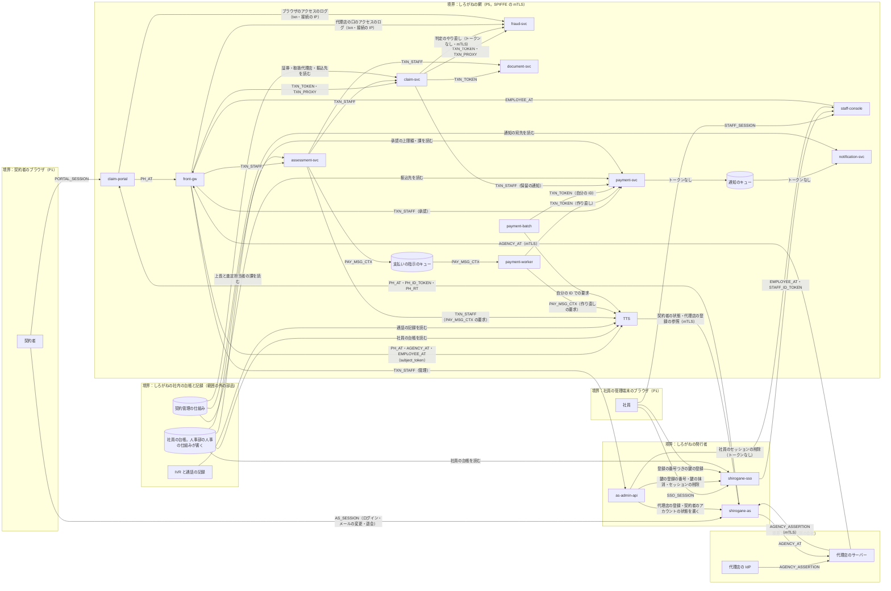
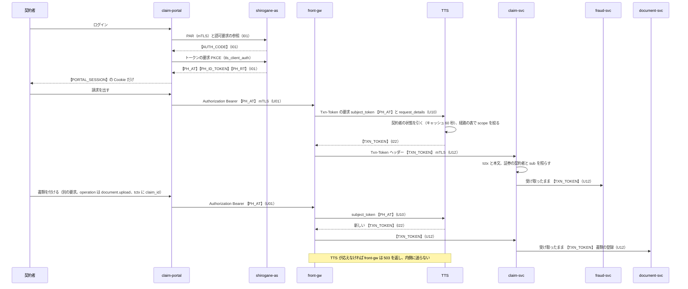
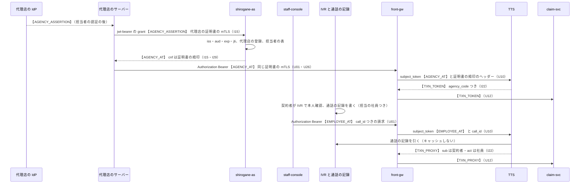
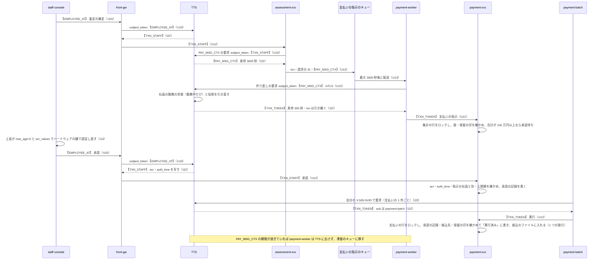

<!-- template_version: 0.7.0 -->
# 設計書（Full）：しろがね損保　保険金の請求と支払いの内部処理（契約者のポータル、代理店の API、Transaction Token Service）

> **測定の対照に使う教材。設計に使わない**

> 架空の損害保険会社「しろがね損保」の、保険金の請求・査定・支払いの内部処理の JWT のクレームの設計書です。契約者はポータル（claim-portal）から、提携の代理店は代理店の API から請求を出し、社員は社員の画面（staff-console）から査定・承認・代理受付をします。入口（front-gw）の内側では外の AT を使わず、しろがねが作る Transaction Token Service（TTS）の Txn-Token と mTLS で運びます。判断は台帳（`claims.yaml`・`token_types.yaml`・`hops.yaml`・`catalog_answers.yaml`）に 1 回だけ書き、この文書からは ID で参照します。

| 欄 | 内容 |
| --- | --- |
| 版 | 0.1.0（最初の版）。テンプレートは `templates/00_core.md`（0.7.0）。節の番号は 00_core と同じ |
| Lite／Full | **Full**。README の 5 問のうち「境界を越えるか」（代理店のサーバーが AT を持つ。代理店の IdP の assertion を受け入れる）・「委任・トークン交換があるか」（入口での Txn-Token への作り直し、電話の代理受付、メッセージの文脈からの作り直し）・「新しい発行者か」（TTS）・「規制の対象か」（要配慮個人情報）が Yes。「マルチテナントか」は No。`catalog_answers.yaml` の `lite_criteria` |
| 使うプロファイル | 契約者と社員のブラウザの境界は P1、front-gw の内側（サービスの網・ブローカー）は P5。モジュールは M_token_validation・M_privacy_minimization・M_authz_pdp・M_sender_constraint。代理店の口は、P3（後回しの #21）の代わりに P5 の入口の変換の行として書いた（12.）。記入欄は付録 D |
| 作成方法 | 生成 AI（Claude）を使って作成した。人による点検は未実施 |

- 生成の区間：`<!-- render:<節>:begin -->`〜`end` の間は `python tools/claim_lint render <この設計書のディレクトリ> --write` が台帳から書き直します。手で直しません
- 要求の出どころ：しろがね損保の「保険金の請求と支払いの仕組みの要求書」（以下「要求」）。設計が使う要求は次の表で、ID（REQ-xx）で参照します。要求に無いものを設計で足したときは、その場所に書きます

| ID | 要求（要求の節） | この設計で効く場所 |
| --- | --- | --- |
| REQ-01 | 契約者のアカウントを止めたら、15 分（900 秒）以内に、その契約者の名でのポータルの操作と電話の代理受付を止める（4.1） | TTS の発行のたびの状態の確認、9.1 |
| REQ-02 | 代理店の契約を止めたら、15 分（900 秒）以内に、その代理店と担当者の請求を止める（4.2） | 代理店の登録、AGENCY_AT の寿命、9.1 |
| REQ-03 | 社員の退職・休職・役割の変更は、10 分（600 秒）以内に、査定・承認・代理受付・管理の操作に効かせる（4.3） | TTS の社員の台帳の確認、Txn-Token の寿命、9.1 |
| REQ-04 | 支払いの承認・指示の取り消し（payment.cancel）と請求の保留は、支払いの実行の前なら必ず効く（5.2） | payment-svc の実行の取引の中の確認（H24）と、保留の印を payment-svc に書く経路（H25） |
| REQ-05 | 100 万円以上の支払いは、査定した人と別の上長が承認する。承認の前の 5 分（300 秒）以内に、ハードウェアの鍵で認証していること（5.1） | TXN_STAFF の acr・auth_time、H23、付録 B |
| REQ-06 | 査定の確定から支払いの指示まで、ブローカーで最大 60 分（3600 秒）待つ。支払いの実行は毎日 1 時から 3 時の夜間の処理（5.3） | PAY_MSG_CTX、H20〜H22・H24 |
| REQ-07 | 請求の受付（ポータル・代理店の口）の可用性は月 99.9%（6.1） | 3.1 の重点、付録 A |
| REQ-08 | 傷病・事故の内容（要配慮個人情報）はトークンに載せず、割り当てた査定担当者だけが書類を読む（7.1） | `C-injury`（却下）、H19、付録 D の M_privacy_minimization |
| REQ-09 | 支払いの 1 件ごとに、誰の請求で、誰が査定し、誰が承認し、何が実行したかを 1 本の記録でたどれる（7.2） | `C-txn`・`C-tctx` の claim_id・payment_id、付録 D の M_privacy_minimization の 7. |
| REQ-10 | トークンの署名の鍵が漏れたら、15 分（900 秒）以内にその鍵の署名を受け入れない（7.3。起点は漏れに気づいた時点と読んだ。3.1） | 目録の `jwks_cache_ttl`・`unknown_kid`、付録 D の M_token_validation の 8. |
| REQ-11 | 電話の代理受付は、自動音声（IVR）で本人確認した通話の間（本人確認から 30 分。1800 秒）だけ（4.4。通話が終わるか 30 分を過ぎたら止める、と読んだ） | TXN_PROXY、H14・H15、3.1 の見送り |
| REQ-12 | ログに個人情報を平文で残さない（7.2） | 台帳の `log_policy`、付録 D の M_privacy_minimization の 7. |

## 1. CI の結果〔Lite：生成〕

項目 ID：`template:00_core#ci-results`

<!-- render:ci-result:begin -->
`python tools/claim_lint designs/target --also-scan designs/target/design.md`（profile full）：**error 0、warn 9、info 15**（claims 26・token_types 26・catalog_events 64）。OK

| 規則 | 重大度 | 対象 | 内容 |
| --- | --- | --- | --- |
| `R3` | info | `idp[shirogane-as]` | 発行者 shirogane-as は組織が自分で作る（kind: self_built）。契機の一覧 7 項目は設計書が決め、すべてカタログのイベントか対象外にひもづく。R3b と L2 は、この発行者を照合しない |
| `R3` | info | `idp[shirogane-sso]` | 発行者 shirogane-sso は組織が自分で作る（kind: self_built）。契機の一覧 5 項目は設計書が決め、すべてカタログのイベントか対象外にひもづく。R3b と L2 は、この発行者を照合しない |
| `R3` | info | `idp[shirogane-tts]` | 発行者 shirogane-tts は組織が自分で作る（kind: self_built）。契機の一覧 8 項目は設計書が決め、すべてカタログのイベントか対象外にひもづく。まだ存在しない発行者（planned: true）なので、作った後に一覧を実装と突き合わせる。R3b と L2 は、この発行者を照合しない |
| `R3` | info | `idp[agency-idp]` | IdP agency-idp は一覧が存在しない。列挙の外の契機は R9 の回答で探した |
| `R6` | info | `pairwise` | 2 因子の組 52 個をすべて検討した（主体 3・発行イベント 9） |
| `R8` | info | `PH_AT` | 最悪 1003 バイト（ヘッダーの行で 1025）／上限 8192（nginx-large-client-header-buffers）= 13% |
| `R8` | info | `AGENCY_AT` | 最悪 1190 バイト（ヘッダーの行で 1212）／上限 8192（nginx-large-client-header-buffers）= 15% |
| `R8` | info | `EMPLOYEE_AT` | 最悪 1088 バイト（ヘッダーの行で 1110）／上限 8192（nginx-large-client-header-buffers）= 14% |
| `R8` | info | `TXN_TOKEN` | 最悪 1574 バイト（ヘッダーの行で 3622）／上限 16384（nodejs-max-http-header-size）= 22% |
| `R8` | info | `TXN_STAFF` | 最悪 1567 バイト（ヘッダーの行で 3615）／上限 16384（nodejs-max-http-header-size）= 22% |
| `R8` | info | `TXN_PROXY` | 最悪 1651 バイト（ヘッダーの行で 3699）／上限 16384（nodejs-max-http-header-size）= 23% |
| `R8` | info | `C-scope` | PH_AT・AGENCY_AT・EMPLOYEE_AT・TXN_TOKEN・TXN_STAFF・TXN_PROXY・PAY_MSG_CTX の両方に載る（重複の候補） |
| `R8` | info | `C-agency-code` | AGENCY_AT・TXN_TOKEN の両方に載る（重複の候補） |
| `L1b` | warn | `C-req-wl` | 未登録の名前 req_wl は草案（draft-ietf-oauth-transaction-tokens-11 §9.2）が定める名前（tools/claim_lint/draft_claims.yaml）。登録の前なので、草案の版（spec_version）と、登録・改名されたときの見直しの条件を確かめる |
| `L1b` | warn | `C-tctx` | 未登録の名前 tctx は草案（draft-ietf-oauth-transaction-tokens-11 §9.2.3）が定める名前（tools/claim_lint/draft_claims.yaml）。登録の前なので、草案の版（spec_version）と、登録・改名されたときの見直しの条件を確かめる |
| `L2` | info | `idp[agency-idp]` | IdP agency-idp の、書き換えを許さないクレームの一覧が tools/claim_lint/idp_reserved.yaml にない。L2 は確かめていない（IdP モジュール #4 で手で確かめる） |
| `L16` | warn | `hop H4` | aud の shirogane-sonpo.internal が上流（H3）に無い（下流ほど絞る。広げない。Txn-Token の scope は同じか狭い：draft-ietf-oauth-transaction-tokens-11 §13.6） |
| `L16` | warn | `hop H7` | aud の shirogane-sonpo.internal が上流（H6）に無い（下流ほど絞る。広げない。Txn-Token の scope は同じか狭い：draft-ietf-oauth-transaction-tokens-11 §13.6） |
| `L16` | warn | `hop H15` | aud の shirogane-sonpo.internal が上流（H14）に無い（下流ほど絞る。広げない。Txn-Token の scope は同じか狭い：draft-ietf-oauth-transaction-tokens-11 §13.6） |
| `L16` | warn | `hop H17` | aud の shirogane-sonpo.internal が上流（H14）に無い（下流ほど絞る。広げない。Txn-Token の scope は同じか狭い：draft-ietf-oauth-transaction-tokens-11 §13.6） |
| `L16` | warn | `hop H30` | 寿命 3600 秒が上流（H29）の 300 秒を超える（下流ほど絞る。組織の規則、author-proposal。寿命の例外は Txn-Token の作り直しだけで、理由は 10 字以上） |
| `L16` | warn | `hop H23` | aud の shirogane-sonpo.internal が上流（H14）に無い（下流ほど絞る。広げない。Txn-Token の scope は同じか狭い：draft-ietf-oauth-transaction-tokens-11 §13.6） |
| `L16` | warn | `hop H26` | aud の shirogane-sonpo.internal が上流（H14）に無い（下流ほど絞る。広げない。Txn-Token の scope は同じか狭い：draft-ietf-oauth-transaction-tokens-11 §13.6） |
| `L17` | info | `PH_ID_TOKEN・AGENCY_ASSERTION・STAFF_ID_TOKEN` | 種類の違うトークン種別が同じ typ（jwt）を使うが、ペイロードの値と aud で区別する（kind_discriminator。RFC 8725 §3.12 の「必須クレームの値を変える」「aud を変える」）。typ は IdP が決め、設計では選べない。aud の列は自由記述なので、文字列が違っても同じ宛先を指していないかは、レビューで確かめる |

R8 PH_AT：ヘッダー 75・ペイロード 611・署名 64 バイト（ceil(4/3*75) + ceil(4/3*611) + ceil(4/3*64) + 2 = 100 + 815 + 86 + 2 = 1003; + 7 (Bearer) = 1010）。nginx-large-client-header-buffers 1025／8192 バイト

R8 AGENCY_AT：ヘッダー 75・ペイロード 751・署名 64 バイト（ceil(4/3*75) + ceil(4/3*751) + ceil(4/3*64) + 2 = 100 + 1002 + 86 + 2 = 1190; + 7 (Bearer) = 1197）。nginx-large-client-header-buffers 1212／8192 バイト

R8 EMPLOYEE_AT：ヘッダー 75・ペイロード 675・署名 64 バイト（ceil(4/3*75) + ceil(4/3*675) + ceil(4/3*64) + 2 = 100 + 900 + 86 + 2 = 1088; + 7 (Bearer) = 1095）。nginx-large-client-header-buffers 1110／8192 バイト

R8 TXN_TOKEN：ヘッダー 81・ペイロード 1033・署名 64 バイト（ceil(4/3*81) + ceil(4/3*1033) + ceil(4/3*64) + 2 = 108 + 1378 + 86 + 2 = 1574）。nodejs-max-http-header-size 3622／16384 バイト

R8 TXN_STAFF：ヘッダー 81・ペイロード 1028・署名 64 バイト（ceil(4/3*81) + ceil(4/3*1028) + ceil(4/3*64) + 2 = 108 + 1371 + 86 + 2 = 1567）。nodejs-max-http-header-size 3615／16384 バイト

R8 TXN_PROXY：ヘッダー 81・ペイロード 1091・署名 64 バイト（ceil(4/3*81) + ceil(4/3*1091) + ceil(4/3*64) + 2 = 108 + 1455 + 86 + 2 = 1651）。nodejs-max-http-header-size 3699／16384 バイト
<!-- render:ci-result:end -->

warn の行ごとの理由（`templates/CONTRIBUTING.md` の 2.）：

| 規則・対象 | 残す理由 |
| --- | --- |
| `L1b`・`C-req-wl`・`C-tctx` | Transaction Tokens の草案（-11）が定める名前で、組織の名前空間に移せない。`spec_version` と見直しの条件（草案の版が変わったとき）を書いた |
| `L16`・`H30` | PAY_MSG_CTX（kind は jwt）の寿命 3600 秒が、上流の TXN_STAFF の 300 秒を超える。ブローカーで最大 3600 秒待つため（REQ-06）で、PAY_MSG_CTX は TTS への作り直しの要求にしか使えない。待つ間の変化は、TTS が作り直しで社員の勤務の状態と役割を、payment-svc が受け付けの取引で版と請求の保留を確かめ、課の異動は 3.1 の業務の規則に頼る（H30 の `narrowing_exception`、5.1。Txn-Token でない種別の例外は、規則が info に下げない） |
| `L16`・`H4`・`H7`・`H15`・`H17`・`H23`・`H26` | TTS が外の AT から Txn-Token を作るホップ。Txn-Token の aud は信頼ドメイン（shirogane-sonpo.internal。草案 §9.2）で、外の AT の aud（口の識別子）と名前が違う。`aud_mapping` は行き先のサービスの名前の aud しか対応づけられないので、対応を台帳に書けない。宛先の絞り込みは、TTS が「AT の aud が front-gw の書いた口と一致すること」を確かめ（`C-aud` の tts の行）、内側の受け手が aud を信頼ドメインだけにすること（`C-aud`）で行う。scope と寿命は L16 が上流と比べ、6 つのホップのどれも上流を超えない（8.） |

## 2. 範囲と信頼の境界〔Lite：手で書く〕

項目 ID：`template:00_core#scope-boundary`

範囲は、契約者の画面（claim-portal）・社員の画面（staff-console）・代理店の口・front-gw・TTS・内側の 6 つのサービス（claim-svc・fraud-svc・document-svc・assessment-svc・payment-svc・notification-svc）・ブローカーの 2 つのキュー（支払いの指示・通知）・payment-worker・夜間の支払いの処理（payment-batch）、shirogane-as の管理の口（as-admin-api）です。shirogane-as・shirogane-sso はしろがねが運用する発行者で、発行の契機と設定を書きます（実装の製品はこの設計書の範囲の外で、OIDC Core 1.0・RFC 9068・RFC 9126・RFC 7523・RFC 8705・RFC 9470 の機能だけを前提にします）。代理店の IdP は範囲の外の発行者で、受け入れの規則だけを書きます。

記入欄：

| 境界 | 使うプロファイル | 中の部品 | 境界を越えるトークン（目録の ID） | 範囲の外にしたものと前提 |
| --- | --- | --- | --- | --- |
| 契約者のブラウザ | P1 | ブラウザ | `PORTAL_SESSION`（Cookie）、`AUTH_CODE`（URL）、`AS_SESSION`（shirogane-as の Cookie） | ブラウザにはトークンを渡さない。スマートフォンのアプリは無い（作るときは P2 で書き足す）。メールの変更・退会は shirogane-as の画面で契約者が行う |
| 社員の管理端末のブラウザ | P1 | 社内の管理端末のブラウザ | `STAFF_SESSION`、`AUTH_CODE`、`SSO_SESSION` | 社員の画面は社内の網からだけ届く。代理店の担当者は社員の画面を使わない |
| 代理店 | P5（入口の変換の行。P3 は #21） | 代理店の IdP、代理店のサーバー | `AGENCY_ASSERTION`、`AGENCY_AT` | 代理店のサーバーの中のトークン・鍵の扱いと、代理店の IdP の担当者の管理は、代理店連携の仕様（しろがねが出す）で求めるだけで、しろがねは確かめられない。代理店のサーバーの証明書は、しろがねの代理店向けの CA が出す |
| しろがねの発行者 | —（発行者） | shirogane-as（契約者・代理店）、as-admin-api（しろがねの発行者の管理の口。shirogane-as と shirogane-sso の両方の管理を受ける）、shirogane-sso（社員） | 上の各トークン | as-admin-api は網の中で TXN_STAFF だけを受ける（社員の口の front-gw の内側）。代理店の登録（代理店のクライアントの client_id と証明書のサブジェクトを含む）・契約者のアカウントの状態・社員のセキュリティキーの登録の番号の発行と鍵の抹消・社員のセッションの削除は as-admin-api だけが書く（2.2）。代理店の登録の新規作成とクライアントの追加も 2 人の操作。代理店向けの CA の証明書は、2 人の操作で有効になった代理店の登録の証明書のサブジェクトに対してだけ、情報セキュリティ部が出す（代理店の CSR を受け、登録の番号と照らす）。claim-portal・staff-console のクライアントの登録と、発行者の署名の鍵の変更は IT 基盤部の変更の手続き（2 人の承認と記録）で行う。shirogane-sso の利用者は社員の台帳から作られ、管理の操作で役割を付けない |
| しろがねの網 | P5 | claim-portal・staff-console・front-gw・TTS・6 つのサービス・payment-worker・payment-batch・ブローカー | 外の AT は front-gw と TTS で止まり、内側は `TXN_TOKEN`・`TXN_STAFF`・`TXN_PROXY`・`PAY_MSG_CTX` だけ | すべての部品は SPIFFE の X.509-SVID を持ち、メッシュの mTLS でだけ話す。網の外から届く入口は front-gw の代理店の口と、claim-portal・staff-console の画面だけ。front-gw の契約者の口と社員の口は、claim-portal・staff-console の SVID からしか接続を受けない |
| 社内の台帳と記録 | —（範囲の外の部品） | 社員の台帳、IVR と通話の記録、契約管理の仕組み | トークンは届かない。TTS・claim-svc・payment-svc・shirogane-sso が読む | 社員の台帳を書くのは人事部の人事の仕組みだけ（入力と承認の手続きは人事の規程）。通話の記録を書くのは IVR だけで、社員は書けない。契約管理の仕組みの証券・取扱代理店・振込先は、契約部の手続きで書く（payee_ref の口座は書き換えず、変わったら新しい payee_ref にする）。どれも読み取りの API を mTLS で出す |

トークンを運ばない内部の呼び出し（図の矢印。どれも呼び出し元の X.509-SVID の mTLS で認証し、受け手は呼び出し元の SPIFFE ID を一覧と照らし、読み取りだけを許す）：

| 呼び出し | 使う資格情報 | 受け手が確かめること | 止まったとき |
| --- | --- | --- | --- |
| TTS → shirogane-as（契約者の状態・代理店の登録・代理店の担当者の表の参照） | TTS の SVID の mTLS | shirogane-as の状態の参照の API は TTS の SPIFFE ID だけを受ける（読み取りだけ） | 60 秒のキャッシュの後は発行しない（3.1） |
| TTS → 社員の台帳・IVR の通話の記録 | TTS の SVID の mTLS | 人事の仕組み・IVR の読み取りの API は、許可した SPIFFE ID（TTS・shirogane-sso・payment-svc・assessment-svc）だけを受ける | 社員の口だけが止まる |
| payment-svc → 社員の台帳（承認の上限額・承認者と査定担当者の課） | payment-svc の SVID の mTLS（承認と取り消しのたびに引く） | 同上（読み取りだけ） | 承認を受けない（拒む） |
| assessment-svc → 社員の台帳（上長と査定担当者の課） | assessment-svc の SVID の mTLS | 同上（読み取りだけ。課と役割の ID だけを返す） | 上長の閲覧と割り当ての変更を受けない（査定担当者の自分の割り当ての閲覧は続く） |
| claim-svc・payment-svc・notification-svc → 契約管理の仕組み | 各サービスの SVID の mTLS | 契約管理の仕組みの読み取りの API は、許可した SPIFFE ID だけを受ける | claim-svc は請求を受けない（3.1 の可用性）、payment-svc は指示・実行を受けない、notification-svc は送らずに再送する |
| claim-svc → fraud-svc（判定待ちの請求の判定のやり直し） | claim-svc の SVID の mTLS（元の Txn-Token は切れているので付けない） | fraud-svc のやり直しの API は claim-svc の SPIFFE ID だけを受け、claim-svc の記録の請求の内容（claim_id・証券番号・金額・請求の主体の sub と act.sub）を本文で受け、判定の記録に「やり直し（利用者の要求の外）」と元の txn を残す。判定の結果を返すだけで、請求の書き込みはしない | 判定待ちのまま 5 分ごとにやり直し、24 時間続いたら保険金部に知らせる |
| as-admin-api → shirogane-as（代理店の登録・代理店のクライアント・契約者のアカウントの状態の書き込み） | as-admin-api（shirogane-as とは別のサービス）の SVID の mTLS | shirogane-as の管理の書き込みの API は as-admin-api の SPIFFE ID だけを受ける（ほかの部品・管理の画面からは書けない。DB の直接の修正は 2.2） | 書き込みは失敗を返し、停止も書けない（当番が as-admin-api を直す。停止の目標は REQ-01・REQ-02 の 900 秒の内で、9.1 の最悪はその後から数える） |
| as-admin-api → shirogane-sso・staff-console（鍵の登録の番号・鍵の抹消・セッションの削除） | as-admin-api の SVID の mTLS | shirogane-sso の管理の API と staff-console のセッションの削除の API は、as-admin-api の SPIFFE ID だけを受ける | 紛失の届けでは、届けた社員の勤務の状態を人事部が「休職」にして TTS で止める手順に切り替える |
| claim-portal・front-gw → fraud-svc（アクセスのログ） | ログの基盤の書き出し（mTLS）。契約者の IP は claim-portal が、ブラウザとの接続から記録する（ヘッダーの申告は使わない）。代理店のサーバーの IP は front-gw の代理店の口が記録する | fraud-svc はログの基盤からだけ読む。IP は個人関連情報で、ログの基盤で 90 日保持し、読めるのは fraud-svc と不正対策の担当だけ（REQ-12：sub は HMAC） | 判定が IP の特徴を使わずに続く |

範囲の外にしたもの：銀行への振込のファイル（payment-batch が作り、銀行との専用の回線で送る）は、この設計の範囲の外です（トークンを使わない）。書類は契約者と代理店が電子で付け、郵送の書類は扱いません（要求の 3.1）。

### 2.1 主体の種類〔Lite：手で書く（2. の中で）〕

項目 ID：`template:00_core#principals`

| 主体 | 種類 | 表すクレーム（台帳の ID） | 利用者のトークンと区別する手段 | 要求の言葉と、入る区分・入らない区分 |
| --- | --- | --- | --- | --- |
| 契約者 | 利用者 | `C-sub`（ph_ の ID） | — | 要求の「契約者」は、証券の契約者で、shirogane-as のアカウントを登録した人。被保険者・受取人が契約者と別の人のときは、契約者のアカウントで請求する（受取人は振込先として契約管理の仕組みに載る）。アカウントを止めた人は入らない |
| 代理店の担当者 | 利用者（別の会社の人） | `C-sub`（agst_ の ID）、`C-agency-code` | 別の aud（代理店の口）の `AGENCY_AT`。Txn-Token では sub の形（agst_）と agency_code | 要求の「代理店」は、代理店の登録が有効な代理店だけ。担当者は、その代理店の IdP が認証した人。代理店の担当者は、代理店の委託の契約に基づく代理店自身の権限で請求を出す（契約者から 1 件ごとに委任を受けるのではない）ので act を使わない。どの証券の請求を出せるかは、証券の取扱代理店で決まる |
| 社員 | 利用者（役割が違う） | `C-sub`（stf_ の ID）、`C-acr`・`C-auth-time` | 別の aud（社員の口）の `EMPLOYEE_AT`。Txn-Token では `TXN_STAFF`（acr・auth_time あり） | 要求の「査定担当者」「上長」「コールセンター」「代理店管理部」「お客さま窓口の上長」と、設計で足した「社員の認証の管理者」（IT 基盤部の担当者のうち人事部が役割を付けた人）は、社員の台帳の役割の ID で決まる（役割と scope の対応は付録 D の M_authz_pdp の 1.）。委託先の作業者は社員の台帳に載せない（入らない）。役割は TTS が台帳から引き、トークンに載せない |
| 電話の代理受付の社員 | 利用者（代理） | `TXN_PROXY` の `C-act` | act のある `TXN_PROXY`。claim-svc・fraud-svc だけが受ける | 要求の「代理受付」は、IVR で本人確認した通話の担当の社員だけ（REQ-11）。本人確認の無い電話・終わった通話・30 分を過ぎた通話では入らない |
| しろがねのサービス | ワークロード | mTLS の SPIFFE ID（q-peer）、`C-req-wl` | トークンのクレームでは表さず、通信の層で確かめる | — |
| 代理店のサーバー | ワークロード（別の会社のサーバー） | `C-client-id`、`C-cnf` | 証明書の mTLS と cnf | 代理店の登録の client_id と証明書のサブジェクトの組だけ |
| 夜間の支払いの処理 | システム（バッチ） | `TXN_TOKEN` の `C-sub`（payment-batch の SPIFFE ID） | sub がワークロードの SPIFFE ID で、scope が `payments:execute` だけ | 利用者の ID を借りない |

### 2.2 システムの権限〔Full だけ〕

項目 ID：`template:00_core#system-privileges`

| 場面 | 主体とトークン（目録の ID） | クレームで示すこと（台帳の ID） | 確かめ方 |
| --- | --- | --- | --- |
| 夜間の支払いの実行 | payment-batch が自分の X.509-SVID で TTS に求める `TXN_TOKEN`（草案 §8.2。支払いの 1 件ごと） | `C-sub` は payment-batch の SPIFFE ID、`C-scope` は `payments:execute`、`C-tctx` の payment_id | payment-svc は mTLS の相手が payment-batch で、sub がその ID と同じことを確かめる。TTS は実行の時間帯（1 時〜3 時）の外では出さない（H24） |
| 支払いの指示（査定の確定の後） | payment-worker が `PAY_MSG_CTX` を出して受ける `TXN_TOKEN` | `C-sub` は査定を確定した社員、`C-req-wl` は payment-worker | TTS が作り直しのたびに、その社員の勤務の状態（勤務中だけ）と査定担当者の役割を引き直し、payment-svc が受け付けの取引で版と請求の保留を確かめる（H22）。payment-worker は自分の権限で支払いを指示しない（sub は社員のまま） |
| 電話の代理受付 | front-gw が TTS に求める `TXN_PROXY` | `C-sub` は通話の記録の契約者、`C-act` の sub は社員、`C-tctx` の call_id | TTS が通話の記録（本人確認の結果・時刻・担当の社員）を毎回引き、claim-svc・fraud-svc が act を記録する（H14・H15・H16） |
| 管理の操作 | 代理店管理部・お客さま窓口の上長・IT 基盤部（社員の認証の管理）の `TXN_STAFF`（as-admin-api） | `C-scope` の `admin:agency`・`admin:account`・`admin:staff-auth`、`C-acr`・`C-auth-time` | as-admin-api が acr と auth_time（300 秒）を確かめる。代理店の登録の変更は 2 人の操作（H26） |
| 社員の認証の管理 | 社員の認証の管理者の役割の IT 基盤部の担当者の `TXN_STAFF`（as-admin-api。scope は `admin:staff-auth`） | `C-tctx` の target_ref（社員の ID） | セキュリティキーの登録：情報セキュリティ部の窓口で社員本人を写真つきの社員証で確かめた後、IT 基盤部の担当者が登録の番号（24 時間・1 回だけ）を発行し、別の担当者が承認する（2 人の操作。記録に両方の sub と txn）。社員はその番号で shirogane-sso の画面から鍵を登録する。番号の確かめと使用済みにする書き込みは、shirogane-sso が鍵の登録と同じ 1 つの取引の中で、番号の状態を「未使用」から「使用済み」に替える条件つきの書き込みで行う（並行の 2 件は 1 件だけ通る。書き込みに失敗・記録先が応えなければ登録しない）。番号は target_ref の社員の ID に結びつき、その社員のパスワードでログインしたセッションでだけ使える。登録したら、社員本人と情報セキュリティ部に知らせる。鍵の抹消・社員のセッションの削除（紛失の届け）：1 人の操作で、すぐ有効。as-admin-api が shirogane-sso の鍵とセッションを消し、staff-console のセッションの削除の API を呼ぶ（2. のトークンを運ばない呼び出し） |
| 緊急時の特権 | 無い：社員が契約者や別の社員になりかわる経路（なりすまし）と、承認を飛ばす経路を作らない | — | 障害で TTS が使えない間は、請求の受付も査定も止める（3.1） |
| データベースの直接の修正 | IT 基盤部の DB の管理者（トークンを使わない） | — | 書ける表：claim-svc の請求・割り当て・保留、payment-svc の支払い・承認の記録・保留の印、shirogane-as の代理店の登録・契約者のアカウント。基盤の変更の手続き（変更の番号、2 人の承認）でだけ行い、直した行の「書いた者」の列に変更の番号と DB の管理者を残す（利用者の操作の行は sub と txn）。承認の記録・保留の印・代理店の登録の直接の修正は、業務の持ち主（保険金部・代理店管理部）の承認も要る。毎月、変更の番号のある行を監査部が変更の記録と突き合わせる |

## 3. 既定から外れた点〔Lite：手で書く〕

項目 ID：`template:00_core#deviations`

| 外れた点 | 既定 | この設計の値 | 書いた台帳の行の ID | 見直しの条件 |
| --- | --- | --- | --- | --- |
| クライアント認証 | 既定の組み合わせに定めなし（秘密の共有が多い） | tls_client_auth（claim-portal・staff-console は SVID、代理店は代理店向けの CA の証明書） | `issuance_profile.client_auth`、`CLIENT_ASSERTION`（却下） | トークンの端点の前で TLS を終端するとき |
| grant | 認可コード＋PKCE と refresh | JWT の assertion（RFC 7523。代理店）と、TTS のトークン交換の形の要求を足す | `issuance_profile.grants` | 代理店の連携の形が変わったとき |
| 送信者制約 | none | 代理店の AT だけ mTLS（RFC 8705）。PH_AT・EMPLOYEE_AT は none（見送りの理由を 3.1 に書く） | `issuance_profile.sender_constraint`、`AGENCY_AT`・`PH_AT`・`EMPLOYEE_AT` の `sender_constraint` | 3.1 の見直しの条件 |
| 要求の保護 | 定めなし | PAR（RFC 9126）と resource（RFC 8707） | `issuance_profile.request_protection` | — |
| AT の寿命 | 製品の既定 | PH_AT・EMPLOYEE_AT は 600 秒、AGENCY_AT は 300 秒（REQ-02 から） | 目録の `max_lifetime` | REQ-01〜03 の数値が変わったとき |
| 入口の内側のトークン | 内部トークン（phantom） | Txn-Token（草案 -11）。組織独自の内部トークンは作らない | `TXN_TOKEN`・`TXN_STAFF`・`TXN_PROXY`、`INTERNAL_TOKEN`（却下） | 草案の版が変わったとき |
| Txn-Token の認証の情報 | 草案に定めなし | TXN_STAFF に acr・auth_time を載せる（TTS が EMPLOYEE_AT から写す） | `C-acr`・`C-auth-time` の note、`TXN_STAFF` | 草案が置き場所を定めたとき |
| rctx | 草案は RECOMMENDED | 載せない（読む受け手が無い） | `C-rctx`（却下） | 要求元の IP で判断する要求が出たとき |
| IdP モジュールの既定の回答 | M_idp_keycloak の既定 | しろがねの発行者は自分で作る発行者（`kind: self_built`）なので、64 件すべてを手で答え、契機の一覧を書いた | `catalog_answers.yaml` の `idp` | 発行者を製品に替えるとき |
| ケーススタディの判定 | — | 記入例ではないので照合しない | — | — |

### 3.1 重点と見送り〔Lite：手で書く（3. の中で）〕

項目 ID：`template:00_core#priorities-deferrals`

| 区分（重点・見送り） | 項目 | 効果と費用（未検証の点を含む） | 見直しの条件 | 台帳の行の ID |
| --- | --- | --- | --- | --- |
| 重点 | 内側は Txn-Token だけ。専用の Txn-Token ヘッダーで受け取ったまま渡し、tctx を使う受け手のすべてが要求の本文と照合する | 外の AT を内側に入れない。途中のサービスが本文を書き換えても、入口で決めた値から外れた処理をしない。受け手ごとに照合する項目を台帳に書く費用（付録 D の P5 の 2. の表） | 草案の版が変わったとき | `TXN_TOKEN`・`TXN_STAFF`・`TXN_PROXY`、`C-tctx`、H4〜H26 |
| 重点 | TTS が発行のたびに、契約者の状態・代理店の登録・社員の台帳・通話の記録を引く | 止める単位ごとに、止めてから効くまでが要求に収まる（9.1 の表。最悪 390 秒・750 秒）。TTS が台帳を毎回引く費用（キャッシュ 60 秒。通話の記録はキャッシュしない） | 台帳の問い合わせが TTS の遅れの主因になったとき | `C-sub`・`C-scope`・`C-agency-code`、目録の `revocation` |
| 重点 | 追加の認証（ハードウェアの鍵・300 秒）は、操作を受ける payment-svc と as-admin-api が TXN_STAFF の acr・auth_time で確かめる | staff-console の画面を通らない呼び出しでも同じ条件になる。承認の記録を書けるのは payment-svc の承認の API だけで、その API が確かめる（付録 B） | 承認の経路を足すとき | `C-acr`・`C-auth-time`、H23・H26 |
| 重点 | 代理店の AT を代理店のサーバーの証明書に束縛し（RFC 8705）、代理店コードは代理店の申告でなく代理店の登録から書く | 網の外にある AT を盗まれても使えない。代理店の IdP の管理者は担当者を作れるが、代理店コード（どの証券を扱えるか）は変えられない | 代理店が証明書を扱えないと分かったとき | `AGENCY_AT`、`C-cnf`、`C-agency-code`、H5・H6 |
| 重点 | 傷病・事故の内容をトークンに載せず、書類は assessment-svc から document-svc への経路でだけ読む | 要配慮個人情報が届く先を document-svc と、割り当てた査定担当者の画面に限る（REQ-08） | 傷病の区分で自動の査定をする要求が出たとき | `C-injury`（却下）、H19 |
| 重点 | TTS・状態の参照・JWKS が応えないときは拒む（縮退の運転を持たない） | 確かめていない値を内側に流さない。請求の受付の経路の部品の目標は front-gw 99.99%・TTS 99.99%（3 つの可用性ゾーン）・shirogane-as（トークンの端点・状態の参照の API・JWKS）99.99%・契約管理の仕組みの読み取りの API 99.99%・claim-svc 99.97% で、契約者の口ではこれに claim-portal 99.99% が加わる。積は契約者の口で 99.92%、代理店の口で 99.93%（REQ-07 の 99.9% に収まる。目標の値で、測っていない）。fraud-svc と書類の登録（document-svc）は受付の経路に入れない（請求を先に受け付け、判定は後から、書類は後から付けられる。H8 の note）。社員の台帳・通話の記録が止まると社員の口だけが止まる。代理店向けの CA の CRL を取り直せないときは、前の CRL で最長 3600 秒受け、その後は代理店の口を止める（失効した証明書を最長 3600 秒受けうる限界を、可用性と引き換えに受け入れる。確かめ方：CRL の配信を止める試験）。夜間の実行の時間帯に TTS か契約管理の仕組みが応えなければ、その夜の支払いは実行せず次の夜に回す（REQ-06 の夜間の実行が 1 日遅れる。保険金部に知らせ、手作業の振込の経路は作らない） | 月の可用性が 99.9% を下回ったとき（付録 A） | H3・H5・H6 の note、H24、目録の `unknown_kid` |
| 重点 | 非同期の経路では Txn-Token を持ち越さず、PAY_MSG_CTX から作り直すときに TTS が社員の状態・役割を引き直し、payment-svc が受け付けと実行の取引で版と請求ごとの保留の印を確かめる。実行の取引の中で payment-svc が承認の記録と保留の印（H25 で写したもの）を確かめる | 60 分待つ間に役割を外した社員の指示や、取り消した承認での実行を通さない（REQ-03・REQ-04） | ブローカーで待つ上限が変わったとき | `PAY_MSG_CTX`、H20〜H25 |
| 見送り | PH_AT・EMPLOYEE_AT の送信者制約（DPoP・mTLS） | 盗まれた PH_AT・EMPLOYEE_AT は、front-gw の契約者の口・社員の口に、claim-portal・staff-console の SVID で接続できる者だけが使える（2 つの口はほかの接続を受けない）。比べた候補：mTLS で束縛すると、SVID が 1 時間ごとに替わるたびに直前の AT が使えなくなる。DPoP（BFF が持つ替わらない鍵）で束縛すると、鍵は AT と同じ BFF のサーバーに置かれるので、BFF が破られたときは鍵も盗まれて守りにならず、AT だけが漏れる経路（ログ・別の部品）は口の mTLS の相手の制限で既に閉じている。proof の作成と照合の費用に見合う守りが無い。確かめ方：front-gw の口の設定の試験（ほかの SVID・網の外からの接続を拒むこと）を CI で毎回走らせ、AT がログに出ないことをログの走査で確かめる | スマートフォンのアプリなど網の外のクライアントを足すとき。claim-portal・staff-console のほかに口に接続できる部品を足すとき | `PH_AT`・`EMPLOYEE_AT` の `sender_constraint`、`issuance_profile.sender_constraint`、`DPOP_PROOF`（却下） |
| 見送り | Back-Channel Logout・SSF/CAEP（代理店の側の担当者の停止を即時に知る手段） | 代理店の IdP で担当者を止めても、しろがねは知らない。次の assertion が出ないことで止まり、止める直前に出た assertion（60＋ずれ 30 秒）、AGENCY_AT（330 秒）、Txn-Token（330 秒）で最悪 750 秒（REQ-02 の 900 秒に収まる。assertion の寿命を 60 秒、AT を 300 秒にしたのはこのため）。契約者・社員の停止は、TTS の毎回の確認で届く。確かめ方：ステージングで、担当者を止める直前に assertion を出させてから止め、750 秒以内に代理店の口の請求が 403 になることを測る | 代理店から、担当者の停止を即時に効かせる要求が出たとき | `LOGOUT_TOKEN`・`SECURITY_EVENT_TOKEN`（却下）、`AGENCY_ASSERTION`・`AGENCY_AT` |
| 見送り | 電話の代理受付を 1 件の操作ごとの本人確認にしない（通話の間の時間枠。本人確認から 1800 秒か終話まで） | 1 回の電話で請求と照会を続けて受けるので、操作のたびに IVR の本人確認をさせると契約者の負担が大きい（REQ-11 は通話の間を許す）。代わりの守り：TTS が通話の記録を毎回引き（キャッシュしない）、終話の時刻がある通話・1800 秒を過ぎた通話では出さない。TXN_PROXY は 60 秒で、exp は本人確認から 1800 秒を超えない。scope は claims:submit・claims:read だけ、act のあるトークンを受けるのは claim-svc・fraud-svc だけ、通話の記録の担当の社員と EMPLOYEE_AT の sub が一致するときだけ出す。残る限界：終話の直前に出た TXN_PROXY は終話から最大 90 秒（60＋ずれ 30）使える（前提：要求の持ち主の保険金部がこの 90 秒を受け入れる。12.）。確かめ方：TTS の試験で、1801 秒を過ぎた記録・終話した通話・別の社員・本人確認の失敗の記録で出さないこと、1799 秒目に出した TXN_PROXY の exp が 1800 秒の時刻であることを確かめる | 代理受付を支払い・書類に広げるとき。要求の持ち主が終話の後の 90 秒を受け入れないとき | `TXN_PROXY`、`C-act`、`C-tctx` の call_id、H14・H15 |
| 見送り | 高額の支払いの承認をトークンの authorization_details に載せない（承認は payment-svc の承認の記録） | 承認を確かめるのは payment-svc だけで、トークンで別の受け手に運ぶ必要が無い。支払いの流れの規則：(1) 確定のときに、振込先がその請求の証券の有効な振込先であることを assessment-svc が claim-svc で確かめ、値を tctx で固定する（H17・H18）。(2) 指示は (claim_id, assessment_ref) で 1 件にし、受けた版より新しくない版と、未実行の指示がある間の新しい版は受けない（版は単調に増える。H29・H22）。滞留した指示は新しい版の確定で出し直す。(3) 承認の要否は、請求ごとの集計の行をロックした 1 つの取引で、実行済み・指示済みで未実行・承認待ちとこの指示の合計から決める（H22）。(4) 承認・取り消しは査定者の今の課の別の上長だけで（3.1 の課の規則）、payment_id・金額・payee_ref に結びつく（H23）。(5) 保留の印は請求ごとの集計の行に置き、指示の受け付けと実行の取引が同じ行をロックして確かめる。取り消し（payment.cancel）・保留・実行はこのロックで直列になり、実行の取引の中で承認の記録・payee_ref の有効さ・保留の印を確かめる（H22・H24・H25。REQ-04）。payee_ref は書き換えられない（口座が変わったら新しい payee_ref）。確かめ方：payment-svc の試験で、取り消した承認・金額や振込先の違う承認・無効にした payee_ref・査定者と同じ社員や査定者の今の課でない上長の承認で実行しないこと、同じ請求の 60 万円の指示 2 件を並行に送って 2 件目が承認待ちになること、指示済みで未実行の 60 万円がある請求に 60 万円の指示を送ると承認待ちになること、同じ assessment_ref の頼み直しで 1 件だけ記録されること、未実行の指示がある請求の新しい版が 409 になること、新しい版が実行された後に届いた古い版が受けられないこと、指示がブローカーにある間にかけた保留で、その指示が受け付け後に実行されないこと、実行と取り消し・保留を並べて送ってどちらか一方だけが効くことを確かめる | 承認を payment-svc の外で確かめさせる要求が出たとき | `C-tctx` の payment_id・payee_ref・assessment_ref、H17〜H25・H29 |
| 見送り | document-svc が、書類の請求の持ち主・代理店・査定担当者の割り当てを自分では確かめない（確かめは前段の claim-svc と assessment-svc） | 書類の登録の API は claim-svc からの mTLS だけを受け、claim-svc が請求の持ち主（sub）と取扱代理店（agency_code）を自分の記録で確かめてから呼ぶ（H10・H11）。要配慮の書類の閲覧の API は assessment-svc からの mTLS だけを受け、assessment-svc が claim-svc の割り当ての記録で確かめる（H17〜H19）。document-svc から claim-svc への経路は作らない（図にも無い）。document-svc が確かめるのは、呼び出し元・scope・tctx の claim_id とパスの一致だけ。確かめ方：毎日、document-svc の登録・閲覧の記録（sub・claim_id・txn）を claim-svc の持ち主・取扱代理店・割り当てと突き合わせ、合わない記録が 1 件でもあれば調べる（付録 A） | claim-svc・assessment-svc のほかに document-svc を呼ぶサービスを足すとき | H10・H11・H19 |
| 見送り | 課の規則（請求の割り当てと課の異動は業務の手続きに任せる） | 上長の権限の基準は、どこでも「請求に割り当てた査定担当者（支払いでは査定者）の今の課＝上長の今の課」の 1 つ（assessment-svc と payment-svc が社員の台帳を要求のたびに引く）。査定担当者の課の異動では役割が残るので、トークンの仕組みでは割り当ても未実行の指示も止まらない。前提（持ち主は保険金部・人事部）：保険金部は、人事部の異動の発令を受けて、発効の前に、異動する査定担当者の割り当てを同じ課の別の査定担当者に替え、未実行の指示を前の課の上長が承認するか取り消す。確かめ方：毎日、割り当ての査定担当者の今の課と割り当ての記録の課、未実行の指示の査定者の今の課と指示を受けたときの課を突き合わせ、違う行を保険金部に返す（付録 A） | 異動の発効と割り当ての付け替えを仕組みでつなぐ要求が出たとき | `C-sub` の assessment-svc・payment-svc の行、H17・H23 |
| 見送り | REQ-03 の時計の起点を、社員の台帳の更新にする（退職・休職・異動の発効から台帳の更新までの区間は、この設計で約束しない） | 前提（持ち主は人事部）：人事部は退職・休職・異動を発効日の前に人事の仕組みに入力して発効の時刻に台帳を変え、急な退職・懲戒は人事部の当番が発覚から 1 時間以内に入力する（人事の規程の 12 条）。この区間の遅れは要求の持ち主（人事部と情報セキュリティ部）が受け入れる。確かめ方：毎月、発令の時刻と台帳の更新の時刻を突き合わせ、発効より遅れた更新を人事部に返す（付録 A） | 要求の持ち主が、起点を発効の時刻と決めたとき | `C-scope`・`C-sub` の `source_system`、9.1・9.2 |
| 見送り | REQ-10 の時計の起点を、漏れに気づいた（代理店の鍵は知らされた）時点にする | 漏れてから気づくまでは測れない。前提（持ち主は情報セキュリティ部）：鍵は HSM の中から出ず、HSM の利用の記録を監視して異常を 15 分以内に知らせる。代理店の鍵は代理店連携の仕様で 15 分以内の知らせを求める。気づいてからは、しろがねの鍵 810 秒・代理店の IdP の鍵 690 秒で受けなくなる（9.1）。確かめ方：毎月の訓練で、気づいてから JWKS から外すまで（480 秒以内）と代理店の登録の停止まで（300 秒以内）を測る | 要求の持ち主が、起点を漏れた時点と決めたとき | 目録の `key_rotation`・`jwks_cache_ttl`、付録 D の M_token_validation の 8. |
| 見送り | 社員の端末・セキュリティキーの紛失に、要求の数値が無い（REQ-03 と同じ 600 秒を目標にする） | 届けを受けてから、当番の操作の目標 270 秒（認証し直しを含む）と Txn-Token の 330 秒で 600 秒に止まる（9.1）。届けまでの時間は社員の行動で、測れない。前提（持ち主は情報セキュリティ部）：紛失に気づいたらすぐ届ける規程があり、IT 基盤部の当番が常に届けを受ける。確かめ方：毎月の訓練で、届けの受け付けから as-admin-api の操作の完了までを測る（付録 A）。要求の持ち主の回答は 12. で待つ | 要求の持ち主が数値を決めたとき | `STAFF_SESSION`・`SSO_SESSION` |
| 見送り | 代理店が、同じ担当者の ID（代理店の IdP の sub）を別の人に付け替えたことを、しろがねは見分けられない | 付け替えられると、別の人が前の人の agst_ の ID を引き継ぎ、請求の記録で 2 人が 1 人に見える（権限は同じ代理店の扱う証券に限られる）。代わりの守り：代理店連携の仕様で sub の付け替えを禁じ、付け替えたときの報告を求める。確かめ方：四半期ごとに、代理店の担当者の表を代理店の担当者の名簿と突き合わせる | 代理店の IdP が付け替えない ID（不変の内部の ID）を出せると分かったとき | `C-sub` の `upstream_issuer`・`identifier_properties` |
| 見送り | 生成の JSON Schema に tctx の内側の型を入れない | `claim_lint render` は object のクレームを object としてだけ書き出す。内側の型（9 つの項目はすべて文字列、形は `C-tctx` の description）は、TTS の発行の試験と、共通の検証部品の tctx の型の検査で確かめる | render が object の内側を書き出せるようになったとき | `C-tctx` の note、`schemas/` |
| 見送り | JWE | どのトークンも網の中か、代理店のサーバー（AGENCY_AT。担当者の ID・代理店コードだけ）にしか届かず、氏名・傷病を載せない。証券番号・金額（tctx）は網の中の mTLS の上だけを通る | Txn-Token を網の外の部品に渡すとき | `C-tctx` の note |

### 3.2 共通の基準〔Lite：手で書く（満たさないものがあるときだけ）〕

項目 ID：`template:00_core#baseline`

| 基準 | 満たすか | 満たさないときの理由と、回した先 |
| --- | --- | --- |
| 受け入れの検証（alg・iss・aud・exp・typ） | 満たす | 目録の `alg_allowlist`・`issuers`・`required_claims`・`typ`。受け手は共通の検証部品で確かめる |
| 必須の欠落は拒否 | 満たす | 目録の `required_claims` と台帳の `on_missing` |
| 型の固定 | 満たす | 台帳の `type`・`shape`。tctx の内側の型は 3.1 の見送り |
| 不変の ID | 満たす | `C-sub`・`C-client-id`・`C-agency-code`。メール・氏名は照合に使わない |
| 組織の名前空間 | 満たす | https://shirogane-sonpo.example/claims/（`namespaces`）。草案の名前（req_wl・tctx）は名前空間なし（1. の warn の理由） |
| ログにトークン全文と個人情報を残さない | 満たす | 目録の `log_policy` はトークンの全体を記録しない。sub・act はハッシュ（REQ-12） |
| IdP の差を入口で正規化してから当てる | 満たす | TTS が契約者・代理店の担当者・社員を 1 つの形（しろがねの主体の ID）にする。代理店の担当者の ID は shirogane-as が (代理店の IdP の iss, sub) から割り当てる（付録 D の P5 の 1.） |

## 4. 発行方式の選択〔Lite：生成（既定の組み合わせから外れた点だけ 3. に手で書く）〕

項目 ID：`template:00_core#issuance-profile`

<!-- render:issuance-profile:begin -->
`token_types.yaml` の `issuance_profile`。既定の組み合わせから外れた点の理由は、手で書く節（既定から外れた点）に書く。

| 項目 | 選択 | 理由 | 根拠 |
| --- | --- | --- | --- |
| クライアントの種類 | 機密（`confidential`） | 契約者の画面（claim-portal）と社員の画面（staff-console）はサーバーで動く BFF で、トークンをブラウザに渡さない。代理店の連携は代理店のサーバーからの呼び出しで、どれも秘密鍵をサーバーに置ける | `slide:p06-grant-types` [RFC 9700 §2.1](https://www.rfc-editor.org/rfc/rfc9700#section-2.1) |
| クライアント認証 | `tls_client_auth` | どのクライアントも mTLS の証明書でトークンの端点に認証する（RFC 8705 §2.1）。claim-portal・staff-console は網の中の X.509-SVID、代理店のサーバーはしろがねの代理店向けの CA が出した証明書。 共有の秘密を置かず、代理店の AT を同じ証明書に束縛できる（sender_constraint）。秘密の鍵はクライアントのサーバーの外に出ない | [RFC 8705 §2.1](https://www.rfc-editor.org/rfc/rfc8705#section-2.1) `slide:p01-client-made-jwts` |
| grant | 認可コード＋PKCE（`authorization_code_pkce`）、リフレッシュ（`refresh_token`）、`jwt_bearer`、トークン交換（`token_exchange`） | 契約者と社員は認可コード＋PKCE。claim-portal だけが RT で AT を取り直す。代理店のサーバーは代理店の IdP が署名した assertion で AT を取る（RFC 7523。jwt_bearer）。 TTS は Txn-Token の要求をトークン交換の形で受ける（shirogane-as・shirogane-sso はトークン交換を受けない） | [RFC 7523 §2.1](https://www.rfc-editor.org/rfc/rfc7523#section-2.1) [draft-ietf-oauth-transaction-tokens-11 §11.1](https://www.ietf.org/archive/id/draft-ietf-oauth-transaction-tokens-11.txt) |
| 送信者制約 | mTLS（`mtls`） | 代理店の AT（AGENCY_AT）は、しろがねの網の外の代理店のサーバーに置かれるので、代理店のサーバーの証明書に束縛する（RFC 8705 §3。cnf の x5t#S256）。 契約者と社員の AT（PH_AT・EMPLOYEE_AT）は束縛しない（目録の sender_constraint: none）。この 2 つは claim-portal・staff-console のサーバーの中にだけあり、 front-gw の契約者の口と社員の口は claim-portal・staff-console の X.509-SVID の mTLS からしか接続を受けないので、盗まれた AT を網の外から使えない。 SVID は 1 時間ごとに替わり、mTLS で束縛すると替わった直後の AT が使えなくなる。DPoP（BFF が持つ替わらない鍵）で束縛する候補も比べたが、鍵は AT と同じ BFF のサーバーに置くので、BFF が破られたときには両方が盗まれ、 AT だけが漏れる経路（ログなど）は front-gw の口の mTLS の相手の制限で既に閉じている。proof の作成と照合の費用に対して守りが増えないので見送った（見送りの理由と確かめ方は設計書の 3.1） | [RFC 8705 §3](https://www.rfc-editor.org/rfc/rfc8705#section-3) `slide:p12-priorities-deferrals` |
| TLS の終端 | `at_entry` | 代理店の mTLS は front-gw が終端し、front-gw が証明書の拇印と AGENCY_AT の cnf を照らす。front-gw の内側は網の中の mTLS（SPIFFE）で、代理店の証明書は内側に届かない | [RFC 8705 §3](https://www.rfc-editor.org/rfc/rfc8705#section-3) |
| 証明書を下流へ渡すヘッダー | `Shirogane-Client-Cert-S256`（受け取った同名のヘッダーは捨てる） | 書けるのは front-gw（代理店の口の TLS の終端。代理店から来た同名のヘッダーは捨てる。TTS は front-gw の SPIFFE ID からの要求でだけこのヘッダーを読む） | — |
| AT の形式 | JWT（`jwt`） | front-gw と TTS が手元で検証する。外の AT は入口の内側に入らない（内側は Txn-Token）ので、内側の受け手のための不透明な AT は要らない | `slide:p01-self-contained-vs-reference` |
| RT の方式 | ローテーション＋再利用の検知（`rotation_reuse_detection`） | claim-portal の RT は使うたびに替え、古い RT の再利用で系列を止める（shirogane-as が実装する）。RT はサーバーにだけ置く | [RFC 9700 §4.14.2](https://www.rfc-editor.org/rfc/rfc9700#section-4.14.2) |
| 要求の保護 | `par`、`resource_indicators` | 認可要求は PAR（RFC 9126）でサーバーから送り、ブラウザの URL に要求の中身を載せない。宛先は resource（RFC 8707）で 1 つだけ求め、AT の aud を口ごとに 1 つにする | [RFC 9126 §1](https://www.rfc-editor.org/rfc/rfc9126#section-1) [RFC 8707 §2](https://www.rfc-editor.org/rfc/rfc8707#section-2) `slide:p09-url-browser` |
| 適合のプロファイル | なし（`none`） | 保険業の監督の指針は、FAPI などの特定のプロファイルへの適合を求めていない（しろがねの法務部の確認）。保険金の支払いは振込のファイルで銀行に渡し、API で口座を動かさない | [FAPI 2.0 Security Profile（Final）§5.3.2.1](https://openid.net/specs/fapi-security-profile-2_0-final.html) |

選択から導かれる要件（`templates/registry/issuance_effects.yaml`）：条件が成り立つ行は 3 件／全 13 件。**次の表は検査ではない。** render が `check` を簡易に読み取った表示で、検査の正は `tools/claim_lint/RULES.md` の L62〜L64（#6）。「満たしている行」は、要件の場所にある台帳の行。

| 行 | 要件 | 台帳で必要になるもの | 簡易な読み取り（正は L62） | 満たしている行 | 規則 |
| --- | --- | --- | --- | --- | --- |
| `E-mtls` | `E-mtls.1` | AT に cnf.x5t#S256（クライアント証明書の拇印）を載せる | 満たす | `C-cnf` | `L62`・`L15` |
| `E-mtls` | `E-mtls.2` | AT の受け手すべてが、TLS の相手の証明書の拇印と cnf を照合する | 満たす | `C-cnf` | `L62`・`L15` |
| `E-mtls` | `E-mtls.3` | TLS をどこで終端するか（tls_termination）を宣言する | 満たす | — | `L62`・`L15` |
| `E-mtls-entry` | `E-mtls-entry.1` | 証明書を下流へ渡すヘッダー（forwarded_cert_header）で、入口はクライアントから来た同名のヘッダーを捨てる（L8） | 満たす | — | `L64`・`L8` |
| `E-mtls-entry` | `E-mtls-entry.2` | そのヘッダーを書けるのは入口だけ、という信頼境界を宣言する（L64） | 満たす | — | `L64`・`L8` |
| `E-token-exchange` | `E-token-exchange.1` | 委任なら act（最も外側が今の代理者）、交換を許す相手を事前に示すなら may_act を台帳に置く | 満たす | `C-act` | `L62`・`L16` |
| `E-token-exchange` | `E-token-exchange.2` | 交換のホップ（kind は exchange）で、aud・scope・寿命・独自クレームを上流より広げない（下流ほど絞る） | 満たす | `H30`・`H22` | `L62`・`L16` |
<!-- render:issuance-profile:end -->

TTS が受ける要求（`catalog_answers.yaml` の `idp` の shirogane-tts の `trigger_list` と同じ）：

| 要求したワークロード | subject_token など | 出すトークン | TTS が確かめること |
| --- | --- | --- | --- |
| front-gw（契約者の口） | subject_token＝`PH_AT` | `TXN_TOKEN` | AT の検証、契約者の台帳の状態、経路の表の scope（AT の scope の内）、request_details の値の型と上限 |
| front-gw（代理店の口） | subject_token＝`AGENCY_AT`、証明書の拇印のヘッダー | `TXN_TOKEN`（agency_code つき） | AT の検証、拇印と cnf、代理店の登録（client_id と agency_code）、担当者の表 |
| front-gw（社員の口） | subject_token＝`EMPLOYEE_AT` | `TXN_STAFF` | AT の検証、社員の台帳の勤務の状態（勤務中だけ。休職・退職は拒む）と役割、役割から許す scope、acr・auth_time を写す |
| front-gw（社員の口。代理受付） | subject_token＝`EMPLOYEE_AT`、request_details の call_id | `TXN_PROXY` | 社員の台帳でコールセンターの役割、通話の記録（本人確認の成功・1800 秒以内・終話の時刻が無いこと・担当の社員）。exp は 60 秒と本人確認から 1800 秒の早い方、記録の契約者の状態 |
| assessment-svc（PAY_MSG_CTX を頼めるのはこのワークロードだけ） | subject_token＝`TXN_STAFF`（operation が assessment.confirm） | `PAY_MSG_CTX` | mTLS の相手が assessment-svc であること、TXN_STAFF の検証（期限内）、operation、tctx の claim_id・amount・payee_ref を写す、assessment_ref を書く（応答が届かなければ同じ確定で頼み直してよく、指示を 1 件にするのは payment-svc。H29・H30・H22） |
| payment-worker | subject_token＝`PAY_MSG_CTX` | `TXN_TOKEN` | PAY_MSG_CTX の検証（typ・exp）、査定を確定した社員の勤務の状態（勤務中だけ）と役割、tctx を変えずに写し、txn を引き継ぐ |
| payment-batch | なし（自分の X.509-SVID。草案 §8.2） | `TXN_TOKEN` | 要求したワークロードが payment-batch で、実行の時間帯の内であること |

どの要求でも、TTS は要求したワークロードを mTLS の相手の SPIFFE ID で認証し（草案 §11.5）、その ID を req_wl に書きます。Txn-Token を subject_token とする Txn-Token の要求は受けません（作り直しは PAY_MSG_CTX からだけ）。

## 5. トークン目録〔Lite：生成〕

項目 ID：`template:00_core#token-inventory`

<!-- render:token-inventory:begin -->
`token_types.yaml` の 26 行（却下 10）。種類の名前は `templates/catalog/token_kinds.yaml`。

| ID | 種類 | 採否 | 発行 → 宛先（aud） | 持ち手 | 形式 | 寿命 | 保存場所 | 運び方 | 読める相手 | JWE | 理由 |
| --- | --- | --- | --- | --- | --- | --- | --- | --- | --- | --- | --- |
| `PH_AT` | アクセストークン | 採用 | shirogane-as（しろがねが運用する契約者と代理店の認可サーバー。auth.shirogane-sonpo.example） → https://portal-api.shirogane-sonpo.example | claim-portal（サーバー） | jwt（at+jwt、ES256） | 600 秒（時計のずれ 30 秒） | BFF のサーバー | Authorization: Bearer | `bff`・`gateway`・`idp` | なし | 契約者が claim-portal から front-gw の契約者の口を呼ぶための AT。front-gw が受けて、TTS が Txn-Token に作り直す。内側のサービスはこの AT を見ない |
| `PH_ID_TOKEN` | ID トークン | 採用 | shirogane-as → shirogane-claim-portal | claim-portal（サーバー） | jwt（JWT、ES256） | 300 秒（時計のずれ 30 秒） | BFF のサーバー | トークンの応答 | `bff`・`idp` | なし | claim-portal が契約者のログインの結果を受け取り、セッションを作る。API には送らない |
| `PH_RT` | リフレッシュトークン | 採用 | shirogane-as → — | claim-portal（サーバー） | opaque | idle 1800 秒、最大 28800 秒 | BFF のサーバー | トークンの応答 | `bff`・`idp` | — | claim-portal が契約者を毎回ログインさせずに、10 分の PH_AT を取り直す |
| `AS_SESSION` | セッション（IdP のセッション session_idp と、RP・BFF のセッション session_rp の 2 層） | 採用 | shirogane-as → — | 契約者のブラウザ（shirogane-as のドメインの Cookie） | opaque | idle 1800 秒、最大 28800 秒 | IdP | Cookie | `browser`・`idp` | — | shirogane-as のログインのセッション。claim-portal のセッションが切れたときの再ログインで使われる |
| `PORTAL_SESSION` | セッション（IdP のセッション session_idp と、RP・BFF のセッション session_rp の 2 層） | 採用 | claim-portal → — | 契約者のブラウザ（Cookie）。中身は claim-portal のサーバーの保存先にある | opaque | idle 1800 秒、最大 28800 秒 | BFF のサーバー | Cookie | `browser`・`bff` | — | ブラウザと claim-portal の間のセッション。ブラウザにはセッションの ID の Cookie だけを渡し、トークンを渡さない |
| `AGENCY_ASSERTION` | 汎用の JWT（ワークロードの ID のトークン・アサーショングラントに出す JWT など） | 採用 | 代理店の IdP（代理店ごとに 1 つ。代理店の登録に iss と JWKS の URL を書く） → https://auth.shirogane-sonpo.example/token | 代理店のサーバー | jwt（JWT、ES256） | 60 秒（時計のずれ 30 秒） | なし | フォームの本文 | `external_rp`・`idp` | なし | 代理店のサーバーが shirogane-as から AGENCY_AT を取るときに出す、代理店の IdP が署名した担当者の assertion（RFC 7523 §2.1 の grant） |
| `AGENCY_AT` | アクセストークン | 採用 | shirogane-as → https://agency-api.shirogane-sonpo.example | 代理店のサーバー | jwt（at+jwt、ES256） | 300 秒（時計のずれ 30 秒） | RP のサーバー | Authorization: Bearer | `external_rp`・`gateway`・`idp` | なし | 代理店のサーバーが、代理店の担当者の権限で front-gw の代理店の口を呼ぶための AT。代理店のサーバーの証明書に束縛する。front-gw が受けて、TTS が Txn-Token に作り直す |
| `EMPLOYEE_AT` | アクセストークン | 採用 | shirogane-sso（しろがねが運用する社員の OIDC の OP。sso.shirogane-sonpo.example） → https://staff-api.shirogane-sonpo.example | staff-console（サーバー） | jwt（at+jwt、ES256） | 600 秒（時計のずれ 30 秒） | BFF のサーバー | Authorization: Bearer | `bff`・`gateway`・`idp` | なし | 社員（査定担当者・上長・コールセンター・代理店管理部・お客さま窓口の上長）が staff-console から front-gw の社員の口を呼ぶための AT。front-gw が受けて、TTS が Txn-Token に作り直す |
| `STAFF_ID_TOKEN` | ID トークン | 採用 | shirogane-sso → shirogane-staff-console | staff-console（サーバー） | jwt（JWT、ES256） | 300 秒（時計のずれ 30 秒） | BFF のサーバー | トークンの応答 | `bff`・`idp` | なし | staff-console が社員のログインの結果を受け取り、セッションを作る。承認の画面の前の認証し直しの結果も、これで受け取る |
| `SSO_SESSION` | セッション（IdP のセッション session_idp と、RP・BFF のセッション session_rp の 2 層） | 採用 | shirogane-sso → — | 社員のブラウザ（shirogane-sso のドメインの Cookie） | opaque | idle 900 秒、最大 36000 秒 | IdP | Cookie | `browser`・`idp` | — | shirogane-sso のログインのセッション。staff-console が prompt=none で EMPLOYEE_AT を取り直すときに使われる |
| `STAFF_SESSION` | セッション（IdP のセッション session_idp と、RP・BFF のセッション session_rp の 2 層） | 採用 | staff-console → — | 社員の管理端末のブラウザ（Cookie）。中身は staff-console のサーバーの保存先にある | opaque | idle 900 秒、最大 36000 秒 | BFF のサーバー | Cookie | `browser`・`bff` | — | ブラウザと staff-console の間のセッション。ブラウザにはセッションの ID の Cookie だけを渡す |
| `AUTH_CODE` | 認可コード | 採用 | shirogane-as・shirogane-sso → — | ブラウザを通って claim-portal・staff-console に届く | opaque | 60 秒 | なし | リダイレクトの query | `browser`・`bff`・`idp` | — | claim-portal（shirogane-as）と staff-console（shirogane-sso）のログイン（PAR と認可コード＋PKCE） |
| `TXN_TOKEN` | Transaction Token（Txn-Token） | 採用 | TTS（しろがねが作る Transaction Token Service） → shirogane-sonpo.internal | front-gw・payment-worker・payment-batch が TTS から受け取り、内側のサービスが受け取ったまま渡す | jwt（txntoken+jwt、ES256） | 300 秒（時計のずれ 30 秒） | サービスのメモリ | Txn-Token のヘッダー | `gateway`・`api` | なし | front-gw の内側で、契約者・代理店の担当者の請求、査定の確定から作り直した支払いの指示、夜間の支払いの実行の取引を運ぶ。act と認証の強さを持たない Txn-Token |
| `TXN_STAFF` | Transaction Token（Txn-Token） | 採用 | TTS → shirogane-sonpo.internal | front-gw が TTS から受け取り、内側のサービスが受け取ったまま渡す | jwt（txntoken+jwt、ES256） | 300 秒（時計のずれ 30 秒） | サービスのメモリ | Txn-Token のヘッダー | `gateway`・`api` | なし | 社員が自分の権限で行う査定・支払いの承認・管理の操作の Txn-Token。sub は社員、EMPLOYEE_AT の acr・auth_time を写し、操作を受けるサービスが認証の強さと新しさを確かめる |
| `TXN_PROXY` | Transaction Token（Txn-Token） | 採用 | TTS → shirogane-sonpo.internal | front-gw が TTS から受け取り、claim-svc が fraud-svc に受け取ったまま渡す | jwt（txntoken+jwt、ES256） | 60 秒（時計のずれ 30 秒） | サービスのメモリ | Txn-Token のヘッダー | `gateway`・`api` | なし | コールセンターの社員が、電話で本人確認した契約者に代わって請求を受け付けるときの Txn-Token。sub は契約者、act は社員で、IVR の本人確認の記録があるときだけ TTS が出す |
| `PAY_MSG_CTX` | 汎用の JWT（ワークロードの ID のトークン・アサーショングラントに出す JWT など） | 採用 | TTS → shirogane-sonpo.internal | assessment-svc が TTS から受け取ってメッセージに入れ、payment-worker が取り出す | jwt（msgctx+jwt、ES256） | 3600 秒（時計のずれ 30 秒） | なし | バックチャネルの POST | `broker`・`api` | なし | 査定の確定から支払いの指示までブローカーで最大 60 分待つ（要求 REQ-06）。Txn-Token の寿命（5 分）より長いので、メッセージには Txn-Token を入れず、TTS が署名した取引の文脈を入れる。payment-worker はこれを TTS に出して新しい TXN_TOKEN を受け取る |
| `CLIENT_ASSERTION` | クライアントの assertion（private_key_jwt・client_secret_jwt） | 却下 | — | — | jwt | — | — | — | — | — | クライアント認証は mTLS（tls_client_auth）で行い、private_key_jwt の assertion を作らない。できなくなるのは、TLS を終端する部品の後ろからクライアント認証すること（しろがねのトークンの端点は TLS を自分で終端する） |
| `LOGOUT_TOKEN` | ログアウトトークン（Back-Channel Logout の Logout Token） | 却下 | — | — | jwt | — | — | — | — | — | Back-Channel Logout を受けない。契約者・社員を止めたとき、claim-portal・staff-console のセッションは残るが、そこからの要求は TTS が毎回状態を引いて拒むので、ログアウトの通知が無くても REQ-01・REQ-03 を満たす。できなくなるのは、IdP での操作をきっかけに BFF のセッションをすぐ消すこと |
| `INTERNAL_TOKEN` | 内部トークン（入口で外部のトークンを検証し、作り直したもの） | 却下 | — | — | jwt | — | — | — | — | — | 入口の内側は Txn-Token（TXN_TOKEN・TXN_STAFF・TXN_PROXY）だけで運ぶ。組織独自の内部トークンを並べると、受け手の検証の設定が 2 つになる。できなくなるのは、Txn-Token の草案に無い形を内部で自由に決めること |
| `ID_JAG` | ID-JAG（Identity Assertion JWT Authorization Grant） | 却下 | — | — | jwt | — | — | — | — | — | しろがねの利用者の SSO 済みの認可を、別の組織の API に持ち込む経路が無い（代理店の API をしろがねが呼ばない）。できなくなるのは、代理店の仕組みを契約者の名で呼ぶこと（呼ぶ必要が無い） |
| `DPOP_PROOF` | DPoP の proof | 却下 | — | — | jwt | — | — | — | — | — | 送信者制約は代理店の AT だけで、mTLS（RFC 8705）で行う。DPoP の proof を作らない。代理店は証明書を扱え、トークンの要求も同じ証明書で認証するので mTLS で足りる。PH_AT・EMPLOYEE_AT を DPoP で束縛する候補は、鍵が AT と同じ BFF のサーバーに置かれて守りが増えないので見送った（設計書の 3.1）。できなくなるのは、TLS の証明書を扱えないクライアントの AT を束縛すること |
| `JAR_REQUEST_OBJECT` | 署名つきの認可要求（JAR の Request Object） | 却下 | — | — | jwt | — | — | — | — | — | 認可要求は PAR でサーバーから送るので、ブラウザを通る要求の改ざんの心配が無い。署名つきの要求を作らない。できなくなるのは、要求そのものの署名の検証（PAR の mTLS の認証で代える） |
| `JARM_RESPONSE` | 署名つきの認可応答（JARM） | 却下 | — | — | jwt | — | — | — | — | — | 認可応答は認可コードだけで、PKCE と state と iss（RFC 9207）で守る。できなくなるのは、認可応答そのものの署名の検証 |
| `SECURITY_EVENT_TOKEN` | Security Event Token（SET。SSF・CAEP の通知） | 却下 | — | — | jwt | — | — | — | — | — | SSF・CAEP の送信も受信もしない。止める処理は TTS が発行のたびに状態を引くことで代える。代理店の IdP の側で担当者を止めても、しろがねは次の assertion まで知らないが、止める直前の assertion は 60 秒、代理店の担当者の AT は 300 秒で切れ、新しい AT には新しい assertion が要る（最悪 750 秒）。できなくなるのは、代理店の側の停止を即時に知ること |
| `STATUS_LIST_TOKEN` | 状態リストのトークン（Token Status List） | 却下 | — | — | jwt | — | — | — | — | — | 状態リストを出さない。受け手に届くのは寿命が 5〜10 分のトークンと、TTS だけが受ける PAY_MSG_CTX なので、個別の失効を配る仕組みは要らない。できなくなるのは、発行済みの 1 枚を名指しで止めること |
| `INTROSPECTION_RESPONSE_JWT` | JWT 形式のイントロスペクションの応答 | 却下 | — | — | jwt | — | — | — | — | — | AT は JWT で、front-gw と TTS が手元で検証する。イントロスペクションを使わない。できなくなるのは、shirogane-as に問い合わせて AT の今の有効性を知ること（TTS が契約者・代理店の状態を直接引く） |
<!-- render:token-inventory:end -->

### 5.1 寿命の上限の方針〔Full だけ〕

項目 ID：`template:00_core#lifetime-policy`

| 種類 | 組織の上限（秒） | 例外を認める手順（承認者・記録先） | 例外にした種別（目録の ID と `lifetime_exception`） |
| --- | --- | --- | --- |
| アクセストークン | 600（`tools/claim_lint/lifetime_caps.yaml` の 3600 より短くする。止める処理は TTS が行い、AT の寿命は盗まれた AT を使える時間で決めた。代理店の AT は REQ-02 から 300） | IT 基盤部の責任者が承認し、この表と目録の `lifetime_exception` に書く | 無い |
| ID トークン | 300（ログインの応答で 1 回だけ使う） | 同上 | 無い |
| RT・セッション | 契約者は最大 28800・無操作 1800、社員は最大 36000・無操作 900（1 回の勤務の長さ） | 同上 | 無い |
| 認可コード | 60 | — | 無い |
| Txn-Token | 300（REQ-03 の 600 秒に、キャッシュ 60 秒・時計のずれ 30 秒を足して 390 秒で収まる長さ） | 同上。延ばす作り直し（草案 §13.15）はしない。TXN_PROXY だけ 60（本人確認から 1800 秒を超えない。REQ-11） | 無い |
| PAY_MSG_CTX（組織の JWT） | 3600（REQ-06 のブローカーで待つ上限と同じ） | 同上 | 無い（カタログの上限の対象外の種類）。上流の TXN_STAFF（300 秒）より長い例外の理由は H30 の `narrowing_exception`（作り直しのときの確かめと、3.1 の業務の規則） |
| 代理店の assertion | 60（代理店連携の仕様で決める。代理店の側の担当者の停止の最悪を REQ-02 に収めるため） | 代理店管理部と IT 基盤部の責任者が承認 | 無い |

## 6. 問い × 仕組み〔Lite：手で書く〕

項目 ID：`template:00_core#question-mechanism`

UC1：契約者がポータルで保険金を請求し、書類を付ける。要求の 3.1 節。

| ユースケース | 問い（ID） | 要るか | 仕組み（台帳の行の ID か、クレームでない仕組み） | 不要の理由・照合する場所 |
| --- | --- | --- | --- | --- |
| UC1 | 誰の権限で（q-sub） | 要る | `C-sub`（TXN_TOKEN の ph_ の ID） | claim-svc が契約管理の仕組みで証券の契約者と照らし、請求の持ち主として記録する |
| UC1 | 誰が代理して実行しているか（q-actor） | 不要 | — | 契約者本人の操作。claim-portal はクライアント（q-agent）で、代理の主体ではない |
| UC1 | どのワークロードが Txn-Token を求めたか（q-req-wl） | 要る | `C-req-wl` | front-gw であること。監査に残す |
| UC1 | 直接の通信相手は誰か（q-peer） | 要る | mTLS の SPIFFE ID | 受け手ごとの呼び出し元の一覧（H2・H4・H8・H10） |
| UC1 | どこを経由したか（q-via） | 不要 | — | トークンに載せない。txn で監査ログとトレースを相関させる。外の AT とは front-gw の監査ログ（AT の iss・jti と txn）で結ぶ |
| UC1 | どの取引か（q-txn） | 要る | `C-txn`、`C-tctx` | txn は監査の相関、tctx は値の照合（policy_number・amount・claim_id） |
| UC1 | 誰が利用者か（q-user） | 要る | `C-sub` | shirogane-as の契約者の台帳の ID。メールでは引かない |
| UC1 | どのエージェント・クライアントか（q-agent） | 要る | `C-client-id`（PH_AT） | front-gw と TTS が claim-portal の client_id だけを受ける |
| UC1 | 何が承認されたか（q-authorized） | 要る | `C-scope`（TTS が絞った値） | 各サービスが API ごとに確かめる |
| UC1 | どのリソース向けか（q-resource） | 要る | `C-aud` | 外の AT は契約者の口、Txn-Token は信頼ドメイン。請求・書類は sub で持ち主を照らす |
| UC1 | 誰が持つべきか（q-holder） | 不要 | — | PH_AT は束縛しない（3.1 の見送り）。front-gw の契約者の口は claim-portal の SVID だけを受け、内側は mTLS |

UC2：代理店の担当者が、代理店の API で請求を出し、書類を付ける。要求の 3.2 節。

| ユースケース | 問い（ID） | 要るか | 仕組み（台帳の行の ID か、クレームでない仕組み） | 不要の理由・照合する場所 |
| --- | --- | --- | --- | --- |
| UC2 | 誰の権限で（q-sub） | 要る | `C-sub`（agst_ の ID）、`C-agency-code` | 代理店の委託の契約に基づく代理店の担当者の権限。claim-svc が証券の取扱代理店と agency_code を照らす |
| UC2 | 誰が代理して実行しているか（q-actor） | 不要 | — | 代理店の担当者は代理店自身の権限で請求を出し、契約者から操作ごとの委任を受けない（2.1）。請求の記録には、担当者（sub）と代理店（agency_code）を残し、契約者の操作と見分ける |
| UC2 | どのワークロードが Txn-Token を求めたか（q-req-wl） | 要る | `C-req-wl` | front-gw であること |
| UC2 | 直接の通信相手は誰か（q-peer） | 要る | 代理店のサーバーとは代理店向けの CA の証明書の mTLS、内側は mTLS の SPIFFE ID | front-gw が証明書を確かめ、内側の受け手は呼び出し元の一覧（H5・H7・H9・H11） |
| UC2 | どこを経由したか（q-via） | 不要 | — | UC1 と同じ |
| UC2 | どの取引か（q-txn） | 要る | `C-txn`、`C-tctx` | claim-svc・fraud-svc・document-svc が要求の本文と照合 |
| UC2 | 誰が利用者か（q-user） | 要る | `C-sub` | shirogane-as が (代理店の IdP の iss, sub) から割り当てた ID。代理店の IdP の sub の文字列のままでは使わない |
| UC2 | どのエージェント・クライアントか（q-agent） | 要る | `C-client-id`（AGENCY_AT） | TTS が代理店の登録で引く |
| UC2 | 何が承認されたか（q-authorized） | 要る | `C-scope`、`C-agency-code` | 取扱代理店の証券の請求だけ |
| UC2 | どのリソース向けか（q-resource） | 要る | `C-aud`（代理店の口） | 代理店の AT は契約者の口・社員の口では受けない |
| UC2 | 誰が持つべきか（q-holder） | 要る | `C-cnf`（x5t#S256） | front-gw が TLS の証明書の拇印と照らし、TTS も front-gw の書いた拇印と照らす |

UC3：コールセンターの社員が、電話で本人確認した契約者に代わって請求を受け付ける。要求の 4.4 節。

| ユースケース | 問い（ID） | 要るか | 仕組み（台帳の行の ID か、クレームでない仕組み） | 不要の理由・照合する場所 |
| --- | --- | --- | --- | --- |
| UC3 | 誰の権限で（q-sub） | 要る | `C-sub`（TXN_PROXY では本人確認した契約者） | TTS が通話の記録の契約者を書く。社員の申告の契約者を書かない |
| UC3 | 誰が代理して実行しているか（q-actor） | 要る | `C-act` | act.sub が通話の記録の担当の社員で、コールセンターの役割を持つこと（TTS）。claim-svc・fraud-svc が記録する |
| UC3 | どのワークロードが Txn-Token を求めたか（q-req-wl） | 要る | `C-req-wl` | front-gw であること |
| UC3 | 直接の通信相手は誰か（q-peer） | 要る | mTLS の SPIFFE ID | act のある Txn-Token は、claim-svc が front-gw から、fraud-svc が claim-svc からだけ受ける（H15・H16） |
| UC3 | どこを経由したか（q-via） | 不要 | — | UC1 と同じ |
| UC3 | どの取引か（q-txn） | 要る | `C-txn`、`C-tctx`（call_id・policy_number・amount） | claim-svc が要求の本文と照合し、call_id を記録する |
| UC3 | 誰が利用者か（q-user） | 要る | `C-sub` | 契約者。社員を利用者として扱わない |
| UC3 | どのエージェント・クライアントか（q-agent） | 要る | `C-client-id`（EMPLOYEE_AT） | TTS が staff-console の client_id だけを受ける |
| UC3 | 何が承認されたか（q-authorized） | 要る | `C-scope`（claims:submit・claims:read） | 代理受付では請求の受付と照会だけ |
| UC3 | どのリソース向けか（q-resource） | 要る | `C-aud` | 社員の口の AT から作る。請求は契約者の証券だけ |
| UC3 | 誰が持つべきか（q-holder） | 不要 | — | TXN_PROXY は front-gw とサービスのメモリの中だけ。直接の相手は mTLS |

UC4：査定担当者が書類を読んで査定を確定し、支払いの指示がブローカーを通って payment-svc に届く。要求の 5.1・5.3 節。

| ユースケース | 問い（ID） | 要るか | 仕組み（台帳の行の ID か、クレームでない仕組み） | 不要の理由・照合する場所 |
| --- | --- | --- | --- | --- |
| UC4 | 誰の権限で（q-sub） | 要る | `C-sub`（TXN_STAFF・PAY_MSG_CTX・作り直した TXN_TOKEN のどれも、査定を確定した社員） | assessment-svc が割り当てを確かめ、TTS が作り直しで在籍と役割を引き直す |
| UC4 | 誰が代理して実行しているか（q-actor） | 不要 | — | 指示の中身（請求・金額・振込先）を決めたのは査定を確定した社員（sub）で、payment-worker は中身を変えられない運び手（TTS が tctx を PAY_MSG_CTX から変えずに写し、PAY_MSG_CTX を出せるのも作り直せるのも決まったワークロードだけ）。人や判断を持つ主体の代理ではないので act を使わない。どのワークロードが運んだかは q-actor の答えではなく、q-req-wl（req_wl）と q-peer で別に記録する（`C-req-wl` は q-actor に答えないとした宣言と同じ） |
| UC4 | どのワークロードが Txn-Token を求めたか（q-req-wl） | 要る | `C-req-wl` | H17 では front-gw、H22 では payment-worker。payment-svc は operation ごとに req_wl を決めて照らす |
| UC4 | 直接の通信相手は誰か（q-peer） | 要る | mTLS の SPIFFE ID | assessment-svc・payment-worker のブローカーへの接続、payment-svc は payment-worker だけから指示を受ける（H20〜H22） |
| UC4 | どこを経由したか（q-via） | 不要 | — | txn を PAY_MSG_CTX から作り直した Txn-Token に引き継ぎ、査定と支払いの記録を 1 本につなぐ（REQ-09） |
| UC4 | どの取引か（q-txn） | 要る | `C-txn`、`C-tctx`（claim_id・amount・payee_ref） | assessment-svc が確定の本文と、payment-svc が指示の本文と照合する |
| UC4 | 誰が利用者か（q-user） | 要る | `C-sub` | 社員の台帳の ID |
| UC4 | どのエージェント・クライアントか（q-agent） | 要る | `C-client-id`（EMPLOYEE_AT） | 確定の要求は staff-console から |
| UC4 | 何が承認されたか（q-authorized） | 要る | `C-scope`（assessments:write・payments:instruct） | 作り直しでは payments:instruct だけ |
| UC4 | どのリソース向けか（q-resource） | 要る | `C-aud` | 信頼ドメイン。payee_ref は payment-svc が契約管理の仕組みの振込先と照らす |
| UC4 | 誰が持つべきか（q-holder） | 不要 | — | PAY_MSG_CTX は TTS への作り直しにしか使えず、TTS は payment-worker の mTLS の相手からだけ受ける |

UC5：上長が 100 万円以上の支払いを承認する。要求の 5.1 節。

| ユースケース | 問い（ID） | 要るか | 仕組み（台帳の行の ID か、クレームでない仕組み） | 不要の理由・照合する場所 |
| --- | --- | --- | --- | --- |
| UC5 | 誰の権限で（q-sub） | 要る | `C-sub`（上長） | payment-svc が支払いの指示の社員と違うこと、査定者（指示の sub）の今の課の上長であること（3.1 の課の規則）、承認の上限額を社員の台帳に問い合わせる |
| UC5 | 誰が代理して実行しているか（q-actor） | 不要 | — | 上長本人の操作 |
| UC5 | どのワークロードが Txn-Token を求めたか（q-req-wl） | 要る | `C-req-wl` | front-gw であること（payment.approve の req_wl） |
| UC5 | 直接の通信相手は誰か（q-peer） | 要る | mTLS の SPIFFE ID | payment-svc の承認の API は front-gw だけを受ける（H23） |
| UC5 | どこを経由したか（q-via） | 不要 | — | UC1 と同じ |
| UC5 | どの取引か（q-txn） | 要る | `C-txn`、`C-tctx`（payment_id・amount） | 支払いの記録と照合する |
| UC5 | 誰が利用者か（q-user） | 要る | `C-sub` | 社員の台帳の ID |
| UC5 | どのエージェント・クライアントか（q-agent） | 要る | `C-client-id`（EMPLOYEE_AT） | staff-console |
| UC5 | 何が承認されたか（q-authorized） | 要る | `C-scope`（payments:approve）、`C-acr`・`C-auth-time` | payment-svc が acr の phr と auth_time の 300 秒を確かめる（REQ-05） |
| UC5 | どのリソース向けか（q-resource） | 要る | `C-aud` | 信頼ドメイン。支払いは payment_id で決まる |
| UC5 | 誰が持つべきか（q-holder） | 不要 | — | UC3 と同じ |

UC6：夜間の処理が支払いを実行する。要求の 5.3 節。

| ユースケース | 問い（ID） | 要るか | 仕組み（台帳の行の ID か、クレームでない仕組み） | 不要の理由・照合する場所 |
| --- | --- | --- | --- | --- |
| UC6 | 誰の権限で（q-sub） | 要る | `C-sub`（payment-batch の SPIFFE ID） | 利用者の権限を借りない |
| UC6 | 誰が代理して実行しているか（q-actor） | 不要 | — | 代理は無い（システムの権限）。実行してよいかは、承認の記録と請求の状態で payment-svc が決める |
| UC6 | どのワークロードが Txn-Token を求めたか（q-req-wl） | 要る | `C-req-wl` | payment-batch であること |
| UC6 | 直接の通信相手は誰か（q-peer） | 要る | mTLS の SPIFFE ID | payment-svc の実行の API は payment-batch だけを受ける（H24） |
| UC6 | どこを経由したか（q-via） | 不要 | — | UC1 と同じ |
| UC6 | どの取引か（q-txn） | 要る | `C-txn`、`C-tctx`（payment_id） | 支払いの 1 件ごとに 1 取引 |
| UC6 | 誰が利用者か（q-user） | 不要 | — | 利用者はいない |
| UC6 | どのエージェント・クライアントか（q-agent） | 不要 | — | shirogane-as・shirogane-sso のクライアントを使わない。ワークロードの ID は q-peer |
| UC6 | 何が承認されたか（q-authorized） | 要る | `C-scope`（payments:execute） | 実行の API だけ。承認が要る支払いは承認の記録を引く |
| UC6 | どのリソース向けか（q-resource） | 要る | `C-aud` | 信頼ドメイン |
| UC6 | 誰が持つべきか（q-holder） | 不要 | — | 網の中だけ |

UC7：代理店管理部が代理店の登録を止める・変える、お客さま窓口の上長が契約者のアカウントを止める、IT 基盤部が社員のセキュリティキーの登録の番号を出す・鍵を抹消する。要求の 4.1・4.2 節。

| ユースケース | 問い（ID） | 要るか | 仕組み（台帳の行の ID か、クレームでない仕組み） | 不要の理由・照合する場所 |
| --- | --- | --- | --- | --- |
| UC7 | 誰の権限で（q-sub） | 要る | `C-sub`（社員） | as-admin-api が操作の記録に残す |
| UC7 | 誰が代理して実行しているか（q-actor） | 不要 | — | 社員本人の操作（管理の操作は社員の権限で、契約者・代理店の代わりではない） |
| UC7 | どのワークロードが Txn-Token を求めたか（q-req-wl） | 要る | `C-req-wl` | front-gw であること |
| UC7 | 直接の通信相手は誰か（q-peer） | 要る | mTLS の SPIFFE ID | as-admin-api は front-gw だけを受ける（H26） |
| UC7 | どこを経由したか（q-via） | 不要 | — | UC1 と同じ |
| UC7 | どの取引か（q-txn） | 要る | `C-txn`、`C-tctx`（target_ref） | 要求の本文の対象と照合する |
| UC7 | 誰が利用者か（q-user） | 要る | `C-sub` | 社員の台帳の ID |
| UC7 | どのエージェント・クライアントか（q-agent） | 要る | `C-client-id`（EMPLOYEE_AT） | staff-console |
| UC7 | 何が承認されたか（q-authorized） | 要る | `C-scope`（admin:agency・admin:account・admin:staff-auth）、`C-acr`・`C-auth-time` | 代理店の登録の変更は 2 人の操作 |
| UC7 | どのリソース向けか（q-resource） | 要る | `C-aud` | 信頼ドメイン |
| UC7 | 誰が持つべきか（q-holder） | 不要 | — | UC3 と同じ |

<!-- render:question-mechanism:begin -->
`templates/registry/questions.yaml` の問いごとに、台帳の `answers`・`does_not_answer` を引いた。「不要」の理由は台帳に列がないので、手で書く表に書く。

| ID | 問い | 問いの一覧の仕組み | 答える台帳の行（answers） | 答えに使わない行（does_not_answer） | 照合する場所 |
| --- | --- | --- | --- | --- | --- |
| `q-sub` | 誰の権限で | `sub` | `sub` | `act` | `claim-portal`・`staff-console`・`shirogane-as`・`tts`・`claim-svc`・`fraud-svc`・`document-svc`・`assessment-svc`・`payment-svc`・`as-admin-api` |
| `q-actor` | 誰が代理して実行しているか | `act` | `act` | `sub`・`req_wl` | `claim-svc`・`fraud-svc` |
| `q-req-wl` | どのワークロードが Txn-Token を求めたか | `req_wl` | `req_wl` | `act` | `claim-svc`・`fraud-svc`・`document-svc`・`assessment-svc`・`payment-svc`・`as-admin-api` |
| `q-peer` | 直接の通信相手は誰か | `mTLS の相手の ID（SPIFFE の X.509-SVID など）` | — | `sub`・`act`・`req_wl` | — |
| `q-via` | どこを経由したか | `経由を示す別の属性（AWS FAS の aws:CalledVia に当たるもの）`・`ネストした act` | — | — | — |
| `q-txn` | どの取引か | `txn` | `txn`・`tctx` | — | `front-gw`・`claim-svc`・`fraud-svc`・`document-svc`・`assessment-svc`・`payment-svc`・`payment-worker`・`as-admin-api`・`tts` |
| `q-user` | 誰が利用者か | `iss と sub の組` | `sub` | — | `claim-portal`・`staff-console`・`shirogane-as`・`tts`・`claim-svc`・`fraud-svc`・`document-svc`・`assessment-svc`・`payment-svc`・`as-admin-api` |
| `q-agent` | どのエージェント・クライアントか | `client_id`・`azp`・`act.sub`・`req_wl` | `client_id` | — | `front-gw`・`tts` |
| `q-authorized` | 何が承認されたか | `scope`・`authorization_details`・`acr・amr・auth_time` | `scope`・`acr`・`auth_time`・`agency_code` | `tctx` | `front-gw`・`tts`・`claim-svc`・`fraud-svc`・`document-svc`・`assessment-svc`・`payment-svc`・`as-admin-api`・`staff-console` |
| `q-resource` | どのリソース向けか | `aud`・`resource（RFC 8707）` | `aud` | — | `claim-portal`・`staff-console`・`shirogane-as`・`front-gw`・`tts`・`claim-svc`・`fraud-svc`・`document-svc`・`assessment-svc`・`payment-svc`・`as-admin-api` |
| `q-holder` | 誰が持つべきか | `cnf` | `cnf` | — | `front-gw`・`tts` |
| `q-iss` | 誰が発行したか、信頼する発行者か（pending） | `iss（許可リストと完全一致）、iss ごとの鍵` | — | — | — |
| `q-typ` | どの種類・目的のトークンか（pending） | `ヘッダーの typ（at+jwt・txntoken+jwt・logout+jwt など）` | — | — | — |
| `q-auth-strength` | どの強さで、いつ認証されたか（pending） | `acr・amr・auth_time` | — | — | — |
| `q-still-valid` | 今も有効か（pending） | `exp、失効の手段（イントロスペクション・状態リスト・SSF/CAEP・Back-Channel Logout）、剥奪が反映されるまでに許す時間` | — | — | — |
<!-- render:question-mechanism:end -->

## 7. シーケンス図〔Full だけ〕

項目 ID：`template:00_core#sequence`

契約者のログインと請求（UC1）：

代理店の請求（UC2）と電話の代理受付（UC3）：

査定の確定・支払いの指示（UC4）、上長の承認（UC5）、夜間の実行（UC6）：

## 8. ホップごとの表〔Lite：生成（交換・作り直しのホップがあれば手で書く）〕

項目 ID：`template:00_core#hop-table`

TTS が新しいトークンを出すホップは、外の AT からの作り直し（H4・H7・H15・H17・H23・H26。`kind: reissue`）、PAY_MSG_CTX からの交換（H22。`kind: exchange`）、payment-batch の自分の ID での要求（H24）と、PAY_MSG_CTX の発行（H29 の要求と H30 の交換。`kind: exchange`）です。H30 の寿命（3600 秒）は上流の TXN_STAFF（300 秒）を超えるので、`narrowing_exception` に理由を書き、L16 の warn として残します（1. の warn の理由）。作り直しと交換のホップは、TTS の入口のホップ（H3・H6・H14）か、PAY_MSG_CTX のブローカーのホップ（H21）を upstream に置き、L16 が scope と寿命を上流と比べます：どのホップの scope も上流の AT・PAY_MSG_CTX の scope の部分集合で、寿命は 300 秒（上流は 300〜3600 秒）。aud だけは、Txn-Token が信頼ドメインを使うので名前が違い、warn として残ります（1. の warn の理由）。H24 は上流のトークンが無いので upstream を置きません（草案 §8.2 の、内部で始まる取引）。

経路の表（TTS が経路ごとに許す scope）は、ホップの scope を経路ごとに分けたものです。例えば、契約者の請求の受付の経路では claims:submit だけ、照会の経路では claims:read だけを出し、ホップの行（H4）はその和を書いています。

<!-- render:hop-table:begin -->
`hops.yaml` の宣言。トークンのないホップの「運ぶトークン」は —。

| ホップ | 種類 | 運ぶトークン | aud | scope | 寿命 | 運ぶ独自クレーム | 交換するサービス | 検証 | 検証・照合すること |
| --- | --- | --- | --- | --- | --- | --- | --- | --- | --- |
| H1 ブラウザ（契約者） → claim-portal | `browser` | `PORTAL_SESSION` | — | — | 28800 秒 | — | — | `local` | セッションの Cookie（__Host-、Secure・HttpOnly・SameSite=Lax） 無操作 1800 秒・最大 28800 秒 書き込みの要求は CSRF のトークンも確かめる |
| H2 claim-portal → front-gw | `entry` | `PH_AT` | `https://portal-api.shirogane-sonpo.example` | `claims:submit`・`claims:read`・`documents:upload` | 600 秒 | — | — | `local` | 契約者の口は claim-portal の X.509-SVID の mTLS からだけ接続を受ける（網の外からは届かない） 署名（ES256、shirogane-as の JWKS）・typ が at+jwt・iss・aud が https://portal-api.shirogane-sonpo.example・exp client_id が claim-portal であること 検証した AT を TTS への要求の subject_token にだけ使い、内側のサービスに渡さない |
| H3 front-gw → tts | `entry` | `PH_AT` | `https://portal-api.shirogane-sonpo.example` | `claims:submit`・`claims:read`・`documents:upload` | 600 秒 | — | — | `local` | front-gw を mTLS の相手の SPIFFE ID で認証する（Txn-Token を求めてよいワークロードの一覧） subject_token の AT を TTS も検証する（署名・typ・iss・aud・exp）。client_id が claim-portal であること sub で shirogane-as の契約者の台帳を引き、アカウントが有効なこと（状態のキャッシュ 60 秒） 経路の表で、要求の口・メソッド・パスに要る scope を決め、AT の scope の中にあるときだけ、その scope に絞る front-gw が request_details で渡した値を、経路の表の項目と型で確かめて tctx に書く（rctx は書かない。台帳の C-rctx は却下） |
| H4 front-gw → claim-svc | `reissue` | `TXN_TOKEN` | `shirogane-sonpo.internal` | `claims:submit`・`claims:read`・`documents:upload` | 300 秒 | — | tts | `local` | mTLS の相手の SPIFFE ID が front-gw であること（契約者・代理店・代理受付の Txn-Token は front-gw からだけ受ける） Txn-Token ヘッダーの値だけを Txn-Token として読む（Authorization ヘッダーは読まない） 共通の検証部品で typ が txntoken+jwt・iss・aud・exp・必須のクレーム。act のあるトークンは、代理受付の API だけが受ける tctx の operation・policy_number・amount・claim_id を要求の本文と照合する（違えば 409） ph_ の sub は、契約管理の仕組みでその契約者の証券であることを確かめる。請求の照会は、請求の持ち主が sub と同じものだけ |
| H31 代理店のサーバー → shirogane-as（トークンの端点） | `entry` | `AGENCY_ASSERTION` | `https://auth.shirogane-sonpo.example/token` | — | 60 秒 | — | — | `local` | 代理店のサーバーの証明書の mTLS（tls_client_auth。代理店向けの CA、CRL）で、代理店の登録の client_id と証明書のサブジェクトの組であること assertion の iss が、この mTLS で認証したクライアントの代理店の登録の iss と一致すること（ほかの代理店の IdP の assertion は受けない）。署名はその登録の JWKS・aud がトークンの端点・exp − iat が 60 秒以下・(iss, jti) が初めて 代理店の登録が有効なこと。(iss, sub) を、その代理店の担当者の表（代理店ごとの表）で代理店の担当者の ID に替え、代理店の登録の代理店コードと証明書の拇印を書いた AGENCY_AT を出す |
| H5 代理店のサーバー → front-gw | `entry` | `AGENCY_AT` | `https://agency-api.shirogane-sonpo.example` | `claims:submit`・`claims:read`・`documents:upload` | 300 秒 | `agency_code` | — | `local` | 代理店の口は、しろがねの代理店向けの CA が出した証明書の mTLS だけを受ける（CRL を 300 秒ごとに取り直す。取り直しに失敗している間は前の CRL を使い、失敗が 3600 秒続いたら代理店の口を止める。失敗が 300 秒続いたら当番に知らせる） 署名・typ が at+jwt・iss・aud が https://agency-api.shirogane-sonpo.example・exp TLS の証明書の SHA-256 の拇印が cnf の x5t#S256 と一致すること（RFC 8705 §3） 検証した AT を TTS への要求の subject_token にだけ使い、内側のサービスに渡さない |
| H6 front-gw → tts | `entry` | `AGENCY_AT` | `https://agency-api.shirogane-sonpo.example` | `claims:submit`・`claims:read`・`documents:upload` | 300 秒 | `agency_code` | — | `local` | front-gw を mTLS の相手の SPIFFE ID で認証する subject_token の AT を TTS も検証する。front-gw が書いた証明書の拇印のヘッダーと cnf の x5t#S256 が一致すること client_id で代理店の登録を引き、登録が有効で、agency_code が登録の代理店コードと一致すること（登録のキャッシュ 60 秒） sub（agst_）が、その代理店の担当者の表にあること |
| H7 front-gw → claim-svc | `reissue` | `TXN_TOKEN` | `shirogane-sonpo.internal` | `claims:submit`・`claims:read`・`documents:upload` | 300 秒 | `agency_code` | tts | `local` | mTLS の相手の SPIFFE ID が front-gw であること Txn-Token ヘッダーだけを読む。共通の検証部品で typ・iss・aud・exp・必須のクレーム tctx の operation・policy_number・amount・claim_id を要求の本文と照合する（違えば 409） agst_ の sub は、証券の取扱代理店が agency_code と一致する証券の請求だけを受ける（契約管理の仕組みの値と照らす） |
| H8 claim-svc → fraud-svc（契約者の請求） | `service` | `TXN_TOKEN` | `shirogane-sonpo.internal` | `claims:submit`・`claims:read`・`documents:upload` | 300 秒 | — | — | `local` | 受けた Txn-Token を改変せずに Txn-Token ヘッダーで渡す（草案 §12.2） fraud-svc は mTLS の相手が claim-svc の SPIFFE ID であることを確かめる（req_wl は front-gw のままで、直接の相手ではない） tctx の operation が claim.submit で、policy_number・amount が判定の依頼の本文と一致すること |
| H9 claim-svc → fraud-svc（代理店の請求） | `service` | `TXN_TOKEN` | `shirogane-sonpo.internal` | `claims:submit`・`claims:read`・`documents:upload` | 300 秒 | `agency_code` | — | `local` | H8 と同じ。受けた Txn-Token を改変せずに渡す fraud-svc は mTLS の相手が claim-svc であることを確かめる tctx の operation が claim.submit で、policy_number・amount が判定の依頼の本文と一致すること |
| H10 claim-svc → document-svc（契約者の書類） | `service` | `TXN_TOKEN` | `shirogane-sonpo.internal` | `claims:submit`・`claims:read`・`documents:upload` | 300 秒 | — | — | `local` | 受けた Txn-Token を改変せずに渡す。claim-svc が自分の資格情報で書類を書かない document-svc は mTLS の相手が claim-svc であること、scope に documents:upload があることを確かめる tctx の operation が document.upload で、claim_id が要求のパスの請求と一致すること。請求の持ち主が sub であることは、呼ぶ前に claim-svc が自分の記録で確かめる（document-svc は claim-svc を引かない。設計書の 3.1） |
| H11 claim-svc → document-svc（代理店の書類） | `service` | `TXN_TOKEN` | `shirogane-sonpo.internal` | `claims:submit`・`claims:read`・`documents:upload` | 300 秒 | `agency_code` | — | `local` | 受けた Txn-Token を改変せずに渡す document-svc は mTLS の相手が claim-svc であること、scope に documents:upload があることを確かめる tctx の operation が document.upload で、claim_id が要求のパスの請求と一致すること。請求の取扱代理店が agency_code と同じことは、呼ぶ前に claim-svc が確かめる（設計書の 3.1） |
| H12 ブラウザ（社員） → staff-console | `browser` | `STAFF_SESSION` | — | — | 36000 秒 | — | — | `local` | セッションの Cookie（__Host-、Secure・HttpOnly・SameSite=Strict） 無操作 900 秒・最大 36000 秒 社内の管理端末の網からの接続だけ 書き込みの要求は CSRF のトークンも確かめる |
| H13 staff-console → front-gw | `entry` | `EMPLOYEE_AT` | `https://staff-api.shirogane-sonpo.example` | `claims:submit`・`claims:read`・`documents:read-sensitive`・`assessments:read`・`assessments:write`・`payments:instruct`・`payments:approve`・`admin:agency`・`admin:account`・`admin:staff-auth` | 600 秒 | — | — | `local` | 社員の口は staff-console の X.509-SVID の mTLS からだけ接続を受ける 署名（ES256、shirogane-sso の JWKS）・typ が at+jwt・iss・aud が https://staff-api.shirogane-sonpo.example・exp client_id が staff-console であること 検証した AT を TTS への要求の subject_token にだけ使い、内側のサービスに渡さない |
| H14 front-gw → tts | `entry` | `EMPLOYEE_AT` | `https://staff-api.shirogane-sonpo.example` | `claims:submit`・`claims:read`・`documents:read-sensitive`・`assessments:read`・`assessments:write`・`payments:instruct`・`payments:approve`・`admin:agency`・`admin:account`・`admin:staff-auth` | 600 秒 | — | — | `local` | front-gw を mTLS の相手の SPIFFE ID で認証する subject_token の EMPLOYEE_AT を TTS も検証する（署名・typ・iss・aud・exp）。client_id が staff-console であること sub で社員の台帳を引き、勤務の状態が「勤務中」であること（台帳の状態は勤務中・休職・退職の 3 つ。休職と退職では発行しない）。役割（査定担当者・上長・コールセンター・代理店管理部・お客さま窓口の上長・社員の認証の管理者）から、経路に許す scope を決める（役割と scope の対応は設計書の付録 D の M_authz_pdp の 1. の表）（台帳のキャッシュ 60 秒） 代理受付の経路では、要求の call_id で IVR の通話の記録を引き（キャッシュしない）、本人確認が成功し、確認から 1800 秒以内で、通話の記録に終話の時刻が無い（通話が続いている）こと、記録の担当の社員が EMPLOYEE_AT の sub と同じことを確かめる。TXN_PROXY の exp は発行から 60 秒と本人確認から 1800 秒の早い方。記録の契約者のアカウントが有効なこと（キャッシュ 60 秒）。sub には記録の契約者を書き、act.sub に社員を書く acr・auth_time を EMPLOYEE_AT から値を変えずに写す（TXN_STAFF だけ） |
| H15 front-gw → claim-svc（電話の代理受付） | `reissue` | `TXN_PROXY` | `shirogane-sonpo.internal` | `claims:submit`・`claims:read` | 60 秒 | — | tts | `local` | mTLS の相手の SPIFFE ID が front-gw であること 共通の検証部品を act を許す設定で使う（代理受付の API だけ）。act.sub が stf_ の ID で、入れ子が無いこと tctx の operation・policy_number・amount・call_id を要求の本文と照合する。policy_number が sub の契約者の証券であること 請求の記録に sub（契約者）と act.sub（社員）と call_id を残す |
| H16 claim-svc → fraud-svc（電話の代理受付） | `service` | `TXN_PROXY` | `shirogane-sonpo.internal` | `claims:submit`・`claims:read` | 60 秒 | — | — | `local` | 受けた Txn-Token を改変せずに渡す fraud-svc は mTLS の相手が claim-svc であることを確かめ、共通の検証部品を act を許す設定で使う tctx の operation が claim.submit で、policy_number・amount が判定の依頼の本文と一致すること。判定の記録に act.sub を残す |
| H17 front-gw → assessment-svc | `reissue` | `TXN_STAFF` | `shirogane-sonpo.internal` | `claims:read`・`documents:read-sensitive`・`assessments:read`・`assessments:write`・`payments:instruct` | 300 秒 | — | tts | `local` | mTLS の相手の SPIFFE ID が front-gw であること 共通の検証部品で typ・iss・aud・exp・必須のクレーム（act のあるトークンは拒む） 査定担当者の操作は、sub が claim-svc の記録でその請求に割り当てた査定担当者であること（H18 で引く）。上長の操作（閲覧・assessment.assign・assessment.hold・assessment.unhold）は、TTS が上長の役割のときだけ出し（assessment.unhold は acr が phr で auth_time が 300 秒以内のときだけ受ける）、assessment-svc は割り当てた査定担当者の今の課が上長の今の課と同じことを社員の台帳で確かめる（設計書の 3.1 の課の規則）。記録に sub と txn を残す assessment.confirm では、tctx の claim_id・amount・payee_ref が要求の本文と一致すること（違えば 409）。payee_ref がその請求の証券の有効な振込先であることを claim-svc に確かめる（H18。claim-svc が自分の記録の請求の証券で契約管理の仕組みを引く） |
| H18 assessment-svc → claim-svc（査定） | `service` | `TXN_STAFF` | `shirogane-sonpo.internal` | `claims:read`・`documents:read-sensitive`・`assessments:read`・`assessments:write`・`payments:instruct` | 300 秒 | — | — | `local` | 受けた Txn-Token を改変せずに渡す。assessment-svc が自分の資格情報で請求を書かない claim-svc は mTLS の相手が assessment-svc であることを確かめる 請求の読み取りは claims:read、割り当て・保留の書き込みは assessments:write。operation が査定の操作の一覧（assessment.read・assessment.confirm・assessment.assign・assessment.hold・assessment.unhold）にあること tctx の claim_id が要求のパスの請求と一致すること（違えば 409）。assessment.confirm では、tctx の payee_ref がその請求の証券（claim-svc の記録）の有効な振込先であることを契約管理の仕組みで確かめて返す。保留と割り当ての変更は、記録に sub と txn を残す |
| H19 assessment-svc → document-svc（査定） | `service` | `TXN_STAFF` | `shirogane-sonpo.internal` | `claims:read`・`documents:read-sensitive`・`assessments:read`・`assessments:write`・`payments:instruct` | 300 秒 | — | — | `local` | 受けた Txn-Token を改変せずに渡す document-svc は mTLS の相手が assessment-svc であること、scope に documents:read-sensitive があることを確かめる tctx の operation が document.read で、claim_id が要求のパスの請求と一致すること。閲覧の記録に sub と txn を残す（割り当ての確かめは assessment-svc が行う） |
| H29 assessment-svc → tts（PAY_MSG_CTX の要求） | `entry` | `TXN_STAFF` | `shirogane-sonpo.internal` | `claims:read`・`documents:read-sensitive`・`assessments:read`・`assessments:write`・`payments:instruct` | 300 秒 | — | — | `local` | TTS は mTLS の相手の SPIFFE ID が assessment-svc であるときだけ PAY_MSG_CTX の要求を受ける（PAY_MSG_CTX を頼める相手の許可リスト。claim-svc など同じ TXN_STAFF を受け取るほかのサービスからは受けない） subject_token の TXN_STAFF を検証し（期限内）、operation が assessment.confirm であること assessment-svc が request_details で渡す assessment_ref（査定の確定の ID と版。版は請求ごとに 1 から増える）を tctx に書く。応答が assessment-svc に届かなかったときは、同じ確定で頼み直してよい（1 件の指示にするのは payment-svc。H22） |
| H30 tts → assessment-svc（PAY_MSG_CTX） | `exchange` | `PAY_MSG_CTX` | `shirogane-sonpo.internal` | `payments:instruct` | 3600 秒 | — | tts | `local` | TTS は TXN_STAFF の tctx の claim_id・amount・payee_ref を変えずに写し、assessment_ref を足し、operation を payment.instruct にし、txn を引き継ぐ。scope は payments:instruct だけ assessment-svc は受け取った PAY_MSG_CTX を読まずにメッセージに入れる |
| H20 assessment-svc → ブローカー（支払いの指示のキュー） | `broker_connection` | `PAY_MSG_CTX` | `shirogane-sonpo.internal` | `payments:instruct` | 3600 秒 | — | — | `none` | assessment-svc は H30 で受け取った PAY_MSG_CTX をメッセージに入れる（TXN_STAFF はメッセージに入れない） ブローカーへの接続は assessment-svc の X.509-SVID の mTLS。ブローカーはトークンを読まない。メッセージの保持は 3600 秒で、過ぎたものは滞留のキューに移る |
| H21 ブローカー（支払いの指示のキュー） → payment-worker | `broker_connection` | `PAY_MSG_CTX` | `shirogane-sonpo.internal` | `payments:instruct` | 3600 秒 | — | — | `none` | payment-worker は自分の X.509-SVID でブローカーに接続する PAY_MSG_CTX を自分では信じず、TTS に出して TXN_TOKEN に替える。期限を過ぎた PAY_MSG_CTX のメッセージは TTS に出さずに滞留のキューに移す。滞留のキューは 7 日で消える（ブローカーの保持の設定）。中を読めるのは payment-worker と IT 基盤部の当番だけで、保険金部には請求の ID と件数だけを見せる txn を処理済みにするのは payment-svc が指示を受け付けた（重複として前の結果を返した場合を含む）後だけ。TTS・payment-svc への送信が失敗したら、メッセージを確認せずにブローカーの再配送に任せ、PAY_MSG_CTX の期限を過ぎたら滞留のキューに移す（正しい 1 件の指示を落とさない。期限を過ぎたものは査定担当者が新しい版で確定する。2 回届いても payment-svc の (claim_id, assessment_ref) の一意の制約で 1 件になる） |
| H22 payment-worker → payment-svc（支払いの指示） | `exchange` | `TXN_TOKEN` | `shirogane-sonpo.internal` | `payments:instruct` | 300 秒 | — | tts | `local` | TTS は payment-worker を mTLS の相手の ID で認証し、PAY_MSG_CTX の署名・typ（msgctx+jwt）・exp を確かめる。査定を確定した社員（sub）の社員の台帳の勤務の状態が「勤務中」（休職・退職では作り直さない）で、査定担当者の役割があることを引き直してから TXN_TOKEN を出す（txn は PAY_MSG_CTX の値。請求の保留・版は payment-svc が受け付けの取引で確かめる） payment-svc は mTLS の相手が payment-worker で、req_wl が payment-worker、scope が payments:instruct であることを確かめる tctx の claim_id・amount・payee_ref・assessment_ref を指示の本文と照合する（payee_ref がその請求の証券の振込先であることは確定のときに assessment-svc と claim-svc が確かめ、値は tctx で固定されている） (claim_id, assessment_ref) に一意の制約を置き、同じ査定の確定の 2 件目は、txn が違っても記録せずに前の結果を返す（再配送・頼み直しへの備え） 版の規則（請求ごとの集計の行に、受けた最新の版と保留の印を置く）：受けた版より新しくない版の指示は受けない（古い版のメッセージが後から届いても通らない）。新しい版は、同じ請求に未実行の指示（承認待ちを含む）がある間は受けない（409）。版を替えたいときは、上長が未実行の指示を取り消す（payment.cancel。H23） 請求ごとの集計の行に保留の印があれば、指示を受けて「保留」の状態で記録する（実行しない） 承認の要否は payment-svc が自分の記録で決める：請求ごとの集計の行を同じ DB の取引の中でロックし（請求ごとに直列にする。版の規則と保留の印もこの取引で確かめる）、同じ請求の支払いの合計（実行済み・指示済みで未実行（承認の要否を問わない）・承認待ち・この指示）が 1000000 円以上なら「承認待ち」にし、指示の記録と集計の更新を同じ取引で書く（指示を分けたり並行に出したりして承認を避けさせない） |
| H23 front-gw → payment-svc（承認） | `reissue` | `TXN_STAFF` | `shirogane-sonpo.internal` | `payments:approve` | 300 秒 | — | tts | `local` | mTLS の相手の SPIFFE ID が front-gw で、req_wl が front-gw であること acr が urn:shirogane-sonpo:acr:phr で、受けた時刻 − auth_time が 300 秒以内であること。足りなければ 401（insufficient_user_authentication） tctx の payment_id がパスの支払いと一致し、amount が支払いの記録の金額と一致すること sub が、支払いの記録の査定者（指示の sub）と違うこと。承認の上限額と、承認者（sub）と査定者の今の課を社員の台帳に問い合わせ（キャッシュしない）、金額が上限額の内で、承認者が査定者の今の課の上長であること（REQ-05 の「上長」。assessment-svc の上長の操作と同じ基準。設計書の 3.1 の課の規則） tctx の payee_ref が支払いの記録の振込先と一致すること（上長は振込先を見て承認する） 承認の記録（承認者の sub・txn・時刻・金額・振込先の payee_ref）を書くのは payment-svc だけ。取り消し（payment.cancel：未実行の指示を取り消し、承認があればそれも取り消す。承認の要らない額の指示も止められる）も同じ API と同じ確かめ（上長・同じ課・phr・300 秒）で受け、支払いの行をロックした取引で書く |
| H24 payment-batch → payment-svc（支払いの実行） | `exchange` | `TXN_TOKEN` | `shirogane-sonpo.internal` | `payments:execute` | 300 秒 | — | tts | `local` | payment-batch は自分の X.509-SVID で TTS に Txn-Token を求める（草案 §8.2。利用者の代理ではない）。sub は payment-batch の SPIFFE ID。支払いの 1 件ごとに 1 つの Txn-Token TTS は、要求したワークロードが payment-batch で、実行の時間帯（毎日 1 時から 3 時）の内であるときだけ出す payment-svc は mTLS の相手が payment-batch で、sub がその SPIFFE ID、scope が payments:execute、tctx の payment_id がパスの支払いと、claim_id がその支払いの記録の請求と一致することを確かめる 「実行」は、payment-svc が支払いの状態を「実行済み」に書いた時点とする。その書き込みと振込のファイルへの追加を、支払いの行をロックした 1 つの取引で行い、同じ取引の中で、承認が要る支払いは承認の記録が有効（取り消されていない）こと、承認の記録の金額・payee_ref が支払いの記録と一致し、payee_ref が契約管理の仕組みで今も有効（無効にされていない）であること、請求ごとの集計の行（同じ取引でロックする）に保留の印が無いことを確かめる。合わなければ実行せず、承認待ちか保留に戻す。同じ payment_id を 2 回入れない 取り消し（payment.cancel）と保留の印の書き込みも同じ支払いの行のロックを取るので、実行と並んだときはどちらかが先に終わる。実行の後に届いた取り消し・保留は効かず、振込の取り消しの手続きに回す（9.1） TTS が実行の時間帯に応えない・契約管理の仕組みが応えないときは、その支払いを実行せず次の夜に回し、保険金部に知らせる（手作業で振込のファイルを作る経路は作らない） |
| H25 claim-svc → payment-svc（請求の保留の通知） | `service` | `TXN_STAFF` | `shirogane-sonpo.internal` | `claims:read`・`documents:read-sensitive`・`assessments:read`・`assessments:write`・`payments:instruct` | 300 秒 | — | — | `local` | 査定担当者・上長が請求を保留にすると（H18。operation が assessment.hold）、claim-svc は受けた Txn-Token を改変せずに payment-svc に渡し、payment-svc が請求ごとの集計の行（支払いの行がまだ無くても作る）をロックして保留の印を書く。payment-svc が書けたときだけ claim-svc は保留を記録して成功を返す（書けなければ保留を失敗にする）。印は請求ごとで、指示の受け付け（H22）と実行（H24）の取引がどちらも同じ行で確かめる。印の書き込み・削除は冪等（同じ操作を繰り返しても同じ結果）で、応答が失われたら claim-svc は同じ操作を頼み直す。実行してよいかの正は payment-svc の印だけで、claim-svc の保留の記録は画面の表示に使う payment-svc は mTLS の相手が claim-svc、scope に assessments:write、tctx の claim_id がパスの請求と一致することを確かめ、tctx の operation（assessment.hold か assessment.unhold）のとおりに印を書く・消す。誰が外してよいか（上長だけ・自分の課の請求だけ）は、TTS（役割の表）と assessment-svc（H17）が決め、payment-svc は operation を権限の判断に使わない（取引の内容として写すだけ） |
| H26 front-gw → as-admin-api | `reissue` | `TXN_STAFF` | `shirogane-sonpo.internal` | `admin:agency`・`admin:account`・`admin:staff-auth` | 300 秒 | — | tts | `local` | mTLS の相手の SPIFFE ID が front-gw であること acr が urn:shirogane-sonpo:acr:phr で、受けた時刻 − auth_time が 300 秒以内であること。足りなければ 401 tctx の operation・target_ref を要求の本文と照合する 代理店の登録の新規作成・クライアント（client_id と証明書のサブジェクト）の追加・変更（代理店コード・証明書のサブジェクト・代理店の IdP の iss と JWKS の URL）は、別の代理店管理部の社員の承認が済むまで有効にしない（2 人の操作）。停止はすぐに有効にする 社員のセキュリティキーの登録の番号の発行は 2 人の操作（発行と承認を別の社員が行い、どちらの sub も target_ref の社員と違うこと）。番号を 1 回だけ使わせるのは shirogane-sso（鍵の登録と同じ取引の条件つきの書き込み。設計書の 2.2）。鍵の抹消とセッションの削除は 1 人の操作で、すぐ有効 操作の記録に sub と txn を残す |
| H27 payment-svc → ブローカー（通知のキュー） | `broker_connection` | — | — | — | — | — | — | `none` | 支払いの実行の後に、請求の ID と通知の種類だけを入れたメッセージを送る（トークン・契約者の ID・金額を入れない） ブローカーへの接続は payment-svc の X.509-SVID の mTLS |
| H28 ブローカー（通知のキュー） → notification-svc | `broker_connection` | — | — | — | — | — | — | `none` | notification-svc は自分の X.509-SVID でブローカーに接続する 宛先（メール・SMS）は、請求の ID から契約管理の仕組みの読み取りの API で引く。利用者の権限で内側の API を呼ばない |
<!-- render:hop-table:end -->

矢印ごとの表（シーケンス図の読み物。載るトークン × 受け手が確かめるクレーム × 書き手）：

<!-- render:arrow-table:begin -->
ホップの受け手（`to`）が `enforced_at` で確かめるクレームを、ホップのトークン（トークンのないホップでは `custom_claims`）から引いた。トークンのあるホップの書き手は `authoritative_writer`。トークンのないホップでは、値を書くのは送り手（`from`）なので、書き手の列には送り手と、台帳の `integrity_until`（書き先と、署名の保護が外れる境界）を出す。

受け手は、`enforced_at.service` の名前が `hops[].to` の文字列に含まれるかで結びつける（大文字と小文字は区別しない）。

**運ぶ行はあるのに、受け手に結びつく行が無いホップ：H20**（1 件。理由は各行の「確かめること」）。受け手が何も確かめないホップなのか、名前の食い違いで結びつかないだけなのかを確かめる。

| ホップ | トークン | 確かめるクレーム | 書き手 | 確かめること | aud | 寿命 |
| --- | --- | --- | --- | --- | --- | --- |
| `H1` | `PORTAL_SESSION` | — | — | 結びつく行なし：このホップのトークンに載る台帳の行が無い（`carried_in`） | — | 28800 秒 |
| `H2` | `PH_AT` | `iss` | ② 発行者（shirogane-as・shirogane-sso・TTS・代理店の IdP） | 口ごとに 1 つの発行者だけを受ける（契約者と代理店の口は shirogane-as、社員の口は shirogane-sso） | `https://portal-api.shirogane-sonpo.example` | 600 秒 |
| `H2` | `PH_AT` | `aud` | ② 発行者（shirogane-as・shirogane-sso は要求の resource、TTS は信頼ドメイン、代理店の IdP は shirogane-as のトークンの端点） | 契約者の口は https://portal-api.shirogane-sonpo.example、代理店の口は https://agency-api.shirogane-sonpo.example、社員の口は https://staff-api.shirogane-sonpo.example だけを受ける（口ごとに 1 つ） | `https://portal-api.shirogane-sonpo.example` | 600 秒 |
| `H2` | `PH_AT` | `exp` | ② 発行者 | 期限とずれ 30 秒 | `https://portal-api.shirogane-sonpo.example` | 600 秒 |
| `H2` | `PH_AT` | `iat` | ② 発行者 | 30 秒より先の時刻なら拒否 | `https://portal-api.shirogane-sonpo.example` | 600 秒 |
| `H2` | `PH_AT` | `jti` | ② 発行者（shirogane-as・shirogane-sso・代理店の IdP） | AT の iss・jti と、TTS から受けた Txn-Token の txn を監査ログの 1 行に記録する | `https://portal-api.shirogane-sonpo.example` | 600 秒 |
| `H2` | `PH_AT` | `client_id` | ② shirogane-as・shirogane-sso（クライアントの登録） | 契約者の口では claim-portal、社員の口では staff-console の client_id だけを受ける。代理店の口では、client_id が代理店の登録にあること | `https://portal-api.shirogane-sonpo.example` | 600 秒 |
| `H2` | `PH_AT` | `scope` | ② shirogane-as・shirogane-sso（クライアントが求めた範囲。クライアントの登録の範囲を超えない） ④ TTS（経路の表と、社員の台帳の役割・代理店の登録・通話の記録で絞る） | 口ごとの語彙に無い値だけの AT は TTS に送らずに拒む | `https://portal-api.shirogane-sonpo.example` | 600 秒 |
| `H3` | `PH_AT` | `iss` | ② 発行者（shirogane-as・shirogane-sso・TTS・代理店の IdP） | subject_token の iss が口の発行者と一致すること。PAY_MSG_CTX は TTS 自身の iss だけ | `https://portal-api.shirogane-sonpo.example` | 600 秒 |
| `H3` | `PH_AT` | `sub` | ① 代理店の IdP（代理店の担当者の ID。代理店が自分の担当者を管理する） ② shirogane-as（契約者の台帳・代理店の担当者の表）と shirogane-sso（社員の台帳） ④ TTS（検証したトークン・通話の記録・ワークロードの ID から決める） | PH_AT は契約者の台帳、AGENCY_AT は代理店の担当者の表、EMPLOYEE_AT は社員の台帳で sub を引き、有効なとき（社員は勤務の状態が勤務中のとき。休職・退職は拒む）だけ発行する。TXN_PROXY の sub は通話の記録の契約者 | `https://portal-api.shirogane-sonpo.example` | 600 秒 |
| `H3` | `PH_AT` | `aud` | ② 発行者（shirogane-as・shirogane-sso は要求の resource、TTS は信頼ドメイン、代理店の IdP は shirogane-as のトークンの端点） | subject_token の aud が、front-gw が要求に書いた口と一致すること | `https://portal-api.shirogane-sonpo.example` | 600 秒 |
| `H3` | `PH_AT` | `exp` | ② 発行者 | 期限の切れた subject_token（AT・PAY_MSG_CTX）からは発行しない | `https://portal-api.shirogane-sonpo.example` | 600 秒 |
| `H3` | `PH_AT` | `iat` | ② 発行者 | 30 秒より先の時刻なら拒否 | `https://portal-api.shirogane-sonpo.example` | 600 秒 |
| `H3` | `PH_AT` | `client_id` | ② shirogane-as・shirogane-sso（クライアントの登録） | PH_AT は claim-portal、EMPLOYEE_AT は staff-console の client_id だけを受ける。AGENCY_AT は代理店の登録で client_id から代理店コードを引き、登録が有効なときだけ発行する | `https://portal-api.shirogane-sonpo.example` | 600 秒 |
| `H3` | `PH_AT` | `scope` | ② shirogane-as・shirogane-sso（クライアントが求めた範囲。クライアントの登録の範囲を超えない） ④ TTS（経路の表と、社員の台帳の役割・代理店の登録・通話の記録で絞る） | 経路の表が求める scope が、AT の scope と主体の今の役割から許される範囲にあるときだけ、その範囲に絞って出す。広げない | `https://portal-api.shirogane-sonpo.example` | 600 秒 |
| `H4` | `TXN_TOKEN` | `iss` | ② 発行者（shirogane-as・shirogane-sso・TTS・代理店の IdP） | 共通の検証部品が TTS の iss だけを受ける | `shirogane-sonpo.internal` | 300 秒 |
| `H4` | `TXN_TOKEN` | `sub` | ① 代理店の IdP（代理店の担当者の ID。代理店が自分の担当者を管理する） ② shirogane-as（契約者の台帳・代理店の担当者の表）と shirogane-sso（社員の台帳） ④ TTS（検証したトークン・通話の記録・ワークロードの ID から決める） | 請求の持ち主を引き、ph_ の sub はその契約者の証券の請求だけ、agst_ の sub は代理店コードの扱う証券だけを受ける。stf_ の sub は assessment-svc からの査定の経路だけ、ワークロードの sub の Txn-Token は受けない。請求の記録に sub を残す | `shirogane-sonpo.internal` | 300 秒 |
| `H4` | `TXN_TOKEN` | `aud` | ② 発行者（shirogane-as・shirogane-sso は要求の resource、TTS は信頼ドメイン、代理店の IdP は shirogane-as のトークンの端点） | aud が shirogane-sonpo.internal だけであること | `shirogane-sonpo.internal` | 300 秒 |
| `H4` | `TXN_TOKEN` | `exp` | ② 発行者 | 期限とずれ 30 秒。exp − iat が 300 秒を超えるものは受けない | `shirogane-sonpo.internal` | 300 秒 |
| `H4` | `TXN_TOKEN` | `iat` | ② 発行者 | exp − iat の確かめに使う | `shirogane-sonpo.internal` | 300 秒 |
| `H4` | `TXN_TOKEN` | `scope` | ② shirogane-as・shirogane-sso（クライアントが求めた範囲。クライアントの登録の範囲を超えない） ④ TTS（経路の表と、社員の台帳の役割・代理店の登録・通話の記録で絞る） | API ごとに必要な scope がなければ 403 | `shirogane-sonpo.internal` | 300 秒 |
| `H4` | `TXN_TOKEN` | `txn` | ④ TTS | 監査ログと請求の記録に txn を残す | `shirogane-sonpo.internal` | 300 秒 |
| `H4` | `TXN_TOKEN` | `req_wl` | ④ TTS（要求したワークロードの mTLS の相手の ID） | req_wl が front-gw であること。監査に記録する。直接の相手の照合には使わない | `shirogane-sonpo.internal` | 300 秒 |
| `H4` | `TXN_TOKEN` | `tctx` | ④ TTS（経路の表。値は front-gw が渡した要求の本文から、作り直しでは PAY_MSG_CTX から） | operation が、その API で受ける操作の一覧（経路の表）にあること。policy_number・amount（請求額）・claim_id が要求の本文・パスと一致すること（違えば 409 で拒否し、監査に記録する）。policy_number は契約管理の仕組みで sub の契約者・agency_code の取扱代理店の証券であること。TXN_PROXY では call_id を請求の記録に残す | `shirogane-sonpo.internal` | 300 秒 |
| `H4` | `TXN_TOKEN` | `https://shirogane-sonpo.example/claims/agency_code` | ② shirogane-as（代理店の登録。client_id から引く） ④ TTS（代理店の登録を引き直して写す） | 証券の取扱代理店（契約管理の仕組みの値）が agency_code と一致する証券の請求だけを受ける。sub が agst_ なのに agency_code が無ければ拒否 | `shirogane-sonpo.internal` | 300 秒 |
| `H31` | `AGENCY_ASSERTION` | `iss` | ② 発行者（shirogane-as・shirogane-sso・TTS・代理店の IdP） | AGENCY_ASSERTION の iss が、mTLS で認証したクライアント（client_id と証明書のサブジェクト）の代理店の登録の iss と完全一致し、その登録の JWKS の鍵で署名を確かめること。ほかの代理店の登録の iss は受けない | `https://auth.shirogane-sonpo.example/token` | 60 秒 |
| `H31` | `AGENCY_ASSERTION` | `sub` | ① 代理店の IdP（代理店の担当者の ID。代理店が自分の担当者を管理する） ② shirogane-as（契約者の台帳・代理店の担当者の表）と shirogane-sso（社員の台帳） ④ TTS（検証したトークン・通話の記録・ワークロードの ID から決める） | AGENCY_ASSERTION の (iss, sub) の組で、認証したクライアントの代理店の担当者の表を引く。代理店の登録が止まっていれば拒否 | `https://auth.shirogane-sonpo.example/token` | 60 秒 |
| `H31` | `AGENCY_ASSERTION` | `aud` | ② 発行者（shirogane-as・shirogane-sso は要求の resource、TTS は信頼ドメイン、代理店の IdP は shirogane-as のトークンの端点） | AGENCY_ASSERTION の aud が自分のトークンの端点であること | `https://auth.shirogane-sonpo.example/token` | 60 秒 |
| `H31` | `AGENCY_ASSERTION` | `exp` | ② 発行者 | 期限とずれ 30 秒。exp − iat が 60 秒を超える assertion は受けない（受け入れの上限は iat から 90 秒で、jti を覚える 90 秒と同じ） | `https://auth.shirogane-sonpo.example/token` | 60 秒 |
| `H31` | `AGENCY_ASSERTION` | `iat` | ② 発行者 | 30 秒より先の時刻なら拒否。exp − iat の確かめに使う | `https://auth.shirogane-sonpo.example/token` | 60 秒 |
| `H31` | `AGENCY_ASSERTION` | `jti` | ② 発行者（shirogane-as・shirogane-sso・代理店の IdP） | (iss, jti) の組を exp まで（最大 90 秒）覚え、同じ組の assertion を 2 回目から拒む。確かめと記録は一意の制約つきの 1 回の書き込みで、記録先が応えなければ拒む | `https://auth.shirogane-sonpo.example/token` | 60 秒 |
| `H5` | `AGENCY_AT` | `iss` | ② 発行者（shirogane-as・shirogane-sso・TTS・代理店の IdP） | 口ごとに 1 つの発行者だけを受ける（契約者と代理店の口は shirogane-as、社員の口は shirogane-sso） | `https://agency-api.shirogane-sonpo.example` | 300 秒 |
| `H5` | `AGENCY_AT` | `aud` | ② 発行者（shirogane-as・shirogane-sso は要求の resource、TTS は信頼ドメイン、代理店の IdP は shirogane-as のトークンの端点） | 契約者の口は https://portal-api.shirogane-sonpo.example、代理店の口は https://agency-api.shirogane-sonpo.example、社員の口は https://staff-api.shirogane-sonpo.example だけを受ける（口ごとに 1 つ） | `https://agency-api.shirogane-sonpo.example` | 300 秒 |
| `H5` | `AGENCY_AT` | `exp` | ② 発行者 | 期限とずれ 30 秒 | `https://agency-api.shirogane-sonpo.example` | 300 秒 |
| `H5` | `AGENCY_AT` | `iat` | ② 発行者 | 30 秒より先の時刻なら拒否 | `https://agency-api.shirogane-sonpo.example` | 300 秒 |
| `H5` | `AGENCY_AT` | `jti` | ② 発行者（shirogane-as・shirogane-sso・代理店の IdP） | AT の iss・jti と、TTS から受けた Txn-Token の txn を監査ログの 1 行に記録する | `https://agency-api.shirogane-sonpo.example` | 300 秒 |
| `H5` | `AGENCY_AT` | `client_id` | ② shirogane-as・shirogane-sso（クライアントの登録） | 契約者の口では claim-portal、社員の口では staff-console の client_id だけを受ける。代理店の口では、client_id が代理店の登録にあること | `https://agency-api.shirogane-sonpo.example` | 300 秒 |
| `H5` | `AGENCY_AT` | `scope` | ② shirogane-as・shirogane-sso（クライアントが求めた範囲。クライアントの登録の範囲を超えない） ④ TTS（経路の表と、社員の台帳の役割・代理店の登録・通話の記録で絞る） | 口ごとの語彙に無い値だけの AT は TTS に送らずに拒む | `https://agency-api.shirogane-sonpo.example` | 300 秒 |
| `H5` | `AGENCY_AT` | `cnf` | ② shirogane-as（トークンの要求の mTLS の証明書の拇印） | 代理店の口の TLS で示された証明書の SHA-256 の拇印が cnf の x5t#S256 と一致すること（RFC 8705 §3）。一致しなければ 401 | `https://agency-api.shirogane-sonpo.example` | 300 秒 |
| `H6` | `AGENCY_AT` | `iss` | ② 発行者（shirogane-as・shirogane-sso・TTS・代理店の IdP） | subject_token の iss が口の発行者と一致すること。PAY_MSG_CTX は TTS 自身の iss だけ | `https://agency-api.shirogane-sonpo.example` | 300 秒 |
| `H6` | `AGENCY_AT` | `sub` | ① 代理店の IdP（代理店の担当者の ID。代理店が自分の担当者を管理する） ② shirogane-as（契約者の台帳・代理店の担当者の表）と shirogane-sso（社員の台帳） ④ TTS（検証したトークン・通話の記録・ワークロードの ID から決める） | PH_AT は契約者の台帳、AGENCY_AT は代理店の担当者の表、EMPLOYEE_AT は社員の台帳で sub を引き、有効なとき（社員は勤務の状態が勤務中のとき。休職・退職は拒む）だけ発行する。TXN_PROXY の sub は通話の記録の契約者 | `https://agency-api.shirogane-sonpo.example` | 300 秒 |
| `H6` | `AGENCY_AT` | `aud` | ② 発行者（shirogane-as・shirogane-sso は要求の resource、TTS は信頼ドメイン、代理店の IdP は shirogane-as のトークンの端点） | subject_token の aud が、front-gw が要求に書いた口と一致すること | `https://agency-api.shirogane-sonpo.example` | 300 秒 |
| `H6` | `AGENCY_AT` | `exp` | ② 発行者 | 期限の切れた subject_token（AT・PAY_MSG_CTX）からは発行しない | `https://agency-api.shirogane-sonpo.example` | 300 秒 |
| `H6` | `AGENCY_AT` | `iat` | ② 発行者 | 30 秒より先の時刻なら拒否 | `https://agency-api.shirogane-sonpo.example` | 300 秒 |
| `H6` | `AGENCY_AT` | `client_id` | ② shirogane-as・shirogane-sso（クライアントの登録） | PH_AT は claim-portal、EMPLOYEE_AT は staff-console の client_id だけを受ける。AGENCY_AT は代理店の登録で client_id から代理店コードを引き、登録が有効なときだけ発行する | `https://agency-api.shirogane-sonpo.example` | 300 秒 |
| `H6` | `AGENCY_AT` | `scope` | ② shirogane-as・shirogane-sso（クライアントが求めた範囲。クライアントの登録の範囲を超えない） ④ TTS（経路の表と、社員の台帳の役割・代理店の登録・通話の記録で絞る） | 経路の表が求める scope が、AT の scope と主体の今の役割から許される範囲にあるときだけ、その範囲に絞って出す。広げない | `https://agency-api.shirogane-sonpo.example` | 300 秒 |
| `H6` | `AGENCY_AT` | `cnf` | ② shirogane-as（トークンの要求の mTLS の証明書の拇印） | front-gw が要求に書いた証明書の拇印と cnf の x5t#S256 が一致すること（front-gw の取り違えを拾う。確かめの主は front-gw） | `https://agency-api.shirogane-sonpo.example` | 300 秒 |
| `H6` | `AGENCY_AT` | `https://shirogane-sonpo.example/claims/agency_code` | ② shirogane-as（代理店の登録。client_id から引く） ④ TTS（代理店の登録を引き直して写す） | AGENCY_AT の agency_code が、client_id で引いた代理店の登録の代理店コードと一致し、登録が有効なこと。AGENCY_AT に agency_code が無い・一致しないときは発行しない | `https://agency-api.shirogane-sonpo.example` | 300 秒 |
| `H7` | `TXN_TOKEN` | `iss` | ② 発行者（shirogane-as・shirogane-sso・TTS・代理店の IdP） | 共通の検証部品が TTS の iss だけを受ける | `shirogane-sonpo.internal` | 300 秒 |
| `H7` | `TXN_TOKEN` | `sub` | ① 代理店の IdP（代理店の担当者の ID。代理店が自分の担当者を管理する） ② shirogane-as（契約者の台帳・代理店の担当者の表）と shirogane-sso（社員の台帳） ④ TTS（検証したトークン・通話の記録・ワークロードの ID から決める） | 請求の持ち主を引き、ph_ の sub はその契約者の証券の請求だけ、agst_ の sub は代理店コードの扱う証券だけを受ける。stf_ の sub は assessment-svc からの査定の経路だけ、ワークロードの sub の Txn-Token は受けない。請求の記録に sub を残す | `shirogane-sonpo.internal` | 300 秒 |
| `H7` | `TXN_TOKEN` | `aud` | ② 発行者（shirogane-as・shirogane-sso は要求の resource、TTS は信頼ドメイン、代理店の IdP は shirogane-as のトークンの端点） | aud が shirogane-sonpo.internal だけであること | `shirogane-sonpo.internal` | 300 秒 |
| `H7` | `TXN_TOKEN` | `exp` | ② 発行者 | 期限とずれ 30 秒。exp − iat が 300 秒を超えるものは受けない | `shirogane-sonpo.internal` | 300 秒 |
| `H7` | `TXN_TOKEN` | `iat` | ② 発行者 | exp − iat の確かめに使う | `shirogane-sonpo.internal` | 300 秒 |
| `H7` | `TXN_TOKEN` | `scope` | ② shirogane-as・shirogane-sso（クライアントが求めた範囲。クライアントの登録の範囲を超えない） ④ TTS（経路の表と、社員の台帳の役割・代理店の登録・通話の記録で絞る） | API ごとに必要な scope がなければ 403 | `shirogane-sonpo.internal` | 300 秒 |
| `H7` | `TXN_TOKEN` | `txn` | ④ TTS | 監査ログと請求の記録に txn を残す | `shirogane-sonpo.internal` | 300 秒 |
| `H7` | `TXN_TOKEN` | `req_wl` | ④ TTS（要求したワークロードの mTLS の相手の ID） | req_wl が front-gw であること。監査に記録する。直接の相手の照合には使わない | `shirogane-sonpo.internal` | 300 秒 |
| `H7` | `TXN_TOKEN` | `tctx` | ④ TTS（経路の表。値は front-gw が渡した要求の本文から、作り直しでは PAY_MSG_CTX から） | operation が、その API で受ける操作の一覧（経路の表）にあること。policy_number・amount（請求額）・claim_id が要求の本文・パスと一致すること（違えば 409 で拒否し、監査に記録する）。policy_number は契約管理の仕組みで sub の契約者・agency_code の取扱代理店の証券であること。TXN_PROXY では call_id を請求の記録に残す | `shirogane-sonpo.internal` | 300 秒 |
| `H7` | `TXN_TOKEN` | `https://shirogane-sonpo.example/claims/agency_code` | ② shirogane-as（代理店の登録。client_id から引く） ④ TTS（代理店の登録を引き直して写す） | 証券の取扱代理店（契約管理の仕組みの値）が agency_code と一致する証券の請求だけを受ける。sub が agst_ なのに agency_code が無ければ拒否 | `shirogane-sonpo.internal` | 300 秒 |
| `H8` | `TXN_TOKEN` | `iss` | ② 発行者（shirogane-as・shirogane-sso・TTS・代理店の IdP） | 共通の検証部品が TTS の iss だけを受ける | `shirogane-sonpo.internal` | 300 秒 |
| `H8` | `TXN_TOKEN` | `sub` | ① 代理店の IdP（代理店の担当者の ID。代理店が自分の担当者を管理する） ② shirogane-as（契約者の台帳・代理店の担当者の表）と shirogane-sso（社員の台帳） ④ TTS（検証したトークン・通話の記録・ワークロードの ID から決める） | 判定の記録に sub を残す | `shirogane-sonpo.internal` | 300 秒 |
| `H8` | `TXN_TOKEN` | `aud` | ② 発行者（shirogane-as・shirogane-sso は要求の resource、TTS は信頼ドメイン、代理店の IdP は shirogane-as のトークンの端点） | aud が shirogane-sonpo.internal だけであること | `shirogane-sonpo.internal` | 300 秒 |
| `H8` | `TXN_TOKEN` | `exp` | ② 発行者 | 期限とずれ 30 秒。exp − iat が 300 秒を超えるものは受けない | `shirogane-sonpo.internal` | 300 秒 |
| `H8` | `TXN_TOKEN` | `iat` | ② 発行者 | exp − iat の確かめに使う | `shirogane-sonpo.internal` | 300 秒 |
| `H8` | `TXN_TOKEN` | `scope` | ② shirogane-as・shirogane-sso（クライアントが求めた範囲。クライアントの登録の範囲を超えない） ④ TTS（経路の表と、社員の台帳の役割・代理店の登録・通話の記録で絞る） | claims:submit があること（判定は請求の受付の中でだけ呼ばれる） | `shirogane-sonpo.internal` | 300 秒 |
| `H8` | `TXN_TOKEN` | `txn` | ④ TTS | 判定の記録に txn を残す | `shirogane-sonpo.internal` | 300 秒 |
| `H8` | `TXN_TOKEN` | `req_wl` | ④ TTS（要求したワークロードの mTLS の相手の ID） | req_wl が front-gw であること | `shirogane-sonpo.internal` | 300 秒 |
| `H8` | `TXN_TOKEN` | `tctx` | ④ TTS（経路の表。値は front-gw が渡した要求の本文から、作り直しでは PAY_MSG_CTX から） | operation が claim.submit で、policy_number・amount が判定の依頼の本文と一致すること（違えば 409） | `shirogane-sonpo.internal` | 300 秒 |
| `H9` | `TXN_TOKEN` | `iss` | ② 発行者（shirogane-as・shirogane-sso・TTS・代理店の IdP） | 共通の検証部品が TTS の iss だけを受ける | `shirogane-sonpo.internal` | 300 秒 |
| `H9` | `TXN_TOKEN` | `sub` | ① 代理店の IdP（代理店の担当者の ID。代理店が自分の担当者を管理する） ② shirogane-as（契約者の台帳・代理店の担当者の表）と shirogane-sso（社員の台帳） ④ TTS（検証したトークン・通話の記録・ワークロードの ID から決める） | 判定の記録に sub を残す | `shirogane-sonpo.internal` | 300 秒 |
| `H9` | `TXN_TOKEN` | `aud` | ② 発行者（shirogane-as・shirogane-sso は要求の resource、TTS は信頼ドメイン、代理店の IdP は shirogane-as のトークンの端点） | aud が shirogane-sonpo.internal だけであること | `shirogane-sonpo.internal` | 300 秒 |
| `H9` | `TXN_TOKEN` | `exp` | ② 発行者 | 期限とずれ 30 秒。exp − iat が 300 秒を超えるものは受けない | `shirogane-sonpo.internal` | 300 秒 |
| `H9` | `TXN_TOKEN` | `iat` | ② 発行者 | exp − iat の確かめに使う | `shirogane-sonpo.internal` | 300 秒 |
| `H9` | `TXN_TOKEN` | `scope` | ② shirogane-as・shirogane-sso（クライアントが求めた範囲。クライアントの登録の範囲を超えない） ④ TTS（経路の表と、社員の台帳の役割・代理店の登録・通話の記録で絞る） | claims:submit があること（判定は請求の受付の中でだけ呼ばれる） | `shirogane-sonpo.internal` | 300 秒 |
| `H9` | `TXN_TOKEN` | `txn` | ④ TTS | 判定の記録に txn を残す | `shirogane-sonpo.internal` | 300 秒 |
| `H9` | `TXN_TOKEN` | `req_wl` | ④ TTS（要求したワークロードの mTLS の相手の ID） | req_wl が front-gw であること | `shirogane-sonpo.internal` | 300 秒 |
| `H9` | `TXN_TOKEN` | `tctx` | ④ TTS（経路の表。値は front-gw が渡した要求の本文から、作り直しでは PAY_MSG_CTX から） | operation が claim.submit で、policy_number・amount が判定の依頼の本文と一致すること（違えば 409） | `shirogane-sonpo.internal` | 300 秒 |
| `H10` | `TXN_TOKEN` | `iss` | ② 発行者（shirogane-as・shirogane-sso・TTS・代理店の IdP） | 共通の検証部品が TTS の iss だけを受ける | `shirogane-sonpo.internal` | 300 秒 |
| `H10` | `TXN_TOKEN` | `sub` | ① 代理店の IdP（代理店の担当者の ID。代理店が自分の担当者を管理する） ② shirogane-as（契約者の台帳・代理店の担当者の表）と shirogane-sso（社員の台帳） ④ TTS（検証したトークン・通話の記録・ワークロードの ID から決める） | 書類の登録・閲覧の記録に sub を残す | `shirogane-sonpo.internal` | 300 秒 |
| `H10` | `TXN_TOKEN` | `aud` | ② 発行者（shirogane-as・shirogane-sso は要求の resource、TTS は信頼ドメイン、代理店の IdP は shirogane-as のトークンの端点） | aud が shirogane-sonpo.internal だけであること | `shirogane-sonpo.internal` | 300 秒 |
| `H10` | `TXN_TOKEN` | `exp` | ② 発行者 | 期限とずれ 30 秒。exp − iat が 300 秒を超えるものは受けない | `shirogane-sonpo.internal` | 300 秒 |
| `H10` | `TXN_TOKEN` | `iat` | ② 発行者 | exp − iat の確かめに使う | `shirogane-sonpo.internal` | 300 秒 |
| `H10` | `TXN_TOKEN` | `scope` | ② shirogane-as・shirogane-sso（クライアントが求めた範囲。クライアントの登録の範囲を超えない） ④ TTS（経路の表と、社員の台帳の役割・代理店の登録・通話の記録で絞る） | 登録は documents:upload、要配慮の書類の閲覧は documents:read-sensitive がなければ 403 | `shirogane-sonpo.internal` | 300 秒 |
| `H10` | `TXN_TOKEN` | `txn` | ④ TTS | 書類の登録・閲覧の記録に txn を残す | `shirogane-sonpo.internal` | 300 秒 |
| `H10` | `TXN_TOKEN` | `req_wl` | ④ TTS（要求したワークロードの mTLS の相手の ID） | req_wl が front-gw であること | `shirogane-sonpo.internal` | 300 秒 |
| `H10` | `TXN_TOKEN` | `tctx` | ④ TTS（経路の表。値は front-gw が渡した要求の本文から、作り直しでは PAY_MSG_CTX から） | operation が document.upload（claim-svc から）か document.read（assessment-svc から）で、claim_id が要求の本文・パスの請求と一致すること（違えば 409） | `shirogane-sonpo.internal` | 300 秒 |
| `H11` | `TXN_TOKEN` | `iss` | ② 発行者（shirogane-as・shirogane-sso・TTS・代理店の IdP） | 共通の検証部品が TTS の iss だけを受ける | `shirogane-sonpo.internal` | 300 秒 |
| `H11` | `TXN_TOKEN` | `sub` | ① 代理店の IdP（代理店の担当者の ID。代理店が自分の担当者を管理する） ② shirogane-as（契約者の台帳・代理店の担当者の表）と shirogane-sso（社員の台帳） ④ TTS（検証したトークン・通話の記録・ワークロードの ID から決める） | 書類の登録・閲覧の記録に sub を残す | `shirogane-sonpo.internal` | 300 秒 |
| `H11` | `TXN_TOKEN` | `aud` | ② 発行者（shirogane-as・shirogane-sso は要求の resource、TTS は信頼ドメイン、代理店の IdP は shirogane-as のトークンの端点） | aud が shirogane-sonpo.internal だけであること | `shirogane-sonpo.internal` | 300 秒 |
| `H11` | `TXN_TOKEN` | `exp` | ② 発行者 | 期限とずれ 30 秒。exp − iat が 300 秒を超えるものは受けない | `shirogane-sonpo.internal` | 300 秒 |
| `H11` | `TXN_TOKEN` | `iat` | ② 発行者 | exp − iat の確かめに使う | `shirogane-sonpo.internal` | 300 秒 |
| `H11` | `TXN_TOKEN` | `scope` | ② shirogane-as・shirogane-sso（クライアントが求めた範囲。クライアントの登録の範囲を超えない） ④ TTS（経路の表と、社員の台帳の役割・代理店の登録・通話の記録で絞る） | 登録は documents:upload、要配慮の書類の閲覧は documents:read-sensitive がなければ 403 | `shirogane-sonpo.internal` | 300 秒 |
| `H11` | `TXN_TOKEN` | `txn` | ④ TTS | 書類の登録・閲覧の記録に txn を残す | `shirogane-sonpo.internal` | 300 秒 |
| `H11` | `TXN_TOKEN` | `req_wl` | ④ TTS（要求したワークロードの mTLS の相手の ID） | req_wl が front-gw であること | `shirogane-sonpo.internal` | 300 秒 |
| `H11` | `TXN_TOKEN` | `tctx` | ④ TTS（経路の表。値は front-gw が渡した要求の本文から、作り直しでは PAY_MSG_CTX から） | operation が document.upload（claim-svc から）か document.read（assessment-svc から）で、claim_id が要求の本文・パスの請求と一致すること（違えば 409） | `shirogane-sonpo.internal` | 300 秒 |
| `H12` | `STAFF_SESSION` | — | — | 結びつく行なし：このホップのトークンに載る台帳の行が無い（`carried_in`） | — | 36000 秒 |
| `H13` | `EMPLOYEE_AT` | `iss` | ② 発行者（shirogane-as・shirogane-sso・TTS・代理店の IdP） | 口ごとに 1 つの発行者だけを受ける（契約者と代理店の口は shirogane-as、社員の口は shirogane-sso） | `https://staff-api.shirogane-sonpo.example` | 600 秒 |
| `H13` | `EMPLOYEE_AT` | `aud` | ② 発行者（shirogane-as・shirogane-sso は要求の resource、TTS は信頼ドメイン、代理店の IdP は shirogane-as のトークンの端点） | 契約者の口は https://portal-api.shirogane-sonpo.example、代理店の口は https://agency-api.shirogane-sonpo.example、社員の口は https://staff-api.shirogane-sonpo.example だけを受ける（口ごとに 1 つ） | `https://staff-api.shirogane-sonpo.example` | 600 秒 |
| `H13` | `EMPLOYEE_AT` | `exp` | ② 発行者 | 期限とずれ 30 秒 | `https://staff-api.shirogane-sonpo.example` | 600 秒 |
| `H13` | `EMPLOYEE_AT` | `iat` | ② 発行者 | 30 秒より先の時刻なら拒否 | `https://staff-api.shirogane-sonpo.example` | 600 秒 |
| `H13` | `EMPLOYEE_AT` | `jti` | ② 発行者（shirogane-as・shirogane-sso・代理店の IdP） | AT の iss・jti と、TTS から受けた Txn-Token の txn を監査ログの 1 行に記録する | `https://staff-api.shirogane-sonpo.example` | 600 秒 |
| `H13` | `EMPLOYEE_AT` | `client_id` | ② shirogane-as・shirogane-sso（クライアントの登録） | 契約者の口では claim-portal、社員の口では staff-console の client_id だけを受ける。代理店の口では、client_id が代理店の登録にあること | `https://staff-api.shirogane-sonpo.example` | 600 秒 |
| `H13` | `EMPLOYEE_AT` | `scope` | ② shirogane-as・shirogane-sso（クライアントが求めた範囲。クライアントの登録の範囲を超えない） ④ TTS（経路の表と、社員の台帳の役割・代理店の登録・通話の記録で絞る） | 口ごとの語彙に無い値だけの AT は TTS に送らずに拒む | `https://staff-api.shirogane-sonpo.example` | 600 秒 |
| `H14` | `EMPLOYEE_AT` | `iss` | ② 発行者（shirogane-as・shirogane-sso・TTS・代理店の IdP） | subject_token の iss が口の発行者と一致すること。PAY_MSG_CTX は TTS 自身の iss だけ | `https://staff-api.shirogane-sonpo.example` | 600 秒 |
| `H14` | `EMPLOYEE_AT` | `sub` | ① 代理店の IdP（代理店の担当者の ID。代理店が自分の担当者を管理する） ② shirogane-as（契約者の台帳・代理店の担当者の表）と shirogane-sso（社員の台帳） ④ TTS（検証したトークン・通話の記録・ワークロードの ID から決める） | PH_AT は契約者の台帳、AGENCY_AT は代理店の担当者の表、EMPLOYEE_AT は社員の台帳で sub を引き、有効なとき（社員は勤務の状態が勤務中のとき。休職・退職は拒む）だけ発行する。TXN_PROXY の sub は通話の記録の契約者 | `https://staff-api.shirogane-sonpo.example` | 600 秒 |
| `H14` | `EMPLOYEE_AT` | `aud` | ② 発行者（shirogane-as・shirogane-sso は要求の resource、TTS は信頼ドメイン、代理店の IdP は shirogane-as のトークンの端点） | subject_token の aud が、front-gw が要求に書いた口と一致すること | `https://staff-api.shirogane-sonpo.example` | 600 秒 |
| `H14` | `EMPLOYEE_AT` | `exp` | ② 発行者 | 期限の切れた subject_token（AT・PAY_MSG_CTX）からは発行しない | `https://staff-api.shirogane-sonpo.example` | 600 秒 |
| `H14` | `EMPLOYEE_AT` | `iat` | ② 発行者 | 30 秒より先の時刻なら拒否 | `https://staff-api.shirogane-sonpo.example` | 600 秒 |
| `H14` | `EMPLOYEE_AT` | `client_id` | ② shirogane-as・shirogane-sso（クライアントの登録） | PH_AT は claim-portal、EMPLOYEE_AT は staff-console の client_id だけを受ける。AGENCY_AT は代理店の登録で client_id から代理店コードを引き、登録が有効なときだけ発行する | `https://staff-api.shirogane-sonpo.example` | 600 秒 |
| `H14` | `EMPLOYEE_AT` | `scope` | ② shirogane-as・shirogane-sso（クライアントが求めた範囲。クライアントの登録の範囲を超えない） ④ TTS（経路の表と、社員の台帳の役割・代理店の登録・通話の記録で絞る） | 経路の表が求める scope が、AT の scope と主体の今の役割から許される範囲にあるときだけ、その範囲に絞って出す。広げない | `https://staff-api.shirogane-sonpo.example` | 600 秒 |
| `H14` | `EMPLOYEE_AT` | `acr` | ① shirogane-sso（その認証で使った手段） ④ TTS（検証した EMPLOYEE_AT の値をそのまま写す） | EMPLOYEE_AT の acr を値を変えずに TXN_STAFF に写す。値の語彙に無ければ発行しない | `https://staff-api.shirogane-sonpo.example` | 600 秒 |
| `H14` | `EMPLOYEE_AT` | `auth_time` | ① shirogane-sso（認証した時刻） ④ TTS（検証した EMPLOYEE_AT の値をそのまま写す） | EMPLOYEE_AT の auth_time を値を変えずに TXN_STAFF に写す | `https://staff-api.shirogane-sonpo.example` | 600 秒 |
| `H15` | `TXN_PROXY` | `iss` | ② 発行者（shirogane-as・shirogane-sso・TTS・代理店の IdP） | 共通の検証部品が TTS の iss だけを受ける | `shirogane-sonpo.internal` | 60 秒 |
| `H15` | `TXN_PROXY` | `sub` | ① 代理店の IdP（代理店の担当者の ID。代理店が自分の担当者を管理する） ② shirogane-as（契約者の台帳・代理店の担当者の表）と shirogane-sso（社員の台帳） ④ TTS（検証したトークン・通話の記録・ワークロードの ID から決める） | 請求の持ち主を引き、ph_ の sub はその契約者の証券の請求だけ、agst_ の sub は代理店コードの扱う証券だけを受ける。stf_ の sub は assessment-svc からの査定の経路だけ、ワークロードの sub の Txn-Token は受けない。請求の記録に sub を残す | `shirogane-sonpo.internal` | 60 秒 |
| `H15` | `TXN_PROXY` | `aud` | ② 発行者（shirogane-as・shirogane-sso は要求の resource、TTS は信頼ドメイン、代理店の IdP は shirogane-as のトークンの端点） | aud が shirogane-sonpo.internal だけであること | `shirogane-sonpo.internal` | 60 秒 |
| `H15` | `TXN_PROXY` | `exp` | ② 発行者 | 期限とずれ 30 秒。exp − iat が 300 秒を超えるものは受けない | `shirogane-sonpo.internal` | 60 秒 |
| `H15` | `TXN_PROXY` | `iat` | ② 発行者 | exp − iat の確かめに使う | `shirogane-sonpo.internal` | 60 秒 |
| `H15` | `TXN_PROXY` | `scope` | ② shirogane-as・shirogane-sso（クライアントが求めた範囲。クライアントの登録の範囲を超えない） ④ TTS（経路の表と、社員の台帳の役割・代理店の登録・通話の記録で絞る） | API ごとに必要な scope がなければ 403 | `shirogane-sonpo.internal` | 60 秒 |
| `H15` | `TXN_PROXY` | `act` | ④ TTS（検証した EMPLOYEE_AT の sub） | 共通の検証部品を act を許す設定で使い、act.sub が stf_ の ID で入れ子が無いこと。請求の記録に act.sub を代理受付の担当者として残す | `shirogane-sonpo.internal` | 60 秒 |
| `H15` | `TXN_PROXY` | `txn` | ④ TTS | 監査ログと請求の記録に txn を残す | `shirogane-sonpo.internal` | 60 秒 |
| `H15` | `TXN_PROXY` | `req_wl` | ④ TTS（要求したワークロードの mTLS の相手の ID） | req_wl が front-gw であること。監査に記録する。直接の相手の照合には使わない | `shirogane-sonpo.internal` | 60 秒 |
| `H15` | `TXN_PROXY` | `tctx` | ④ TTS（経路の表。値は front-gw が渡した要求の本文から、作り直しでは PAY_MSG_CTX から） | operation が、その API で受ける操作の一覧（経路の表）にあること。policy_number・amount（請求額）・claim_id が要求の本文・パスと一致すること（違えば 409 で拒否し、監査に記録する）。policy_number は契約管理の仕組みで sub の契約者・agency_code の取扱代理店の証券であること。TXN_PROXY では call_id を請求の記録に残す | `shirogane-sonpo.internal` | 60 秒 |
| `H16` | `TXN_PROXY` | `iss` | ② 発行者（shirogane-as・shirogane-sso・TTS・代理店の IdP） | 共通の検証部品が TTS の iss だけを受ける | `shirogane-sonpo.internal` | 60 秒 |
| `H16` | `TXN_PROXY` | `sub` | ① 代理店の IdP（代理店の担当者の ID。代理店が自分の担当者を管理する） ② shirogane-as（契約者の台帳・代理店の担当者の表）と shirogane-sso（社員の台帳） ④ TTS（検証したトークン・通話の記録・ワークロードの ID から決める） | 判定の記録に sub を残す | `shirogane-sonpo.internal` | 60 秒 |
| `H16` | `TXN_PROXY` | `aud` | ② 発行者（shirogane-as・shirogane-sso は要求の resource、TTS は信頼ドメイン、代理店の IdP は shirogane-as のトークンの端点） | aud が shirogane-sonpo.internal だけであること | `shirogane-sonpo.internal` | 60 秒 |
| `H16` | `TXN_PROXY` | `exp` | ② 発行者 | 期限とずれ 30 秒。exp − iat が 300 秒を超えるものは受けない | `shirogane-sonpo.internal` | 60 秒 |
| `H16` | `TXN_PROXY` | `iat` | ② 発行者 | exp − iat の確かめに使う | `shirogane-sonpo.internal` | 60 秒 |
| `H16` | `TXN_PROXY` | `scope` | ② shirogane-as・shirogane-sso（クライアントが求めた範囲。クライアントの登録の範囲を超えない） ④ TTS（経路の表と、社員の台帳の役割・代理店の登録・通話の記録で絞る） | claims:submit があること（判定は請求の受付の中でだけ呼ばれる） | `shirogane-sonpo.internal` | 60 秒 |
| `H16` | `TXN_PROXY` | `act` | ④ TTS（検証した EMPLOYEE_AT の sub） | act のある判定の依頼は、判定の記録に act.sub を残す（代理受付の請求として判定の入力を分ける） | `shirogane-sonpo.internal` | 60 秒 |
| `H16` | `TXN_PROXY` | `txn` | ④ TTS | 判定の記録に txn を残す | `shirogane-sonpo.internal` | 60 秒 |
| `H16` | `TXN_PROXY` | `req_wl` | ④ TTS（要求したワークロードの mTLS の相手の ID） | req_wl が front-gw であること | `shirogane-sonpo.internal` | 60 秒 |
| `H16` | `TXN_PROXY` | `tctx` | ④ TTS（経路の表。値は front-gw が渡した要求の本文から、作り直しでは PAY_MSG_CTX から） | operation が claim.submit で、policy_number・amount が判定の依頼の本文と一致すること（違えば 409） | `shirogane-sonpo.internal` | 60 秒 |
| `H17` | `TXN_STAFF` | `iss` | ② 発行者（shirogane-as・shirogane-sso・TTS・代理店の IdP） | 共通の検証部品が TTS の iss だけを受ける | `shirogane-sonpo.internal` | 300 秒 |
| `H17` | `TXN_STAFF` | `sub` | ① 代理店の IdP（代理店の担当者の ID。代理店が自分の担当者を管理する） ② shirogane-as（契約者の台帳・代理店の担当者の表）と shirogane-sso（社員の台帳） ④ TTS（検証したトークン・通話の記録・ワークロードの ID から決める） | 査定担当者の操作は、sub が請求に割り当てた査定担当者であること（割り当ては claim-svc で引く）。上長の操作（閲覧・割り当ての変更・保留・保留の解除）は、請求に割り当てた査定担当者の今の課（社員の台帳。要求のたびに mTLS で引く）が上長の今の課と同じときだけ。payment-svc の承認も同じ基準（設計書の 3.1 の課の規則） | `shirogane-sonpo.internal` | 300 秒 |
| `H17` | `TXN_STAFF` | `aud` | ② 発行者（shirogane-as・shirogane-sso は要求の resource、TTS は信頼ドメイン、代理店の IdP は shirogane-as のトークンの端点） | aud が shirogane-sonpo.internal だけであること | `shirogane-sonpo.internal` | 300 秒 |
| `H17` | `TXN_STAFF` | `exp` | ② 発行者 | 期限とずれ 30 秒。exp − iat が 300 秒を超えるものは受けない | `shirogane-sonpo.internal` | 300 秒 |
| `H17` | `TXN_STAFF` | `iat` | ② 発行者 | exp − iat の確かめに使う | `shirogane-sonpo.internal` | 300 秒 |
| `H17` | `TXN_STAFF` | `scope` | ② shirogane-as・shirogane-sso（クライアントが求めた範囲。クライアントの登録の範囲を超えない） ④ TTS（経路の表と、社員の台帳の役割・代理店の登録・通話の記録で絞る） | API ごとに必要な scope がなければ 403 | `shirogane-sonpo.internal` | 300 秒 |
| `H17` | `TXN_STAFF` | `acr` | ① shirogane-sso（その認証で使った手段） ④ TTS（検証した EMPLOYEE_AT の値をそのまま写す） | 保留の解除（assessment.unhold）は、acr が urn:shirogane-sonpo:acr:phr でなければ 401（insufficient_user_authentication） | `shirogane-sonpo.internal` | 300 秒 |
| `H17` | `TXN_STAFF` | `auth_time` | ① shirogane-sso（認証した時刻） ④ TTS（検証した EMPLOYEE_AT の値をそのまま写す） | 保留の解除（assessment.unhold）は、受けた時刻 − auth_time が 300 秒を超えれば 401 | `shirogane-sonpo.internal` | 300 秒 |
| `H17` | `TXN_STAFF` | `txn` | ④ TTS | 査定の記録に txn を残す | `shirogane-sonpo.internal` | 300 秒 |
| `H17` | `TXN_STAFF` | `req_wl` | ④ TTS（要求したワークロードの mTLS の相手の ID） | req_wl が front-gw であること | `shirogane-sonpo.internal` | 300 秒 |
| `H17` | `TXN_STAFF` | `tctx` | ④ TTS（経路の表。値は front-gw が渡した要求の本文から、作り直しでは PAY_MSG_CTX から） | operation が、その API で受ける操作の一覧にあること。assessment.confirm では claim_id・amount・payee_ref が要求の本文と一致し、payee_ref がその請求の証券の有効な振込先であること（claim-svc の記録の請求の証券で引く。H18）（違えば 409） | `shirogane-sonpo.internal` | 300 秒 |
| `H18` | `TXN_STAFF` | `iss` | ② 発行者（shirogane-as・shirogane-sso・TTS・代理店の IdP） | 共通の検証部品が TTS の iss だけを受ける | `shirogane-sonpo.internal` | 300 秒 |
| `H18` | `TXN_STAFF` | `sub` | ① 代理店の IdP（代理店の担当者の ID。代理店が自分の担当者を管理する） ② shirogane-as（契約者の台帳・代理店の担当者の表）と shirogane-sso（社員の台帳） ④ TTS（検証したトークン・通話の記録・ワークロードの ID から決める） | 請求の持ち主を引き、ph_ の sub はその契約者の証券の請求だけ、agst_ の sub は代理店コードの扱う証券だけを受ける。stf_ の sub は assessment-svc からの査定の経路だけ、ワークロードの sub の Txn-Token は受けない。請求の記録に sub を残す | `shirogane-sonpo.internal` | 300 秒 |
| `H18` | `TXN_STAFF` | `aud` | ② 発行者（shirogane-as・shirogane-sso は要求の resource、TTS は信頼ドメイン、代理店の IdP は shirogane-as のトークンの端点） | aud が shirogane-sonpo.internal だけであること | `shirogane-sonpo.internal` | 300 秒 |
| `H18` | `TXN_STAFF` | `exp` | ② 発行者 | 期限とずれ 30 秒。exp − iat が 300 秒を超えるものは受けない | `shirogane-sonpo.internal` | 300 秒 |
| `H18` | `TXN_STAFF` | `iat` | ② 発行者 | exp − iat の確かめに使う | `shirogane-sonpo.internal` | 300 秒 |
| `H18` | `TXN_STAFF` | `scope` | ② shirogane-as・shirogane-sso（クライアントが求めた範囲。クライアントの登録の範囲を超えない） ④ TTS（経路の表と、社員の台帳の役割・代理店の登録・通話の記録で絞る） | API ごとに必要な scope がなければ 403 | `shirogane-sonpo.internal` | 300 秒 |
| `H18` | `TXN_STAFF` | `txn` | ④ TTS | 監査ログと請求の記録に txn を残す | `shirogane-sonpo.internal` | 300 秒 |
| `H18` | `TXN_STAFF` | `req_wl` | ④ TTS（要求したワークロードの mTLS の相手の ID） | req_wl が front-gw であること。監査に記録する。直接の相手の照合には使わない | `shirogane-sonpo.internal` | 300 秒 |
| `H18` | `TXN_STAFF` | `tctx` | ④ TTS（経路の表。値は front-gw が渡した要求の本文から、作り直しでは PAY_MSG_CTX から） | operation が、その API で受ける操作の一覧（経路の表）にあること。policy_number・amount（請求額）・claim_id が要求の本文・パスと一致すること（違えば 409 で拒否し、監査に記録する）。policy_number は契約管理の仕組みで sub の契約者・agency_code の取扱代理店の証券であること。TXN_PROXY では call_id を請求の記録に残す | `shirogane-sonpo.internal` | 300 秒 |
| `H19` | `TXN_STAFF` | `iss` | ② 発行者（shirogane-as・shirogane-sso・TTS・代理店の IdP） | 共通の検証部品が TTS の iss だけを受ける | `shirogane-sonpo.internal` | 300 秒 |
| `H19` | `TXN_STAFF` | `sub` | ① 代理店の IdP（代理店の担当者の ID。代理店が自分の担当者を管理する） ② shirogane-as（契約者の台帳・代理店の担当者の表）と shirogane-sso（社員の台帳） ④ TTS（検証したトークン・通話の記録・ワークロードの ID から決める） | 書類の登録・閲覧の記録に sub を残す | `shirogane-sonpo.internal` | 300 秒 |
| `H19` | `TXN_STAFF` | `aud` | ② 発行者（shirogane-as・shirogane-sso は要求の resource、TTS は信頼ドメイン、代理店の IdP は shirogane-as のトークンの端点） | aud が shirogane-sonpo.internal だけであること | `shirogane-sonpo.internal` | 300 秒 |
| `H19` | `TXN_STAFF` | `exp` | ② 発行者 | 期限とずれ 30 秒。exp − iat が 300 秒を超えるものは受けない | `shirogane-sonpo.internal` | 300 秒 |
| `H19` | `TXN_STAFF` | `iat` | ② 発行者 | exp − iat の確かめに使う | `shirogane-sonpo.internal` | 300 秒 |
| `H19` | `TXN_STAFF` | `scope` | ② shirogane-as・shirogane-sso（クライアントが求めた範囲。クライアントの登録の範囲を超えない） ④ TTS（経路の表と、社員の台帳の役割・代理店の登録・通話の記録で絞る） | 登録は documents:upload、要配慮の書類の閲覧は documents:read-sensitive がなければ 403 | `shirogane-sonpo.internal` | 300 秒 |
| `H19` | `TXN_STAFF` | `txn` | ④ TTS | 書類の登録・閲覧の記録に txn を残す | `shirogane-sonpo.internal` | 300 秒 |
| `H19` | `TXN_STAFF` | `req_wl` | ④ TTS（要求したワークロードの mTLS の相手の ID） | req_wl が front-gw であること | `shirogane-sonpo.internal` | 300 秒 |
| `H19` | `TXN_STAFF` | `tctx` | ④ TTS（経路の表。値は front-gw が渡した要求の本文から、作り直しでは PAY_MSG_CTX から） | operation が document.upload（claim-svc から）か document.read（assessment-svc から）で、claim_id が要求の本文・パスの請求と一致すること（違えば 409） | `shirogane-sonpo.internal` | 300 秒 |
| `H29` | `TXN_STAFF` | `iss` | ② 発行者（shirogane-as・shirogane-sso・TTS・代理店の IdP） | subject_token の iss が口の発行者と一致すること。PAY_MSG_CTX は TTS 自身の iss だけ | `shirogane-sonpo.internal` | 300 秒 |
| `H29` | `TXN_STAFF` | `sub` | ① 代理店の IdP（代理店の担当者の ID。代理店が自分の担当者を管理する） ② shirogane-as（契約者の台帳・代理店の担当者の表）と shirogane-sso（社員の台帳） ④ TTS（検証したトークン・通話の記録・ワークロードの ID から決める） | PH_AT は契約者の台帳、AGENCY_AT は代理店の担当者の表、EMPLOYEE_AT は社員の台帳で sub を引き、有効なとき（社員は勤務の状態が勤務中のとき。休職・退職は拒む）だけ発行する。TXN_PROXY の sub は通話の記録の契約者 | `shirogane-sonpo.internal` | 300 秒 |
| `H29` | `TXN_STAFF` | `aud` | ② 発行者（shirogane-as・shirogane-sso は要求の resource、TTS は信頼ドメイン、代理店の IdP は shirogane-as のトークンの端点） | subject_token の aud が、front-gw が要求に書いた口と一致すること | `shirogane-sonpo.internal` | 300 秒 |
| `H29` | `TXN_STAFF` | `exp` | ② 発行者 | 期限の切れた subject_token（AT・PAY_MSG_CTX）からは発行しない | `shirogane-sonpo.internal` | 300 秒 |
| `H29` | `TXN_STAFF` | `iat` | ② 発行者 | 30 秒より先の時刻なら拒否 | `shirogane-sonpo.internal` | 300 秒 |
| `H29` | `TXN_STAFF` | `scope` | ② shirogane-as・shirogane-sso（クライアントが求めた範囲。クライアントの登録の範囲を超えない） ④ TTS（経路の表と、社員の台帳の役割・代理店の登録・通話の記録で絞る） | 経路の表が求める scope が、AT の scope と主体の今の役割から許される範囲にあるときだけ、その範囲に絞って出す。広げない | `shirogane-sonpo.internal` | 300 秒 |
| `H29` | `TXN_STAFF` | `acr` | ① shirogane-sso（その認証で使った手段） ④ TTS（検証した EMPLOYEE_AT の値をそのまま写す） | EMPLOYEE_AT の acr を値を変えずに TXN_STAFF に写す。値の語彙に無ければ発行しない | `shirogane-sonpo.internal` | 300 秒 |
| `H29` | `TXN_STAFF` | `auth_time` | ① shirogane-sso（認証した時刻） ④ TTS（検証した EMPLOYEE_AT の値をそのまま写す） | EMPLOYEE_AT の auth_time を値を変えずに TXN_STAFF に写す | `shirogane-sonpo.internal` | 300 秒 |
| `H29` | `TXN_STAFF` | `tctx` | ④ TTS（経路の表。値は front-gw が渡した要求の本文から、作り直しでは PAY_MSG_CTX から） | PAY_MSG_CTX を出すのは、mTLS の相手が assessment-svc で、TXN_STAFF の operation が assessment.confirm のときだけ（応答が届かなかった頼み直しでは同じ確定で出してよい）。作り直しでは operation が payment.instruct の PAY_MSG_CTX だけを受け、claim_id・amount・payee_ref・assessment_ref を変えずに写す。TXN_PROXY では call_id で通話の記録を引く | `shirogane-sonpo.internal` | 300 秒 |
| `H30` | `PAY_MSG_CTX` | `iss` | ② 発行者（shirogane-as・shirogane-sso・TTS・代理店の IdP） | 共通の検証部品が TTS の iss だけを受ける | `shirogane-sonpo.internal` | 3600 秒 |
| `H30` | `PAY_MSG_CTX` | `sub` | ① 代理店の IdP（代理店の担当者の ID。代理店が自分の担当者を管理する） ② shirogane-as（契約者の台帳・代理店の担当者の表）と shirogane-sso（社員の台帳） ④ TTS（検証したトークン・通話の記録・ワークロードの ID から決める） | 査定担当者の操作は、sub が請求に割り当てた査定担当者であること（割り当ては claim-svc で引く）。上長の操作（閲覧・割り当ての変更・保留・保留の解除）は、請求に割り当てた査定担当者の今の課（社員の台帳。要求のたびに mTLS で引く）が上長の今の課と同じときだけ。payment-svc の承認も同じ基準（設計書の 3.1 の課の規則） | `shirogane-sonpo.internal` | 3600 秒 |
| `H30` | `PAY_MSG_CTX` | `aud` | ② 発行者（shirogane-as・shirogane-sso は要求の resource、TTS は信頼ドメイン、代理店の IdP は shirogane-as のトークンの端点） | aud が shirogane-sonpo.internal だけであること | `shirogane-sonpo.internal` | 3600 秒 |
| `H30` | `PAY_MSG_CTX` | `exp` | ② 発行者 | 期限とずれ 30 秒。exp − iat が 300 秒を超えるものは受けない | `shirogane-sonpo.internal` | 3600 秒 |
| `H30` | `PAY_MSG_CTX` | `iat` | ② 発行者 | exp − iat の確かめに使う | `shirogane-sonpo.internal` | 3600 秒 |
| `H30` | `PAY_MSG_CTX` | `scope` | ② shirogane-as・shirogane-sso（クライアントが求めた範囲。クライアントの登録の範囲を超えない） ④ TTS（経路の表と、社員の台帳の役割・代理店の登録・通話の記録で絞る） | API ごとに必要な scope がなければ 403 | `shirogane-sonpo.internal` | 3600 秒 |
| `H30` | `PAY_MSG_CTX` | `txn` | ④ TTS | 査定の記録に txn を残す | `shirogane-sonpo.internal` | 3600 秒 |
| `H30` | `PAY_MSG_CTX` | `tctx` | ④ TTS（経路の表。値は front-gw が渡した要求の本文から、作り直しでは PAY_MSG_CTX から） | operation が、その API で受ける操作の一覧にあること。assessment.confirm では claim_id・amount・payee_ref が要求の本文と一致し、payee_ref がその請求の証券の有効な振込先であること（claim-svc の記録の請求の証券で引く。H18）（違えば 409） | `shirogane-sonpo.internal` | 3600 秒 |
| `H20` | `PAY_MSG_CTX` | — | — | 結びつく行なし：受け手 `ブローカー（支払いの指示のキュー）` の名前を含む `enforced_at.service` が無い（運ぶ行の service：as-admin-api・assessment-svc・claim-portal・claim-svc・document-svc・fraud-svc・front-gw・payment-svc・payment-worker・shirogane-as・staff-console・tts）。名前をそろえるか、受け手の確かめを台帳に書く | `shirogane-sonpo.internal` | 3600 秒 |
| `H21` | `PAY_MSG_CTX` | `exp` | ② 発行者 | キューから出したメッセージの PAY_MSG_CTX の期限を見て、過ぎていれば TTS に出さずに滞留の扱いにする（期限を見ない例外を作らない） | `shirogane-sonpo.internal` | 3600 秒 |
| `H21` | `PAY_MSG_CTX` | `txn` | ④ TTS | payment-svc が指示を受け付けた後にだけ txn を処理済みにし、処理済みの txn のメッセージを TTS に出さない。送信の失敗はブローカーの再配送に任せる（重複は payment-svc が一意の制約で拒む） | `shirogane-sonpo.internal` | 3600 秒 |
| `H22` | `TXN_TOKEN` | `iss` | ② 発行者（shirogane-as・shirogane-sso・TTS・代理店の IdP） | 共通の検証部品が TTS の iss だけを受ける | `shirogane-sonpo.internal` | 300 秒 |
| `H22` | `TXN_TOKEN` | `sub` | ① 代理店の IdP（代理店の担当者の ID。代理店が自分の担当者を管理する） ② shirogane-as（契約者の台帳・代理店の担当者の表）と shirogane-sso（社員の台帳） ④ TTS（検証したトークン・通話の記録・ワークロードの ID から決める） | 支払いの記録の査定者（指示の sub）と承認の sub（上長）が同じなら承認・取り消しを拒む。承認・取り消しの sub は、査定者の今の課（社員の台帳。キャッシュしない）の上長であること（assessment-svc と同じ基準。設計書の 3.1 の課の規則）。sub がワークロードの ID のときは payment-batch の ID だけを受ける。保留の通知（H25）では sub を保留の印に残す | `shirogane-sonpo.internal` | 300 秒 |
| `H22` | `TXN_TOKEN` | `aud` | ② 発行者（shirogane-as・shirogane-sso は要求の resource、TTS は信頼ドメイン、代理店の IdP は shirogane-as のトークンの端点） | aud が shirogane-sonpo.internal だけであること | `shirogane-sonpo.internal` | 300 秒 |
| `H22` | `TXN_TOKEN` | `exp` | ② 発行者 | 期限とずれ 30 秒。exp − iat が 300 秒を超えるものは受けない | `shirogane-sonpo.internal` | 300 秒 |
| `H22` | `TXN_TOKEN` | `iat` | ② 発行者 | exp − iat の確かめに使う | `shirogane-sonpo.internal` | 300 秒 |
| `H22` | `TXN_TOKEN` | `scope` | ② shirogane-as・shirogane-sso（クライアントが求めた範囲。クライアントの登録の範囲を超えない） ④ TTS（経路の表と、社員の台帳の役割・代理店の登録・通話の記録で絞る） | 指示は payments:instruct、承認は payments:approve、実行は payments:execute、保留の通知（H25）は assessments:write がなければ 403 | `shirogane-sonpo.internal` | 300 秒 |
| `H22` | `TXN_TOKEN` | `txn` | ④ TTS | 支払いの指示・承認・実行の記録に txn を残す。重複の指示の判定には txn を使わず、(claim_id, assessment_ref) の一意の制約で行う（頼み直しで txn が変わっても二重にならない）。受けた版より新しくない版と、未実行の指示がある間の新しい版は受けない | `shirogane-sonpo.internal` | 300 秒 |
| `H22` | `TXN_TOKEN` | `req_wl` | ④ TTS（要求したワークロードの mTLS の相手の ID） | operation ごとに req_wl を決める：payment.instruct は payment-worker、payment.approve・payment.cancel・assessment.hold・assessment.unhold（H25）は front-gw、payment.execute は payment-batch。違えば 403 | `shirogane-sonpo.internal` | 300 秒 |
| `H22` | `TXN_TOKEN` | `tctx` | ④ TTS（経路の表。値は front-gw が渡した要求の本文から、作り直しでは PAY_MSG_CTX から） | operation が、その API で受ける操作の一覧にあること。payment.instruct では claim_id・amount・payee_ref・assessment_ref が指示の本文と一致すること。payment.approve と payment.execute では payment_id がパスの支払いと一致し、approve では amount・payee_ref が支払いの記録と、execute では claim_id が支払いの記録の請求と一致すること。assessment.hold・assessment.unhold（H25）では claim_id がパスの請求と一致すること | `shirogane-sonpo.internal` | 300 秒 |
| `H23` | `TXN_STAFF` | `iss` | ② 発行者（shirogane-as・shirogane-sso・TTS・代理店の IdP） | 共通の検証部品が TTS の iss だけを受ける | `shirogane-sonpo.internal` | 300 秒 |
| `H23` | `TXN_STAFF` | `sub` | ① 代理店の IdP（代理店の担当者の ID。代理店が自分の担当者を管理する） ② shirogane-as（契約者の台帳・代理店の担当者の表）と shirogane-sso（社員の台帳） ④ TTS（検証したトークン・通話の記録・ワークロードの ID から決める） | 支払いの記録の査定者（指示の sub）と承認の sub（上長）が同じなら承認・取り消しを拒む。承認・取り消しの sub は、査定者の今の課（社員の台帳。キャッシュしない）の上長であること（assessment-svc と同じ基準。設計書の 3.1 の課の規則）。sub がワークロードの ID のときは payment-batch の ID だけを受ける。保留の通知（H25）では sub を保留の印に残す | `shirogane-sonpo.internal` | 300 秒 |
| `H23` | `TXN_STAFF` | `aud` | ② 発行者（shirogane-as・shirogane-sso は要求の resource、TTS は信頼ドメイン、代理店の IdP は shirogane-as のトークンの端点） | aud が shirogane-sonpo.internal だけであること | `shirogane-sonpo.internal` | 300 秒 |
| `H23` | `TXN_STAFF` | `exp` | ② 発行者 | 期限とずれ 30 秒。exp − iat が 300 秒を超えるものは受けない | `shirogane-sonpo.internal` | 300 秒 |
| `H23` | `TXN_STAFF` | `iat` | ② 発行者 | exp − iat の確かめに使う | `shirogane-sonpo.internal` | 300 秒 |
| `H23` | `TXN_STAFF` | `scope` | ② shirogane-as・shirogane-sso（クライアントが求めた範囲。クライアントの登録の範囲を超えない） ④ TTS（経路の表と、社員の台帳の役割・代理店の登録・通話の記録で絞る） | 指示は payments:instruct、承認は payments:approve、実行は payments:execute、保留の通知（H25）は assessments:write がなければ 403 | `shirogane-sonpo.internal` | 300 秒 |
| `H23` | `TXN_STAFF` | `acr` | ① shirogane-sso（その認証で使った手段） ④ TTS（検証した EMPLOYEE_AT の値をそのまま写す） | 承認と取り消し（payment.cancel）の API は、acr が urn:shirogane-sonpo:acr:phr でなければ 401（insufficient_user_authentication。RFC 9470） | `shirogane-sonpo.internal` | 300 秒 |
| `H23` | `TXN_STAFF` | `auth_time` | ① shirogane-sso（認証した時刻） ④ TTS（検証した EMPLOYEE_AT の値をそのまま写す） | 承認と取り消し（payment.cancel）の API は、受けた時刻 − auth_time が 300 秒（時計のずれ 30 秒を含めない）を超えれば 401 | `shirogane-sonpo.internal` | 300 秒 |
| `H23` | `TXN_STAFF` | `txn` | ④ TTS | 支払いの指示・承認・実行の記録に txn を残す。重複の指示の判定には txn を使わず、(claim_id, assessment_ref) の一意の制約で行う（頼み直しで txn が変わっても二重にならない）。受けた版より新しくない版と、未実行の指示がある間の新しい版は受けない | `shirogane-sonpo.internal` | 300 秒 |
| `H23` | `TXN_STAFF` | `req_wl` | ④ TTS（要求したワークロードの mTLS の相手の ID） | operation ごとに req_wl を決める：payment.instruct は payment-worker、payment.approve・payment.cancel・assessment.hold・assessment.unhold（H25）は front-gw、payment.execute は payment-batch。違えば 403 | `shirogane-sonpo.internal` | 300 秒 |
| `H23` | `TXN_STAFF` | `tctx` | ④ TTS（経路の表。値は front-gw が渡した要求の本文から、作り直しでは PAY_MSG_CTX から） | operation が、その API で受ける操作の一覧にあること。payment.instruct では claim_id・amount・payee_ref・assessment_ref が指示の本文と一致すること。payment.approve と payment.execute では payment_id がパスの支払いと一致し、approve では amount・payee_ref が支払いの記録と、execute では claim_id が支払いの記録の請求と一致すること。assessment.hold・assessment.unhold（H25）では claim_id がパスの請求と一致すること | `shirogane-sonpo.internal` | 300 秒 |
| `H24` | `TXN_TOKEN` | `iss` | ② 発行者（shirogane-as・shirogane-sso・TTS・代理店の IdP） | 共通の検証部品が TTS の iss だけを受ける | `shirogane-sonpo.internal` | 300 秒 |
| `H24` | `TXN_TOKEN` | `sub` | ① 代理店の IdP（代理店の担当者の ID。代理店が自分の担当者を管理する） ② shirogane-as（契約者の台帳・代理店の担当者の表）と shirogane-sso（社員の台帳） ④ TTS（検証したトークン・通話の記録・ワークロードの ID から決める） | 支払いの記録の査定者（指示の sub）と承認の sub（上長）が同じなら承認・取り消しを拒む。承認・取り消しの sub は、査定者の今の課（社員の台帳。キャッシュしない）の上長であること（assessment-svc と同じ基準。設計書の 3.1 の課の規則）。sub がワークロードの ID のときは payment-batch の ID だけを受ける。保留の通知（H25）では sub を保留の印に残す | `shirogane-sonpo.internal` | 300 秒 |
| `H24` | `TXN_TOKEN` | `aud` | ② 発行者（shirogane-as・shirogane-sso は要求の resource、TTS は信頼ドメイン、代理店の IdP は shirogane-as のトークンの端点） | aud が shirogane-sonpo.internal だけであること | `shirogane-sonpo.internal` | 300 秒 |
| `H24` | `TXN_TOKEN` | `exp` | ② 発行者 | 期限とずれ 30 秒。exp − iat が 300 秒を超えるものは受けない | `shirogane-sonpo.internal` | 300 秒 |
| `H24` | `TXN_TOKEN` | `iat` | ② 発行者 | exp − iat の確かめに使う | `shirogane-sonpo.internal` | 300 秒 |
| `H24` | `TXN_TOKEN` | `scope` | ② shirogane-as・shirogane-sso（クライアントが求めた範囲。クライアントの登録の範囲を超えない） ④ TTS（経路の表と、社員の台帳の役割・代理店の登録・通話の記録で絞る） | 指示は payments:instruct、承認は payments:approve、実行は payments:execute、保留の通知（H25）は assessments:write がなければ 403 | `shirogane-sonpo.internal` | 300 秒 |
| `H24` | `TXN_TOKEN` | `txn` | ④ TTS | 支払いの指示・承認・実行の記録に txn を残す。重複の指示の判定には txn を使わず、(claim_id, assessment_ref) の一意の制約で行う（頼み直しで txn が変わっても二重にならない）。受けた版より新しくない版と、未実行の指示がある間の新しい版は受けない | `shirogane-sonpo.internal` | 300 秒 |
| `H24` | `TXN_TOKEN` | `req_wl` | ④ TTS（要求したワークロードの mTLS の相手の ID） | operation ごとに req_wl を決める：payment.instruct は payment-worker、payment.approve・payment.cancel・assessment.hold・assessment.unhold（H25）は front-gw、payment.execute は payment-batch。違えば 403 | `shirogane-sonpo.internal` | 300 秒 |
| `H24` | `TXN_TOKEN` | `tctx` | ④ TTS（経路の表。値は front-gw が渡した要求の本文から、作り直しでは PAY_MSG_CTX から） | operation が、その API で受ける操作の一覧にあること。payment.instruct では claim_id・amount・payee_ref・assessment_ref が指示の本文と一致すること。payment.approve と payment.execute では payment_id がパスの支払いと一致し、approve では amount・payee_ref が支払いの記録と、execute では claim_id が支払いの記録の請求と一致すること。assessment.hold・assessment.unhold（H25）では claim_id がパスの請求と一致すること | `shirogane-sonpo.internal` | 300 秒 |
| `H25` | `TXN_STAFF` | `iss` | ② 発行者（shirogane-as・shirogane-sso・TTS・代理店の IdP） | 共通の検証部品が TTS の iss だけを受ける | `shirogane-sonpo.internal` | 300 秒 |
| `H25` | `TXN_STAFF` | `sub` | ① 代理店の IdP（代理店の担当者の ID。代理店が自分の担当者を管理する） ② shirogane-as（契約者の台帳・代理店の担当者の表）と shirogane-sso（社員の台帳） ④ TTS（検証したトークン・通話の記録・ワークロードの ID から決める） | 支払いの記録の査定者（指示の sub）と承認の sub（上長）が同じなら承認・取り消しを拒む。承認・取り消しの sub は、査定者の今の課（社員の台帳。キャッシュしない）の上長であること（assessment-svc と同じ基準。設計書の 3.1 の課の規則）。sub がワークロードの ID のときは payment-batch の ID だけを受ける。保留の通知（H25）では sub を保留の印に残す | `shirogane-sonpo.internal` | 300 秒 |
| `H25` | `TXN_STAFF` | `aud` | ② 発行者（shirogane-as・shirogane-sso は要求の resource、TTS は信頼ドメイン、代理店の IdP は shirogane-as のトークンの端点） | aud が shirogane-sonpo.internal だけであること | `shirogane-sonpo.internal` | 300 秒 |
| `H25` | `TXN_STAFF` | `exp` | ② 発行者 | 期限とずれ 30 秒。exp − iat が 300 秒を超えるものは受けない | `shirogane-sonpo.internal` | 300 秒 |
| `H25` | `TXN_STAFF` | `iat` | ② 発行者 | exp − iat の確かめに使う | `shirogane-sonpo.internal` | 300 秒 |
| `H25` | `TXN_STAFF` | `scope` | ② shirogane-as・shirogane-sso（クライアントが求めた範囲。クライアントの登録の範囲を超えない） ④ TTS（経路の表と、社員の台帳の役割・代理店の登録・通話の記録で絞る） | 指示は payments:instruct、承認は payments:approve、実行は payments:execute、保留の通知（H25）は assessments:write がなければ 403 | `shirogane-sonpo.internal` | 300 秒 |
| `H25` | `TXN_STAFF` | `acr` | ① shirogane-sso（その認証で使った手段） ④ TTS（検証した EMPLOYEE_AT の値をそのまま写す） | 承認と取り消し（payment.cancel）の API は、acr が urn:shirogane-sonpo:acr:phr でなければ 401（insufficient_user_authentication。RFC 9470） | `shirogane-sonpo.internal` | 300 秒 |
| `H25` | `TXN_STAFF` | `auth_time` | ① shirogane-sso（認証した時刻） ④ TTS（検証した EMPLOYEE_AT の値をそのまま写す） | 承認と取り消し（payment.cancel）の API は、受けた時刻 − auth_time が 300 秒（時計のずれ 30 秒を含めない）を超えれば 401 | `shirogane-sonpo.internal` | 300 秒 |
| `H25` | `TXN_STAFF` | `txn` | ④ TTS | 支払いの指示・承認・実行の記録に txn を残す。重複の指示の判定には txn を使わず、(claim_id, assessment_ref) の一意の制約で行う（頼み直しで txn が変わっても二重にならない）。受けた版より新しくない版と、未実行の指示がある間の新しい版は受けない | `shirogane-sonpo.internal` | 300 秒 |
| `H25` | `TXN_STAFF` | `req_wl` | ④ TTS（要求したワークロードの mTLS の相手の ID） | operation ごとに req_wl を決める：payment.instruct は payment-worker、payment.approve・payment.cancel・assessment.hold・assessment.unhold（H25）は front-gw、payment.execute は payment-batch。違えば 403 | `shirogane-sonpo.internal` | 300 秒 |
| `H25` | `TXN_STAFF` | `tctx` | ④ TTS（経路の表。値は front-gw が渡した要求の本文から、作り直しでは PAY_MSG_CTX から） | operation が、その API で受ける操作の一覧にあること。payment.instruct では claim_id・amount・payee_ref・assessment_ref が指示の本文と一致すること。payment.approve と payment.execute では payment_id がパスの支払いと一致し、approve では amount・payee_ref が支払いの記録と、execute では claim_id が支払いの記録の請求と一致すること。assessment.hold・assessment.unhold（H25）では claim_id がパスの請求と一致すること | `shirogane-sonpo.internal` | 300 秒 |
| `H26` | `TXN_STAFF` | `iss` | ② 発行者（shirogane-as・shirogane-sso・TTS・代理店の IdP） | 共通の検証部品が TTS の iss だけを受ける | `shirogane-sonpo.internal` | 300 秒 |
| `H26` | `TXN_STAFF` | `sub` | ① 代理店の IdP（代理店の担当者の ID。代理店が自分の担当者を管理する） ② shirogane-as（契約者の台帳・代理店の担当者の表）と shirogane-sso（社員の台帳） ④ TTS（検証したトークン・通話の記録・ワークロードの ID から決める） | 操作の記録に sub を残す | `shirogane-sonpo.internal` | 300 秒 |
| `H26` | `TXN_STAFF` | `aud` | ② 発行者（shirogane-as・shirogane-sso は要求の resource、TTS は信頼ドメイン、代理店の IdP は shirogane-as のトークンの端点） | aud が shirogane-sonpo.internal だけであること | `shirogane-sonpo.internal` | 300 秒 |
| `H26` | `TXN_STAFF` | `exp` | ② 発行者 | 期限とずれ 30 秒。exp − iat が 300 秒を超えるものは受けない | `shirogane-sonpo.internal` | 300 秒 |
| `H26` | `TXN_STAFF` | `iat` | ② 発行者 | exp − iat の確かめに使う | `shirogane-sonpo.internal` | 300 秒 |
| `H26` | `TXN_STAFF` | `scope` | ② shirogane-as・shirogane-sso（クライアントが求めた範囲。クライアントの登録の範囲を超えない） ④ TTS（経路の表と、社員の台帳の役割・代理店の登録・通話の記録で絞る） | 代理店の登録の変更は admin:agency、契約者のアカウントの停止は admin:account、社員のセキュリティキーの登録の番号・鍵の抹消・セッションの削除は admin:staff-auth がなければ 403 | `shirogane-sonpo.internal` | 300 秒 |
| `H26` | `TXN_STAFF` | `acr` | ① shirogane-sso（その認証で使った手段） ④ TTS（検証した EMPLOYEE_AT の値をそのまま写す） | すべての変更の API は、acr が urn:shirogane-sonpo:acr:phr でなければ 401（insufficient_user_authentication） | `shirogane-sonpo.internal` | 300 秒 |
| `H26` | `TXN_STAFF` | `auth_time` | ① shirogane-sso（認証した時刻） ④ TTS（検証した EMPLOYEE_AT の値をそのまま写す） | すべての変更の API は、受けた時刻 − auth_time が 300 秒を超えれば 401 | `shirogane-sonpo.internal` | 300 秒 |
| `H26` | `TXN_STAFF` | `txn` | ④ TTS | 操作の記録に txn を残す | `shirogane-sonpo.internal` | 300 秒 |
| `H26` | `TXN_STAFF` | `req_wl` | ④ TTS（要求したワークロードの mTLS の相手の ID） | req_wl が front-gw であること | `shirogane-sonpo.internal` | 300 秒 |
| `H26` | `TXN_STAFF` | `tctx` | ④ TTS（経路の表。値は front-gw が渡した要求の本文から、作り直しでは PAY_MSG_CTX から） | operation が、その API で受ける操作の一覧にあり、target_ref が要求の本文の対象と一致すること（違えば 409） | `shirogane-sonpo.internal` | 300 秒 |
| `H27` | — | — | — | 結びつく行なし：トークンのないホップで、`custom_claims` に台帳の行が無い | — | — |
| `H28` | — | — | — | 結びつく行なし：トークンのないホップで、`custom_claims` に台帳の行が無い | — | — |
<!-- render:arrow-table:end -->

H20（assessment-svc → 支払いの指示のキュー）は、受け手のブローカーがトークンを読まないので、結びつく行がありません（PAY_MSG_CTX を読むのは TTS だけ。payment-worker は期限と txn だけを見る）。H30（TTS → assessment-svc）の行には、PAY_MSG_CTX に載るクレームの assessment-svc の確かめ（TXN_STAFF を受けるときのもの）が並びますが、assessment-svc は PAY_MSG_CTX を読まずにメッセージに入れます。H27・H28 はトークンを運ばないホップです（通知のメッセージは請求の ID と通知の種類だけ）。

## 9. ライフサイクル表〔Lite：手で書く〕

項目 ID：`template:00_core#lifecycle`

<!-- heading-only -->
### 9.1 トークン・セッション・接続

| 層・種別（目録の ID） | 寿命（idle／最大） | リフレッシュ | RT のローテーションと再利用の検知 | 失効の手段 | 剥奪が届くまでの秒数 | 長時間の処理での扱い |
| --- | --- | --- | --- | --- | --- | --- |
| `PH_AT` | —／600 | `PH_RT` で取り直す | — | exp まで。TTS の毎回の確認で内側は止まる | 内側の処理は 390（TTS のキャッシュ 60＋Txn-Token 330）。AT そのものは 630 | 使わない（入口で Txn-Token に替える） |
| `AGENCY_AT` | —／300 | 新しい assertion で取り直す | — | exp まで。TTS が代理店の登録を毎回引く | 代理店の停止は 390。代理店の側の担当者の停止は 750（assertion 90＋AT 330＋Txn-Token 330） | 使わない |
| `EMPLOYEE_AT` | —／600 | prompt=none で取り直す | — | exp まで。TTS が社員の台帳を毎回引く | 390 | 使わない |
| `AGENCY_ASSERTION` | —／60 | 無い | — | 1 回だけ（jti を 90 秒覚える）。代理店の登録の停止ですぐ受けない | 0（代理店の停止）。代理店の側の担当者の停止では、止める直前のものが 90 秒まで使える | 使わない |
| `PH_ID_TOKEN`・`STAFF_ID_TOKEN` | —／300 | 無い | — | ログインのときだけ使う | — | 使わない |
| `PH_RT` | 1800／28800 | 使うたびに替わる | ローテーションあり・再利用の検知あり | ローテーション、失効の端点、取り直しの失敗 | 0（ログアウト・アカウントの停止・パスワードの変更） | 使わない |
| `AS_SESSION` | 1800／28800 | — | — | RP-Initiated Logout、アカウントの停止での削除 | 0 | — |
| `SSO_SESSION` | 900／36000 | — | — | RP-Initiated Logout、社員の台帳の停止での削除 | 60（shirogane-sso が台帳を 60 秒ごとに引く） | — |
| `PORTAL_SESSION` | 1800／28800 | 操作のたびに無操作の時計を戻す | — | ログアウト、停止の応答で削除 | 0（ログアウト）。停止は次の API の呼び出しのとき | — |
| `STAFF_SESSION` | 900／36000 | 操作のたびに無操作の時計を戻す | — | ログアウト、停止の応答で削除 | 0（ログアウト）。停止は次の API の呼び出しのとき | — |
| `AUTH_CODE` | —／60 | — | — | 1 回だけ | 0 | — |
| `TXN_TOKEN`・`TXN_STAFF` | —／300 | 無い（作り直しもしない） | — | exp まで。発行のたびに状態を引く | 390 | 持ち越さない。PAY_MSG_CTX から新しく作る |
| `TXN_PROXY` | —／60（本人確認から 1800 秒を超えない） | 無い | — | exp まで。発行のたびに通話の記録と状態を引く | 150（キャッシュ 60＋90）。終話からは 90 | 使わない |
| `PAY_MSG_CTX` | —／3600 | 無い | — | exp まで。TTS が作り直しのたびに社員の状態を引く | 60（TTS のキャッシュ） | ブローカーで待つ間だけ。期限を過ぎたメッセージは滞留のキューに移し、査定担当者が新しい版の確定をする（payment-svc は古い版を受けない） |

止める単位ごとの、届く種別と最悪の時間（要求 REQ-01〜04・REQ-10）：

| 止める単位 | 止める操作（誰が・どこで） | 届いているトークンと、種別ごとの最悪 | 止めたい操作が止まるまでの最悪 | 要求 |
| --- | --- | --- | --- | --- |
| 契約者 | お客さま窓口の上長が as-admin-api でアカウントを止める（H26）。契約者が shirogane-as の画面で退会する | `PH_AT` 630 秒（TTS への要求にしか使えない）、`PH_RT`・`AS_SESSION` は 0 秒、`TXN_TOKEN`（契約者の請求）330 秒、`TXN_PROXY`（その契約者の代理受付）90 秒。TTS の状態のキャッシュ 60 秒 | 390 秒（60＋330） | REQ-01（900 秒） |
| 代理店 | 代理店管理部が as-admin-api で代理店の登録を止める（すぐ有効） | shirogane-as は次の `AGENCY_AT` を出さない（0 秒）、発行済みの `AGENCY_AT` 330 秒（TTS で拒む）、`TXN_TOKEN` 330 秒。TTS の登録のキャッシュ 60 秒 | 390 秒 | REQ-02（900 秒） |
| 代理店の担当者 | 代理店が自分の IdP で担当者を止める（しろがねは知らない） | 止める直前に出た `AGENCY_ASSERTION` 90 秒、それから取った `AGENCY_AT` 330 秒、そこから作った `TXN_TOKEN` 330 秒 | 750 秒 | REQ-02（900 秒） |
| 社員 | 人事部が人事の仕組みで退職・休職・役割の変更を入れ、社員の台帳がその場で変わる（勤務の状態は勤務中・休職・退職） | `EMPLOYEE_AT` 630 秒（TTS への要求にしか使えず、TTS は勤務中でない社員には休職でも退職でも出さない）、`TXN_STAFF` 330 秒・`TXN_PROXY` 90 秒、`PAY_MSG_CTX`（その社員が確定した指示）は作り直しのときに 60 秒、`SSO_SESSION` 60 秒。TTS の台帳のキャッシュ 60 秒 | 390 秒。ブローカーで待っている指示は、作り直しのときに止まる（滞留のキューに移り、上長が割り当てを替え、新しい査定担当者が新しい版の確定をする）。課の異動では役割が残るので TTS は止めない。割り当てと未実行の指示は 3.1 の課の規則で片づける | REQ-03（600 秒） |
| 社員の端末・セキュリティキーの紛失 | 社員が IT 基盤部の当番に届け、当番が届けを受けてから 270 秒以内に（ハードウェアの鍵での認証し直しを含む）as-admin-api（admin:staff-auth。H26）で shirogane-sso の鍵の登録とセッション、staff-console のその社員のセッションを消す | `STAFF_SESSION`・`SSO_SESSION` は消した時点で 0 秒、`EMPLOYEE_AT` は staff-console のサーバーの中だけ（セッションが消えると使われない）、発行済みの `TXN_STAFF` 330 秒・`TXN_PROXY` 90 秒 | 600 秒（届けを受けてから。当番の操作 270＋Txn-Token 330） | 要求に数値が無い。REQ-03 と同じ 600 秒を目標にした（3.1・12.） |
| 支払いの承認・請求 | 上長が未実行の指示と承認を取り消す（payment.cancel。H23）。査定担当者・上長が請求を保留にする（H18。claim-svc が payment-svc に保留の印を書いてから成功を返す。H25） | 承認・保留はトークンに載らない。payment-svc が実行（「実行済み」に書く取引）の中で、支払いの行をロックして承認の記録と保留の印を確かめる。取り消し・保留の書き込みも同じ行のロックを取る（H24） | 実行の前なら 0 秒。実行の後に届いたものは効かず、振込の取り消しの手続き（保険金部）に回す | REQ-04 |
| 署名の鍵 | 漏れに気づいてから 480 秒以内に、IT 基盤部の当番が漏れた鍵を JWKS から外し、新しい鍵で署名する（付録 D の M_token_validation の 8.）。代理店の IdP の鍵は、代理店の知らせから 300 秒以内に代理店管理部が代理店の登録を止める | 受け手の JWKS のキャッシュ 300 秒、知らない kid の取り直しの間隔 30 秒。代理店の IdP の鍵では、TTS の登録のキャッシュ 60 秒と Txn-Token 330 秒 | しろがねの鍵は気づいてから 810 秒（480＋330）。代理店の IdP の鍵は知らせから 690 秒（300＋60＋330） | REQ-10（900 秒。起点は気づいた・知らされた時点。3.1） |

すでに書かれた承認の記録と、受け付けた指示は、承認した上長・確定した査定担当者が後で退職・異動しても有効のままにします（その時点で権限のある人が行ったため）。実行の前に止めたいときは、査定者の今の課の上長が取り消します（payment.cancel。REQ-04）。契約者のアカウントの停止は、支払いそのものを止めません。支払いを止めるのは請求の保留です（不正の疑いのときは、査定担当者・上長が保留にする）。

確かめ用の生成の表（4 つの層。寿命が鮮度の許容を超える行に「超える」と出る）：

<!-- render:lifecycle:begin -->
slide:p08-four-lifetimes の 4 層を、台帳の列から引いた（`templates/registry/README.md` の 6.）。長時間の処理と剥奪の反映の書き方は、手で書くライフサイクル表に書く。

2. の `volatility` は「値が変わってから反映されるまでに許す秒数」（`templates/registry/README.md` の 3.）で、0 は即時の反映が要ること、`never` はトークンの寿命の間に値が変わらないことを表す。載るトークンの受け入れの最大（寿命＋時計のずれ）がこれを超える行に「超える」と出し、目録の `revocation` のうち遅れが許容以内の手段（`exp_only` を除く）を並べる。その手段がこのクレームの変化に効くかは機械では読まないので、台帳の `on_revoke` で確かめる。検査の正は L5（#6）で、この表は検査ではない。

**1. トークンの寿命**

| トークン | 寿命 | 時計のずれ | 寿命を変えられる主体 | ホップでの寿命 |
| --- | --- | --- | --- | --- |
| `PH_AT` | 600 秒 | 30 秒 | `platform` | H2 600 秒 H3 600 秒 |
| `PH_ID_TOKEN` | 300 秒 | 30 秒 | `platform` | — |
| `AGENCY_ASSERTION` | 60 秒 | 30 秒 | `client` | H31 60 秒 |
| `AGENCY_AT` | 300 秒 | 30 秒 | `platform` | H5 300 秒 H6 300 秒 |
| `EMPLOYEE_AT` | 600 秒 | 30 秒 | `platform` | H13 600 秒 H14 600 秒 |
| `STAFF_ID_TOKEN` | 300 秒 | 30 秒 | `platform` | — |
| `AUTH_CODE` | 60 秒 | — | `platform` | — |
| `TXN_TOKEN` | 300 秒 | 30 秒 | `platform` | H4 300 秒 H7 300 秒 H8 300 秒 H9 300 秒 H10 300 秒 H11 300 秒 H22 300 秒 H24 300 秒 |
| `TXN_STAFF` | 300 秒 | 30 秒 | `platform` | H17 300 秒 H18 300 秒 H19 300 秒 H29 300 秒 H23 300 秒 H25 300 秒 H26 300 秒 |
| `TXN_PROXY` | 60 秒 | 30 秒 | `platform` | H15 60 秒 H16 60 秒 |
| `PAY_MSG_CTX` | 3600 秒 | 30 秒 | `platform` | H30 3600 秒 H20 3600 秒 H21 3600 秒 |

**2. クレームの値の鮮度（受け手のいる行）**

| クレーム | 載るトークン | 受け入れの最大 | 反映までに許す秒数 | 反映の遅れ | 再計算 | 受け入れの最大と許容 | 許容以内の失効の手段（目録） | 剥奪・停止のとき（台帳） |
| --- | --- | --- | --- | --- | --- | --- | --- | --- |
| `iss` | `PH_AT`・`PH_ID_TOKEN`・`AGENCY_ASSERTION`・`AGENCY_AT`・`EMPLOYEE_AT`・`STAFF_ID_TOKEN`・`TXN_TOKEN`・`TXN_STAFF`・`TXN_PROXY`・`PAY_MSG_CTX` | 3630 秒 | `never` | 0 秒 | `never` | 寿命の間に変わらない（never） | — | 該当なし（発行者を替えるときは、受け手の許可の設定を先に足す） |
| `sub` | `PH_AT`・`PH_ID_TOKEN`・`AGENCY_ASSERTION`・`AGENCY_AT`・`EMPLOYEE_AT`・`STAFF_ID_TOKEN`・`TXN_TOKEN`・`TXN_STAFF`・`TXN_PROXY`・`PAY_MSG_CTX` | 3630 秒 | `never` | 0 秒 | `reissue` | 寿命の間に変わらない（never） | — | 契約者・代理店・社員を止めると、TTS の次の発行から拒む（状態のキャッシュは 60 秒まで） |
| `aud` | `PH_AT`・`PH_ID_TOKEN`・`AGENCY_ASSERTION`・`AGENCY_AT`・`EMPLOYEE_AT`・`STAFF_ID_TOKEN`・`TXN_TOKEN`・`TXN_STAFF`・`TXN_PROXY`・`PAY_MSG_CTX` | 3630 秒 | `never` | 0 秒 | `never` | 寿命の間に変わらない（never） | — | 該当なし |
| `exp` | `PH_AT`・`PH_ID_TOKEN`・`AGENCY_ASSERTION`・`AGENCY_AT`・`EMPLOYEE_AT`・`STAFF_ID_TOKEN`・`TXN_TOKEN`・`TXN_STAFF`・`TXN_PROXY`・`PAY_MSG_CTX` | 3630 秒 | `never` | 0 秒 | `never` | 寿命の間に変わらない（never） | — | 該当なし |
| `iat` | `PH_AT`・`PH_ID_TOKEN`・`AGENCY_ASSERTION`・`AGENCY_AT`・`EMPLOYEE_AT`・`STAFF_ID_TOKEN`・`TXN_TOKEN`・`TXN_STAFF`・`TXN_PROXY`・`PAY_MSG_CTX` | 3630 秒 | `never` | 0 秒 | `never` | 寿命の間に変わらない（never） | — | 該当なし |
| `jti` | `PH_AT`・`AGENCY_ASSERTION`・`AGENCY_AT`・`EMPLOYEE_AT` | 630 秒 | `never` | 0 秒 | `reissue` | 寿命の間に変わらない（never） | — | 該当なし（1 枚ごとの値） |
| `client_id` | `PH_AT`・`AGENCY_AT`・`EMPLOYEE_AT` | 630 秒 | `never` | 0 秒 | `never` | 寿命の間に変わらない（never） | — | 代理店の登録を止めると、shirogane-as は次の AT を出さず、TTS は次の発行から拒む |
| `scope` | `PH_AT`・`AGENCY_AT`・`EMPLOYEE_AT`・`TXN_TOKEN`・`TXN_STAFF`・`TXN_PROXY`・`PAY_MSG_CTX` | 3630 秒 | 600 秒 | 390 秒 | `reissue` | 超える（PH_AT 630 秒・EMPLOYEE_AT 630 秒・PAY_MSG_CTX 3630 秒 > 許容 600 秒） | PH_AT：DB の確認（60 秒） EMPLOYEE_AT：DB の確認（60 秒） PAY_MSG_CTX：DB の確認（60 秒） | 社員の役割を外すと、TTS の次の発行から外した範囲を出さない（台帳のキャッシュ 60 秒）。発行済みの Txn-Token は最大 330 秒で切れる |
| `cnf` | `AGENCY_AT` | 330 秒 | `never` | 0 秒 | `reissue` | 寿命の間に変わらない（never） | — | 証明書を失効させると、front-gw と shirogane-as の TLS の終端が接続を拒む（CRL を 300 秒ごとに取り直す。CRL を取り直せない間は前の CRL で、最長 3600 秒の後に口を止める） |
| `acr` | `EMPLOYEE_AT`・`STAFF_ID_TOKEN`・`TXN_STAFF` | 630 秒 | `never` | 0 秒 | `login` | 寿命の間に変わらない（never） | — | 該当なし（その認証の値）。鍵を抹消すると、次のログインから phr にならない |
| `auth_time` | `EMPLOYEE_AT`・`STAFF_ID_TOKEN`・`TXN_STAFF` | 630 秒 | `never` | 0 秒 | `login` | 寿命の間に変わらない（never） | — | 該当なし |
| `nonce` | `PH_ID_TOKEN`・`STAFF_ID_TOKEN` | 330 秒 | `never` | 0 秒 | `login` | 寿命の間に変わらない（never） | — | 該当なし |
| `email` | `PH_ID_TOKEN` | 330 秒 | 28800 秒 | 28800 秒 | `login` | — | — | 該当なし（表示だけ） |
| `act` | `TXN_PROXY` | 90 秒 | `never` | 0 秒 | `reissue` | 寿命の間に変わらない（never） | — | 社員を止めると、TTS の次の発行から拒む（台帳のキャッシュ 60 秒） |
| `txn` | `TXN_TOKEN`・`TXN_STAFF`・`TXN_PROXY`・`PAY_MSG_CTX` | 3630 秒 | `never` | 0 秒 | `never` | 寿命の間に変わらない（never） | — | 該当なし |
| `req_wl` | `TXN_TOKEN`・`TXN_STAFF`・`TXN_PROXY` | 330 秒 | `never` | 0 秒 | `never` | 寿命の間に変わらない（never） | — | 該当なし |
| `tctx` | `TXN_TOKEN`・`TXN_STAFF`・`TXN_PROXY`・`PAY_MSG_CTX` | 3630 秒 | `never` | 0 秒 | `reissue` | 寿命の間に変わらない（never） | — | 該当なし（取引ごとの値） |
| `https://shirogane-sonpo.example/claims/agency_code` | `AGENCY_AT`・`TXN_TOKEN` | 330 秒 | 900 秒 | 390 秒 | `reissue` | — | — | 代理店の登録を止めると、shirogane-as は次の AGENCY_AT を出さず、TTS は次の発行から拒む（登録のキャッシュ 60 秒）。発行済みの Txn-Token は最大 330 秒 |

**3. セッションと RT の寿命**

| セッション・RT・接続 | idle | 最大 | ローテーション | 再利用の検知 | 失効の手段（遅れ） |
| --- | --- | --- | --- | --- | --- |
| `PH_RT` | 1800 秒 | 28800 秒 | あり | `yes` | ローテーション（0 秒） 失効の端点（0 秒） リフレッシュの失敗（0 秒） |
| `AS_SESSION` | 1800 秒 | 28800 秒 | — | — | RP-Initiated Logout（0 秒） セッションの削除（0 秒） |
| `PORTAL_SESSION` | 1800 秒 | 28800 秒 | — | — | セッションの削除（0 秒） |
| `SSO_SESSION` | 900 秒 | 36000 秒 | — | — | RP-Initiated Logout（0 秒） セッションの削除（60 秒） |
| `STAFF_SESSION` | 900 秒 | 36000 秒 | — | — | セッションの削除（0 秒） |
| `H20（broker_connection）` | — | 3600 秒 | — | — | — |
| `H21（broker_connection）` | — | 3600 秒 | — | — | — |
| `H27（broker_connection）` | — | 3600 秒 | — | — | — |
| `H28（broker_connection）` | — | 3600 秒 | — | — | — |

**4. クレームの定義の寿命**

| クレーム | 状態 | 廃止の期限 | 持ち主 | 変更を決める者 |
| --- | --- | --- | --- | --- |
| `iss` | `active` | — | しろがね損保 IT 基盤部（ID とトークン） | IETF（RFC 7519） |
| `sub` | `active` | — | しろがね損保 IT 基盤部（ID とトークン） | IETF（RFC 7519） |
| `aud` | `active` | — | しろがね損保 IT 基盤部（ID とトークン） | IETF（RFC 7519） |
| `exp` | `active` | — | しろがね損保 IT 基盤部（ID とトークン） | IETF（RFC 7519） |
| `iat` | `active` | — | しろがね損保 IT 基盤部（ID とトークン） | IETF（RFC 7519） |
| `jti` | `active` | — | しろがね損保 IT 基盤部（ID とトークン） | IETF（RFC 7519） |
| `client_id` | `active` | — | しろがね損保 IT 基盤部（ID とトークン） | IETF（RFC 9068） |
| `scope` | `active` | — | しろがね損保 IT 基盤部（ID とトークン） | IETF（RFC 8693） |
| `cnf` | `active` | — | しろがね損保 IT 基盤部（ID とトークン） | IETF（RFC 8705） |
| `acr` | `active` | — | しろがね損保 情報セキュリティ部 | OpenID Foundation（OpenID Connect Core 1.0） |
| `auth_time` | `active` | — | しろがね損保 情報セキュリティ部 | OpenID Foundation（OpenID Connect Core 1.0） |
| `nonce` | `active` | — | しろがね損保 IT 基盤部（ID とトークン） | OpenID Foundation（OpenID Connect Core 1.0） |
| `email` | `active` | — | しろがね損保 IT 基盤部（ID とトークン） | OpenID Foundation（OpenID Connect Core 1.0） |
| `act` | `active` | — | しろがね損保 IT 基盤部（ID とトークン） | IETF（RFC 8693） |
| `txn` | `active` | — | しろがね損保 IT 基盤部（ID とトークン） | IETF（RFC 8417、draft-ietf-oauth-transaction-tokens-11） |
| `req_wl` | `active` | — | しろがね損保 IT 基盤部（ID とトークン） | IETF（draft-ietf-oauth-transaction-tokens-11） |
| `tctx` | `active` | — | しろがね損保 IT 基盤部（ID とトークン） | IETF（draft-ietf-oauth-transaction-tokens-11） |
| `https://shirogane-sonpo.example/claims/agency_code` | `active` | — | しろがね損保 代理店管理部 | しろがね損保 IT 基盤部（名前空間の持ち主） |

名前空間 `https://shirogane-sonpo.example/claims/` の構造の版：—
<!-- render:lifecycle:end -->

#### DB・ブローカーの接続の層

項目 ID：`template:00_core#lifecycle-db-connection`

| 接続（ホップの ID） | 接続の最大寿命 | 開くときに使うトークン（目録の ID）と寿命 | 剥奪を開いた接続に届かせる手段 |
| --- | --- | --- | --- |
| 無い：DB への接続のホップ（トークンの値を DB の文脈に写す接続）は無い。各サービスは自分の DB の役割で接続し、行の絞り込みは問い合わせの条件で行う（U02 は対象外） | — | — | — |
| H20・H21・H27・H28（サービス → ブローカー。滞留のキューの写しは 7 日で消え、読めるのは payment-worker と IT 基盤部の当番だけ） | 3600 秒 | トークンを使わない（X.509-SVID の mTLS。SVID の寿命は 1 時間で自動で替わる） | サービスの接続の剥奪は SVID の失効とメッシュの許可で行う。メッセージの中の PAY_MSG_CTX は TTS が作り直しのたびに確かめる |

### 9.2 クレームの鮮度の表〔Lite：生成（寿命が許容を超える行の対策だけ手で書く）〕

項目 ID：`template:00_core#freshness`

| クレーム（台帳の ID） | 反映までに許す秒数 | 載る種別と受け入れの上限（秒） | 対策 | 対策を書いた台帳・目録の列 |
| --- | --- | --- | --- | --- |
| `C-scope` | 600（REQ-03） | `PAY_MSG_CTX` 3630 | PAY_MSG_CTX の scope は TTS への作り直しの要求でだけ使う。TTS は作り直しのたびに、PAY_MSG_CTX の sub（査定を確定した社員）を社員の台帳で引き直し、今の役割に payments:instruct があるときだけ出す（役割の出どころは社員の台帳で、PAY_MSG_CTX の値ではない）。内側のサービスが PAY_MSG_CTX の scope で判断することは無い | `PAY_MSG_CTX` の `revocation`（db_lookup）、`C-scope` の `on_revoke` |
| `C-scope`・`C-agency-code` | 600・900 | `PH_AT`・`EMPLOYEE_AT` 630、`AGENCY_AT` 330 | AT の scope と agency_code は、TTS が発行のたびに台帳・登録を引いて絞り直す上限としてだけ使う | 目録の `revocation`（db_lookup） |

元のデータからの経路（権限の元データを書き換えるのは誰か）：

| 元のデータ | 書く者と経路 | 受け手の判断が変わるまで |
| --- | --- | --- |
| 社員の台帳（勤務の状態：勤務中・休職・退職、役割、課、承認の上限額） | 人事部の担当者が人事の仕組みで入力し、人事部の責任者が承認した時点で台帳が変わる（人事の規程。しろがねの IT の部品からは書けない） | TTS は 60 秒のキャッシュの後に引く。payment-svc の承認の上限額と課、assessment-svc の課は要求のたびに問い合わせる（キャッシュしない。異動はその次の要求から効く）。査定担当者の課の異動に伴う割り当ての付け替えは 3.1 の課の規則 |
| 代理店の登録（client_id・代理店コード・証明書のサブジェクト・代理店の IdP の iss と JWKS の URL） | 代理店管理部の社員が staff-console から as-admin-api で書く（H26。変更は別の社員の承認が要る。停止はすぐ） | shirogane-as は毎回引く。TTS は 60 秒のキャッシュ |
| 契約者のアカウントの状態・メール | お客さま窓口の上長が as-admin-api で止める（H26）。契約者が shirogane-as の画面でメールを変える・退会する（AS_SESSION） | TTS は 60 秒のキャッシュ。メールは次のログインの ID トークンで反映（表示だけ） |
| 証券の取扱代理店・振込先 | 契約部が契約管理の仕組みで書く（範囲の外の仕組みの手続き）。振込先は書き換えない：口座が変わったら新しい payee_ref を作り、古い payee_ref は無効にする（前提。持ち主は契約部） | claim-svc・payment-svc が請求・指示のたびに問い合わせる |
| どの業務の記録も（承認の記録・保留・割り当て・代理店の登録・契約者のアカウント） | 上の経路のほかに、IT 基盤部の DB の管理者が基盤の変更の手続きで直せる（2.2。直した行に変更の番号を残し、毎月監査部が突き合わせる） | 直した値は、次の参照（TTS のキャッシュ 60 秒、payment-svc の実行の取引）から効く |
| 通話の記録（本人確認の結果と時刻・担当の社員・終話の時刻） | IVR だけが書く | TTS が代理受付の発行のたびに引く（キャッシュしない） |

### 9.3 クレームの定義の寿命〔Full だけ（廃止予定の行があれば Lite でも書く）〕

項目 ID：`template:00_core#definition-lifecycle`

| クレーム（台帳の ID） | 状態と期日 | 代わりの行 | 受け手ごとの移行の状況 | 並行発行の期間と、古い形式を読むのをやめる時点 |
| --- | --- | --- | --- | --- |
| 無い：最初の版で、廃止予定・変更中の行が無い。すべて `active` | — | — | — | 変えるときは、受け手が先・発行者が後の順で、Txn-Token は 300 秒、AGENCY_AT は 300 秒、PH_AT・EMPLOYEE_AT は 600 秒、PAY_MSG_CTX は 3600 秒を過ぎるまで並べて出す（claim_request の問 24） |

共有クレーム（`C-agency-code`）の追加前の 25 問は、`claim_request_agency_code.md` にあります。

## 10. 判断の行〔Lite：生成〕

項目 ID：`template:00_core#decisions`

<!-- render:decision-rows:begin -->
`claims.yaml` の 26 行（採用 18・既定どおり 0・却下 8）。根拠 ID は `refs`、裏付けは `evidence`（ケーススタディの実測など）。

| ID | 候補 | 採否 | 代わりの行 | 理由 | 前提 | 根拠 ID | 裏付け | 見直しの条件 |
| --- | --- | --- | --- | --- | --- | --- | --- | --- |
| `C-iss` | `iss` | 採用 | — | 受け手は種別ごとに許す発行者を決め、ほかの発行者のトークンを受けない。代理店の IdP の iss を受けるのは shirogane-as の assertion の検証だけ | 代理店の IdP は代理店ごとに 1 つで、代理店の登録に iss と JWKS の URL を書く | [RFC 7519 §4.1.1](https://www.rfc-editor.org/rfc/rfc7519#section-4.1.1) `slide:p04-single-issuer` | — | 代理店が IdP を替えるとき。発行者を足すとき |
| `C-sub` | `sub` | 採用 | — | 誰の権限で動くかと、監査・持ち主の照合のキー。代理店の担当者の ID は代理店の IdP の値のまま使わず、(代理店の IdP の iss, sub) の組から shirogane-as が割り当てた ID にする（代理店をまたいで同じ文字列があっても混ざらない） | 契約者の ID と社員の ID は、それぞれ shirogane-as の利用者の台帳と社員の台帳の変わらない ID から作り、再利用しない | [RFC 7519 §4.1.2](https://www.rfc-editor.org/rfc/rfc7519#section-4.1.2) [RFC 7523 §3](https://www.rfc-editor.org/rfc/rfc7523#section-3) `slide:p02-user-identifier` | — | 契約者のアカウントの統合（同じ人の 2 つのアカウントを 1 つにする）を始めるとき。代理店の担当者を代理店をまたいで同じ人として扱う要求が出たとき |
| `C-aud` | `aud` | 採用 | — | 契約者・代理店・社員の AT を宛先で分け、別の口に出された AT を受けない。AT には userinfo を宛先に入れない（claim-portal・staff-console は UserInfo を呼ばない）ので、値は 1 つ | shirogane-as・shirogane-sso は、クライアントが求めた resource（RFC 8707）を 1 つだけ aud にし、登録の無い値を出さない | [RFC 7519 §4.1.3](https://www.rfc-editor.org/rfc/rfc7519#section-4.1.3) [draft-ietf-oauth-transaction-tokens-11 §9.2](https://www.ietf.org/archive/id/draft-ietf-oauth-transaction-tokens-11.txt) | — | 口を足すとき。1 つの AT で 2 つの口を呼ぶ要求が出たとき |
| `C-exp` | `exp` | 採用 | — | 受け手は期限を過ぎたトークンを受けない。非同期の処理でも同じ（期限の切れた Txn-Token をメッセージに持ち越さず、PAY_MSG_CTX から作り直す） | しろがねのサーバーの時計は NTP で 1 秒以内にそろう。代理店の IdP の時計のずれは 30 秒までを許す | [RFC 7519 §4.1.4](https://www.rfc-editor.org/rfc/rfc7519#section-4.1.4) [draft-ietf-oauth-transaction-tokens-11 §13.15](https://www.ietf.org/archive/id/draft-ietf-oauth-transaction-tokens-11.txt) | — | 時計のずれの監視で 30 秒を超えたとき |
| `C-iat` | `iat` | 採用 | — | 未来の時刻のトークンを拒み、TTS のトークンと代理店の assertion では exp − iat で寿命の上限を確かめる | 発行者の時計がそろう（ずれは 30 秒まで） | [RFC 7519 §4.1.6](https://www.rfc-editor.org/rfc/rfc7519#section-4.1.6) | — | 時計のずれの監視で 30 秒を超えたとき |
| `C-jti` | `jti` | 採用 | — | 代理店の assertion は 1 回だけ使わせる（RFC 7523 §3 の jti）。AT は RFC 9068 §2.2 が jti を求め、Txn-Token に作り直すと AT の jti が消えるので、 front-gw が AT の iss・jti と Txn-Token の txn を 1 行に記録して、外の AT から内側の取引をたどれるようにする | shirogane-as・shirogane-sso は AT に 128 ビット以上の乱数の jti を必ず入れる。代理店の IdP は assertion ごとに別の jti を入れる（代理店連携の仕様で求める） | [RFC 7523 §3](https://www.rfc-editor.org/rfc/rfc7523#section-3) [RFC 9068 §2.2](https://www.rfc-editor.org/rfc/rfc9068#section-2.2) `slide:p06-audit-trail` | — | 代理店の IdP が jti を出せないと分かったとき |
| `C-client-id` | `client_id` | 採用 | — | 契約者の口では claim-portal、社員の口では staff-console のクライアントが取った AT だけを受ける。代理店の口では、代理店の登録の client_id と mTLS の証明書が組であることを確かめる | shirogane-as・shirogane-sso の AT は RFC 9068 の形で、client_id を必ず入れる | [RFC 9068 §2.2](https://www.rfc-editor.org/rfc/rfc9068#section-2.2) `slide:p02-delegation-client` | — | クライアントを足すとき（スマートフォンのアプリなど） |
| `C-scope` | `scope` | 採用 | — | 各サービスは TTS のトークンの scope で API を許すかを決める。AT の scope は、TTS が絞るときの上限としてだけ使う（役割は AT に載せず、TTS が社員の台帳から引く） | TTS の経路の表（口・HTTP のメソッド・パスごとの scope と、役割ごとに許す scope。役割と scope の対応は設計書の付録 D の M_authz_pdp の 1. の表）が、各サービスの API と同じ版で配られる | [RFC 8693 §4.2](https://www.rfc-editor.org/rfc/rfc8693#section-4.2) [draft-ietf-oauth-transaction-tokens-11 §9.2.1](https://www.ietf.org/archive/id/draft-ietf-oauth-transaction-tokens-11.txt) `slide:p05-scope-vs-role` | — | scope の語彙を足すとき。経路の表とサービスの版がずれたとき |
| `C-cnf` | `cnf` | 採用 | — | 代理店の AT はしろがねの網の外（代理店のサーバー）に置かれるので、漏れた AT を別の者が使えないよう、証明書に束縛する（RFC 8705） | 代理店のサーバーの証明書は、しろがねの代理店向けの CA が出し、代理店のサーバーだけが秘密鍵を持つ | [RFC 8705 §3.1](https://www.rfc-editor.org/rfc/rfc8705#section-3.1) [RFC 7800 §3.1](https://www.rfc-editor.org/rfc/rfc7800#section-3.1) | — | 代理店が証明書を扱えないと分かったとき。DPoP に替える要求が出たとき |
| `C-acr` | `acr` | 採用 | — | 100 万円以上の支払いの承認と、代理店の登録・契約者のアカウントの停止・社員のセキュリティキーの登録の番号と鍵の抹消・社員のセッションの削除は、フィッシングに強い認証を求める。確かめるのは操作を受ける payment-svc と as-admin-api で、staff-console の画面ではない | shirogane-sso はハードウェアの鍵（FIDO2 のセキュリティキー）の認証のときだけ phr を書き、ログインのセッションの再利用では acr を上げない | [OpenID Connect Core 1.0 §2](https://openid.net/specs/openid-connect-core-1_0.html#IDToken) [RFC 9470 §3](https://www.rfc-editor.org/rfc/rfc9470#section-3) `slide:p06-step-up-approval` | — | 認証の手段を足すとき。草案が Txn-Token の認証の情報の置き場所を定めたとき |
| `C-auth-time` | `auth_time` | 採用 | — | 承認の前の 300 秒以内に認証したことを、操作を受ける payment-svc・as-admin-api が確かめる（要求 REQ-05） | shirogane-sso は max_age=0 の要求で必ず認証し直させ、auth_time を書き直す。EMPLOYEE_AT にも auth_time を入れる | [OpenID Connect Core 1.0 §2](https://openid.net/specs/openid-connect-core-1_0.html#IDToken) [RFC 9470 §3](https://www.rfc-editor.org/rfc/rfc9470#section-3) | — | 承認の前の認証の新しさの要求（300 秒）が変わったとき |
| `C-nonce` | `nonce` | 採用 | — | ID トークンの再送・すり替えを、要求とセッションに結びつけて拒む | claim-portal・staff-console は nonce をサーバーのセッションに置き、ブラウザに渡さない | [OpenID Connect Core 1.0 §3.1.2.1](https://openid.net/specs/openid-connect-core-1_0.html#AuthRequest) | — | ログインの形を替えるとき |
| `C-email` | `email` | 採用 | — | claim-portal がログインした人に「誰としてログインしているか」を見せる。照合・認可には使わない（照合は sub） | email は PH_ID_TOKEN にだけ載せ、AT・Txn-Token に載せない | [OpenID Connect Core 1.0 §5.1](https://openid.net/specs/openid-connect-core-1_0.html#StandardClaims) `slide:p04-immutable-identifiers` | — | メールを照合に使う要求が出たとき（そのときは別の行にして、本人確認の仕組みを決める） |
| `C-act` | `act` | 採用 | — | 代理の操作を、契約者の名と社員の名の両方で記録し、後から本人の操作と見分ける。act のあるトークンを受ける設定は claim-svc と fraud-svc だけに置く | 代理の深さは 1（社員が契約者に代わるだけ）。社員の代わりにさらに誰かが操作する経路は作らない | [RFC 8693 §4.1](https://www.rfc-editor.org/rfc/rfc8693#section-4.1) `slide:p05-system-privileges` | — | 代理店の担当者や AI の受付が契約者に代わって操作する経路を足すとき。Transaction Tokens の草案の版が変わったとき |
| `C-txn` | `txn` | 採用 | — | 監査ログ・トレースを、サービスと非同期の経路をまたいで 1 本につなぐ（要求 REQ-09） | TTS は 128 ビットの乱数で txn を作る | [draft-ietf-oauth-transaction-tokens-11 §9.2](https://www.ietf.org/archive/id/draft-ietf-oauth-transaction-tokens-11.txt) `slide:p06-audit-trail` | — | Transaction Tokens の草案の版が変わったとき |
| `C-req-wl` | `req_wl` | 採用 | — | 取引を始めてよいワークロード（front-gw・payment-worker・payment-batch）からの Txn-Token だけを受け、監査に残す | 草案 -11 は req_wl に何を書くかを細かく定めていない。しろがねは要求したワークロードの SPIFFE ID を書く（12.） | [draft-ietf-oauth-transaction-tokens-11 §9.2](https://www.ietf.org/archive/id/draft-ietf-oauth-transaction-tokens-11.txt) | — | Transaction Tokens の草案の版が変わったとき |
| `C-tctx` | `tctx` | 採用 | — | 取引の値を入口で 1 回だけ決め、値を使うサービスが要求の本文と照合する（途中のサービスが本文を書き換えても、入口で決めた値から外れた処理をしない） | front-gw が要求の本文から経路の表の項目を取り出して request_details で TTS に渡し、TTS が経路の表の型と上限で確かめて書く（値は要求した者の申告で、TTS は形を確かめて固定するだけ。値が正しいかは受け手が保存データと照らす）。 PAY_MSG_CTX からの作り直しでは、TTS は PAY_MSG_CTX の tctx の claim_id・amount・payee_ref・assessment_ref を変えずに写す | [draft-ietf-oauth-transaction-tokens-11 §9.2.3](https://www.ietf.org/archive/id/draft-ietf-oauth-transaction-tokens-11.txt) `slide:p04-split-by-writer` `slide:p06-transaction-tokens` | — | Transaction Tokens の草案の版が変わったとき。tctx に項目を足すとき |
| `C-rctx` | `rctx` | 却下（不要） | — | 要求の環境（要求元の IP など）で判断する内側の受け手が無い。fraud-svc の不正の判定は請求の内容（tctx の値と請求の記録）で行い、 要求元の IP の傾向は、ブラウザ・代理店のサーバーとの接続を終端する部品（契約者は claim-portal、代理店は front-gw の代理店の口）が接続から記録したアクセスのログ（txn つき）を、fraud-svc がログの基盤から 5 分ごとに読んで調べる （front-gw の契約者の口が見るのは claim-portal の IP なので使わない。ヘッダーの申告の IP も使わない）。IP をトークンで運ぶと、 読まない受け手（document-svc・assessment-svc・payment-svc）にも届く | 請求の受付の場で IP によって許可・拒否を決める要求が無い | [draft-ietf-oauth-transaction-tokens-11 §9.2.2](https://www.ietf.org/archive/id/draft-ietf-oauth-transaction-tokens-11.txt) `slide:p06-access-context` | — | 請求の受付の場で、要求元の IP・端末で判定を変える要求が出たとき（そのときも、判断は front-gw か TTS で行う形から考える） |
| `C-agency-code` | `https://shirogane-sonpo.example/claims/agency_code` | 採用 | — | claim-svc が、代理店の担当者の請求・書類の登録を、その代理店が扱う証券だけに絞る。値は代理店の申告（assertion）からは取らず、しろがねの代理店の登録からだけ書く | 代理店の登録は、client_id・代理店コード・証明書のサブジェクト・代理店の IdP の iss を組で持ち、代理店管理部だけが as-admin-api で書く | `slide:p04-immutable-identifiers` `slide:p04-split-by-writer` | — | 代理店の合併・分割で代理店コードを付け替える要求が出たとき。Transaction Tokens の草案の版が変わったとき |
| `C-injury` | `https://shirogane-sonpo.example/claims/injury_code` | 却下（禁止） | — | 傷病・事故の内容は要配慮個人情報で、トークンに載せない（要求 REQ-08）。査定に要る受け手（assessment-svc から document-svc）が書類の保存先から読む。トークンは届く先がホップごとに広がり、ログ・キャッシュに写りやすい | 査定は document-svc の書類と assessment-svc の記録だけで行い、トークンの値で傷病を判断する受け手が無い | `slide:p09-jwe-sd-jwt` | — | 傷病の区分で自動の査定をする要求が出たとき（そのときも、載せずに問い合わせる形から考える） |
| `C-roles` | `roles` | 却下（代替あり） | `C-scope` | 社員の役割を EMPLOYEE_AT に載せると、役割を外してから AT の寿命（600 秒）と Txn-Token の寿命の分だけ古い役割が残り、要求 REQ-03（600 秒）を超える。TTS が発行のたびに社員の台帳から役割を引き、scope に替える | — | [RFC 7643 §4.1.2](https://www.rfc-editor.org/rfc/rfc7643#section-4.1.2) `slide:p05-scope-vs-role` | — | TTS が社員の台帳を引けない構成（台帳を網の外に移すなど）にするとき |
| `C-groups` | `groups` | 却下（不要） | — | 部署・課のグループで認可しない。請求の担当は claim-svc の割り当ての記録で、役割は社員の台帳で決める | 査定の担当は請求ごとの割り当てで決まり、部署では決まらない | — | — | 部署単位で請求を見せる要求（課長が課の全請求を見るなど）が出たとき |
| `C-amr` | `amr` | 却下（代替あり） | `C-acr` | 認証の手段の一覧（amr）を受け手ごとに解釈させず、shirogane-sso が acr の 2 つの値にまとめる。受け手は acr の値だけを比べる | — | [RFC 8176 §2](https://www.rfc-editor.org/rfc/rfc8176#section-2) | — | 手段ごとに違う扱い（SMS の多要素を承認で拒むなど）を受け手で決める要求が出たとき |
| `C-birthdate` | `birthdate` | 却下（不要） | — | 生年月日で判断する受け手が無い。年齢の確認が要る場面（未成年の契約者の請求）は、契約管理の仕組みの値で claim-svc が判断する | — | [OpenID Connect Core 1.0 §5.1](https://openid.net/specs/openid-connect-core-1_0.html#StandardClaims) | — | ポータルで年齢によって画面を変える要求が出たとき |
| `C-policies` | `https://shirogane-sonpo.example/claims/policy_numbers` | 却下（代替あり） | `C-tctx` | 契約者の全証券の番号を AT に載せない。証券の数に上限が無く、解約・名義変更が寿命の間に反映されない。claim-svc が請求の 1 件ごとに、tctx の policy_number と契約管理の仕組みの値を照らす | claim-svc は契約管理の仕組みの読み取りの API を、請求の受付のたびに呼べる | — | — | 契約管理の仕組みの読み取りが請求の受付の遅れの主因になったとき |
| `C-sid` | `sid` | 却下（不要） | — | Back-Channel Logout・Front-Channel Logout を使わない（LOGOUT_TOKEN は却下）ので、IdP のセッションの ID を受け手が読む場面が無い | — | [OpenID Connect Back-Channel Logout 1.0 §2.4](https://openid.net/specs/openid-connect-backchannel-1_0.html#LogoutToken) | — | IdP のログアウトでポータル・社員の画面のセッションを消す要求が出たとき |
<!-- render:decision-rows:end -->

<!-- render:data-sources:begin -->
載せる行（採用・既定どおり）の `source_system`・`authoritative_writer`・発行の契機。

| ID | クレーム | データ源 | 書き手（段階） | 発行の契機 | 再計算 | 反映までに許す秒数 | 反映の遅れ |
| --- | --- | --- | --- | --- | --- | --- | --- |
| `C-iss` | `iss` | 発行者の設定 | ② 発行者（shirogane-as・shirogane-sso・TTS・代理店の IdP）（設定できる主体：platform） | `I01`・`I02`・`I15`・`I22` | `never` | `never` | 0 秒 |
| `C-sub` | `sub` | shirogane-as の契約者の台帳と代理店の担当者の表、社員の台帳（人事部。shirogane-sso が読む）、IVR の通話の記録（TXN_PROXY の契約者） | ① 代理店の IdP（代理店の担当者の ID。代理店が自分の担当者を管理する）（設定できる主体：client） ② shirogane-as（契約者の台帳・代理店の担当者の表）と shirogane-sso（社員の台帳）（設定できる主体：platform） ④ TTS（検証したトークン・通話の記録・ワークロードの ID から決める）（設定できる主体：platform） | `I01`・`I02`・`I15`・`I22` | `reissue` | `never` | 0 秒 |
| `C-aud` | `aud` | shirogane-as・shirogane-sso の API の登録と TTS の設定 | ② 発行者（shirogane-as・shirogane-sso は要求の resource、TTS は信頼ドメイン、代理店の IdP は shirogane-as のトークンの端点）（設定できる主体：platform） | `I01`・`I02`・`I15`・`I22` | `never` | `never` | 0 秒 |
| `C-exp` | `exp` | 発行者の時計と寿命の設定 | ② 発行者（設定できる主体：platform） | `I01`・`I02`・`I15`・`I22` | `never` | `never` | 0 秒 |
| `C-iat` | `iat` | 発行者の時計 | ② 発行者（設定できる主体：platform） | `I01`・`I02`・`I15`・`I22` | `never` | `never` | 0 秒 |
| `C-jti` | `jti` | 発行者の乱数の生成 | ② 発行者（shirogane-as・shirogane-sso・代理店の IdP）（設定できる主体：platform） | `I01`・`I02`・`I15` | `reissue` | `never` | 0 秒 |
| `C-client-id` | `client_id` | claim-portal・staff-console のクライアントの登録（IT 基盤部の変更の手続き）と、代理店のクライアントの登録（代理店の登録の一部で、client_id・代理店コード・証明書のサブジェクトの組を代理店管理部が as-admin-api で書き、shirogane-as がそこからクライアントを作る。証明書の更新は同じサブジェクトで出し直すので登録し直さない） | ② shirogane-as・shirogane-sso（クライアントの登録）（設定できる主体：platform） | `I01`・`I02`・`I15` | `never` | `never` | 0 秒 |
| `C-scope` | `scope` | クライアントの登録（AT）、TTS の経路の表と社員の台帳の役割（人事部が人事の仕組みで書く）（Txn-Token） | ② shirogane-as・shirogane-sso（クライアントが求めた範囲。クライアントの登録の範囲を超えない）（設定できる主体：platform） ④ TTS（経路の表と、社員の台帳の役割・代理店の登録・通話の記録で絞る）（設定できる主体：platform） | `I01`・`I02`・`I15`・`I22` | `reissue` | 600 秒 | 390 秒 |
| `C-cnf` | `cnf` | トークンの要求の TLS の接続で示されたクライアント証明書 | ② shirogane-as（トークンの要求の mTLS の証明書の拇印）（設定できる主体：platform） | `I15`・`I29` | `reissue` | `never` | 0 秒 |
| `C-acr` | `acr` | shirogane-sso の認証の記録と、社員のセキュリティキーの登録（社員本人が、as-admin-api で IT 基盤部が 2 人の操作で発行した 1 回だけの登録の番号で登録する。本人の確認は情報セキュリティ部の窓口。設計書の 2.2） | ① shirogane-sso（その認証で使った手段）（設定できる主体：platform） ④ TTS（検証した EMPLOYEE_AT の値をそのまま写す）（設定できる主体：platform） | `I01`・`I11`・`I12`・`I22` | `login` | `never` | 0 秒 |
| `C-auth-time` | `auth_time` | shirogane-sso の認証の記録 | ① shirogane-sso（認証した時刻）（設定できる主体：platform） ④ TTS（検証した EMPLOYEE_AT の値をそのまま写す）（設定できる主体：platform） | `I01`・`I11`・`I12`・`I22` | `login` | `never` | 0 秒 |
| `C-nonce` | `nonce` | claim-portal・staff-console の乱数の生成 | ① claim-portal・staff-console（要求に付ける）（設定できる主体：platform） | `I01`・`I11`・`I12` | `login` | `never` | 0 秒 |
| `C-email` | `email` | shirogane-as の契約者の台帳（契約者がポータルで変える） | ② shirogane-as（契約者の台帳）（設定できる主体：platform・end_user） | `I01`・`I11` | `login` | 28800 秒 | 28800 秒 |
| `C-act` | `act` | EMPLOYEE_AT の sub と、社員の台帳の役割（コールセンター）・通話の記録の担当者 | ④ TTS（検証した EMPLOYEE_AT の sub）（設定できる主体：platform） | `I22` | `reissue` | `never` | 0 秒 |
| `C-txn` | `txn` | TTS の乱数の生成（作り直しでは PAY_MSG_CTX の txn） | ④ TTS（設定できる主体：platform） | `I22` | `never` | `never` | 0 秒 |
| `C-req-wl` | `req_wl` | TTS の mTLS の終端が確かめた X.509-SVID | ④ TTS（要求したワークロードの mTLS の相手の ID）（設定できる主体：platform） | `I22` | `never` | `never` | 0 秒 |
| `C-tctx` | `tctx` | 入口の要求の本文（front-gw が取り出す）と TTS の経路の表。call_id は IVR の通話の記録 | ④ TTS（経路の表。値は front-gw が渡した要求の本文から、作り直しでは PAY_MSG_CTX から）（設定できる主体：platform・caller） | `I22` | `reissue` | `never` | 0 秒 |
| `C-agency-code` | `https://shirogane-sonpo.example/claims/agency_code` | shirogane-as の代理店の登録（代理店管理部が as-admin-api で書く。変更には別の社員の承認が要る） | ② shirogane-as（代理店の登録。client_id から引く）（設定できる主体：platform） ④ TTS（代理店の登録を引き直して写す）（設定できる主体：platform） | `I15`・`I22` | `reissue` | 900 秒 | 390 秒 |
<!-- render:data-sources:end -->

## 11. カタログへの回答〔Lite：生成（集計）〕

項目 ID：`template:00_core#catalog-answers`

<!-- render:catalog-summary:begin -->
`catalog_answers.yaml`：全 64 件（発行 34・利用 30）のうち 64 件に回答。該当 24 件、**対象外 40 件／全 64 件（62%）**。

**該当**

| イベント | 名前 | トークン | メモ |
| --- | --- | --- | --- |
| `I01` | 認可コード＋PKCE での対話ログイン（AT・ID トークン・RT・認可コードの発行。PAR を含む） | `PH_AT`・`PH_ID_TOKEN`・`PH_RT`・`AUTH_CODE`・`AS_SESSION`・`PORTAL_SESSION`・`EMPLOYEE_AT`・`STAFF_ID_TOKEN`・`SSO_SESSION`・`STAFF_SESSION` | 契約者は claim-portal から shirogane-as に、社員は staff-console から shirogane-sso に、PAR と認可コード＋PKCE でログインする。RT は claim-portal にだけ出す |
| `I02` | リフレッシュトークンでの再発行（ローテーションを含む） | `PH_AT`・`PH_RT` | claim-portal だけが PH_RT で取り直す。shirogane-as は取り直しのたびに契約者のアカウントの状態を見る |
| `I11` | サイレント再認証（prompt=none）・SSO セッションの再利用での発行 | `EMPLOYEE_AT`・`STAFF_ID_TOKEN`・`AUTH_CODE`・`PH_AT`・`PH_ID_TOKEN` | staff-console は EMPLOYEE_AT の期限が切れると prompt=none で取り直す。claim-portal のセッションが切れた後の再ログインで、shirogane-as のセッションが残っていれば認証の画面を出さずに発行される。どちらも acr・auth_time は前の認証の値のままで、承認の前の認証し直し（I12）の代わりにならない |
| `I12` | 追加認証（step-up。RFC 9470）での発行 | `EMPLOYEE_AT`・`STAFF_ID_TOKEN`・`SSO_SESSION` | 上長の支払いの承認と、代理店管理部・お客さま窓口の上長の管理の操作の前に、max_age=0 と acr_values でハードウェアの鍵で認証し直させる。確かめるのは payment-svc と as-admin-api（TXN_STAFF の acr・auth_time） |
| `I15` | JWT のアサーショングラント（RFC 7523。ドメインをまたぐ JWT、ワークロードの JWT）での発行 | `AGENCY_AT` | 代理店のサーバーが、代理店の IdP の assertion（AGENCY_ASSERTION）と tls_client_auth で shirogane-as から取る。shirogane-as は assertion の iss・aud・exp・jti を確かめ、(iss, sub) を代理店の担当者の ID に替える |
| `I22` | Txn-Token の発行と作り直し（Transaction Token Service） | `TXN_TOKEN`・`TXN_STAFF`・`TXN_PROXY`・`PAY_MSG_CTX` | TTS が、front-gw（契約者・代理店・社員の口）、assessment-svc（PAY_MSG_CTX）、payment-worker（PAY_MSG_CTX からの作り直し）、payment-batch（自分の ID）の要求で出す。発行のたびに契約者・代理店・社員・通話の記録の状態を引く。TTS が落ちたら発行せず、front-gw は 503 を返す |
| `I25` | サインアップ・招待・初回ログインでの発行 | `PH_AT`・`PH_ID_TOKEN`・`PH_RT`・`AS_SESSION`・`PORTAL_SESSION` | 契約者が証券番号と、郵送した登録の番号で本人確認してアカウントを作り、初めてログインする。メールアドレスだけでは登録できない |
| `I26` | 資格情報の変更（パスワードの変更・リセット、MFA の登録）の後の発行 | `PH_AT`・`PH_ID_TOKEN`・`PH_RT`・`AS_SESSION`・`EMPLOYEE_AT`・`STAFF_ID_TOKEN`・`SSO_SESSION` | 資格情報の変更の後の発行。shirogane-as は契約者の古い RT の系列とほかのセッションを止める。shirogane-sso のセキュリティキーの登録は、as-admin-api で 2 人の操作で発行した 1 回だけの登録の番号（shirogane-sso が鍵の登録と同じ取引で使用済みにする）があるときだけ受け、登録した鍵での認証から acr が phr になる |
| `I29` | 送信者制約つきの発行（DPoP・mTLS で AT・RT を鍵に束縛する。cnf） | `AGENCY_AT` | shirogane-as が、代理店のサーバーの tls_client_auth の証明書の拇印を AGENCY_AT の cnf（x5t#S256）に書く（RFC 8705 §3）。PH_AT・EMPLOYEE_AT は束縛しない（3.1） |
| `U01` | API が Authorization ヘッダーの Bearer で AT を受けて検証する | `PH_AT`・`AGENCY_AT`・`EMPLOYEE_AT` | front-gw が口ごとに Authorization ヘッダーの Bearer で AT を受け、検証して TTS への要求にだけ使う。内側のサービスは AT を受けない |
| `U03` | RP（BFF・クライアント）がログインの応答で ID トークンを検証し、読む | `PH_ID_TOKEN`・`STAFF_ID_TOKEN` | claim-portal・staff-console がログインの応答で ID トークンの署名・iss・aud・exp・nonce を確かめる。staff-console は acr・auth_time も読む |
| `U04` | BFF・クライアントがリフレッシュトークンを提示して AT を取り直す | `PH_RT`・`PH_AT` | claim-portal が PH_RT を出して PH_AT を取り直す。古い RT が 2 回使われたら shirogane-as が系列を止める |
| `U06` | RP が利用者のログアウトを IdP に送る（RP-Initiated Logout） | `AS_SESSION`・`SSO_SESSION`・`PORTAL_SESSION`・`STAFF_SESSION` | claim-portal・staff-console のログアウトで、自分のセッションを消し、shirogane-as・shirogane-sso の logout の端点に送る。claim-portal は PH_RT も失効させる |
| `U09` | 受け手が未知の kid を見て JWKS を取り直す（署名鍵のローテーションと JWKS のキャッシュ） | `PH_AT`・`AGENCY_AT`・`EMPLOYEE_AT`・`AGENCY_ASSERTION`・`TXN_TOKEN`・`TXN_STAFF`・`TXN_PROXY`・`PAY_MSG_CTX` | 受け手は JWKS を 300 秒キャッシュし、知らない kid では最短 30 秒の間隔で取り直す。取り直しに失敗したら受けない（on_fetch_failure：reject） |
| `U10` | 受け手が AT をトークン交換の subject_token として提示する | `PH_AT`・`AGENCY_AT`・`EMPLOYEE_AT`・`PAY_MSG_CTX`・`TXN_STAFF` | front-gw が AT を、assessment-svc が TXN_STAFF を、payment-worker が PAY_MSG_CTX を、TTS のトークン交換の形の要求の subject_token として出す |
| `U11` | 入口が外部のトークンを検証し、ヘッダーに転記して内側へ渡す | `AGENCY_AT` | front-gw は AT のクレームをヘッダーに写さない（Txn-Token に作り直す）。ヘッダーに写すのは、代理店の口の証明書の拇印（Shirogane-Client-Cert-S256）を TTS への要求に付けるときだけで、代理店から来た同名のヘッダーは捨てる |
| `U12` | サービス間で文脈を伝搬する（Txn-Token・mTLS・SPIFFE） | `TXN_TOKEN`・`TXN_STAFF`・`TXN_PROXY` | 内側のサービスは Txn-Token ヘッダーで受け取ったまま渡し、直接の相手を mTLS の SPIFFE ID で確かめる |
| `U13` | 非同期の処理（キュー・イベント・ワークフロー）で主体を引き継ぐ | `PAY_MSG_CTX`・`TXN_TOKEN` | 査定の確定から支払いの指示まで、ブローカーで最大 3600 秒待つ。メッセージには PAY_MSG_CTX を入れ、payment-worker が TTS で TXN_TOKEN に作り直す。夜間の支払いの実行は payment-batch が自分の ID で求める（後で動く処理の権限は、作り直し・実行の時点で TTS と payment-svc が確かめ直す） |
| `U14` | ログ・監査・トレースにクレームを残す | `TXN_TOKEN`・`TXN_STAFF`・`TXN_PROXY`・`PH_AT`・`AGENCY_AT`・`EMPLOYEE_AT` | 監査ログに txn・sub の HMAC・act.sub の HMAC・tctx の operation・claim_id・payment_id・assessment_ref・金額を残す（policy_number・payee_ref・call_id は平文で残さない）。front-gw は AT の iss・jti と txn を 1 行に残す。トークンの全体は記録しない |
| `U15` | クライアント・運用者が失効のエンドポイント（RFC 7009）や管理の操作でトークン・セッションを失効させる | `PH_RT`・`AS_SESSION`・`SSO_SESSION` | claim-portal はログアウトで PH_RT を失効の端点（RFC 7009）に送る。契約者のアカウントの停止・社員の退職で shirogane-as・shirogane-sso がセッションを消す |
| `U21` | 判断や検証の結果をキャッシュする | `TXN_TOKEN`・`TXN_STAFF`・`TXN_PROXY` | TTS は契約者・代理店・社員の状態を 60 秒までキャッシュする。通話の記録・承認の記録はキャッシュしない。受け手は判断の結果をキャッシュしない（JWKS のキャッシュは U09） |
| `U22` | ブラウザ・URL にトークンを置く・通す | `AUTH_CODE` | 認可コードだけがリダイレクトの query でブラウザを通る（60 秒・1 回だけ・PKCE）。認可要求は PAR で送り、AT・RT・ID トークンはブラウザに出さない |
| `U26` | 送信者制約つきのトークンを使う（DPoP の proof・mTLS の証明書と cnf を照合する） | `AGENCY_AT` | front-gw が代理店の口の TLS の証明書の拇印と AGENCY_AT の cnf を照らす。TTS は front-gw が書いたヘッダーの拇印と cnf を照らす |
| `U27` | 受け手が拒否して再挑戦を求める（WWW-Authenticate、insufficient_user_authentication） | `TXN_STAFF` | payment-svc・as-admin-api は、acr・auth_time が足りなければ 401（insufficient_user_authentication。RFC 9470）を返し、staff-console が max_age=0 と acr_values で認証し直させる |

**対象外**

| イベント | 名前 | 起きない前提 | 前提が崩れる条件 |
| --- | --- | --- | --- |
| `I03` | 軽量アクセストークン（Keycloak の lightweight access token）での発行 | shirogane-as・shirogane-sso は AT の形を RFC 9068 の 1 つに決めていて、クレームを減らした別の形の AT を出さない | AT の大きさを減らすために、クレームを落とした別の形の AT を出すとき |
| `I04` | Resource Owner Password Credentials（ROPC）など、トークンエンドポイントに利用者の資格情報を直接送る発行 | どのクライアントにも Password の grant を許さない（RFC 9700 §2.4 が ROPC を使わないよう求めている） | 代理店の仕組みが、担当者のパスワードを預かってトークンを取る連携を求めたとき |
| `I05` | Client Credentials（サービスアカウント・M2M）での発行 | client credentials の grant を許さない。代理店の呼び出しは、必ず担当者の assertion（I15）で取った AT で行う | 代理店の夜間の一括の連携など、担当者のいない呼び出しを受けるとき |
| `I06` | トークン交換（RFC 8693。委任・なりすまし・エージェントの委任）での発行 | shirogane-as・shirogane-sso はトークン交換を受けない。交換の形の要求は TTS だけが受ける（I22） | shirogane-as で別のトークンから AT を取る連携（契約者のスマートフォンのアプリのトークンの持ち込みなど）を足すとき |
| `I07` | Device Authorization Grant（RFC 8628。入力の限られた端末）での発行 | 入力の限られた端末からのログインが無い（契約者は Web の画面、社員は社内の管理端末のブラウザ） | 事故の現場の端末・コールセンターの電話機からログインする機能を足すとき |
| `I08` | オフラインアクセス（offline_access スコープ）でのオフラインの RT の発行 | offline_access の scope を使わない。PH_RT は claim-portal のクライアントの登録で決まり、ログインのセッションの最大（28800 秒）を超えない | 契約者がログインしていない間に、契約者の名で処理を続ける要求が出たとき |
| `I09` | Back-Channel Logout のログアウトトークンの発行 | Back-Channel Logout を使わない（LOGOUT_TOKEN は却下）。BFF のセッションの終わりは、ログアウトと、TTS での拒否の応答で行う | 契約者・社員の停止をきっかけに、BFF のセッションをすぐ消す要求が出たとき |
| `I10` | implicit・hybrid（フロントチャネルでトークンを返す応答）での発行 | 応答の型は code だけで、implicit・hybrid を許さない（RFC 9700 §2.1.2） | ブラウザだけで動く画面を足し、フロントチャネルでトークンを受けるとき |
| `I13` | CIBA（別の端末での承認）での発行 | 別の端末での承認（CIBA）を使わない。上長の承認は staff-console の画面で行う | 承認を上長のスマートフォンへの通知で行う要求が出たとき |
| `I14` | 承認・同意の内容（RAR の authorization_details）を載せた発行 | 承認の内容を RAR の authorization_details でトークンに載せない。高額の支払いの承認は payment-svc の承認の記録で、取引の値は TTS が tctx に書く | 承認を payment-svc の外（銀行の API など）で確かめさせる要求が出たとき |
| `I16` | ID-JAG（ドメインをまたぐ、SSO 済みの利用者の認可グラント）の発行と、それを使った AT の発行 | 別の組織の API に、しろがねの利用者の SSO 済みの認可を持ち込まない（ID_JAG は却下） | 支払いの結果を代理店の API に契約者の名で送る要求が出たとき |
| `I17` | 外部の IdP を経由したログイン（ブローカー）と、初回の取り込み（JIT プロビジョニング） | 代理店の担当者は shirogane-as にブラウザでログインしない（代理店の IdP と shirogane-as の間に連携のログインを作らない）。代理店の値は assertion（I15）だけで受ける | 代理店の担当者がしろがねの画面に直接ログインする機能を足すとき |
| `I18` | アカウントの名寄せ・リンク（既存の利用者と外部の ID を結びつけた後の発行） | アカウントの名寄せ（同じメールの契約者を 1 つにする）をしない。同じ人が 2 つのアカウントを持つときは、お客さま窓口の手続きで片方を消す | 契約者の 2 つのアカウントを自動で 1 つにする機能を足すとき |
| `I19` | 管理者・運用者の代理操作（Keycloak の Impersonate、break-glass）での発行 | 社員が契約者としてログインする代理ログイン（なりすまし）を使わない。電話の代理受付は TTS が出す TXN_PROXY（I22）で、社員は自分の ID のまま act に載る | コールセンターの手順に、shirogane-as で契約者としてログインする作業を入れるとき |
| `I20` | ワークロードの ID の発行（Kubernetes のサービスアカウントのトークン、CI の OIDC、SPIFFE の JWT-SVID） | ワークロードの ID は SPIFFE の X.509-SVID だけで、JWT-SVID・Kubernetes のサービスアカウントのトークンを受け手が受けない | mTLS の通らない経路（クラウドの関数など）にワークロードの JWT を渡すとき |
| `I21` | 入口での作り直し（外部のトークンを検証して内部トークンを出す。phantom token・Passport・ext_authz） | 入口は組織独自の内部トークンを作らない（INTERNAL_TOKEN は却下）。入口での作り直しは TTS の Txn-Token（I22）だけ | Txn-Token に替えて組織独自の内部トークンを使うとき |
| `I23` | 共有シグナル（SET。SSF・CAEP）の発行 | SSF・CAEP の送信も受信もしない（SECURITY_EVENT_TOKEN は却下） | 代理店から、担当者の停止を即時に効かせる要求が出たとき |
| `I24` | テナント・組織の切り替えに伴う再発行 | テナントが無く、テナント・組織の切り替えでトークンを出し直す場面が無い | グループ会社の保険を同じポータルで扱い、会社を切り替える機能を足すとき |
| `I27` | 状態リスト（Token Status List）の発行と、トークンへの status の埋め込み | 状態リストを出さない（STATUS_LIST_TOKEN は却下）。寿命の短いトークンだけを受け手に渡す | 寿命が 15 分を超える JWT を内側の受け手に渡すとき |
| `I28` | クライアントの assertion の作成（private_key_jwt・client_secret_jwt でのクライアント認証） | クライアント認証は tls_client_auth で、private_key_jwt・client_secret_jwt の assertion を作らない（CLIENT_ASSERTION は却下） | トークンの端点の前で TLS を終端する部品を置き、mTLS のクライアント認証ができなくなるとき |
| `I30` | DPoP の proof の作成 | DPoP を使わない（DPOP_PROOF は却下）。送信者制約は mTLS だけ | 証明書を扱えない代理店を受け入れ、DPoP で束縛するとき |
| `I31` | 署名つきの認可要求（JAR の Request Object）の作成 | 認可要求を Request Object で署名しない（JAR_REQUEST_OBJECT は却下）。PAR で送る | 認可要求に承認の内容を載せるとき |
| `I32` | 署名つきの認可応答（JARM）の発行 | 認可応答を JARM で署名しない（JARM_RESPONSE は却下）。認可応答は認可コードと iss（RFC 9207）だけ | FAPI の適合を求められたとき |
| `I33` | JWT 形式のイントロスペクションの応答（RFC 9701）の発行 | イントロスペクションを使わない（INTROSPECTION_RESPONSE_JWT は却下） | AT を不透明な形に替えるとき |
| `I34` | OID4VCI の Pre-Authorized Code での発行（検証可能な資格情報の発行のための AT） | 検証可能な資格情報（OID4VCI）を出さない | 契約者に保険の証明書を検証可能な資格情報で出す機能を足すとき |
| `U02` | API がテナントを決め、DB の文脈（SET LOCAL など）を設定して行を絞る（RLS・接続プール） | サービスはトークンの値を DB のセッションの文脈（SET LOCAL など）に写さない。行の絞り込みは、各サービスが sub・agency_code・claim_id を問い合わせの条件に書いて行い、DB の役割はサービスごとに 1 つ | RLS で行を絞る設計に替え、トークンの値を DB の文脈に写すとき（そのときは M_data_layer を足す） |
| `U05` | 受け手がトークンイントロスペクションで有効性とクレームを問い合わせる | イントロスペクションを使わない。front-gw と TTS が手元で検証し、状態は TTS が台帳を直接引く | AT を不透明な形に替えるとき |
| `U07` | RP が Back-Channel Logout のログアウトトークンを受けて検証する | Back-Channel Logout のトークンを受けない（LOGOUT_TOKEN は却下） | I09 の前提が崩れたとき |
| `U08` | クライアントが AT で UserInfo を呼ぶ | claim-portal・staff-console は UserInfo を呼ばない（表示に要る値は ID トークンから）。AT の aud に userinfo を入れない | 契約者の住所などを UserInfo から取る画面を足すとき |
| `U16` | 受け手が状態リスト（Token Status List）で失効を確かめる | 受け手は状態リストを引かない。受け手に届く JWT は寿命が 300〜600 秒で、状態は TTS が発行のたびに引く | I27 の前提が崩れたとき |
| `U17` | 受け手が SET（SSF・CAEP）を受けて、トークンを拒み、セッションを終える | SET（SSF・CAEP の通知）を受ける受け手を作らない。止める処理は TTS が発行のたびに状態を引くことで行う | I23 の前提が崩れたとき |
| `U18` | RP が Front-Channel Logout の要求（iframe の iss・sid）を受けてセッションを終える | Front-Channel Logout を使わない | shirogane-as・shirogane-sso の SSO に別の RP を足し、ログアウトを伝える要求が出たとき |
| `U19` | 応答・Webhook を署名して返す・受ける（RFC 9421） | 応答・Webhook を署名して返す場面が無い。代理店への結果は代理店の口の応答で返し、銀行への振込はファイルの送信（この設計の範囲の外。銀行との専用の回線と署名つきのファイル） | 代理店に支払いの結果を Webhook で送る機能を足すとき |
| `U20` | 取引先の API（信頼ドメインをまたぐ）を呼ぶ | しろがねの内側から、信頼ドメインの外の API を利用者の名で呼ばない | 修理工場・病院の API に請求の照会を送る連携を足すとき |
| `U23` | 長時間の接続（WebSocket・gRPC のストリーム・SSE）で、途中でトークンの期限が切れる | 長時間の接続（WebSocket・gRPC のストリーム）を使わない。画面の更新は短い要求の繰り返し | 査定の画面に、請求の状態をストリームで送る機能を足すとき |
| `U24` | クラウドの STS で JWT を使って資格情報を得る（AssumeRoleWithWebIdentity など） | クラウドの STS に JWT を出して資格情報を得る場面が無い（基盤はしろがねの自社の網） | 書類の保存先をクラウドのストレージに移し、ワークロードの JWT で資格情報を得るとき |
| `U25` | エージェントがツール（MCP のサーバー）を呼ぶ | エージェントがツールを呼ぶ場面が無い | 査定の補助に AI のエージェントを足し、内側の API を呼ばせるとき |
| `U28` | 分析基盤・データウェアハウスにクレームを複製する | 分析基盤・データウェアハウスにトークンのクレームを複製しない。不正の判定の記録（fraud-svc）は fraud-svc の保存先にだけ置き、90 日で消す | 請求の傾向の分析のために、判定の記録や監査ログを分析基盤に写すとき |
| `U29` | 移行の期間に、受け手が旧い経路（旧い入口・旧いヘッダー・旧いトークンや資格情報）の要求も受け続ける | この設計は新しく作る仕組みで、旧い請求の仕組み（電話と紙の受付）は API を持たず、旧い入口・旧いトークンを受け続ける経路が無い | 旧い仕組みから請求のデータを移す期間に、旧い仕組みの API を並行して受けるとき |
| `U30` | 試験用の発行者・鍵・時計・口（認証を飛ばす口、時刻を進める口、試験の利用者）が本番に残り、受け手がそれを受け入れる | 本番の受け手は試験用の発行者・鍵を設定に持たない（iss と JWKS は環境ごとに 1 つ）。認証を飛ばす口・時刻を進める口は本番のビルドに入れない。試験の契約者は本番の契約者の台帳に作らない | 本番で試験の利用者・試験の発行者を使う運用を始めるとき |
<!-- render:catalog-summary:end -->

## 12. 書き手が自信のない点〔Lite：手で書く〕

項目 ID：`template:00_core#uncertain`

| 点 | 確かめていないこと | 確かめ方の案 | 関係する台帳・目録の ID |
| --- | --- | --- | --- |
| 草案の版 | 2026-11-23 の時点の最新の draft-ietf-oauth-transaction-tokens-11 で読んだ。req_wl に何を書くか、要求の request_details の細部、Txn-Token に acr・auth_time を足すことを、草案は細かく定めていない（しろがねの判断で決めた） | 草案の版が変わったら読み直し、変わった点を 3. に書く | `C-req-wl`・`C-tctx`・`C-acr`・`C-auth-time`、`TXN_STAFF` |
| PAY_MSG_CTX | カタログに行の無い発行（outside_enumeration の found）。subject_token の型として、草案 §11.2 の独自の URN で受ける形が妥当か | 専門家（`review/escalation.md`）に回す候補 | `PAY_MSG_CTX`、I22 |
| 代理店の IdP | 2 社の IdP が、RFC 7523 の assertion に jti を入れ、ES256 で署名し、鍵を 24 時間前に JWKS に載せられるか（代理店連携の仕様で求めるが、まだ試していない） | ステージングで 2 社と結合の試験をする | `AGENCY_ASSERTION`、`C-jti` |
| SVID での tls_client_auth | claim-portal・staff-console が SVID（URI の SAN）で tls_client_auth を使うとき、shirogane-as・shirogane-sso が SAN の URI で照らせること（RFC 8705 §2.1.2 の tls_client_auth_san_uri） | 発行者の設定の試験で確かめる | `issuance_profile.client_auth` |
| 可用性の目標 | 3.1 の 99.92%（契約者の口）・99.93%（代理店の口）は部品の目標の積で、測っていない。依存先（社員の台帳・通話の記録）が止まったときは、社員の口だけが止まり、請求の受付（REQ-07）は止まらないと考えた | 運用で月ごとに測る（付録 A） | H3・H6・H14 の note |
| 時計 | IVR の通話の記録の時刻、shirogane-sso の auth_time、代理店の IdP の iat を、別の時計の値として比べる（付録 D の M_token_validation の 6.）。IVR と代理店の IdP の時計を、しろがねは見ていない | IVR の時刻を NTP の監視に足す。代理店には連携の仕様で NTP を求める | `C-auth-time`・`C-iat`、H14 |
| 代理店の担当者の表 | 初めての (iss, sub) の組に、代理店の登録が有効なら新しい ID を割り当てる（代理店の IdP の管理者は担当者を作れる）。付け替えは見分けられない（3.1 の見送り） | 代理店連携の仕様で、sub を付け替えないことと報告を求める。2 社が守れるかを結合の試験で確かめる | `C-sub` の `upstream_issuer` |
| 監査ログの相関 | 監査ログで sub・act と、証券番号・振込先・通話の ID を HMAC にするので、ログだけでは誰かが分からない（監査部が鍵で引く。claim_id から請求の記録を引けば分かるので、ログの基盤を読める者は監査部とセキュリティの担当に限る）。REQ-09 の「1 本の記録」は txn と claim_id・payment_id でつなぐ | 監査部と、たどる手順を試す | `C-sub`・`C-txn`・`C-tctx` |
| 代理受付の終話の後 | 終話の直前に出た TXN_PROXY が終話から最大 90 秒使える（3.1 の見送り）。REQ-11 の「通話の間」にこの 90 秒を許すか | 要求の持ち主（保険金部）に確かめる。許さないなら、claim-svc が受付の時点で通話の記録の終話を引く形を考える | `TXN_PROXY`、H14・H15 |
| 要求の起点 | REQ-03（発効か台帳の更新か）・REQ-10（漏れた時点か気づいた時点か）の時計の起点を、この設計は台帳の更新・気づいた時点と読んだ（3.1 の見送り） | 要求の持ち主（人事部・情報セキュリティ部）に確かめる | 9.1、REQ-03・REQ-10 |
| 端末の紛失の目標 | 社員の端末・セキュリティキーの紛失の届けから止まるまでの要求の数値が無い（3.1 の見送り）。9.1 では REQ-03 と同じ 600 秒を目標にし、当番の操作 270 秒と Txn-Token 330 秒で 600 秒に収まるとした。届けが出るまでの時間は数えていない | 要求の持ち主（情報セキュリティ部）に、届けからの目標と、届けまでの扱いを確かめる | `STAFF_SESSION`・`SSO_SESSION` |
| fraud-svc の IP の分析 | claim-portal と front-gw の代理店の口のアクセスのログを 5 分ごとに読む形で足りるか（rctx を載せないと決めた。2. のトークンを運ばない呼び出し） | 不正対策の担当と、判定に要る遅れを確かめる | `C-rctx`（却下） |

## 13. 前の版との差分

項目 ID：`template:00_core#diff`

| 版 | 変えたこと | 台帳の行の ID | PR |
| --- | --- | --- | --- |
| 0.1.0 | 最初の版 | すべて | — |

<!-- heading-only -->
## 付録（A〜C は Full だけ。D は Lite でも書く）

### A. 運用で測る指標〔Full だけ〕

項目 ID：`template:00_core#operational-metrics`

| 指標 | 周期 | 持ち主 | しきい値と、超えたときの対応 |
| --- | --- | --- | --- |
| 請求の受付（契約者の口・代理店の口）の可用性 | 月 | IT 基盤部 | 99.9% を下回ったら、原因の部品（claim-portal・front-gw・TTS・shirogane-as・契約管理の仕組み・claim-svc）の目標と 3.1 の重点の「拒む」の選び方を見直す |
| TTS の拒否の件数（契約者の停止・代理店の登録・社員の台帳・通話の記録・拇印の不一致） | 5 分 | IT 基盤部 | 代理店の口の拇印の不一致が 1 件でもあれば、front-gw の設定か攻撃かを調べる |
| tctx と要求の本文の食い違い（409） | 5 分 | 各サービスの持ち主 | 1 件でもあれば調べる（途中での書き換え、または入口の取り出しの誤り） |
| 書類の登録・閲覧と、請求の持ち主・取扱代理店・割り当ての突き合わせ | 毎日 | 情報セキュリティ部 | 合わない登録・閲覧が 1 件でもあれば調べる（3.1 の見送りの確かめ方） |
| claim-svc の保留の記録と payment-svc の保留の印の突き合わせ | 毎日 | 保険金部 | 違う請求が 1 件でもあれば、payment-svc の印（実行の可否の正）に合わせて claim-svc の記録を直す |
| 割り当て・未実行の指示と、社員の台帳の今の課の突き合わせ | 毎日 | 保険金部 | 違う行が 1 件でもあれば、割り当ての付け替えか、前の課の上長の承認・取り消しを頼む（3.1 の課の規則） |
| 発令と社員の台帳の更新の時刻の突き合わせ | 月 | 人事部・情報セキュリティ部 | 発効より遅れた更新が 1 件でもあれば人事部に返す（3.1 の REQ-03 の起点の見送り） |
| 鍵の漏えいの訓練（気づいてから JWKS から外すまで・代理店の登録の停止まで）と、紛失の届けの訓練（届けの受け付けから鍵とセッションを消すまで） | 月 | IT 基盤部・代理店管理部 | 480 秒・300 秒・270 秒を超えたら手順を見直す（REQ-10、3.1 の紛失の見送り） |
| 支払いの指示の滞留のキューの件数 | 1 時間 | 保険金部 | 1 件でもあれば、査定担当者に新しい版の確定を頼む（REQ-06 の 3600 秒を超えた指示）。payment-svc は、同じ請求に未実行の指示がある間は新しい版を受けず（前の指示が実は受け付けられていたら 409 で分かる）、受けた版より古い版も受けない（H22） |
| 承認の API の 401（acr・auth_time の不足） | 毎日 | 情報セキュリティ部 | 同じ社員で 1 日に 5 件を超えたら、画面の案内か攻撃かを調べる |
| 共通の検証部品（shirogane-txn-verifier）の版 | 毎日（依存関係の走査） | IT 基盤部 | 2 つ前より古い版のサービスが 1 つでもあれば、次の配備で上げさせる |
| 発行したトークンと台帳のずれ | 配備のたび | IT 基盤部 | `schemas/*.issuer.schema.json` で TTS と shirogane-as の発行を検証し、外れたら配備を止める |

### B. 追加認証〔Full だけ〕

項目 ID：`template:00_core#step-up`

| 操作 | 求める `acr`・`max_age` | 照合する受け手 | 足りないときの扱い |
| --- | --- | --- | --- |
| 上長（査定者の今の課の上長）が 100 万円以上の支払いを承認する・未実行の指示を取り消す（payment.cancel） | `urn:shirogane-sonpo:acr:phr`、300 秒（REQ-05） | payment-svc（TXN_STAFF の `C-acr`・`C-auth-time`。H23） | 401（insufficient_user_authentication）。staff-console が max_age=0 と acr_values で認証し直させる。承認の記録を書く経路はこの API だけで、ほかの経路（指示・実行）は承認を書けない |
| 代理店管理部が代理店の登録を変える・止める | 同上 | as-admin-api（H26） | 同上 |
| お客さま窓口の上長が契約者のアカウントを止める | 同上 | as-admin-api（H26） | 同上 |
| 社員の認証の管理者がセキュリティキーの登録の番号を出す・承認する、鍵を抹消する、社員のセッションを消す | 同上（紛失の届けの当番も、操作の前にハードウェアの鍵で認証し直す。運用の手順書に書く） | as-admin-api（H26） | 同上 |
| 上長が請求の保留を外す（assessment.unhold） | `urn:shirogane-sonpo:acr:phr`、300 秒 | assessment-svc（H17） | 401。止めていた支払いを夜間の実行に戻す操作なので、承認・取り消しと同じ強さを求める。保留をかける方（assessment.hold）は安全側の操作なので求めない |
| 査定の確定 | 求めない（社員のログインの acr は mfa 以上） | — | 100 万円以上は承認が要り、承認で追加の認証を求める |

prompt=none での取り直し（I11）と、shirogane-as・shirogane-sso のセッションの再利用では acr・auth_time は前の認証の値のままで、新しい認証の代わりになりません。staff-console の画面の案内（`C-acr`・`C-auth-time` の staff-console の行）は利用者のためで、判断は受け手が行います。

### C. 結果・応答の完全性〔Full だけ〕

項目 ID：`template:00_core#result-integrity`

| 結果・応答 | 方式 | 署名する部分と必須のパラメータ |
| --- | --- | --- |
| 代理店の口の応答 | 署名しない | 代理店の証明書の mTLS で守る |
| サービス間の応答 | 署名しない | 網の中の mTLS で守る |
| 契約者への通知（メール・SMS） | 署名しない | 請求の状態が変わったことだけを知らせ、リンクにトークンを入れない（ポータルにログインして見る） |
| 銀行への振込のファイル | この設計の範囲の外 | 銀行との専用の回線と、銀行の決めた署名の形式 |

### D. プロファイルとモジュールの記入欄〔Lite・Full：手で書く（Lite は、Lite でも記入とされた項目だけ）〕

項目 ID：`template:00_core#profile-fill-ins`

<!-- fill-ins:begin -->
#### P1_human_web：1. BFF とトークンを持つ SPA の判断表〔Full：記入／Lite：参照〕

| 決めること | 選んだ候補 | 理由 | 台帳・目録の ID |
| --- | --- | --- | --- |
| 構成 | BFF（claim-portal・staff-console） | トークンをブラウザに渡さない。どちらもサーバーで動き、mTLS の証明書を持てる | `issuance_profile.client_type` |
| AT の置き場所 | BFF のサーバー | ブラウザの JavaScript から読めない | `PH_AT`・`EMPLOYEE_AT` の `stored_at` |
| RT の置き場所 | claim-portal のサーバー。社員には RT を出さない | 社員の画面は勤務の間だけで、prompt=none で取り直せる | `PH_RT` の `stored_at`・`rt_rotation`、`issuance_profile.rt_strategy` |
| Cookie の守り | __Host- の接頭辞、Secure・HttpOnly、契約者は SameSite=Lax、社員は SameSite=Strict | 社員の画面は外のサイトからの遷移を受けない | `PORTAL_SESSION`・`STAFF_SESSION` の `note` |
| ID トークンの置き場所 | BFF のサーバー。ログインの応答で検証した後は保存しない | email を載せるので、ブラウザ・ログに出さない | `PH_ID_TOKEN`・`STAFF_ID_TOKEN` の `stored_at`・`visible_to` |
| 運び方 | ブラウザとは Cookie、front-gw には Authorization の Bearer | 内側は Txn-Token ヘッダー | 目録の `transport` |

#### P1_human_web：2. トークンと認可のパラメータを URL から外す〔Full：記入／Lite：参照〕

| 場面 | 選んだ運び方 | 理由 | 台帳・目録の ID |
| --- | --- | --- | --- |
| 認可要求 | PAR（サーバーから送り、URL には request_uri だけ） | 要求の中身（resource・acr_values）をブラウザの URL に載せない | `issuance_profile.request_protection` |
| 認可応答 | リダイレクトの query の認可コード（60 秒・1 回だけ・PKCE・iss） | code の応答の型だけを許す | `AUTH_CODE` の `transport` |
| API の呼び出し | Authorization ヘッダー（BFF のサーバーから） | URL に AT を載せない | `PH_AT`・`EMPLOYEE_AT` の `transport` |
| ログ | AT は jti だけ、ID トークン・RT・Txn-Token は記録しない | 個人情報とトークンの全文をログに残さない（REQ-12） | 目録の `log_policy` |

#### P1_human_web：3. ログインと ID トークンの扱い〔Full：記入／Lite：参照〕

| 観点 | 決めたこと | 理由 | 台帳・目録の ID |
| --- | --- | --- | --- |
| 検証 | 署名・iss・aud・exp・iat・nonce。社員は acr・auth_time も必須 | 社員の画面は承認の前の案内に acr・auth_time を使う | `PH_ID_TOKEN`・`STAFF_ID_TOKEN` の `required_claims` |
| 載せる属性 | 契約者は email（表示だけ）。社員は載せない | 照合は sub だけ | `C-email` の `carried_in`・`confidential_from` |
| 認証の強さ | 社員だけ acr（phr・mfa の 2 値）と auth_time | 承認・管理の操作で受け手が確かめる | `C-acr`・`C-auth-time` |

#### P1_human_web：4. セッションとログアウト〔Full：記入／Lite：参照〕

| 観点 | 決めたこと | 理由 | 台帳・目録の ID |
| --- | --- | --- | --- |
| 寿命 | 契約者は無操作 1800・最大 28800、社員は無操作 900・最大 36000 | 社員は 1 回の勤務の長さ。どちらも NIST SP 800-63B-4 §2.2.3 の上限の内 | `PORTAL_SESSION`・`STAFF_SESSION`・`AS_SESSION`・`SSO_SESSION`・`PH_RT` の `idle_timeout`・`max_lifetime` |
| IdP からの通知 | 受けない（LOGOUT_TOKEN は却下） | 止めた主体の要求は TTS が拒み、BFF は 403 でセッションを消す（3.1 の見送り） | `LOGOUT_TOKEN`、I09・U07 |
| ログアウトの後の AT | claim-portal は PH_RT を失効させる。AT は捨てる（exp まで残るが BFF の外に無い） | AT は BFF のサーバーの中だけ | `PH_AT`・`PH_RT` の `revocation` |

#### P1_human_web：5. 追加認証への入り口〔Full：記入／Lite：参照〕

| 観点 | 決めたこと | 理由 | 台帳・目録の ID |
| --- | --- | --- | --- |
| 応答の受け方 | payment-svc・as-admin-api の 401（insufficient_user_authentication）を、staff-console が受けて max_age=0 と acr_values で認証し直させる | 判断は受け手が行い、画面は案内だけ（付録 B） | `C-acr` の `enforced_at` |

#### P5_internal_propagation：1. 入口での変換〔Full：記入／Lite：参照〕

| IdP | 利用者のキーの作り方 | ロール・宛先の写し方 | 理由 | 台帳の ID |
| --- | --- | --- | --- | --- |
| shirogane-as（契約者） | sub（ph_）をそのまま使う（shirogane-as が割り当てた変わらない ID） | 役割は無い。宛先は契約者の口の aud だけ | しろがねの発行者で、ID がすでにしろがねの形 | `C-sub` |
| shirogane-as（代理店の担当者） | shirogane-as が (代理店の IdP の iss, assertion の sub) の組で代理店の担当者の表を引き、agst_ の ID にする | 代理店コードは代理店の登録から書く（assertion からは取らない） | 代理店をまたいで同じ sub の文字列があっても混ざらない。代理店の申告で扱える証券を広げられない | `C-sub` の `upstream_issuer`、`C-agency-code` |
| shirogane-sso（社員） | sub（stf_）をそのまま使う | 役割は AT に載せず、TTS が社員の台帳の役割の ID から scope に替える | 役割を外してから効くまでを REQ-03 に収める（`C-roles` は却下） | `C-sub`・`C-scope` |

| 決めること | 決めたこと | 理由 | 台帳・目録の ID |
| --- | --- | --- | --- |
| 交換するか | 作り替える。front-gw が外の AT を検証し、TTS が Txn-Token を出す | 内側のサービスに外の AT と発行者の差を見せない | `issuance_profile.at_format`、H4・H7・H15・H17・H23・H26（reissue）、`exchanger: tts` |
| グループの超過 | 無い：グループ・ロールをトークンに載せない | 役割は TTS が台帳から引く | `C-groups`・`C-roles`（却下） |
| 内部トークンの形 | Txn-Token（3 種）。組織独自の内部トークンは作らない | 草案の形で足りる | `TXN_TOKEN`・`TXN_STAFF`・`TXN_PROXY`、`INTERNAL_TOKEN`（却下） |
| 作り直しで消える値 | 外の AT の iss・jti は、front-gw の監査ログに Txn-Token の txn と 1 行で残す | 外の AT から内側の取引をたどる（REQ-09） | `C-jti`・`C-txn` の front-gw の行、`questions.q-via` |

#### P5_internal_propagation：2. Transaction Token（Txn-Token）〔Full：記入／Lite：参照〕

| 決めること | 決めたこと | 理由 | 台帳・目録の ID |
| --- | --- | --- | --- |
| 取得する場所 | 入口（front-gw。§8.1）、payment-worker（PAY_MSG_CTX から）、payment-batch（内部で始まる処理。§8.2） | 外から来る取引は入口で、後で動く取引はそのときに取る | `TXN_TOKEN`・`TXN_STAFF`・`TXN_PROXY` の `issuer`・`holder` |
| `tctx`・`rctx` の中身 | tctx は下の表の 9 項目（すべて文字列）で TTS だけが書く。rctx は載せない | 取引の値を入口で固定し、受け手が照合する。要求の環境で判断する受け手が無い | `C-tctx`、`C-rctx`（却下） |
| 運び方 | 専用の Txn-Token ヘッダーで、受け取ったまま渡す（§12.1・§12.2）。Authorization ヘッダーの値を Txn-Token として読まない | AT と取り違えない（§13.13） | 目録の `transport`（txn_token_header） |
| 寿命 | 300 秒（TXN_PROXY は 60 秒で、本人確認から 1800 秒を超えない）。元の AT（300〜600 秒）より長くしない | REQ-03 の 600 秒に 390 秒で収まる | 目録の `max_lifetime`。`narrowing_exception` は使わない |

tctx の内側の構造と、照合する受け手（`C-tctx` の `description`・`enforced_at` と同じ。operation ごとにある項目は TTS の経路の表が決める）：

| 項目 | 型と形 | 入る operation | 書く者 | 照合する受け手と、照合の相手 |
| --- | --- | --- | --- | --- |
| operation | 文字列。経路の表の名前（claim.submit・claim.read・document.upload・document.read・assessment.read・assessment.confirm・assessment.assign・assessment.hold・assessment.unhold・payment.instruct・payment.approve・payment.cancel・payment.execute・agency.update・agency.suspend・account.suspend・staff-auth.enroll・staff-auth.enroll-approve・staff-auth.revoke） | すべて | TTS（経路の表） | すべての受け手が、その API で受ける操作の一覧（経路の表。例：claim-svc の請求の読み取りの API は claim.read と assessment.read・assessment.confirm を受ける）にあることを確かめる。TTS は PAY_MSG_CTX の発行（assessment.confirm のときだけ）と作り直し（payment.instruct のときだけ）で確かめる |
| policy_number | 文字列。数字 10 桁 | claim.submit | TTS（front-gw が本文から取り出す） | claim-svc（本文と、契約管理の仕組みの証券の契約者・取扱代理店）、fraud-svc（判定の依頼の本文） |
| claim_id | 文字列。clm_ と 26 文字 | claim.read・document.upload・document.read・assessment.*・payment.instruct・payment.execute | 同上。作り直しでは PAY_MSG_CTX から、実行では payment-batch の要求から | claim-svc（本文・パス）、document-svc（パスの請求）、assessment-svc（確定の本文）、payment-svc（指示の本文、実行では支払いの記録の請求） |
| amount | 文字列。円の整数を 10 進で、先頭の 0 と符号なし。最大 12 桁 | claim.submit（請求額）・assessment.confirm・payment.instruct（支払額）・payment.approve | 同上 | claim-svc・fraud-svc（請求の本文）、assessment-svc（確定の本文）、payment-svc（指示の本文、承認では支払いの記録の金額） |
| payee_ref | 文字列。pye_ と 26 文字（口座番号ではない） | assessment.confirm・payment.instruct・payment.approve | 同上 | assessment-svc（確定の本文と、claim-svc で請求の証券の有効な振込先であること）、payment-svc（指示の本文。承認では支払いの記録の振込先、実行では承認の記録の振込先と、契約管理の仕組みで今も有効なこと） |
| payment_id | 文字列。pay_ と 26 文字 | payment.approve・payment.execute | TTS（front-gw・payment-batch の要求から） | payment-svc（パスの支払い） |
| call_id | 文字列。call_ と 26 文字 | 代理受付の claim.submit・claim.read | TTS（front-gw が本文から取り出し、TTS が通話の記録で確かめる） | TTS（通話の記録）、claim-svc（請求の記録に残す） |
| target_ref | 文字列。agency_code（AG と 6 桁）か契約者の ID（ph_）か社員の ID（stf_） | agency.update・agency.suspend・account.suspend・staff-auth.enroll・staff-auth.enroll-approve・staff-auth.revoke | TTS（front-gw が本文から取り出す） | as-admin-api（本文の対象） |
| assessment_ref | 文字列。asm_ と 26 文字と版の番号（査定の確定の ID と版） | payment.instruct（PAY_MSG_CTX とその作り直し） | TTS（H29 で assessment-svc が request_details で渡す値を、確定の記録の形で確かめて書く） | payment-svc（指示の本文と、(claim_id, assessment_ref) の一意の制約） |

#### P5_internal_propagation：3. サービス間の呼び出し〔Full：記入／Lite：参照〕

| 呼び出し（from → to） | 通信相手の確かめ方 | 利用者の確かめ方 | 理由 | 台帳の ID |
| --- | --- | --- | --- | --- |
| front-gw → claim-svc・assessment-svc・payment-svc・as-admin-api | mTLS の SPIFFE ID が front-gw | Txn-Token の sub と scope、tctx と本文 | 入口からの取引は front-gw だけが持ち込む | H4・H7・H15・H17・H23・H26 |
| claim-svc → fraud-svc・document-svc | mTLS の SPIFFE ID が claim-svc | 受け取ったまま渡した Txn-Token の sub・scope・tctx。請求の持ち主・agency_code は呼ぶ前に claim-svc が確かめる | 仲介のサービスが自分の資格情報で書かない | H8〜H11・H16 |
| assessment-svc → claim-svc・document-svc | mTLS の SPIFFE ID が assessment-svc | TXN_STAFF の sub と scope（documents:read-sensitive） | 要配慮の書類は assessment-svc からだけ | H18・H19 |
| payment-worker・payment-batch → payment-svc | mTLS の SPIFFE ID と、operation ごとの req_wl | 作り直した TXN_TOKEN の sub（査定を確定した社員）、payment-batch の sub（自分の ID） | 指示と実行の経路を分ける | H22・H24 |
| claim-svc → payment-svc（保留の通知） | mTLS の SPIFFE ID が claim-svc | 受け取ったまま渡した TXN_STAFF の sub・scope（assessments:write）・tctx の operation（assessment.hold）と claim_id | 保留を実行と同じ DB で確かめるため | H25 |

#### P5_internal_propagation：4. 非同期の処理（キュー・イベント）〔Full：記入／Lite：参照〕

| 決めること | 決めたこと | 理由 | 台帳・目録の ID |
| --- | --- | --- | --- |
| メッセージの中身 | 支払いの指示は txn・請求の ID・PAY_MSG_CTX だけ。通知は請求の ID と通知の種類だけ（トークンなし） | 口座番号・傷病・氏名をブローカーに置かない | H20・H27、`PAY_MSG_CTX` の `jwe.note` |
| ワーカーの認証 | payment-worker・notification-svc は自分の X.509-SVID でブローカーと TTS に認証する | ワーカーの ID はトークンでなく通信の層で示す | H21・H22・H28 |
| 下流の呼び出し | payment-worker は PAY_MSG_CTX を TTS に出して TXN_TOKEN（sub は社員、req_wl は payment-worker、寿命 300 秒）を受け取る。TTS がそのときに社員の状態・役割を引き直し、payment-svc が受け付けの取引で版と請求の保留を確かめる | 60 分待つ間の変化を、実行の時点で確かめる（REQ-03・REQ-06） | `PAY_MSG_CTX`・`TXN_TOKEN` の `long_running` |

#### M_token_validation：1. 検証の順序〔Full：記入／Lite：参照〕

| 受け手 | 順序を守る仕組み | 理由 | 台帳・目録の ID |
| --- | --- | --- | --- |
| front-gw・TTS・内側のサービス | 共通の検証部品（front-gw と TTS は外の AT の設定、内側は Txn-Token の設定）が、typ・alg・iss・鍵・署名・exp・aud・必須のクレームの順に確かめ、通った後にだけクレームを返す | サービスごとに順序を変えさせない | 目録の `required_claims`、ホップの `validates` |

#### M_token_validation：2. 発行者（iss）〔Full：記入／Lite：参照〕

| 受け手 | 受け入れる発行者と鍵の取得元 | 理由 | 台帳・目録の ID |
| --- | --- | --- | --- |
| front-gw・TTS | 契約者と代理店の口は shirogane-as、社員の口は shirogane-sso。鍵は発行者のメタデータの jwks_uri | 口ごとに発行者を 1 つにする | `PH_AT`・`AGENCY_AT`・`EMPLOYEE_AT` の `issuers` |
| shirogane-as | 代理店の assertion は、代理店の登録の iss と JWKS の URL だけ（設定した jwks_uri） | 代理店の IdP のメタデータを辿らない | `AGENCY_ASSERTION` の `issuers`・`key_source` |
| 内側のサービス | TTS だけ（設定した jwks_uri） | 外の発行者のトークンを内側で受けない | `TXN_TOKEN`・`TXN_STAFF`・`TXN_PROXY` の `issuers` |

#### M_token_validation：3. アルゴリズム（alg）〔Full：記入／Lite：参照〕

| 種別 | 許可する alg | 理由 | 台帳・目録の ID |
| --- | --- | --- | --- |
| すべての JWT | ES256 だけ | 発行者がすべてしろがねの管理か、代理店連携の仕様で決められる | 目録の `alg_allowlist` |

#### M_token_validation：4. ヘッダーの危険なパラメータ〔Full：記入／Lite：参照〕

| 決めること | 決めたこと | 理由 | 台帳・目録の ID |
| --- | --- | --- | --- |
| 鍵の取得元 | jku・x5u・jwk・x5c を辿らず、信じない。鍵は目録の jwks_uri からだけ | ヘッダーで鍵を差し替えさせない | 目録の `key_source`（`header_key_params: reject`） |

#### M_token_validation：5. 宛先（aud）〔Full：記入／Lite：参照〕

| 受け手 | 自分を表す値 | 理由 | 台帳・目録の ID |
| --- | --- | --- | --- |
| front-gw | 口ごとに https://portal-api・agency-api・staff-api.shirogane-sonpo.example の 1 つ | 別の口の AT を受けない | 目録の `aud`、H2・H5・H13 |
| shirogane-as | https://auth.shirogane-sonpo.example/token | 代理店の assertion の宛先 | `AGENCY_ASSERTION` の `aud` |
| 内側のサービス | shirogane-sonpo.internal（信頼ドメイン）だけ。2 つ以上の値は拒む | 草案 §9.2 | `C-aud` の `enforced_at` |

#### M_token_validation：6. 時刻（exp・nbf・iat）〔Full：記入／Lite：参照〕

| 種別 | 許すずれ・寿命の確かめ方・時刻を比べる箇所と時計・1 回だけ受ける値の記録先 | 理由 | 台帳・目録の ID |
| --- | --- | --- | --- |
| Txn-Token | ずれ 30 秒。exp − iat が 300 秒を超えるものは受けない。比べるのは TTS の時計と受け手の時計（どちらもしろがねの NTP） | TTS の設定の誤りで長い Txn-Token が出ても受けない | `C-exp`・`C-iat` |
| 代理店の assertion | ずれ 30 秒。exp − iat が 60 秒以下。iat は代理店の IdP の時計、比べるのは shirogane-as の時計（ずれたら拒む側に倒れる）。jti は shirogane-as が (iss, jti) を 90 秒覚える（一意の制約つきの 1 回の書き込み） | 代理店の時計はしろがねが見ていない（12.） | `AGENCY_ASSERTION` の `jti_policy`、`C-jti` |
| 承認の auth_time | auth_time は shirogane-sso の時計、比べるのは payment-svc・as-admin-api の時計（どちらもしろがねの NTP）。300 秒に時計のずれを足さない（厳しい側） | REQ-05 の 300 秒を広げない | `C-auth-time` |
| 通話の記録 | 本人確認と終話の時刻は IVR の時計、比べるのは TTS の時計。本人確認から 1800 秒を過ぎたら・終話の時刻があれば出さない。TXN_PROXY の exp は本人確認の時刻＋1800 秒を超えない。IVR の時計のずれは監視に足す（12.） | REQ-11 | H14 |
| 支払いの実行の時間帯 | TTS の時計で 1 時〜3 時。payment-batch の時計ではない | 実行の時間帯を TTS が決める | H24 |
| 支払いの指示の文脈（PAY_MSG_CTX） | ずれ 30 秒。exp − iat が 3600 秒を超えるものは受けない。比べるのは TTS（作り直し）と payment-worker の時計（どちらもしろがねの NTP）。期限の切れたものは作り直さず、滞留のキューに移す | REQ-06 の待ちの上限 | `PAY_MSG_CTX`、H21・H22 |
| セキュリティキーの登録の番号 | 発行から 24 時間。発行の時刻も、比べる時刻も shirogane-sso の時計 | 番号は 2 人の操作で出し、本人が 24 時間以内に登録する（2.2） | 2.2、H26 |

#### M_token_validation：7. 種類（typ）〔Full：記入／Lite：参照〕

| 種別 | 確かめる値 | 理由 | 台帳・目録の ID |
| --- | --- | --- | --- |
| AT | at+jwt | ID トークン・Txn-Token と取り違えない | `PH_AT`・`AGENCY_AT`・`EMPLOYEE_AT` の `typ` |
| ID トークン・代理店の assertion | JWT。aud で区別する（ID トークンはクライアントの ID、assertion はトークンの端点） | 代理店の IdP に typ を決めさせられない | `kind_discriminator`（L17） |
| Txn-Token | txntoken+jwt | AT として受けない（§13.13） | `TXN_TOKEN`・`TXN_STAFF`・`TXN_PROXY` の `typ` |
| PAY_MSG_CTX | msgctx+jwt | TTS の作り直しの要求でだけ受ける | `PAY_MSG_CTX` の `typ` |

#### M_token_validation：8. 鍵のローテーション〔Full：記入／Lite：参照〕

| 発行者 | 周期と待つ時間・鍵の保管と持ち主・漏えい時の手順と目標の分数 | 理由 | 台帳・目録の ID |
| --- | --- | --- | --- |
| shirogane-as・shirogane-sso | 90 日ごと。次の鍵を JWKS に載せて 600 秒待ってから使い、古い鍵は 630 秒の後に外す。鍵は HSM の中で作り、持ち主は IT 基盤部（取り出せない）。漏れたら、当番の IT 基盤部の担当者が、漏れに気づいた時点（情報セキュリティ部の検知か届け）から 480 秒以内に、鍵を JWKS から外して次の鍵に切り替える（HSM の鍵の無効化と JWKS の更新を 1 つの操作にした手順。毎月の訓練で時間を測る）。受け手は外してから最悪 330 秒（キャッシュ 300＋知らない kid の間隔 30）で受けなくなり、気づいてから最悪 810 秒 | REQ-10 の 900 秒に収める（起点は気づいた時点。3.1） | `PH_AT`・`EMPLOYEE_AT` の `key_rotation`・`jwks_cache_ttl`・`unknown_kid` |
| TTS | 30 日ごと。600 秒待って使い、古い鍵は 3630 秒（PAY_MSG_CTX の上限）の後に外す。HSM、持ち主は IT 基盤部。漏れたら同じ手順で気づいてから 480 秒以内に外し、受け手は外してから最悪 330 秒で受けなくなる（気づいてから最悪 810 秒）。漏れた鍵で署名した PAY_MSG_CTX のメッセージは作り直せなくなり、滞留のキューに移る（査定担当者が新しい版の確定をする） | 同上 | `TXN_TOKEN` の `key_rotation` |
| 代理店の IdP | 代理店ごと。新しい鍵を 24 時間前に JWKS に載せ、古い鍵は 90 秒の後に外す（代理店連携の仕様）。鍵の持ち主は代理店。漏れたら代理店が 15 分以内にしろがねの当番に知らせる（代理店連携の仕様）。代理店管理部の当番が、知らせを受けてから 300 秒以内に代理店の登録を止める（停止は 1 人の操作で、すぐ有効。shirogane-as は次の assertion を受けない）。発行済みの AGENCY_AT は TTS が登録のキャッシュ 60 秒の後に拒み、Txn-Token の 330 秒を足して、知らせから最悪 690 秒 | 代理店の鍵をしろがねは持たない。知らせまでの時間は代理店の約束で、しろがねは測れない（3.1） | `AGENCY_ASSERTION` の `key_rotation` |
| 代理店向けの CA・SPIFFE の CA | X.509 の証明書の発行者（トークンの目録の外）。どちらも HSM で、持ち主は情報セキュリティ部（代理店向け）と IT 基盤部（SPIFFE）。漏れたら信頼の束を差し替え、front-gw とメッシュの設定を配る（手順書） | トークンの束縛（cnf）と q-peer の土台なので、鍵の扱いを書いておく | `C-cnf`、`questions.q-peer` |

#### M_token_validation：9. JWKS のキャッシュと知らない kid〔Full：記入／Lite：参照〕

| 受け手 | TTL・間隔・失敗時 | 理由 | 台帳・目録の ID |
| --- | --- | --- | --- |
| すべての受け手 | TTL 300 秒。知らない kid では最短 30 秒の間隔で取り直し、30 秒の負のキャッシュ。取り直しに失敗したら受けない | REQ-10 に収める。拒む側に倒すので、JWKS の配信の可用性は 3.1 の目標に入れた | 目録の `jwks_cache_ttl`・`unknown_kid` |

#### M_token_validation：10. 検証ライブラリと明示の設定〔Full：記入／Lite：参照〕

| 受け手 | ライブラリと版 | 明示した設定 | 理由 | 台帳・目録の ID |
| --- | --- | --- | --- | --- |
| すべての受け手 | 共通の検証部品（shirogane-txn-verifier 1.x。中で使う JOSE のライブラリの版は部品が固定する） | alg（ES256）、iss、aud、typ、ずれ 30 秒、必須のクレーム、act を許すか | ライブラリの既定に頼らない | `C-*` の `enforced_at`、目録の `alg_allowlist`・`max_clock_skew` |

#### M_token_validation：11. 組織共通の検証部品〔Full：記入／Lite：参照〕

| 決めること | 決めたこと | 理由 | 台帳の ID |
| --- | --- | --- | --- |
| 配るか・部品の名前と版 | 配る（shirogane-txn-verifier）。版は付録 A で監視する | 受け手ごとの検証の差をなくす | `C-tctx`・`C-act` の `enforced_at` |
| 固定する項目 | Txn-Token ヘッダーだけを読む、typ・iss・aud、tctx の 9 項目の型、act を許すのは設定で許したサービス（claim-svc・fraud-svc）だけ | 取り違えを部品の中で止める | — |

#### M_token_validation：12. ネストした JWT（署名＋暗号化）〔Full：記入／Lite：参照〕

| 種別 | 外側と内側の検証の設定 | 理由 | 台帳・目録の ID |
| --- | --- | --- | --- |
| 無い：JWE を使わない（3.1 の見送り） | — | — | 目録の `jwe` |

#### M_privacy_minimization：1. 個人情報保護法の判断表〔Lite・Full：記入〕

| 決めること | 選んだ候補 | 理由 | 台帳・目録の ID |
| --- | --- | --- | --- |
| クレームごとの区分 | 個人情報：sub・act・email・tctx（sub と組で証券番号・金額）。要配慮個人情報：トークンに載せない（`C-injury` は却下） | 傷病は書類の保存先だけに置く（REQ-08） | `claims[].pii_category` |
| 社外の受け手 | 代理店（AGENCY_AT。代理店の担当者の ID と代理店コード。代理店自身の担当者の情報で、契約者の情報は載らない） | 代理店の口の応答で返す請求の情報は、代理店が扱う証券の分だけ | `AGENCY_AT` の `visible_to` |
| 国外への移転 | 無い：すべての部品と保存先は国内 | — | — |

#### M_privacy_minimization：2. 保護の要件表〔Lite：生成／Full：生成と確かめ〕

| 決めること | 選んだ候補 | 理由 | 台帳・目録の ID |
| --- | --- | --- | --- |
| 読まれてはいけない相手 | どの行も `confidential_from: []`（生成の表を確かめた） | 個人情報の行は網の中の受け手と BFF にだけ届き、届く相手のすべてが読んでよい | `claims[].confidential_from` |
| 落ち着いた手段 | 載せない（傷病・IP・役割・全証券の番号）、参照（payee_ref は口座番号でなく参照 ID） | 要る受け手が保存先・API から引く | `C-injury`・`C-rctx`・`C-roles`・`C-policies`（却下）、`C-tctx` |
| 署名の保護が外れる場所 | 監査ログ（sub の HMAC）。ヘッダー・DB の文脈には写さない | — | `C-sub` の `integrity_until` |

#### M_privacy_minimization：3. 機微な値の保護の順〔Full：記入／Lite：参照〕

| 決めること | 選んだ候補 | 理由 | 台帳・目録の ID |
| --- | --- | --- | --- |
| クレームごとの落ち着いた手段 | 傷病は載せない、口座は参照 ID、IP は載せない | 届く先がホップごとに広がるので、まず載せない | `C-injury`・`C-tctx`・`C-rctx` |
| JWE を使う種別と復号できる相手 | 無い：JWE を使わない（3.1） | — | 目録の `jwe` |

#### M_privacy_minimization：4. 派生値〔Full：記入／Lite：参照〕

| 決めること | 選んだ候補 | 理由 | 台帳・目録の ID |
| --- | --- | --- | --- |
| 値か派生値か | 無い：派生値をトークンに載せない。高額かどうか（同じ請求の、実行済み・指示済みで未実行・承認待ちの支払いとこの指示の合計が 100 万円以上）は payment-svc が、請求ごとにロックした取引の中で自分の記録から決める | 判定をトークンの値に任せない | H22 |
| 派生値の書き手 | 無い：派生値の行が無い | — | — |

#### M_privacy_minimization：5. 機微な属性を API で渡す〔Full：記入／Lite：参照〕

| 決めること | 選んだ候補 | 理由 | 台帳・目録の ID |
| --- | --- | --- | --- |
| API で渡す属性と受け手 | 傷病の書類は document-svc が assessment-svc にだけ渡す。振込先は契約管理の仕組みが payment-svc にだけ、通知の宛先は notification-svc にだけ渡す | 要る受け手が要るときに引く | `C-injury`（却下）、H19・H28 |
| API のトークンの送信者制約 | 網の中の mTLS（直接の相手を確かめる） | Txn-Token は束縛しないが、受け手が mTLS の相手を確かめる | 目録の `sender_constraint` |
| 受け手が持つ期間 | assessment-svc は書類を持たず、閲覧のたびに引く。notification-svc は送ったら宛先を捨てる | 写しを残さない | — |

#### M_privacy_minimization：6. 社内の ID と外部に出す ID〔Full：記入／Lite：参照〕

| 決めること | 選んだ候補 | 理由 | 台帳・目録の ID |
| --- | --- | --- | --- |
| 種別ごとの sub の種類 | すべて public（ペアワイズにしない） | 受け手がすべてしろがねの部品か、自分の担当者の ID を受け取る代理店 | 目録の `subject_type` |
| 外部の受け手と目的 | 代理店：担当者の ID（自社の担当者の照合と記録） | — | `AGENCY_AT` |
| 識別子の性質 | 不透明な値（ph_・agst_・stf_）。しろがねはどれも付け替えない（reassignable: false）。agst_ は、代理店が上流の sub を付け替えると別の人を指しうる（上流の性質。3.1 の見送り） | メール・社員番号を ID にしない | `C-sub` の `identifier_properties` |

#### M_privacy_minimization：7. 監査ログに残す項目と伏せる項目〔Full：記入／Lite：参照〕

| 決めること | 選んだ候補 | 理由 | 台帳・目録の ID |
| --- | --- | --- | --- |
| クレームごとのログの方針 | sub・act・tctx は HMAC（tctx のうち相関に使う operation・claim_id・payment_id・assessment_ref と金額は、各サービスが業務の記録の項目として値で残す。policy_number・payee_ref・call_id は平文で残さない）、txn・scope・agency_code は値、email・nonce は記録しない | REQ-09 の 1 本の記録と、REQ-12 の平文の個人情報を残さないこと | `claims[].log_policy` |
| 種別ごとのトークンのログの方針 | 外の AT は jti だけ、ほかは記録しない | トークンの全文を残さない | 目録の `log_policy` |
| 承認・取引の相関に使う ID | txn（入口から支払いの実行まで。PAY_MSG_CTX からの作り直しでも同じ）、claim_id、payment_id。承認の記録は payment-svc の記録で payment_id と txn を持つ | 請求・査定・承認・実行を 1 本につなぐ | `C-txn`・`C-tctx` |
| 記録するヘッダーの許可リスト | Txn-Token・Authorization・Cookie・Shirogane-Client-Cert-S256 は記録しない。traceparent は記録する | トークンと拇印をログに残さない | — |

#### M_privacy_minimization：8. 監査ログ自体の保護〔Full：記入／Lite：参照〕

| 決めること | 選んだ候補 | 理由 | 台帳・目録の ID |
| --- | --- | --- | --- |
| 読める者 | 監査部と情報セキュリティ部の担当だけ | 個人の行動の記録を広げない | — |
| 保存期間 | 7 年（保険金の支払いの記録の保存の社内規程） | 支払いの記録と同じ | — |
| 主体のハッシュの方式と鍵の持ち主 | HMAC-SHA256。鍵は監査ログの基盤が HSM に持ち、監査部が引くときだけ使う | ログだけでは誰かが分からない（12.） | `C-sub`・`C-act` の `log_policy` |

#### M_authz_pdp：1. RBAC・ABAC・関係ベース（併用）の判断表〔Full：記入／Lite：参照〕

| 操作 | 選んだモデル | 理由 | 入力のクレーム（台帳の ID） |
| --- | --- | --- | --- |
| 請求の受付・照会（契約者） | 関係（証券の契約者・請求の持ち主） | 自分の証券・請求だけ | `C-sub`、`C-tctx` |
| 請求の受付・照会（代理店） | 関係（証券の取扱代理店） | 代理店が扱う証券だけ | `C-agency-code`、`C-tctx` |
| 査定・書類の閲覧 | RBAC（査定担当者の役割）＋関係（請求の割り当て） | 割り当てた請求だけ | `C-scope`、`C-sub` |
| 支払いの承認 | RBAC（上長）＋ABAC（承認の上限額・指示した社員と別・同じ課・認証の強さ） | REQ-05 | `C-scope`・`C-acr`・`C-auth-time`、`C-tctx` |
| 管理の操作 | RBAC（代理店管理部・お客さま窓口の上長・IT 基盤部）＋2 人の操作（代理店の登録の変更・鍵の登録の番号） | — | `C-scope`・`C-acr` |

役割と、TTS が経路の表で出す scope の対応（社員の台帳の役割の ID ごと。表に無い組は出さない。経路ごとにこの中からさらに絞る）：

| 役割（社員の台帳） | 出す scope | 出す operation の例 | 理由 |
| --- | --- | --- | --- |
| 査定担当者 | claims:read・assessments:read・assessments:write・documents:read-sensitive・payments:instruct | assessment.read・assessment.confirm・assessment.hold・document.read | 割り当てた請求の査定と書類の閲覧（REQ-08 の「割り当てた査定担当者」。割り当ては assessment-svc が照らす） |
| 上長 | claims:read・assessments:read・assessments:write・payments:approve | assessment.read・assessment.assign・assessment.hold・assessment.unhold・payment.approve・payment.cancel | 割り当てた査定担当者の今の課が自分の課と同じ請求の、割り当て・保留・保留の解除・承認・取り消し（3.1 の課の規則）。documents:read-sensitive は出さない（REQ-08。要配慮の書類は割り当てた査定担当者だけが読む） |
| コールセンター | claims:submit・claims:read（TXN_PROXY だけ） | claim.submit・claim.read | 電話の代理受付だけ（REQ-11） |
| 代理店管理部 | admin:agency | agency.update・agency.suspend | 代理店の登録 |
| お客さま窓口の上長 | admin:account | account.suspend | 契約者のアカウントの停止 |
| 社員の認証の管理者（IT 基盤部の担当者のうち、人事部が役割を付けた人） | admin:staff-auth | staff-auth.enroll・staff-auth.enroll-approve・staff-auth.revoke | セキュリティキーの登録の番号と鍵の抹消・セッションの削除。自分自身（target_ref が自分）には出さない |

#### M_authz_pdp：2. 載せるか、問い合わせるか〔Full：記入／Lite：参照〕

| 候補 | 載せる・問い合わせる | 理由 | 台帳の ID |
| --- | --- | --- | --- |
| 社員の役割 | 問い合わせる（TTS が台帳を引き、scope に替える） | REQ-03 の 600 秒 | `C-roles`（却下）、`C-scope` |
| 承認の上限額 | 問い合わせる（payment-svc が承認のたびに社員の台帳に） | 変わりうる値で、間違えると大きい | H23 |
| 契約者の証券 | 問い合わせる（claim-svc が契約管理の仕組みに） | 数の上限が無く、解約・名義変更が寿命の間に変わる | `C-policies`（却下） |
| 代理店コード | 載せる（変わらない値。登録の停止は TTS が引く） | claim-svc が毎回使う | `C-agency-code` |
| 請求の保留・承認の記録 | 載せない。保留は H25 で payment-svc の請求ごとの集計の行に写し、指示の受け付けと実行の取引の中で、承認の記録と一緒に同じ行で確かめる | REQ-04（別の DB に問い合わせると、問い合わせと実行の間の保留が効かない） | H22・H24・H25 |

#### M_authz_pdp：3. オブジェクト単位の認可（BFLA・BOLA）〔Full：記入／Lite：参照〕

| オブジェクト | 照合の仕方 | 失敗の応答 | 理由 | 台帳の ID |
| --- | --- | --- | --- | --- |
| 請求 | claim-svc が、契約者は証券の契約者と sub、代理店は取扱代理店と agency_code、社員は割り当て（査定担当者）か、上長は、割り当てた査定担当者の今の課が自分の課と同じ請求か（assessment-svc が社員の台帳で照らす。payment-svc の承認も同じ基準。3.1 の課の規則）で照らす | 404（存在を知らせない） | 他人の claim_id を指定しても、claim-svc で止まる | `C-sub`・`C-agency-code` の `enforced_at` |
| 書類 | 登録は claim-svc が請求の持ち主・agency_code を照らしてから document-svc を呼び、閲覧は assessment-svc が割り当てを照らしてから呼ぶ。document-svc は呼び出し元（mTLS）・scope・tctx の claim_id とパスを照らす（3.1 の見送り） | 404 | 要配慮の書類 | H10・H11・H19 |
| 支払い | payment-svc が payment_id と記録の金額・指示した社員で照らす | 404・409 | — | H22〜H24 |
| 振込先 | 確定のときに assessment-svc が、claim-svc の記録の請求の証券の有効な振込先であることを claim-svc で確かめる（H17・H18）。payee_ref は書き換えられないので、payment-svc は承認と実行で同じ payee_ref と、その有効さだけを照らす | 409 | 査定担当者が振込先を差し替えられない | `C-tctx` の payment-svc の行 |

#### M_authz_pdp：4. 粗い権限・取引単位・オブジェクト単位の 3 層〔Full：記入／Lite：参照〕

| 層 | 使うクレーム | 理由 | 台帳の ID |
| --- | --- | --- | --- |
| 粗い | scope | API ごとの可否 | `C-scope` |
| 取引単位 | tctx（operation と値）、承認では acr・auth_time | 入口で決めた取引から外れた処理をしない | `C-tctx`・`C-acr`・`C-auth-time` |
| オブジェクト単位 | sub・agency_code と、各サービスの保存データ（持ち主・割り当て・取扱代理店・承認の記録） | トークンの値だけに任せない | `C-sub`・`C-agency-code` |

#### M_authz_pdp：5. PEP・PDP の分担と判断の入力の出どころ〔Full：記入／Lite：参照〕

| 判断の入力 | 出どころ | 理由 | 台帳の ID |
| --- | --- | --- | --- |
| 役割・承認の上限額 | 社員の台帳（人事部） | トークンの値でなく元のデータ | `C-scope` の `source_system` |
| 代理店コード | 代理店の登録（代理店管理部） | 代理店の申告を使わない | `C-agency-code` の `source_system` |
| 証券の契約者・取扱代理店・振込先 | 契約管理の仕組み（契約部） | — | `C-sub` の claim-svc の行 |
| 通話の本人確認 | IVR の通話の記録 | 社員の申告を使わない | `C-act` の `source_system` |
| 要求元の IP | 判断に使わない（rctx は載せない） | — | `C-rctx`（却下） |

#### M_sender_constraint：1. DPoP と mTLS の選び方〔Full：記入／Lite：参照〕

| 決めること | 選んだ候補 | 理由 | 台帳・目録の ID |
| --- | --- | --- | --- |
| 束縛するか・方式 | 代理店の AT だけ mTLS（RFC 8705） | 代理店のサーバーは証明書を扱え、トークンの要求も同じ証明書で行う | `issuance_profile.sender_constraint`、`AGENCY_AT` の `sender_constraint` |
| 束縛するトークン | AGENCY_AT だけ。PH_AT・EMPLOYEE_AT・Txn-Token は束縛しない（3.1） | 網の外にあるのは AGENCY_AT だけ | 目録の `sender_constraint` |
| 照合する受け手 | front-gw（主）と TTS（front-gw の書いた拇印と） | front-gw が TLS を終端する | `C-cnf` の `enforced_at` |

#### M_sender_constraint：2. 入口で TLS を終端するときの証明書の渡し方〔Full：記入／Lite：参照〕

| 決めること | 決めたこと | 理由 | 台帳の ID |
| --- | --- | --- | --- |
| 終端の場所 | front-gw（代理店の口） | 代理店の証明書は内側に届かない | `issuance_profile.tls_termination` |
| 渡すヘッダー・同名を捨てる・書ける者 | Shirogane-Client-Cert-S256（証明書の拇印）。代理店から来た同名のヘッダーは捨てる。書けるのは front-gw だけで、TTS は front-gw の SPIFFE ID からの要求でだけ読む | 拇印を偽装させない | `issuance_profile.forwarded_cert_header`、H6 の `forwarded_headers` |

#### M_sender_constraint：3. DPoP の nonce と、使い回した proof の拒否〔Full：記入／Lite：参照〕

| 決めること | 決めたこと | 理由 | 台帳・目録の ID |
| --- | --- | --- | --- |
| 照合する項目 | 無い：DPoP を使わない | 送信者制約は mTLS だけ | `DPOP_PROOF`（却下） |
| `jti` の再送・`iat` の窓 | 無い：DPoP を使わない | — | — |
| nonce | 無い：DPoP を使わない | — | — |

#### M_sender_constraint：4. RT のローテーションとの関係〔Full：記入／Lite：参照〕

| 決めること | 決めたこと | 理由 | 台帳・目録の ID |
| --- | --- | --- | --- |
| RT の守り方 | 代理店には RT を出さない。claim-portal の PH_RT はローテーションと再利用の検知 | 束縛した AT は 300 秒で、取り直しは新しい assertion | `issuance_profile.rt_strategy`、`PH_RT` の `rt_rotation` |
| 証明書・鍵の更新 | 代理店の証明書は同じサブジェクトで出し直す（代理店のクライアントの登録は代理店管理部の代理店の登録で、更新では登録し直さない）。古い証明書に束縛した AGENCY_AT は、更新の後に使えなくなり（最大 300 秒）、代理店のサーバーは新しい証明書で取り直す | 束縛の切り替えの時間を AT の寿命で決める | `AGENCY_AT` の `max_lifetime`、`C-cnf` |

#### M_sender_constraint：5. 選択で台帳・目録がどう変わるか

| 選択 | 足した・直した行 | 理由 |
| --- | --- | --- |
| 代理店の AT を mTLS で束縛 | `C-cnf`（AGENCY_AT。front-gw・TTS の照合）、`issuance_profile.tls_termination`・`forwarded_cert_header`、H6 の `forwarded_headers`、I29・U26 を該当 | E-mtls の要件（issuance_effects.yaml） |
| DPoP を使わない | `DPOP_PROOF`（却下）、I30 を対象外 | — |
<!-- fill-ins:end -->

根拠：research/template-design/pilot.md の 6. と 7.、templates/README.md の「プロファイルとモジュールの組み合わせ方」、筆者の提案：プロファイルとモジュールの記入欄を、設計書の付録 D の 1 か所にまとめる（追跡 #61）
