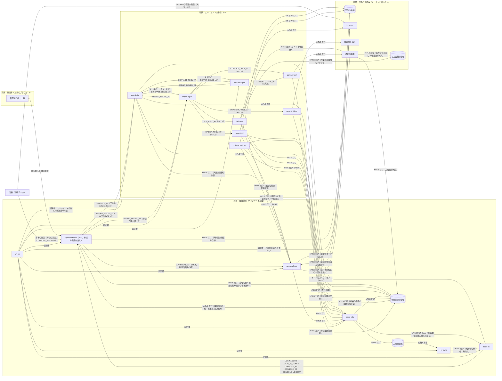
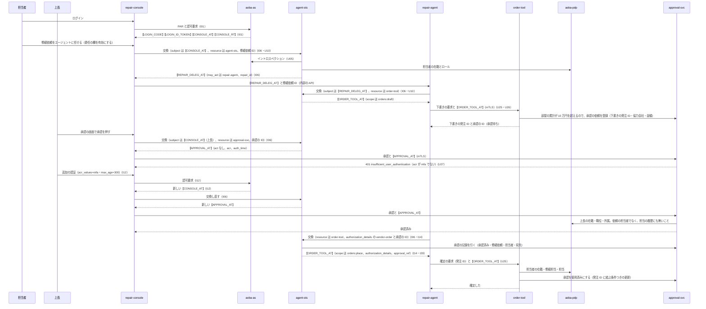
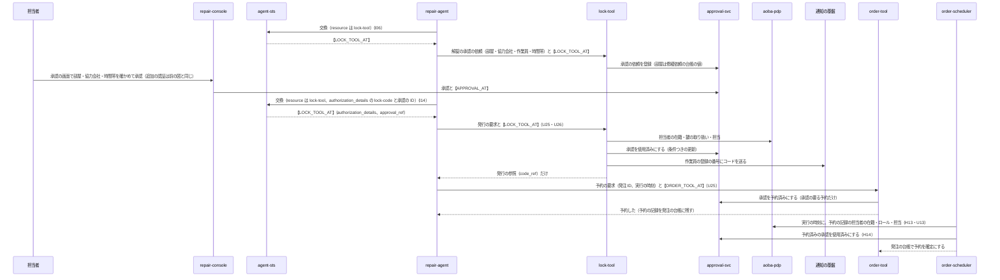
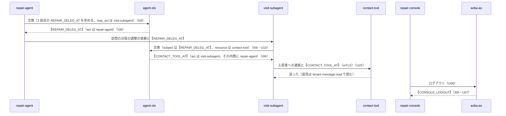

<!-- template_version: 0.7.0 -->
# あおば住まいサービス 修繕の手配：管理担当者のコンソールと修繕手配エージェントの JWT クレームの設計書（Full）

> **意図的に誤りを含む教材。設計に使わない**

架空の不動産管理会社「あおば住まいサービス」で、管理担当者がコンソールで入居者からの修繕依頼を扱い、AI エージェント（修繕手配エージェントと、訪問の日程を調整するサブエージェント）が担当者の代わりに MCP のツール（協力会社への発注、入居者への連絡、支払いの依頼、スマートロックの一時解錠コード）を呼ぶ仕組みの、トークンとクレームの設計です。判断の正は同じディレクトリの `claims.yaml`・`token_types.yaml`・`hops.yaml`・`catalog_answers.yaml` と `claim_request_*.md` で、この文書はその読み物です。

- 節の番号・アンカー・項目 ID は `templates/00_core.md`（0.7.0）と同じ。〔〕は 00_core の節の扱い
- 生成の区間：`<!-- render:<節>:begin -->`〜`end` の間は `python tools/claim_lint render <この設計書のディレクトリ> --write` が台帳から書き直す。手で直さない
- 当てはまらない記入欄は、表を消さずに「無い」と理由を書いた

| 欄 | この設計 |
| --- | --- |
| 版 | 1.0（初版。前の版なし） |
| Lite／Full | README の 5 問：境界を越える No・マルチテナント No・委任・交換 **Yes**・新しい発行者 **Yes**（agent-sts）・規制 No。**判定は Full**（`catalog_answers.yaml` の `lite_criteria`）。claim_lint は profile を付けずに（Full で）実行する |
| 使うプロファイル | 担当者・上長のブラウザとコンソールの境界は P1、エージェント・サブエージェント・MCP のツールの境界は P4（2. の図）。モジュールは M_token_validation・M_sender_constraint・M_authz_pdp・M_privacy_minimization。記入欄は付録 D |
| 発行者 | aoba-as（組織が作った認可サーバー。OpenID Connect Core 1.0、RFC 6749・7636・9126・9068・7009・7662、OpenID Connect Back-Channel Logout 1.0、RFC 9470 の追加の認証を実装する）と、agent-sts（この設計で作る交換のサービス。RFC 8693・8707・9396・8705 を実装する）。製品の IdP を使わないので、製品の挙動に頼る行は無い。aoba-as の振る舞いは aoba-as の仕様書（認証基盤チーム、2026-10 版）を出どころにし、本番の版で試験していない点は 12. に書いた |
| 作成方法 | 生成 AI（Claude）を使って書いた。人による点検は未実施 |

## 1. CI の結果〔Lite：生成〕

項目 ID：`template:00_core#ci-results`

<!-- render:ci-result:begin -->
`python tools/claim_lint designs/target --also-scan designs/target/design.md`（profile full）：**error 0、warn 3、info 24**（claims 30・token_types 23・catalog_events 64）。OK

| 規則 | 重大度 | 対象 | 内容 |
| --- | --- | --- | --- |
| `R3` | info | `idp[aoba-as]` | 発行者 aoba-as は組織が自分で作る（kind: self_built）。契機の一覧 8 項目は設計書が決め、すべてカタログのイベントか対象外にひもづく。R3b と L2 は、この発行者を照合しない |
| `R3` | info | `idp[agent-sts]` | 発行者 agent-sts は組織が自分で作る（kind: self_built）。契機の一覧 5 項目は設計書が決め、すべてカタログのイベントか対象外にひもづく。まだ存在しない発行者（planned: true）なので、作った後に一覧を実装と突き合わせる。R3b と L2 は、この発行者を照合しない |
| `R6` | info | `pairwise` | 2 因子の組 60 個をすべて検討した（主体 3・発行イベント 10） |
| `R8` | info | `ORDER_TOOL_AT` | 最悪 1656 バイト（ヘッダーの行で 1678）／上限 8192（tool-http-header-field）= 20% |
| `R8` | info | `CONTACT_TOOL_AT` | 最悪 1122 バイト（ヘッダーの行で 1144）／上限 8192（tool-http-header-field）= 14% |
| `R8` | info | `PAYMENT_TOOL_AT` | 最悪 1122 バイト（ヘッダーの行で 1144）／上限 8192（tool-http-header-field）= 14% |
| `R8` | info | `LOCK_TOOL_AT` | 最悪 1656 バイト（ヘッダーの行で 1678）／上限 8192（tool-http-header-field）= 20% |
| `R8` | info | `APPROVAL_AT` | 最悪 1019 バイト（ヘッダーの行で 1041）／上限 8192（approval-http-header-field）= 13% |
| `R8` | info | `C-scope` | CONSOLE_AT・REPAIR_DELEG_AT・ORDER_TOOL_AT・CONTACT_TOOL_AT・PAYMENT_TOOL_AT・LOCK_TOOL_AT・APPROVAL_AT の両方に載る（重複の候補） |
| `R8` | info | `C-act` | REPAIR_DELEG_AT・ORDER_TOOL_AT・CONTACT_TOOL_AT・PAYMENT_TOOL_AT・LOCK_TOOL_AT の両方に載る（重複の候補） |
| `R8` | info | `C-cnf` | ORDER_TOOL_AT・CONTACT_TOOL_AT・PAYMENT_TOOL_AT・LOCK_TOOL_AT・APPROVAL_AT の両方に載る（重複の候補） |
| `R8` | info | `C-authorization-details` | ORDER_TOOL_AT・LOCK_TOOL_AT の両方に載る（重複の候補） |
| `R8` | info | `C-repair-id` | REPAIR_DELEG_AT・ORDER_TOOL_AT・CONTACT_TOOL_AT・PAYMENT_TOOL_AT・LOCK_TOOL_AT・APPROVAL_AT の両方に載る（重複の候補） |
| `R8` | info | `C-approval-ref` | ORDER_TOOL_AT・LOCK_TOOL_AT・APPROVAL_AT の両方に載る（重複の候補） |
| `L16` | info | `hop H3` | 上流のトークンに無い独自クレームを、作り直しで足す（added_claims）：C-repair-id（修繕依頼の台帳） |
| `L16` | info | `hop H5` | 上流のトークンに無い独自クレームを、作り直しで足す（added_claims）：C-approval-ref（approval-svc） |
| `L16` | info | `hop H5` | aud を上流（H4）の https://sts.aoba-sumai.example から、行き先の 1 つの宛先 https://order-tool.aoba-sumai.example/mcp に替える（aud_replacement。理由：agent-sts 宛ての REPAIR_DELEG_AT を、交換で order-tool の 1 つの宛先に置き換える（MCP のパススルーの禁止）。order-tool は REPAIR_DELEG_AT を受けない） |
| `L16` | warn | `hop H5` | authorization_details の https://aoba-sumai.example/rar/vendor-order が上流（H4）に無い（下流ほど絞る。広げない） |
| `L16` | info | `hop H6` | aud を上流（H4）の https://sts.aoba-sumai.example から、行き先の 1 つの宛先 https://contact-tool.aoba-sumai.example/mcp に替える（aud_replacement。理由：agent-sts 宛ての REPAIR_DELEG_AT を、交換で contact-tool の 1 つの宛先に置き換える（MCP のパススルーの禁止）） |
| `L16` | info | `hop H7` | aud を上流（H4）の https://sts.aoba-sumai.example から、行き先の 1 つの宛先 https://payment-tool.aoba-sumai.example/mcp に替える（aud_replacement。理由：agent-sts 宛ての REPAIR_DELEG_AT を、交換で payment-tool の 1 つの宛先に置き換える（MCP のパススルーの禁止）） |
| `L16` | info | `hop H8` | 上流のトークンに無い独自クレームを、作り直しで足す（added_claims）：C-approval-ref（approval-svc） |
| `L16` | info | `hop H8` | aud を上流（H4）の https://sts.aoba-sumai.example から、行き先の 1 つの宛先 https://lock-tool.aoba-sumai.example/mcp に替える（aud_replacement。理由：agent-sts 宛ての REPAIR_DELEG_AT を、交換で lock-tool の 1 つの宛先に置き換える（MCP のパススルーの禁止）） |
| `L16` | warn | `hop H8` | scope の approvals:decide が上流（H4）に無い（下流ほど絞る。広げない） |
| `L16` | warn | `hop H8` | authorization_details の https://aoba-sumai.example/rar/lock-code が上流（H4）に無い（下流ほど絞る。広げない） |
| `L16` | info | `hop H11` | aud を上流（H10）の https://sts.aoba-sumai.example から、行き先の 1 つの宛先 https://contact-tool.aoba-sumai.example/mcp に替える（aud_replacement。理由：agent-sts 宛ての REPAIR_DELEG_AT を、交換で contact-tool の 1 つの宛先に置き換える。visit-subagent の連絡だけに使う） |
| `L16` | info | `hop H12` | 上流のトークンに無い独自クレームを、作り直しで足す（added_claims）：C-repair-id（repair-console の交換の要求（画面で開いた修繕依頼）と修繕依頼の台帳）、C-approval-ref（approval-svc） |
| `L16` | info | `hop H12` | aud を上流（H2）の https://sts.aoba-sumai.example から、行き先の 1 つの宛先 https://approval.aoba-sumai.example に替える（aud_replacement。理由：agent-sts 宛ての CONSOLE_AT を、交換で approval-svc の 1 つの宛先に置き換える。approval-svc は CONSOLE_AT を受けない） |

R8 ORDER_TOOL_AT：ヘッダー 75・ペイロード 1101・署名 64 バイト（ceil(4/3*75) + ceil(4/3*1101) + ceil(4/3*64) + 2 = 100 + 1468 + 86 + 2 = 1656; + 7 (Bearer) = 1663）。tool-http-header-field 1678／8192 バイト

R8 CONTACT_TOOL_AT：ヘッダー 75・ペイロード 700・署名 64 バイト（ceil(4/3*75) + ceil(4/3*700) + ceil(4/3*64) + 2 = 100 + 934 + 86 + 2 = 1122; + 7 (Bearer) = 1129）。tool-http-header-field 1144／8192 バイト

R8 PAYMENT_TOOL_AT：ヘッダー 75・ペイロード 700・署名 64 バイト（ceil(4/3*75) + ceil(4/3*700) + ceil(4/3*64) + 2 = 100 + 934 + 86 + 2 = 1122; + 7 (Bearer) = 1129）。tool-http-header-field 1144／8192 バイト

R8 LOCK_TOOL_AT：ヘッダー 75・ペイロード 1101・署名 64 バイト（ceil(4/3*75) + ceil(4/3*1101) + ceil(4/3*64) + 2 = 100 + 1468 + 86 + 2 = 1656; + 7 (Bearer) = 1663）。tool-http-header-field 1678／8192 バイト

R8 APPROVAL_AT：ヘッダー 75・ペイロード 623・署名 64 バイト（ceil(4/3*75) + ceil(4/3*623) + ceil(4/3*64) + 2 = 100 + 831 + 86 + 2 = 1019; + 7 (Bearer) = 1026）。approval-http-header-field 1041／8192 バイト
<!-- render:ci-result:end -->

warn の行ごとの理由（抑止はしていない。lint の出力のとおり）：

| 規則 | 対象 | 書き手の判断 |
| --- | --- | --- |
| `L16` | `hop H5`・`hop H8` | 上流の REPAIR_DELEG_AT には承認の内容が無く、agent-sts が交換のときに approval-svc の承認済みの記録から `authorization_details` を作って足す。この値は、それが無ければ拒否される操作（10 万円を超える発注の確定・予約、解錠コードの発行）を通すもので、トークンでできることを上流（H4）より**広げる**。広げてよい根拠は上流のトークンではなく、別の権限の元である人の承認の記録（approval-svc。上長か担当者本人が、追加の認証のうえで 1 件の発注・1 回の解錠について承認したもの）で、広がるのはその 1 件の分だけ。agent-sts は承認済みの記録からだけ作り、受け手は approval-svc で承認を条件つきで使用済みにして確かめる（台帳の `C-authorization-details`・`C-approval-ref` の `enforced_at`）。委任の REPAIR_DELEG_AT は承認の無い時点で出すので、上流に承認の内容を載せる手段が無い。解錠のコードの送り直し（H8 で最大 3 回）も、同じ承認の記録（lock-tool が使用済みにした、取り消していない、not_after の前）から同じ 1 回の解錠の内容を作り直すだけで、新しいコードは作らない（4. の表）。このホップの warn は、この根拠があるときだけ受け入れる（承認の記録に依らずに authorization_details を足すホップには当てはめない） |
| `L16` | `hop H8`（scope） | 上流の REPAIR_DELEG_AT は approvals:decide を持たない（H3 で外した）。作業が延びたとき、repair-agent が lock-tool を通じて解錠の時間帯を延ばす（approval-svc の承認の記録の not_after を 4 時間の内側で更新する）ため、H8 で approvals:decide を足す。承認の操作でなく、承認済みの記録の not_after の更新（lock-tool が approval-svc の更新の口で行う）。担当者は CONSOLE_AT で同じ権限を持つので、担当者の権限を広げない（`hops.yaml` の H8 の `note`） |

根拠：templates/CONTRIBUTING.md の 2.、tools/claim_lint/RULES.md、tools/claim_lint/RENDER.md の 1.

## 2. 範囲と信頼の境界〔Lite：手で書く〕

項目 ID：`template:00_core#scope-boundary`

### 要求の要約

設計の前提にした業務の要求（管理部の修繕課の業務要求書 2026-11 版の要約）です。6. のユースケースと、寿命・遅れの数値は、この ID を出どころにします。

| ID | 要求 |
| --- | --- |
| REQ-01 | 管理担当者と上長は、ブラウザのコンソールで修繕依頼を扱い、承認する。トークンをブラウザに置かない |
| REQ-02 | 担当者は 1 日の勤務（最大 9 時間）の間、ログインし直さなくてよい。30 分操作しなければログインし直す |
| REQ-03 | エージェントは担当者の代わりに、担当者に割り当てられた修繕依頼だけを進める。担当者の権限を超えず、記録でエージェントの操作と担当者の操作を区別できる。エージェントが動くのは担当者がログインしている間だけで、ログアウト・セッションの終了から 10 分以内に止まる（REQ-10 の予約の実行を除く） |
| REQ-04 | エージェントは訪問の日程の調整を、サブエージェントに任せてよい。委任は 2 段まで。サブエージェントは入居者への連絡だけをする |
| REQ-05 | 同じ部屋で直近 30 日の発注の累計（取り消したものを除き、予約を含む。税込）が 10 万円を超える発注は、上長の承認が要る。承認した発注・協力会社・金額のとおりに 1 回だけ実行する。上長は、その発注を頼んだ担当者でなく、その修繕依頼の担当になったこともない人であること（担当の付け替えを挟んで自分の発注を承認させない）。承認は 24 時間で期限が切れ、使われる前なら、承認した人・今の担当者・同じ課の上長が取り下げられ、取り下げたら直ちに止まる |
| REQ-06 | スマートロックの一時解錠コードは、担当者本人が部屋・協力会社・時間帯（4 時間以内）を確かめて承認したときだけ、承認ごとに 1 回だけ発行する。コードは協力会社の作業員にだけ届け、エージェント・コンソールの画面・ログに出さない。発行したコードは、担当者か課長が取りやめたとき、15 分以内に使えなくなる |
| REQ-07 | 承認の操作（REQ-05・REQ-06）は、承認する人が 5 分以内に多要素認証していること |
| REQ-08 | 退職・異動・ロールの剥奪が人事の台帳で確定してから（人事部の 2 人目の承認の時点。人事部に確かめた。2026-11-20）、修繕依頼の担当の付け替えが修繕依頼の台帳に登録されてから、発注の確定・解錠コードの発行・支払いの依頼は 2 分以内に（承認した上長の剥奪も、まだ使っていない承認を 2 分以内に止める）、そのほかの操作（下書き・連絡）は 10 分以内に止まる |
| REQ-09 | 担当者がエージェントへの委任をやめたら、エージェントとサブエージェントの操作は 10 分以内に止まり、予約した発注は実行しない |
| REQ-10 | 協力会社の受付の時間外の発注は予約でき、受付の開始の時刻に確定する（予約から最大 24 時間後）。実行の時点で担当者の在籍・ロール・担当と承認の状態を確かめ直す |
| REQ-11 | 修繕依頼ごと・発注ごと・承認ごとの操作を、監査で 1 本にたどれる（修繕依頼 ID・発注 ID・承認 ID）。監査ログは 3 年残す |
| REQ-12 | 入居者の個人情報（氏名・電話番号・住所）は、それを使う部品（修繕依頼の台帳・通知の基盤）だけが扱う。トークンに載せない（ツールも宛先を持たず、通知の基盤が台帳から引く） |
| REQ-13 | 手配の仕組み（エージェント・ツール・承認）が止まっても、1 回 60 分までなら、電話での手配の手順（この設計の外）で業務を続けられる。60 分を超える停止は避ける。安全より可用性を優先しない（止まったら手作業に切り替える） |

### 範囲

範囲は、担当者・上長のブラウザ、コンソール（`repair-console`。サーバー側の BFF で、承認の画面を含む）、認可サーバー `aoba-as`、交換のサービス `agent-sts`（この設計で作る）、エージェントの実行基盤の `repair-agent`（修繕手配エージェント）とサブエージェント `visit-subagent`、MCP のツール `order-tool`・`contact-tool`・`payment-tool`・`lock-tool`、承認の記録 `approval-svc`（この設計で作る）、認可の判断点 `aoba-pdp`、予約の発注の実行 `order-scheduler`、人事連携 `hr-sync`、ワークロードの証明書を出す `wl-ca` です。下流の仕組み（発注の台帳・協力会社の台帳・スマートロックの管理 `lock-svc`・経理の仕組み・通知の基盤）は、ツールが自分の証明書で呼び、トークンを渡しません。

| 境界 | 使うプロファイル | 中の部品 | 境界を越えるトークン（目録の ID） | 範囲の外にしたものと前提 |
| --- | --- | --- | --- | --- |
| 担当者・上長のブラウザ | P1 | ブラウザ | CONSOLE_SESSION（Cookie だけ）、LOGIN_CODE（1 回限り） | スマートフォンのアプリ（P2）。担当者・上長はブラウザだけで使う前提。協力会社の作業員はログインしない（解錠コードは SMS で受ける） |
| 組織の網（コンソールと基盤） | P1 | repair-console・aoba-as・hr-sync・aoba-pdp・approval-svc・wl-ca・修繕依頼の台帳・人事の台帳 | CONSOLE_AT・CONSOLE_RT・LOGIN_ID_TOKEN・CONSOLE_LOGOUT・APPROVAL_AT | 人事の台帳と修繕依頼の台帳そのものの中（別の設計書）。修繕依頼の台帳は、修繕依頼の部屋・担当・担当の履歴（追記だけ）と委任の欄を返す API と、repair-console が委任の欄と担当の割り当てを書く API を持つ前提（担当の割り当ては 2.2）。両台帳の書き手の前提は 3.1 の見送りの行コンソールが修繕依頼の一覧を画面に出す読み取りの API は、管理業務システムの既存の API（別の設計書） |
| エージェントの委任 | P4 | agent-sts・repair-agent・visit-subagent・order-tool・contact-tool・payment-tool・lock-tool・order-scheduler | REPAIR_DELEG_AT、ツールのトークン 4 種（ツールごと、mTLS で束縛） | エージェントの言語モデルの提供元（トークンを渡さない。実行基盤のコードがトークンを持ち、モデルの出力からツールの呼び出しを組み立てる。修繕依頼の本文をモデルに渡す扱いは別の設計書） |
| 下流の仕組み | 無い：トークンを渡さない | 発注の台帳・協力会社の台帳・lock-svc・経理の仕組み・通知の基盤（SMS の配信事業者を呼ぶ） | なし | 下流の仕組みはそれぞれ、呼び出し元の証明書の許可リストで受ける。協力会社の受発注の画面（協力会社が発注を見る）は別の設計書 |
| データ層 | 無い：トークンで DB に接続しない | 発注の台帳は order-tool・order-scheduler が自分の DB アカウントで接続する | なし | ツールが利用者のトークンで DB に接続する構成にするとき（M_data_layer を使う） |

### 2.1 主体の種類〔Lite：手で書く（2. の中で）〕

項目 ID：`template:00_core#principals`

| 主体 | 種類 | 表すクレーム（台帳の ID） | 利用者のトークンと区別する手段 | 要求の言葉と、入る区分・入らない区分 |
| --- | --- | --- | --- | --- |
| 管理担当者 | 利用者 | `C-sub`（aoba-as の利用者 ID） | — | 「担当者」に入るのは、人事の台帳で管理部の修繕課に在籍する社員・契約社員・派遣社員。休職中は人事の台帳の在籍の状態が「休職」で、aoba-pdp が修繕担当のロールを返さないので入らない。退職の手続き中は退職日の前日まで入る（人事部に確かめた。2026-11-20）。「担当者本人」は修繕依頼の台帳でその修繕依頼の担当の人 |
| 上長 | 利用者 | `C-sub`（自分の利用者 ID） | 担当者と同じ形。承認は repair-console の承認の画面で、自分のログインで行う | 「上長」（台帳・ホップ・この文書では「同じ課の上長」と書く）は、aoba-pdp の上長のロールを持つ人：人事の台帳の職位が修繕課の課長以上か、職務代行として登録された人で、承認する発注の担当者と同じ課の人。その発注を頼んだ担当者か、その修繕依頼の担当になったことがあれば（修繕依頼の台帳の担当の履歴）承認できない（approval-svc の規則）。課長の代理（職務代行）は人事の台帳に職位として登録された人だけ |
| repair-agent | ワークロード | `C-act`（最も外側の act.sub）、`C-client-id` | ツールのトークンの sub は担当者のまま、act にワークロードの URI。CONSOLE_AT をエージェントに渡さず、REPAIR_DELEG_AT だけを渡す。1 段目の REPAIR_DELEG_AT は act を持たないが、宛先は agent-sts だけで（ツールは受けない）、may_act に repair-agent があり、交換で出るツールのトークンには必ず act が入る。act の無いツールのトークンを得る経路は無い | — |
| visit-subagent | ワークロード | `C-act`（最も外側の act.sub）、内側の act に repair-agent | 委任の深さ 2。2 段目の REPAIR_DELEG_AT の may_act に名前があるときだけ交換でき、連絡のツールの宛先だけを得る | — |
| repair-console | ワークロード | `C-client-id`（CONSOLE_AT・APPROVAL_AT・1 段目の REPAIR_DELEG_AT） | ツールのトークンを得ない（agent-sts のリソースの表で、repair-console に許す宛先は agent-sts と approval-svc だけ） | — |
| order-scheduler | システム | wl-ca の証明書の URI（トークンを使わない） | 担当者のトークンを持たない。発注の台帳の予約の記録と自分の証明書で動き、監査ログには行為者として order-scheduler と、予約のときの act の連鎖を残す | — |
| hr-sync・aoba-pdp | システム | wl-ca の証明書の URI（トークンを使わない） | 担当者のトークンを持たない。hr-sync は aoba-as の利用者の API を、aoba-pdp は人事の台帳と修繕依頼の台帳を、証明書の許可リストで呼ぶ | — |
| 基盤チームの当番 | 利用者 | `C-sub`（自分の利用者 ID） | 担当者と同じ形。aoba-pdp の当番のロール（人事の台帳の勤務の予定で、今その時間の基盤チームの当番に入っている人）で見分ける | 停止の宣言と、頼る先が止まった間の解錠のコードの失効（lock-svc の管理の画面）だけをする。課長・担当者は当番のロールを持たないので宣言できない |

### 2.2 システムの権限〔Full だけ〕

項目 ID：`template:00_core#system-privileges`

| 場面 | 主体とトークン（目録の ID） | クレームで示すこと（台帳の ID） | 確かめ方 |
| --- | --- | --- | --- |
| 予約の発注の実行 | order-scheduler。トークンを使わず、wl-ca の証明書の mTLS で aoba-pdp・approval-svc・修繕依頼の台帳を呼び、発注の台帳に書く（H13・H14） | 予約の記録（担当者の sub・修繕依頼 ID・発注 ID・承認 ID・act の連鎖・予約の時刻）。トークンのクレームではない | 実行の時点で、予約の記録が order-tool の DB アカウントで作られ書き換えられていないこと（変更の記録の表）、予約の記録の act の連鎖の行為者が agent-sts と同じクライアントの登録の表に今も登録されていること、aoba-pdp の在籍・ロール・担当、修繕依頼の台帳の委任の欄（有効で、世代が予約の記録の世代と同じ。予約の後に止めていれば、有効にし直していても実行しない）と担当の履歴（予約の後に付け替えが無い）、approval-svc の予約済みの承認を引き直す。どれかが通らなければ実行せず、予約を取り消して担当者に知らせる。order-scheduler の発注の台帳の DB アカウントは「予約→確定」と「予約→取り消し」の更新だけを許す（予約の記録を作れず、中身も書き換えられない）。承認を使用済みにした後、確定の前に落ちたら、次の回で同じ発注 ID で再試行する（approval-svc は同じ発注 ID に前の結果を返し、「予約→確定」は条件つきの更新なので 1 回だけ） |
| 人事連携 | hr-sync。トークンを使わず、aoba-as の利用者の API を mTLS で呼ぶ | — | 5 分ごとに人事の台帳の変更を引き、aoba-as の利用者の作成・無効化・氏名の更新とセッションの削除をする。重要な操作の剥奪は aoba-pdp が人事の台帳を直接引くので、hr-sync の遅れは REQ-08 の判断に入らない（9.2） |
| 運用者の操作（上長の引き継ぎ） | 上長。自分の CONSOLE_AT（自分でログイン） | `C-sub` は上長 | aoba-as に代理ログインの機能を作らない（catalog の I19 は対象外）。担当の割り当ては、修繕課の課長が repair-console の「担当の割り当て」の画面で行い、repair-console が mTLS で修繕依頼の台帳に書く（セッションの sub が修繕課の課長であることを aoba-pdp で確かめる。割り当てた人・時刻・前後の担当を、担当の履歴に追記だけで残す）。上長が担当を自分に付け替えて引き継ぐと、その修繕依頼の発注の承認者には二度となれない（担当の履歴に残るので、別の課長が承認する）。監査ログの sub は上長 |
| 管理用の口（設定の変更） | 認証基盤チーム。aoba-as の管理の画面には自分のログイン（acr が mfa）で入る。agent-sts のクライアントの登録・委任の表・リソースの表と、各受け手の呼び出し元の許可リストは、設定のリポジトリの PR（2 人の承認）で変え、配布で反映する（受け手は 5 分ごとに読み直す。証明書の URI で持ち、拇印は持たない）。鍵の漏えいなどの緊急の変更は、当番 1 人の承認で配れるが、できるのは外す変更（登録・表・許可リストからの削除）と、登録済みのワークロードの URI を同じワークロードの次の世代の URI に替える変更だけ（新しいワークロード・宛先・委任の追加は 2 人の承認の PR だけ）。翌営業日に 2 人目が承認する | 監査ログの sub は運用者 | agent-sts は管理の API を持たない（設定は配備のときに読むだけ）。aoba-as の管理の画面でできるのは、利用者の無効化とセッションの削除だけで、利用者の作成と社員番号の属性の編集はできない（aoba-as の仕様書の 7.）。利用者を作り、社員番号を書けるのは hr-sync の証明書の API だけ。管理の画面の操作は aoba-as の監査ログに残る |
| 緊急時の特権 | 無い：緊急の修繕（水漏れなど）は電話で協力会社に手配し、鍵は管理部の物理の鍵の手順で扱う（この設計の外。REQ-13） | — | 電話での手配は、後で修繕依頼の台帳に記録する（別の手順書）。電話での発注は、エージェントの操作を再開する前に、修繕課の課長が repair-console の「手作業の発注」の画面で発注の台帳に登録し（書ける口と事後の確かめは 3.1 の発注の台帳の行）、部屋の直近 30 日の累計に数える（再開の手順の条件。3.1） |
| lock-svc の管理の画面 | 基盤チームの 2 人。自分のログイン（acr が mfa）で入る。失効の操作は、電話で頼んだ担当者の ID で、その担当者の取り消しとして lock-svc の監査ログに残す（approval-svc の取り消しの記録とそろえるため） | — | できるのは、承認 ID か部屋の ID での発行済みのコードの失効と、発行中の一覧（承認 ID・部屋の ID・not_after だけ）の表示だけ。コードの作成・表示・承認 ID の無い解錠はできない（lock-svc の仕様。作成は lock-tool の口だけ）。頼る先が止まった間の取り消しに使う（3.1） |
| 停止の宣言（手作業の発注の窓を開ける） | 基盤チームの当番。repair-console の当番の画面に自分のログインで入る（ブラウザは CONSOLE_SESSION だけ） | `C-sub` は当番 | repair-console が、セッションの sub が aoba-pdp の当番のロールを持ち、ID トークンの acr が mfa で auth_time から 300 秒以内であること、付録 A の依存先の停止の警報が出ていることを確かめてから、発注の台帳の停止の記録に書く（宣言した当番の sub・時刻・警報の ID）。警報が出ていなければ宣言できない。解除は同じ条件で、警報が止んでから 60 分で自動でも解除される。宣言と解除は repair-console と発注の台帳の監査ログに残り、翌営業日に基盤チームのリーダーが確かめる |
| DB の管理 | approval-svc・発注の台帳・aoba-as の利用者・修繕依頼の台帳・協力会社の台帳の DB の管理者（基盤チームの 2 人）。トークンを使わない | — | 承認の記録・予約の記録・利用者の社員番号の属性・修繕依頼の部屋と担当と履歴・作業員の番号を直接書き換えられる。止める手段と確かめ方は 3.1 の見送りの行（DB の管理者の直接の書き込み） |

## 3. 既定から外れた点〔Lite：手で書く〕

項目 ID：`template:00_core#deviations`

| 外れた点 | 既定 | この設計の値 | 書いた台帳の行の ID | 見直しの条件 |
| --- | --- | --- | --- | --- |
| クライアント認証 | private_key_jwt など | tls_client_auth（aoba-as・agent-sts とも。wl-ca の証明書） | `issuance_profile.client_auth` | mTLS を張れない場所にクライアントを置くとき |
| 交換の発行者を足した | 既定の組み合わせに交換は無い | agent-sts の token exchange | `issuance_profile.grants`（exceptions） | エージェントが担当者のセッションの外で動く処理を足すとき |
| 送信者制約 | none | agent-sts のツールのトークンと APPROVAL_AT は mtls。aoba-as の CONSOLE_AT・CONSOLE_RT と agent-sts の REPAIR_DELEG_AT は none | `issuance_profile.sender_constraint`、`token_types[]` | CONSOLE_AT・REPAIR_DELEG_AT を組織の網の外に出す構成にするとき |
| RT を出さない発行者 | RT のローテーション | agent-sts は RT を出さない | `issuance_profile.rt_strategy`（exceptions） | 同上 |
| ロールをトークンに載せない | IdP の roles | ロールは aoba-pdp に問い合わせる | `C-roles`（却下）、`C-groups`（却下） | aoba-pdp の応答が遅く、ツールの呼び出しの遅れが問題になったとき |
| JWKS を取り直せないとき | 最後に取れた鍵を使う（use_last_known） | 拒否する（reject） | `token_types[].unknown_kid` | 3.1 の見送りの行 |
| 予約の実行で交換し直さない | 後で動く処理はワーカーが自分の ID で交換し直す（判断の木の keep-sub-exchange） | トークンを使わず、order-scheduler が判断の元の記録を直接引き直す | `ORDER_TOOL_AT.long_running`、`hops.yaml` の H13・H14 | 3.1 の見送りの行 |
| カタログの既定の回答 | 製品の IdP の既定（Full では引き継がない） | すべて手で書いた（11.） | `catalog_answers.yaml` | — |
| ケーススタディの判定 | 無い：記入例ではない（`scenario` はこの設計の名前で、ケーススタディと照合しない） | — | — | — |

### 3.1 重点と見送り〔Lite：手で書く（3. の中で）〕

項目 ID：`template:00_core#priorities-deferrals`

組織の種類は「AI エージェントの委任」と「社内業務システム」の両方に当たります。理由を付けて見送った点と既知の限界は、すべてこの表に書き、12. には確かめていない事実だけを書きます。

| 区分（重点・見送り） | 項目 | 効果と費用（未検証の点を含む） | 見直しの条件 | 台帳の行の ID |
| --- | --- | --- | --- | --- |
| 重点 | エージェントに CONSOLE_AT を渡さない（委任は REPAIR_DELEG_AT） | エージェントが act の無いトークンを得る経路が無い。REPAIR_DELEG_AT は may_act の主体の mTLS でしか交換できず、ツールは受けない。費用は repair-console が委任の間 REPAIR_DELEG_AT を交換し直して渡すこと（5 分に 1 回） | エージェントを担当者のセッションの外で動かすとき | `REPAIR_DELEG_AT`、`C-may-act`、`hops.yaml` の H3 |
| 重点 | act の連鎖を正しく読む（最も外側だけで判断） | サブエージェントのトークンで発注・解錠を通さない。費用はツールごとの行為者の許可リストの保守 | 委任の深さを変えるとき | `C-act`、`token_types[].max_delegation_depth` |
| 重点 | 宛先に束縛した交換（ツールごとに種別を分け、aud は 1 つ） | 1 つのツールから漏れたトークンを別のツールで使わせない。費用は手順ごとの交換（agent-sts の負荷。1 件の修繕依頼で 20〜60 回の見込み、未計測） | agent-sts の負荷が問題になったとき | `C-aud`、`hops.yaml` の H5〜H8・H11 |
| 重点 | 操作ごとの承認を、その操作と宛先に結び、1 回だけ使う | 承認の内容と違う発注・解錠、取り下げた承認、別のツールでの流用を止める。消費は approval-svc の条件つきの更新で、発注 ID（解錠は承認自身）に結ぶ。結果が分からない応答の後の再試行は、同じ発注 ID なら前の結果を返すので 2 回実行しない。承認を自動で未使用に戻さない。同じ発注 ID の再試行で確定できない発注（下書きの取り消し・担当の付け替えなど）は、order-tool が下書きを取り消すと同時に approval-svc で「使用済み・未確定」の承認を失効させ（発注 ID に結んだ条件つきの更新）、新しい承認は新しい発注 ID で依頼し直す（正しい 1 回を失わないよう、再試行は同じ発注 ID で行う） | approval-svc の応答が遅いとき | `C-authorization-details`、`C-approval-ref`、付録 D の P4 の 5. |
| 重点 | 承認の要否を、1 件の金額でなく部屋ごとの累計で決める | 10 万円以下に分けた発注で承認を逃れさせない（同じ部屋の直近 30 日の、取り消した発注を除き予約を含む累計）。同じ部屋の別の修繕依頼に分けても数える。並行の確定で両方が相手を含まない累計を読まないよう、order-tool は発注の台帳の部屋の行を排他の錠で押さえた 1 つのトランザクションで、数えてから確定・予約までを行う（同じ部屋の確定は直列になる。費用は同じ部屋の並行の確定の待ち）。停止の間の電話での発注も、再開の前に累計に入れる。確かめ方：order-tool の結合試験で、分けた 2 件目で承認を求めることと、累計 0 円の部屋に 6 万円の発注 2 件を並行に確定すると片方が承認を求められること | 承認の規則を変えるとき | `hops.yaml` の H5、`C-order-limit`（却下） |
| 重点 | 重要な操作の都度の確認（発注の確定・解錠・支払いで aoba-pdp） | 剥奪を 60 秒で重要な操作に届かせる（REQ-08 の 2 分の内側）。aoba-pdp は人事の台帳と修繕依頼の台帳を直接引き、hr-sync の遅れに頼らない。費用は aoba-pdp の可用性への依存（次の見送りの行） | aoba-pdp を止めずに保守できない時間帯が出たとき | `C-sub`、`token_types[].revocation` |
| 重点 | 重複の実行を、業務の ID で防ぐ（jti に頼らない） | 再送・再試行で同じ操作を 2 回しない。重複を防ぐ鍵は、エージェントの申告でなく受け手が採番した業務の ID：発注の確定・予約は下書きのときに order-tool が採番した発注 ID（「下書き→確定」の条件つきの更新）、支払いの依頼は発注 ID（1 つの発注に 1 回。payment-tool が発注の台帳で「依頼済み」でないことを確かめてから経理の仕組みに送り、送った後に「依頼済み」にする）、解錠は承認 ID（lock-svc は承認 ID ごとにコードを 1 つだけ作り、not_after まで暗号化して持ち、同じ承認 ID の再要求には同じコードを返す。通知の基盤は「承認 ID と送信の回」を送信の重複を避ける鍵にする。作業員への送信が失敗・結果不明なら、lock-tool は同じ回のまま再試行し（重複なら捨てられる）、同じコードを送り直す。届かないと担当者が知らせたら、エージェントが送り直しを頼める：agent-sts は使用済み（lock-tool による）で取り消していない not_after の前の承認にだけ送り直しの LOCK_TOOL_AT（authorization_details と approval_ref つき）を出し、lock-tool は作業員の番号のハッシュが承認の記録と一致するときだけ、承認の記録の回を approval-svc の条件つきの更新（回が n で 3 未満なら n+1）で上げてから同じコードを送る（3 回まで。並行の 2 件は片方だけが送る。新しいコードは作らない）。lock-tool も lock-svc も、コードを作業員の番号のほかに出さない）、連絡は下書きの ID（送る順と重複の鍵は token_types の CONTACT_TOOL_AT の purpose）、予約の実行は発注 ID。確定しなかった下書きは 7 日で消える（使用済み・未確定の承認を持つ下書きは、承認を失効させて閉じるまで残す）。確かめ方：各ツールの結合試験で、同じ ID の要求を並行に 2 件送り、1 回だけ実行されること | ツールを足すとき | `C-jti`、付録 D の P4 の 5. |
| 重点 | 解錠コードをトークン・エージェント・画面に出さない | エージェントの実行基盤から漏れても解錠できない。lock-tool が作業員の登録の番号に直接送り、エージェントには発行の参照だけを返す | 作業員がアプリで解錠する方式に替えるとき | `C-unlock-code`（却下）、`LOCK_TOOL_AT` |
| 見送り | CONSOLE_AT・CONSOLE_RT の送信者制約 | どちらも repair-console のサーバーの中だけにあり、ブラウザにもエージェントにも渡さない。CONSOLE_AT の宛先は agent-sts だけで、agent-sts は交換を求める者に wl-ca の証明書の mTLS を求める（どのワークロードでもよい。repair-console かは CONSOLE_AT の client_id で見る）。CONSOLE_RT は aoba-as が repair-console の mTLS を求める。網の外で CONSOLE_AT だけ・CONSOLE_RT だけを盗んでも何も呼べないので、束縛の費用（aoba-as の実装と BFF の鍵の管理）に見合わない。確かめ方：agent-sts の結合試験で wl-ca の証明書の無い要求が、aoba-as の結合試験で repair-console の証明書の無い要求が拒否されること | CONSOLE_AT をサーバーの外に出す構成にするとき、agent-sts・aoba-as が mTLS のクライアント認証をやめるとき | `issuance_profile.sender_constraint`、`CONSOLE_AT`、`CONSOLE_RT` |
| 見送り | REPAIR_DELEG_AT の送信者制約 | REPAIR_DELEG_AT は repair-console から repair-agent へ、repair-agent から visit-subagent へ渡すので、出す時点の持ち主の証明書に束縛できない。代わりに、宛先は agent-sts だけで、交換できるのは may_act の主体の mTLS だけにする。漏れた REPAIR_DELEG_AT は may_act の主体の鍵が無ければ使えない（wl-ca の中間の CA の鍵が漏れたときは別。その行に書いた）。確かめ方：agent-sts の結合試験で、may_act と違う証明書からの交換と、ツールへの REPAIR_DELEG_AT の提示が拒否されること | may_act を使わずに渡す相手を足すとき | `REPAIR_DELEG_AT`、`C-may-act` |
| 見送り | 予約の実行で、トークンを交換し直すこと | 予約の実行は担当者のログアウトの後（翌朝など）で、交換の subject_token になる担当者のトークンが無い。長い寿命のトークンを予約のために出すより、判断の元の記録（aoba-pdp の在籍・ロール・担当、修繕依頼の台帳の委任の欄、approval-svc の予約済みの承認）を実行の時点で直接引き直す。AS が交換で確かめる項目（担当者の在籍・ロール・担当、委任、行為者のクライアントの登録、承認）を、order-scheduler が同じ出どころから確かめる（行為者の登録は agent-sts と同じクライアントの登録の表を読む）。あわせて、予約の記録が order-tool の DB アカウントで作られ書き換えられていないことを、実行の前に変更の記録の表で確かめる。費用は、order-scheduler の確かめの実装が agent-sts と別になること。確かめ方：order-scheduler の結合試験で、退職・担当の付け替え（付け替えて戻した場合を含む）・委任の停止（止めて有効にし直した場合を含む）・承認の取り下げ・予約したエージェントの登録の取り消し・DB での予約の記録の書き換えのそれぞれで予約が実行されないこと | 予約の実行を agent-sts の交換に寄せる仕組み（予約の記録を subject に使う交換）を作るとき | `ORDER_TOOL_AT.long_running`、`hops.yaml` の H13・H14 |
| 見送り | 頼る先が止まったときに通すこと（止める側に倒す） | aoba-as（イントロスペクション）・aoba-pdp・修繕依頼の台帳・approval-svc・agent-sts のどれかが止まると、エージェントの操作と承認は止まる（付録 D の M_authz_pdp の 5.）。REQ-13 は 60 分までの停止を電話の手配で受けるので、誤った発注・解錠を通すより止める。再開の前に、停止の間の電話での発注を発注の台帳に登録する（部屋の累計に入れる。2.2）。確かめ方：本番の前と半年ごとの障害の訓練で、各依存先を止めて拒否されることと、付録 A の警報（5 分）が出ることを確かめる | 停止が 60 分を超えることが年に 2 回以上起きたとき | 付録 A、付録 D の M_authz_pdp の 5. |
| 見送り | JWKS を取り直せないとき、最後に取れた鍵で受け入れること | 鍵が漏れて JWKS から外したのに、取り直せない受け手が古い鍵で受け入れ続けることを避ける（漏えいの手順の 15 分を守る）。費用は、発行者の JWKS の端点が止まると、キャッシュの期限（600 秒）の後に受け手が拒否すること。発行者そのものが止まれば新しいトークンも出ないので、失うものは少ない（REQ-13）。確かめ方：受け手の試験で、JWKS の端点を止めて 600 秒の後に拒否すること | 発行者と受け手の間の網が不安定で、拒否が業務に響くとき | `token_types[].unknown_kid`・`jwks_cache_ttl` |
| 見送り | approval-svc・発注の台帳・aoba-as の利用者・修繕依頼の台帳・協力会社の台帳の DB の管理者の直接の書き込みを止めること | DB の管理者（基盤チームの 2 人）は、障害の対応のために DB を直接書ける（承認の状態、予約の記録、利用者の社員番号の属性、修繕依頼の部屋・担当・担当の履歴・委任の欄、作業員の番号を含む）。DB の権限ではこれを止めない。代わりに、5 つの DB の変更をすべて追記だけの変更の記録の表に残し（DB の関数で書く）、毎日、変更の記録とアプリの監査ログを突き合わせ、アプリを通らない変更が 1 件でもあれば管理部の部長と監査の担当に知らせる（付録 A）。書いたその場で判断に使われる値は、翌日では遅いので、どの DB でも同じ 1 つの規則で使う前に止める：各アプリの API は、最後の変更がそのアプリの DB アカウントでない行（変更の記録の表で分かる）を「要確認」として返さず、読む側はその修繕依頼・利用者・承認・予約の操作を拒否する。当たるのは、承認の記録（approval-svc。承認済みへの変更）、予約の記録（order-scheduler が実行の前に確かめる）、aoba-as の利用者の社員番号の属性（hr-sync のアカウント以外の変更は aoba-pdp に返さない）、修繕依頼の台帳の部屋・担当・担当の履歴・委任の欄、協力会社の台帳の取引・作業員の登録と番号。DB の管理者が障害の対応で直した行は、アプリの口で書き直すまで使えない（止める側に倒れる）。確かめ方：本番の前の試験で、DB を直接書き換えて翌日の突き合わせが検出することと、DB で足した予約・DB で「承認済み」にした承認・DB で書き換えた社員番号の属性と担当の履歴が使われないこと | DB の管理者の権限を、承認つきの一時の権限に替えられるとき | `C-approval-ref`、`C-repair-id`、付録 A |
| 見送り | 修繕依頼の台帳と協力会社の台帳の書き込みの口を、この設計で閉じること | この設計が頼る値の書き手を次に限る前提にする（どちらの台帳も別の設計書）。修繕依頼の台帳：部屋は、受付の担当が管理業務システムの受付の画面で修繕依頼を作るときに決め、作った後は変えられない（変えるときは修繕依頼を作り直す）。担当と担当の履歴は、repair-console の担当の割り当ての画面からだけ書け（課長のセッション。管理業務システムの既存の画面からは書けない）、履歴は DB の関数で追記だけ。委任の欄は repair-console からだけ書ける（担当者のセッション）。協力会社の台帳：作業員の番号は、管理部の協力会社の窓口が受発注の画面で登録し、変更には窓口のもう 1 人の承認が要る。作業員は、エージェントが要求に入れた作業員の ID を、lock-tool が協力会社の台帳でその協力会社に登録された作業員であることを確かめてから承認の依頼に入れ、承認の画面に出して担当者本人が確かめる（authorization_details の worker_id）。lock-tool は、解錠の承認の依頼のときの作業員の番号の鍵つきのハッシュを承認の記録に残し、発行のときに今の番号のハッシュと一致しなければ送らない（承認の後に番号を書き換えてコードを別の人に届けさせない）。両台帳の DB の管理者の直接の書き込みは、上の DB の管理者の行と同じ変更の記録の表と毎日の突き合わせに入れる。確かめ方：修繕依頼の台帳・協力会社の台帳の結合試験で、既存の画面・API からの部屋・担当・履歴の書き換えと、承認なしの番号の変更が拒否されること。別の設計書の該当の節が変わったら、この行を見直す | 管理業務システム・受発注の画面の設計が変わったとき | `C-repair-id`、`C-authorization-details`、付録 A |
| 見送り | 発注の台帳の書き込みの口を、この設計の部品だけに閉じること | 承認の要否（部屋の累計）と支払いの可否・額は発注の台帳の値で決まるので、書き手と書ける欄を次に限る（DB アカウントを書き手ごとに分け、DB の権限で欄と状態の遷移を絞る）。order-tool：下書き・確定・予約・取り消し（金額・協力会社は下書きのときだけ）。order-scheduler：「予約→確定」「予約→取り消し」だけ。協力会社の受発注の画面（別の設計書）：「確定→完了の報告済み」と報告の本文・写真だけで、金額・取り消し・状態の戻しは書けない（支払いの額は確定額）。手作業の発注（REQ-13 の停止の間の電話での発注）：当番が停止を宣言している間（発注の台帳の停止の記録。宣言と解除は、基盤チームの当番が repair-console の当番の画面で行う。宣言できる条件は 2.2 の停止の宣言の行）と、解除から 24 時間の後追いの登録の間だけ、課長が repair-console の「手作業の発注」の画面で登録し（発注の日時は停止の間に限る）、repair-console が mTLS で発注の台帳の手作業の口に書く（セッションの sub が修繕課の課長であることを aoba-pdp で確かめる。種類は「手作業の発注」で、部屋の累計に数える）。10 万円を超える手作業の発注は、登録のときに approval-svc に種類が「手作業の事後の確認」の承認の記録を作り、再開の後に別の課長（登録した課長でなく、その修繕依頼の担当の履歴にも無い人）が承認の画面で事後に確かめる。条件は承認と同じ（APPROVAL_AT、acr が mfa で auth_time から 300 秒。付録 B）で、approval-svc が確かめる。確かめられなかった（不適切とした）発注は管理部の部長に知らせる（電話での発注はすでに協力会社に伝わっているため、取り消しは部長が決める）。手作業の発注で 10 万円を超えるものは、事後の確認が「確認済み」になるまで支払いを依頼しない（不適切とされたものは支払わない）（payment-tool の照合）。DB の管理者の直接の書き込みは、上の DB の管理者の行の変更の記録と突き合わせに入れる（どの DB アカウントで書いたかが変更の記録に残るので、正しい口の書き込みは知らせない）。確かめ方：発注の台帳の結合試験で、受発注の画面のアカウントからの金額・取り消しの書き換えと、課長でないセッションの手作業の発注が拒否されること | 受発注の画面の設計が変わったとき | `C-approval-ref`、`hops.yaml` の H5・H7、付録 A |
| 見送り | 発行した解錠コードを、退職・担当の付け替え・協力会社や作業員の登録の停止で自動では止めないこと | 発行したコードは、担当者か課長が repair-console の承認の画面で取り消すと、approval-svc が使用済みの解錠の承認を「取り消し」にし、lock-svc に失効を求める（REQ-06。lock-svc が錠に失効を届けるのは毎日 3 時の同期。機器の挙動は 12.）。まだ発行していない承認は、発行のときに lock-tool が担当の履歴・協力会社の取引・作業員の登録と番号を確かめるので、これらの出来事の後は発行されない。一方、担当者の退職・担当の付け替え・協力会社の取引の停止・作業員の登録の取り消しの出来事から、発行済みのコードを自動で探して止める仕組みは作らない。理由：コードは最大 4 時間の窓で 1 つの部屋に限られ、登録の番号の作業員にだけ届いている。出来事の多くは窓の外で起き、仕組みの費用（4 つの台帳の出来事を lock-svc につなぐ）に見合わない。代わりに、approval-svc が 30 分ごとに、課ごとの発行中のコードの一覧（使用済みで not_after の前の解錠の承認。修繕依頼 ID・承認 ID・not_after だけで、部屋・協力会社・作業員・コードは含まない。部屋などは課長が承認の画面で開いて見る）を、通知の基盤の社内の宛先（上長の社内のメール。SMS の配信事業者を通さない）で同じ課の上長に送り、課長の手順書に「退職・付け替え・取引の停止・作業員の登録の取り消しのときは、一覧を見て、その修繕依頼の承認の画面から取り消す」を入れる。取り消しの条件は、その修繕依頼の担当者か同じ課の上長で、承認者の条件（担当の履歴に無い）とは分ける（台帳の C-approval-ref の approval-svc の enforced_at）。agent-sts は、同じ課の上長には担当の履歴にかかわらず取り消しのための APPROVAL_AT を出す。確かめ方：修繕課の部長が月に 1 回、これらの出来事の後 4 時間以内に not_after が残っていたコードが取り消されたかを、承認の記録と人事の台帳・協力会社の台帳で点検する | 取り消し漏れが 1 件でも見つかったとき（出来事から自動で取り消す仕組みを作る） | `C-unlock-code`、`C-approval-ref`、REQ-06 |
| 見送り | 頼る先が止まった間の解錠コードの取り消しを、通常の経路で行うこと | 通常の取り消しは repair-console → agent-sts → approval-svc → lock-svc を通るので、どれかが止まると取り消せない。新しい部品は作らず、手順で受ける：担当者か課長が当番（基盤チーム）に電話し、当番が lock-svc の管理の画面（基盤チームの 2 人だけ。自分のログインで入る）から承認 ID か部屋の ID で失効させる。錠に届くのは lock-svc の毎日 3 時の同期（REQ-06）。lock-svc は、管理の画面での失効を approval-svc の失効の通知の口に知らせ（届くまで再送する）、approval-svc がその承認の記録を「取り消し」にする（当番は記録を書かない）。確かめ方：半年ごとの障害の訓練で、agent-sts を止めた状態で手順どおりに失効の操作ができること | lock-svc の管理の画面が使えない構成に変わったとき | `C-unlock-code`、REQ-06・REQ-13 |
| 見送り | 委任を止めて有効にし直す前の REPAIR_DELEG_AT を拒否すること | 担当者が委任を止めて 330 秒以内に有効にし直すと、止める前に出した REPAIR_DELEG_AT が残りの寿命（最悪 330 秒）の間、交換に使える。同じ担当者・同じエージェント・同じ修繕依頼の委任で、権限は広がらないので、トークンに世代の番号を足す費用（新しい共有クレームと時計の比べ）に見合わない。止めた後の予約は、予約の記録の世代の番号で止める（時計に依らない。H13）。確かめ方：agent-sts の結合試験で、止めている間の交換が拒否されることと、order-scheduler の結合試験で止めて有効にし直す前の予約が実行されないこと | 止めて有効にし直す間に、委任の範囲を変えられるようにするとき | `REPAIR_DELEG_AT`、`hops.yaml` の H13 |
| 見送り | 委任の欄と担当の割り当ての書き込みにトークンを使うこと | 修繕依頼の台帳の委任の欄（有効・停止）は、repair-console が mTLS で書き、担当者のセッションの sub が修繕依頼の担当と一致するときだけ書く。担当の割り当ては、セッションの sub が修繕課の課長のときだけ書き、担当の履歴に残す（どちらも BFF のセッションを信じる）。台帳の API にトークンの受け入れを足す費用に比べ、書けるのが repair-console の証明書だけなので、BFF が乗っ取られない限り他人の委任を書けない。確かめ方：修繕依頼の台帳の結合試験で、repair-console 以外の証明書の書き込みと、担当でない sub の書き込みが拒否されること | 修繕依頼の台帳を repair-console 以外の画面からも書くとき | `C-repair-id` |
| 見送り | wl-ca の証明書の失効の確かめ（失効リスト・OCSP） | 証明書は 24 時間で、エージェントを止めるときは agent-sts のクライアントの登録を外し、証明書の更新を止める。束縛したトークンは最悪 330 秒で切れ、その予約も order-scheduler が実行しない。クライアントの登録と各受け手の許可リストは、毎日の証明書の更新で変わらないよう、拇印でなく証明書の URI で持つ。そのため 1 つの証明書の鍵が漏れると、その証明書は期限（最悪 24 時間）まで使える。鍵は各ワークロードの鍵管理の仕組みの中で作り外に出さないので、漏れるのはホストが乗っ取られたときで、そのときは当番がそのワークロードを新しい URI（世代の番号を上げる）で出し直し、古い URI を登録と許可リストから外す。登録と許可リストは設定の配布で受け手が 5 分ごとに読み直し、緊急の変更は 1 人の承認と事後の 2 人目の承認で配る（外す変更と、同じワークロードの URI の差し替えだけ。2.2）。外し終えるまでの目標は 30 分。確かめ方：障害の訓練で、ワークロードの URI を替えて古い URI の証明書が 30 分以内に拒否されること。失効リストの配布の費用に見合わない。確かめ方：登録を外したエージェントの交換が拒否されることを結合試験で確かめる | 証明書の寿命を 24 時間より長くするとき | `C-cnf`、付録 D の M_token_validation の 8. |
| 見送り | wl-ca の中間の CA の鍵の漏えいを、60 分より早く塞ぐこと | 中間の CA の鍵が漏れると、偽の証明書で任意のワークロードになりすませる。トークンの要る口も、エージェントの実行基盤から漏れた REPAIR_DELEG_AT（最悪 330 秒の寿命の間）と偽の repair-agent の証明書がそろえば開く（agent-sts は may_act を URI で照合するので、偽の証明書に束縛したツールのトークンを出す）。その間にできるのは、下書き・連絡・承認の要らない発注・支払いの依頼で、承認の要る発注・解錠は人の承認が要るので開かない。開くのは、証明書だけで受ける口：aoba-pdp の問い合わせ（読み取り）、修繕依頼の台帳（委任の欄・担当の割り当ての書き込み、repair-console になりすます）、approval-svc の承認の依頼の登録と記録の参照、発注の台帳（DB アカウントは証明書でない）を除く下流の通知の基盤（偽の連絡の送信）と経理の仕組み（支払いの依頼）。解錠のコードの作成も開く：approval-svc の使用済みの口も lock-svc の作成の口も lock-tool の証明書の URI で受けるので、偽の lock-tool の証明書があれば、承認済みで未発行の解錠の承認を使用済みにしてコードを受け取れる。開くのは、担当者本人が部屋・協力会社・作業員・4 時間以内の時間帯を承認した未発行の承認の分だけで、新しい部屋・時間帯の解錠は作れない。この口にトークンを足す費用（lock-svc を受け手にする）より、窓が 60 分で、検出の 5 分の警報の後に当番が窓の間に作られたコードを lock-svc の管理の画面で一括で失効させる手順のほうを選ぶ。失効リストでは塞げない（攻撃者は新しい証明書を作れる）ので、中間の CA を替えて信頼の設定から外すまで（目標 60 分）この口が開く。検出は、wl-ca がすべての発行を記録し、配備の仕組みが求めていない発行を 5 分以内に警報にする（付録 A）。費用は、60 分の間の偽の連絡・支払いの依頼・委任の欄の書き換えと、未発行の解錠の承認からのコードの作成の恐れで（解錠は警報の後に当番が一括で失効させる）、経理の支払いは翌営業日の確定の前に発注の台帳と突き合わせる。確かめ方：障害の訓練で、配備の仕組みを通らない証明書を発行し、5 分の警報と、60 分以内の中間の CA の差し替えの手順を確かめる | 中間の CA の差し替えを 60 分より早くできる仕組みができたとき、証明書だけで受ける口に解錠と同じ記録の確かめを足すとき | `C-cnf`、付録 A、付録 D の M_token_validation の 8. |
| 見送り | 人事の台帳の登録から確定までの時間を、この設計で約束すること | REQ-08 の起点は、人事の台帳で値が確定した時点（人事部の 2 人目の承認）で、登録から確定までは人事システムの手順（別の設計書）が受け持つ。人事部の手順書は、退職・異動の登録を当日の業務時間内（2 時間以内）に確定すると定めている。確かめ方：人事部が月に 1 回、登録から確定までの時間の最大を、修繕課のシステム担当に報告する（2 時間を超えた月は、人事部と手順を見直す） | 人事部の手順が変わったとき、確定の遅れが 2 か月続けて 2 時間を超えたとき | 9.2、`C-sub.source_system` |
| 見送り | 課長が自分を担当にして、解錠を 1 人で承認できること | REQ-06 は担当者本人の承認を求め、課長が担当になることを妨げない。課長が自分を担当にすれば、解錠の依頼と承認を 1 人でできる（発注の承認は、担当の履歴があるので別の課長になる）。解錠は部屋・協力会社・4 時間以内の時間帯に限られ、承認には追加の認証が要る。代わりに、自分を担当にした割り当ての後の解錠を、週に 1 回、修繕課の部長が担当の履歴と承認の記録で点検する。確かめ方：点検の記録を監査の担当が四半期ごとに見る | 解錠の悪用が 1 件でも見つかったとき（解錠にも、担当でない 2 人目の承認を足す） | `C-sub`、REQ-06 |
| 見送り | 生成のスキーマで authorization_details のメンバーの型を表すこと | 生成の発行側のスキーマ（`schemas/`）は、オブジェクトの中のメンバーの型を表さない（items は object だけ）。メンバーの型と書式は台帳の `C-authorization-details` の description と付録 D の P4 の 5. の表に決め、agent-sts と受け手の共通の部品（aoba-jwt-guard）の試験で、型の違う値（金額が数値、時刻の書式違い）を拒否することを確かめる | 生成の道具がメンバーの型を出せるようになったとき | `C-authorization-details` |
| 見送り | aoba-as の RT の再利用の検知を、本番の前の試験より前に確かめること | 再利用の検知は aoba-as の仕様書の 5.2 にあるが、試験していないので台帳は unverified。CONSOLE_RT は repair-console の mTLS が無ければ使えないので、検知が動かなくても盗んだ RT だけでは使えない。確かめ方：本番の前の試験で、ローテーションの後に古い RT を使い、系列とセッションが終わるかを見る（12.） | 試験で検知が動かなかったとき（直すまで RT の寿命を縮める） | `CONSOLE_RT.rt_rotation`、`issuance_profile.rt_strategy` |
| 見送り | JWE | ツールのトークンに入居者の連絡先・住所・解錠コードを載せないので、読まれてはいけない値が無い | 機微な値を載せる要望が出たとき | `C-tenant-phone`・`C-unit-address`・`C-unlock-code`（却下） |
| 見送り | 標準による深さの強制 | 標準が無いので、agent-sts の組織の規則（深さ 2）で強制する | 標準ができたとき | `token_types[].max_delegation_depth` |

### 3.2 共通の基準〔Lite：手で書く（満たさないものがあるときだけ）〕

項目 ID：`template:00_core#baseline`

| 基準 | 満たすか | 満たさないときの理由と、回した先 |
| --- | --- | --- |
| 受け入れの検証（alg・iss・aud・exp・typ） | 満たす | — |
| 必須の欠落は拒否 | 満たす | — |
| 型の固定 | 満たす | — |
| 不変の ID | 満たす（sub は UUID、修繕依頼・承認・発注は不透明な ID） | — |
| 組織の名前空間 | 満たす（https://aoba-sumai.example/claims/） | — |
| ログにトークン全文と個人情報を残さない | 満たす（トークンは jti だけ。sub・repair_id・approval_ref は監査の共通部品の鍵つきのハッシュ。authorization_details・氏名・連絡先・解錠コードは残さない） | — |
| IdP の差を入口で正規化してから当てる | 無い：入口を置かない。発行者は組織の 2 つだけで、ツールには agent-sts のトークンだけが届く | — |

## 4. 発行方式の選択〔Lite：生成（既定の組み合わせから外れた点だけ 3. に手で書く）〕

項目 ID：`template:00_core#issuance-profile`

agent-sts が受ける要求の一覧（`catalog_answers.yaml` の `idp` の agent-sts の `trigger_list` の出どころ）：

| 要求 | 受けるか | 条件 |
| --- | --- | --- |
| `grant_type=urn:ietf:params:oauth:grant-type:token-exchange`（subject_token が CONSOLE_AT） | 受ける | クライアントは wl-ca の証明書の mTLS で認証した者（どのワークロードでもよい。CONSOLE_AT の client_id が repair-console であることを見る）。actor_token は受けない。`resource` は 1 つで、agent-sts 自身（委任の 1 段目の REPAIR_DELEG_AT。修繕依頼 ID を要求に入れ、修繕依頼の台帳で担当が sub で委任の欄が有効なときだけ）か approval-svc（APPROVAL_AT。画面で開いた修繕依頼 ID を要求に入れ、sub がその担当か、aoba-pdp で同じ課の上長（承認・事後の確認・解錠の取り消しのどれかをしうる人）であるときだけ。承認の記録の ID を入れたときは、その記録が approval-svc にあるときだけ。修繕依頼 ID は承認の記録から写さない）。aoba-as のイントロスペクションで CONSOLE_AT が有効で、aoba-pdp で担当者が在籍しているとき |
| `grant_type=urn:ietf:params:oauth:grant-type:token-exchange`（subject_token が REPAIR_DELEG_AT） | 受ける | クライアントは REPAIR_DELEG_AT の may_act の主体（mTLS の証明書の URI）だけ。`resource` は 1 つで、クライアントごとのリソースの表にある宛先（repair-agent はツール 4 つと、2 段目の委任の agent-sts。visit-subagent は contact-tool だけ）。repair-agent には、表に無くても https://*.aoba-sumai.example/mcp の形の MCP の URI にも出す。修繕依頼の台帳で担当と委任の欄、aoba-pdp で在籍とロールを確かめる。深さ 3 になる委任は拒否 |
| 交換の要求の `authorization_details` | 受ける | type が vendor-order（宛先が order-tool）か lock-code（宛先が lock-tool）のときだけ。要求には承認の ID を入れ、agent-sts は approval-svc の承認済みの記録（修繕依頼・担当者・宛先が一致し、期限内）から作り直す（要求の値をそのまま載せない）。解錠のコードの送り直しだけは、lock-tool が使用済みにした解錠の承認（取り消していない、not_after の前）からも作る |
| `actor_token` | 受けない | 行為者は mTLS の相手の証明書で決める（送られたら invalid_request） |
| `grant_type=refresh_token` | 受けない | RT を出さない |
| `grant_type=client_credentials` | 受けない | エージェント自身の権限のトークンを出さない |

agent-sts が頼る先が止まったとき（どれも止める側に倒す。理由は 3.1 の見送りの行）：

| 頼る先 | 止まったときの agent-sts | 業務への影響と、許す時間 |
| --- | --- | --- |
| aoba-as（イントロスペクションと、aoba-pdp が引く利用者と社員番号の対応） | CONSOLE_AT の交換を拒否する（temporarily_unavailable）。REPAIR_DELEG_AT の交換は、aoba-pdp が答えられる間（対応のキャッシュの 60 秒）だけ続く | 新しい委任と承認の操作が止まり、進行中の委任も最悪 60 秒の後に止まる。REQ-13 の 60 分まで電話の手配 |
| aoba-pdp | すべての交換を拒否する | エージェントの操作と承認が止まる。同上 |
| 修繕依頼の台帳 | すべての交換を拒否する（担当と委任の欄を確かめられない） | 同上 |
| approval-svc | authorization_details を求める交換と APPROVAL_AT の交換を拒否する。ほかの交換は続く | 承認の要る発注・解錠と承認の操作が止まる。下書き・連絡・承認の要らない発注は続く |
| 署名の鍵（agent-sts の中の鍵管理の仕組み） | 発行できない | すべてが止まる。同上 |

<!-- render:issuance-profile:begin -->
`token_types.yaml` の `issuance_profile`。既定の組み合わせから外れた点の理由は、手で書く節（既定から外れた点）に書く。

| 項目 | 選択 | 理由 | 根拠 |
| --- | --- | --- | --- |
| クライアントの種類 | 機密（`confidential`） | repair-console はサーバー側の BFF で、トークンをブラウザに出さない。agent-sts のクライアント（repair-console・repair-agent・visit-subagent）も サーバー側のワークロードで、wl-ca の証明書を持つ。公開クライアントは作らない | [RFC 6749 §2.1](https://www.rfc-editor.org/rfc/rfc6749#section-2.1) `slide:p08-rotation` |
| クライアント認証 | `tls_client_auth` | repair-console は aoba-as にも agent-sts にも、wl-ca の証明書で mTLS のクライアント認証をする。エージェントも wl-ca の証明書で agent-sts に認証する。 共有の秘密（client_secret_*）を持たない。登録の照合は証明書の URI の SAN（tls_client_auth_san_uri）で行う | [RFC 8705 §2.1](https://www.rfc-editor.org/rfc/rfc8705#section-2.1) |
| grant | 認可コード＋PKCE（`authorization_code_pkce`）、リフレッシュ（`refresh_token`）。例外：agent-sts は トークン交換（`token_exchange`） | 担当者はコンソールで認可コード＋PKCE（S256）でログインし、repair-console は RT で CONSOLE_AT を取り直す。aoba-as は client credentials・パスワード・ デバイスの grant・CIBA・トークン交換を受けない（aoba-as の仕様書の 3.）【agent-sts の例外】agent-sts が受けるのは RFC 8693 のトークン交換だけ。エージェントに RT を出さず、ツールの呼び出しの手順ごとに交換し直す。client credentials は持たない （エージェント自身の権限でツールを呼ぶ経路を作らない） | [RFC 7636 §4](https://www.rfc-editor.org/rfc/rfc7636#section-4) `slide:p06-grant-types` [RFC 8693 §2.1](https://www.rfc-editor.org/rfc/rfc8693#section-2.1) |
| 送信者制約 | なし（`none`）。例外：agent-sts は mTLS（`mtls`） | aoba-as が出す CONSOLE_AT・CONSOLE_RT は送信者制約を付けない。どちらも repair-console のサーバーの中にだけあり、ブラウザにもエージェントにも渡さない （エージェントには agent-sts の REPAIR_DELEG_AT を渡す）。CONSOLE_AT の宛先は agent-sts だけで、agent-sts は交換を求める者に wl-ca の証明書の mTLS を求めるので（どのワークロードでもよい）、 網の外で CONSOLE_AT だけを盗んでも何も呼べない。CONSOLE_RT も aoba-as が repair-console の mTLS を求める【agent-sts の例外】ツール・approval-svc 宛てのトークン（ORDER_TOOL_AT・CONTACT_TOOL_AT・PAYMENT_TOOL_AT・LOCK_TOOL_AT・APPROVAL_AT）は、交換を求めたワークロードの証明書に 束縛する（cnf の x5t#S256）。エージェントの実行基盤は入居者の依頼の文（外からの入力）を読むので、トークンが外に出る経路を前提にする。 REPAIR_DELEG_AT は束縛しない（宛先は agent-sts だけで、交換できるのは may_act の主体の mTLS だけ。design.md の 3.1） | `slide:p12-priorities-deferrals` [RFC 9700 §4.10.1](https://www.rfc-editor.org/rfc/rfc9700#section-4.10.1) [RFC 8705 §3](https://www.rfc-editor.org/rfc/rfc8705#section-3) |
| TLS の終端 | `end_to_end` | エージェント・repair-console とツール・approval-svc・agent-sts の間は、組織の網の中で直接 mTLS を張る。入口で TLS を終端しないので、証明書をヘッダーで渡さない | [RFC 8705 §6.5](https://www.rfc-editor.org/rfc/rfc8705#section-6.5) |
| AT の形式 | JWT（`jwt`） | ツールは手元で act・cnf・authorization_details を照合する。重要な操作の判断の新しさは、トークンでなく aoba-pdp と approval-svc への問い合わせで保つ | `slide:p01-self-contained-vs-reference` [RFC 9068 §2](https://www.rfc-editor.org/rfc/rfc9068#section-2) |
| RT の方式 | ローテーション＋再利用の検知（`rotation_reuse_detection`）。例外：agent-sts は なし（`none`） | CONSOLE_RT は repair-console だけが持つ。aoba-as は使うたびに RT を替え、替えた後の古い RT が使われたら、その RT の系列とセッションを終える （aoba-as の仕様書の 5.2）。再利用の検知が仕様どおりに動くことは、本番の前の試験で確かめる（design.md の 12.）【agent-sts の例外】agent-sts は RT を出さない。repair-console が担当者のセッションの間、CONSOLE_AT で REPAIR_DELEG_AT を交換し直してエージェントに渡す | [RFC 9700 §4.14.2](https://www.rfc-editor.org/rfc/rfc9700#section-4.14.2) |
| 要求の保護 | `par`、`resource_indicators`、`rar` | repair-console から aoba-as への認可要求は PAR で送り、URL に載るのは request_uri と認可コードだけにする。agent-sts への交換の要求には resource（RFC 8707）を 1 つ入れて宛先を絞り、承認の要る操作では authorization_details（RFC 9396）を approval-svc の記録から agent-sts が作る | [RFC 9126 §2](https://www.rfc-editor.org/rfc/rfc9126#section-2) [RFC 8707 §2](https://www.rfc-editor.org/rfc/rfc8707#section-2) [RFC 9396 §2](https://www.rfc-editor.org/rfc/rfc9396#section-2) |
| 適合のプロファイル | なし（`none`） | 不動産の管理の社内の業務で、FAPI などの業界の規制の対象ではない。承認と追加の認証は、FAPI に合わせずに上の選択で行う | [FAPI 2.0 Security Profile（Final）§5.3.2.1](https://openid.net/specs/fapi-security-profile-2_0-final.html) |

選択から導かれる要件（`templates/registry/issuance_effects.yaml`）：条件が成り立つ行は 3 件／全 13 件。**次の表は検査ではない。** render が `check` を簡易に読み取った表示で、検査の正は `tools/claim_lint/RULES.md` の L62〜L64（#6）。「満たしている行」は、要件の場所にある台帳の行。

| 行 | 要件 | 台帳で必要になるもの | 簡易な読み取り（正は L62） | 満たしている行 | 規則 |
| --- | --- | --- | --- | --- | --- |
| `E-mtls` | `E-mtls.1` | AT に cnf.x5t#S256（クライアント証明書の拇印）を載せる | 満たす | `C-cnf` | `L62`・`L15` |
| `E-mtls` | `E-mtls.2` | AT の受け手すべてが、TLS の相手の証明書の拇印と cnf を照合する | 満たす | `C-cnf` | `L62`・`L15` |
| `E-mtls` | `E-mtls.3` | TLS をどこで終端するか（tls_termination）を宣言する | 満たす | — | `L62`・`L15` |
| `E-token-exchange` | `E-token-exchange.1` | 委任なら act（最も外側が今の代理者）、交換を許す相手を事前に示すなら may_act を台帳に置く | 満たす | `C-act` | `L62`・`L16` |
| `E-token-exchange` | `E-token-exchange.2` | 交換のホップ（kind は exchange）で、aud・scope・寿命・独自クレームを上流より広げない（下流ほど絞る） | 満たす | `H3`・`H5`・`H6`・`H7`・`H8`・`H9`・`H11`・`H12` | `L62`・`L16` |
| `E-rar` | `E-rar.1` | authorization_details の type の語彙を value_vocabulary で定め、持ち主を決める | 満たす | `C-authorization-details` | `L62`・`L16` |
| `E-rar` | `E-rar.2` | 宛先ごとに絞って入れる（ホップの authorization_details） | 満たす | `H5`・`H8` | `L62`・`L16` |
| `E-rar` | `E-rar.3` | 配列の上限（max_items）と 1 件の上限（max_bytes）を決める | 満たす | `C-authorization-details` | `L62`・`L16` |
<!-- render:issuance-profile:end -->

根拠：templates/registry/README.md の 3.3 と 7.、templates/registry/issuance_effects.yaml

## 5. トークン目録〔Lite：生成〕

項目 ID：`template:00_core#token-inventory`

<!-- render:token-inventory:begin -->
`token_types.yaml` の 23 行（却下 11）。種類の名前は `templates/catalog/token_kinds.yaml`。

| ID | 種類 | 採否 | 発行 → 宛先（aud） | 持ち手 | 形式 | 寿命 | 保存場所 | 運び方 | 読める相手 | JWE | 理由 |
| --- | --- | --- | --- | --- | --- | --- | --- | --- | --- | --- | --- |
| `CONSOLE_SESSION` | セッション（IdP のセッション session_idp と、RP・BFF のセッション session_rp の 2 層） | 採用 | repair-console（BFF） → — | ブラウザ（HttpOnly・Secure・SameSite=Lax の __Host- の Cookie） | opaque | idle 1800 秒、最大 32400 秒 | ブラウザ | Cookie | `browser`・`bff` | — | ブラウザは repair-console の BFF のセッションの Cookie だけを持つ。トークンをブラウザに出さない（REQ-01） |
| `LOGIN_CODE` | 認可コード | 採用 | aoba-as → — | ブラウザを経由して repair-console へ | opaque | 60 秒 | なし | リダイレクトの query | `browser`・`bff`・`idp` | — | 認可コード＋PKCE（S256）で aoba-as が出す。PAR で認可要求を送るので、URL に載るのは request_uri と認可コードだけ |
| `LOGIN_ID_TOKEN` | ID トークン | 採用 | aoba-as → repair-console | repair-console のサーバー。ブラウザには渡さない | jwt（JWT、ES256） | 300 秒（時計のずれ 30 秒） | BFF のサーバー | トークンの応答 | `bff`・`idp` | なし | repair-console がログインを確かめ、画面に担当者の名前を出す。sid を BFF のセッションに結ぶ。追加の認証の後の acr・auth_time を確かめてから承認の画面に戻す |
| `CONSOLE_AT` | アクセストークン | 採用 | aoba-as → https://sts.aoba-sumai.example | repair-console のサーバー | jwt（at+jwt、ES256） | 300 秒（時計のずれ 30 秒） | BFF のサーバー | フォームの本文 | `bff`・`idp` | なし | 担当者の権限を agent-sts に示すためだけの AT。宛先は agent-sts だけで、ツールと approval-svc は受け入れない。repair-console のサーバーだけが持ち、 エージェントには渡さない。repair-console はこれを交換の subject_token にだけ使う（エージェントへの委任の REPAIR_DELEG_AT と、承認の操作の APPROVAL_AT） |
| `CONSOLE_RT` | リフレッシュトークン | 採用 | aoba-as → https://login.aoba-sumai.example | repair-console のサーバー | opaque | idle 1800 秒、最大 32400 秒 | BFF のサーバー | トークンの応答 | `bff`・`idp` | — | CONSOLE_AT を 300 秒にしたまま、セッションの間は担当者に再ログインさせない（REQ-02）。repair-console だけが持ち、エージェントには渡さない |
| `CONSOLE_LOGOUT` | ログアウトトークン（Back-Channel Logout の Logout Token） | 採用 | aoba-as → repair-console | repair-console のサーバー（Back-Channel Logout の受け口） | jwt（logout+jwt、ES256） | 120 秒（時計のずれ 30 秒） | なし | バックチャネルの POST | `bff`・`idp` | なし | 担当者の無効化・セッションの削除を、repair-console の BFF のセッションに届かせる。次のリフレッシュの失敗を待たない |
| `REPAIR_DELEG_AT` | アクセストークン | 採用 | agent-sts → https://sts.aoba-sumai.example | repair-agent か visit-subagent のメモリ（repair-console・repair-agent から内部の API で受ける） | jwt（at+jwt、ES256） | 300 秒（時計のずれ 30 秒） | サービスのメモリ | フォームの本文 | `client`・`idp` | なし | 担当者が修繕依頼をエージェントに任せるとき、agent-sts が出す委任の AT。宛先は agent-sts だけで、may_act に任せる相手（1 段目は repair-agent、 2 段目は visit-subagent）を入れる。エージェントはこれを subject_token にして、自分の mTLS でツールのトークンに交換する。CONSOLE_AT をエージェントに渡さないための種別 |
| `ORDER_TOOL_AT` | アクセストークン | 採用 | agent-sts → https://order-tool.aoba-sumai.example/mcp | repair-agent のメモリ（証明書に束縛） | jwt（at+jwt、ES256） | 300 秒（時計のずれ 30 秒） | サービスのメモリ | Authorization: Bearer | `client`・`api` | なし | agent-sts が交換で出す、order-tool（協力会社への発注）だけ宛ての AT。sub は担当者、最も外側の act.sub は repair-agent、cnf は repair-agent の証明書。 承認が要る確定では authorization_details（vendor-order）と approval_ref を載せる |
| `CONTACT_TOOL_AT` | アクセストークン | 採用 | agent-sts → https://contact-tool.aoba-sumai.example/mcp | repair-agent か visit-subagent のメモリ（交換を求めた者の証明書に束縛） | jwt（at+jwt、ES256） | 300 秒（時計のずれ 30 秒） | サービスのメモリ | Authorization: Bearer | `client`・`api` | なし | agent-sts が交換で出す、contact-tool（入居者・協力会社の窓口への連絡）だけ宛ての AT。repair-agent も visit-subagent も使う。連絡の相手は contact-tool が 修繕依頼の台帳で種類（入居者・協力会社の窓口）を決め、宛先は通知の基盤が台帳から引く。トークンにも要求にも連絡先を載せない。visit-subagent の相手は入居者だけ |
| `PAYMENT_TOOL_AT` | アクセストークン | 採用 | agent-sts → https://payment-tool.aoba-sumai.example/mcp | repair-agent のメモリ（証明書に束縛） | jwt（at+jwt、ES256） | 300 秒（時計のずれ 30 秒） | サービスのメモリ | Authorization: Bearer | `client`・`api` | なし | agent-sts が交換で出す、payment-tool（協力会社への支払いの依頼）だけ宛ての AT。支払いの額は payment-tool が発注の台帳の確定額から決め、要求の額を使わない。 承認は発注のときの承認で足り、このトークンには authorization_details を載せない |
| `LOCK_TOOL_AT` | アクセストークン | 採用 | agent-sts → https://lock-tool.aoba-sumai.example/mcp | repair-agent のメモリ（証明書に束縛） | jwt（at+jwt、ES256） | 300 秒（時計のずれ 30 秒） | サービスのメモリ | Authorization: Bearer | `client`・`api` | なし | agent-sts が交換で出す、lock-tool（スマートロックの一時解錠コード）だけ宛ての AT。発行では authorization_details（lock-code）と approval_ref を載せる。 コードそのものは lock-tool が協力会社の作業員に直接送り、このトークンの持ち主（エージェント）には返さない |
| `APPROVAL_AT` | アクセストークン | 採用 | agent-sts → https://approval.aoba-sumai.example | repair-console のサーバー（証明書に束縛） | jwt（at+jwt、ES256） | 120 秒（時計のずれ 30 秒） | BFF のサーバー | Authorization: Bearer | `bff`・`api` | なし | 上長・担当者が repair-console の承認の画面で操作するとき、repair-console が CONSOLE_AT から交換で得る、approval-svc だけ宛ての AT。act は無く、client_id は repair-console。1 回の承認の操作ごとに、その承認の記録の approval_ref を載せて出す（参照だけのときは approval_ref 無し）。acr を CONSOLE_AT から写し、auth_time には交換した時刻を書き、 approval-svc が追加の認証の新しさを確かめる |
| `TXN_TOKEN` | Transaction Token（Txn-Token） | 却下 | — | — | jwt | — | — | — | — | — | ツールの先に、トークンで文脈を伝えるサービスの連鎖が無い。修繕依頼の相関は repair_id、行為者は act、承認は approval_ref で足りる |
| `INTERNAL_TOKEN` | 内部トークン（入口で外部のトークンを検証し、作り直したもの） | 却下 | — | — | jwt | — | — | — | — | — | 入口でトークンを作り直さない。ツール宛てのトークンは agent-sts が交換で直接出す |
| `ID_JAG` | ID-JAG（Identity Assertion JWT Authorization Grant） | 却下 | — | — | jwt | — | — | — | — | — | 信頼ドメインをまたいでツールを呼ばない。ツールはすべて組織の中にある |
| `DPOP_PROOF` | DPoP の proof | 却下 | — | — | jwt | — | — | — | — | — | 送信者制約は mTLS にした。エージェントの実行基盤と repair-console はどれも wl-ca の証明書を持ち、DPoP の鍵を別に管理しない |
| `CLIENT_ASSERTION` | クライアントの assertion（private_key_jwt・client_secret_jwt） | 却下 | — | — | jwt | — | — | — | — | — | クライアント認証は mTLS（tls_client_auth）にした。鍵を 2 種類持たない |
| `JAR_REQUEST_OBJECT` | 署名つきの認可要求（JAR の Request Object） | 却下 | — | — | jwt | — | — | — | — | — | 認可要求は PAR で repair-console のサーバーから aoba-as に直接送る。ブラウザを通る要求の改ざんは PAR で防ぐ |
| `JARM_RESPONSE` | 署名つきの認可応答（JARM） | 却下 | — | — | jwt | — | — | — | — | — | 認可応答は認可コードと iss だけで、PKCE と PAR で守る。応答に署名する必要がない |
| `WL_IDENTITY_JWT` | 汎用の JWT（ワークロードの ID のトークン・アサーショングラントに出す JWT など） | 却下 | — | — | jwt | — | — | — | — | — | エージェントの ID を JWT（ワークロードの ID のトークン・actor_token）で運ばない。agent-sts は交換を求めた mTLS の相手の証明書（wl-ca）から行為者を決め、 act を作る。JWT の発行者を増やさない |
| `SECURITY_EVENT_TOKEN` | Security Event Token（SET。SSF・CAEP の通知） | 却下 | — | — | jwt | — | — | — | — | — | 人事の台帳の変更は aoba-pdp が人事の台帳を直接引いて反映し、SET を使わない。セッションの終了は Back-Channel Logout で届ける |
| `STATUS_LIST_TOKEN` | 状態リストのトークン（Token Status List） | 却下 | — | — | jwt | — | — | — | — | — | ツールのトークンは 300 秒で、重要な操作は aoba-pdp と approval-svc に都度問い合わせる。状態リストで個々のトークンを止める必要がない |
| `INTROSPECTION_RESPONSE_JWT` | JWT 形式のイントロスペクションの応答 | 却下 | — | — | jwt | — | — | — | — | — | agent-sts は aoba-as のイントロスペクションを mTLS で直接呼び、応答を第三者に渡さないので、JSON の応答で足りる |
<!-- render:token-inventory:end -->

### 5.1 寿命の上限の方針〔Full だけ〕

項目 ID：`template:00_core#lifetime-policy`

組織の上限は `tools/claim_lint/lifetime_caps.yaml` の値をそのまま使います。どの寿命も、要求（2. の REQ）から決め、上限は超えません。

| 種類 | 組織の上限（秒） | 例外を認める手順（承認者・記録先） | 例外にした種別（目録の ID と `lifetime_exception`） |
| --- | --- | --- | --- |
| アクセストークン・ID トークン | 3600 | 認証基盤チームの責任者が承認し、`token_types.yaml` の `lifetime_exception` と PR に残す | 無い（CONSOLE_AT・LOGIN_ID_TOKEN・REPAIR_DELEG_AT・ツールのトークン 4 種は 300、APPROVAL_AT は 120） |
| 対話用の RT・セッション | 86400（無操作 3600） | 同上 | 無い（CONSOLE_RT・CONSOLE_SESSION は最大 32400＝REQ-02 の 9 時間、無操作 1800＝REQ-02 の 30 分） |
| 認可コード | 600 | 同上 | 無い（LOGIN_CODE は 60） |
| ログアウトトークン | 120 | 同上 | 無い（CONSOLE_LOGOUT は 120） |
| 交換で出すトークン | 上流（subject_token）の残りの寿命を超えない（組織の規則） | 例外を認めない | 無い（agent-sts は種別の寿命か subject_token の残りの短いほう） |

寿命の数字の出どころ：

| 数字 | 出どころ |
| --- | --- |
| ツールのトークン・REPAIR_DELEG_AT の 300 秒（受け入れの上限 330 秒） | REQ-08・REQ-09 の「そのほかの操作は 10 分」。剥奪から下書きが止まるまで、aoba-pdp のキャッシュ 60 秒＋手元のトークン 330 秒＝390 秒で 600 秒の内側（連絡の 2 つはロールで絞らない。9.2）。委任の停止は 330 秒（開いた返信の購読は token_types の CONTACT_TOOL_AT の long_running） |
| CONSOLE_AT の 300 秒 | 交換のたびにイントロスペクションするので短さは剥奪に効かないが、REPAIR_DELEG_AT・APPROVAL_AT の上流として、下流の寿命を上流以下にそろえる |
| APPROVAL_AT の 120 秒 | 1 回の承認の操作（画面で押してから approval-svc が受けるまで）に足りる長さ。追加の認証の 300 秒（REQ-07）は auth_time で別に確かめる |
| aoba-pdp のキャッシュ 60 秒 | REQ-08 の「重要な操作は 2 分」の半分。aoba-pdp の負荷の見込み（未計測、12.）から、0 にしない |
| JWKS のキャッシュ 600 秒・取り直しの間隔 60 秒 | 鍵の漏えいの手順の 15 分（付録 D の M_token_validation の 8.）から、運用者の作業 5 分を引いた 10 分 |

## 6. 問い × 仕組み〔Lite：手で書く〕

項目 ID：`template:00_core#question-mechanism`

**ユースケース 1：エージェントが修繕依頼を進める（発注の下書き・確定、入居者への連絡、支払いの依頼、解錠コードの発行）**。要求の出どころ：REQ-03・REQ-05・REQ-06・REQ-08・REQ-11・REQ-12

| ユースケース | 問い（ID） | 要るか | 仕組み（台帳の行の ID か、クレームでない仕組み） | 不要の理由・照合する場所 |
| --- | --- | --- | --- | --- |
| UC1 | q-sub | 要る | `C-sub` | 発注の確定・解錠・支払いのツールが aoba-pdp に担当者の在籍・ロール・担当を問い合わせる |
| UC1 | q-actor | 要る | `C-act`（最も外側の act.sub） | 各ツールが mTLS の相手と照合し、ツールの操作ごとの行為者の許可リストで判断 |
| UC1 | q-req-wl | 不要 | — | Txn-Token を使わない。交換を求めたワークロードは agent-sts が mTLS で認証する |
| UC1 | q-peer | 要る | mTLS の相手の wl-ca の証明書（URI の SAN） | 各ツールが TLS の層で確かめ、`C-cnf` と `C-act` に照らす |
| UC1 | q-via | 要る | agent-sts の交換の監査ログと、各ツールの監査ログ | 交換の元の jti と出した jti を結ぶ |
| UC1 | q-txn | 要る | `C-repair-id` | ツールの対象の照合（payment-tool は M_authz_pdp の 3.）と、全ツールの監査ログ |
| UC1 | q-user | 要る | `C-sub` | 監査ログ（鍵つきのハッシュ） |
| UC1 | q-agent | 要る | `C-act`、`C-client-id` | 各ツール |
| UC1 | q-authorized | 要る | `C-scope`、`C-authorization-details`、`C-approval-ref` | scope は各ツール、承認は order-tool・lock-tool と approval-svc |
| UC1 | q-resource | 要る | `C-aud` | 各ツール（自分の MCP の URI の 1 つだけ） |
| UC1 | q-holder | 要る | `C-cnf` | 各ツール |

**ユースケース 2：サブエージェントが訪問の日程を調整する**。要求の出どころ：REQ-04

| ユースケース | 問い（ID） | 要るか | 仕組み | 不要の理由・照合する場所 |
| --- | --- | --- | --- | --- |
| UC2 | q-sub | 要る | `C-sub`（REPAIR_DELEG_AT から写す） | agent-sts（aoba-pdp で在籍） |
| UC2 | q-actor | 要る | `C-act`（最も外側が visit-subagent） | contact-tool。内側の act（repair-agent）は記録だけ |
| UC2 | q-req-wl | 不要 | — | UC1 と同じ |
| UC2 | q-peer | 要る | mTLS の相手の wl-ca の証明書 | contact-tool、agent-sts |
| UC2 | q-via | 要る | agent-sts の交換の監査ログ（元の jti と出した jti） | contact-tool の監査ログに受けたトークンの jti を残す。act の連鎖は q-actor と監査の相関の記録で、経路の証跡ではない |
| UC2 | q-txn | 要る | `C-repair-id` | contact-tool（連絡の相手を修繕依頼の入居者に限る）と監査ログ |
| UC2 | q-user | 要る | `C-sub` | 監査ログ |
| UC2 | q-agent | 要る | `C-act`、`C-client-id`、`C-may-act` | agent-sts（may_act）、contact-tool（許可リスト） |
| UC2 | q-authorized | 要る | `C-scope`（tenant.message:send・tenant.message:read だけ） | contact-tool。連絡は承認が要らない |
| UC2 | q-resource | 要る | `C-aud` | agent-sts（REPAIR_DELEG_AT）、contact-tool（CONTACT_TOOL_AT） |
| UC2 | q-holder | 要る | `C-cnf`、REPAIR_DELEG_AT は `C-may-act` | contact-tool、agent-sts |

**ユースケース 3：上長・担当者がコンソールで承認する（発注の承認、解錠コードの承認、却下・取り下げ）**。要求の出どころ：REQ-01・REQ-05・REQ-06・REQ-07

| ユースケース | 問い（ID） | 要るか | 仕組み | 不要の理由・照合する場所 |
| --- | --- | --- | --- | --- |
| UC3 | q-sub | 要る | `C-sub`（承認者） | approval-svc（aoba-pdp で承認者のロール・所属と、承認の種類ごとの条件） |
| UC3 | q-actor | 要る | `C-client-id`（repair-console）と act が無いこと | approval-svc が、APPROVAL_AT に act が無く client_id が repair-console であることを確かめる（エージェントが承認の操作をしていないこと）。H12 の validates |
| UC3 | q-req-wl | 不要 | — | Txn-Token を使わない |
| UC3 | q-peer | 要る | repair-console の wl-ca の証明書（mTLS） | approval-svc |
| UC3 | q-via | 要る | agent-sts の交換の監査ログと approval-svc の監査ログ | 承認の記録に、承認者の sub と APPROVAL_AT の jti を残す |
| UC3 | q-txn | 要る | `C-repair-id`（画面で開いた修繕依頼）と `C-approval-ref` | approval-svc が、画面で開いた修繕依頼と操作する承認の記録の修繕依頼を比べ、違えば拒否（出どころの違う 2 つ） |
| UC3 | q-user | 要る | `C-sub` | approval-svc の監査ログ |
| UC3 | q-agent | 要る | `C-client-id` | approval-svc |
| UC3 | q-authorized | 要る | `C-scope`（approvals:decide）、`C-approval-ref`、`C-acr`、`C-auth-time` | approval-svc |
| UC3 | q-resource | 要る | `C-aud` | approval-svc |
| UC3 | q-holder | 要る | `C-cnf` | approval-svc |

**ユースケース 4：予約した発注が、受付の開始の時刻に確定する**。要求の出どころ：REQ-09・REQ-10・REQ-11

| ユースケース | 問い（ID） | 要るか | 仕組み | 不要の理由・照合する場所 |
| --- | --- | --- | --- | --- |
| UC4 | q-sub | 要る | 予約の記録の担当者の sub（予約のときの `C-sub` の写し） | order-scheduler が aoba-pdp に在籍・ロール・担当を問い合わせる（H13） |
| UC4 | q-actor | 要る | order-scheduler の wl-ca の証明書（実行の行為者）と、予約の記録の act の連鎖（予約した行為者） | aoba-pdp・approval-svc が呼び出し元の許可リストで照合し、監査ログに「実行は order-scheduler、予約は repair-agent」の両方を残す |
| UC4 | q-req-wl | 不要 | — | Txn-Token を使わない |
| UC4 | q-peer | 要る | order-scheduler の wl-ca の証明書（mTLS） | aoba-pdp・approval-svc・修繕依頼の台帳 |
| UC4 | q-via | 要る | 発注の台帳の予約の記録と、order-tool・order-scheduler の監査ログ | 予約と実行を発注 ID で結ぶ |
| UC4 | q-txn | 要る | 予約の記録の修繕依頼 ID（`C-repair-id` の写し） | aoba-pdp（担当）、修繕依頼の台帳（委任の欄）、approval-svc（承認の記録） |
| UC4 | q-user | 要る | 予約の記録の sub | 監査ログ |
| UC4 | q-agent | 要る | 予約の記録の client_id と act の連鎖 | 監査ログ（予約した行為者） |
| UC4 | q-authorized | 要る | 予約の記録の承認 ID（`C-approval-ref` の写し）と、予約のときの `C-scope`（orders:place） | approval-svc の予約済みの承認を使用済みにする（H14）。承認の要らない予約は、予約のときの累計で決めた結果を記録に残す |
| UC4 | q-resource | 要る | order-scheduler の呼び出し元の許可リスト（aoba-pdp・approval-svc・修繕依頼の台帳・発注の台帳） | トークンを使わないので aud は無い。呼べる相手は呼ばれる側の許可リストで決まる |
| UC4 | q-holder | 不要 | — | トークンを持ち越さない。予約の記録は発注の台帳の中だけにあり、作れるのは order-tool の DB アカウントだけ。DB の管理者の直接の書き込みは、order-scheduler が実行の前に変更の記録の表で検出して実行しない（`C-repair-id` の `integrity_until`、3.1） |

<!-- render:question-mechanism:begin -->
`templates/registry/questions.yaml` の問いごとに、台帳の `answers`・`does_not_answer` を引いた。「不要」の理由は台帳に列がないので、手で書く表に書く。

| ID | 問い | 問いの一覧の仕組み | 答える台帳の行（answers） | 答えに使わない行（does_not_answer） | 照合する場所 |
| --- | --- | --- | --- | --- | --- |
| `q-sub` | 誰の権限で | `sub` | `sub` | `act` | `repair-console`・`agent-sts`・`order-tool`・`contact-tool`・`payment-tool`・`lock-tool`・`approval-svc` |
| `q-actor` | 誰が代理して実行しているか | `act` | `act` | `sub` | `agent-sts`・`order-tool`・`contact-tool`・`payment-tool`・`lock-tool` |
| `q-req-wl` | どのワークロードが Txn-Token を求めたか | `req_wl` | — | — | — |
| `q-peer` | 直接の通信相手は誰か | `mTLS の相手の ID（SPIFFE の X.509-SVID など）` | — | — | — |
| `q-via` | どこを経由したか | `経由を示す別の属性（AWS FAS の aws:CalledVia に当たるもの）`・`ネストした act` | — | — | — |
| `q-txn` | どの取引か | `txn` | `repair_id` | — | `agent-sts`・`order-tool`・`contact-tool`・`payment-tool`・`lock-tool`・`approval-svc`・`aoba-pdp` |
| `q-user` | 誰が利用者か | `iss と sub の組` | `sub` | — | `repair-console`・`agent-sts`・`order-tool`・`contact-tool`・`payment-tool`・`lock-tool`・`approval-svc` |
| `q-agent` | どのエージェント・クライアントか | `client_id`・`azp`・`act.sub`・`req_wl` | `client_id`・`act` | — | `agent-sts`・`order-tool`・`contact-tool`・`payment-tool`・`lock-tool`・`approval-svc` |
| `q-authorized` | 何が承認されたか | `scope`・`authorization_details`・`acr・amr・auth_time` | `scope`・`authorization_details`・`approval_ref` | — | `agent-sts`・`order-tool`・`contact-tool`・`payment-tool`・`lock-tool`・`approval-svc` |
| `q-resource` | どのリソース向けか | `aud`・`resource（RFC 8707）` | `aud` | — | `repair-console`・`agent-sts`・`order-tool`・`contact-tool`・`payment-tool`・`lock-tool`・`approval-svc` |
| `q-holder` | 誰が持つべきか | `cnf` | `cnf` | — | `order-tool`・`contact-tool`・`payment-tool`・`lock-tool`・`approval-svc` |
| `q-iss` | 誰が発行したか、信頼する発行者か（pending） | `iss（許可リストと完全一致）、iss ごとの鍵` | — | — | — |
| `q-typ` | どの種類・目的のトークンか（pending） | `ヘッダーの typ（at+jwt・txntoken+jwt・logout+jwt など）` | — | — | — |
| `q-auth-strength` | どの強さで、いつ認証されたか（pending） | `acr・amr・auth_time` | — | — | — |
| `q-still-valid` | 今も有効か（pending） | `exp、失効の手段（イントロスペクション・状態リスト・SSF/CAEP・Back-Channel Logout）、剥奪が反映されるまでに許す時間` | — | — | — |
<!-- render:question-mechanism:end -->

根拠：slide:p05-one-request-carries、slide:p10-four-questions、templates/registry/questions.yaml

## 7. シーケンス図〔Full だけ〕

項目 ID：`template:00_core#sequence`

ログイン、委任、10 万円を超える発注（上長の承認と追加の認証）：

解錠コード（担当者本人の承認）と、予約の発注の実行：

サブエージェントの連絡と、ログアウト：

根拠：templates/catalog/issue_events.yaml、templates/catalog/use_events.yaml、slide:p06-stage-map

## 8. ホップごとの表〔Lite：生成（交換・作り直しのホップがあれば手で書く）〕

項目 ID：`template:00_core#hop-table`

交換のホップ（H3・H5〜H9・H11・H12）は、新しいトークンを出す agent-sts を `from` に書き、トークンを運ぶ者（repair-console・repair-agent・visit-subagent）を括弧に書きました。ツールと approval-svc 宛ての交換では aud が 1 つの宛先に置き換わり（`aud_replacement`）、scope は上流の部分集合（H8 の approvals:decide は除く。1.）、寿命は上流（300 秒）以下です。H13・H14 は予約の実行の経路で、トークンを運ばず、予約の記録の値（修繕依頼 ID・承認 ID）を運びます。

<!-- render:hop-table:begin -->
`hops.yaml` の宣言。トークンのないホップの「運ぶトークン」は —。

| ホップ | 種類 | 運ぶトークン | aud | scope | 寿命 | 運ぶ独自クレーム | 交換するサービス | 検証 | 検証・照合すること |
| --- | --- | --- | --- | --- | --- | --- | --- | --- | --- |
| H1 担当者のブラウザ → repair-console | `browser` | `CONSOLE_SESSION` | `repair-console` | — | 32400 秒 | — | — | `local` | Cookie の __Host- の接頭辞と SameSite BFF のセッションの無操作 1800 秒と最大 32400 秒 状態を変える要求の CSRF のトークン |
| H2 repair-console → https://sts.aoba-sumai.example（agent-sts。委任と承認の交換） | `service` | `CONSOLE_AT` | `https://sts.aoba-sumai.example` | `openid`・`orders:draft`・`orders:place`・`tenant.message:send`・`tenant.message:read`・`payments:request`・`lock.code:issue`・`approvals:decide` | 300 秒 | — | — | `introspection` | 署名（aoba-as の JWKS） iss が aoba-as aud が agent-sts client_id が repair-console aoba-as のイントロスペクションで有効 mTLS の相手が wl-ca の証明書（どのワークロードでもよい。repair-console かは CONSOLE_AT の client_id で見る） actor_token を受けない（コンソールの交換は担当者自身の操作） aoba-pdp で担当者の在籍とロール（CONSOLE_AT の preferred_username（ログイン名）を aoba-pdp に渡して引く） 委任の交換では修繕依頼の台帳で担当が sub で委任の欄が有効 APPROVAL_AT の交換では sub が要求の修繕依頼の担当か同じ課の上長 |
| H3 https://sts.aoba-sumai.example（agent-sts が発行。運ぶのは repair-console） → repair-agent | `exchange` | `REPAIR_DELEG_AT` | `https://sts.aoba-sumai.example` | `orders:draft`・`orders:place`・`tenant.message:send`・`tenant.message:read`・`payments:request`・`lock.code:issue` | 300 秒 | `repair_id（足す：修繕依頼の台帳）` | agent-sts | `local` | repair-agent は REPAIR_DELEG_AT を検証せずに保持する（宛先は agent-sts） repair-console との間は mTLS（repair-agent は repair-console の証明書だけから受ける） |
| H4 repair-agent → https://sts.aoba-sumai.example（agent-sts。エージェントの交換） | `service` | `REPAIR_DELEG_AT` | `https://sts.aoba-sumai.example` | `orders:draft`・`orders:place`・`tenant.message:send`・`tenant.message:read`・`payments:request`・`lock.code:issue` | 300 秒 | `repair_id` | — | `local` | 署名（agent-sts の JWKS） aud が agent-sts may_act.sub が mTLS の相手の証明書の URI（repair-agent） 修繕依頼の台帳で担当が sub で委任の欄が有効 aoba-pdp で担当者の在籍とロール resource が 1 つで、リソースの表にあるか、https://*.aoba-sumai.example/mcp の形の MCP の URI（repair-agent だけ。新しいツールを表に足さずに使えるように） |
| H5 https://sts.aoba-sumai.example（agent-sts が発行。運ぶのは repair-agent） → https://order-tool.aoba-sumai.example/mcp | `exchange` | `ORDER_TOOL_AT` | `https://order-tool.aoba-sumai.example/mcp` | `orders:draft`・`orders:place` | 300 秒 | `repair_id`・`approval_ref（足す：approval-svc）` | agent-sts | `local` | 署名（agent-sts の JWKS） iss が agent-sts、exp − iat が 300 秒以下 aud が order-tool だけ mTLS の相手の証明書と cnf の x5t#S256 act の入れ子の深さが 2 以下 最も外側の act.sub が mTLS の相手で repair-agent、client_id も repair-agent scope に操作がある（下書きは orders:draft、確定・予約は orders:place） 下書きの修繕依頼が repair_id と一致 確定・予約では aoba-pdp で担当者の在籍・修繕担当・修繕依頼の担当 確定・予約では協力会社の台帳で協力会社の取引が今も有効 確定・予約では、発注の台帳の部屋の行を排他の錠で押さえた 1 つのトランザクションの中で、部屋の直近 30 日の累計（予約を含む）を数えて確定・予約まで行う（同じ部屋の並行の確定は直列になる）。累計が 10 万円を超えれば authorization_details と下書きの一致と approval-svc の条件つきの使用済み（予約なら予約済み。approval-svc は承認した人が今も同じ課の上長かも確かめる） |
| H6 https://sts.aoba-sumai.example（agent-sts が発行。運ぶのは repair-agent） → https://contact-tool.aoba-sumai.example/mcp | `exchange` | `CONTACT_TOOL_AT` | `https://contact-tool.aoba-sumai.example/mcp` | `tenant.message:send`・`tenant.message:read` | 300 秒 | `repair_id` | agent-sts | `local` | 署名（agent-sts の JWKS） iss が agent-sts、exp − iat が 300 秒以下 aud が contact-tool だけ mTLS の相手の証明書と cnf の x5t#S256 act の入れ子の深さが 2 以下 client_id が repair-agent で、act の最も外側の URI と同じエージェント（クライアントの登録の表） 最も外側の act.sub が mTLS の相手で、連絡の行為者の許可リストにある scope に操作がある 連絡の相手を repair_id の修繕依頼の入居者と協力会社の窓口に限る（repair-agent だけ。宛先は通知の基盤が引く） 返信の読み取りは、repair_id の修繕依頼のやり取りだけ（違えば 404） |
| H7 https://sts.aoba-sumai.example（agent-sts が発行。運ぶのは repair-agent） → https://payment-tool.aoba-sumai.example/mcp | `exchange` | `PAYMENT_TOOL_AT` | `https://payment-tool.aoba-sumai.example/mcp` | `payments:request` | 300 秒 | `repair_id` | agent-sts | `local` | 署名（agent-sts の JWKS） iss が agent-sts、exp − iat が 300 秒以下 aud が payment-tool だけ mTLS の相手の証明書と cnf の x5t#S256 act の入れ子の深さが 2 以下 client_id が repair-agent で、act の最も外側の URI と同じエージェント（クライアントの登録の表） 最も外側の act.sub が mTLS の相手で repair-agent scope に payments:request aoba-pdp で担当者の在籍・修繕担当・修繕依頼の担当 発注が確定済みで完了の報告がある（発注の修繕依頼と repair_id は照合しない。発注 ID は発注の台帳で一意なので） 10 万円を超える手作業の発注は事後の確認が確認済み 支払いの額は発注の台帳の確定額（要求の額を使わない） 発注の台帳で「依頼済み」でないことを確かめてから経理の仕組みに送り、送った後に「依頼済み」にする |
| H8 https://sts.aoba-sumai.example（agent-sts が発行。運ぶのは repair-agent） → https://lock-tool.aoba-sumai.example/mcp | `exchange` | `LOCK_TOOL_AT` | `https://lock-tool.aoba-sumai.example/mcp` | `lock.code:issue`・`approvals:decide` | 300 秒 | `repair_id`・`approval_ref（足す：approval-svc）` | agent-sts | `local` | 署名（agent-sts の JWKS） iss が agent-sts、exp − iat が 300 秒以下 aud が lock-tool だけ mTLS の相手の証明書と cnf の x5t#S256 act の入れ子の深さが 2 以下 client_id が repair-agent で、act の最も外側の URI と同じエージェント（クライアントの登録の表） 最も外側の act.sub が mTLS の相手で repair-agent（visit-subagent は拒否） scope に lock.code:issue aoba-pdp で担当者の在籍・鍵の取り扱い・修繕依頼の担当 発行では authorization_details の unit_id が修繕依頼の部屋で、今が not_before と not_after の間 発行では承認の後に担当の付け替えが無い（担当の履歴） 発行では approval-svc の条件つきの使用済み 発行では authorization_details の worker_id の作業員にだけ送る 発行では承認した人（担当者本人）が今も在籍・担当・鍵の取り扱い（approval-svc が確かめ直す） 発行と送り直しでは協力会社の台帳で協力会社の取引と作業員の登録が今も有効で、作業員の番号のハッシュが承認の記録のハッシュと一致 送り直しは lock-tool が使用済みにした取り消していない not_after の前の承認だけで、承認の記録の回を条件つきの更新で上げてから（3 回まで） not_after − not_before が 4 時間以内 |
| H9 https://sts.aoba-sumai.example（agent-sts が発行。運ぶのは repair-agent） → visit-subagent | `exchange` | `REPAIR_DELEG_AT` | `https://sts.aoba-sumai.example` | `tenant.message:send`・`tenant.message:read` | 300 秒 | `repair_id` | agent-sts | `local` | visit-subagent は REPAIR_DELEG_AT を検証せずに保持する（宛先は agent-sts） repair-agent との間は mTLS |
| H10 visit-subagent → https://sts.aoba-sumai.example（agent-sts。委任の 2 段目の交換） | `service` | `REPAIR_DELEG_AT` | `https://sts.aoba-sumai.example` | `tenant.message:send`・`tenant.message:read` | 300 秒 | `repair_id` | — | `local` | 署名（agent-sts の JWKS） aud が agent-sts may_act.sub が mTLS の相手の証明書の URI（visit-subagent） 委任の表に repair-agent → visit-subagent がある 深さが 2 を超えない 修繕依頼の台帳で担当が sub で委任の欄が有効 aoba-pdp で担当者の在籍とロール resource が contact-tool だけ |
| H11 https://sts.aoba-sumai.example（agent-sts が発行。運ぶのは visit-subagent） → https://contact-tool.aoba-sumai.example/mcp | `exchange` | `CONTACT_TOOL_AT` | `https://contact-tool.aoba-sumai.example/mcp` | `tenant.message:send`・`tenant.message:read` | 300 秒 | `repair_id` | agent-sts | `local` | 署名（agent-sts の JWKS） iss が agent-sts、exp − iat が 300 秒以下 aud が contact-tool だけ mTLS の相手の証明書と cnf の x5t#S256 act の入れ子の深さが 2 以下 client_id が visit-subagent で、act の最も外側の URI と同じエージェント（クライアントの登録の表） 最も外側の act.sub が mTLS の相手で、連絡の行為者の許可リストにある（visit-subagent）。内側の act は記録だけ scope に操作がある 連絡の相手を repair_id の修繕依頼の入居者に限る（最も外側が visit-subagent なので協力会社の窓口は拒否。宛先は通知の基盤が引く） 返信の読み取りは、repair_id の修繕依頼の入居者とのやり取りだけ（違えば 404） |
| H12 https://sts.aoba-sumai.example（agent-sts が発行。運ぶのは repair-console） → https://approval.aoba-sumai.example（approval-svc） | `exchange` | `APPROVAL_AT` | `https://approval.aoba-sumai.example` | `approvals:decide` | 120 秒 | `repair_id（足す：repair-console の交換の要求（画面で開いた修繕依頼）と修繕依頼の台帳）`・`approval_ref（足す：approval-svc）` | agent-sts | `local` | 署名（agent-sts の JWKS） iss が agent-sts、exp − iat が 120 秒以下 aud が approval-svc だけ mTLS の相手の証明書と cnf の x5t#S256（APPROVAL_AT を交換で求めた者） client_id が repair-console で act が無い scope に approvals:decide 解錠の承認では not_after − not_before が 4 時間以内 承認と手作業の発注の事後の確認では acr が mfa で、approval-svc の時計で auth_time から 300 秒以内（却下・取り下げ・解錠の取り消しでは求めない） 承認・却下・取り下げでは approval_ref の記録だけを操作し、記録の repair_id がトークンの repair_id（画面で開いた修繕依頼）と一致 aoba-pdp で承認者の在籍・ロール・所属と、承認の種類ごとの承認者の条件（発注は、承認者が依頼の担当者でなく、修繕依頼の台帳の担当の履歴にも無い。解錠は、承認者が依頼の担当者で今も担当） 一覧の参照は repair_id の修繕依頼の記録だけを、その担当者か同じ課の上長にだけ返す 取り下げ・却下は、承認した人・今の担当者・同じ課の上長だけ 承認の操作は承認待ちの記録だけ（却下・取り下げ・失効・取り消しは終わりの状態） |
| H13 order-scheduler（予約の発注の実行） → aoba-pdp | `service` | — | — | — | — | `repair_id` | — | `none` | mTLS の相手が order-scheduler の証明書で、aoba-pdp の呼び出し元の許可リストにある 予約の記録の担当者（sub）が在籍し、修繕担当のロールを持ち、修繕依頼の担当である （order-scheduler が問い合わせの前に確かめる）予約の記録の act の連鎖の行為者が、agent-sts と同じクライアントの登録の表に今も登録されている （同じく）予約の記録を作ったのが変更の記録の表で order-tool の DB アカウントで、作った後に書き換えられていない （同じく）修繕依頼の台帳の委任の欄が有効で、世代が予約の記録の世代と同じ（予約の後に委任を止めていない） （同じく）予約の後に担当の履歴に付け替えが無い |
| H14 order-scheduler（予約の発注の実行） → https://approval.aoba-sumai.example（approval-svc） | `service` | — | — | — | — | `repair_id`・`approval_ref` | — | `none` | mTLS の相手が order-scheduler の証明書で、approval-svc の呼び出し元の許可リストにある 承認の記録が予約済みで、結んだ発注 ID・修繕依頼・担当者が予約の記録と一致 予約済みを使用済みにする条件つきの更新（取り下げてあれば失敗） |
<!-- render:hop-table:end -->

矢印ごとの表：

<!-- render:arrow-table:begin -->
ホップの受け手（`to`）が `enforced_at` で確かめるクレームを、ホップのトークン（トークンのないホップでは `custom_claims`）から引いた。トークンのあるホップの書き手は `authoritative_writer`。トークンのないホップでは、値を書くのは送り手（`from`）なので、書き手の列には送り手と、台帳の `integrity_until`（書き先と、署名の保護が外れる境界）を出す。

受け手は、`enforced_at.service` の名前が `hops[].to` の文字列に含まれるかで結びつける（大文字と小文字は区別しない）。

**運ぶ行はあるのに、受け手に結びつく行が無いホップ：H3・H9**（2 件。理由は各行の「確かめること」）。受け手が何も確かめないホップなのか、名前の食い違いで結びつかないだけなのかを確かめる。

| ホップ | トークン | 確かめるクレーム | 書き手 | 確かめること | aud | 寿命 |
| --- | --- | --- | --- | --- | --- | --- |
| `H1` | `CONSOLE_SESSION` | — | — | 結びつく行なし：このホップのトークンに載る台帳の行が無い（`carried_in`） | `repair-console` | 32400 秒 |
| `H2` | `CONSOLE_AT` | `iss` | ② 各発行者（aoba-as・agent-sts）の設定 | subject_token の iss が、CONSOLE_AT なら aoba-as、REPAIR_DELEG_AT なら自分と完全一致 | `https://sts.aoba-sumai.example` | 300 秒 |
| `H2` | `CONSOLE_AT` | `sub` | ① aoba-as（ローカルの利用者の ID） ③ agent-sts（subject_token から写すだけ） | 出すトークンの sub は subject_token の sub と同じ。aoba-pdp で在籍を確かめる。委任とツールの交換では修繕依頼の台帳で修繕依頼の担当が sub であること、APPROVAL_AT の交換では sub が修繕依頼の担当か、aoba-pdp で同じ課の上長であること（承認者の条件そのものは approval-svc が確かめる） | `https://sts.aoba-sumai.example` | 300 秒 |
| `H2` | `CONSOLE_AT` | `aud` | ② aoba-as（クライアントの登録の宛先。repair-console の CONSOLE_AT は agent-sts だけ） ③ agent-sts（交換の要求の resource を、リソースの表と宛先の規則で確かめてから書く） | CONSOLE_AT・REPAIR_DELEG_AT の aud が https://sts.aoba-sumai.example だけ | `https://sts.aoba-sumai.example` | 300 秒 |
| `H2` | `CONSOLE_AT` | `exp` | ② aoba-as（クライアントごとの寿命の設定） ③ agent-sts（種別の寿命と subject_token の exp の早いほう） | subject_token の exp を確かめ、出すトークンの exp を subject_token の exp より後にしない | `https://sts.aoba-sumai.example` | 300 秒 |
| `H2` | `CONSOLE_AT` | `iat` | ② aoba-as ③ agent-sts | 未来の iat（ずれ 30 秒を超える）を拒否 | `https://sts.aoba-sumai.example` | 300 秒 |
| `H2` | `CONSOLE_AT` | `jti` | ② aoba-as ③ agent-sts | 交換の記録に元の jti と出した jti を残す | `https://sts.aoba-sumai.example` | 300 秒 |
| `H2` | `CONSOLE_AT` | `client_id` | ② aoba-as（mTLS で認証したクライアント） ③ agent-sts（REPAIR_DELEG_AT の交換では mTLS で認証した交換を求めたクライアント。CONSOLE_AT の交換では CONSOLE_AT の client_id を写す） | CONSOLE_AT の client_id が repair-console（交換を求めた mTLS の相手は wl-ca の証明書であればよく、どのワークロードでもよい）。REPAIR_DELEG_AT の交換では、mTLS の相手のクライアントが may_act の主体 | `https://sts.aoba-sumai.example` | 300 秒 |
| `H2` | `CONSOLE_AT` | `scope` | ② aoba-as（repair-console に登録した scope の上限の中で要求の値） ③ agent-sts（上流の scope と、宛先の操作と、aoba-pdp のロールの積。連絡の 2 つはロールで絞らず、委任の表でエージェントに許した範囲で付ける） | 出す scope が subject_token の scope と、宛先の操作の表と、aoba-pdp のロールの積（連絡の 2 つはロールで絞らず、委任の表でエージェントに許した範囲で付ける）。空になれば拒否 | `https://sts.aoba-sumai.example` | 300 秒 |
| `H2` | `CONSOLE_AT` | `acr` | ① aoba-as（認証の段） ③ agent-sts（CONSOLE_AT から写すだけ） | CONSOLE_AT の acr を APPROVAL_AT に写すだけ（判断しない） | `https://sts.aoba-sumai.example` | 300 秒 |
| `H2` | `CONSOLE_AT` | `auth_time` | ① aoba-as ③ agent-sts（APPROVAL_AT では交換した時刻を書く） | APPROVAL_AT の auth_time に交換した時刻を書く（CONSOLE_AT の auth_time は、無ければ交換を拒否するだけで写さない） | `https://sts.aoba-sumai.example` | 300 秒 |
| `H3` | `REPAIR_DELEG_AT` | — | — | 結びつく行なし：受け手 `repair-agent` の名前を含む `enforced_at.service` が無い（運ぶ行の service：agent-sts・aoba-pdp・approval-svc・contact-tool・lock-tool・order-tool・payment-tool・repair-console）。名前をそろえるか、受け手の確かめを台帳に書く | `https://sts.aoba-sumai.example` | 300 秒 |
| `H4` | `REPAIR_DELEG_AT` | `iss` | ② 各発行者（aoba-as・agent-sts）の設定 | subject_token の iss が、CONSOLE_AT なら aoba-as、REPAIR_DELEG_AT なら自分と完全一致 | `https://sts.aoba-sumai.example` | 300 秒 |
| `H4` | `REPAIR_DELEG_AT` | `sub` | ① aoba-as（ローカルの利用者の ID） ③ agent-sts（subject_token から写すだけ） | 出すトークンの sub は subject_token の sub と同じ。aoba-pdp で在籍を確かめる。委任とツールの交換では修繕依頼の台帳で修繕依頼の担当が sub であること、APPROVAL_AT の交換では sub が修繕依頼の担当か、aoba-pdp で同じ課の上長であること（承認者の条件そのものは approval-svc が確かめる） | `https://sts.aoba-sumai.example` | 300 秒 |
| `H4` | `REPAIR_DELEG_AT` | `aud` | ② aoba-as（クライアントの登録の宛先。repair-console の CONSOLE_AT は agent-sts だけ） ③ agent-sts（交換の要求の resource を、リソースの表と宛先の規則で確かめてから書く） | CONSOLE_AT・REPAIR_DELEG_AT の aud が https://sts.aoba-sumai.example だけ | `https://sts.aoba-sumai.example` | 300 秒 |
| `H4` | `REPAIR_DELEG_AT` | `exp` | ② aoba-as（クライアントごとの寿命の設定） ③ agent-sts（種別の寿命と subject_token の exp の早いほう） | subject_token の exp を確かめ、出すトークンの exp を subject_token の exp より後にしない | `https://sts.aoba-sumai.example` | 300 秒 |
| `H4` | `REPAIR_DELEG_AT` | `iat` | ② aoba-as ③ agent-sts | 未来の iat（ずれ 30 秒を超える）を拒否 | `https://sts.aoba-sumai.example` | 300 秒 |
| `H4` | `REPAIR_DELEG_AT` | `jti` | ② aoba-as ③ agent-sts | 交換の記録に元の jti と出した jti を残す | `https://sts.aoba-sumai.example` | 300 秒 |
| `H4` | `REPAIR_DELEG_AT` | `client_id` | ② aoba-as（mTLS で認証したクライアント） ③ agent-sts（REPAIR_DELEG_AT の交換では mTLS で認証した交換を求めたクライアント。CONSOLE_AT の交換では CONSOLE_AT の client_id を写す） | CONSOLE_AT の client_id が repair-console（交換を求めた mTLS の相手は wl-ca の証明書であればよく、どのワークロードでもよい）。REPAIR_DELEG_AT の交換では、mTLS の相手のクライアントが may_act の主体 | `https://sts.aoba-sumai.example` | 300 秒 |
| `H4` | `REPAIR_DELEG_AT` | `scope` | ② aoba-as（repair-console に登録した scope の上限の中で要求の値） ③ agent-sts（上流の scope と、宛先の操作と、aoba-pdp のロールの積。連絡の 2 つはロールで絞らず、委任の表でエージェントに許した範囲で付ける） | 出す scope が subject_token の scope と、宛先の操作の表と、aoba-pdp のロールの積（連絡の 2 つはロールで絞らず、委任の表でエージェントに許した範囲で付ける）。空になれば拒否 | `https://sts.aoba-sumai.example` | 300 秒 |
| `H4` | `REPAIR_DELEG_AT` | `act` | ③ agent-sts（交換を求めた mTLS の相手の証明書の URI から作る。要求の値は使わない） | 2 段目の REPAIR_DELEG_AT の最も外側の act.sub が repair-agent で、mTLS の相手が may_act の主体。深さ 3 になる交換は拒否 | `https://sts.aoba-sumai.example` | 300 秒 |
| `H4` | `REPAIR_DELEG_AT` | `may_act` | ③ agent-sts（委任の表から） | may_act.sub が mTLS の相手の証明書の URI と一致し、委任の表にある | `https://sts.aoba-sumai.example` | 300 秒 |
| `H4` | `REPAIR_DELEG_AT` | `https://aoba-sumai.example/claims/repair_id` | ③ agent-sts（委任とツールの交換では、修繕依頼の台帳で担当と委任を確かめた値。APPROVAL_AT では、repair-console の交換の要求の修繕依頼（画面で開いた修繕依頼）を、sub が担当か上長であることを確かめてから。承認の記録の値は写さない） | 1 段目の委任の交換では、修繕依頼の台帳で修繕依頼の担当が sub で委任の欄が有効か。REPAIR_DELEG_AT の交換では REPAIR_DELEG_AT の値をそのまま写し（要求で変えさせない）、担当と委任の欄を確かめ直す。APPROVAL_AT の交換では、要求の修繕依頼について sub が担当か、aoba-pdp で同じ課の上長か | `https://sts.aoba-sumai.example` | 300 秒 |
| `H5` | `ORDER_TOOL_AT` | `iss` | ② 各発行者（aoba-as・agent-sts）の設定 | iss が agent-sts と完全一致。aoba-as のトークンは拒否 | `https://order-tool.aoba-sumai.example/mcp` | 300 秒 |
| `H5` | `ORDER_TOOL_AT` | `sub` | ① aoba-as（ローカルの利用者の ID） ③ agent-sts（subject_token から写すだけ） | 確定（orders:place）のたびに aoba-pdp に sub を渡し、在籍・修繕担当のロール・修繕依頼の担当を問い合わせる。下書きは監査ログに残すだけ | `https://order-tool.aoba-sumai.example/mcp` | 300 秒 |
| `H5` | `ORDER_TOOL_AT` | `aud` | ② aoba-as（クライアントの登録の宛先。repair-console の CONSOLE_AT は agent-sts だけ） ③ agent-sts（交換の要求の resource を、リソースの表と宛先の規則で確かめてから書く） | aud が https://order-tool.aoba-sumai.example/mcp だけ。配列にほかの値があれば拒否 | `https://order-tool.aoba-sumai.example/mcp` | 300 秒 |
| `H5` | `ORDER_TOOL_AT` | `exp` | ② aoba-as（クライアントごとの寿命の設定） ③ agent-sts（種別の寿命と subject_token の exp の早いほう） | exp を確かめ、exp − iat が 300 秒以下 | `https://order-tool.aoba-sumai.example/mcp` | 300 秒 |
| `H5` | `ORDER_TOOL_AT` | `iat` | ② aoba-as ③ agent-sts | exp − iat が 300 秒以下。未来の iat を拒否 | `https://order-tool.aoba-sumai.example/mcp` | 300 秒 |
| `H5` | `ORDER_TOOL_AT` | `jti` | ② aoba-as ③ agent-sts | 監査ログに残す | `https://order-tool.aoba-sumai.example/mcp` | 300 秒 |
| `H5` | `ORDER_TOOL_AT` | `client_id` | ② aoba-as（mTLS で認証したクライアント） ③ agent-sts（REPAIR_DELEG_AT の交換では mTLS で認証した交換を求めたクライアント。CONSOLE_AT の交換では CONSOLE_AT の client_id を写す） | client_id が repair-agent で、act の最も外側の URI と同じエージェント（agent-sts と同じクライアントの登録の表（client_id とワークロードの URI の対応。設定の配布で受け手に渡し、5 分ごとに読み直す）で対応を引く） | `https://order-tool.aoba-sumai.example/mcp` | 300 秒 |
| `H5` | `ORDER_TOOL_AT` | `scope` | ② aoba-as（repair-console に登録した scope の上限の中で要求の値） ③ agent-sts（上流の scope と、宛先の操作と、aoba-pdp のロールの積。連絡の 2 つはロールで絞らず、委任の表でエージェントに許した範囲で付ける） | 下書きは orders:draft、確定・予約は orders:place が要る。足りなければ 403 insufficient_scope | `https://order-tool.aoba-sumai.example/mcp` | 300 秒 |
| `H5` | `ORDER_TOOL_AT` | `act` | ③ agent-sts（交換を求めた mTLS の相手の証明書の URI から作る。要求の値は使わない） | 最も外側の act.sub が mTLS の相手の証明書の URI で、発注の行為者の許可リスト（repair-agent）にある。act の入れ子の深さが 2 を超えれば拒否 | `https://order-tool.aoba-sumai.example/mcp` | 300 秒 |
| `H5` | `ORDER_TOOL_AT` | `cnf` | ③ agent-sts（交換を求めた mTLS の相手の証明書から） | mTLS の相手の証明書の拇印と cnf の x5t#S256 が一致 | `https://order-tool.aoba-sumai.example/mcp` | 300 秒 |
| `H5` | `ORDER_TOOL_AT` | `authorization_details` | ⑥ agent-sts（approval-svc の承認済みの記録から。エージェントの申告では作らない） | 承認が要る確定で、type が vendor-order、locations が自分、order_id・vendor_id・amount・repair_id が下書きの記録と完全一致。無ければ・違えば拒否。承認の要否の累計は、部屋の行の排他の錠を押さえたトランザクションの中で数える。確定・予約では協力会社の取引が今も有効（協力会社の台帳） | `https://order-tool.aoba-sumai.example/mcp` | 300 秒 |
| `H5` | `ORDER_TOOL_AT` | `https://aoba-sumai.example/claims/repair_id` | ③ agent-sts（委任とツールの交換では、修繕依頼の台帳で担当と委任を確かめた値。APPROVAL_AT では、repair-console の交換の要求の修繕依頼（画面で開いた修繕依頼）を、sub が担当か上長であることを確かめてから。承認の記録の値は写さない） | 下書き・確定の対象の発注の修繕依頼が repair_id と一致。違えば 404 | `https://order-tool.aoba-sumai.example/mcp` | 300 秒 |
| `H5` | `ORDER_TOOL_AT` | `https://aoba-sumai.example/claims/approval_ref` | ⑥ agent-sts（approval-svc の承認済みの記録から。解錠のコードの送り直しだけは、lock-tool が使用済みにした取り消していない not_after の前の解錠の承認から。記録の修繕依頼・担当者・宛先が合わなければ載せない） | approval-svc で、承認の記録の発注 ID・修繕依頼・担当者（sub）が要求と一致し、承認済み・未使用・期限内なら使用済み（発注 ID に結ぶ）にする条件つきの更新が成功するときだけ確定。approval-svc が応答しなければ拒否 | `https://order-tool.aoba-sumai.example/mcp` | 300 秒 |
| `H6` | `CONTACT_TOOL_AT` | `iss` | ② 各発行者（aoba-as・agent-sts）の設定 | iss が agent-sts と完全一致。aoba-as のトークンは拒否 | `https://contact-tool.aoba-sumai.example/mcp` | 300 秒 |
| `H6` | `CONTACT_TOOL_AT` | `sub` | ① aoba-as（ローカルの利用者の ID） ③ agent-sts（subject_token から写すだけ） | 監査ログに残す。連絡の相手の範囲（入居者と協力会社の窓口。visit-subagent なら入居者だけ）は C-repair-id の照合で決める | `https://contact-tool.aoba-sumai.example/mcp` | 300 秒 |
| `H6` | `CONTACT_TOOL_AT` | `aud` | ② aoba-as（クライアントの登録の宛先。repair-console の CONSOLE_AT は agent-sts だけ） ③ agent-sts（交換の要求の resource を、リソースの表と宛先の規則で確かめてから書く） | aud が https://contact-tool.aoba-sumai.example/mcp だけ | `https://contact-tool.aoba-sumai.example/mcp` | 300 秒 |
| `H6` | `CONTACT_TOOL_AT` | `exp` | ② aoba-as（クライアントごとの寿命の設定） ③ agent-sts（種別の寿命と subject_token の exp の早いほう） | exp を確かめ、exp − iat が 300 秒以下 | `https://contact-tool.aoba-sumai.example/mcp` | 300 秒 |
| `H6` | `CONTACT_TOOL_AT` | `iat` | ② aoba-as ③ agent-sts | exp − iat が 300 秒以下。未来の iat を拒否 | `https://contact-tool.aoba-sumai.example/mcp` | 300 秒 |
| `H6` | `CONTACT_TOOL_AT` | `jti` | ② aoba-as ③ agent-sts | 監査ログに残す | `https://contact-tool.aoba-sumai.example/mcp` | 300 秒 |
| `H6` | `CONTACT_TOOL_AT` | `client_id` | ② aoba-as（mTLS で認証したクライアント） ③ agent-sts（REPAIR_DELEG_AT の交換では mTLS で認証した交換を求めたクライアント。CONSOLE_AT の交換では CONSOLE_AT の client_id を写す） | client_id が repair-agent か visit-subagent で、act の最も外側の URI と同じエージェント（クライアントの登録の表で対応を引く） | `https://contact-tool.aoba-sumai.example/mcp` | 300 秒 |
| `H6` | `CONTACT_TOOL_AT` | `scope` | ② aoba-as（repair-console に登録した scope の上限の中で要求の値） ③ agent-sts（上流の scope と、宛先の操作と、aoba-pdp のロールの積。連絡の 2 つはロールで絞らず、委任の表でエージェントに許した範囲で付ける） | 送信は tenant.message:send、返信の読み取りは tenant.message:read が要る | `https://contact-tool.aoba-sumai.example/mcp` | 300 秒 |
| `H6` | `CONTACT_TOOL_AT` | `act` | ③ agent-sts（交換を求めた mTLS の相手の証明書の URI から作る。要求の値は使わない） | 最も外側の act.sub が mTLS の相手で、連絡の行為者の許可リスト（repair-agent・visit-subagent）にある。最も外側が visit-subagent なら、連絡の相手は入居者だけ（協力会社の窓口は拒否。REQ-04）。内側の act は記録だけ。act の入れ子の深さが 2 を超えれば拒否 | `https://contact-tool.aoba-sumai.example/mcp` | 300 秒 |
| `H6` | `CONTACT_TOOL_AT` | `cnf` | ③ agent-sts（交換を求めた mTLS の相手の証明書から） | mTLS の相手の証明書の拇印と cnf の x5t#S256 が一致 | `https://contact-tool.aoba-sumai.example/mcp` | 300 秒 |
| `H6` | `CONTACT_TOOL_AT` | `https://aoba-sumai.example/claims/repair_id` | ③ agent-sts（委任とツールの交換では、修繕依頼の台帳で担当と委任を確かめた値。APPROVAL_AT では、repair-console の交換の要求の修繕依頼（画面で開いた修繕依頼）を、sub が担当か上長であることを確かめてから。承認の記録の値は写さない） | 連絡の相手を repair_id の修繕依頼の入居者と、その発注の協力会社の窓口に限る（最も外側の act.sub が visit-subagent なら入居者だけ）。要求は相手の種類だけを受け、電話番号・宛先を受けない。宛先は通知の基盤が repair_id と相手の種類から台帳で引く。返信の読み取り（tenant.message:read）は、repair_id の修繕依頼のやり取りだけを返し（visit-subagent なら入居者とのやり取りだけ）、違う ID には 404 | `https://contact-tool.aoba-sumai.example/mcp` | 300 秒 |
| `H7` | `PAYMENT_TOOL_AT` | `iss` | ② 各発行者（aoba-as・agent-sts）の設定 | iss が agent-sts と完全一致。aoba-as のトークンは拒否 | `https://payment-tool.aoba-sumai.example/mcp` | 300 秒 |
| `H7` | `PAYMENT_TOOL_AT` | `sub` | ① aoba-as（ローカルの利用者の ID） ③ agent-sts（subject_token から写すだけ） | 支払いの依頼のたびに aoba-pdp に sub を渡し、在籍・修繕担当のロール・修繕依頼の担当を問い合わせる | `https://payment-tool.aoba-sumai.example/mcp` | 300 秒 |
| `H7` | `PAYMENT_TOOL_AT` | `aud` | ② aoba-as（クライアントの登録の宛先。repair-console の CONSOLE_AT は agent-sts だけ） ③ agent-sts（交換の要求の resource を、リソースの表と宛先の規則で確かめてから書く） | aud が https://payment-tool.aoba-sumai.example/mcp だけ | `https://payment-tool.aoba-sumai.example/mcp` | 300 秒 |
| `H7` | `PAYMENT_TOOL_AT` | `exp` | ② aoba-as（クライアントごとの寿命の設定） ③ agent-sts（種別の寿命と subject_token の exp の早いほう） | exp を確かめ、exp − iat が 300 秒以下 | `https://payment-tool.aoba-sumai.example/mcp` | 300 秒 |
| `H7` | `PAYMENT_TOOL_AT` | `iat` | ② aoba-as ③ agent-sts | exp − iat が 300 秒以下。未来の iat を拒否 | `https://payment-tool.aoba-sumai.example/mcp` | 300 秒 |
| `H7` | `PAYMENT_TOOL_AT` | `jti` | ② aoba-as ③ agent-sts | 監査ログに残す | `https://payment-tool.aoba-sumai.example/mcp` | 300 秒 |
| `H7` | `PAYMENT_TOOL_AT` | `client_id` | ② aoba-as（mTLS で認証したクライアント） ③ agent-sts（REPAIR_DELEG_AT の交換では mTLS で認証した交換を求めたクライアント。CONSOLE_AT の交換では CONSOLE_AT の client_id を写す） | client_id が repair-agent で、act の最も外側の URI と同じエージェント（クライアントの登録の表で対応を引く） | `https://payment-tool.aoba-sumai.example/mcp` | 300 秒 |
| `H7` | `PAYMENT_TOOL_AT` | `scope` | ② aoba-as（repair-console に登録した scope の上限の中で要求の値） ③ agent-sts（上流の scope と、宛先の操作と、aoba-pdp のロールの積。連絡の 2 つはロールで絞らず、委任の表でエージェントに許した範囲で付ける） | payments:request が要る | `https://payment-tool.aoba-sumai.example/mcp` | 300 秒 |
| `H7` | `PAYMENT_TOOL_AT` | `act` | ③ agent-sts（交換を求めた mTLS の相手の証明書の URI から作る。要求の値は使わない） | 最も外側の act.sub が mTLS の相手で、支払いの行為者の許可リスト（repair-agent）にある。act の入れ子の深さが 2 を超えれば拒否 | `https://payment-tool.aoba-sumai.example/mcp` | 300 秒 |
| `H7` | `PAYMENT_TOOL_AT` | `cnf` | ③ agent-sts（交換を求めた mTLS の相手の証明書から） | mTLS の相手の証明書の拇印と cnf の x5t#S256 が一致 | `https://payment-tool.aoba-sumai.example/mcp` | 300 秒 |
| `H7` | `PAYMENT_TOOL_AT` | `https://aoba-sumai.example/claims/repair_id` | ③ agent-sts（委任とツールの交換では、修繕依頼の台帳で担当と委任を確かめた値。APPROVAL_AT では、repair-console の交換の要求の修繕依頼（画面で開いた修繕依頼）を、sub が担当か上長であることを確かめてから。承認の記録の値は写さない） | 支払いの対象の発注が確定済みで完了の報告がある（発注の修繕依頼と repair_id は照合しない。発注 ID は発注の台帳で一意なので）。手作業の発注で 10 万円を超えるものは、事後の確認が「確認済み」になるまで支払いを依頼しない（不適切とされたものは支払わない）。額は発注の台帳の確定額で、要求の額を使わない | `https://payment-tool.aoba-sumai.example/mcp` | 300 秒 |
| `H8` | `LOCK_TOOL_AT` | `iss` | ② 各発行者（aoba-as・agent-sts）の設定 | iss が agent-sts と完全一致。aoba-as のトークンは拒否 | `https://lock-tool.aoba-sumai.example/mcp` | 300 秒 |
| `H8` | `LOCK_TOOL_AT` | `sub` | ① aoba-as（ローカルの利用者の ID） ③ agent-sts（subject_token から写すだけ） | 解錠コードの発行のたびに aoba-pdp に sub を渡し、在籍・鍵の取り扱いのロール・修繕依頼の担当を問い合わせる | `https://lock-tool.aoba-sumai.example/mcp` | 300 秒 |
| `H8` | `LOCK_TOOL_AT` | `aud` | ② aoba-as（クライアントの登録の宛先。repair-console の CONSOLE_AT は agent-sts だけ） ③ agent-sts（交換の要求の resource を、リソースの表と宛先の規則で確かめてから書く） | aud が https://lock-tool.aoba-sumai.example/mcp だけ | `https://lock-tool.aoba-sumai.example/mcp` | 300 秒 |
| `H8` | `LOCK_TOOL_AT` | `exp` | ② aoba-as（クライアントごとの寿命の設定） ③ agent-sts（種別の寿命と subject_token の exp の早いほう） | exp を確かめ、exp − iat が 300 秒以下 | `https://lock-tool.aoba-sumai.example/mcp` | 300 秒 |
| `H8` | `LOCK_TOOL_AT` | `iat` | ② aoba-as ③ agent-sts | exp − iat が 300 秒以下。未来の iat を拒否 | `https://lock-tool.aoba-sumai.example/mcp` | 300 秒 |
| `H8` | `LOCK_TOOL_AT` | `jti` | ② aoba-as ③ agent-sts | 監査ログに残す | `https://lock-tool.aoba-sumai.example/mcp` | 300 秒 |
| `H8` | `LOCK_TOOL_AT` | `client_id` | ② aoba-as（mTLS で認証したクライアント） ③ agent-sts（REPAIR_DELEG_AT の交換では mTLS で認証した交換を求めたクライアント。CONSOLE_AT の交換では CONSOLE_AT の client_id を写す） | client_id が repair-agent で、act の最も外側の URI と同じエージェント（クライアントの登録の表で対応を引く） | `https://lock-tool.aoba-sumai.example/mcp` | 300 秒 |
| `H8` | `LOCK_TOOL_AT` | `scope` | ② aoba-as（repair-console に登録した scope の上限の中で要求の値） ③ agent-sts（上流の scope と、宛先の操作と、aoba-pdp のロールの積。連絡の 2 つはロールで絞らず、委任の表でエージェントに許した範囲で付ける） | lock.code:issue が要る | `https://lock-tool.aoba-sumai.example/mcp` | 300 秒 |
| `H8` | `LOCK_TOOL_AT` | `act` | ③ agent-sts（交換を求めた mTLS の相手の証明書の URI から作る。要求の値は使わない） | 最も外側の act.sub が mTLS の相手で、解錠の行為者の許可リスト（repair-agent）にある。visit-subagent は拒否。act の入れ子の深さが 2 を超えれば拒否 | `https://lock-tool.aoba-sumai.example/mcp` | 300 秒 |
| `H8` | `LOCK_TOOL_AT` | `cnf` | ③ agent-sts（交換を求めた mTLS の相手の証明書から） | mTLS の相手の証明書の拇印と cnf の x5t#S256 が一致 | `https://lock-tool.aoba-sumai.example/mcp` | 300 秒 |
| `H8` | `LOCK_TOOL_AT` | `authorization_details` | ⑥ agent-sts（approval-svc の承認済みの記録から。エージェントの申告では作らない） | type が lock-code、locations が自分、unit_id が修繕依頼の部屋、vendor_id・worker_id・not_before・not_after が要求と完全一致（コードは worker_id の作業員にだけ送る）し、not_after − not_before が 4 時間以内で not_before < not_after、今が not_before と not_after の間（承認の依頼の登録でも 4 時間を超える時間帯を拒否する）。発行と送り直しでは、協力会社の台帳で協力会社の取引と作業員の登録が今も有効で、作業員の番号のハッシュが承認の記録のハッシュと一致。無ければ・違えば拒否 | `https://lock-tool.aoba-sumai.example/mcp` | 300 秒 |
| `H8` | `LOCK_TOOL_AT` | `https://aoba-sumai.example/claims/repair_id` | ③ agent-sts（委任とツールの交換では、修繕依頼の台帳で担当と委任を確かめた値。APPROVAL_AT では、repair-console の交換の要求の修繕依頼（画面で開いた修繕依頼）を、sub が担当か上長であることを確かめてから。承認の記録の値は写さない） | 修繕依頼の部屋が authorization_details の unit_id と一致 | `https://lock-tool.aoba-sumai.example/mcp` | 300 秒 |
| `H8` | `LOCK_TOOL_AT` | `https://aoba-sumai.example/claims/approval_ref` | ⑥ agent-sts（approval-svc の承認済みの記録から。解錠のコードの送り直しだけは、lock-tool が使用済みにした取り消していない not_after の前の解錠の承認から。記録の修繕依頼・担当者・宛先が合わなければ載せない） | 発行では、approval-svc で承認の記録の修繕依頼・担当者が要求と一致し、承認済み・未使用・期限内なら使用済みにする条件つきの更新が成功するときだけ発行。発行では、承認の後に修繕依頼の台帳の担当の履歴に付け替えが無いことも確かめる（今の担当だけを見ない）。発行と送り直しのどちらでも、協力会社の台帳で協力会社の取引と作業員の登録が今も有効で、作業員の番号のハッシュが承認の記録のハッシュと一致するときだけ送る。送り直しでは、承認が lock-tool による使用済み・取り消していない・not_after の前のときだけ同じコードを送り直す。送り直しの回は承認の記録に持ち、approval-svc の条件つきの更新（回が n で n が 3 未満なら n+1）で上げてから送る（並行の 2 件は片方だけが送る）。応答しなければ拒否 | `https://lock-tool.aoba-sumai.example/mcp` | 300 秒 |
| `H9` | `REPAIR_DELEG_AT` | — | — | 結びつく行なし：受け手 `visit-subagent` の名前を含む `enforced_at.service` が無い（運ぶ行の service：agent-sts・aoba-pdp・approval-svc・contact-tool・lock-tool・order-tool・payment-tool・repair-console）。名前をそろえるか、受け手の確かめを台帳に書く | `https://sts.aoba-sumai.example` | 300 秒 |
| `H10` | `REPAIR_DELEG_AT` | `iss` | ② 各発行者（aoba-as・agent-sts）の設定 | subject_token の iss が、CONSOLE_AT なら aoba-as、REPAIR_DELEG_AT なら自分と完全一致 | `https://sts.aoba-sumai.example` | 300 秒 |
| `H10` | `REPAIR_DELEG_AT` | `sub` | ① aoba-as（ローカルの利用者の ID） ③ agent-sts（subject_token から写すだけ） | 出すトークンの sub は subject_token の sub と同じ。aoba-pdp で在籍を確かめる。委任とツールの交換では修繕依頼の台帳で修繕依頼の担当が sub であること、APPROVAL_AT の交換では sub が修繕依頼の担当か、aoba-pdp で同じ課の上長であること（承認者の条件そのものは approval-svc が確かめる） | `https://sts.aoba-sumai.example` | 300 秒 |
| `H10` | `REPAIR_DELEG_AT` | `aud` | ② aoba-as（クライアントの登録の宛先。repair-console の CONSOLE_AT は agent-sts だけ） ③ agent-sts（交換の要求の resource を、リソースの表と宛先の規則で確かめてから書く） | CONSOLE_AT・REPAIR_DELEG_AT の aud が https://sts.aoba-sumai.example だけ | `https://sts.aoba-sumai.example` | 300 秒 |
| `H10` | `REPAIR_DELEG_AT` | `exp` | ② aoba-as（クライアントごとの寿命の設定） ③ agent-sts（種別の寿命と subject_token の exp の早いほう） | subject_token の exp を確かめ、出すトークンの exp を subject_token の exp より後にしない | `https://sts.aoba-sumai.example` | 300 秒 |
| `H10` | `REPAIR_DELEG_AT` | `iat` | ② aoba-as ③ agent-sts | 未来の iat（ずれ 30 秒を超える）を拒否 | `https://sts.aoba-sumai.example` | 300 秒 |
| `H10` | `REPAIR_DELEG_AT` | `jti` | ② aoba-as ③ agent-sts | 交換の記録に元の jti と出した jti を残す | `https://sts.aoba-sumai.example` | 300 秒 |
| `H10` | `REPAIR_DELEG_AT` | `client_id` | ② aoba-as（mTLS で認証したクライアント） ③ agent-sts（REPAIR_DELEG_AT の交換では mTLS で認証した交換を求めたクライアント。CONSOLE_AT の交換では CONSOLE_AT の client_id を写す） | CONSOLE_AT の client_id が repair-console（交換を求めた mTLS の相手は wl-ca の証明書であればよく、どのワークロードでもよい）。REPAIR_DELEG_AT の交換では、mTLS の相手のクライアントが may_act の主体 | `https://sts.aoba-sumai.example` | 300 秒 |
| `H10` | `REPAIR_DELEG_AT` | `scope` | ② aoba-as（repair-console に登録した scope の上限の中で要求の値） ③ agent-sts（上流の scope と、宛先の操作と、aoba-pdp のロールの積。連絡の 2 つはロールで絞らず、委任の表でエージェントに許した範囲で付ける） | 出す scope が subject_token の scope と、宛先の操作の表と、aoba-pdp のロールの積（連絡の 2 つはロールで絞らず、委任の表でエージェントに許した範囲で付ける）。空になれば拒否 | `https://sts.aoba-sumai.example` | 300 秒 |
| `H10` | `REPAIR_DELEG_AT` | `act` | ③ agent-sts（交換を求めた mTLS の相手の証明書の URI から作る。要求の値は使わない） | 2 段目の REPAIR_DELEG_AT の最も外側の act.sub が repair-agent で、mTLS の相手が may_act の主体。深さ 3 になる交換は拒否 | `https://sts.aoba-sumai.example` | 300 秒 |
| `H10` | `REPAIR_DELEG_AT` | `may_act` | ③ agent-sts（委任の表から） | may_act.sub が mTLS の相手の証明書の URI と一致し、委任の表にある | `https://sts.aoba-sumai.example` | 300 秒 |
| `H10` | `REPAIR_DELEG_AT` | `https://aoba-sumai.example/claims/repair_id` | ③ agent-sts（委任とツールの交換では、修繕依頼の台帳で担当と委任を確かめた値。APPROVAL_AT では、repair-console の交換の要求の修繕依頼（画面で開いた修繕依頼）を、sub が担当か上長であることを確かめてから。承認の記録の値は写さない） | 1 段目の委任の交換では、修繕依頼の台帳で修繕依頼の担当が sub で委任の欄が有効か。REPAIR_DELEG_AT の交換では REPAIR_DELEG_AT の値をそのまま写し（要求で変えさせない）、担当と委任の欄を確かめ直す。APPROVAL_AT の交換では、要求の修繕依頼について sub が担当か、aoba-pdp で同じ課の上長か | `https://sts.aoba-sumai.example` | 300 秒 |
| `H11` | `CONTACT_TOOL_AT` | `iss` | ② 各発行者（aoba-as・agent-sts）の設定 | iss が agent-sts と完全一致。aoba-as のトークンは拒否 | `https://contact-tool.aoba-sumai.example/mcp` | 300 秒 |
| `H11` | `CONTACT_TOOL_AT` | `sub` | ① aoba-as（ローカルの利用者の ID） ③ agent-sts（subject_token から写すだけ） | 監査ログに残す。連絡の相手の範囲（入居者と協力会社の窓口。visit-subagent なら入居者だけ）は C-repair-id の照合で決める | `https://contact-tool.aoba-sumai.example/mcp` | 300 秒 |
| `H11` | `CONTACT_TOOL_AT` | `aud` | ② aoba-as（クライアントの登録の宛先。repair-console の CONSOLE_AT は agent-sts だけ） ③ agent-sts（交換の要求の resource を、リソースの表と宛先の規則で確かめてから書く） | aud が https://contact-tool.aoba-sumai.example/mcp だけ | `https://contact-tool.aoba-sumai.example/mcp` | 300 秒 |
| `H11` | `CONTACT_TOOL_AT` | `exp` | ② aoba-as（クライアントごとの寿命の設定） ③ agent-sts（種別の寿命と subject_token の exp の早いほう） | exp を確かめ、exp − iat が 300 秒以下 | `https://contact-tool.aoba-sumai.example/mcp` | 300 秒 |
| `H11` | `CONTACT_TOOL_AT` | `iat` | ② aoba-as ③ agent-sts | exp − iat が 300 秒以下。未来の iat を拒否 | `https://contact-tool.aoba-sumai.example/mcp` | 300 秒 |
| `H11` | `CONTACT_TOOL_AT` | `jti` | ② aoba-as ③ agent-sts | 監査ログに残す | `https://contact-tool.aoba-sumai.example/mcp` | 300 秒 |
| `H11` | `CONTACT_TOOL_AT` | `client_id` | ② aoba-as（mTLS で認証したクライアント） ③ agent-sts（REPAIR_DELEG_AT の交換では mTLS で認証した交換を求めたクライアント。CONSOLE_AT の交換では CONSOLE_AT の client_id を写す） | client_id が repair-agent か visit-subagent で、act の最も外側の URI と同じエージェント（クライアントの登録の表で対応を引く） | `https://contact-tool.aoba-sumai.example/mcp` | 300 秒 |
| `H11` | `CONTACT_TOOL_AT` | `scope` | ② aoba-as（repair-console に登録した scope の上限の中で要求の値） ③ agent-sts（上流の scope と、宛先の操作と、aoba-pdp のロールの積。連絡の 2 つはロールで絞らず、委任の表でエージェントに許した範囲で付ける） | 送信は tenant.message:send、返信の読み取りは tenant.message:read が要る | `https://contact-tool.aoba-sumai.example/mcp` | 300 秒 |
| `H11` | `CONTACT_TOOL_AT` | `act` | ③ agent-sts（交換を求めた mTLS の相手の証明書の URI から作る。要求の値は使わない） | 最も外側の act.sub が mTLS の相手で、連絡の行為者の許可リスト（repair-agent・visit-subagent）にある。最も外側が visit-subagent なら、連絡の相手は入居者だけ（協力会社の窓口は拒否。REQ-04）。内側の act は記録だけ。act の入れ子の深さが 2 を超えれば拒否 | `https://contact-tool.aoba-sumai.example/mcp` | 300 秒 |
| `H11` | `CONTACT_TOOL_AT` | `cnf` | ③ agent-sts（交換を求めた mTLS の相手の証明書から） | mTLS の相手の証明書の拇印と cnf の x5t#S256 が一致 | `https://contact-tool.aoba-sumai.example/mcp` | 300 秒 |
| `H11` | `CONTACT_TOOL_AT` | `https://aoba-sumai.example/claims/repair_id` | ③ agent-sts（委任とツールの交換では、修繕依頼の台帳で担当と委任を確かめた値。APPROVAL_AT では、repair-console の交換の要求の修繕依頼（画面で開いた修繕依頼）を、sub が担当か上長であることを確かめてから。承認の記録の値は写さない） | 連絡の相手を repair_id の修繕依頼の入居者と、その発注の協力会社の窓口に限る（最も外側の act.sub が visit-subagent なら入居者だけ）。要求は相手の種類だけを受け、電話番号・宛先を受けない。宛先は通知の基盤が repair_id と相手の種類から台帳で引く。返信の読み取り（tenant.message:read）は、repair_id の修繕依頼のやり取りだけを返し（visit-subagent なら入居者とのやり取りだけ）、違う ID には 404 | `https://contact-tool.aoba-sumai.example/mcp` | 300 秒 |
| `H12` | `APPROVAL_AT` | `iss` | ② 各発行者（aoba-as・agent-sts）の設定 | iss が agent-sts と完全一致。aoba-as のトークンは拒否 | `https://approval.aoba-sumai.example` | 120 秒 |
| `H12` | `APPROVAL_AT` | `sub` | ① aoba-as（ローカルの利用者の ID） ③ agent-sts（subject_token から写すだけ） | aoba-pdp で承認者の在籍とロールを引き、承認の種類ごとの承認者の条件と照合する。発注の承認は、承認者の sub が承認の記録の担当者（依頼したときの sub）と違い、修繕依頼の台帳の担当の履歴（今と過去の担当）にも無いこと。解錠の承認は、承認者の sub が承認の記録の担当者で、今も修繕依頼の担当であること | `https://approval.aoba-sumai.example` | 120 秒 |
| `H12` | `APPROVAL_AT` | `aud` | ② aoba-as（クライアントの登録の宛先。repair-console の CONSOLE_AT は agent-sts だけ） ③ agent-sts（交換の要求の resource を、リソースの表と宛先の規則で確かめてから書く） | aud が https://approval.aoba-sumai.example だけ | `https://approval.aoba-sumai.example` | 120 秒 |
| `H12` | `APPROVAL_AT` | `exp` | ② aoba-as（クライアントごとの寿命の設定） ③ agent-sts（種別の寿命と subject_token の exp の早いほう） | exp を確かめ、exp − iat が 120 秒以下 | `https://approval.aoba-sumai.example` | 120 秒 |
| `H12` | `APPROVAL_AT` | `iat` | ② aoba-as ③ agent-sts | exp − iat が 120 秒以下。未来の iat を拒否 | `https://approval.aoba-sumai.example` | 120 秒 |
| `H12` | `APPROVAL_AT` | `jti` | ② aoba-as ③ agent-sts | 監査ログに残す | `https://approval.aoba-sumai.example` | 120 秒 |
| `H12` | `APPROVAL_AT` | `client_id` | ② aoba-as（mTLS で認証したクライアント） ③ agent-sts（REPAIR_DELEG_AT の交換では mTLS で認証した交換を求めたクライアント。CONSOLE_AT の交換では CONSOLE_AT の client_id を写す） | client_id が repair-console。APPROVAL_AT に act が無いことも確かめる（エージェントが承認の操作をする経路を作らない） | `https://approval.aoba-sumai.example` | 120 秒 |
| `H12` | `APPROVAL_AT` | `scope` | ② aoba-as（repair-console に登録した scope の上限の中で要求の値） ③ agent-sts（上流の scope と、宛先の操作と、aoba-pdp のロールの積。連絡の 2 つはロールで絞らず、委任の表でエージェントに許した範囲で付ける） | approvals:decide が要る | `https://approval.aoba-sumai.example` | 120 秒 |
| `H12` | `APPROVAL_AT` | `cnf` | ③ agent-sts（交換を求めた mTLS の相手の証明書から） | mTLS の相手の証明書の拇印と cnf の x5t#S256 が一致（APPROVAL_AT を交換で求めた者の証明書） | `https://approval.aoba-sumai.example` | 120 秒 |
| `H12` | `APPROVAL_AT` | `acr` | ① aoba-as（認証の段） ③ agent-sts（CONSOLE_AT から写すだけ） | 承認の操作（承認済みにする操作）と手作業の発注の事後の確認で（却下・取り下げ・解錠の取り消しは止める操作なので求めない）、acr が mfa でなければ 401 insufficient_user_authentication（acr_values=mfa・max_age=300） | `https://approval.aoba-sumai.example` | 120 秒 |
| `H12` | `APPROVAL_AT` | `auth_time` | ① aoba-as ③ agent-sts（APPROVAL_AT では交換した時刻を書く） | 承認の操作と手作業の発注の事後の確認で（却下・取り下げ・解錠の取り消しは除く）、approval-svc の時計で今 − auth_time が 300 秒を超えれば 401 insufficient_user_authentication | `https://approval.aoba-sumai.example` | 120 秒 |
| `H12` | `APPROVAL_AT` | `https://aoba-sumai.example/claims/repair_id` | ③ agent-sts（委任とツールの交換では、修繕依頼の台帳で担当と委任を確かめた値。APPROVAL_AT では、repair-console の交換の要求の修繕依頼（画面で開いた修繕依頼）を、sub が担当か上長であることを確かめてから。承認の記録の値は写さない） | 一覧の参照（approval_ref の無い APPROVAL_AT）では、トークンの repair_id の修繕依頼の承認の記録だけを返し、sub がその修繕依頼の担当者か、aoba-pdp で同じ課の上長でなければ返さない（担当の履歴にある課長も、解錠の取り消しのために参照できる。承認・事後の確認の操作は担当の履歴に無い課長だけ）。APPROVAL_AT の repair_id（repair-console が画面で開いた修繕依頼）が、操作する承認の記録の repair_id と一致（出どころの違う 2 つを比べ、画面で見ている修繕依頼と違う承認を操作させない）。order-scheduler からの予約済みの使用（H14）では、予約の記録の修繕依頼と一致 | `https://approval.aoba-sumai.example` | 120 秒 |
| `H12` | `APPROVAL_AT` | `https://aoba-sumai.example/claims/approval_ref` | ⑥ agent-sts（approval-svc の承認済みの記録から。解錠のコードの送り直しだけは、lock-tool が使用済みにした取り消していない not_after の前の解錠の承認から。記録の修繕依頼・担当者・宛先が合わなければ載せない） | APPROVAL_AT の approval_ref の記録だけに承認・却下・取り下げを許す。取り下げ・却下をしてよいのは、承認した人・今の担当者・同じ課の上長だけ。使用済み・予約済みにするとき（order-tool・lock-tool の更新）は、承認した人を aoba-pdp で確かめ直す：発注の承認は、承認した人が今も在籍し同じ課の上長のロールを持つこと、解錠の承認は、承認した人（担当者本人）が今も在籍し、修繕依頼の担当で、鍵の取り扱いのロールを持つこと（承認の後の承認者の剥奪で、まだ使っていない承認を止める。REQ-08）。承認の操作は「承認待ち」の記録にだけ許し、却下・取り下げ・失効・取り消しは終わりの状態で、承認し直せない（新しい承認は新しい依頼で）。使用済み・予約済みにする条件つきの更新では、記録の「承認済み」への変更が approval-svc のアプリの DB アカウントで書かれたこと（変更の記録の表）も条件にする（DB の管理者が直接「承認済み」にした記録は使わせない）。記録の repair_id がトークンの repair_id と一致。order-scheduler からの予約済みの使用（H14）では、承認の記録の発注 ID・修繕依頼・担当者が予約の記録と一致し、予約済みなら使用済みにする条件つきの更新。発行済みの解錠の取り消し（その修繕依頼の担当者か、同じ課の上長の APPROVAL_AT。承認者の条件の「担当の履歴に無い」は求めない）では、承認を「取り消し」にして lock-svc に失効を求める。手作業の発注の事後の確認（approval_ref の記録の種類が「手作業の事後の確認」）では、承認と同じ条件（acr が mfa・auth_time から 300 秒、確かめる課長は登録した課長でなく担当の履歴にも無い）を求める | `https://approval.aoba-sumai.example` | 120 秒 |
| `H13` | — | `https://aoba-sumai.example/claims/repair_id` | order-scheduler（予約の発注の実行）（トークンなし。書き先：agent-sts・ツール 4 つ・approval-svc・order-scheduler の監査ログ（監査の共通部品の鍵つきのハッシュ。C-sub と同じ鍵））。監査の基盤（閲覧は監査の担当と管理部の部長だけ） order-scheduler（予約の発注の実行）（トークンなし。書き先：発注の台帳の予約の記録（order-tool が書き、order-scheduler が読んで aoba-pdp・approval-svc に渡す））。発注の台帳（予約の記録を作れるのは order-tool の DB アカウントだけ。order-scheduler の DB アカウントは状態の「予約→確定」「予約→取り消し」だけを更新できる。DB の管理者の直接の書き込みは、order-scheduler が実行の前に変更の記録の表で検出する。design.md の 3.1） | 予約の実行の問い合わせ（H13）で、修繕依頼の台帳の修繕依頼の担当が、渡された担当者（sub）であることを確かめる。呼び出し元は証明書の許可リストの order-scheduler だけ | — | — |
| `H14` | — | `https://aoba-sumai.example/claims/repair_id` | order-scheduler（予約の発注の実行）（トークンなし。書き先：agent-sts・ツール 4 つ・approval-svc・order-scheduler の監査ログ（監査の共通部品の鍵つきのハッシュ。C-sub と同じ鍵））。監査の基盤（閲覧は監査の担当と管理部の部長だけ） order-scheduler（予約の発注の実行）（トークンなし。書き先：発注の台帳の予約の記録（order-tool が書き、order-scheduler が読んで aoba-pdp・approval-svc に渡す））。発注の台帳（予約の記録を作れるのは order-tool の DB アカウントだけ。order-scheduler の DB アカウントは状態の「予約→確定」「予約→取り消し」だけを更新できる。DB の管理者の直接の書き込みは、order-scheduler が実行の前に変更の記録の表で検出する。design.md の 3.1） | 一覧の参照（approval_ref の無い APPROVAL_AT）では、トークンの repair_id の修繕依頼の承認の記録だけを返し、sub がその修繕依頼の担当者か、aoba-pdp で同じ課の上長でなければ返さない（担当の履歴にある課長も、解錠の取り消しのために参照できる。承認・事後の確認の操作は担当の履歴に無い課長だけ）。APPROVAL_AT の repair_id（repair-console が画面で開いた修繕依頼）が、操作する承認の記録の repair_id と一致（出どころの違う 2 つを比べ、画面で見ている修繕依頼と違う承認を操作させない）。order-scheduler からの予約済みの使用（H14）では、予約の記録の修繕依頼と一致 | — | — |
| `H14` | — | `https://aoba-sumai.example/claims/approval_ref` | order-scheduler（予約の発注の実行）（トークンなし。書き先：order-tool・approval-svc・agent-sts・order-scheduler の監査ログ（監査の共通部品の鍵つきのハッシュ。C-sub と同じ鍵））。監査の基盤（閲覧は監査の担当と管理部の部長だけ） order-scheduler（予約の発注の実行）（トークンなし。書き先：発注の台帳の予約の記録（order-scheduler が読んで approval-svc に渡す））。発注の台帳（予約の記録を作れるのは order-tool の DB アカウントだけ。order-scheduler の DB アカウントは状態の「予約→確定」「予約→取り消し」だけを更新できる。DB の管理者の直接の書き込みは、order-scheduler が実行の前に変更の記録の表で検出する。design.md の 3.1） | APPROVAL_AT の approval_ref の記録だけに承認・却下・取り下げを許す。取り下げ・却下をしてよいのは、承認した人・今の担当者・同じ課の上長だけ。使用済み・予約済みにするとき（order-tool・lock-tool の更新）は、承認した人を aoba-pdp で確かめ直す：発注の承認は、承認した人が今も在籍し同じ課の上長のロールを持つこと、解錠の承認は、承認した人（担当者本人）が今も在籍し、修繕依頼の担当で、鍵の取り扱いのロールを持つこと（承認の後の承認者の剥奪で、まだ使っていない承認を止める。REQ-08）。承認の操作は「承認待ち」の記録にだけ許し、却下・取り下げ・失効・取り消しは終わりの状態で、承認し直せない（新しい承認は新しい依頼で）。使用済み・予約済みにする条件つきの更新では、記録の「承認済み」への変更が approval-svc のアプリの DB アカウントで書かれたこと（変更の記録の表）も条件にする（DB の管理者が直接「承認済み」にした記録は使わせない）。記録の repair_id がトークンの repair_id と一致。order-scheduler からの予約済みの使用（H14）では、承認の記録の発注 ID・修繕依頼・担当者が予約の記録と一致し、予約済みなら使用済みにする条件つきの更新。発行済みの解錠の取り消し（その修繕依頼の担当者か、同じ課の上長の APPROVAL_AT。承認者の条件の「担当の履歴に無い」は求めない）では、承認を「取り消し」にして lock-svc に失効を求める。手作業の発注の事後の確認（approval_ref の記録の種類が「手作業の事後の確認」）では、承認と同じ条件（acr が mfa・auth_time から 300 秒、確かめる課長は登録した課長でなく担当の履歴にも無い）を求める | — | — |
<!-- render:arrow-table:end -->

根拠：slide:p06-narrow-downstream、templates/registry/README.md の 3.4、RFC 8693 §5

## 9. ライフサイクル表〔Lite：手で書く〕

項目 ID：`template:00_core#lifecycle`

<!-- heading-only -->
### 9.1 トークン・セッション・接続

| 層・種別（目録の ID） | 寿命（idle／最大） | リフレッシュ | RT のローテーションと再利用の検知 | 失効の手段 | 剥奪が届くまでの秒数 | 長時間の処理での扱い |
| --- | --- | --- | --- | --- | --- | --- |
| CONSOLE_SESSION | 1800／32400 | 操作で idle を延ばす | — | ログアウト・Back-Channel Logout | 0 | エージェントに任せている間も、担当者が 30 分操作しなければ切れ、REPAIR_DELEG_AT の交換し直しが止まる（REQ-02・REQ-03）。エージェントはその後、手元のトークンで最悪 330 秒動く（REQ-03 の 10 分の内側。開いた返信の購読は token_types の CONTACT_TOOL_AT の long_running）。予約の実行はセッションに依らない |
| aoba-as のセッション | 1800／32400 | 利用で idle を延ばす | — | ログアウト・hr-sync によるセッションの削除 | 0 | — |
| CONSOLE_RT | 1800／32400 | 使うたびにローテーション | ローテーションあり。再利用の検知は仕様にあるが未試験（3.1・12.） | ログアウト・失効の端点・セッションの削除 | 0 | エージェントに渡さない |
| CONSOLE_AT | —／300 | repair-console が CONSOLE_RT で取り直す | — | agent-sts のイントロスペクション（0 秒）と aoba-pdp（60 秒） | 交換は 0〜60、手元は 330（CONSOLE_AT だけでは何も呼べない） | エージェントに渡さない |
| REPAIR_DELEG_AT | —／300（subject_token の残りが短ければそれ以下） | なし。repair-console が残り 60 秒の前に交換し直して渡す | RT なし | 交換のたびに修繕依頼の台帳の委任の欄（0 秒）と担当（キャッシュ 3600 秒）と aoba-pdp（60 秒） | 委任の停止は 0（次の交換）、担当の付け替えは 3600、剥奪は 60、手元は 330 | 担当者のセッションが終われば交換し直されず、最悪 330 秒で止まる（REQ-03 の 10 分の内側） |
| ORDER_TOOL_AT・PAYMENT_TOOL_AT・LOCK_TOOL_AT | —／300（REPAIR_DELEG_AT の残りが短ければそれ以下） | なし。手順ごとに交換し直す | RT なし | 確定・予約・支払い・発行は aoba-pdp（60 秒）、承認の要る操作は approval-svc（0 秒）。下書き・承認の依頼は exp まで | 重要な操作は 60、下書きは 390（aoba-pdp 60＋手元 330） | 予約の発注では保存しない（order-scheduler が予約の記録と自分の証明書で、実行の時点に確かめ直す） |
| CONTACT_TOOL_AT | —／300 | なし | RT なし | exp まで。次の交換は agent-sts が拒否 | 330（委任の停止）。ロールの剥奪では止まらない（連絡の 2 つはロールで絞らない。9.2） | 開いた返信の購読は token_types の CONTACT_TOOL_AT の long_running |
| APPROVAL_AT | —／120 | なし。承認の操作ごとに交換する | RT なし | approval-svc が操作のたびに aoba-pdp（60 秒） | 60 | — |
| LOGIN_ID_TOKEN・CONSOLE_LOGOUT・LOGIN_CODE | 300・120・60 | — | — | 保存しない・1 回限り | — | — |
| 予約の記録（発注の台帳） | 実行の時刻まで（最大 24 時間。承認の期限を超える予約は受けない） | — | — | 実行の時点で aoba-pdp・修繕依頼の台帳・approval-svc を引き直す。委任の欄の世代を予約の記録と比べるので、委任を止めれば、その後に有効にし直しても止める前の予約は実行しない。担当者は画面から予約を取り消せない（取り消しはエージェントに頼むか、委任を止める） | 実行の時点で確かめるので 0（実行より前に止めたいときは委任を止める） | REQ-09・REQ-10 |
| 承認の記録（approval-svc） | 発注は承認から 24 時間、解錠は not_after まで | — | — | 取り下げ・使用済み・期限切れ。受け手が条件つきの更新で使うので、取り下げは即時。発行済みの解錠は、担当者・課長の取り消しで approval-svc が lock-svc に失効を求め、lock-svc が毎日 3 時の同期で錠に届ける（REQ-06） | 0（解錠のコードは、次の毎日 3 時の同期まで） | 予約済みの承認は、予約の実行か取り消しまで残る。発行中の解錠のコードを出来事から自動で止めないことは 3.1 |

確かめ用の生成の表：

<!-- render:lifecycle:begin -->
slide:p08-four-lifetimes の 4 層を、台帳の列から引いた（`templates/registry/README.md` の 6.）。長時間の処理と剥奪の反映の書き方は、手で書くライフサイクル表に書く。

2. の `volatility` は「値が変わってから反映されるまでに許す秒数」（`templates/registry/README.md` の 3.）で、0 は即時の反映が要ること、`never` はトークンの寿命の間に値が変わらないことを表す。載るトークンの受け入れの最大（寿命＋時計のずれ）がこれを超える行に「超える」と出し、目録の `revocation` のうち遅れが許容以内の手段（`exp_only` を除く）を並べる。その手段がこのクレームの変化に効くかは機械では読まないので、台帳の `on_revoke` で確かめる。検査の正は L5（#6）で、この表は検査ではない。

**1. トークンの寿命**

| トークン | 寿命 | 時計のずれ | 寿命を変えられる主体 | ホップでの寿命 |
| --- | --- | --- | --- | --- |
| `LOGIN_CODE` | 60 秒 | — | `platform` | — |
| `LOGIN_ID_TOKEN` | 300 秒 | 30 秒 | `platform` | — |
| `CONSOLE_AT` | 300 秒 | 30 秒 | `platform` | H2 300 秒 |
| `CONSOLE_LOGOUT` | 120 秒 | 30 秒 | `platform` | — |
| `REPAIR_DELEG_AT` | 300 秒 | 30 秒 | `platform` | H3 300 秒 H4 300 秒 H9 300 秒 H10 300 秒 |
| `ORDER_TOOL_AT` | 300 秒 | 30 秒 | `platform` | H5 300 秒 |
| `CONTACT_TOOL_AT` | 300 秒 | 30 秒 | `platform` | H6 300 秒 H11 300 秒 |
| `PAYMENT_TOOL_AT` | 300 秒 | 30 秒 | `platform` | H7 300 秒 |
| `LOCK_TOOL_AT` | 300 秒 | 30 秒 | `platform` | H8 300 秒 |
| `APPROVAL_AT` | 120 秒 | 30 秒 | `platform` | H12 120 秒 |

**2. クレームの値の鮮度（受け手のいる行）**

| クレーム | 載るトークン | 受け入れの最大 | 反映までに許す秒数 | 反映の遅れ | 再計算 | 受け入れの最大と許容 | 許容以内の失効の手段（目録） | 剥奪・停止のとき（台帳） |
| --- | --- | --- | --- | --- | --- | --- | --- | --- |
| `iss` | `LOGIN_ID_TOKEN`・`CONSOLE_AT`・`CONSOLE_LOGOUT`・`REPAIR_DELEG_AT`・`ORDER_TOOL_AT`・`CONTACT_TOOL_AT`・`PAYMENT_TOOL_AT`・`LOCK_TOOL_AT`・`APPROVAL_AT` | 330 秒 | `never` | 0 秒 | `never` | 寿命の間に変わらない（never） | — | 変わらない値。発行者の切り替えは受け手の許可リストの変更で行う |
| `sub` | `LOGIN_ID_TOKEN`・`CONSOLE_AT`・`CONSOLE_LOGOUT`・`REPAIR_DELEG_AT`・`ORDER_TOOL_AT`・`CONTACT_TOOL_AT`・`PAYMENT_TOOL_AT`・`LOCK_TOOL_AT`・`APPROVAL_AT` | 330 秒 | `never` | 0 秒 | `never` | 寿命の間に変わらない（never） | — | 担当者の退職・異動は、agent-sts の交換ごとの aoba-pdp の問い合わせと、発注の確定・解錠コード・支払いのツールの呼び出しごとの問い合わせで止める（9.2）。aoba-pdp は人事の台帳の API が応答しないとき、最後に引いた結果を最大 24 時間返す（修繕の業務を止めない） |
| `aud` | `LOGIN_ID_TOKEN`・`CONSOLE_AT`・`CONSOLE_LOGOUT`・`REPAIR_DELEG_AT`・`ORDER_TOOL_AT`・`CONTACT_TOOL_AT`・`PAYMENT_TOOL_AT`・`LOCK_TOOL_AT`・`APPROVAL_AT` | 330 秒 | `never` | 0 秒 | `never` | 寿命の間に変わらない（never） | — | 変わらない値 |
| `exp` | `LOGIN_ID_TOKEN`・`CONSOLE_AT`・`CONSOLE_LOGOUT`・`REPAIR_DELEG_AT`・`ORDER_TOOL_AT`・`CONTACT_TOOL_AT`・`PAYMENT_TOOL_AT`・`LOCK_TOOL_AT`・`APPROVAL_AT` | 330 秒 | `never` | 0 秒 | `never` | 寿命の間に変わらない（never） | — | トークンごとの値 |
| `iat` | `LOGIN_ID_TOKEN`・`CONSOLE_AT`・`CONSOLE_LOGOUT`・`REPAIR_DELEG_AT`・`ORDER_TOOL_AT`・`CONTACT_TOOL_AT`・`PAYMENT_TOOL_AT`・`LOCK_TOOL_AT`・`APPROVAL_AT` | 330 秒 | `never` | 0 秒 | `never` | 寿命の間に変わらない（never） | — | トークンごとの値 |
| `jti` | `CONSOLE_AT`・`CONSOLE_LOGOUT`・`REPAIR_DELEG_AT`・`ORDER_TOOL_AT`・`CONTACT_TOOL_AT`・`PAYMENT_TOOL_AT`・`LOCK_TOOL_AT`・`APPROVAL_AT` | 330 秒 | `never` | 0 秒 | `never` | 寿命の間に変わらない（never） | — | トークンごとの値 |
| `client_id` | `CONSOLE_AT`・`REPAIR_DELEG_AT`・`ORDER_TOOL_AT`・`CONTACT_TOOL_AT`・`PAYMENT_TOOL_AT`・`LOCK_TOOL_AT`・`APPROVAL_AT` | 330 秒 | `never` | 0 秒 | `never` | 寿命の間に変わらない（never） | — | クライアントの登録を外すと、次の発行・交換から出なくなる |
| `scope` | `CONSOLE_AT`・`REPAIR_DELEG_AT`・`ORDER_TOOL_AT`・`CONTACT_TOOL_AT`・`PAYMENT_TOOL_AT`・`LOCK_TOOL_AT`・`APPROVAL_AT` | 330 秒 | 600 秒 | 390 秒 | `exchange` | — | — | ロールの剥奪は、agent-sts が次の交換で aoba-pdp の結果から scope を外す（aoba-pdp のキャッシュ 60 秒）。手元のツールのトークンは最悪 330 秒残るので、 下書きは最悪 390 秒（REQ-08 の 10 分の内側）。連絡の 2 つはロールで絞らないので、ロールの剥奪では止まらない（担当の付け替えか委任の停止で止まる）。発注の確定・解錠コード・支払いはツールが呼び出しのたびに aoba-pdp で確かめる（最悪 60 秒） |
| `act` | `REPAIR_DELEG_AT`・`ORDER_TOOL_AT`・`CONTACT_TOOL_AT`・`PAYMENT_TOOL_AT`・`LOCK_TOOL_AT` | 330 秒 | `never` | 0 秒 | `exchange` | 寿命の間に変わらない（never） | — | エージェントのクライアントの登録を外すと、次の交換から拒否される（手元のツールのトークンは最悪 330 秒）。そのエージェントがした予約は、order-scheduler が実行の時点で同じクライアントの登録の表を引き、予約の記録の行為者が外れていれば実行しない（H13） |
| `may_act` | `REPAIR_DELEG_AT` | 330 秒 | `never` | 0 秒 | `exchange` | 寿命の間に変わらない（never） | — | 委任の表から外すと、次の REPAIR_DELEG_AT から出なくなる。出した REPAIR_DELEG_AT は最悪 330 秒 |
| `cnf` | `ORDER_TOOL_AT`・`CONTACT_TOOL_AT`・`PAYMENT_TOOL_AT`・`LOCK_TOOL_AT`・`APPROVAL_AT` | 330 秒 | `never` | 0 秒 | `exchange` | 寿命の間に変わらない（never） | — | 証明書は 24 時間で、残り 8 時間で更新する。更新した証明書の接続では、新しい証明書で交換し直したトークンだけを使う（共通のクライアント部品が、証明書と トークンを組で管理する。design.md の付録 D の M_sender_constraint の 4.） |
| `acr` | `LOGIN_ID_TOKEN`・`CONSOLE_AT`・`APPROVAL_AT` | 330 秒 | `never` | 0 秒 | `login` | 寿命の間に変わらない（never） | — | ログインごとの値。リフレッシュでは変わらない |
| `auth_time` | `LOGIN_ID_TOKEN`・`CONSOLE_AT`・`APPROVAL_AT` | 330 秒 | `never` | 0 秒 | `login`・`exchange` | 寿命の間に変わらない（never） | — | ログインごとの値（APPROVAL_AT は交換ごと） |
| `authorization_details` | `ORDER_TOOL_AT`・`LOCK_TOOL_AT` | 330 秒 | 0 秒 | 0 秒 | `exchange` | 超える（ORDER_TOOL_AT 330 秒・LOCK_TOOL_AT 330 秒 > 許容 0 秒） | ORDER_TOOL_AT：DB の確認（0 秒） LOCK_TOOL_AT：DB の確認（0 秒） | 承認の取り下げは、order-tool・lock-tool が実行のたびに approval-svc で承認を条件つきで使用済みにする（取り下げてあれば失敗する）ことで、すぐに止める |
| `https://aoba-sumai.example/claims/repair_id` | `REPAIR_DELEG_AT`・`ORDER_TOOL_AT`・`CONTACT_TOOL_AT`・`PAYMENT_TOOL_AT`・`LOCK_TOOL_AT`・`APPROVAL_AT` | 330 秒 | `never` | 0 秒 | `exchange` | 寿命の間に変わらない（never） | — | 委任の停止は、次の交換で agent-sts が拒否する。担当の付け替えは、agent-sts が修繕依頼の台帳の担当を 3600 秒キャッシュするので、下書き・連絡は最悪 3930 秒で止まる。発注の確定・解錠・支払いは、ツールが aoba-pdp で担当を確かめ直す（最悪 60 秒） |
| `https://aoba-sumai.example/claims/approval_ref` | `ORDER_TOOL_AT`・`LOCK_TOOL_AT`・`APPROVAL_AT` | 330 秒 | `never` | 0 秒 | `exchange` | 寿命の間に変わらない（never） | — | ID そのものは変わらない。承認の取り下げは、受け手の approval-svc への条件つきの更新が失敗することで反映する |
| `nonce` | `LOGIN_ID_TOKEN` | 330 秒 | `never` | 0 秒 | `login` | 寿命の間に変わらない（never） | — | 要求ごとの値 |
| `sid` | `LOGIN_ID_TOKEN`・`CONSOLE_LOGOUT` | 330 秒 | `never` | 0 秒 | `login` | 寿命の間に変わらない（never） | — | セッションごとの値 |
| `events` | `CONSOLE_LOGOUT` | 150 秒 | `never` | 0 秒 | `never` | 寿命の間に変わらない（never） | — | トークンごとの値 |
| `name` | `LOGIN_ID_TOKEN` | 330 秒 | 86400 秒 | 32400 秒 | `login` | — | — | 表示だけに使うので、改姓などの変更は次のログインで反映すればよい |

**3. セッションと RT の寿命**

| セッション・RT・接続 | idle | 最大 | ローテーション | 再利用の検知 | 失効の手段（遅れ） |
| --- | --- | --- | --- | --- | --- |
| `CONSOLE_SESSION` | 1800 秒 | 32400 秒 | — | — | セッションの削除（0 秒） Back-Channel Logout（0 秒） |
| `CONSOLE_RT` | 1800 秒 | 32400 秒 | あり | `unverified` | RP-Initiated Logout（0 秒） セッションの削除（0 秒） 失効の端点（0 秒） ローテーション（0 秒） |

**4. クレームの定義の寿命**

| クレーム | 状態 | 廃止の期限 | 持ち主 | 変更を決める者 |
| --- | --- | --- | --- | --- |
| `iss` | `active` | — | 認証基盤チーム | IETF（RFC 7519） |
| `sub` | `active` | — | 認証基盤チーム | IETF（RFC 7519） |
| `aud` | `active` | — | 認証基盤チーム | IETF（RFC 7519） |
| `exp` | `active` | — | 認証基盤チーム | IETF（RFC 7519） |
| `iat` | `active` | — | 認証基盤チーム | IETF（RFC 7519） |
| `jti` | `active` | — | 認証基盤チーム | IETF（RFC 7519） |
| `client_id` | `active` | — | 認証基盤チーム | IETF（RFC 9068） |
| `scope` | `active` | — | 認証基盤チーム | IETF（RFC 8693） |
| `act` | `active` | — | 認証基盤チーム | IETF（RFC 8693） |
| `may_act` | `active` | — | 認証基盤チーム | IETF（RFC 8693） |
| `cnf` | `active` | — | 認証基盤チーム | IETF（RFC 8705） |
| `acr` | `active` | — | 認証基盤チーム | OpenID Foundation |
| `auth_time` | `active` | — | 認証基盤チーム | OpenID Foundation |
| `authorization_details` | `active` | — | 管理部の修繕課のシステム担当 | 認証基盤チーム（台帳の持ち主） |
| `https://aoba-sumai.example/claims/repair_id` | `active` | — | 管理部の修繕課のシステム担当 | 認証基盤チーム（台帳の持ち主） |
| `https://aoba-sumai.example/claims/approval_ref` | `active` | — | 管理部の修繕課のシステム担当 | 認証基盤チーム（台帳の持ち主） |
| `nonce` | `active` | — | 認証基盤チーム | OpenID Foundation |
| `sid` | `active` | — | 認証基盤チーム | OpenID Foundation |
| `events` | `active` | — | 認証基盤チーム | OpenID Foundation |
| `name` | `active` | — | 認証基盤チーム | OpenID Foundation |

名前空間 `https://aoba-sumai.example/claims/` の構造の版：—
<!-- render:lifecycle:end -->

#### DB・ブローカーの接続の層

項目 ID：`template:00_core#lifecycle-db-connection`

| 接続（ホップの ID） | 接続の最大寿命 | 開くときに使うトークン（目録の ID）と寿命 | 剥奪を開いた接続に届かせる手段 |
| --- | --- | --- | --- |
| 無い：トークンで DB・ブローカーに接続しない | — | — | 発注の台帳には order-tool・order-scheduler が自分の DB アカウントで接続し、担当者の剥奪は aoba-pdp と agent-sts で止める |

### 9.2 クレームの鮮度の表〔Lite：生成（寿命が許容を超える行の対策だけ手で書く）〕

項目 ID：`template:00_core#freshness`

| クレーム（台帳の ID） | 反映までに許す秒数 | 載る種別と受け入れの上限（秒） | 対策 | 対策を書いた台帳・目録の列 |
| --- | --- | --- | --- | --- |
| `C-scope` | 600（REQ-08 の「そのほかの操作は 10 分」） | ツールのトークン 330 | agent-sts は CONSOLE_AT・REPAIR_DELEG_AT の scope をそのまま使わず、交換のたびに aoba-pdp のロールで絞り直す（連絡の 2 つはロールで絞らず、委任の表でエージェントに許した範囲で付ける）。手元のトークンの分を足して、下書きは最悪 390 秒。重要な操作は scope に頼らず、ツールが aoba-pdp でロールを引く（60 秒） | `C-scope.on_revoke`・`propagation_delay`、`ORDER_TOOL_AT.revocation` |
| `C-authorization-details` | 0（REQ-05：取り下げたら直ちに止める） | ORDER_TOOL_AT・LOCK_TOOL_AT 330 | order-tool・lock-tool が実行のたびに approval-svc で承認を条件つきで使用済みにする（キャッシュしない）。取り下げてあれば失敗する。approval-svc が応答しなければ拒否する | `ORDER_TOOL_AT.revocation`・`LOCK_TOOL_AT.revocation`（db_lookup 0 秒）、`C-authorization-details.on_revoke` |
| 担当者の在籍・ロール・担当（トークンに載せない） | 120（REQ-08：重要な操作は、人事の台帳で確定してから・担当の付け替えを登録してから 2 分） | — | 重要な操作のツールと approval-svc は、呼び出しのたびに aoba-pdp に問い合わせる。aoba-pdp は人事の台帳と修繕依頼の台帳を直接引き、結果を 60 秒キャッシュする（最悪 60 秒）。人事の台帳の API が応答しないときは、最後に引いた結果を最大 24 時間返す。hr-sync（aoba-as への写し）は経路に入らない | `token_types[].revocation`（db_lookup 60 秒）、付録 D の M_authz_pdp の 5. |
| 修繕依頼の担当（トークンに載せない） | 600（REQ-08：担当の付け替えの登録から、下書き・連絡は 10 分） | REPAIR_DELEG_AT・ツールのトークン 330 | agent-sts は交換のたびに修繕依頼の台帳の担当を確かめるが、台帳の負荷を下げるため担当を 3600 秒キャッシュする。重要な操作はツールが aoba-pdp で担当を引く（60 秒） | `REPAIR_DELEG_AT.revocation`（db_lookup 3600 秒）、`C-repair-id.on_revoke` |
| 委任の欄（トークンに載せない） | 600（REQ-09） | REPAIR_DELEG_AT・ツールのトークン 330 | agent-sts は交換のたびに修繕依頼の台帳の委任の欄を引く（キャッシュしない）。手元のトークンは最悪 330 秒（開いた返信の購読は token_types の CONTACT_TOOL_AT の long_running）。予約は order-scheduler が実行の時点で引く | `REPAIR_DELEG_AT.revocation`（db_lookup 0 秒）、`hops.yaml` の H13 |

元のデータからの経路（op-source-change の出どころ）：人事の台帳の在籍・職位・所属・研修の記録は、人事部の担当者が人事システムの画面で登録し、人事部の承認者がもう 1 人で承認したときに確定する（人事システムの 2 人の手順。別の設計書）。aoba-pdp は確定した値だけを人事の台帳の API で読む（REQ-08 の起点は確定の時点。登録から確定までは人事部の手順で、3.1 の見送りの行）。修繕依頼の担当は、修繕課の課長が repair-console の「担当の割り当て」の画面で割り当て、修繕依頼の台帳が担当の履歴に追記する（2.2）。aoba-pdp には、ロールを手で書き換える画面も API も無く、ロールは人事の台帳の値から導くだけ（修繕担当＝修繕課に在籍、上長＝修繕課の課長以上、鍵の取り扱い＝研修の記録が有効）。aoba-pdp は、ツール・approval-svc からはトークンの sub で、agent-sts からは CONSOLE_AT の preferred_username（ログイン名）で、人事の台帳の社員番号を aoba-as の利用者の属性で引く（社員番号の性質は台帳の C-staff-number）。この属性を書けるのは hr-sync の証明書の API だけで、aoba-as の管理の画面では書けない（2.2。DB の管理者の直接の書き込みは 3.1 の見送りの行）。導き方の規則は認証基盤チームが設定のリポジトリの PR（2 人の承認）で変える。

### 9.3 クレームの定義の寿命〔Full だけ（廃止予定の行があれば Lite でも書く）〕

項目 ID：`template:00_core#definition-lifecycle`

| クレーム（台帳の ID） | 状態と期日 | 代わりの行 | 受け手ごとの移行の状況 | 並行発行の期間と、古い形式を読むのをやめる時点 |
| --- | --- | --- | --- | --- |
| 無い：廃止予定・変更中のクレームは無い（初版） | — | — | — | 組織の名前空間のクレームを変えるときは、受け手が新旧の両方を受けるようにしてから agent-sts が新しい形で出し、ツールのトークンの受け入れの上限（330 秒）と配備の周期（2 週間）の長いほうより後に古い形をやめる |

新しく足した共有クレーム 2 つ（`C-repair-id`・`C-approval-ref`）の追加前の 25 問は `claim_request_repair_id.md`・`claim_request_approval_ref.md` です。

## 10. 判断の行〔Lite：生成〕

項目 ID：`template:00_core#decisions`

<!-- render:decision-rows:begin -->
`claims.yaml` の 30 行（採用 20・既定どおり 0・却下 10）。根拠 ID は `refs`、裏付けは `evidence`（ケーススタディの実測など）。

| ID | 候補 | 採否 | 代わりの行 | 理由 | 前提 | 根拠 ID | 裏付け | 見直しの条件 |
| --- | --- | --- | --- | --- | --- | --- | --- | --- |
| `C-iss` | `iss` | 採用 | — | 受け手ごとに受け入れる発行者を種別ごとに 1 つに固定する。ツール 4 つと approval-svc は agent-sts だけ、agent-sts は subject_token に aoba-as（CONSOLE_AT）か 自分（REPAIR_DELEG_AT）、repair-console は aoba-as だけを受ける。ツールが aoba-as のトークンを受けないので、担当者のトークンでツールを呼ぶ経路が無い | 発行者は 2 つで、受け手ごとに受け入れる発行者を設定で固定する | [RFC 8725 §3.8](https://www.rfc-editor.org/rfc/rfc8725#section-3.8) `slide:p00-incident-signature-valid` | — | 別の発行者（協力会社の認可サーバー、グループ会社の IdP）のトークンを受ける受け手が出たとき |
| `C-sub` | `sub` | 採用 | — | agent-sts は交換で sub を subject_token から写すだけで、要求の値で差し替えさせない。発注の確定・解錠コードの発行・支払いの依頼のツールは、sub で aoba-pdp に 担当者の在籍・ロール・修繕依頼の担当を問い合わせる。退職した担当者を作り直しても別の sub になり、古い sub の権限は引き継がれない | 担当者は aoba-as のローカルの利用者で、外部の IdP から取り込まない | [RFC 8693 §4.1](https://www.rfc-editor.org/rfc/rfc8693#section-4.1) `slide:p02-user-identifier` | — | 協力会社の作業員やグループ会社の社員をログインさせることになったとき |
| `C-aud` | `aud` | 採用 | — | 1 つのトークンの宛先は 1 つだけにする。agent-sts は交換の要求の resource（RFC 8707）を 1 つだけ受け、リソースの表に登録した宛先（repair-agent には https://*.aoba-sumai.example/mcp の形の URI も）に出す。 ツールは aud が自分の MCP の URI と完全一致し、ほかの値が並ばないことを確かめる。漏れたトークンを別のツールで使わせない | ツール・approval-svc はそれぞれ 1 つの正規の URI を持つ | [RFC 8707 §2](https://www.rfc-editor.org/rfc/rfc8707#section-2) [RFC 9068 §4](https://www.rfc-editor.org/rfc/rfc9068#section-4) `slide:p06-narrow-downstream` | — | 1 つのツールを複数の URI で公開するとき |
| `C-exp` | `exp` | 採用 | — | 受け手は exp を時計のずれ 30 秒まで許して確かめる。agent-sts は交換で出すトークンの exp を、自分の寿命の上限と subject_token の exp の早いほうにする （下流の寿命が上流を超えない）。ツールは exp − iat が種別の寿命以下であることも確かめる | 発行者と受け手の時計は組織の NTP に合わせる | [RFC 7519 §4.1.4](https://www.rfc-editor.org/rfc/rfc7519#section-4.1.4) `slide:p08-choosing-lifetime` | — | 組織の網の外の受け手を足すとき |
| `C-iat` | `iat` | 採用 | — | 受け手は exp − iat で寿命の上限を確かめ、未来の iat（時計のずれ 30 秒を超える）を拒否する。ログアウトトークンは iat から 120 秒で受け入れを打ち切る | 発行者と受け手の時計は組織の NTP に合わせる | [RFC 7519 §4.1.6](https://www.rfc-editor.org/rfc/rfc7519#section-4.1.6) | — | 組織の網の外の受け手を足すとき |
| `C-jti` | `jti` | 採用 | — | agent-sts は交換の記録に、元のトークンの jti と出したトークンの jti を結んで残す。ツールと approval-svc は jti を監査ログに残し、どのトークンで 操作したかをたどる。ログアウトトークンは jti で再送を拒否する。業務の操作の重複は、発注 ID・承認 ID などの業務の ID で防ぐ（jti に頼らない） | 発行者は UUID の version 4 で jti を作る | [RFC 7519 §4.1.7](https://www.rfc-editor.org/rfc/rfc7519#section-4.1.7) `slide:p06-audit-trail` | — | jti で 1 回限りの使用を強制する種別を足すとき |
| `C-client-id` | `client_id` | 採用 | — | agent-sts は client_id を、REPAIR_DELEG_AT の交換では交換を求めた mTLS の相手のクライアントの登録から書き、CONSOLE_AT の交換では CONSOLE_AT の client_id（repair-console）を写し、要求の値を使わない。ツールは client_id が act の最も外側の行為者と 同じエージェントであることを確かめる。approval-svc は client_id が repair-console で act が無い（エージェントの経路で承認させない）ことを確かめる | クライアントは 3 つ（repair-console・repair-agent・visit-subagent）で、それぞれ wl-ca の証明書 1 つに対応する | [RFC 9068 §2.2](https://www.rfc-editor.org/rfc/rfc9068#section-2.2) [RFC 8693 §4.3](https://www.rfc-editor.org/rfc/rfc8693#section-4.3) | — | エージェントを足すとき |
| `C-scope` | `scope` | 採用 | — | CONSOLE_AT の scope は repair-console が求めた範囲の上限で、agent-sts は交換のたびに、宛先のツールの操作だけ、かつ aoba-pdp が返す担当者のロールで 許す操作だけに絞る（上流の部分集合）。連絡の 2 つ（tenant.message:send・tenant.message:read）はロールで絞らず、委任の表でエージェントに許した範囲で付ける（修繕担当のロールが外れても、担当の修繕依頼の入居者への連絡を止めない）。 訪問の調整のサブエージェントには連絡の 2 つだけを渡す。ワイルドカードは作らない | aoba-pdp は人事の台帳から導いたロールを 60 秒以内の新しさで返す | [RFC 8693 §4.2](https://www.rfc-editor.org/rfc/rfc8693#section-4.2) `slide:p10-per-tool-scopes` `slide:p05-scope-vs-role` | — | ツールを足すとき・ロールの区分を変えるとき |
| `C-act` | `act` | 採用 | — | ツールは最も外側の act.sub だけで行為者を判断する（RFC 8693 §4.1）。最も外側の act.sub を mTLS の相手の証明書の URI と照合し、 ツールの操作ごとの行為者の許可リスト（発注・支払い・解錠は repair-agent だけ、連絡は repair-agent と visit-subagent）と照合する。内側の act は監査ログに残すだけ | 委任の深さは 2 まで（repair-agent → visit-subagent）。agent-sts は 3 段目の交換を拒否する | [RFC 8693 §4.1](https://www.rfc-editor.org/rfc/rfc8693#section-4.1) `slide:p10-four-questions` `slide:p10-delegation-chain-depth` | — | visit-subagent がさらに別のエージェントに任せる要望が出たとき |
| `C-may-act` | `may_act` | 採用 | — | agent-sts は、1 段目の REPAIR_DELEG_AT の may_act に repair-agent を、2 段目に visit-subagent を、委任の表から入れる。REPAIR_DELEG_AT の交換では、 mTLS の相手が may_act の主体と同じことを確かめる。ほかのワークロードが REPAIR_DELEG_AT を手に入れても交換できない | 任せてよい相手は agent-sts の委任の表（repair-console → repair-agent、repair-agent → visit-subagent）で決まり、エージェントの申告では決まらない | [RFC 8693 §4.4](https://www.rfc-editor.org/rfc/rfc8693#section-4.4) `slide:p02-delegation-client` | — | 任せる相手のエージェントを足すとき |
| `C-cnf` | `cnf` | 採用 | — | ツールと approval-svc は、mTLS の相手の証明書の拇印と cnf の x5t#S256 を照合する。エージェントの実行基盤は入居者の依頼の文（外からの入力）を読むので、 トークンが漏れる前提にし、鍵を持たない者に使わせない | エージェント・repair-console とツール・approval-svc の間は、組織の網の中で端から端まで mTLS を張り、途中で TLS を終端しない | [RFC 8705 §3.1](https://www.rfc-editor.org/rfc/rfc8705#section-3.1) `slide:p08-rotation` | — | ツールの手前に TLS を終端する入口を置くとき |
| `C-acr` | `acr` | 採用 | — | 承認の操作（10 万円を超える発注の承認、解錠コードの承認。却下・取り下げは除く）では、approval-svc が APPROVAL_AT の acr が mfa であることを求める（RFC 9470）。 agent-sts は CONSOLE_AT の acr を APPROVAL_AT に写すだけで値を作らない。ツールのトークンには載せない（承認の時点で確かめ、ツールは承認の記録を引く） | aoba-as は acr_values=mfa の要求で TOTP を求め、満たしたときだけ acr に mfa を書く（aoba-as の仕様書の 4.3） | [RFC 9470 §3](https://www.rfc-editor.org/rfc/rfc9470#section-3) `slide:p02-auth-strength-session` | — | 担当者の認証にパスキーを入れるとき（acr の語彙を見直す） |
| `C-auth-time` | `auth_time` | 採用 | — | 承認の操作では、approval-svc が今の時刻 − auth_time が 300 秒以下であることを求める（REQ-07）。リフレッシュで iat は新しくなるが auth_time は変わらないので、 朝のログインのまま承認できない。agent-sts は APPROVAL_AT の auth_time に交換した時刻を書く（APPROVAL_AT は承認の操作のたびに交換し直すので、交換の時刻が承認の直前の認証の時刻になる） | aoba-as は CONSOLE_AT と ID トークンに auth_time を載せ、リフレッシュでは元の値のまま出す（aoba-as の仕様書の 4.3） | [RFC 9470 §3](https://www.rfc-editor.org/rfc/rfc9470#section-3) [OpenID Connect Core 1.0 §3.1.2.1](https://openid.net/specs/openid-connect-core-1_0.html#AuthRequest) | — | aoba-as の認証の段の仕様を変えるとき |
| `C-authorization-details` | `authorization_details` | 採用 | — | agent-sts は、承認済みの承認の記録からだけ authorization_details を作り、locations と同じ宛先のツールのトークンにだけ載せる（エージェントの申告の金額・部屋は使わない）。 order-tool は発注の下書きの order_id・vendor_id・amount・repair_id と、lock-tool は修繕依頼の部屋と要求の協力会社・時間帯と、完全一致で比べ（金額は文字列の 10 進として）、 食い違えば拒否する | 1 つのツールのトークンで、承認した 1 つの操作だけを運ぶ（max_items 1） | [RFC 9396 §2](https://www.rfc-editor.org/rfc/rfc9396#section-2) [RFC 9396 §9.1](https://www.rfc-editor.org/rfc/rfc9396#section-9.1) `slide:p10-human-approval-evidence` | — | 複数の発注をまとめて 1 回で承認する要望が出たとき |
| `C-repair-id` | `https://aoba-sumai.example/claims/repair_id` | 採用 | — | agent-sts は、交換の要求の修繕依頼が subject_token の担当者に割り当てられ、エージェントへの委任が止められていないことを修繕依頼の台帳で確かめてから載せる。 ツールは要求の対象（下書き・連絡の相手・部屋）がこの修繕依頼のものかを確かめ（支払いでは、発注の修繕依頼と repair_id は照合しない）、監査ログに残す。修繕依頼ごとの操作をたどる鍵にする（REQ-11） | 修繕依頼は 1 人の担当者に割り当てられ、エージェントは 1 つの修繕依頼の中で動く | `slide:p06-audit-trail` 筆者の提案：修繕依頼の ID を交換で載せ、ツールの対象の照合と監査ログの相関に使う（#82） | — | 複数の修繕依頼をまとめて扱うエージェントを作るとき |
| `C-approval-ref` | `https://aoba-sumai.example/claims/approval_ref` | 採用 | — | order-tool・lock-tool は approval_ref で、approval-svc の承認を条件つきの更新（承認済み・未使用なら、その発注 ID かその承認自身に結んで使用済みに）で 1 回だけ使う。同じ発注 ID での再試行には前の結果を返し、別の発注 ID では失敗する。APPROVAL_AT では、承認する 1 つの記録を指し、approval-svc は その記録にだけ操作させる。監査ログで操作と承認を結ぶ（REQ-11） | approval-svc は、状態の参照と、条件つきの更新（予約・使用・取り下げ）の API を持つ（この設計で作る） | `slide:p10-human-approval-evidence` 筆者の提案：承認の ID を交換で載せ、受け手が承認の記録を条件つきの更新で 1 回だけ使う（#82） | — | 承認の記録を別の仕組みに移すとき |
| `C-nonce` | `nonce` | 採用 | — | repair-console は ID トークンの nonce を、BFF のセッションに保存した値と照合し、別のログインの応答を受けない | repair-console はログインの要求ごとに新しい nonce を作る | [OpenID Connect Core 1.0 §3.1.3.7](https://openid.net/specs/openid-connect-core-1_0.html#IDTokenValidation) | — | ログインの流れを変えるとき |
| `C-sid` | `sid` | 採用 | — | repair-console はログアウトトークンの sid で、消す BFF のセッションを探す | aoba-as の ID トークンとログアウトトークンに sid が載る（aoba-as の仕様書の 6.） | [OpenID Connect Back-Channel Logout 1.0 §2.4](https://openid.net/specs/openid-connect-backchannel-1_0.html#LogoutToken) | — | Back-Channel Logout をやめるとき |
| `C-events` | `events` | 採用 | — | repair-console は events にログアウトのイベントがあり、nonce が無いことを確かめ、ID トークンと取り違えない | aoba-as のログアウトトークンが仕様どおりの events を持つ | [OpenID Connect Back-Channel Logout 1.0 §2.6](https://openid.net/specs/openid-connect-backchannel-1_0.html#Validation) | — | Back-Channel Logout をやめるとき |
| `C-name` | `name` | 採用 | — | コンソールの画面に担当者の名前を出す。ID トークンだけに載せ、AT・ツールのトークンには載せない | aoba-as は name を ID トークンだけに載せる（クライアントの登録で、AT に載せる属性を sub と認証の属性に限る） | `slide:p04-immutable-identifiers` | — | ツールが担当者の名前を必要とする要望が出たとき（そのときも aoba-pdp で引く） |
| `C-roles` | `roles` | 却下（代替あり） | `C-scope` | ロールの剥奪を 2 分以内に重要な操作に届かせる（REQ-08）ため、ロールをトークンに載せない。agent-sts は交換のたびに、重要な操作のツールと approval-svc は 呼び出しのたびに aoba-pdp に問い合わせる。トークンにはクライアントに委ねた範囲（scope）だけを載せる | aoba-pdp は人事の台帳から導いたロールを 60 秒以内の新しさで返す | `slide:p04-carry-or-query` `slide:p08-stale-claims` | — | aoba-pdp の応答が遅く、ツールの呼び出しの遅れが問題になったとき |
| `C-groups` | `groups` | 却下（代替あり） | `C-scope` | 所属は異動で変わり、名前は組織の改編で付け替わる。権限を所属の名前で決めると、名前を変えるだけで権限が動く。所属が要る判断（上長が部下の発注を承認できるか）は、 approval-svc が aoba-pdp に人事の台帳の所属のコードで問い合わせる | 所属の判断はすべて aoba-pdp で行う | `slide:p02-roles-groups-entitlements` `slide:p04-split-by-writer` | — | 所属でツールを出し分ける要望が出たとき |
| `C-amr` | `amr` | 却下（代替あり） | `C-acr` | 承認の判断に要るのは「多要素で認証したか」だけで、acr の mfa で足りる。方法の一覧を載せると、受け手ごとに読み方がずれる | 承認の判断は acr と auth_time だけで行う | [RFC 9470 §3](https://www.rfc-editor.org/rfc/rfc9470#section-3) | — | 方法ごとに扱いを変える要望（パスキーだけを認めるなど）が出たとき |
| `C-email` | `email` | 却下（不要） | — | コンソールもツールも担当者のメールを使わない。照合は sub、表示は name で足りる。載せると手元とログに個人情報が増える | 担当者への通知はこの設計の外の社内の連絡の仕組みで行う | `slide:p09-do-not-carry` | — | ツールが担当者にメールを送る要望が出たとき |
| `C-tenant-phone` | `https://aoba-sumai.example/claims/tenant_phone` | 却下（代替あり） | `C-repair-id` | 入居者への連絡は、contact-tool が repair_id と相手の種類（入居者）を通知の基盤に渡し、通知の基盤が修繕依頼の台帳から宛先を引いて送る（REQ-12。contact-tool も宛先を持たない）。トークンに載せると、 エージェントの実行基盤・全ツールの手元に入居者の電話番号が残り、エージェントが任意の番号に送る経路にもなる | 通知の基盤は repair_id と相手の種類から、修繕依頼の台帳で宛先を引ける | `slide:p09-do-not-carry` `slide:p09-jws-is-readable` | — | 修繕依頼の台帳を引けないツールが入居者の連絡先を必要とするとき |
| `C-unit-address` | `https://aoba-sumai.example/claims/unit_address` | 却下（代替あり） | `C-authorization-details` | 解錠の照合に要るのは部屋の ID（authorization_details の unit_id）だけで、住所は要らない。住所と解錠の時間帯が同じトークンに並ぶと、漏れたときに いつどの部屋が開くかが読める | lock-tool は部屋の ID で、スマートロックの管理の仕組み（lock-svc）の錠を引ける | `slide:p09-do-not-carry` | — | 住所を表示するツールを足すとき（そのときも修繕依頼の台帳から引く） |
| `C-unlock-code` | `https://aoba-sumai.example/claims/unlock_code` | 却下（禁止） | — | 解錠コードは秘密の値で、協力会社の作業員にだけ届ける（REQ-06）。トークン（JWS は読める）・エージェント・担当者の画面・ログに出さない。lock-tool が lock-svc で 作らせ、通知の基盤で作業員の登録の番号に直接送り、エージェントには発行の参照（code_ref。lock-tool が発行ごとに採番する乱数で、lock-svc にも approval-svc にも渡さない）だけを返す | lock-svc は、承認 ID ごとにコードを 1 つだけ作り、not_after まで暗号化して持ち、同じ承認 ID の再要求には同じコードを返す。lock-tool はコードを保存しない | `slide:p09-jws-is-readable` `slide:p09-do-not-carry` | — | 作業員がアプリで解錠する方式（コードを使わない）に替えるとき |
| `C-staff-number` | `https://aoba-sumai.example/claims/staff_number` | 却下（不要） | — | トークンに載せない。受け手は社員番号で判断せず、aoba-pdp が sub（agent-sts からの問い合わせはログイン名）から aoba-as の利用者の属性で引く。突き合わせの鍵としての性質は次のとおり：人事の台帳が採番し、 付け替え・再利用をしない（再雇用でも新しい番号。人事部に確かめた。2026-11-20）。属性が無い・人事の台帳に無い番号なら、aoba-pdp は在籍なしとして拒否する。 属性の最後の変更が hr-sync のアプリの DB アカウントでない利用者は、aoba-as の利用者の API が返さない（design.md の 3.1） | 人事の台帳は社員番号を付け替えない | `slide:p04-immutable-identifiers` | — | 人事の台帳の採番の規則が変わるとき |
| `C-order-limit` | `https://aoba-sumai.example/claims/order_limit` | 却下（不要） | — | 承認が要るかは担当者ごとの上限ではなく、部屋ごとの直近 30 日の累計で決める（REQ-05）。累計は発注の台帳の値で、order-tool が確定のたびに数える。 トークンに上限を載せると、寿命の間に累計が変わっても古い値で通る | 承認の要否の規則は部屋ごとの累計だけで、担当者ごとに変えない | `slide:p04-carry-or-query` | — | 担当者の職位で承認の要否を変える要望が出たとき |
| `C-txn` | `txn` | 却下（代替あり） | `C-repair-id` | 監査で結ぶ単位は修繕依頼（何日もかけて多くの呼び出しをまたぐ）で、1 つの呼び出しの連鎖ではない。Txn-Token を使わず、修繕依頼 ID・発注 ID・承認 ID・jti で結ぶ | ツールの先に、トークンで文脈を伝えるサービスの連鎖が無い | [draft-ietf-oauth-transaction-tokens-11 §9.2](https://datatracker.ietf.org/doc/html/draft-ietf-oauth-transaction-tokens-11#section-9.2) | — | ツールの先に複数のサービスを呼ぶ処理を足すとき |
<!-- render:decision-rows:end -->

<!-- render:data-sources:begin -->
載せる行（採用・既定どおり）の `source_system`・`authoritative_writer`・発行の契機。

| ID | クレーム | データ源 | 書き手（段階） | 発行の契機 | 再計算 | 反映までに許す秒数 | 反映の遅れ |
| --- | --- | --- | --- | --- | --- | --- | --- |
| `C-iss` | `iss` | 各発行者の設定（認証基盤チームが持つ） | ② 各発行者（aoba-as・agent-sts）の設定（設定できる主体：platform） | `I01`・`I02`・`I06`・`I09`・`I12` | `never` | `never` | 0 秒 |
| `C-sub` | `sub` | aoba-as の利用者（hr-sync が人事の台帳の在籍の記録から作る。ID は aoba-as が割り当てる。利用者を作り社員番号の属性を書けるのは hr-sync の証明書の API だけで、aoba-as の管理の画面では作れない） | ① aoba-as（ローカルの利用者の ID）（設定できる主体：platform） ③ agent-sts（subject_token から写すだけ）（設定できる主体：platform） | `I01`・`I02`・`I06`・`I09` | `never` | `never` | 0 秒 |
| `C-aud` | `aud` | aoba-as のクライアントの登録、agent-sts のリソースの表（認証基盤チームが持つ） | ② aoba-as（クライアントの登録の宛先。repair-console の CONSOLE_AT は agent-sts だけ）（設定できる主体：platform） ③ agent-sts（交換の要求の resource を、リソースの表と宛先の規則で確かめてから書く）（設定できる主体：platform） | `I01`・`I02`・`I06`・`I09`・`I12` | `never` | `never` | 0 秒 |
| `C-exp` | `exp` | 発行者の時計と寿命の設定 | ② aoba-as（クライアントごとの寿命の設定）（設定できる主体：platform） ③ agent-sts（種別の寿命と subject_token の exp の早いほう）（設定できる主体：platform） | `I01`・`I02`・`I06`・`I09`・`I12` | `never` | `never` | 0 秒 |
| `C-iat` | `iat` | 発行者の時計 | ② aoba-as（設定できる主体：platform） ③ agent-sts（設定できる主体：platform） | `I01`・`I02`・`I06`・`I09`・`I12` | `never` | `never` | 0 秒 |
| `C-jti` | `jti` | 発行者の乱数 | ② aoba-as（設定できる主体：platform） ③ agent-sts（設定できる主体：platform） | `I01`・`I02`・`I06`・`I09`・`I12` | `never` | `never` | 0 秒 |
| `C-client-id` | `client_id` | aoba-as と agent-sts のクライアントの登録（認証基盤チームが持つ） | ② aoba-as（mTLS で認証したクライアント）（設定できる主体：platform） ③ agent-sts（REPAIR_DELEG_AT の交換では mTLS で認証した交換を求めたクライアント。CONSOLE_AT の交換では CONSOLE_AT の client_id を写す）（設定できる主体：platform） | `I01`・`I02`・`I06`・`I12` | `never` | `never` | 0 秒 |
| `C-scope` | `scope` | aoba-as のクライアントの登録（上限）、aoba-pdp のロール（人事の台帳から導く） | ② aoba-as（repair-console に登録した scope の上限の中で要求の値）（設定できる主体：platform） ③ agent-sts（上流の scope と、宛先の操作と、aoba-pdp のロールの積。連絡の 2 つはロールで絞らず、委任の表でエージェントに許した範囲で付ける）（設定できる主体：platform） | `I01`・`I02`・`I06`・`I12` | `exchange` | 600 秒 | 390 秒 |
| `C-act` | `act` | agent-sts が mTLS で認証した相手の証明書（wl-ca が出す。URI の SAN にワークロードの URI） | ③ agent-sts（交換を求めた mTLS の相手の証明書の URI から作る。要求の値は使わない）（設定できる主体：platform） | `I06` | `exchange` | `never` | 0 秒 |
| `C-may-act` | `may_act` | agent-sts の委任の表（認証基盤チームが PR で持つ） | ③ agent-sts（委任の表から）（設定できる主体：platform） | `I06` | `exchange` | `never` | 0 秒 |
| `C-cnf` | `cnf` | agent-sts への交換の要求の mTLS の相手の証明書 | ③ agent-sts（交換を求めた mTLS の相手の証明書から）（設定できる主体：platform） | `I06`・`I29` | `exchange` | `never` | 0 秒 |
| `C-acr` | `acr` | aoba-as の認証の記録 | ① aoba-as（認証の段）（設定できる主体：platform） ③ agent-sts（CONSOLE_AT から写すだけ）（設定できる主体：platform） | `I01`・`I06`・`I12` | `login` | `never` | 0 秒 |
| `C-auth-time` | `auth_time` | aoba-as の認証の記録（APPROVAL_AT は agent-sts の交換の時刻） | ① aoba-as（設定できる主体：platform） ③ agent-sts（APPROVAL_AT では交換した時刻を書く）（設定できる主体：platform） | `I01`・`I06`・`I12` | `login`・`exchange` | `never` | 0 秒 |
| `C-authorization-details` | `authorization_details` | approval-svc の承認の記録（承認の依頼は order-tool・lock-tool が自分の記録から作り、上長・担当者が repair-console で承認する） | ⑥ agent-sts（approval-svc の承認済みの記録から。エージェントの申告では作らない）（設定できる主体：platform） | `I06`・`I14` | `exchange` | 0 秒 | 0 秒 |
| `C-repair-id` | `https://aoba-sumai.example/claims/repair_id` | 修繕依頼の台帳（管理業務システム）。APPROVAL_AT では repair-console の交換の要求（画面で開いた修繕依頼）と修繕依頼の台帳（承認の記録の値は写さない） | ③ agent-sts（委任とツールの交換では、修繕依頼の台帳で担当と委任を確かめた値。APPROVAL_AT では、repair-console の交換の要求の修繕依頼（画面で開いた修繕依頼）を、sub が担当か上長であることを確かめてから。承認の記録の値は写さない）（設定できる主体：platform） | `I06` | `exchange` | `never` | 0 秒 |
| `C-approval-ref` | `https://aoba-sumai.example/claims/approval_ref` | approval-svc の承認の記録 | ⑥ agent-sts（approval-svc の承認済みの記録から。解錠のコードの送り直しだけは、lock-tool が使用済みにした取り消していない not_after の前の解錠の承認から。記録の修繕依頼・担当者・宛先が合わなければ載せない）（設定できる主体：platform） | `I06`・`I14` | `exchange` | `never` | 0 秒 |
| `C-nonce` | `nonce` | repair-console の BFF のセッション | ① aoba-as（認可要求の値を写す）（設定できる主体：platform） | `I01`・`I12` | `login` | `never` | 0 秒 |
| `C-sid` | `sid` | aoba-as のセッション | ① aoba-as（設定できる主体：platform） | `I01`・`I09` | `login` | `never` | 0 秒 |
| `C-events` | `events` | aoba-as | ② aoba-as（設定できる主体：platform） | `I09` | `never` | `never` | 0 秒 |
| `C-name` | `name` | 人事の台帳の氏名（hr-sync が aoba-as に写す。担当者は自分で変えられない） | ① aoba-as（人事の台帳から hr-sync が写した氏名）（設定できる主体：platform） | `I01` | `login` | 86400 秒 | 32400 秒 |
<!-- render:data-sources:end -->

## 11. カタログへの回答〔Lite：生成（集計）〕

項目 ID：`template:00_core#catalog-answers`

<!-- render:catalog-summary:begin -->
`catalog_answers.yaml`：全 64 件（発行 34・利用 30）のうち 64 件に回答。該当 30 件、**対象外 34 件／全 64 件（53%）**。

**該当**

| イベント | 名前 | トークン | メモ |
| --- | --- | --- | --- |
| `I01` | 認可コード＋PKCE での対話ログイン（AT・ID トークン・RT・認可コードの発行。PAR を含む） | `LOGIN_CODE`・`LOGIN_ID_TOKEN`・`CONSOLE_AT`・`CONSOLE_RT`・`CONSOLE_SESSION` | 担当者・上長のコンソールへのログイン（PAR・認可コード＋PKCE・mTLS のクライアント認証） |
| `I02` | リフレッシュトークンでの再発行（ローテーションを含む） | `CONSOLE_AT`・`CONSOLE_RT` | repair-console が CONSOLE_RT で CONSOLE_AT を取り直す。RT は使うたびにローテーション |
| `I06` | トークン交換（RFC 8693。委任・なりすまし・エージェントの委任）での発行 | `REPAIR_DELEG_AT`・`ORDER_TOOL_AT`・`CONTACT_TOOL_AT`・`PAYMENT_TOOL_AT`・`LOCK_TOOL_AT`・`APPROVAL_AT` | agent-sts の RFC 8693 の交換（委任の 1 段目・2 段目、ツールのトークン、承認の操作）。aoba-as では交換しない |
| `I09` | Back-Channel Logout のログアウトトークンの発行 | `CONSOLE_LOGOUT` | repair-console の Back-Channel Logout の受け口を登録し、セッションの終了（無効化・パスワードの再設定・ログアウト）を BFF のセッションに届ける |
| `I11` | サイレント再認証（prompt=none）・SSO セッションの再利用での発行 | `CONSOLE_AT`・`LOGIN_ID_TOKEN`・`CONSOLE_RT` | aoba-as のセッションが残っている間の再ログインは認証を省く。CONSOLE_AT の auth_time は元のログインのまま。承認の判断（auth_time から 300 秒）は APPROVAL_AT の auth_time で行う。 repair-console は prompt=none を使わない |
| `I12` | 追加認証（step-up。RFC 9470）での発行 | `CONSOLE_AT`・`LOGIN_ID_TOKEN` | 承認の操作で approval-svc が insufficient_user_authentication を返すと、コンソールが acr_values=mfa・max_age=300 で認証し直してもらう |
| `I14` | 承認・同意の内容（RAR の authorization_details）を載せた発行 | `ORDER_TOOL_AT`・`LOCK_TOOL_AT` | agent-sts が approval-svc の承認済みの記録から authorization_details を作り、locations と同じ宛先のツールのトークンにだけ載せる。aoba-as は authorization_details を出さない |
| `I25` | サインアップ・招待・初回ログインでの発行 | `CONSOLE_AT`・`LOGIN_ID_TOKEN`・`CONSOLE_RT` | hr-sync が作った担当者の初回のログイン（パスワードと TOTP を登録）。出るトークンはほかのログインと同じ |
| `I26` | 資格情報の変更（パスワードの変更・リセット、MFA の登録）の後の発行 | `CONSOLE_AT`・`LOGIN_ID_TOKEN`・`CONSOLE_RT` | パスワードの再設定・TOTP の登録し直しの後のログイン。ほかのセッションを消し、ログアウトトークンを出す |
| `I29` | 送信者制約つきの発行（DPoP・mTLS で AT・RT を鍵に束縛する。cnf） | `ORDER_TOOL_AT`・`CONTACT_TOOL_AT`・`PAYMENT_TOOL_AT`・`LOCK_TOOL_AT`・`APPROVAL_AT` | agent-sts が交換を求めたワークロードの証明書にトークンを束縛する（cnf の x5t#S256）。aoba-as の CONSOLE_AT と agent-sts の REPAIR_DELEG_AT は束縛しない（design.md の 3.1） |
| `U01` | API が Authorization ヘッダーの Bearer で AT を受けて検証する | `ORDER_TOOL_AT`・`CONTACT_TOOL_AT`・`PAYMENT_TOOL_AT`・`LOCK_TOOL_AT`・`APPROVAL_AT` | 各ツールと approval-svc が Authorization の Bearer でトークンを受け、mTLS の相手の証明書と cnf を照合する |
| `U03` | RP（BFF・クライアント）がログインの応答で ID トークンを検証し、読む | `LOGIN_ID_TOKEN` | repair-console がログインと追加の認証の応答で ID トークンを検証する（nonce・sid・acr・auth_time） |
| `U04` | BFF・クライアントがリフレッシュトークンを提示して AT を取り直す | `CONSOLE_RT`・`CONSOLE_AT` | repair-console が CONSOLE_RT で CONSOLE_AT を取り直し、委任の間は REPAIR_DELEG_AT を交換し直してエージェントに渡す |
| `U05` | 受け手がトークンイントロスペクションで有効性とクレームを問い合わせる | `CONSOLE_AT` | agent-sts は交換のたびに aoba-as のイントロスペクションで CONSOLE_AT が有効かを確かめる（キャッシュしない） |
| `U06` | RP が利用者のログアウトを IdP に送る（RP-Initiated Logout） | `CONSOLE_SESSION`・`CONSOLE_RT` | コンソールのログアウトで、BFF のセッションを消し、RT を失効させ、RP-Initiated Logout を送る |
| `U07` | RP が Back-Channel Logout のログアウトトークンを受けて検証する | `CONSOLE_LOGOUT` | repair-console がログアウトトークンを検証し（iss・aud・iat・jti・events・sid、nonce が無い）、BFF のセッションを消す |
| `U09` | 受け手が未知の kid を見て JWKS を取り直す（署名鍵のローテーションと JWKS のキャッシュ） | `LOGIN_ID_TOKEN`・`CONSOLE_AT`・`CONSOLE_LOGOUT`・`REPAIR_DELEG_AT`・`ORDER_TOOL_AT`・`CONTACT_TOOL_AT`・`PAYMENT_TOOL_AT`・`LOCK_TOOL_AT`・`APPROVAL_AT` | 受け手は JWKS を 600 秒キャッシュし、未知の kid の取り直しは 60 秒に 1 回まで。新しい鍵は署名に使う 660 秒より前に公開する。取り直せなければ拒否する |
| `U10` | 受け手が AT をトークン交換の subject_token として提示する | `CONSOLE_AT`・`REPAIR_DELEG_AT` | repair-console が CONSOLE_AT を、repair-agent・visit-subagent が REPAIR_DELEG_AT を agent-sts の交換の subject_token に出す |
| `U12` | サービス間で文脈を伝搬する（Txn-Token・mTLS・SPIFFE） | — | エージェントとツール、ツールと approval-svc・aoba-pdp・下流の仕組み（発注の台帳・lock-svc・経理・通知の基盤）、order-scheduler と aoba-pdp・approval-svc の間は、 wl-ca の証明書の mTLS で相手を確かめ、呼ばれる側が呼び出し元の許可リストで照合する。トークンは渡さない。lock-svc は、コードを作る前に approval-svc で承認が使用済みにされたことを確かめる （承認の無いコードを作らせない。中間の CA の鍵の漏えいでは開く）。中間の CA の鍵が漏れた場合に開く口は design.md の 3.1 |
| `U13` | 非同期の処理（キュー・イベント・ワークフロー）で主体を引き継ぐ | — | 予約の発注（最大 24 時間後）は、order-tool が予約の記録（担当者の sub・修繕依頼 ID・発注 ID・承認 ID・act の連鎖・予約の時刻）を発注の台帳に残し、 order-scheduler が実行の時点で、予約の記録が order-tool の DB アカウントで作られ書き換えられていないこと、予約した行為者が今もクライアントの登録の表にあること、 自分の証明書で aoba-pdp（在籍・ロール・担当）・修繕依頼の台帳（委任の欄）・approval-svc（予約済みの承認）を引き直す。 担当者のトークンもツールのトークンも持ち越さない（ホップ H13・H14、ORDER_TOOL_AT の long_running） |
| `U14` | ログ・監査・トレースにクレームを残す | `ORDER_TOOL_AT`・`CONTACT_TOOL_AT`・`PAYMENT_TOOL_AT`・`LOCK_TOOL_AT`・`APPROVAL_AT` | 各ツールと approval-svc は sub・最も外側の act.sub・act の連鎖・client_id・repair_id・業務の ID（発注 ID・支払いの依頼の ID・発行の参照）・jti を、order-tool と approval-svc は approval_ref も監査ログに残す。トークンの全文・authorization_details・連絡先・解錠コードは残さない |
| `U15` | クライアント・運用者が失効のエンドポイント（RFC 7009）や管理の操作でトークン・セッションを失効させる | `CONSOLE_RT` | ログアウトで repair-console が RT を失効の端点に送る。hr-sync は無効化のときに利用者のセッションを消す |
| `U20` | 取引先の API（信頼ドメインをまたぐ）を呼ぶ | — | 通知の基盤が SMS の配信事業者の API を、事業者が出した資格情報で呼ぶ（入居者・作業員への連絡と解錠コード）。担当者・エージェントのトークンは渡さない |
| `U21` | 判断や検証の結果をキャッシュする | — | aoba-pdp は人事の台帳と修繕依頼の台帳の結果を 60 秒キャッシュする。agent-sts は修繕依頼の台帳の担当を 3600 秒キャッシュする。受け手は JWKS を 600 秒キャッシュする。approval-svc の承認の状態・イントロスペクションの応答・委任の欄はキャッシュしない |
| `U22` | ブラウザ・URL にトークンを置く・通す | `LOGIN_CODE`・`CONSOLE_SESSION` | URL に載るのは PAR の request_uri と認可コードだけ。ブラウザには HttpOnly の Cookie だけ |
| `U23` | 長時間の接続（WebSocket・gRPC のストリーム・SSE）で、途中でトークンの期限が切れる | `CONTACT_TOOL_AT` | contact-tool は、入居者の返信の待ち受けを WebSocket で返す（扱いは token_types.yaml の CONTACT_TOOL_AT の long_running）。ほかのツールの呼び出しは要求と応答の 1 往復 |
| `U25` | エージェントがツール（MCP のサーバー）を呼ぶ | `ORDER_TOOL_AT`・`CONTACT_TOOL_AT`・`PAYMENT_TOOL_AT`・`LOCK_TOOL_AT` | repair-agent・visit-subagent が MCP のツールを、ツールごとのトークンで呼ぶ |
| `U26` | 送信者制約つきのトークンを使う（DPoP の proof・mTLS の証明書と cnf を照合する） | `ORDER_TOOL_AT`・`CONTACT_TOOL_AT`・`PAYMENT_TOOL_AT`・`LOCK_TOOL_AT`・`APPROVAL_AT` | ツールと approval-svc は mTLS の相手の証明書の拇印と cnf の x5t#S256 を照合する |
| `U27` | 受け手が拒否して再挑戦を求める（WWW-Authenticate、insufficient_user_authentication） | `APPROVAL_AT`・`ORDER_TOOL_AT` | approval-svc は承認の操作で acr・auth_time が足りなければ 401 と insufficient_user_authentication（acr_values=mfa・max_age=300）を返す。 ツールは scope が足りなければ 403 と insufficient_scope（下書きのトークンで確定しようとしたときなど） |
| `U30` | 試験用の発行者・鍵・時計・口（認証を飛ばす口、時刻を進める口、試験の利用者）が本番に残り、受け手がそれを受け入れる | `APPROVAL_AT` | 本番の approval-svc は、承認の期限と追加の認証の結合試験のために、時刻を進める X-Test-Now ヘッダーの口を残す（網の中の呼び出し元からの要求なら受け、承認の期限と auth_time の比べにそのヘッダーの時刻を使う。閉じる日は決めていない）。そのほかの試験用の発行者・鍵・認証を飛ばす口は持たず、配備の前の検査で、受け入れる iss が許可リストの値だけで、試験の利用者が aoba-as の本番にいないことを確かめる |

**対象外**

| イベント | 名前 | 起きない前提 | 前提が崩れる条件 |
| --- | --- | --- | --- |
| `I03` | 軽量アクセストークン（Keycloak の lightweight access token）での発行 | aoba-as は軽量の（中身を減らした）AT を出さない。CONSOLE_AT の形は aoba-as の仕様書の 4. の 1 つだけ | aoba-as に AT の形を選ぶ設定を足すとき |
| `I04` | Resource Owner Password Credentials（ROPC）など、トークンエンドポイントに利用者の資格情報を直接送る発行 | aoba-as はパスワードの grant を受けない（aoba-as の仕様書の 3.）。担当者のパスワードをクライアントに送らせない | 古い業務の道具のためにパスワードの grant を足すとき |
| `I05` | Client Credentials（サービスアカウント・M2M）での発行 | aoba-as はサービスアカウントを持たず、client credentials を受けない。hr-sync は aoba-as の利用者の API を mTLS の証明書の許可リストで呼ぶ。agent-sts も client credentials を受けない | トークンで aoba-as の API を呼ぶサービスか、担当者のいない定期の処理をエージェントに任せることを足すとき |
| `I07` | Device Authorization Grant（RFC 8628。入力の限られた端末）での発行 | aoba-as はデバイスの grant を受けない。担当者はブラウザだけで使う | 作業員の端末など入力の限られた端末からコンソールを使うとき |
| `I08` | オフラインアクセス（offline_access スコープ）でのオフラインの RT の発行 | aoba-as は offline_access を出さない。担当者のセッションの外でトークンを使わない（予約の実行はトークンを使わない） | 担当者がログアウトした後も動く処理を、担当者のトークンで行うことにしたとき |
| `I10` | implicit・hybrid（フロントチャネルでトークンを返す応答）での発行 | aoba-as は response_type=code だけを受け、フロントチャネルでトークンを返さない | フロントチャネルでトークンを受けるクライアントを足すとき |
| `I13` | CIBA（別の端末での承認）での発行 | 承認は repair-console の承認の画面で、本人がログインして行い、CIBA を使わない。aoba-as は CIBA を受けない | 上長がスマートフォンの通知で承認する仕組みを入れるとき |
| `I15` | JWT のアサーショングラント（RFC 7523。ドメインをまたぐ JWT、ワークロードの JWT）での発行 | aoba-as も agent-sts も JWT の bearer の grant を受けない。エージェントの ID は mTLS の証明書で示す | ワークロードの JWT でトークンを得る処理を足すとき |
| `I16` | ID-JAG（ドメインをまたぐ、SSO 済みの利用者の認可グラント）の発行と、それを使った AT の発行 | 信頼ドメインをまたいでツールを呼ばない。ID-JAG を出さない | 社外の MCP サーバーを使うとき |
| `I17` | 外部の IdP を経由したログイン（ブローカー）と、初回の取り込み（JIT プロビジョニング） | 担当者は aoba-as のローカルの利用者で、外部の IdP を取り込まない | グループ会社の IdP でログインする担当者を受け入れるとき |
| `I18` | アカウントの名寄せ・リンク（既存の利用者と外部の ID を結びつけた後の発行） | 外部の ID と結びつけないので、名寄せ・リンクが起きない。hr-sync は社員番号で aoba-as の利用者を探して更新する（照合の鍵は社員番号で、トークンには出さない） | 外部の IdP を足したとき |
| `I19` | 管理者・運用者の代理操作（Keycloak の Impersonate、break-glass）での発行 | aoba-as に代理ログイン（なりすまし）の機能を作らない。上長が修繕依頼を引き継ぐときは、修繕依頼の台帳で担当を自分に付け替えてから、自分のログインで操作し、 監査ログには上長の sub が残る。緊急時の特権のトークンも作らない（design.md の 2.2） | 運用の手順で、担当者の画面を代わりに見る要望が出たとき |
| `I20` | ワークロードの ID の発行（Kubernetes のサービスアカウントのトークン、CI の OIDC、SPIFFE の JWT-SVID） | ワークロードの ID は wl-ca の X.509 の証明書だけで、JWT のワークロードの ID（JWT-SVID など）を出さない。証明書の鍵の守りは design.md の付録 D の M_token_validation の 8. に書いた | mTLS を張れない場所でエージェントを動かし、JWT の actor_token が要るとき |
| `I21` | 入口での作り直し（外部のトークンを検証して内部トークンを出す。phantom token・Passport・ext_authz） | ツールの手前に入口を置かず、入口でトークンを作り直さない。agent-sts は交換のサービスで、入口ではない | ツールを社外に公開するための入口を置くとき |
| `I22` | Txn-Token の発行と作り直し（Transaction Token Service） | Txn-Token を使わない。ツールの先にトークンで文脈を伝えるサービスの連鎖が無い | ツールの先に複数のサービスを呼ぶ処理を足すとき |
| `I23` | 共有シグナル（SET。SSF・CAEP）の発行 | 担当者の変更は hr-sync が aoba-as に書き、aoba-pdp が人事の台帳を直接引く。SET を出さない | 人事の台帳が SSF の送信者になったとき |
| `I24` | テナント・組織の切り替えに伴う再発行 | 組織は 1 つで、テナント・組織の切り替えが無い | グループ会社の管理の業務を同じ仕組みに入れるとき |
| `I27` | 状態リスト（Token Status List）の発行と、トークンへの status の埋め込み | 状態リストを使わない。ツールのトークンは 300 秒で、重要な操作は aoba-pdp と approval-svc に都度問い合わせる | 寿命の長いトークンを出すとき |
| `I28` | クライアントの assertion の作成（private_key_jwt・client_secret_jwt でのクライアント認証） | クライアント認証は mTLS（tls_client_auth）で、private_key_jwt・client_secret_jwt の assertion を作らない | mTLS を張れない場所にクライアントを置くとき |
| `I30` | DPoP の proof の作成 | 送信者制約は mTLS で、DPoP の proof を作らない | ブラウザや作業員のスマートフォンから直接ツールを呼ぶクライアントを作るとき |
| `I31` | 署名つきの認可要求（JAR の Request Object）の作成 | 認可要求は PAR でサーバーから直接送り、JAR の Request Object を作らない | 要求の内容を第三者に証明する必要が出たとき |
| `I32` | 署名つきの認可応答（JARM）の発行 | 認可応答に JARM を使わない。応答はコードと iss だけで、PKCE と PAR で守る | FAPI に合わせる必要が出たとき |
| `I33` | JWT 形式のイントロスペクションの応答（RFC 9701）の発行 | agent-sts は aoba-as のイントロスペクションの応答を JSON で受け、JWT の応答を求めない | イントロスペクションの応答を別のサービスに渡す必要が出たとき |
| `I34` | OID4VCI の Pre-Authorized Code での発行（検証可能な資格情報の発行のための AT） | 検証可能な資格情報を出さない | 作業員の資格を資格情報として出すとき |
| `U02` | API がテナントを決め、DB の文脈（SET LOCAL など）を設定して行を絞る（RLS・接続プール） | テナントが無く、トークンの値で DB の文脈（SET LOCAL など）を設定しない。ツールは自分の DB アカウントで台帳を引く（order-tool・contact-tool・lock-tool は、対象が repair_id の修繕依頼のものかを照合する） | 物件の持ち主ごとにデータを分けるとき |
| `U08` | クライアントが AT で UserInfo を呼ぶ | repair-console は UserInfo を呼ばない。表示名は ID トークンの name で足りる | ID トークンに無い属性を画面に出すとき |
| `U11` | 入口が外部のトークンを検証し、ヘッダーに転記して内側へ渡す | 入口でトークンをヘッダーに転記しない。ツールはトークンをそのまま検証する | ツールの手前に入口を置くとき |
| `U16` | 受け手が状態リスト（Token Status List）で失効を確かめる | 状態リストを使わない | 寿命の長いトークンを出すとき |
| `U17` | 受け手が SET（SSF・CAEP）を受けて、トークンを拒み、セッションを終える | SET を受けない。剥奪は aoba-pdp の問い合わせで届く | 人事の台帳が SSF の送信者になったとき |
| `U18` | RP が Front-Channel Logout の要求（iframe の iss・sid）を受けてセッションを終える | Front-Channel Logout を使わない。ログアウトは Back-Channel Logout で届ける | ブラウザの中だけで動くクライアントを足すとき |
| `U19` | 応答・Webhook を署名して返す・受ける（RFC 9421） | 応答・Webhook に署名しない。ツールの応答は mTLS の上で返し、協力会社・事業者から Webhook を受けない | 協力会社からの完了の報告を Webhook で受けるとき |
| `U24` | クラウドの STS で JWT を使って資格情報を得る（AssumeRoleWithWebIdentity など） | クラウドの STS で JWT を資格情報に替えない | ツールをクラウドの関数で動かすとき |
| `U28` | 分析基盤・データウェアハウスにクレームを複製する | 監査ログは監査の基盤に置き、分析基盤に複製しない | 修繕の費用の分析のために監査ログを分析基盤に写すとき |
| `U29` | 移行の期間に、受け手が旧い経路（旧い入口・旧いヘッダー・旧いトークンや資格情報）の要求も受け続ける | 新しく作る仕組みで、移行期間の旧い口が無い。今の電話とメールでの発注はトークンを使わず、ツールに旧い口を作らない | 既存の発注の画面や一括の取り込みを、ツールの口で受けることにしたとき |
<!-- render:catalog-summary:end -->

## 12. 書き手が自信のない点〔Lite：手で書く〕

項目 ID：`template:00_core#uncertain`

確かめていない事実だけを書きます。理由を付けて見送った点は 3.1 です。

| 点 | 確かめていないこと | 確かめ方の案 | 関係する台帳・目録の ID |
| --- | --- | --- | --- |
| aoba-as の RT の再利用の検知 | ローテーションの後に古い RT が使われたとき、系列とセッションが終わるか（仕様書の 5.2 にあるが、試験していない） | 本番の前の試験で、ローテーションの後に古い RT を使い、新しい RT も使えなくなるかを見る | `CONSOLE_RT.rt_rotation` |
| aoba-as の acr・auth_time | acr_values=mfa の要求で TOTP を求めたときだけ acr が mfa になること、リフレッシュで auth_time が変わらないこと（仕様書の 4.3） | 本番の前の試験で、パスワードだけのログインの CONSOLE_AT と、追加の認証の後の CONSOLE_AT・リフレッシュの後の CONSOLE_AT を読む | `C-acr`、`C-auth-time` |
| aoba-pdp の応答の時間と負荷 | 呼び出しのたびの問い合わせで、ツールの応答が遅くならないか。60 秒のキャッシュで人事の台帳の API の負荷が足りるか（どちらも未計測） | 本番の前の負荷試験で、1 件の修繕依頼の 60 回の呼び出しを 50 並行で流す | `token_types[].revocation`、付録 A |
| agent-sts の書き出し | agent-sts の JWT の書き出しに空白が入らないこと（R8 の serializer_extra_bytes を 0 にした） | 実装の試験で、出したトークンの長さを測る | `ORDER_TOOL_AT.size` ほか |
| スマートロックの機器の時間帯 | lock-svc が作るコードを、機器が not_before・not_after の外で拒否すること（機器の提供元の仕様書の記述を読んだだけで、機器で確かめていない） | 本番の前に、試験の部屋の機器で時間帯の外のコードを入れる | `C-authorization-details`、`LOCK_TOOL_AT` |
| スマートロックの機器の時計の合わせ | lock-svc が機器とつながるたびに機器の時計を合わせられること、合わせられない機器を見分けてコードを作らないこと（機器の提供元の仕様書を読んだだけ） | 本番の前に、試験の部屋の機器の網を切り、26 時間の後にコードの作成が拒否されることを確かめる | `C-authorization-details` |
| 協力会社の受付の開始の時刻 | 予約の最大 24 時間で、連休の後の受付に足りるか（業務要求書の値で、運用で確かめていない） | 運用の最初の 3 か月、予約の実行の時刻の分布を見る | `ORDER_TOOL_AT.long_running` |
| lock-svc と通知の基盤の重複の鍵 | lock-svc が承認 ID ごとにコードを 1 つだけ作って同じ承認 ID に同じコードを返すこと、approval-svc で使用済みを確かめること、通知の基盤が「承認 ID と送信の回」で送信の重複を避けること、lock-svc の毎日 3 時の同期で錠に失効が届くこと（錠の機器は同期の時刻に網につながる前提で、機器の提供元の仕様書を読んだだけ） | 本番の前の結合試験で、同じ承認 ID の作成・送信を並行に 2 件、結果不明の後の再試行、使用済みでない承認での作成、送り直し、失効を試し、試験の部屋の機器で失効の後のコードが拒否されるまでの時間を測る | `C-unlock-code`、付録 D の P4 の 5. |
| 専門家に回す点 | 委任の深さが 2（`templates/review/escalation.md` の delegation-depth）。深さの上限の規則と、根元からの一括失効（委任の欄の停止で、2 段目まで止まること）の妥当性 | 認証基盤チームの責任者のレビューに回す | `token_types[].max_delegation_depth`、`REPAIR_DELEG_AT`、付録 D の P4 の 7.・9. |

## 13. 前の版との差分

項目 ID：`template:00_core#diff`

| 版 | 変えたこと | 台帳の行の ID | PR |
| --- | --- | --- | --- |
| 1.0 | 初版 | — | — |

<!-- heading-only -->
## 付録（A〜C は Full だけ。D は Lite でも書く）

### A. 運用で測る指標〔Full だけ〕

項目 ID：`template:00_core#operational-metrics`

| 指標 | 周期 | 持ち主 | しきい値と、超えたときの対応 |
| --- | --- | --- | --- |
| 共通の検証部品の採用率と版（agent-sts・ツール 4 つ） | 配備ごと | 認証基盤チーム | 5 つすべてが同じ版。古い版が残れば配備を止める |
| aud・typ・cnf の検証の失敗の件数 | 毎時 | 修繕課のシステム担当 | 1 時間に 20 件を超えたら調べる（漏れたトークンの使い回しの兆候） |
| 台帳と実際の発行のずれ | 毎日 | 認証基盤チーム | agent-sts の出したトークンを `schemas/` の発行側のスキーマと、authorization_details のメンバーの表（付録 D の P4 の 5.）で検証し、1 件でも違えば調べる |
| 承認の照合の失敗（発注 ID・金額・部屋の不一致、取り下げの後の要求、使用済みの承認の再使用） | 毎時 | 修繕課のシステム担当 | 1 件でも出たら、その修繕依頼のエージェントの手順を調べる |
| 結果の分からない確定・発行（確定中・発行中のまま 10 分） | 5 分ごと | 修繕課のシステム担当 | 1 件でも出たら、同じ発注 ID・承認での再試行の結果を確かめる（2 回目の実行は起きないので、確定していなければ再試行する） |
| agent-sts・aoba-pdp・approval-svc・修繕依頼の台帳・aoba-as の応答の失敗 | 1 分ごと | 修繕課のシステム担当 | 5 分続いたら警報。当番が電話の手配に切り替える（REQ-13 の 60 分の内側で切り替える） |
| 承認の記録・発注の台帳・aoba-as の利用者・修繕依頼の台帳・協力会社の台帳の、アプリを通らない変更 | 毎日 | 監査の担当 | 変更の記録の表とアプリの監査ログを突き合わせ、1 件でも出たら管理部の部長と監査の担当に知らせる（3.1） |
| wl-ca の、配備の仕組みが求めていない証明書の発行 | 1 分ごと | 基盤チーム | 1 件でも出たら 5 分以内に警報。中間の CA の鍵の漏えいとして扱い、60 分以内に差し替える（3.1） |
| order-scheduler が実行しなかった予約（記録の書き換え・行為者の登録の取り消し） | 毎時 | 修繕課のシステム担当 | 1 件でも出たら、その予約と DB の変更の記録を調べる |
| 予約済みのまま実行されなかった承認 | 毎日 | 修繕課のシステム担当 | 予約の時刻を 1 時間過ぎて予約済みの承認が残れば調べる |

### B. 追加認証〔Full だけ〕

項目 ID：`template:00_core#step-up`

| 操作 | 求める `acr`・`max_age` | 照合する受け手 | 足りないときの扱い |
| --- | --- | --- | --- |
| 10 万円を超える発注の承認（上長）、解錠コードの承認（担当者本人） | acr が mfa、auth_time から 300 秒以内（max_age=300。REQ-07） | approval-svc（承認の操作の入口は repair-console の承認の画面の 1 つだけ。エージェントは承認の操作をできないので、エージェントの経路・予約の経路から承認に届く道は無い） | 401 と WWW-Authenticate の error="insufficient_user_authentication"、acr_values="mfa"、max_age=300（RFC 9470 §3）。repair-console が承認の画面で認証し直してもらい、交換し直す |
| 承認の要る発注の確定・予約、解錠コードの発行（エージェント） | 求めない。承認の操作のときに approval-svc が確かめ、ツールは承認の記録が承認済みであることを確かめる | order-tool・lock-tool（approval-svc の条件つきの更新） | 承認が無ければ拒否（追加の認証では足りない） |
| 予約の実行（order-scheduler） | 求めない。承認の操作のときに確かめた記録を使う | approval-svc（予約済みの承認） | 承認が取り下げてあれば実行しない |
| 手作業の発注の事後の確認（10 万円を超えるもの。登録した課長とは別の課長） | acr が mfa、auth_time から 300 秒以内（承認と同じ） | approval-svc | 承認と同じ 401 |
| 承認の却下・取り下げ、発行済みの解錠の取り消し | 求めない（止める操作を遅らせない） | approval-svc | — |
| 下書き・連絡・承認の要らない発注・支払いの依頼 | 求めない（ログインの acr のまま） | — | — |

### C. 結果・応答の完全性〔Full だけ〕

項目 ID：`template:00_core#result-integrity`

| 結果・応答 | 方式 | 署名する部分と必須のパラメータ |
| --- | --- | --- |
| ツールの応答（下書きの発注 ID・確定の結果・発行の参照・連絡の結果） | 無い：署名しない。エージェントとツールの間は mTLS で、応答はその接続の上で返る | 応答を別の部品に渡して証明する必要が出たら、RFC 9421 の @status と Content-Digest を署名する |
| 解錠コードの作業員への通知 | 無い：トークンでも応答でもない。通知の基盤が SMS で作業員の登録の番号に送る | SMS の到達の記録は通知の基盤の記録で見る |
| 協力会社からの完了の報告 | 無い：Webhook を受けない（協力会社は受発注の画面で報告し、発注の台帳の「完了の報告済み」と報告の本文だけを書く。金額は書けない。別の設計書。3.1） | Webhook で受けるようになったら、その仕様の署名を検証する（U19 を見直す） |

### D. プロファイルとモジュールの記入欄〔Lite・Full：手で書く（Lite は、Lite でも記入とされた項目だけ）〕

項目 ID：`template:00_core#profile-fill-ins`

<!-- fill-ins:begin -->
#### P1_human_web：1. BFF とトークンを持つ SPA の判断表〔Full：記入／Lite：参照〕

項目：`template:profiles/P1_human_web#bff-vs-spa`（問いと候補は、テンプレートのこの項目にある）

| 決めること | 選んだ候補 | 理由 | 台帳・目録の ID |
| --- | --- | --- | --- |
| 構成 | BFF（repair-console） | コンソールは入居者の依頼の文や写真を表示するので、スクリプトの混入でトークンを盗まれる前提にする。トークンをサーバーに置く | `issuance_profile.client_type` |
| AT の置き場所 | BFF のサーバー（bff_server）。エージェントには CONSOLE_AT を渡さない | ブラウザにもエージェントにも出さない | `token_types[].stored_at`（CONSOLE_AT の行） |
| RT の置き場所 | BFF のサーバー。ローテーション（再利用の検知は 3.1・12.） | エージェントにも渡さない | `token_types[].stored_at`・`rt_rotation`（CONSOLE_RT の行）、`issuance_profile.rt_strategy` |
| Cookie の守り | HttpOnly・Secure・SameSite=Lax・__Host- の接頭辞。状態を変える要求（承認の操作を含む）は CSRF のトークンも確かめる | Cookie だけがブラウザの資格情報 | `token_types[].note`（CONSOLE_SESSION の行）、`hops.yaml` の H1 |
| ID トークンの置き場所 | BFF のサーバー。検証の後は保存しない | ブラウザに出さない | `token_types[].stored_at`・`visible_to`（LOGIN_ID_TOKEN の行） |
| 運び方 | ブラウザとは Cookie、aoba-as とはトークンの応答の本文、agent-sts とは交換の要求の本文、approval-svc とは Authorization ヘッダー（APPROVAL_AT） | Authorization ヘッダーで出すのは agent-sts のトークンだけ | `token_types[].transport` |

#### P1_human_web：2. トークンと認可のパラメータを URL から外す〔Full：記入／Lite：参照〕

項目：`template:profiles/P1_human_web#url-exposure`（問いと候補は、テンプレートのこの項目にある）

| 場面 | 選んだ運び方 | 理由 | 台帳・目録の ID |
| --- | --- | --- | --- |
| 認可要求 | PAR（URL には request_uri だけ） | 要求の scope・acr_values を URL とブラウザの履歴に残さない | `issuance_profile.request_protection` |
| 認可応答 | 認可コードと iss をクエリで（1 回限り、60 秒） | PKCE で横取りを防ぐ | `token_types[].transport`（LOGIN_CODE の行） |
| API の呼び出し | ブラウザからは Cookie だけ | トークンを URL にもブラウザにも置かない | `token_types[].transport`（CONSOLE_SESSION の行） |
| ログ | トークンは jti だけ。URL のクエリ（code・state）はアクセスログで伏せる | 認可コードの使い回しの手がかりを残さない | `token_types[].log_policy` |

#### P1_human_web：3. ログインと ID トークンの扱い〔Full：記入／Lite：参照〕

項目：`template:profiles/P1_human_web#login-id-token`（問いと候補は、テンプレートのこの項目にある）

| 観点 | 決めたこと | 理由 | 台帳・目録の ID |
| --- | --- | --- | --- |
| 検証 | iss・aud・exp・iat・nonce・sid・acr・auth_time | 別のログインの応答を受けない。追加の認証の後の acr を確かめる | `token_types[].required_claims`（LOGIN_ID_TOKEN の行） |
| 載せる属性 | name だけ（表示用）。メール・電話は載せない | 画面に出すのは名前だけ | `claims[].carried_in`（C-name）、`C-email`（却下） |
| 認証の強さ | acr（pwd・mfa）と auth_time を載せ、承認の判断は approval-svc が行う | コンソールは確かめて画面に戻すだけ | `claims[]`（C-acr・C-auth-time） |

#### P1_human_web：4. セッションとログアウト〔Full：記入／Lite：参照〕

項目：`template:profiles/P1_human_web#session-logout`（問いと候補は、テンプレートのこの項目にある）

| 観点 | 決めたこと | 理由 | 台帳・目録の ID |
| --- | --- | --- | --- |
| 寿命 | BFF のセッション・aoba-as のセッション・RT とも無操作 1800 秒、最大 32400 秒（REQ-02） | 3 つをそろえ、どれかが先に切れて残りが生きることを避ける | `token_types[].idle_timeout`・`max_lifetime`（CONSOLE_SESSION・CONSOLE_RT の行） |
| IdP からの通知 | Back-Channel Logout（CONSOLE_LOGOUT） | hr-sync の無効化とパスワードの再設定を BFF のセッションに届ける | `token_types[]`（CONSOLE_LOGOUT の行）、`catalog_answers.yaml` の I09・U07 |
| ログアウトの後の AT | CONSOLE_AT は exp まで残るが、agent-sts のイントロスペクションで交換が止まる。REPAIR_DELEG_AT は交換し直されず、手元のツールのトークンは最悪 330 秒 | ツールは CONSOLE_AT を受けない | `token_types[].revocation`（CONSOLE_AT・REPAIR_DELEG_AT の行） |

#### P1_human_web：5. 追加認証への入り口〔Full：記入／Lite：参照〕

項目：`template:profiles/P1_human_web#step-up-hook`（問いと候補は、テンプレートのこの項目にある）

| 観点 | 決めたこと | 理由 | 台帳・目録の ID |
| --- | --- | --- | --- |
| 応答の受け方 | approval-svc の 401 insufficient_user_authentication を repair-console が受け、承認の画面で acr_values=mfa・max_age=300 の認可要求を出す。エージェントは承認の操作をしないので、エージェントの経路に入り口は要らない | 判断は approval-svc の 1 か所で、入り口はコンソールの承認の画面の 1 つ | `claims[]`（C-acr の `enforced_at`） |

#### P4_ai_agent_delegation：1. MCP の認可の必須チェック表〔Full：記入〕

項目：`template:profiles/P4_ai_agent_delegation#mcp-checklist`（問いと候補は、テンプレートのこの項目にある）

| # | 確かめ方 | 確かめた結果 | 台帳・目録・試験の ID |
| --- | --- | --- | --- |
| 1 | エージェントは agent-sts への交換の要求に `resource`（ツールの MCP の URI）を 1 つ入れる。エージェントは aoba-as に認可要求を出さない（担当者のログインはコンソール） | 設計で満たす。交換の要求の試験で、resource が 2 つ以上・リソースの表に無く https://*.aoba-sumai.example/mcp の形でもない宛先なら agent-sts が拒否することを確かめる | `hops[].aud`（H5〜H8・H11）、`issuance_profile.request_protection` |
| 2 | 各ツールは aud が自分の MCP の URI の 1 つだけのトークンを受ける。ほかのツールのトークン・REPAIR_DELEG_AT・CONSOLE_AT を拒否する | 設計で満たす（iss が agent-sts だけ、aud が自分だけ、ツールごとに種別が別） | `token_types[].aud`、`claims[].enforced_at`（C-aud・C-iss） |
| 3 | ツールは上流にトークンを渡さない。発注の台帳・lock-svc・経理の仕組み・通知の基盤・approval-svc・aoba-pdp は各ツールの証明書（mTLS）か DB アカウントで呼ぶ | 設計で満たす（ツールから先のトークンのホップが無い） | `hops[].exchanger`（ツールから上流へのホップは無い） |
| 4 | 無い：固定のクライアント ID で第三者の AS に転送するプロキシを置かない | 当てはまらない | — |
| 5 | 無い：エージェントは認可コードの流れを使わない（認可応答を受けない）。repair-console は認可応答の iss を確かめる | エージェントには当てはまらない。repair-console は aoba-as の iss を照合する | `token_types[].issuers`（LOGIN_ID_TOKEN） |
| 6 | 担当者のログインは repair-console の認可コード＋PKCE（S256）。エージェントは使わない | 設計で満たす | `issuance_profile.grants`（authorization_code_pkce） |
| 7 | 公開クライアントは無い。CONSOLE_RT は機密のクライアントの repair-console だけが持ち、ローテーションする | 当てはまらない（公開クライアントが無い）。ローテーションは行う | `token_types[].rt_rotation`（CONSOLE_RT）、`issuance_profile.rt_strategy` |
| 8 | エージェントはツールのトークンを Authorization ヘッダーで送り、クエリに入れない | 設計で満たす | `token_types[].transport`（ツールのトークン 4 種は authorization_bearer） |
| 9 | 各ツールは Protected Resource Metadata（RFC 9728）を公開し、authorization_servers に agent-sts だけを書く | 実装で満たす（配備の前の検査で、4 つのツールのメタデータを確かめる） | 配備の前の検査の手順 |

#### P4_ai_agent_delegation：2. エージェントの ID〔Full：記入〕

項目：`template:profiles/P4_ai_agent_delegation#agent-identity`（問いと候補は、テンプレートのこの項目にある）

| 観点 | 決めたこと | 理由 | 台帳・目録の ID |
| --- | --- | --- | --- |
| 登録 | repair-agent・visit-subagent を、ワークロードの URI（wl-ca の証明書の URI の SAN）ごとに agent-sts のクライアント（client_id）として登録する。共有しない。担当者のトークンを act なしで使う経路は無い（エージェントは CONSOLE_AT を受けず、ツールは aoba-as のトークンを受けない） | エージェントの操作と担当者の操作を区別する（REQ-03） | `claims[]`（C-client-id・C-act） |
| 認証の手段 | wl-ca の証明書の mTLS（tls_client_auth）。actor_token は使わない（行為者は mTLS の相手で決める） | 秘密を持たせない。証明書は 24 時間で、残り 8 時間で更新する | `issuance_profile.client_auth`、`WL_IDENTITY_JWT`（却下） |

#### P4_ai_agent_delegation：3. 自律・委任・なりすましの型〔Full：記入〕

項目：`template:profiles/P4_ai_agent_delegation#delegation-mode`（問いと候補は、テンプレートのこの項目にある）

| 操作 | 型 | 理由 | 台帳の ID（`answers` に q-sub・q-actor） |
| --- | --- | --- | --- |
| 発注・連絡・支払いの依頼・解錠（repair-agent） | 委任（sub は担当者、act.sub は repair-agent） | 担当者の権限の範囲で動く | `C-sub`、`C-act` |
| 訪問の日程の調整（visit-subagent） | 委任の委任（sub は担当者、最も外側の act.sub は visit-subagent、内側に repair-agent） | 連絡だけを任せる（REQ-04） | `C-sub`、`C-act`、`C-may-act` |
| 承認の操作（上長・担当者） | 本人（act なし、client_id は repair-console） | 代理する者がいない。approval-svc は act が無いことを確かめる | `C-sub`、`C-client-id` |
| 予約の実行 | システム（order-scheduler）。トークンを使わない | 担当者のトークンを持ち越さない（REQ-10）。予約の記録の sub で判断し、行為者は order-scheduler として記録する | 予約の記録（トークンのクレームではない） |
| なりすまし | 無い：aoba-as に代理ログインを作らず、交換でも act の無いツールのトークンを出さない。エージェントが持つ act の無いトークンは 1 段目の REPAIR_DELEG_AT だけで、宛先は agent-sts だけ、交換できるのは may_act の主体だけ（2.1） | 上長も自分の ID で操作する | `catalog_answers.yaml` の I19、`C-may-act` |

#### P4_ai_agent_delegation：4. 交換の方針（may_act と委任の理由）〔Full：記入〕

項目：`template:profiles/P4_ai_agent_delegation#delegation-policy`（問いと候補は、テンプレートのこの項目にある）

| 観点 | 決めたこと | 理由 | 台帳の ID |
| --- | --- | --- | --- |
| 代理してよい者 | agent-sts の「委任の表」（repair-console → repair-agent、repair-agent → visit-subagent）で決め、REPAIR_DELEG_AT の may_act に入れる。REPAIR_DELEG_AT の交換では may_act の主体と mTLS の相手を照合する。表に無いクライアントの交換は拒否する。担当者が任せてよいかは、修繕依頼の台帳の委任の欄（担当者本人が画面で有効にする） | 申告で行為者を決めない | `C-may-act`、`C-act` |
| 評価する者 | agent-sts | 交換の口を 1 つにする | `hops[].exchanger` |
| 委任の理由・承認者 | 委任の理由は修繕依頼（repair_id）。発注・解錠の承認者は approval-svc の記録で、トークンには approval_ref だけを載せる | 承認者の名前をトークンに載せない | `C-repair-id`、`C-approval-ref` |
| 許す宛先 | クライアントごとのリソースの表（repair-agent はツール 4 つと agent-sts、visit-subagent は contact-tool だけ、repair-console は agent-sts と approval-svc だけ）に登録した宛先に出す。repair-agent には、表に無くても https://*.aoba-sumai.example/mcp の形の MCP の URI にも出す（ツールを足すたびに表を直さない）。承認の内容は、承認の記録の locations と同じ宛先にだけ載せる | 入居者の依頼の文に紛れた指示で宛先を変えさせない | `hops[].aud`、`issuance_profile.request_protection` |

#### P4_ai_agent_delegation：5. 人の承認〔Full：記入〕

項目：`template:profiles/P4_ai_agent_delegation#human-approval`（問いと候補は、テンプレートのこの項目にある）

| 観点 | 決めたこと | 理由 | 台帳の ID |
| --- | --- | --- | --- |
| 承認を確かめる者 | 上長（発注）・担当者本人（解錠）が、repair-console の承認の画面で、自分のログインで承認する。発注の承認者は、承認の記録の担当者（依頼したときの sub）と別人で、修繕依頼の台帳の担当の履歴にも無い人（担当の付け替えを挟んだ自己承認を止める）。確定は承認の記録の担当者の sub のトークンでだけ通る。承認の依頼は order-tool・lock-tool が自分の記録（下書き・修繕依頼の台帳の部屋）から approval-svc に登録し、エージェントの申告の金額・部屋を使わない（発注の依頼には、エージェントが書いた説明の文も添える）。CIBA は使わない。エージェントは承認の操作をできない（APPROVAL_AT は act の無い repair-console にだけ出る） | 発注の承認の画面には、エージェントが承認の依頼に添えた説明の文（発注の内容と金額を書いたもの）と修繕依頼を出し、発注の台帳の下書きの値（発注 ID・協力会社・金額）は出さない（画面を短くするため）。解錠の承認の画面には部屋・協力会社・作業員の名前と番号の末尾 4 桁・時間帯と修繕依頼を出す。人が自分で確かめる | `issuance_profile.grants`（ciba は無い）、`APPROVAL_AT` |
| 承認の内容 | authorization_details の 2 つの type と approval_ref。メンバーはどれも文字列：vendor-order は locations・order_id（^ORD-[0-9]{10}$）・repair_id・vendor_id（^VD-[0-9]{6}$）・amount（税込の円の 10 進。^[1-9][0-9]{0,8}$）・currency（"JPY"）、lock-code は locations・repair_id・unit_id（^RM-[0-9]{8}$）・vendor_id・worker_id（作業員の ID。^WK-[0-9]{6}$）・worker_name（作業員の氏名。lock-tool が作業員への SMS の本文に名前を入れるため）・not_before・not_after（RFC 3339 の UTC を YYYY-MM-DDTHH:MM:SSZ の 1 つの書式に固定。秒まで・小数なし・大文字の T と Z。差は 4 時間以内で、lock-tool が承認の依頼の登録と発行で、approval-svc が承認で確かめる）。agent-sts が承認の記録から作るときに NFC と時刻の書式にそろえ、受け手は書式の違う値を拒否してから完全一致で比べる | 金額を浮動小数で比べない。通貨を省かない。宛先を locations で固定する | `C-authorization-details`、`C-approval-ref` |
| 受け手の照合 | order-tool は下書きの記録の order_id・vendor_id・amount・repair_id と、lock-tool は修繕依頼の部屋と要求の協力会社・時間帯と、完全一致で比べる。lock-tool は発行と送り直しで、協力会社の台帳で協力会社の取引と作業員の登録が今も有効で、作業員の番号のハッシュが承認の記録のハッシュと一致することも確かめる。どちらも locations が自分であることを確かめる。そのうえで approval-svc で、承認の記録の修繕依頼・担当者（sub）が一致し、承認済み・未使用・期限内であることを、使用済みにする更新の条件として確かめる。approval-svc が応答しなければ拒否する（下書き・連絡は続ける） | REQ-05 の「取り下げたら直ちに止まる」。可用性より誤った発注・解錠を止めることを優先する（3.1） | `claims[].enforced_at`（C-authorization-details・C-approval-ref） |
| 消費の競合と再送 | approval-svc の条件つきの更新（承認済み・未使用なら使用済み）を 1 つの原子的な更新で行い、発注では発注 ID、解錠では承認自身に結ぶ。並行の 2 件は片方だけが成功する。同じ発注 ID（解錠は同じ承認）の再試行には前の結果を返し、別の発注 ID では失敗する。使用済みにした後に確定（発注の台帳の「下書き→確定」の条件つきの更新）か発行（lock-svc の作成。lock-svc は承認 ID ごとにコードを 1 つだけ作り、同じ承認 ID に同じコードを返す）が失敗・結果不明のときは、同じ発注 ID・承認で再試行し、確定・発行は 1 回だけになる。コードを作った後の作業員への送信が失敗・結果不明なら、同じ承認 ID・同じ送信の回で送り直し（同じコード。通知の基盤は承認 ID と送信の回で重複を避ける）、正しい 1 回を失わない。届かないときの送り直しは、承認の記録の回を条件つきの更新で上げてから同じコードを送る（3 回まで。3.1）。発行したコードの取り消しは、担当者・課長が承認の画面で行い、approval-svc が lock-svc に失効を求める。承認を自動で未使用に戻さない。承認の状態は、承認待ち → 承認済み →（予約済み →）使用済み・未確定 → 確定済み（order-tool・order-scheduler が確定の後に知らせる）で、取り下げられるのは使用済みの前だけ。承認の操作は承認待ちの記録にだけ許し、却下・取り下げ・失効・取り消しは終わりの状態で、承認し直せない（取り下げを上書きさせない。新しい承認は新しい依頼で）。同じ発注 ID の再試行で確定できない発注（下書きの取り消し・担当の付け替えなど）は、order-tool が下書きを取り消すと同時に approval-svc で使用済み・未確定の承認を失効させ（発注 ID に結んだ条件つきの更新）、新しい承認は新しい発注 ID で依頼し直す。使用済み・未確定の承認を持つ下書きは、7 日で消さずに閉じるまで残す。approval-svc が止まっていれば拒否する | 同じ承認で 2 回実行させず、結果の分からない応答の後に正しい 1 回を失わない | `claims[].enforced_at`（C-authorization-details・C-approval-ref）、`token_types[].revocation`（db_lookup） |

#### P4_ai_agent_delegation：6. ツールごとのスコープと引き上げ〔Full：記入〕

項目：`template:profiles/P4_ai_agent_delegation#tool-scopes`（問いと候補は、テンプレートのこの項目にある）

| ツール | 最初のスコープ | 引き上げの方針 | 台帳・目録の ID |
| --- | --- | --- | --- |
| order-tool | orders:draft | 確定・予約を決めたら orders:place を含めて交換し直す。足りなければ 403 insufficient_scope。agent-sts の交換の監査ログに引き上げを残す | `C-scope`、`ORDER_TOOL_AT.max_lifetime`（300 秒） |
| contact-tool | tenant.message:send・tenant.message:read | 引き上げない。連絡の相手は修繕依頼の台帳から決まる | `C-scope` |
| payment-tool | payments:request | 引き上げない。支払いの額は発注の台帳の確定額 | `C-scope` |
| lock-tool | lock.code:issue | 発行は承認があるときだけ（authorization_details と approval_ref を含めて交換し直す）。作業が延びて解錠の時間帯を延ばすときは approvals:decide を含めて交換し直す（承認の操作でなく、承認済みの記録の not_after の更新） | `C-scope`、`hops.yaml` の H8 |
| すべて | ワイルドカードを作らない。手順ごとに宛先 1 つ・300 秒・RT なしで作り直す。visit-subagent には連絡の 2 つだけ | — | `token_types[]`（ツールのトークン 4 種） |

#### P4_ai_agent_delegation：7. 委任の連鎖の深さ〔Full：記入〕

項目：`template:profiles/P4_ai_agent_delegation#delegation-depth`（問いと候補は、テンプレートのこの項目にある）

| 観点 | 決めたこと | 理由 | 台帳・目録の ID |
| --- | --- | --- | --- |
| 上限 | 2（repair-agent → visit-subagent）。agent-sts が交換のときに 3 段目を拒否し、ツールも深さ 2 を超える act を拒否する | 日程の調整のほかに任せる仕事が無い。深さ 2 は `templates/review/escalation.md` の delegation-depth に当たるので、12. で専門家に回す | `token_types[].max_delegation_depth`（REPAIR_DELEG_AT・ツールのトークン 4 種） |
| 認可に使う act | 最も外側の act だけ。各ツールは最も外側の act.sub を mTLS の相手と照合し、操作ごとの許可リスト（発注・支払い・解錠は repair-agent だけ、連絡は repair-agent・visit-subagent）に当てる。内側の act は監査ログに連鎖として残すだけ | RFC 8693 §4.1。サブエージェントのトークンで発注・解錠を通さない | `C-act`（answers は q-actor、内側の act は not_meaning に書いた） |

#### P4_ai_agent_delegation：8. 監査の相関〔Full：記入〕

項目：`template:profiles/P4_ai_agent_delegation#audit-correlation`（問いと候補は、テンプレートのこの項目にある）

| 記録する項目 | 記録の仕方 | 理由 | 台帳の ID |
| --- | --- | --- | --- |
| 誰の権限で | iss と sub。sub は監査の共通部品の鍵つきのハッシュ（全サービスで同じ鍵・同じ正規化）で、agent-sts・ツール 4 つ・approval-svc・order-scheduler が残す | 担当者を監査の担当だけが特定でき、どのログでも同じ値で結べる | `C-sub.log_policy` |
| 誰が実行したか | 最も外側の act.sub と、act の連鎖の全体、client_id（全ツール）。承認は承認者の sub と client_id（repair-console）。予約の実行は order-scheduler と、予約の記録の act の連鎖 | エージェントと担当者の操作を区別する（REQ-03） | `C-act.log_policy`、`C-client-id` |
| どの取引か | repair_id（全ツール・approval-svc・order-scheduler。sub と同じ鍵のハッシュ）、業務の ID（order-tool は発注 ID、payment-tool は支払いの依頼の ID と発注 ID、lock-tool は発行の参照）と jti。agent-sts は交換の元の jti と出した jti を結ぶ | 修繕依頼ごと・発注ごとにたどる（REQ-11）。業務の ID はトークンに無くても、受け手のログに残す | `C-repair-id`、`C-jti` |
| 何の承認か | approval_ref（order-tool・approval-svc・agent-sts・order-scheduler。sub・repair_id と同じ鍵のハッシュ） | 操作と承認を結ぶ（REQ-11） | `C-approval-ref` |

#### P4_ai_agent_delegation：9. 委任の一括失効〔Full：記入〕

項目：`template:profiles/P4_ai_agent_delegation#chain-revocation`（問いと候補は、テンプレートのこの項目にある）

| 観点 | 決めたこと | 理由 | 台帳・目録の ID |
| --- | --- | --- | --- |
| 止める手段 | 根元は修繕依頼の台帳の委任の欄と、担当者の aoba-as のセッション。担当者が委任を止めると（委任の欄を停止）、agent-sts は 1 段目・2 段目の REPAIR_DELEG_AT の交換を次から拒否する。セッションが終わると、repair-console が REPAIR_DELEG_AT を交換し直さない。予約は order-scheduler が実行の時点で委任の欄を引き、停止か、世代が予約のときと違えば（止めて有効にし直した）実行しない。止めた後の交換は agent-sts が拒否する（止めて有効にし直す前の REPAIR_DELEG_AT の扱いは 3.1） | エージェントは RT を持たないので、交換を止めれば委任の全体が止まる | `token_types[].revocation`（REPAIR_DELEG_AT・ツールのトークンの行）、`hops.yaml` の H13 |
| 許す遅れ | 委任の停止から、交換は 0 秒、手元のツールのトークンは最悪 330 秒（REQ-09 の 10 分の内側。開いた返信の購読は token_types の CONTACT_TOOL_AT の long_running）。重要な操作は剥奪なら aoba-pdp で 60 秒 | REQ-08・REQ-09 | `token_types[].revocation[].delay_seconds` |

#### M_token_validation：1. 検証の順序〔Full：記入／Lite：参照〕

項目：`template:modules/M_token_validation#validation-order`（問いと候補は、テンプレートのこの項目にある）

| 受け手 | 順序を守る仕組み | 理由 | 台帳・目録の ID |
| --- | --- | --- | --- |
| agent-sts・order-tool・contact-tool・payment-tool・lock-tool | 組織の共通の検証部品（11.）が、typ → alg（許可リスト）→ kid と iss の JWKS → 署名 → iss → aud → exp・nbf・iat → 必須クレーム → cnf の順に確かめ、各サービスは通った後に act・scope・業務の照合をする | 順序の誤り（署名の前に中身を信じる）をサービスごとに作らない | `token_types[].required_claims`、`hops[].validates` |
| repair-console | OIDC のライブラリの ID トークンの検証（nonce を明示）と、ログアウトトークンの検証（events・nonce の不在） | ID トークンとログアウトトークンを取り違えない | `token_types[].required_claims`（LOGIN_ID_TOKEN・CONSOLE_LOGOUT） |

#### M_token_validation：2. 発行者（iss）〔Full：記入／Lite：参照〕

項目：`template:modules/M_token_validation#issuer`（問いと候補は、テンプレートのこの項目にある）

| 受け手 | 受け入れる発行者と鍵の取得元 | 理由 | 台帳・目録の ID |
| --- | --- | --- | --- |
| ツール 4 つ・approval-svc | agent-sts だけ。鍵は agent-sts のメタデータの jwks_uri | 担当者のトークンを直接受けない | `token_types[].issuers`、`C-iss` |
| agent-sts | subject_token は aoba-as（CONSOLE_AT）か自分（REPAIR_DELEG_AT）。それぞれのメタデータの jwks_uri | 種類ごとに発行者を 1 つに固定する | `token_types[].issuers`（CONSOLE_AT・REPAIR_DELEG_AT） |
| repair-console | aoba-as だけ | — | `token_types[].issuers`（LOGIN_ID_TOKEN・CONSOLE_LOGOUT） |

#### M_token_validation：3. アルゴリズム（alg）〔Full：記入／Lite：参照〕

項目：`template:modules/M_token_validation#alg`（問いと候補は、テンプレートのこの項目にある）

| 種別 | 許可する alg | 理由 | 台帳・目録の ID |
| --- | --- | --- | --- |
| すべての JWT（aoba-as・agent-sts） | ES256 | 両方の発行者の署名鍵は P-256。none と HS* と RS* は許さない | `token_types[].alg_allowlist` |

#### M_token_validation：4. ヘッダーの危険なパラメータ〔Full：記入／Lite：参照〕

項目：`template:modules/M_token_validation#header-params`（問いと候補は、テンプレートのこの項目にある）

| 決めること | 決めたこと | 理由 | 台帳・目録の ID |
| --- | --- | --- | --- |
| 鍵の取得元 | iss のメタデータの jwks_uri だけ。ヘッダーの jku・x5u・jwk・x5c はたどらず信頼しない | ヘッダーの値で鍵を差し替えさせない | `token_types[].key_source` |

#### M_token_validation：5. 宛先（aud）〔Full：記入／Lite：参照〕

項目：`template:modules/M_token_validation#audience`（問いと候補は、テンプレートのこの項目にある）

| 受け手 | 自分を表す値 | 理由 | 台帳・目録の ID |
| --- | --- | --- | --- |
| order-tool・contact-tool・payment-tool・lock-tool | それぞれの MCP の URI（https://order-tool.aoba-sumai.example/mcp など）。配列に別の値が並べば拒否 | ツールの間でトークンを使い回させない | `token_types[].aud`、`hops[].aud`、`C-aud` |
| approval-svc | https://approval.aoba-sumai.example | APPROVAL_AT の宛先 | `token_types[].aud`（APPROVAL_AT） |
| agent-sts | https://sts.aoba-sumai.example | CONSOLE_AT・REPAIR_DELEG_AT の宛先 | `token_types[].aud`（CONSOLE_AT・REPAIR_DELEG_AT） |
| repair-console | repair-console（クライアント ID） | ID トークン・ログアウトトークン | `token_types[].aud`（LOGIN_ID_TOKEN・CONSOLE_LOGOUT） |

#### M_token_validation：6. 時刻（exp・nbf・iat）〔Full：記入／Lite：参照〕

項目：`template:modules/M_token_validation#time`（問いと候補は、テンプレートのこの項目にある）

| 種別 | 許すずれ・寿命の確かめ方・時刻を比べる箇所と時計・1 回だけ受ける値の記録先 | 理由 | 台帳・目録の ID |
| --- | --- | --- | --- |
| すべての JWT | ずれ 30 秒。ツールは exp − iat が 300 秒以下、approval-svc は 120 秒以下を確かめる。時計はすべて組織の NTP（発行者・受け手・approval-svc・order-scheduler・DB） | 発行者の設定の誤りで長いトークンが出ても受けない | `token_types[].max_clock_skew`・`max_lifetime`、`C-exp`・`C-iat` |
| 時刻を比べるほかの箇所 | auth_time（APPROVAL_AT では agent-sts が交換の時刻を書く）と今の時刻（approval-svc の時計）。承認の期限・予約の実行の時刻・not_before・not_after は approval-svc・order-scheduler・lock-tool が自分の時計で比べる（承認の期限は approval-svc が書いて比べる。比べる時刻は 11. の U30）。NTP からのずれが 1 秒を超えたサーバーは監視で外す | 別の時計の値を比べる箇所を数え、ずれたら止める側に倒す（追加の認証はずれの 30 秒を足さない） | `C-auth-time`、`C-authorization-details` |
| スマートロックの機器の時計 | 解錠の時間帯を最後に当てるのは機器の時計。lock-svc は機器とつながるたびに機器の時計を合わせ、最後に合わせてから 26 時間を超えた機器か、ずれが 60 秒を超えた機器にはコードを作らない（止める側に倒す。発行は lock-tool に失敗を返す） | 4 時間の窓が前後にずれて、承認の時間帯の外に開かないようにする | `C-authorization-details` |
| 1 回だけ受ける値 | ログアウトトークンの jti は repair-console のセッションの保存先に 150 秒。承認は approval-svc の条件つきの更新（P4 の 5.）。支払いの依頼は、payment-tool が発注の台帳で「依頼済み」でないことを確かめてから経理の仕組みに送り、送った後に「依頼済み」にする（1 つの発注に 1 回）。認可コードは aoba-as が 1 回限り | — | `CONSOLE_LOGOUT.jti_policy`、`C-approval-ref` |

#### M_token_validation：7. 種類（typ）〔Full：記入／Lite：参照〕

項目：`template:modules/M_token_validation#typ`（問いと候補は、テンプレートのこの項目にある）

| 種別 | 確かめる値 | 理由 | 台帳・目録の ID |
| --- | --- | --- | --- |
| CONSOLE_AT・REPAIR_DELEG_AT・ツールのトークン 4 種・APPROVAL_AT | at+jwt。同じ typ の種別は iss と aud で分ける（ツールは agent-sts の iss と自分の aud だけを受け、agent-sts は自分の aud の CONSOLE_AT・REPAIR_DELEG_AT だけを受ける） | AT を ID トークンとして受けさせない | `token_types[].typ` |
| LOGIN_ID_TOKEN | JWT（aoba-as の仕様）。aud が repair-console で、ほかの JWT と重ならない | — | `token_types[].typ` |
| CONSOLE_LOGOUT | logout+jwt | — | `token_types[].typ` |

#### M_token_validation：8. 鍵のローテーション〔Full：記入／Lite：参照〕

項目：`template:modules/M_token_validation#key-rotation`（問いと候補は、テンプレートのこの項目にある）

| 発行者 | 周期と待つ時間・鍵の保管と持ち主・漏えい時の手順と目標の分数 | 理由 | 台帳・目録の ID |
| --- | --- | --- | --- |
| aoba-as | 90 日。新しい鍵を 660 秒前に公開し、古い鍵は 360 秒残す。鍵は組織の鍵管理の仕組み（HSM。鍵を外に出さない）の中で、持ち主は認証基盤チーム。漏えい時は、当番が古い鍵を JWKS から外して新しい鍵ですぐに署名を始め、全セッションを消す。受け手は最悪 600 秒（キャッシュ）で古い鍵を受けなくなり、取り直しに失敗しても古い鍵で受けない（3.1）。目標 15 分（作業 5 分＋キャッシュ 10 分） | 受け手の JWKS のキャッシュ 600 秒と取り直しの間隔 60 秒の和より前に公開する | `token_types[].key_rotation`（CONSOLE_AT ほか）、`unknown_kid`、`jwks_cache_ttl` |
| agent-sts | 30 日。660 秒前に公開し、古い鍵は 360 秒残す。鍵は同じ鍵管理の仕組みの別の鍵で、持ち主は認証基盤チーム。漏えい時の手順と目標は aoba-as と同じ（15 分。新しい鍵ですぐに署名を始めると、受け手は未知の kid で 60 秒に 1 回取り直す） | ツールのトークンは 300 秒なので、古い鍵を長く残す必要が無い | `token_types[].key_rotation`（REPAIR_DELEG_AT・ツールのトークン・APPROVAL_AT）、`signing_key_scope` |
| wl-ca（ワークロードの証明書。JWT は出さない） | 中間の CA の鍵は鍵管理の仕組みの中、ルートの鍵はオフライン。持ち主は基盤チーム。証明書は 24 時間。中間の CA の鍵が漏れたら、60 分以内に新しい中間の CA に替えて全ワークロードの証明書を出し直し、受け手の信頼の設定から古い中間の CA を外す。それまでの間、トークンの要る口は REPAIR_DELEG_AT かツールのトークン（may_act・cnf）が無ければ呼べない（漏れた REPAIR_DELEG_AT と組めば、承認の要らない操作は残りの寿命の間できる）が、証明書だけで受ける口（aoba-pdp・修繕依頼の台帳の書き込み・approval-svc の依頼の登録・通知の基盤・経理の仕組み）は開く。開く口（承認済みで未発行の解錠の承認からのコードの作成を含む）と、検出（配備の仕組みが求めていない発行を 5 分で警報）と、見送りの理由は 3.1 | 証明書の発行者は JWT の発行者でないので `catalog_answers.yaml` の idp に無いが、mTLS と cnf の信頼の元なので鍵の守りをここに書く | `C-cnf`、`catalog_answers.yaml` の outside_enumeration |

#### M_token_validation：9. JWKS のキャッシュと知らない kid〔Full：記入／Lite：参照〕

項目：`template:modules/M_token_validation#jwks-cache`（問いと候補は、テンプレートのこの項目にある）

| 受け手 | TTL・間隔・失敗時 | 理由 | 台帳・目録の ID |
| --- | --- | --- | --- |
| すべての受け手 | TTL 600 秒。期限の 60 秒前から取り直しを始め、取れなければ期限までは今の値を使い、期限を過ぎたら拒否する。未知の kid での取り直しは 60 秒に 1 回、負のキャッシュ 60 秒 | 知らない kid の連打で発行者に負荷をかけさせない。漏えいの手順の 15 分を守る | `token_types[].jwks_cache_ttl`・`unknown_kid` |

#### M_token_validation：10. 検証ライブラリと明示の設定〔Full：記入／Lite：参照〕

項目：`template:modules/M_token_validation#library-config`（問いと候補は、テンプレートのこの項目にある）

| 受け手 | ライブラリと版 | 明示した設定 | 理由 | 台帳・目録の ID |
| --- | --- | --- | --- | --- |
| agent-sts・ツール 4 つ | 組織の共通の検証部品（aoba-jwt-guard 1.x。中で使う JOSE のライブラリの版は部品の README に固定） | alg の許可リスト、iss の許可リスト、aud、ずれ 30 秒、typ、必須クレーム、ヘッダーの鍵のパラメータの拒否、authorization_details のメンバーの型 | ライブラリの既定に頼らない | `claims[].enforced_at`、`token_types[].alg_allowlist`・`max_clock_skew` |
| repair-console | OIDC のライブラリ（BFF の枠組みの版に固定） | 同上に nonce | — | 同上 |
| approval-svc | 承認の画面の Web の枠組みに付いている JWT の検証（版は枠組みに任せる） | iss・aud・exp・cnf の照合を枠組みの設定に書き、alg と typ と必須クレームは枠組みの既定に任せる | 承認の画面の枠組みに合わせ、部品を 2 つ持たない | `claims[].enforced_at` |

#### M_token_validation：11. 組織共通の検証部品〔Full：記入／Lite：参照〕

項目：`template:modules/M_token_validation#shared-validator`（問いと候補は、テンプレートのこの項目にある）

| 決めること | 決めたこと | 理由 | 台帳の ID |
| --- | --- | --- | --- |
| 配るか・部品の名前と版 | 配る。aoba-jwt-guard 1.x を agent-sts・4 つのツールで使う（approval-svc は 10. のとおり） | 5 つの受け手の検証をそろえる | `claims[].consumer_access_path`（書いていない。approval-svc のほかは同じ部品のため） |
| 固定する項目 | iss・alg・typ・aud・ずれ・必須クレーム・cnf の照合・act の最も外側の取り出し・authorization_details のメンバーの型 | 委任の読み方（最も外側だけ）と承認の内容の型を部品で固定し、ツールごとに書かせない | — |

#### M_token_validation：12. ネストした JWT（署名＋暗号化）〔Full：記入／Lite：参照〕

項目：`template:modules/M_token_validation#nested-jwt`（問いと候補は、テンプレートのこの項目にある）

| 種別 | 外側と内側の検証の設定 | 理由 | 台帳・目録の ID |
| --- | --- | --- | --- |
| 無い：JWE を使わない | — | 読まれてはいけない値をトークンに載せない（3.1） | `token_types[].jwe`（どれも used: false） |

#### M_sender_constraint：1. DPoP と mTLS の選び方〔Full：記入／Lite：参照〕

項目：`template:modules/M_sender_constraint#dpop-vs-mtls`（問いと候補は、テンプレートのこの項目にある）

| 決めること | 選んだ候補 | 理由 | 台帳・目録の ID |
| --- | --- | --- | --- |
| 束縛するか・方式 | ツールのトークン 4 種と APPROVAL_AT を mTLS で束縛（cnf の x5t#S256）。CONSOLE_AT・CONSOLE_RT・REPAIR_DELEG_AT は束縛しない | 呼び出し元はすべて wl-ca の証明書を持つワークロード。見送る理由は 3.1 | `issuance_profile.sender_constraint`、`token_types[].sender_constraint` |
| 束縛するトークン | ORDER_TOOL_AT・CONTACT_TOOL_AT・PAYMENT_TOOL_AT・LOCK_TOOL_AT・APPROVAL_AT | ツールと approval-svc を呼べるのはこれだけ | `token_types[]` |
| 照合する受け手 | order-tool・contact-tool・payment-tool・lock-tool・approval-svc | — | `claims[].enforced_at`（C-cnf） |

#### M_sender_constraint：2. 入口で TLS を終端するときの証明書の渡し方〔Full：記入／Lite：参照〕

項目：`template:modules/M_sender_constraint#tls-termination`（問いと候補は、テンプレートのこの項目にある）

| 決めること | 決めたこと | 理由 | 台帳の ID |
| --- | --- | --- | --- |
| 終端の場所 | 端から端まで（end_to_end）。ツール・approval-svc が自分で TLS を終端する | 証明書をヘッダーで渡す経路を作らない | `issuance_profile.tls_termination` |
| 渡すヘッダー・同名を捨てる・書ける者 | 無い：入口で終端しないのでヘッダーで渡さない | — | `issuance_profile.forwarded_cert_header`（書かない） |

#### M_sender_constraint：3. DPoP の nonce と、使い回した proof の拒否〔Full：記入／Lite：参照〕

項目：`template:modules/M_sender_constraint#dpop-nonce-jti`（問いと候補は、テンプレートのこの項目にある）

| 決めること | 決めたこと | 理由 | 台帳・目録の ID |
| --- | --- | --- | --- |
| 照合する項目 | 無い：DPoP を使わない | mTLS を選んだ | `token_types[]`（DPOP_PROOF は却下） |
| `jti` の再送・`iat` の窓 | 無い：同上 | — | — |
| nonce | 無い：同上 | — | — |

#### M_sender_constraint：4. RT のローテーションとの関係〔Full：記入／Lite：参照〕

項目：`template:modules/M_sender_constraint#rt-rotation`（問いと候補は、テンプレートのこの項目にある）

| 決めること | 決めたこと | 理由 | 台帳・目録の ID |
| --- | --- | --- | --- |
| RT の守り方 | CONSOLE_RT はローテーションと、mTLS のクライアント認証（repair-console の証明書が無ければ使えない）。エージェントには RT を出さない | RT を持つのは機密のクライアントの 1 つだけ | `issuance_profile.rt_strategy`、`token_types[].rt_rotation`・`sender_constraint`（CONSOLE_RT） |
| 証明書・鍵の更新 | 証明書は 24 時間で、残り 8 時間で更新する。トークンを持つ者と鍵を持つ者はどの箇所も同じワークロード（交換を求めた者が、束縛したトークンを持つ）。更新した後は、新しい証明書の接続では新しい証明書で交換し直したトークンだけを使い、古い証明書に束縛したトークンは古い証明書の接続で使い切るか捨てる（共通のクライアント部品 aoba-agent-kit が、証明書とトークンを組で持つ）。古い証明書は期限まで有効なので、更新の後も最悪 300 秒は古い組のまま動ける | 証明書の更新でツールの呼び出しが止まらず、cnf の食い違いも起きない | `token_types[].sender_constraint`・`max_lifetime`、`C-cnf` |

#### M_sender_constraint：5. 選択で台帳・目録がどう変わるか

項目：`template:modules/M_sender_constraint#registry-effects`（問いと候補は、テンプレートのこの項目にある）

| 選択 | 足した・直した行 | 理由 |
| --- | --- | --- |
| ツールのトークンと APPROVAL_AT を mTLS で束縛 | `C-cnf` を足し、5 つの種別の required_claims に cnf を入れた。`issuance_profile.tls_termination` を end_to_end にした。DPOP_PROOF を却下にした | 受け手が照合する行を台帳に置く |

#### M_authz_pdp：1. RBAC・ABAC・関係ベース（併用）の判断表〔Full：記入／Lite：参照〕

項目：`template:modules/M_authz_pdp#model-choice`（問いと候補は、テンプレートのこの項目にある）

| 操作 | 選んだモデル | 理由 | 入力のクレーム（台帳の ID） |
| --- | --- | --- | --- |
| 発注の下書き | RBAC（修繕担当。agent-sts が交換で scope に変える）＋オブジェクト単位（修繕依頼の担当） | 担当の修繕依頼だけを扱う（REQ-03） | `C-scope`、`C-repair-id` |
| 発注の確定・予約 | RBAC（修繕担当）＋ABAC（部屋の累計・承認）＋オブジェクト単位。ロールと担当は aoba-pdp に都度問い合わせる | 剥奪を 2 分以内に止める（REQ-08）、10 万円を超えれば承認（REQ-05） | `C-sub`、`C-scope`、`C-authorization-details`、`C-approval-ref`、`C-repair-id` |
| 連絡 | RBAC（行為者の許可リスト）＋scope＋オブジェクト単位（修繕依頼の入居者だけ） | 連絡は承認が要らない | `C-act`、`C-scope`、`C-repair-id` |
| 支払いの依頼 | RBAC（修繕担当）＋オブジェクト単位（確定済みで完了の報告のある発注） | 額は発注の台帳の確定額 | `C-sub`、`C-scope`、`C-repair-id` |
| 解錠コードの発行 | RBAC（鍵の取り扱い）＋ABAC（承認・時間帯）＋オブジェクト単位（修繕依頼の部屋） | REQ-06 | `C-sub`、`C-scope`、`C-authorization-details`、`C-approval-ref` |
| 承認 | ABAC（職位・所属・修繕依頼の担当でないこと、または担当者本人）＋acr・auth_time | REQ-05・REQ-06・REQ-07 | `C-sub`、`C-acr`、`C-auth-time`、`C-approval-ref` |

#### M_authz_pdp：2. 載せるか、問い合わせるか〔Full：記入／Lite：参照〕

項目：`template:modules/M_authz_pdp#carry-or-query`（問いと候補は、テンプレートのこの項目にある）

| 候補 | 載せる・問い合わせる | 理由 | 台帳の ID |
| --- | --- | --- | --- |
| ロール（修繕担当・上長・鍵の取り扱い） | 問い合わせる（aoba-pdp） | 剥奪を 60 秒で届かせる | `C-roles`（却下） |
| 所属 | 問い合わせる | 名前は組織の改編で変わる | `C-groups`（却下） |
| 承認の要否（部屋の累計） | 問い合わせる（order-tool が発注の台帳で数える） | 寿命の間に累計が変わる | `C-order-limit`（却下） |
| 承認の状態 | 問い合わせる（approval-svc の条件つきの更新） | 取り下げを直ちに反映する | `C-approval-ref` |
| 承認の内容 | 載せる（authorization_details） | 要求と手元で比べられる。状態は問い合わせる | `C-authorization-details` |
| 入居者の連絡先・住所 | 載せない（contact-tool が修繕依頼の台帳から引く） | 最小化（REQ-12） | `C-tenant-phone`・`C-unit-address`（却下） |

#### M_authz_pdp：3. オブジェクト単位の認可（BFLA・BOLA）〔Full：記入／Lite：参照〕

項目：`template:modules/M_authz_pdp#object-level`（問いと候補は、テンプレートのこの項目にある）

| オブジェクト | 照合の仕方 | 失敗の応答 | 理由 | 台帳の ID |
| --- | --- | --- | --- | --- |
| 修繕依頼（agent-sts） | 修繕依頼の台帳で、修繕依頼の担当が sub で、委任の欄が有効か | 交換を拒否（invalid_request） | 担当でない修繕依頼をエージェントに進めさせない | `C-repair-id.enforced_at` |
| 発注（order-tool） | 発注の台帳で、要求の発注 ID の修繕依頼が repair_id と一致するか | 404（存在を知らせない） | scope だけでは他人の発注を確定できてしまう | `C-repair-id.enforced_at` |
| 支払いの発注（payment-tool） | 発注の台帳で、要求の発注 ID の発注が確定済みで完了の報告があるか（発注の修繕依頼と repair_id は照合しない。発注 ID は発注の台帳で一意なので） | 404 | 支払いの額は確定額で、要求の額を使わない | `C-repair-id.enforced_at` |
| 連絡の相手（contact-tool） | 相手は repair_id の修繕依頼の入居者と、その発注の協力会社の窓口だけ。最も外側の act.sub が visit-subagent なら入居者だけ。要求は相手の種類だけを受け、電話番号・宛先を受けない（宛先は通知の基盤が台帳から引く）。返信の読み取りは repair_id の修繕依頼のやり取りだけ（visit-subagent なら入居者とのやり取りだけ）で、違う ID は 404 | 400 | 任意の相手に送らせない | `C-repair-id.enforced_at` |
| 部屋（lock-tool） | 修繕依頼の台帳の部屋が authorization_details の unit_id と一致するか | 403 | 別の部屋の解錠を流用させない | `C-repair-id.enforced_at`、`C-authorization-details.enforced_at` |
| 承認（order-tool・lock-tool・approval-svc） | 承認の記録の修繕依頼・担当者・発注 ID（解錠は部屋）が要求と一致するか。一覧の参照は、APPROVAL_AT の repair_id の修繕依頼の記録だけを、その担当者か同じ課の上長にだけ返す | 403（一覧は空） | 別の修繕依頼の承認を流用させない | `C-approval-ref.enforced_at` |

#### M_authz_pdp：4. 粗い権限・取引単位・オブジェクト単位の 3 層〔Full：記入／Lite：参照〕

項目：`template:modules/M_authz_pdp#layers`（問いと候補は、テンプレートのこの項目にある）

| 層 | 使うクレーム | 理由 | 台帳の ID |
| --- | --- | --- | --- |
| 粗い | scope（ツールの操作）と、最も外側の act.sub（行為者の許可リスト） | ツールの入口で弾く | `C-scope`、`C-act` |
| 取引単位 | authorization_details と approval_ref（発注 1 件・解錠 1 回） | 承認した 1 つの操作だけを実行する | `C-authorization-details`、`C-approval-ref` |
| オブジェクト単位 | repair_id（台帳と照合） | 担当の修繕依頼のものだけを扱う | `C-repair-id` |

#### M_authz_pdp：5. PEP・PDP の分担と判断の入力の出どころ〔Full：記入／Lite：参照〕

項目：`template:modules/M_authz_pdp#pep-pdp-inputs`（問いと候補は、テンプレートのこの項目にある）

| 判断の入力 | 出どころ | 理由 | 台帳の ID |
| --- | --- | --- | --- |
| 担当者の在籍・職位・所属・研修の記録 | aoba-pdp が、sub（agent-sts からは CONSOLE_AT の preferred_username（ログイン名））から aoba-as の利用者の社員番号の属性（hr-sync だけが書く）を引き、その社員番号で人事の台帳の API を引く（どちらも 60 秒キャッシュ。人事の台帳の API が応答しないときは、最後に引いた結果を最大 24 時間返す）。人事の台帳を書くのは人事部の担当者と承認者の 2 人の手順だけ（9.2） | トークンより新しい。在籍の判断は hr-sync の写しの遅れを経ない | `C-sub.source_system` |
| ロール | aoba-pdp が人事の台帳の値から導く（手で付ける口が無い） | 同上 | `C-roles`（却下の理由） |
| 修繕依頼の担当 | aoba-pdp が修繕依頼の台帳で引く（60 秒キャッシュ）。agent-sts は委任の欄をキャッシュせずに引き、担当を 3600 秒キャッシュする | 担当の付け替えを反映する | `C-repair-id.source_system` |
| 承認の状態 | approval-svc（キャッシュしない） | 取り下げを直ちに反映 | `C-approval-ref.source_system` |
| 金額・協力会社・部屋 | 発注の台帳の下書きと修繕依頼の台帳（PEP の order-tool・lock-tool が authorization_details と照合） | 要求の値を使わない | `C-authorization-details` |

PEP は agent-sts（交換）・4 つのツール・approval-svc で、PDP は aoba-pdp です。aoba-pdp・approval-svc・修繕依頼の台帳が応答しないときは、それを入力にする操作を拒否します（4. の表と 3.1）。aoba-pdp を呼べる相手は、証明書の許可リスト（agent-sts・repair-console・order-tool・payment-tool・lock-tool・approval-svc・order-scheduler）だけ（repair-console は、担当の割り当ての前の課長の確かめと、画面のボタンの出し分けに使う）、approval-svc の失効の通知の口を呼べる相手は lock-svc だけ、承認の依頼・使用済み・予約済みの口を呼べる相手は order-tool・lock-tool・order-scheduler だけ、解錠の承認済みの記録の not_after の更新の口は lock-tool だけ、記録の参照の口は agent-sts だけ、使用済みの確かめの口は lock-svc だけ（解錠のコードを作る前）、承認の操作の口は APPROVAL_AT だけで受けます。許可リストは証明書の URI で持ちます（3.1 の wl-ca の行）。

#### M_privacy_minimization：1. 個人情報保護法の判断表〔Lite・Full：記入〕

項目：`template:modules/M_privacy_minimization#appi-table`（問いと候補は、テンプレートのこの項目にある）

| 決めること | 選んだ候補 | 理由 | 台帳・目録の ID |
| --- | --- | --- | --- |
| クレームごとの区分 | 個人情報：sub（担当者）・name（担当者）・repair_id（修繕依頼の台帳と容易に照合でき、入居者が分かる）・approval_ref（approval-svc の記録と照合すると修繕依頼・部屋・時間帯が分かる。repair_id と同じ基準）・authorization_details（部屋と時間帯と作業員の氏名）。ほかは該当なし。要配慮個人情報は無い | 担当者も入居者も個人 | `claims[].pii_category` |
| 社外の受け手 | 無い：トークンは社外に出ない（SMS の配信事業者には通知の基盤が宛先と本文だけを渡す。トークンではない） | — | `claims[].recipients_external`（書いていない） |
| 国外への移転 | 無い：すべて国内のデータセンター。エージェントの言語モデルにはトークンを渡さない | — | `claims[].cross_border`（書いていない） |

#### M_privacy_minimization：2. 保護の要件表〔Lite：生成／Full：生成と確かめ〕

項目：`template:modules/M_privacy_minimization#protection-table`（問いと候補は、テンプレートのこの項目にある）

| 決めること | 選んだ候補 | 理由 | 台帳・目録の ID |
| --- | --- | --- | --- |
| 読まれてはいけない相手 | 無い（どの行も []）。読まれて困る値（連絡先・住所・解錠コード）はトークンに載せない | — | `claims[].confidential_from` |
| 落ち着いた手段 | 連絡先・住所は「載せない」（却下）。解錠コードは「載せない」（禁止） | — | `C-tenant-phone`・`C-unit-address`・`C-unlock-code` |
| 署名の保護が外れる場所 | sub・repair_id・approval_ref は監査ログに鍵つきのハッシュで写す（監査の基盤の中）。予約の記録に sub・repair_id・approval_ref を写す（発注の台帳の中） | — | `claims[].integrity_until` |

生成の結果（10. の判断の行と 9.2）を確かめた。L65 の指摘は無い。

#### M_privacy_minimization：3. 機微な値の保護の順〔Full：記入／Lite：参照〕

項目：`template:modules/M_privacy_minimization#protection-order`（問いと候補は、テンプレートのこの項目にある）

| 決めること | 選んだ候補 | 理由 | 台帳・目録の ID |
| --- | --- | --- | --- |
| クレームごとの落ち着いた手段 | 入居者の連絡先・住所は「載せない」（参照の repair_id に代える）。担当者の名前は ID トークンだけ | 載せない → 派生値 → 参照 → JWE の順で、最初で足りた | `C-tenant-phone`、`C-unit-address`、`C-repair-id`、`C-name` |
| JWE を使う種別と復号できる相手 | 無い | — | `token_types[].jwe` |

#### M_privacy_minimization：4. 派生値〔Full：記入／Lite：参照〕

項目：`template:modules/M_privacy_minimization#derived-values`（問いと候補は、テンプレートのこの項目にある）

| 決めること | 選んだ候補 | 理由 | 台帳・目録の ID |
| --- | --- | --- | --- |
| 値か派生値か | 無い：派生値を載せる行は無い（承認の要否は載せずに order-tool が数える） | — | `C-order-limit`（却下） |
| 派生値の書き手 | 無い | — | — |

#### M_privacy_minimization：5. 機微な属性を API で渡す〔Full：記入／Lite：参照〕

項目：`template:modules/M_privacy_minimization#sensitive-via-api`（問いと候補は、テンプレートのこの項目にある）

| 決めること | 選んだ候補 | 理由 | 台帳・目録の ID |
| --- | --- | --- | --- |
| API で渡す属性と受け手 | 入居者・協力会社の窓口・作業員の宛先は、通知の基盤だけが修繕依頼の台帳・協力会社の台帳から引く。contact-tool・lock-tool は repair_id・相手の種類・作業員の ID を渡す（lock-tool は SMS の本文に入れる作業員の氏名も渡す）。lock-tool が協力会社の台帳から受けるのは作業員の番号の鍵つきのハッシュだけ（承認の後の書き換えの検出） | REQ-12。宛先を使うのは送信の時だけ | `C-tenant-phone`（却下・代替あり）、`C-repair-id` |
| API のトークンの送信者制約 | contact-tool・lock-tool 宛てのトークンは mTLS で束縛 | — | `token_types[].sender_constraint` |
| 受け手が持つ期間 | contact-tool・lock-tool は宛先を持たない。通知の基盤は送信の間だけ宛先を持ち、送信の記録には宛先の鍵つきのハッシュだけを残す。lock-tool は解錠コードを保存しない（lock-svc が not_after まで暗号化して持つ） | — | `C-unlock-code` |
| 発行中の解錠の一覧（approval-svc → 通知の基盤 → 上長） | 修繕依頼 ID・承認 ID・not_after だけを社内のメールで送る（修繕依頼 ID は個人情報として扱う）。通知の基盤の送信の記録は宛先のハッシュだけで、メールは社内のメールの保存の規程（1 年）に従う | 部屋と時間帯の組み合わせ（在宅の時間が分かる）を一覧に載せない | `C-repair-id` |

#### M_privacy_minimization：6. 社内の ID と外部に出す ID〔Full：記入／Lite：参照〕

項目：`template:modules/M_privacy_minimization#identifier-sectors`（問いと候補は、テンプレートのこの項目にある）

| 決めること | 選んだ候補 | 理由 | 台帳・目録の ID |
| --- | --- | --- | --- |
| 種別ごとの sub の種類 | public（社内だけで使う） | 社外の受け手が無い | `token_types[].subject_type` |
| 外部の受け手と目的 | 無い | — | `claims[].recipients_external` |
| 識別子の性質 | sub は UUID（stable、再割り当てなし）、repair_id・approval_ref は不透明な ID、client_id は登録の名前 | 照合は不変の ID で行う | `claims[].identifier_properties` |

#### M_privacy_minimization：7. 監査ログに残す項目と伏せる項目〔Full：記入／Lite：参照〕

項目：`template:modules/M_privacy_minimization#audit-log`（問いと候補は、テンプレートのこの項目にある）

| 決めること | 選んだ候補 | 理由 | 台帳・目録の ID |
| --- | --- | --- | --- |
| クレームごとのログの方針 | sub・repair_id・approval_ref は鍵つきのハッシュ、act・client_id・jti・scope・aud は値のまま、authorization_details・name・cnf・nonce は記録しない | 監査に要るものだけ | `claims[].log_policy` |
| 種別ごとのトークンのログの方針 | どの種別も全文を記録しない（jti だけ。ID トークンは記録しない） | — | `token_types[].log_policy` |
| 承認・取引の相関に使う ID | repair_id（ハッシュ）・approval_ref（ハッシュ）・発注 ID・jti | — | `C-repair-id`・`C-approval-ref`・`C-jti` |
| 記録するヘッダーの許可リスト | traceparent・要求の ID だけ。Authorization・Cookie は記録しない | — | — |

#### M_privacy_minimization：8. 監査ログ自体の保護〔Full：記入／Lite：参照〕

項目：`template:modules/M_privacy_minimization#audit-log-protection`（問いと候補は、テンプレートのこの項目にある）

| 決めること | 選んだ候補 | 理由 | 台帳・目録の ID |
| --- | --- | --- | --- |
| 読める者 | 監査の担当と管理部の部長。書き込みは各サービスの追記だけ | — | — |
| 保存期間 | 3 年（REQ-11） | — | — |
| 主体のハッシュの方式と鍵の持ち主 | HMAC-SHA256。全サービスが監査の共通部品で同じ鍵を使う（ハッシュの前に repair_id は大文字にそろえる）。鍵は監査の担当が鍵管理の仕組みで持ち、1 年ごとに替え、古い鍵は保存期間の 3 年は残す（年をまたぐ検索は、古い鍵でも同じ値を作る） | 鍵を持つ監査の担当だけが、担当者・修繕依頼からハッシュを作って検索でき、どのサービスのログでも同じ値で結べる | `claims[].log_policy: ハッシュ化して記録`（C-sub・C-repair-id） |
<!-- fill-ins:end -->

根拠：research/template-design/pilot.md の 6. と 7.、templates/README.md の「プロファイルとモジュールの組み合わせ方」
