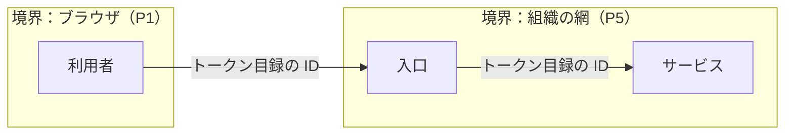
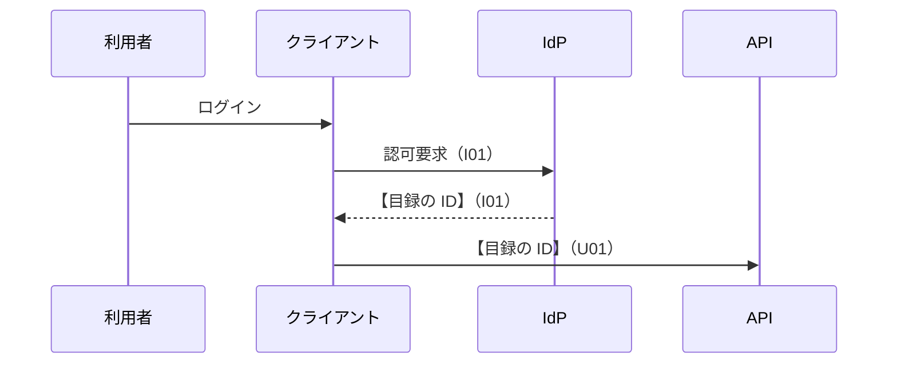

<!-- template_version: 0.7.0 -->
# 設計書の共通部分（00_core）

> テンプレートです。候補と検討の問いだけを載せ、採否の理由の見本は載せません（理由の写し書きを防ぐため。#4 の方針）。判断は台帳（`claims.yaml`・`token_types.yaml`・`hops.yaml`・`catalog_answers.yaml`）に 1 回だけ書き、ここからは ID で参照します。

- 使う場面：JWT のクレームを設計するすべての設計書の本体です。プロファイル（`profiles/`）とモジュール（`modules/`）は、この文書の節から参照する判断の部品です
- 書き方：[README.md](README.md) の「Lite と Full の判定」で Lite か Full かを決めてから書きます。見出しの〔〕は、その節の扱いです
  - 〔Lite：手で書く〕：Lite でも Full でも、書き手が書く節（5 つ。`research/template-design/gate1.md` の 10.）
  - 〔Lite：生成〕：`python tools/claim_lint render <設計書のディレクトリ> --write` が台帳から書く節。手で書かない
  - 〔Full だけ〕：Lite では書かない節
- プロファイルとモジュールの記入欄：選んだプロファイル（`profiles/`）・モジュール（`modules/`）の「記入欄」の表は、この設計書の付録 D（`template:00_core#profile-fill-ins`）に書きます。`python tools/new_design.py <設計書のディレクトリ> --profile lite|full --use <プロファイルとモジュール>` が、表を付録 D に足します。プロファイル・モジュールのファイルそのものには書き込みません（問いと候補を読む資料です）
- 使わない記入欄：自分の設計に当てはまらない記入欄（例：トークンで DB・ブローカーに接続しない設計の「DB・ブローカーの接続の層」）は、節と表を消さずに、表の最初の列に「無い」と書き、同じ行にそう言える理由を 1 つ書きます。最初の列が決まった見出し（`#`・観点・決めること）の表で、ある行だけが当てはまらないときは、見出しを残し、その行の最初の記入の列に「無い：理由」と書きます。節ごと消すと、レビューする人が「書き忘れ」と「当てはまらない」を見分けられないためです。見出しの〔Full だけ〕の節を Lite で書かないのは、この決まりの対象ではありません（書かないままでよい）。**当てはまらない**欄は「無い」、**当てはまるが書かない** Full の節は 12.（書き手が自信のない点）に理由を書く、と使い分けます
- 生成の区間：`<!-- render:<節>:begin -->` と `<!-- render:<節>:end -->` の間は render が書き直します（`tools/claim_lint/RENDER.md`）。区間の中を手で直すと CI（`render --check`）が失敗します。台帳を直してから生成し直してください
- 項目 ID：各節の `項目 ID：` の値（`template:00_core#<アンカー>`）は、レビュー教材（#5）と対応表（#22）が参照する固定の ID です。設計書に写すときも、見出しの直前のアンカーを消さないでください
- 記入例：Lite は [examples/scenario-a/design.md](examples/scenario-a/design.md)、Full は `examples/scenario-b/design.md`（#4 の 2 つ目の PR）
- 作成方法：本資料は生成AI（Claude）を使って作成し、筆者が確認して公開しています。人による点検は未実施

設計書の冒頭には、次の 4 行を書きます（手で書く）。

| 欄 | 書くこと |
| --- | --- |
| 版 | 設計書の版と、前の版（13. の差分の起点） |
| Lite／Full | README の 5 問の答えと判定。1 つでも Yes なら Full。判定と、書く欄・claim_lint の profile をそろえる（README の「Lite と Full の判定」） |
| 使うプロファイル | P1・P4・P5 のどれを、どの境界で使うか（2. の図と同じ）。使うモジュールも書く。記入欄は付録 D |
| 作成方法 | 生成 AI を使ったか。使ったなら、その旨と人の確認の範囲 |

<a id="ci-results"></a>
## 1. CI の結果〔Lite：生成〕

項目 ID：`template:00_core#ci-results`

決めること：なし（記録の欄）。claim_lint の件数と全部の指摘、R8 のサイズの計算を貼ります。error が 0 件でない設計書は、レビューに回しません。warning の抑止には、行ごとの理由が要ります（`templates/CONTRIBUTING.md` の 2.）。

<!-- render:ci-result:begin -->
<!-- render:ci-result:end -->

根拠：templates/CONTRIBUTING.md の 2.、tools/claim_lint/RULES.md、tools/claim_lint/RENDER.md の 1.

<a id="scope-boundary"></a>
## 2. 範囲と信頼の境界〔Lite：手で書く〕

項目 ID：`template:00_core#scope-boundary`
<!-- req:p06-validation-split.R8 -->

決めること：この設計書が扱う範囲（どのクライアント・発行者・サービス・データ層までか）と、信頼の境界（ブラウザ・入口・サービスの網・DB・外部の IdP・取引先）。境界ごとに、使うプロファイル（P1・P4・P5）を書きます。範囲の外にしたものは、外にした前提を書きます。

| 観点 | 検討の問い | 根拠 |
| --- | --- | --- |
| 境界 | トークンが越える境界はどこか。境界の外側の部品（ブラウザ・取引先・外部の IdP）は何を読めるか | slide:p07-trust-boundary、slide:p09-jws-is-readable |
| 入口 | 外の形式のトークンを、内側に持ち込むか。入口で交換・作り直すか | slide:p06-edge-exchange、slide:p11-translation-layer |
| 書き手 | クレームはどの段階（① 認証時〜⑥ 承認・同意）で、誰が書くか | slide:p06-stage-map |
| データ層 | DB の文脈を設定するのは誰か。DB は何を信じるか | slide:p07-three-db-paths、slide:p07-trust-boundary |
| 範囲の外 | 扱わない部品・経路と、その前提が崩れる条件は何か | templates/CONTRIBUTING.md の 2. |

図（mermaid の flowchart か、画像）：境界を subgraph で囲み、境界ごとにプロファイルの名前を書きます。矢印にはトークン目録の ID（5.）を書きます。



記入欄：

| 境界 | 使うプロファイル | 中の部品 | 境界を越えるトークン（目録の ID） | 範囲の外にしたものと前提（書き手が書く） |
| --- | --- | --- | --- | --- |
|  |  |  |  |  |

根拠：slide:p07-trust-boundary、slide:p06-stage-map、slide:p06-edge-exchange、research/template-design/gate1.md の 10.

<a id="principals"></a>
### 2.1 主体の種類〔Lite：手で書く（2. の中で）〕

項目 ID：`template:00_core#principals`
<!-- req:p05-three-principals.R1 -->

決めること：この設計に出てくる主体を、利用者・ワークロード・システム（基盤）に分け、それぞれをトークンのどのクレームで表すか。RFC 9068 の `sub` は利用者にもクライアントにもなるので、受け手が区別できる手段を書きます。

| 主体の種類 | 例 | 検討の問い | 表し方の候補 | 根拠 |
| --- | --- | --- | --- | --- |
| 利用者 | 社員・顧客・取引先の担当者 | 安定したキーは何か（iss と sub の組、Entra は oid＋tid） | IdP の `sub`、組織の `user_id` | slide:p05-three-principals、slide:p02-user-identifier |
| ワークロード | サービス・ジョブ・エージェント | 利用者のトークンと区別できるか | client credentials の `sub`・`client_id`、SPIFFE ID、マネージド ID | slide:p05-three-principals、RFC 9700 §4.15.1 |
| システム・基盤 | 運用者・バッチ・クラウドのサービス | 誰の操作かが監査に残るか | サービスの ID、委任のトークンの `act` | slide:p05-system-privileges |
| 要求の言葉の区分 | 正社員・契約社員・派遣・休職中・退職の手続き中・委託先 | 要求が「社員」「利用者」「管理者」と呼ぶ人に、どの区分が入るか。区分ごとに、通す・止める値が設計にあるか（#63 で足した。パイロット #9 の O2） | 区分を元のデータ（人事の台帳など）から引いて判断に入れる／区分を問わない（要求の持ち主に確かめた記録を書く） | research/template-design/pilot.md の 4. |

記入欄：

| 主体 | 種類 | 表すクレーム（台帳の ID） | 利用者のトークンと区別する手段（書き手が書く） | 要求の言葉と、入る区分・入らない区分（書き手が書く） |
| --- | --- | --- | --- | --- |
|  |  |  |  |  |

根拠：slide:p05-three-principals、RFC 9068 §2.2、RFC 9700 §4.15.1、templates/catalog/subject_state_matrix.md

<a id="system-privileges"></a>
### 2.2 システムの権限〔Full だけ〕

項目 ID：`template:00_core#system-privileges`
<!-- req:p05-system-privileges.R1 req:p05-system-privileges.R3 req:p05-system-privileges.R7 req:p05-cross-tenant.R3 req:p05-system-privileges.R5 -->

決めること：夜間バッチ・運用者の操作・緊急時の特権（break-glass）・基盤の操作のそれぞれで、どの主体がどのトークンで動くか。利用者の権限を借りないこと、運用者は実行者として名を残すことを、場面ごとに確かめます。

| 場面 | 検討の問い | 候補 | 根拠 |
| --- | --- | --- | --- |
| 夜間バッチ | 利用者の権限を借りていないか | client credentials のトークン（`sub` はクライアント） | slide:p05-system-privileges、catalog:issue_events |
| 運用者の操作 | 運用者が利用者として振る舞っていないか | 交換で得た委任のトークン（`sub` に利用者、`act` に運用者） | slide:p05-system-privileges、RFC 8693 §4.1 |
| テナントをまたぐ運用者 | 承認と期限を確かめ、顧客と運用者の両方を記録するか | 委任のトークン＋承認の ID | slide:p05-cross-tenant、template:modules/M_multitenancy#operator-access |
| 緊急時の特権 | 承認と短い期限があるか | `may_act`・`act`、承認の ID（RAR・CIBA） | slide:p05-system-privileges、RFC 8693 §4.4 |
| 基盤の操作 | 管理者も権限を編集できない ID か | サービスにリンクされたロール | slide:p05-system-privileges |

記入欄：

| 場面 | 主体とトークン（目録の ID） | クレームで示すこと（台帳の ID） | 確かめ方（書き手が書く） |
| --- | --- | --- | --- |
|  |  |  |  |

根拠：slide:p05-system-privileges、slide:p05-cross-tenant、RFC 8693 §4.1・§4.4、NIST IR 8587 §5.3.1.6

<a id="deviations"></a>
## 3. 既定から外れた点〔Lite：手で書く〕

項目 ID：`template:00_core#deviations`
<!-- req:p12-priorities-deferrals.R3 -->

決めること：既定（IdP モジュールの既定の回答、発行方式の既定の組み合わせ（BFF＋認可コード＋PKCE）、共通の基準）から外れた判断の要約です。1 行に 1 つ、外れた点と、それを書いた台帳の行の ID を書きます。理由そのものは台帳の行（`rationale`・`assumption`・`revisit_trigger`）に書き、ここには写しません。

| 既定の出どころ | 検討の問い | 根拠 |
| --- | --- | --- |
| 発行方式の既定の組み合わせ | 4. の選択のうち、既定（機密の BFF・認可コード＋PKCE・送信者制約なし・JWT の AT・RT のローテーション）と違うものはどれか | templates/registry/README.md の 3.3、research/template-design/gate1.md の 10. |
| IdP モジュールの既定の回答 | カタログへの回答（11.）で、既定の回答を引き継がなかったイベントはどれか | template:modules/M_idp_keycloak#catalog-defaults |
| 共通の基準 | 3.2 の共通の基準のうち、満たさないものはあるか（あるなら Full にし、レビューで専門家に回す） | slide:p12-priorities-deferrals |
| ケーススタディの判定 | 記入例として作るとき、ケーススタディの判定と違う行はどれか | templates/casestudy-deviations.yaml |

記入欄：

| 外れた点 | 既定 | この設計の値 | 書いた台帳の行の ID | 見直しの条件（書き手が書く） |
| --- | --- | --- | --- | --- |
|  |  |  |  |  |

根拠：research/template-design/gate1.md の 10.、templates/registry/README.md の 2.、slide:p12-priorities-deferrals

<a id="priorities-deferrals"></a>
### 3.1 重点と見送り〔Lite：手で書く（3. の中で）〕

項目 ID：`template:00_core#priorities-deferrals`
<!-- req:p12-priorities-deferrals.R3 req:p12-priorities-deferrals.R4 req:p12-priorities-deferrals.R5 -->

決めること：組織の種類（マルチテナント SaaS・社内業務・AI エージェントの委任）に応じて、共通の基準の上に何を重点とし、何を見送るか。見送るものには「何が起きたら見直すか」を必ず書きます。

| 組織の種類 | 重点の候補（ガイド） | 見送りの候補（ガイド） | 根拠 |
| --- | --- | --- | --- |
| マルチテナント SaaS | テナントと発行者の照合、テナント単位の鍵、データ側のテナント照合、SET LOCAL と行単位の制御 | 細かい権限のトークン化 | slide:p12-priorities-deferrals |
| 社内業務システム | 入口での正規化、ヘッダーの除去、重要な操作の鮮度確認、groups 超過の解決 | JWE、送信者制約 | slide:p12-priorities-deferrals |
| AI エージェントの委任 | act の連鎖を正しく読む、宛先に束縛した交換、承認の束縛、タスク単位の短命トークン、深さの組織規則 | 標準による深さの強制 | slide:p12-priorities-deferrals |

記入欄：

| 区分（重点・見送り） | 項目 | 効果と費用（未検証の点を含む）（書き手が書く） | 見直しの条件（書き手が書く） | 台帳の行の ID |
| --- | --- | --- | --- | --- |
|  |  |  |  |  |

根拠：slide:p12-priorities-deferrals、jwt-claims-casestudy@080b8da（results/summary.md の「見送りの代償と重点の費用」）

<a id="baseline"></a>
### 3.2 共通の基準〔Lite：手で書く（満たさないものがあるときだけ）〕

項目 ID：`template:00_core#baseline`
<!-- req:p12-priorities-deferrals.R1 req:p12-priorities-deferrals.R2 -->

決めること：どの組織でも外さない基準を、この設計が満たしているか。IdP の差は入口で正規化してから基準を当て、正規の要求を落とさないこと（B9・B16 のような誤拒否）も確かめます。

| 基準 | 確かめる欄 | 根拠 |
| --- | --- | --- |
| 受け入れの検証（alg・iss・aud・exp・typ） | トークン目録の `alg_allowlist`・`issuers`・`required_claims`・`typ`、template:modules/M_token_validation#validation-order | slide:p12-priorities-deferrals、slide:p01-validation-order |
| 必須の欠落は拒否 | 台帳の `on_missing`、目録の `required_claims` | slide:p04-reject-missing-required |
| 型の固定 | 台帳の `type`・`shape` | slide:p04-type |
| 不変の ID | 台帳の `identifier_properties`・`paired_id` | slide:p04-immutable-identifiers |
| 組織の名前空間 | 台帳の `namespace`・最上位の `namespaces` | slide:p04-namespace |
| ログにトークン全文と個人情報を残さない | 台帳の `log_policy`、目録の `log_policy` | slide:p09-logs-traces |
| IdP の差を入口で正規化してから当てる | template:profiles/P5_internal_propagation#edge-conversion | slide:p04-reject-missing-required、slide:p03-absorb-idp-differences |

記入欄：

| 基準 | 満たすか | 満たさないときの理由と、回した先（専門家・追跡 issue）（書き手が書く） |
| --- | --- | --- |
|  |  |  |

根拠：slide:p12-priorities-deferrals、jwt-claims-casestudy@080b8da（results/summary.md の除去実験）

<a id="issuance-profile"></a>
## 4. 発行方式の選択〔Lite：生成（既定の組み合わせから外れた点だけ 3. に手で書く）〕

項目 ID：`template:00_core#issuance-profile`
<!-- req:p06-grant-types.R1 req:p08-rotation.R2 req:p09-url-browser.R2 -->

決めること：クライアントの種類・クライアント認証・grant・送信者制約・AT の形式・RT の方式・要求の保護・準拠するプロファイル。値と理由は `token_types.yaml` の `issuance_profile` に書き、この節は render が生成します。選択ごとに台帳で必要になるもの（`templates/registry/issuance_effects.yaml`）と、それを満たしている台帳の行も表示されます。**トークン目録（5.）とクレームの表は、この選択の結果として読めるように書きます**（例：送信者制約を DPoP にすると、AT に `cnf.jkt` の行と、目録に DPoP の proof の行が要る）。

| 項目 | 検討の問い | 候補（スキーマの値） | 部品 | 根拠 |
| --- | --- | --- | --- | --- |
| クライアントの種類 | トークンをサーバー側で持てるか | public・confidential・fapi | template:profiles/P1_human_web#bff-vs-spa | slide:p06-grant-types、slide:p08-rotation |
| クライアント認証 | 秘密を持てるか。鍵で認証するか | private_key_jwt・tls_client_auth・client_secret_* など | — | OpenID Connect Core 1.0 §9、RFC 8705 §2.1 |
| grant | 主体は誰で、どこで認証したか | 認可コード＋PKCE・client credentials・token exchange・CIBA・device・refresh・JWT bearer | template:profiles/P4_ai_agent_delegation#delegation-mode | slide:p06-grant-types |
| 送信者制約 | 漏れたトークンをそのまま使われてよいか | none・dpop・mtls | template:modules/M_sender_constraint#dpop-vs-mtls | RFC 9449 §1、RFC 8705 §1 |
| AT の形式 | 受け手が手元で検証するか、問い合わせるか | jwt・opaque_introspection・phantom | template:modules/M_authz_pdp#carry-or-query | slide:p01-self-contained-vs-reference |
| RT の方式 | RT が漏れたときに何で止めるか | rotation_reuse_detection・rotation・sender_constrained・none | template:modules/M_sender_constraint#rt-rotation | RFC 9700 §4.14.2 |
| 要求の保護 | 認可要求を改ざん・漏えいから守るか | par・jar・rar・resource_indicators | template:profiles/P1_human_web#url-exposure | RFC 9126 §1、RFC 9396 §2、RFC 8707 §2 |
| 準拠するプロファイル | 規制・業界の要求があるか | none・fapi2_security・oauth2_1 | — | FAPI 2.0 Security Profile（Final）§5.3.2.1 |

<!-- render:issuance-profile:begin -->
<!-- render:issuance-profile:end -->

根拠：templates/registry/README.md の 3.3 と 7.、templates/registry/issuance_effects.yaml、tools/claim_lint/RENDER.md の 5.

<a id="token-inventory"></a>
## 5. トークン目録〔Lite：生成〕

項目 ID：`template:00_core#token-inventory`
<!-- req:p08-token-types-lifetimes.R4 -->

決めること：どのトークンを、誰が誰に向けて、どの形式・寿命で発行し、誰が読めて、JWE を使うか。カタログの 17 種類（`templates/catalog/token_kinds.yaml`）のすべてに、採用・既定どおり・却下＋理由を付けます。値は `token_types.yaml` の `token_types` に書き、この節は render が生成します。目録の ID は、シーケンス図（7.）の矢印、ホップの表（8.）、ライフサイクル表（9.）、台帳の `carried_in` で同じものを使います。

| 列 | 検討の問い | 根拠 |
| --- | --- | --- |
| 発行 → 宛先・持つ者 | 宛先（`aud`）と持つ者（`holder`）は誰か。ID トークンを API に送っていないか | slide:p01-id-token-vs-access-token |
| 形式（typ・alg） | 種類の違うトークンを `typ` で区別できるか | slide:p01-validation-order、RFC 9068 §2.1 |
| 寿命（idle と最大） | 種類ごとに上限を決めたか。1 つの数字で語っていないか | slide:p08-token-types-lifetimes |
| 保存場所・運び方 | URL・ブラウザに残らないか | slide:p09-url-browser、slide:p08-copies-outlive-token |
| 読める相手・JWE | 読まれてはいけないクレームを、読める相手に届くトークンに載せていないか | slide:p09-jws-is-readable、template:modules/M_privacy_minimization#protection-table |

<!-- render:token-inventory:begin -->
<!-- render:token-inventory:end -->

根拠：slide:p08-token-types-lifetimes、templates/registry/README.md の 3.2、templates/catalog/token_kinds.yaml、tools/claim_lint/RENDER.md の 1.

<a id="lifetime-policy"></a>
### 5.1 寿命の上限の方針〔Full だけ〕

項目 ID：`template:00_core#lifetime-policy`
<!-- req:p08-token-types-lifetimes.R4 req:p08-choosing-lifetime.R2 req:p08-choosing-lifetime.R4 req:p08-decision-table.R1 -->

決めること：種類ごとの寿命の上限を、組織の規則として文書にします。上限を超える種別には、例外を認める手順（誰が承認し、どこに記録するか）を書きます。上限のファイルは `tools/claim_lint/lifetime_caps.yaml` の形（#6 の L23。自組織のファイルに替えられる）です。

| 種類 | 指針の数値 | 検討の問い | 根拠 |
| --- | --- | --- | --- |
| アクセストークン・ID トークン | 1 時間以内とすべき | 剥奪の許容時間（9.2）から見て短いか | NIST IR 8587 §5.3.1.1、slide:p08-choosing-lifetime |
| 対話用の RT・セッション | 再認証の上限（AAL2 は 24 時間・無操作 1 時間） | RT の最大寿命が再認証の上限を超えないか | NIST SP 800-63B-4 §2.2.3、slide:p08-token-types-lifetimes |
| 認可コードなどのアサーションの参照 | 5 分以内（FAPI 2.0 は 60 秒） | — | NIST SP 800-63C-4 §4.11.1、FAPI 2.0 Security Profile（Final）§5.3.2.1 |
| Txn-Token | 分以下 | 元のトークンより長くするか（仕様は許す） | draft-ietf-oauth-transaction-tokens-11 §6、slide:p08-token-types-lifetimes |

記入欄：

| 種類 | 組織の上限（秒） | 例外を認める手順（承認者・記録先）（書き手が書く） | 例外にした種別（目録の ID と `lifetime_exception`） |
| --- | --- | --- | --- |
|  |  |  |  |

根拠：slide:p08-choosing-lifetime、slide:p08-token-types-lifetimes、NIST IR 8587 §5.3.1.1

<a id="question-mechanism"></a>
## 6. 問い × 仕組み〔Lite：手で書く〕

項目 ID：`template:00_core#question-mechanism`

決めること：ユースケースごとに、答えるべき問い（`templates/registry/questions.yaml` の 11 問。スライドと同じ文言）のそれぞれに、どの仕組み（クレーム・トークン・通信の層）で答えるか。**選ばなかった問いには「不要」と理由を書きます。** 取り違えやすい問いは別々の行にします：「誰が代理して実行しているか」（`act`）、「どのワークロードが Txn-Token を求めたか」（`req_wl`）、「どの取引か」（Txn-Token の `txn`）、「直接の通信相手は誰か」（mTLS・SPIFFE などのワークロードの ID。トークンのクレームでは代えられない）。

| 問い（questions.yaml の ID） | 仕組みの候補 | 取り違えやすい相手 | 根拠 |
| --- | --- | --- | --- |
| 誰の権限で（`q-sub`） | `sub` | `act`（代理している者） | slide:p05-one-request-carries、RFC 8693 §4.1 |
| 誰が代理して実行しているか（`q-actor`） | `act`（最も外側が今の行為者） | 入れ子の `act`（過去の行為者）、`sub` | slide:p10-four-questions、RFC 8693 §4.1 |
| どのワークロードが Txn-Token を求めたか（`q-req-wl`） | Txn-Token の `req_wl` | `act`、通信の相手 | draft-ietf-oauth-transaction-tokens-11 §9.2 |
| 直接の通信相手は誰か（`q-peer`） | mTLS・SPIFFE の ID（通信の層） | `act`・`req_wl` | slide:p05-one-request-carries |
| どこを経由したか（`q-via`） | 証跡（ログ・トレース） | `act` の連鎖 | slide:p06-audit-trail |
| どの取引か（`q-txn`） | Txn-Token の `txn` | 承認の ID | draft-ietf-oauth-transaction-tokens-11 §9.2 |
| 誰が利用者か（`q-user`） | `sub` と組織の `user_id` | 表示名・メール | slide:p02-user-identifier |
| どのエージェント・クライアントか（`q-agent`） | `client_id`・`azp`・`act` | `sub` | slide:p02-delegation-client、slide:p10-agent-identity |
| 何が承認されたか（`q-authorized`） | `scope`・`authorization_details`・承認の ID | `roles` | slide:p10-human-approval-evidence、RFC 9396 §2 |
| どのリソース向けか（`q-resource`） | `aud`（resource indicator で絞る） | `scope` | slide:p06-narrow-downstream、RFC 8707 §2 |
| 誰が持つべきか（`q-holder`） | 送信者制約（`cnf`） | `sub` | template:modules/M_sender_constraint#dpop-vs-mtls、RFC 9449 §6.1 |

ユースケースごとに、要求の出どころ（要求の文書の節）を表の前に 1 行書きます。要求に無いユースケース・操作を設計で足したときは「要求に無い」と書き、足した理由を書きます（#63 で足した。パイロット #9 の O6：設計が足した操作が、要求と突き合わされずに残った）。

記入欄（ユースケースごとに 1 表。問いの行は 11 行すべて書く）：

| ユースケース | 問い（ID） | 要るか | 仕組み（台帳の行の ID か、クレームでない仕組み） | 不要の理由・照合する場所（書き手が書く） |
| --- | --- | --- | --- | --- |
|  |  |  |  |  |

台帳の `answers`・`does_not_answer`（Full の列）を書けば、次の区間に確かめ用の表が生成されます。手で書いた表と食い違えば、どちらかが誤りです（#18 の L12・L13 が台帳の側を確かめる）。

<!-- render:question-mechanism:begin -->
<!-- render:question-mechanism:end -->

根拠：slide:p05-one-request-carries、slide:p10-four-questions、templates/registry/questions.yaml、research/template-design/gate1.md の 10.

<a id="sequence"></a>
## 7. シーケンス図〔Full だけ〕

項目 ID：`template:00_core#sequence`

決めること：主な流れ（ログイン・API の呼び出し・交換・リフレッシュ・ログアウト・失効）を、矢印ごとにカタログのイベント ID（`I01` など。`templates/catalog/`）とトークン目録の ID を付けて描きます。**目録に無いトークンを矢印に書かない**でください（#6 の L21 が、目録・ホップ・カタログへの回答との食い違いを見る。図の参照の書き方は `【<目録の ID>】`）。



- mermaid の文の中で `;` を使わない（文の区切りとして読まれ、GitHub で描画されない。`tools/check_mermaid.py`）

根拠：templates/catalog/issue_events.yaml、templates/catalog/use_events.yaml、slide:p06-stage-map、tools/check_mermaid.py

<a id="hop-table"></a>
## 8. ホップごとの表〔Lite：生成（交換・作り直しのホップがあれば手で書く）〕

項目 ID：`template:00_core#hop-table`
<!-- req:p12-review-viewpoints.R7 -->

Lite でホップを 1 つも書かない設計は、`hops.yaml` を置きません（`hops: []` はスキーマに反します。claim_lint は、Lite ではファイルが無いことを info で知らせます）。Full では経路のホップを書きます。Full で `hops.yaml` が無い・空のときは、claim_lint が warn（LOAD）で知らせます。交換・作り直しのホップがある設計は、README の 5 問の 3 が Yes なので Full です。Lite でも、DB・ブローカーの接続などのホップを書くときは `hops.yaml` を置きます（`python tools/new_design.py <設計書> --with-hops`）。

決めること：経路のホップごとに、運ぶトークン・`aud`・`scope`・寿命・運ぶ独自クレーム・交換を担うサービス・受け手の検証。**規則：下流は `aud`・`scope`・寿命・独自クレームのどれでも上流を超えない。** 超える場合（Txn-Token は仕様上、元より長くてよい）は `narrowing_exception` に理由を書きます。値は `hops.yaml` に書き、この節は render が生成します。交換・作り直しのホップの `aud`・`scope`・`max_lifetime`・`custom_claims`・`exchanger` は Lite でも手で書きます。

| 観点 | 検討の問い | 根拠 |
| --- | --- | --- |
| 宛先 | 交換のたびに `aud` を 1 つの宛先に絞っているか | slide:p06-narrow-downstream、RFC 8707 §2 |
| 範囲 | `scope`・`authorization_details` が上流より広がっていないか | slide:p06-narrow-downstream、RFC 9396 §9.1 |
| 寿命 | 下流のトークンが上流より長く生きないか | slide:p06-narrow-downstream、draft-ietf-oauth-transaction-tokens-11 §6 |
| 独自クレーム | 下流の受け手が読まないクレームを運んでいないか | slide:p11-pre-add-questions-2 |
| 誰が検証するか | 入口で検証しても、各サービスで検証するか | slide:p06-validation-split |
| ヘッダーへの転記 | 同名のヘッダーを入口で捨てているか | slide:p06-header-forwarding |

<!-- render:hop-table:begin -->
<!-- render:hop-table:end -->

矢印ごとの表（シーケンス図の読み物。載るトークン × 受け手が確かめるクレーム × 書き手）：

<!-- render:arrow-table:begin -->
<!-- render:arrow-table:end -->

根拠：slide:p06-narrow-downstream、templates/registry/README.md の 3.4、RFC 8693 §5

<a id="lifecycle"></a>
## 9. ライフサイクル表〔Lite：手で書く〕

項目 ID：`template:00_core#lifecycle`
<!-- req:p02-auth-strength-session.R5 req:p08-async-processing.R4 req:p08-downstream-after-expiry.R3 -->

決めること：寿命の 4 つの層（トークン・クレームの値の鮮度・セッションと RT・クレームの定義）を、別々に書きます。9.1 はトークン種別とセッション層と接続ごと、9.2 はクレームごと、9.3 はクレームの定義ごとです。4 つは独立に動きます（AT が 5 分でも、セッションが 10 時間なら 10 時間トークンを得られる）。

<!-- heading-only -->
### 9.1 トークン・セッション・接続

| 列 | 検討の問い | 根拠 |
| --- | --- | --- |
| 寿命（idle と最大） | 種類ごとに決めたか（5.1 の上限の中か） | slide:p08-token-types-lifetimes |
| リフレッシュ | リフレッシュで属性・ロールが再評価されるか（IdP ごとに違う） | slide:p08-refresh-reevaluation |
| RT のローテーションと再利用の検知 | 古い RT の再利用で系列を失効させるか。確かめたか | slide:p08-rotation、RFC 9700 §4.14.2 |
| 失効の手段 | exp まで待つ・イントロスペクション・状態リスト・SSF/CAEP・Back-Channel Logout のどれか | slide:p08-revocation-propagation、slide:p08-logout |
| 剥奪が届くまでに許す時間 | 受け手が止めるまでの最悪の秒数は何秒か | slide:p08-revocation-propagation |
| 長時間の処理 | 非同期の処理・期限切れの後の下流の呼び出しで、トークンをどう扱うか | slide:p08-async-processing、slide:p08-downstream-after-expiry |

記入欄：

| 層・種別（目録の ID） | 寿命（idle／最大） | リフレッシュ | RT のローテーションと再利用の検知 | 失効の手段 | 剥奪が届くまでの秒数 | 長時間の処理での扱い（書き手が書く） |
| --- | --- | --- | --- | --- | --- | --- |
|  |  |  |  |  |  |  |

確かめ用の生成の表（4 つの層。寿命が鮮度の許容を超える行に「超える」と出る）：

<!-- render:lifecycle:begin -->
<!-- render:lifecycle:end -->

根拠：slide:p08-four-lifetimes、slide:p08-token-types-lifetimes、slide:p08-refresh-reevaluation、slide:p08-rotation、slide:p08-revocation-propagation、slide:p08-async-processing、templates/registry/README.md の 6.

<a id="lifecycle-db-connection"></a>
#### DB・ブローカーの接続の層

項目 ID：`template:00_core#lifecycle-db-connection`
<!-- req:p07-lifetime-mismatch.R4 req:p07-lifetime-mismatch.R3 -->

決めること：DB・メッセージブローカーへの接続の寿命と、トークンの寿命の関係。多くの DB でトークンは「接続を開く鍵」で、失効やロールの剥奪は開いた接続に届きません。接続の最大寿命をトークンの寿命以下にするか、利用者のクレームを取引ごとに注入するか、すぐ止めるなら DB 側の主体を削除するかを決めます。既存の接続に再認証を強制できる製品では、それを有効にするかを決めます（Kafka の `connections.max.reauth.ms` は既定で 0、つまり再認証しない）。値は `hops.yaml` の `db_connection`・`broker_connection` のホップの `connection_max_lifetime` に書きます。

| 製品の例 | 開いた接続への影響（ガイドの表） | 根拠 |
| --- | --- | --- |
| RDS・Aurora の IAM 認証 | 影響しない（認証時だけ使う） | slide:p07-lifetime-mismatch |
| Cloud SQL の IAM 認証 | 影響しない（期限の後に失敗するのは新しい接続だけ） | slide:p07-lifetime-mismatch |
| Azure Database for PostgreSQL（Entra） | 削除した利用者も最大 60 分は入れる。DB 側で削除すれば即時 | slide:p07-lifetime-mismatch |
| Kafka | 既定（`connections.max.reauth.ms` が 0）では切断しない。正の値にすると、期限内に再認証しない接続をブローカーが切る（スライドの表の「しなければ切断」は、正の値にした場合の意味） | slide:p07-lifetime-mismatch、Kafka 4.4 Broker Configs「connections.max.reauth.ms」 |

記入欄（トークンで DB・ブローカーに接続しない設計は、最初の列に「無い」と書き、同じ行にその理由を書く。節は消さない）：

| 接続（ホップの ID） | 接続の最大寿命 | 開くときに使うトークン（目録の ID）と寿命 | 剥奪を開いた接続に届かせる手段（書き手が書く） |
| --- | --- | --- | --- |
|  |  |  |  |

根拠：slide:p07-lifetime-mismatch、NIST IR 8587 §4.1.4、ASVS v5.0.0-8.3.2

利用者のクレームを取引ごとに注入する方法は template:modules/M_data_layer#pool-context にあります。

<a id="freshness"></a>
### 9.2 クレームの鮮度の表〔Lite：生成（寿命が許容を超える行の対策だけ手で書く）〕

項目 ID：`template:00_core#freshness`
<!-- req:p08-stale-claims.R1 req:p08-reissue-triggers.R2 req:p08-four-lifetimes.R1 -->

決めること：クレームを発行時点の写しとみなし、クレームごとに「値が変わってから反映されるまでに許す時間」（台帳の `volatility`）と、載るトークンの寿命（受け入れの上限＝`max_lifetime`＋`max_clock_skew`）を並べます。**寿命のほうが長いクレームには対策を書きます。** 外部の IdP の属性を取り込むなら、取り込み方（初回だけか、毎回か）も値の鮮度として書きます。

| 対策の候補 | 中身 | 台帳・目録の列 | 根拠 |
| --- | --- | --- | --- |
| 寿命を縮める | そのクレームが載る種別の寿命を、許容の時間以下にする | 目録の `max_lifetime` | slide:p08-stale-claims |
| 問い合わせに切り替える | 重要な判断で PDP・DB・イントロスペクションに都度問い合わせる | 台帳の `on_revoke`・`enforced_at` | slide:p08-stale-claims、template:modules/M_authz_pdp#carry-or-query |
| 失効を伝える | CAEP の token-claims-change などのイベントで受け手に伝える | 目録の `revocation` | slide:p08-stale-claims、slide:p08-revocation-propagation |
| 再発行の契機 | 利用者の状態が変わったら新しいトークンを取り直す | 台帳の `recompute_trigger` | slide:p08-reissue-triggers |
| 元のデータからの経路 | IdP の手前（人事の台帳など）で変わる値は、IdP のグループ・属性に届くまでの経路（SCIM・人事の連携・人手）と遅れを、反映までの秒数に含める。人手なら上限が無いことを書く（#63 で足した。パイロット #9 の O5） | 台帳の `source_system`・`volatility`・`propagation_delay` | RFC 7644、research/template-design/pilot.md の 4. |

記入欄（生成の表で「超える」と出た行だけ）：

| クレーム（台帳の ID） | 反映までに許す秒数 | 載る種別と受け入れの上限（秒） | 対策（書き手が書く） | 対策を書いた台帳・目録の列 |
| --- | --- | --- | --- | --- |
|  |  |  |  |  |

根拠：slide:p08-stale-claims、slide:p08-four-lifetimes、slide:p08-reissue-triggers、templates/registry/README.md の 6.、tools/claim_lint/RENDER.md の 1.

<a id="definition-lifecycle"></a>
### 9.3 クレームの定義の寿命〔Full だけ（廃止予定の行があれば Lite でも書く）〕

項目 ID：`template:00_core#definition-lifecycle`
<!-- req:p00-claims-are-contracts.R8 req:p04-forward-compatibility.R3 req:p04-forward-compatibility.R4 req:p11-why-govern.R1 req:p11-change-procedure.R1 req:p11-change-procedure.R3 req:p11-change-procedure.R4 req:p11-change-procedure.R5 req:p11-pre-add-questions-2.R11 req:p11-pre-add-questions-2.R12 req:p08-four-lifetimes.R1 req:p12-review-viewpoints.R16 -->

決めること：クレームの追加・変更・廃止を、API の変更と同じ重さの手順で扱います。トークンの中身（名前・型・形）の変更は破壊的変更です。手順は「受け手が先、発行者が後」です。

1. **受け手が先**：全受け手に事前に通知し、受け手を新旧の両方を受け入れるよう直す。新しい**制限**のクレームは、古い受け手が無視して効かない前提で、受け手の対応を先に済ませる
2. **選択制**：希望する受け手から新形式を出す。新形式を事前に確かめるプレビューの手段を用意する（Keycloak なら template:modules/M_idp_keycloak#token-preview）
3. **期日で既定**：日付を事前に告知し、互換期間は新旧を並行して発行する（期間を短く見積もらない）
4. **旧形式を廃止**：台帳の `status` を `deprecated`（`sunset_on` に期日）から `sunset` に進める。期日を過ぎても読む受け手がいれば #6 の L18 が出る

| 列 | 検討の問い | 根拠 |
| --- | --- | --- |
| `status`・`sunset_on` | 廃止予定のクレームに期日があるか | slide:p11-change-procedure、slide:p11-registry-fields |
| `consumers`・`consumers_migration` | 全受け手を把握し、移行の状況を受け手ごとに持っているか | slide:p11-change-procedure、slide:p11-why-govern |
| `alt` | 代わりの行はどれか | templates/registry/README.md の 3.1 |
| 互換期間 | 古い形式で出した最後のトークンの受け入れの上限が過ぎてから、古い形式を読むのをやめるか | slide:p11-change-procedure、slide:p04-forward-compatibility |

記入欄（廃止予定・変更中のクレームごと）：

| クレーム（台帳の ID） | 状態と期日 | 代わりの行 | 受け手ごとの移行の状況 | 並行発行の期間と、古い形式を読むのをやめる時点（書き手が書く） |
| --- | --- | --- | --- | --- |
|  |  |  |  |  |

新しい共有クレームを足すときは、[claim_request.md](claim_request.md)（追加前の 25 問）を Lite でも書きます。

根拠：slide:p11-change-procedure、slide:p11-why-govern、slide:p04-forward-compatibility、slide:p00-claims-are-contracts、NIST SP 800-162 §3.3.3

<a id="decisions"></a>
## 10. 判断の行〔Lite：生成〕

項目 ID：`template:00_core#decisions`
<!-- req:p11-ownership.R5 req:p11-pre-add-questions-2.R14 -->

決めること：なし（台帳から生成する ADR の行）。クレームの候補ごとの採否（却下の種類）・代わりの行・理由・前提・根拠 ID・裏付け・見直しの条件です。追加・変更・廃止はレビューの場（PR）で決め、決定・理由・却下した案をこの行に残します。追加前の 25 問の回答は、ここ（台帳の 1 行）と `claim_request_<名前>.md` の両方から辿れるようにします。データ源の表も添えます。

<!-- render:decision-rows:begin -->
<!-- render:decision-rows:end -->

<!-- render:data-sources:begin -->
<!-- render:data-sources:end -->

根拠：slide:p11-ownership、slide:p11-pre-add-questions-2、templates/registry/README.md の 3.1、tools/claim_lint/RENDER.md の 1.

<a id="catalog-answers"></a>
## 11. カタログへの回答〔Lite：生成（集計）〕

項目 ID：`template:00_core#catalog-answers`

決めること：カタログ（`templates/catalog/issue_events.yaml`・`use_events.yaml`）の全イベントに「該当」か「対象外」を `catalog_answers.yaml` で答えます。この節は集計（件数と、**対象外の件数と割合**）と行の一覧を生成します。

- 「対象外」には、起きない前提（`assumption`）と、その前提が崩れる条件（`breaks_when`）を書きます
- IdP モジュールの既定の回答を引き継げるのは、Lite で、カタログの行に `lite_inherit: true` の印があるイベントだけです（クライアントの設定のスイッチ 1 つで止めていて、指摘が出ていないもの。template:modules/M_idp_keycloak#catalog-defaults）。引き継ぐ行にも、どの設定を、どこで、いつ確かめたかの 1 欄（`setting_checked`）を書きます。指摘が出た行、レルム・クライアントの既定に依存する行、利用イベントは手で書きます
- 既定の回答を変えるときだけ、理由を書きます
- カタログの外を問う欄（`outside_enumeration`）に、探した範囲を書きます（R9）

<!-- render:catalog-summary:begin -->
<!-- render:catalog-summary:end -->

根拠：tools/claim_lint/RULES.md の R2・R9、research/template-design/gate1.md の 10.、templates/CONTRIBUTING.md の 2.

<a id="uncertain"></a>
## 12. 書き手が自信のない点〔Lite：手で書く〕

項目 ID：`template:00_core#uncertain`

決めること：書き手が確かめていない点、実測していない IdP の挙動、根拠が筆者の提案だけの判断、レビュアーに見てほしい点。レビュアーはここから読み始めます。

| 観点 | 検討の問い | 根拠 |
| --- | --- | --- |
| 実測 | IdP の挙動（リフレッシュでの再評価、RT の再利用の検知、交換で出たトークンの `act`）を確かめたか | slide:p03-recent-changes、slide:p08-refresh-reevaluation |
| 草案 | 草案に依存する行に、版と見直しの条件があるか | slide:p10-guidance-standards |
| 専門家 | 専門家に回すべき行（独自の暗号・委任の深さが 2 以上・テナントをまたぐ交換）はあるか | slide:p12-review-viewpoints |

記入欄：

| 点 | 確かめていないこと（書き手が書く） | 確かめ方の案（書き手が書く） | 関係する台帳・目録の ID |
| --- | --- | --- | --- |
|  |  |  |  |

根拠：research/template-design/gate1.md の 10.、slide:p12-review-viewpoints

<a id="diff"></a>
## 13. 前の版との差分

項目 ID：`template:00_core#diff`

決めること：なし（版の記録）。前の版から変えた判断と、その PR を書きます。台帳の破壊的変更は `python tools/claim_lint diff --base <git ref> <設計書>`（#6 の L10）で確かめます。

| 版 | 変えたこと | 台帳の行の ID | PR |
| --- | --- | --- | --- |
|  |  |  |  |

根拠：templates/CONTRIBUTING.md の 4.、slide:p11-why-govern

<!-- heading-only -->
## 付録（A〜C は Full だけ。D は Lite でも書く）

<a id="operational-metrics"></a>
### A. 運用で測る指標〔Full だけ〕

項目 ID：`template:00_core#operational-metrics`
<!-- req:p11-audit-metrics.R3 req:p11-audit-metrics.R6 req:p11-audit-metrics.R7 -->

決めること：台帳と実際の発行のずれ、検証の失敗、トークンの使用パターンを、どの指標・周期・持ち主で測るか。

| 指標 | 測り方の候補 | 根拠 |
| --- | --- | --- |
| 共通の検証ライブラリの採用率と版 | 依存関係の走査 | slide:p11-audit-metrics |
| `aud`・型の検証失敗の件数 | 受け手の拒否ログの集約 | slide:p11-audit-metrics |
| 台帳と実際の発行のずれ | 発行側の検査用スキーマ（`schemas/*.issuer.schema.json`）での検証 | slide:p11-audit-metrics、tools/claim_lint/RENDER.md の 4. |
| トークンの使用パターン | 発行・利用の監視 | NIST IR 8587 §5.3.1.4、slide:p11-audit-metrics |

記入欄：

| 指標 | 周期 | 持ち主 | しきい値と、超えたときの対応（書き手が書く） |
| --- | --- | --- | --- |
|  |  |  |  |

根拠：slide:p11-audit-metrics、NIST IR 8587 §5.3.1.4

<a id="step-up"></a>
### B. 追加認証〔Full だけ〕

項目 ID：`template:00_core#step-up`
<!-- req:p02-auth-strength-session.R6 -->

決めること：高リスクの操作ごとに、受け手が要求する認証の強さ（`acr`・`max_age`）と、足りないときの応答（`insufficient_user_authentication`）。

| 観点 | 検討の問い | 根拠 |
| --- | --- | --- |
| 操作 | どの操作が高リスクか | slide:p06-step-up-approval |
| 要求 | 受け手はどの `acr`・`max_age` を求めるか | RFC 9470 §3、slide:p02-auth-strength-session |
| 応答 | 足りないとき `insufficient_user_authentication` で追加の認証を求めるか | RFC 9470 §3 |

記入欄：

| 操作 | 求める `acr`・`max_age` | 照合する受け手 | 足りないときの扱い（書き手が書く） |
| --- | --- | --- | --- |
|  |  |  |  |

根拠：slide:p06-step-up-approval、slide:p02-auth-strength-session、RFC 9470 §3

<a id="result-integrity"></a>
### C. 結果・応答の完全性〔Full だけ〕

項目 ID：`template:00_core#result-integrity`
<!-- req:p06-return-results.R1 req:p06-return-results.R4 req:p06-flow-partner-events.R3 -->

決めること：処理結果・サービス間の応答・Webhook を、JWT（自己完結した主張）・HTTP メッセージ署名（RFC 9421）・参照型のどれで返すか。RFC 9421 なら、署名する部分（`@method`・`@path`・`Content-Digest`）と `created`・`keyid` の必須を決めます。

| 方式 | 向いている場面（ガイド） | 根拠 |
| --- | --- | --- |
| JWT | 自己完結した主張を返すとき | slide:p06-return-results |
| HTTP メッセージ署名 | 本文そのものの完全性を守るとき（Webhook・取引先の API） | RFC 9421 §2、slide:p06-flow-partner-events |
| 参照型 | 結果を受け手が取りに来るとき | slide:p06-return-results |

記入欄：

| 結果・応答 | 方式 | 署名する部分と必須のパラメータ（書き手が書く） |
| --- | --- | --- |
|  |  |  |

根拠：slide:p06-return-results、slide:p06-flow-partner-events、RFC 9421 §2

<a id="profile-fill-ins"></a>
### D. プロファイルとモジュールの記入欄〔Lite・Full：手で書く（Lite は、Lite でも記入とされた項目だけ）〕

項目 ID：`template:00_core#profile-fill-ins`

決めること：冒頭の「使うプロファイル」に書いたプロファイルとモジュールの、記入欄の表への答え。判断そのものは台帳に 1 回だけ書き、ここには決めたことの要約と、台帳・目録の ID を書きます。表は手で写さず、次のコマンドで足します（すでにある項目は書き換えません。プロファイルを後から足すときも同じコマンドです）。

```
python tools/new_design.py designs/my-service --profile full --use P1,P4,M_token_validation
```

| 区分 | ここに書く項目 | 根拠 |
| --- | --- | --- |
| Lite | 見出しが〔Lite・Full：記入〕で始まる項目だけ（`--profile lite`）。ほかの項目は問いを読み、答えは 3.（既定から外れた点）と台帳に書く。P4 は Full だけで、Lite の項目は無い | templates/README.md の「Lite で書くもの（縮小 Lite）」 |
| Full | 記入欄のあるすべての項目（`--profile full`） | templates/README.md の「プロファイルとモジュールの組み合わせ方」 |
| 当てはまらない項目 | 表を消さずに、「無い」と理由を書く（冒頭の「使わない記入欄」）。足された見出しの〔〕は、もとの項目の扱い（〔Full：記入／Lite：参照〕、〔Full：記入〕、〔Lite：生成／Full：生成と確かめ〕 など）で、生成とされた項目は、生成の結果を確かめた旨を書く | research/template-design/pilot.md の 7. |

<!-- fill-ins:begin -->
<!-- fill-ins:end -->

根拠：research/template-design/pilot.md の 6. と 7.、templates/README.md の「プロファイルとモジュールの組み合わせ方」、筆者の提案：プロファイルとモジュールの記入欄を、設計書の付録 D の 1 か所にまとめる（追跡 #61）
