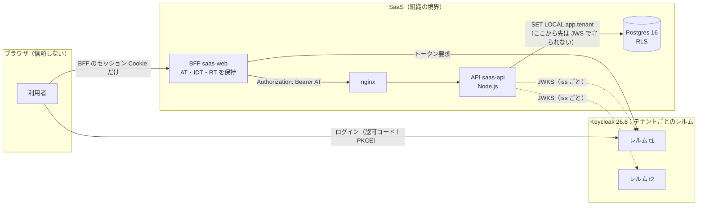

<!-- template_version: 0.1.0 -->
# 設計書（Lite）記入例：シナリオ A　マルチテナント SaaS（Keycloak 26.8）

> **記入例です。推奨ではありません。** ケーススタディ（jwt-claims-casestudy@080b8da）のシナリオ A の前提での一例で、自組織の判断の代わりに写さないでください。判断の正は同じディレクトリの `claims.yaml`・`token_types.yaml`・`catalog_answers.yaml` で、この文書はその読み物です。

- 版：0.1.0（#16 の縦の一本。テンプレート（#4）ができる前に、#4 の節の順に沿って書いた）
- Lite を選んだ理由：#4 の 5 問のうち「マルチテナントか」が Yes なので、#4 の定義では Full になる。縦の一本では、Lite の欄（#4 の 2・3・4・6・7・12 と台帳の必須列）がどれだけで書けるかを測るために、あえて Lite の欄で書いた。Full の欄（鮮度の表、定義の寿命など）は書いていない
- 作成方法：本資料は生成AI（Claude）を使って作成し、筆者が確認して公開しています。人による点検は未実施

## 1. CI の結果

```
$ python tools/claim_lint templates/examples/scenario-a
claim_lint v0  design=templates/examples/scenario-a  profile=full  claims=25  token_types=9  catalog_events=19
R8    info      AT      最悪 1258 バイト（ヘッダーの行で 1280）／上限 8192（nginx-large-client-header-buffers）= 16%
R8    info      C-iss   AT・IDT の両方に載る（重複の候補）  ほか info 3 件
error 0, warn 0, info 5
OK
```

## 2. 範囲と信頼の境界

テナントごとに Keycloak のレルム（t1・t2）を分ける。ブラウザはトークンを持たず、BFF（saas-web）がサーバー側で AT・ID トークン・RT を持つ。API（saas-api）は AT をローカルで検証し、Postgres の行単位の制御（RLS）でテナントを絞る。入口のゲートウェイと内部トークンへの交換は置かない（ケーススタディの共通の前提との違い。`templates/casestudy-deviations.yaml` の `scenario_premises`）。



境界の要点：
- テナントの管理者は、自分のレルムのマッパーを変えられる。そのため tenant_id は「iss のレルム名と一致するときだけ」信じる（ケーススタディ A8）。
- tenant_id は API で DB のセッション変数に写した時点で、署名の保護の外に出る（`claims.yaml` の `integrity_until`）。以降は、トランザクションごとの SET LOCAL と、RLS をすり抜けない DB のロール（NOBYPASSRLS）で守る。

## 3. 既定から外れた点

| 点 | 既定（Keycloak・ケーススタディ） | この例 | 理由 |
| --- | --- | --- | --- |
| クライアントのスコープ | basic・roles・profile・email・acr・web-origins | basic だけ。組織のクレームはクライアントのマッパーで足す | AT に個人情報と Keycloak の形のロールを載せない。ケーススタディの既定のクライアントの AT は 1398 バイト、この例の構成の見本は 1045 バイト |
| Full Scope Allowed | ON | OFF。スコープのロールは approver・tenant-admin だけ | 既定のロール（default-roles-t1・offline_access・uma_authorization）を AT に出さない（ケーススタディ keycloak.full_scope） |
| AT のヘッダーの typ | JWT | at+jwt（RFC 9068 のヘッダーの型を ON） | ID トークンを API に送る誤りを typ で拒否する |
| ログイン | ケーススタディの実験は ROPC | 認可コード＋PKCE | RFC 9700 §2.4 |
| 入口での交換 | ケーススタディの共通の前提は入口で内部トークンに交換 | 交換しない | 2. を参照 |

## 4. 発行方式の選択

`token_types.yaml` の `issuance_profile` の要約。

| 項目 | 選択 | 理由（要約） |
| --- | --- | --- |
| クライアントの種類 | 機密（BFF） | ブラウザにトークンを置かない |
| クライアント認証 | client_secret_basic | ケーススタディのレルムのまま（筆者の提案） |
| grant | 認可コード＋PKCE、リフレッシュ | ROPC を使わない |
| 送信者制約 | なし | AT は BFF と API の間だけを通る（筆者の提案） |
| AT の形式 | JWT（at+jwt） | API がローカルで検証。剥奪の反映は 300 秒まで許す |
| RT の方式 | ローテーション | 再利用の検知の挙動は確かめていない（12. に書いた） |
| 要求の保護 | なし | 宛先は Audience マッパーで固定 |

## 5. トークン目録

| ID | 種類 | 採否 | 発行 → 受け手 | 形式 | 寿命 | 保存場所 | 運び方 |
| --- | --- | --- | --- | --- | --- | --- | --- |
| AT | アクセストークン | 採用 | テナントのレルム → saas-api | JWT（at+jwt、RS256） | 300 秒 | BFF のサーバー | Authorization: Bearer |
| IDT | ID トークン | 採用 | テナントのレルム → saas-web | JWT（RS256） | 300 秒 | BFF のサーバー（ログイン時だけ使う） | トークンの応答 |
| RT | リフレッシュトークン | 採用 | テナントのレルム → BFF | 不透明として扱う | SSO の idle 1800 秒 | BFF のサーバー | トークンの応答 |
| CODE | 認可コード | 既定どおり | テナントのレルム → BFF | 不透明 | 60 秒（既定値は確かめていない） | なし | リダイレクトの query |
| BFFSESSION | BFF のセッション | 採用 | BFF → ブラウザ | 不透明 | idle 1800 秒 | ブラウザの Cookie | Cookie |
| SSO | IdP のセッション | 既定どおり | Keycloak | 不透明 | idle 1800 秒 | Keycloak | Keycloak の Cookie |
| LOGOUT | ログアウトトークン | 却下 | — | JWT | — | — | RP が 1 つなので RP-Initiated Logout で足りる |
| DPOP | DPoP の proof | 却下 | — | JWT | — | — | 送信者制約を付けない |
| TXN | Txn-Token | 却下 | — | JWT | — | — | サービス間の伝搬がない |

## 6. 問い × 仕組み

問いの文言は #3 の問いの一覧（案）による。選ばなかった問いには「不要」と理由を書いた。

| 問い | 使う仕組み | 検証する場所 | 不要の理由・前提 |
| --- | --- | --- | --- |
| 誰の権限で | `sub`（と名前空間の `user_id`） | saas-api（請求書の持ち主と照合） | — |
| どのテナントで（A で加えた問い） | `iss`（レルム）と名前空間の `tenant_id` の一致、DB の RLS | saas-api、Postgres | — |
| 誰が代理して実行しているか | 不要 | — | 代理・委任がない。運用者の横断作業はこの例の範囲外 |
| どのワークロードが Txn-Token を求めたか | 不要 | — | Txn-Token を使わない |
| 直接の通信相手は誰か | 不要（ネットワークの制御に任せる） | — | BFF と API は同じ組織のネットワークの中。mTLS を入れるときに見直す |
| どの取引で、何をどの条件で | 不要 | — | RAR を使わない。承認の内容は DB で持つ |
| 誰が発行したか、信頼する発行者か | `iss` の許可リスト、iss ごとの JWKS、`alg` は RS256 だけ | saas-api | — |
| どの種類・目的のトークンか | ヘッダーの `typ: at+jwt` | saas-api | ペイロードの `typ`（Keycloak の Bearer）は使わない |
| どの強さで、いつ認証されたか | 不要 | — | 認証の強さで操作を分けない（`acr` は却下。`auth_time` は載るが読まない） |
| 何が承認されたか、どこ向けか | `aud: saas-api`、名前空間の `roles` | saas-api | `scope` は openid だけで、認可に使わない |
| 誰が持つべきか | 不要 | — | 送信者制約なし（4.） |
| 今も有効か | `exp`（300 秒）。重要な操作ではテナントの停止の一覧を API が引く | saas-api | 剥奪の反映は最大 300 秒を許す |

## 7. シーケンス図

矢印の `[I..]`・`[U..]` は `templates/catalog/` のイベント ID。

```mermaid
sequenceDiagram
  autonumber
  participant U as ブラウザ
  participant BFF as BFF saas-web
  participant KC as Keycloak（レルム t1）
  participant API as saas-api
  participant DB as Postgres
  U->>BFF: ログインを始める
  BFF->>U: 認可要求へリダイレクト（PKCE S256、nonce）
  U->>KC: ログイン [I01]
  KC->>U: 認可コード（CODE）
  U->>BFF: 認可コード
  BFF->>KC: トークン要求（code_verifier） [I01]
  KC->>BFF: AT・IDT・RT
  BFF->>BFF: ID トークンを検証、nonce を照合 [U03]
  BFF->>U: BFF のセッション Cookie
  U->>BFF: 請求書の一覧
  BFF->>API: Authorization: Bearer AT [U01]
  API->>KC: 未知の kid なら JWKS を取り直す [U09]
  API->>API: alg・typ・iss・aud・exp・必須クレーム、iss と tenant_id の一致
  API->>DB: BEGIN; SET LOCAL app.tenant = tenant_id; SELECT …（RLS） [U02]
  DB->>API: 自テナントの行だけ
  API->>BFF: 結果
  BFF->>KC: 期限の前に RT で取り直す [U04][I02]
  KC->>BFF: 新しい AT・IDT・RT（RT はローテーション）
  U->>BFF: ログアウト
  BFF->>KC: RP-Initiated Logout（id_token_hint） [U06]
```

カタログで「対象外」にしたイベント（I03〜I09、U05・U07・U08・U10）は、この図に出さない。前提と崩れる条件は `catalog_answers.yaml` にある。

## 8. ホップごとの表

「下流は上流を超えない」を規則とする（slide:p06-narrow-downstream）。この例では交換がないので、トークンの付け替えはなく、DB へは AT を渡さずにテナントの値だけを渡す。

| ホップ | 運ぶもの | aud | scope | 寿命 | 運ぶ独自クレーム | 検証・照合する場所 |
| --- | --- | --- | --- | --- | --- | --- |
| H1 ブラウザ → BFF | BFFSESSION（Cookie） | — | — | idle 1800 秒 | なし | BFF |
| H2 BFF → saas-api | AT | saas-api | openid | 300 秒 | tenant_id・user_id・roles・v | saas-api |
| H3 saas-api → Postgres | トークンなし。app.tenant（SET LOCAL）、DB のロール app_rls | — | — | 1 トランザクション | tenant_id の値だけ | Postgres の RLS |

H3 は H2 の部分集合（tenant_id だけ）で、上流を超えていない。

## 9. ライフサイクル表

| 種類・層 | 寿命 | リフレッシュ | RT のローテーション・再利用の検知 | 失効の手段 | 剥奪が反映されるまで | 長時間の処理 |
| --- | --- | --- | --- | --- | --- | --- |
| AT | 300 秒 | BFF が RT で取り直す（I02。マッパーが再実行される） | — | なし（ローカル検証。exp まで残る） | 最大 300 秒 | 非同期の処理に AT を渡さない |
| IDT | 300 秒 | リフレッシュの応答にも出る | — | 保存しない | ログイン時だけ使う | — |
| RT | SSO の idle 1800 秒 | 使うたびに新しい RT | ローテーションあり。再利用の検知は確かめていない | ログアウト（U06）、SSO セッションの終了 | ログアウトの直後 | — |
| CODE | 60 秒（確かめていない） | — | — | 1 回の使用で無効 | — | — |
| BFFSESSION | idle 1800 秒 | 操作で延長。SSO を超えない | — | ログアウトで削除 | ログアウトの直後 | — |
| SSO セッション | idle 1800 秒（最大は確かめていない） | 利用で延長 | — | ログアウト、管理者による削除 | ログアウトの直後。発行済みの AT は残る（ケーススタディ keycloak.logout_introspection：JWT は最小 299 秒残った） | — |
| DB の接続 | プールの設定による（トークンより長い） | — | — | — | 接続の文脈はトランザクションごとに SET LOCAL で設定し直す（ケーススタディ A7） | — |

## 10. 判断の行（要約）

判断の正は `claims.yaml`（25 行：採用 14・既定どおり 5・却下 6）。表の生成は #19 なので、ここには要点だけを書く。

| 行 | 採否 | 理由の要点 |
| --- | --- | --- |
| C-tenant-id | 採用 | テナントは API がパスやヘッダーでなく、このクレームで決める。iss と照合する（A5・A8・A11・A12） |
| C-roles | 採用（最大 2 件） | 粗いロールだけ。スコープのロールで 2 つに限るので値域が固定 |
| C-auth-time・C-typ-claim・C-sid・C-azp・C-scope | 既定どおり | Keycloak が外せない、または外す費用に見合わない。API は azp 以外を読まない |
| C-client-id | 却下 | Keycloak の AT に無い。azp で読む |
| C-realm-access・C-preferred-username・C-acr・C-allowed-origins・C-idp | 却下 | Keycloak の形を受け手に読ませない、変わる名前を使わない、用途がない |

ケーススタディの判定と違う行（8 件）は `templates/casestudy-deviations.yaml` にある。

## 11. カタログへの回答

`catalog_answers.yaml`：全 19 件に回答。対象外 11 件／全 19 件（58%）。

## 12. 書き手が自信のない点

- Keycloak の古い RT を再利用したときに、セッションまで失効させるか（再利用の検知）を確かめていない。
- jti の接頭辞（見本では onrtac）が、リフレッシュなど別の発行で同じ長さかを確かめていない。R8 の max_bytes 43 はこの前提による。
- ID トークンは見本で発行していない。ID トークンのクレームの構成（name・email・email_verified のマッパー）は設計で、実物で確かめていない。
- 認可コードの寿命 60 秒、SSO セッションの最大の長さは、Keycloak 26.8 の既定値を確かめていない。
- other_headers_bytes 2048 は見積もり（筆者の提案）。実際の要求のヘッダーを測っていない。

## 13. 前の版との差分

初版。
