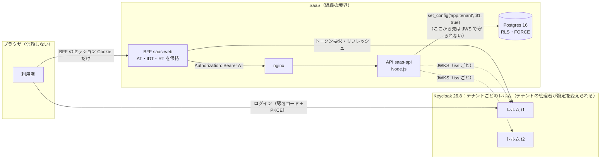

<!-- template_version: 0.1.0 -->
# 設計書（Lite）記入例：シナリオ A　マルチテナント SaaS（Keycloak 26.8）

> **記入例です。推奨ではありません。** ケーススタディ（jwt-claims-casestudy@080b8da）のシナリオ A の前提での一例で、自組織の判断の代わりに写さないでください。判断の正は同じディレクトリの `claims.yaml`・`token_types.yaml`・`catalog_answers.yaml` で、この文書はその読み物です。

- 版：0.1.4（#16 の縦の一本。0.1.4 は #17 の網羅の規則が求める節を `catalog_answers.yaml` に足した版。0.1.3 は #2 でカタログを全体に広げたのに合わせて、カタログへの回答を足した版。テンプレート（#4）ができる前に、#4 の節の順に沿って書いた。0.1.1 は PR #28 の独立レビューの 17 件を反映した版）
- **このケースは #4 の定義では Full です。** #4 の Lite の判定（5 問）のうち「マルチテナントか」が Yes なので、1 つでも Yes なら Full になります。縦の一本では、Lite の欄（#4 の 2・3・4・6・7・12 と台帳の必須列）がどれだけで書けるかを測るために、あえて Lite の欄で書きました。マルチテナントのレビューで要るクレームの鮮度の表と定義の寿命の欄（Full の欄）は書いていません。関門 1 の「Lite の記入時間」は、Full に当たるケースを Lite の欄で書いた時間になります（`research/template-design/gate1.md`）
- 関門 1（2026-11-22）の判定は「絞る」。見出しの〔〕は、`research/template-design/gate1.md` の「Lite の縮小案」での扱い（手で書く／生成／Full だけ）を示す。中身は消していない。共有クレームを足すときの追加前の 25 問（`claim_request_tenant_id.md`）は、縮小 Lite でも手で書く
- 作成方法：本資料は生成AI（Claude）を使って作成し、筆者が確認して公開しています。人による点検は未実施。作成とは別の LLM のセッションでレビューした（`research/reviews/scenario-a-2026-11-22.md`）

## 1. CI の結果　〔縮小 Lite：生成〕

```
$ python tools/claim_lint templates/examples/scenario-a
claim_lint  design=templates/examples/scenario-a  profile=full  claims=25  token_types=9  catalog_events=62
R3    info      idp       IdP keycloak の一覧（keycloak-settings・keycloak-grant-types）とカタログの差集合は 0 件
R3b   warn      I25       keycloak のこの発行で プロトコルマッパー が呼ばれるかは unknown（カタログ）。独自クレーム C-tenant-id・C-user-id・C-roles・C-v が載ることを確かめて hook_checked に書く
R3b   warn      I26       （I25 と同じ）
R6    info      pairwise  2 因子の組 13 個をすべて検討した（主体 1・発行イベント 4）
R8    info      AT        最悪 1258 バイト（ヘッダーの行で 1280）／上限 8192（nginx-large-client-header-buffers）= 16%
R8    info      C-iss     AT・IDT の両方に載る（重複の候補）  ほか info 3 件
error 0, warn 2, info 7
OK
```

## 2. 範囲と信頼の境界　〔縮小 Lite：手で書く〕

テナントごとに Keycloak のレルム（t1・t2）を分ける。ブラウザはトークンを持たず、BFF（saas-web）がサーバー側で AT・ID トークン・RT を持つ。API（saas-api）は AT をローカルで検証し、Postgres の行単位の制御（RLS）でテナントを絞る。入口のゲートウェイと内部トークンへの交換は置かない（ケーススタディの共通の前提との違い。`templates/casestudy-deviations.yaml` の `scenario_premises`）。



境界の要点：
- **テナントの管理者は、自分のレルムの中では全権を持つ。** マッパー（tenant_id・user_id・roles・Audience）、スコープのロールの割り当て、AT の寿命（accessTokenLifespan）を変えられる。そこで API は、テナントの外に効くものをトークンの値に頼らず、iss と API 側の設定で強制する。
  - どのテナントか：iss（許可リストとレルムごとの鍵）から対応表で引く。tenant_id とパスのテナントは、それと一致するかの照合だけに使う（ケーススタディ A8）
  - 寿命の上限：`exp − iat ≤ 300 秒` を API が検査する（exp と iat はどちらも発行者が書くので、時計のずれは足さない）。受け手の時計のずれは 30 秒まで許すので、AT の受け入れの最大は発行から 330 秒。この文書の「最大 330 秒」はこの値
  - ロール：語彙（approver・tenant-admin）と件数（2 件まで）を API が固定する
  - 利用者の識別子：BOLA の鍵は sub だけ。user_id は sub と一致しなければ拒否する
  - テナントの中で誰に何のロールを付けるかは、テナントの管理者の権限として受け入れる
- tenant_id（正確には iss から引いたテナント）は、API で DB のセッション変数に写した時点で、署名の保護の外に出る（`claims.yaml` の `integrity_until`）。以降は次で守る。
  - トランザクションごとに `set_config('app.tenant', $1, true)` をパラメータで呼ぶ（`SET LOCAL` は値をバインドできないので使わない）
  - RLS をすり抜ける主体を作らない：アプリのロール `app_rls` はテーブルの所有者ではなく、NOSUPERUSER・NOBYPASSRLS。テーブルは `FORCE ROW LEVEL SECURITY`（所有者にも効かせる）。所有者はマイグレーションのロールで、アプリからは使わない。ビューは作らないか、`security_invoker` で作る。所有者の権限で動く `SECURITY DEFINER` の関数も作らない（作るなら所有者を RLS の対象のロールにする）
  - 文脈が無いときは全件を拒否する：`app.tenant` が未設定（NULL・空文字）だと、ポリシー `tenant_id = current_setting('app.tenant', true)` に一致する行はない（tenant_id は NOT NULL、空文字は CHECK で禁止）
  - すべての SQL にもテナントの条件を付け、RLS と併用する（ケーススタディ A7）

## 3. 既定から外れた点　〔縮小 Lite：手で書く〕

| 点 | 既定（Keycloak・ケーススタディ） | この例 | 理由 |
| --- | --- | --- | --- |
| クライアントのスコープ | basic・roles・profile・email・acr・web-origins | basic だけ。組織のクレームはクライアントのマッパーで足す | AT に個人情報と Keycloak の形のロールを載せない。ケーススタディの既定のクライアントの AT は 1398 バイト（jwt-claims-casestudy@080b8da の `results/measurements.json` の `A.keycloak_token_bytes.alice`）、この例の構成の見本は 1045 バイト（`research/template-design/gate1.md`） |
| Full Scope Allowed | ON | OFF。スコープのロールは approver・tenant-admin だけ | 既定のロール（default-roles-t1・offline_access・uma_authorization）を AT に出さない（ケーススタディ keycloak.full_scope） |
| AT のヘッダーの typ | JWT | at+jwt（RFC 9068 のヘッダーの型を ON） | ID トークンを API に送る誤りを typ で拒否する。ただし Keycloak の AT は client_id を欠くので、RFC 9068 には適合しない（6.） |
| ログイン | ケーススタディの実験は ROPC | 認可コード＋PKCE | RFC 9700 §2.4 |
| 入口での交換 | ケーススタディの共通の前提は入口で内部トークンに交換 | 交換しない | 2. を参照 |
| SSO セッションの最大 | 確かめていない | 36000 秒（10 時間）に設定 | idle だけでは上限がない。slide:p08-token-types-lifetimes の Keycloak SSO の最大 10 時間に合わせた |

## 4. 発行方式の選択　〔縮小 Lite：生成（既定の組み合わせから外れた点だけ手で書く）〕

`token_types.yaml` の `issuance_profile` の要約。

| 項目 | 選択 | 理由（要約） |
| --- | --- | --- |
| クライアントの種類 | 機密（BFF） | ブラウザにトークンを置かない |
| クライアント認証 | client_secret_basic | ケーススタディのレルムのまま（筆者の提案） |
| grant | 認可コード＋PKCE、リフレッシュ | ROPC を使わない |
| 送信者制約 | なし | AT は BFF と API の間だけを通る（筆者の提案） |
| AT の形式 | JWT（at+jwt） | API がローカルで検証。テナントの停止は DB で要求ごとに確かめ、ロールの剥奪は 330 秒まで許す |
| RT の方式 | ローテーション | RFC 9700 §4.14.2 の要求は公開クライアントへのもので、機密の BFF には課されない。BFF から RT が漏れたときに古い RT を使えなくするために採る。再利用の検知は確かめていないので当てにしない |
| 要求の保護 | なし | 宛先は Audience マッパーで固定 |

## 5. トークン目録　〔縮小 Lite：生成〕

| ID | 種類 | 採否 | 発行 → 受け手 | 形式 | 寿命 | 保存場所 | 運び方 |
| --- | --- | --- | --- | --- | --- | --- | --- |
| AT | アクセストークン | 採用 | テナントのレルム → saas-api | JWT（at+jwt、RS256） | 300 秒（API が exp − iat を検査） | BFF のサーバー | Authorization: Bearer |
| IDT | ID トークン | 採用 | テナントのレルム → saas-web | JWT（RS256） | 300 秒 | BFF のサーバー（ログイン時だけ使う） | トークンの応答 |
| RT | リフレッシュトークン | 採用 | テナントのレルム → BFF | 不透明として扱う | idle 1800 秒、最大 36000 秒 | BFF のサーバー | トークンの応答 |
| CODE | 認可コード | 既定どおり | テナントのレルム → BFF | 不透明 | 60 秒（既定値は確かめていない） | なし | リダイレクトの query |
| BFFSESSION | BFF のセッション | 採用 | BFF → ブラウザ | 不透明 | idle 1800 秒、最大 36000 秒 | ブラウザの Cookie | Cookie |
| SSO | IdP のセッション | 採用（Session Max を設定） | Keycloak | 不透明 | idle 1800 秒、最大 36000 秒 | Keycloak | Keycloak の Cookie |
| LOGOUT | ログアウトトークン | 却下 | — | JWT | — | — | IdP 側のセッションの終了は、BFF のリフレッシュの失敗で検知する（最大 330 秒の遅れを許す） |
| DPOP | DPoP の proof | 却下 | — | JWT | — | — | 送信者制約を付けない |
| TXN | Txn-Token | 却下 | — | JWT | — | — | サービス間の伝搬がない |

## 6. 問い × 仕組み　〔縮小 Lite：手で書く〕

問いの文言は #3 の問いの一覧（案）による。選ばなかった問いには「不要」と理由を書いた。

| 問い | 使う仕組み | 検証する場所 | 不要の理由・前提 |
| --- | --- | --- | --- |
| 誰の権限で | `sub`。BOLA の鍵は sub だけ（請求書の owner_sub と照合）。名前空間の `user_id` は sub と一致しなければ拒否するだけ | saas-api | — |
| どのテナントで（A で加えた問い） | `iss` から対応表で引いたテナント。`tenant_id` とパスのテナントは一致の照合。DB は RLS（FORCE）とテナントの条件。テナントの停止は tenants.status を要求ごとに確かめる | saas-api、Postgres | — |
| 誰が代理して実行しているか | 不要 | — | 代理・委任がない。運用者の横断作業はこの例の範囲外 |
| どのワークロードが Txn-Token を求めたか | 不要 | — | Txn-Token を使わない |
| 直接の通信相手は誰か | 不要（ネットワークの制御に任せる） | — | BFF と API は同じ組織のネットワークの中。mTLS を入れるときに見直す |
| どの取引で、何をどの条件で | 不要 | — | RAR を使わない。承認の内容は DB で持つ |
| 誰が発行したか、信頼する発行者か | `iss` の許可リスト、iss ごとの JWKS、`alg` は RS256 だけ。JWKS のキャッシュは TTL 3600 秒。未知の kid の取り直しは iss ごとに最短 300 秒に 1 回、無い kid は 300 秒の負のキャッシュ。新しい鍵は署名に使う前に 3900 秒より長く公開する | saas-api | — |
| どの種類・目的のトークンか | ヘッダーの `typ: at+jwt` | saas-api | ペイロードの `typ`（Keycloak の Bearer）は使わない。Keycloak の AT は client_id を欠き RFC 9068 に適合しないので、RFC 9068 どおりの汎用の検証部品は使えない（`C-client-id`） |
| どの強さで、いつ認証されたか | 不要 | — | 認証の強さで操作を分けない（`acr` は却下。`auth_time` は載るが読まない） |
| 何が承認されたか、どこ向けか | `aud: saas-api`、名前空間の `roles`（語彙と件数を API が固定） | saas-api | `scope` は openid だけで、認可に使わない |
| 誰が持つべきか | 不要 | — | 送信者制約なし（4.） |
| 今も有効か | `exp`（300 秒。exp − iat も検査）。テナントの停止は DB で要求ごと。利用者の無効化・IdP のセッションの終了は BFF のリフレッシュの失敗（最大 330 秒） | saas-api、BFF | ロールの剥奪の反映は最大 330 秒を許す |

## 7. シーケンス図　〔Full だけ〕

矢印の `[I..]`・`[U..]` は `templates/catalog/` のイベント ID。

```mermaid
sequenceDiagram
  autonumber
  participant U as ブラウザ
  participant BFF as BFF saas-web
  participant KC as Keycloak（レルム t1）
  participant API as saas-api
  participant DB as Postgres
  U->>BFF: ログインを始める
  BFF->>U: 認可要求へリダイレクト（PKCE S256、nonce）
  U->>KC: ログイン [I01]
  KC->>U: 認可コード（CODE）
  U->>BFF: 認可コード
  BFF->>KC: トークン要求（code_verifier） [I01]
  KC->>BFF: AT・IDT・RT
  BFF->>BFF: ID トークンを検証、nonce を照合 [U03]
  BFF->>U: BFF のセッション Cookie
  U->>BFF: 請求書の一覧
  BFF->>API: Authorization: Bearer AT [U01]
  API->>KC: 未知の kid なら JWKS を取り直す（iss ごとに最短 300 秒に 1 回） [U09]
  API->>API: alg・typ・iss・aud・exp・exp−iat・必須クレーム。iss からテナントを引き、tenant_id・パスと照合。roles の語彙と件数、user_id = sub
  API->>DB: BEGIN; SELECT set_config('app.tenant', $1, true); tenants.status を確認; SELECT … WHERE tenant_id = $1（RLS） [U02]
  DB->>API: 自テナントの行だけ
  API->>BFF: 結果
  BFF->>KC: 期限の前に RT で取り直す [U04][I02]
  KC->>BFF: 新しい AT・IDT・RT（RT はローテーション）。失敗したら BFF はセッションを終える
  U->>BFF: ログアウト
  BFF->>KC: RP-Initiated Logout（id_token_hint） [U06]
```

カタログで「対象外」にしたイベント（50 件。v0 の I03〜I09・U05・U07・U08・U10 と、#2 で足した 38 件、#17 で足した I34）は、この図に出さない。#2 で足した「該当」のうち、I25・I26 は I01 と同じ発行なので [I01] の矢印で表し、U14（ログ）・U27（401 の応答）は図を簡単にするため省いた。前提と崩れる条件は `catalog_answers.yaml` にある。

## 8. ホップごとの表　〔縮小 Lite：生成（交換・作り直しのホップがあれば手で書く）〕

「下流は上流を超えない」を規則とする（slide:p06-narrow-downstream）。この例では交換がないので、トークンの付け替えはなく、DB へは AT を渡さずにテナントの値だけを渡す。

| ホップ | 運ぶもの | aud | scope | 寿命 | 運ぶ独自クレーム | 検証・照合する場所 |
| --- | --- | --- | --- | --- | --- | --- |
| H1 ブラウザ → BFF | BFFSESSION（Cookie） | — | — | idle 1800 秒、最大 36000 秒 | なし | BFF |
| H2 BFF → saas-api | AT | saas-api | openid | 300 秒 | tenant_id・user_id・roles・v | saas-api |
| H3 saas-api → Postgres | トークンなし。app.tenant（set_config の第 3 引数 true）、DB のロール app_rls | — | — | 1 トランザクション | iss から引いたテナントの値だけ | Postgres の RLS（FORCE） |

H3 は H2 の部分集合（テナントだけ）で、上流を超えていない。

## 9. ライフサイクル表　〔縮小 Lite：手で書く〕

| 種類・層 | 寿命 | リフレッシュ | RT のローテーション・再利用の検知 | 失効の手段 | 剥奪が反映されるまで | 長時間の処理 |
| --- | --- | --- | --- | --- | --- | --- |
| AT | 300 秒（API が exp − iat ≤ 300 を検査。受け入れは最大 330 秒） | BFF が RT で取り直す（I02。マッパーが再実行される） | — | なし（ローカル検証。exp まで残る） | テナントの停止は 0 秒（DB）。ロールの剥奪は最大 330 秒 | 非同期の処理に AT を渡さない |
| IDT | 300 秒 | リフレッシュの応答にも出る | — | 保存しない | ログイン時だけ使う | — |
| RT | idle 1800 秒、最大 36000 秒（SSO の最大） | 使うたびに新しい RT | ローテーションあり。再利用の検知は確かめていない | ログアウト（U06）、SSO セッションの終了 | ログアウトの直後 | — |
| CODE | 60 秒（確かめていない） | — | — | 1 回の使用で無効 | — | — |
| BFFSESSION | idle 1800 秒、最大 36000 秒 | 操作で idle を延長 | — | ログアウトで削除。RT のリフレッシュが失敗したら終える | ログアウトの直後。IdP 側の終了・利用者の無効化は次のリフレッシュまで（最大 330 秒） | — |
| SSO セッション | idle 1800 秒、最大 36000 秒（SSO Session Max を設定） | 利用で延長 | — | ログアウト、管理者による削除 | ログアウトの直後。発行済みの AT は残る（ケーススタディ keycloak.logout_introspection：JWT は最小 299 秒残った） | — |
| DB の接続 | プールの設定による（トークンより長い） | — | — | — | 文脈はトランザクションごとに set_config（第 3 引数 true）で設定し直し、コミットで消える。未設定なら RLS が全件を拒否する（ケーススタディ A7） | — |

## 10. 判断の行（要約）　〔縮小 Lite：生成〕

判断の正は `claims.yaml`（25 行：採用 14・既定どおり 5・却下 6）。表の生成は #19 なので、ここには要点だけを書く。

| 行 | 採否 | 理由の要点 |
| --- | --- | --- |
| C-iss | 採用 | テナントを決める。許可リストとレルムごとの鍵 |
| C-tenant-id | 採用 | iss から引いたテナントとの照合用の写し。ケーススタディの共通の基準（A5・A8・A11・A12） |
| C-sub | 採用 | BOLA の唯一の鍵 |
| C-user-id | 採用 | sub と一致を確かめるだけ。認可の鍵にしない |
| C-roles | 採用（最大 2 件） | 粗いロールだけ。語彙と件数は API が固定 |
| C-auth-time・C-typ-claim・C-sid・C-azp・C-scope | 既定どおり | Keycloak が外せない（公式文書の軽量アクセストークンの記述からの推論）、または外す費用に見合わない。API は azp 以外を読まない |
| C-client-id | 却下 | Keycloak の AT に無い。azp で読む。そのため AT は RFC 9068 に適合しない |
| C-realm-access・C-preferred-username・C-acr・C-allowed-origins・C-idp | 却下 | Keycloak の形を受け手に読ませない、変わる名前を使わない、用途がない |

ケーススタディの判定と違う行（8 件）は `templates/casestudy-deviations.yaml` にある。

## 11. カタログへの回答　〔縮小 Lite：生成〕

`catalog_answers.yaml`：全 62 件に回答。対象外 50 件／全 62 件（81%）。#2 でカタログを全体に広げる前の 19 件（v0）では、対象外 11 件／19 件（58%）だった。

#17 の網羅の規則のために、同じファイルに次の節を足した（中身は `catalog_answers.yaml` の各節のコメント）。

| 節 | 規則 | 中身 |
| --- | --- | --- |
| `idp` | R3・R3b | Keycloak 26.8。トークン端点の grant の一覧（`keycloak-grant-types`）とカタログの差集合を R3 が確かめる |
| `subject_states` | R4 | 7 状態 × 5 層（AT・RT・ID・IdP のセッション・BFF のセッション）の 35 セル。内部トークンと Logout Token は使わない層として理由を書いた |
| `pairwise` | R6 | 主体の種類は利用者だけが該当（ワークロード・システムは対象外）。該当の発行 I01・I02・I25・I26 と段階 ①② の組み合わせ 7 つ |
| `outside_enumeration` | R9 | 境界の図・ライフサイクル表（Lite で手で書く節）・Keycloak の文書と grant の一覧・先行の一覧を探した。新しい契機はなく、発行の中身が変わる場面を 1 つ found に書いた |

R3b の warn 2 件（I25・I26）は残している。カタログで Keycloak の `hook_invoked` が unknown で、実物で確かめていないため（12. の自信のない点と同じ扱い）。

## 12. 書き手が自信のない点　〔縮小 Lite：手で書く〕

- Keycloak の古い RT を再利用したときに、セッションまで失効させるか（再利用の検知）を確かめていない。
- 初回ログイン（I25）とパスワードの変更の後の発行（I26）で、マッパーが呼ばれるかを確かめていない（カタログでも unknown。claim_lint の R3b の warn）。
- jti の接頭辞（見本では onrtac）が、リフレッシュなど別の発行で同じ長さかを確かめていない。R8 の max_bytes 43 はこの前提による。
- ID トークンは見本で発行していない。ID トークンのクレームの構成（name・email・email_verified のマッパー）は設計で、実物で確かめていない。
- 認可コードの寿命 60 秒、SSO Session Max の既定値、ユーザープロファイルの属性の長さの上限は、Keycloak 26.8 の値を確かめていない。
- typ・sid・azp・scope を「通常の AT でも外せない」とするのは、軽量アクセストークンについての公式文書の記述からの推論。
- JWKS の取り直しの間隔（300 秒）、負のキャッシュ、キャッシュの TTL（3600 秒）は筆者の提案で、一次資料では確かめていない。Keycloak が passive の鍵を JWKS に載せるか（鍵の入れ替えの手順の前提）も確かめていない。
- BFF は 2 つのレルムのクライアントなので、認可応答の取り違え（mix-up）を防ぐために、レルムごとに redirect_uri を分ける（RFC 9207 の `iss` の照合は、Keycloak の対応を確かめていない）。
- other_headers_bytes 2048 は見積もり（筆者の提案）。実際の要求のヘッダーを測っていない。

## 13. 前の版との差分

- 0.1.4：#17 の網羅の規則（R3・R3b・R4・R6・R9）が求める節（`idp`・`subject_states`・`pairwise`・`outside_enumeration`）を `catalog_answers.yaml` に足した。PR #33 の独立点検で、カタログに I34（OID4VCI）が足されたので対象外で答え、R9 の探した範囲から Full だけの節（シーケンス図）を外し、停止の RT の根拠を「拒否による実質の失効」と書き直した。1. の CI の結果と 11. を直した
- 0.1.3：#2 でカタログが 19 件から 61 件（発行 33・利用 28）になったので、足した 42 件に回答した（該当 4 件：I25・I26・U14・U27、対象外 38 件）。11. の件数と 7. の注記を直した
- 0.1.2：PR #28 の再点検の指摘を反映した（C-scope の根拠、JWKS のキャッシュの TTL と鍵の入れ替えの手順、受け入れの上限 330 秒の書き方、SECURITY DEFINER、SSO の採否、exp − iat の書き方）
- 0.1.1：PR #28 の独立レビュー（Major 4・Minor 13）を反映した。テナントの管理者の権限の前提と API 側の強制（A01）、BOLA の鍵を sub に一本化（A02）、Back-Channel Logout の却下の理由と代わりの手段（A03）、RLS をすり抜ける主体（A04）、テナントを iss で決める（A05）、ほか 12 件。指摘ごとの直し方は `research/reviews/scenario-a-2026-11-22.md`
- 0.1.0：初版
