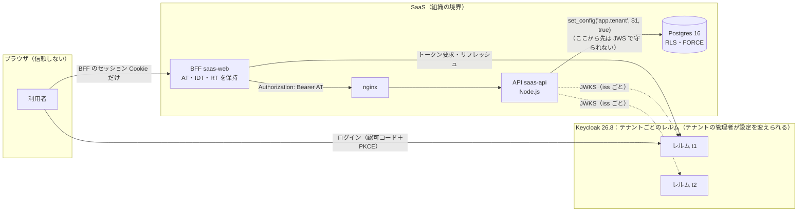
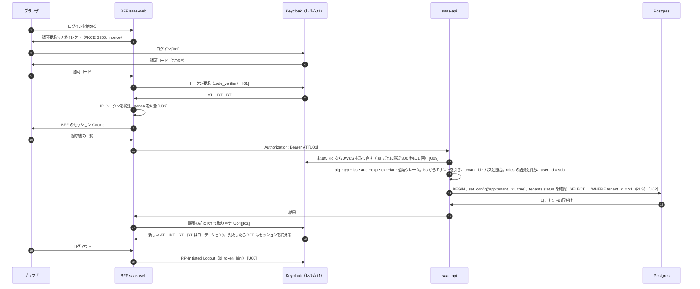

<!-- template_version: 0.2.0 -->
# 設計書（Lite）記入例：シナリオ A　マルチテナント SaaS（Keycloak 26.8）

> **記入例です。推奨ではありません。** ケーススタディ（jwt-claims-casestudy@080b8da）のシナリオ A の前提での一例で、自組織の判断の代わりに写さないでください。判断の正は同じディレクトリの `claims.yaml`・`token_types.yaml`・`hops.yaml`・`catalog_answers.yaml` で、この文書はその読み物です。

- **生成の区間**：`<!-- render:<節>:begin -->` と `<!-- render:<節>:end -->` の間は、`python tools/claim_lint render templates/examples/scenario-a --write` が台帳から書き直す（#19、`tools/claim_lint/RENDER.md`）。手で直さず、台帳を直してから生成し直す。CI は `render --check` で、区間が台帳から生成し直したものと違えば失敗する。区間の外は手で書く
- 版：0.2.3（#18 の目的と仕組みの規則が求める宣言を足した版）。0.2.2 は #6 の意味の規則が求める宣言を足した版。0.2.1 は #19 で生成の区間に置き換えた版（前の版は 0.2.0）。0.2.0 は #3 の台帳 v1 に移し替えた版（前の版は 0.1.4。#16 の縦の一本。0.1.4 は #17 の網羅の規則が求める節を `catalog_answers.yaml` に足した版。0.1.3 は #2 でカタログを全体に広げたのに合わせて、カタログへの回答を足した版。テンプレート（#4）ができる前に、#4 の節の順に沿って書いた。0.1.1 は PR #28 の独立レビューの 17 件を反映した版）
- **このケースは #4 の定義では Full です。** #4 の Lite の判定（5 問）のうち「マルチテナントか」が Yes なので、1 つでも Yes なら Full になります。縦の一本では、Lite の欄（#4 の 2・3・4・6・7・12 と台帳の必須列）がどれだけで書けるかを測るために、あえて Lite の欄で書きました。マルチテナントのレビューで要るクレームの鮮度の表と定義の寿命の欄（Full の欄）は書いていません。関門 1 の「Lite の記入時間」は、Full に当たるケースを Lite の欄で書いた時間になります（`research/template-design/gate1.md`）
- 関門 1（2026-11-22）の判定は「絞る」。見出しの〔〕は、`research/template-design/gate1.md` の「Lite の縮小案」での扱い（手で書く／生成／Full だけ）を示す。中身は消していない。共有クレームを足すときの追加前の 25 問（`claim_request_tenant_id.md`・`claim_request_user_id.md`・`claim_request_roles.md`・`claim_request_v.md`。#4 で後の 3 つを足した）は、縮小 Lite でも手で書く
- 作成方法：本資料は生成AI（Claude）を使って作成し、筆者が確認して公開しています。人による点検は未実施。作成とは別の LLM のセッションでレビューした（`research/reviews/scenario-a-2026-11-22.md`）

## 1. CI の結果　〔縮小 Lite：生成〕

<!-- render:ci-result:begin -->
`python tools/claim_lint templates/examples/scenario-a --also-scan templates/examples/scenario-a/design.md`（profile full）：**error 0、warn 3、info 6**（claims 26・token_types 18・catalog_events 62）。OK

| 規則 | 重大度 | 対象 | 内容 |
| --- | --- | --- | --- |
| `R3` | info | `idp` | IdP keycloak の一覧（keycloak-settings・keycloak-grant-types）とカタログの差集合は 0 件 |
| `R3b` | warn | `I25` | keycloak のこの発行で プロトコルマッパー が呼ばれるかは unknown（カタログ）。独自クレーム C-tenant-id・C-user-id・C-roles・C-v が載ることを確かめて hook_checked に書く |
| `R3b` | warn | `I26` | keycloak のこの発行で プロトコルマッパー が呼ばれるかは unknown（カタログ）。独自クレーム C-tenant-id・C-user-id・C-roles・C-v が載ることを確かめて hook_checked に書く |
| `R6` | info | `pairwise` | 2 因子の組 13 個をすべて検討した（主体 1・発行イベント 4） |
| `R8` | info | `AT` | 最悪 1258 バイト（ヘッダーの行で 1280）／上限 8192（nginx-large-client-header-buffers）= 16% |
| `L1b` | info | `C-typ-claim` | IdP が既定で出す私的名 typ（名前空間なし・未登録）。名前を決めたのは IdP で、受け手は読まない（consumers が空）ので error にしない。読む受け手を足すなら組織の名前空間に写す |
| `L2` | info | `idp` | IdP keycloak の、書き換えを許さないクレームの一覧が tools/claim_lint/idp_reserved.yaml にない。L2 は確かめていない（IdP モジュール #4 で手で確かめる） |
| `L27` | info | `token_type AT` | at+jwt の REQUIRED の client_id（RFC 9068 §2.2）が無いことを、台帳の却下の行で逸脱として記録している |
| `L11` | warn | `C-scope` | AT に scope を載せるのに、認可の判断に使う宣言（enforced_at）がない。載せるなら判断に使い、使わないなら載せない（OWASP ASVS 5.0.0 10.3.2） |

R8 AT：ヘッダー 86・ペイロード 599・署名 256 バイト（ceil(4/3*86) + ceil(4/3*599) + ceil(4/3*256) + 2 = 115 + 799 + 342 + 2 = 1258; + 7 (Bearer) = 1265）。nginx-large-client-header-buffers 1280／8192 バイト、nodejs-max-http-header-size 3328／16384 バイト
<!-- render:ci-result:end -->

## 2. 範囲と信頼の境界　〔縮小 Lite：手で書く〕

テナントごとに Keycloak のレルム（t1・t2）を分ける。ブラウザはトークンを持たず、BFF（saas-web）がサーバー側で AT・ID トークン・RT を持つ。API（saas-api）は AT をローカルで検証し、Postgres の行単位の制御（RLS）でテナントを絞る。入口のゲートウェイと内部トークンへの交換は置かない（ケーススタディの共通の前提との違い。`templates/casestudy-deviations.yaml` の `scenario_premises`）。

境界の要点：
- **テナントの管理者は、自分のレルムの中では全権を持つ。** マッパー（tenant_id・user_id・roles・Audience）、スコープのロールの割り当て、AT の寿命（accessTokenLifespan）を変えられる。そこで API は、テナントの外に効くものをトークンの値に頼らず、iss と API 側の設定で強制する。
  - どのテナントか：iss（許可リストとレルムごとの鍵）から対応表で引く。tenant_id とパスのテナントは、それと一致するかの照合だけに使う（ケーススタディ A8）
  - 寿命の上限：`exp − iat ≤ 300 秒` を API が検査する（exp と iat はどちらも発行者が書くので、時計のずれは足さない）。受け手の時計のずれは 30 秒まで許すので、AT の受け入れの最大は発行から 330 秒。この文書の「最大 330 秒」はこの値
  - ロール：語彙（approver・tenant-admin）と件数（2 件まで）を API が固定する
  - 利用者の識別子：BOLA の鍵は sub だけ。user_id は sub と一致しなければ拒否する
  - テナントの中で誰に何のロールを付けるかは、テナントの管理者の権限として受け入れる
- tenant_id（正確には iss から引いたテナント）は、API で DB のセッション変数に写した時点で、署名の保護の外に出る（`claims.yaml` の `integrity_until`）。以降は次で守る。
  - トランザクションごとに `set_config('app.tenant', $1, true)` をパラメータで呼ぶ（`SET LOCAL` は値をバインドできないので使わない）
  - RLS をすり抜ける主体を作らない：アプリのロール `app_rls` はテーブルの所有者ではなく、NOSUPERUSER・NOBYPASSRLS。テーブルは `FORCE ROW LEVEL SECURITY`（所有者にも効かせる）。所有者はマイグレーションのロールで、アプリからは使わない。ビューは作らないか、`security_invoker` で作る。所有者の権限で動く `SECURITY DEFINER` の関数も作らない（作るなら所有者を RLS の対象のロールにする）
  - 文脈が無いときは全件を拒否する：`app.tenant` が未設定（NULL・空文字）だと、ポリシー `tenant_id = current_setting('app.tenant', true)` に一致する行はない（tenant_id は NOT NULL、空文字は CHECK で禁止）
  - すべての SQL にもテナントの条件を付け、RLS と併用する（ケーススタディ A7）

## 3. 既定から外れた点　〔縮小 Lite：手で書く〕

| 点 | 既定（Keycloak・ケーススタディ） | この例 | 理由 |
| --- | --- | --- | --- |
| クライアントのスコープ | basic・roles・profile・email・acr・web-origins | basic だけ。組織のクレームはクライアントのマッパーで足す | AT に個人情報と Keycloak の形のロールを載せない。ケーススタディの既定のクライアントの AT は 1398 バイト（jwt-claims-casestudy@080b8da の `results/measurements.json` の `A.keycloak_token_bytes.alice`）、この例の構成の見本は 1045 バイト（`research/template-design/gate1.md`） |
| Full Scope Allowed | ON | OFF。スコープのロールは approver・tenant-admin だけ | 既定のロール（default-roles-t1・offline_access・uma_authorization）を AT に出さない（ケーススタディ keycloak.full_scope） |
| AT のヘッダーの typ | JWT | at+jwt（RFC 9068 のヘッダーの型を ON） | ID トークンを API に送る誤りを typ で拒否する。ただし Keycloak の AT は client_id を欠くので、RFC 9068 には適合しない（6.） |
| ログイン | ケーススタディの実験は ROPC | 認可コード＋PKCE | RFC 9700 §2.4 |
| 入口での交換 | ケーススタディの共通の前提は入口で内部トークンに交換 | 交換しない | 2. を参照 |
| クライアントの任意のスコープ | address・phone・offline_access・organization・microprofile-jwt（Keycloak 26.8.0 で clientId だけで作ったクライアントの実測、2026-11-23、#30） | なし | オフラインの RT を出さない（カタログの I08 は対象外）。既定のロール（default-roles-t1）には offline_access が残る（同じ実測）ので、スコープを外して止める。`claim_lint drift` の D11 が、スコープが戻ったら検出する |
| SSO セッションの最大 | 36000 秒（Keycloak 26.8.0 の新しいレルムの実測、2026-11-23、#30） | 36000 秒（10 時間）。既定と同じ値を、レルムの設定に明示する | idle だけでは上限がない。slide:p08-token-types-lifetimes の Keycloak SSO の最大 10 時間に合わせた。既定から外れた点ではないが、テナントの管理者が延ばしたときに `claim_lint drift`（D5）で検出できるように、値を台帳と設定の両方に書く |

## 4. 発行方式の選択　〔縮小 Lite：生成（既定の組み合わせから外れた点だけ手で書く）〕

<!-- render:issuance-profile:begin -->
`token_types.yaml` の `issuance_profile`。既定の組み合わせから外れた点の理由は、手で書く節（既定から外れた点）に書く。

| 項目 | 選択 | 理由 | 根拠 |
| --- | --- | --- | --- |
| クライアントの種類 | 機密（`confidential`） | ブラウザにトークンを置かず、サーバー側の BFF（saas-web）がトークンを持つ | `slide:p06-flow-browser-to-db` |
| クライアント認証 | `client_secret_basic` | ケーススタディのレルムと同じ（クライアントシークレット）。private_key_jwt に替えると、鍵の管理の行が増える | 筆者の提案：縦の一本ではケーススタディのクライアント認証をそのまま使う（#16） |
| grant | 認可コード＋PKCE（`authorization_code_pkce`）、リフレッシュ（`refresh_token`） | 利用者のログインは認可コード＋PKCE（S256）。ROPC は使わない | [RFC 9700 §2.1.1](https://www.rfc-editor.org/rfc/rfc9700#section-2.1.1) [RFC 9700 §2.4](https://www.rfc-editor.org/rfc/rfc9700#section-2.4) |
| 送信者制約 | なし（`none`） | AT は BFF のサーバーと API の間でだけ運ばれ、ブラウザに出ない。盗用の経路が BFF と API のサーバーの侵害に限られる | 筆者の提案：BFF の構成ではシナリオ A の AT に送信者制約を付けない（#16） |
| AT の形式 | JWT（`jwt`） | API がローカルで検証する（RFC 9068 の at+jwt）。剥奪の反映は、受け入れの上限 330 秒（寿命 300 秒＋受け手の時計のずれ 30 秒）までを許す | [RFC 9068 §2.1](https://www.rfc-editor.org/rfc/rfc9068#section-2.1) |
| RT の方式 | ローテーション（`rotation`） | レルムの Revoke Refresh Token を有効にしてローテーションする。RFC 9700 §4.14.2 のローテーションの要求は公開クライアントへのもので、機密クライアントの BFF には課されない（クライアント認証で RT の利用者を縛れるため）。それでも採るのは、BFF の保存場所から RT が漏れたとき、古い RT が次のリフレッシュで使えなくなるため。古い RT の再利用でセッションまで失効させるか（再利用の検知）は確かめていないので、検知による守りは当てにしない | [RFC 9700 §4.14.2](https://www.rfc-editor.org/rfc/rfc9700#section-4.14.2) `slide:p08-rotation` |
| 要求の保護 | なし | PAR・JAR・RAR・resource indicators は使わない。宛先は Audience マッパーで固定する | — |
| 適合のプロファイル | なし（`none`） | 規制の対象（FAPI など）ではない | — |

選択から導かれる要件（`templates/registry/issuance_effects.yaml`）：条件が成り立つ行は 0 件／全 13 件（成り立たない行：E-dpop・E-mtls・E-mtls-entry・E-opaque・E-phantom・E-client-credentials・E-token-exchange・E-rar・E-rt-sender-constrained・E-fapi-no-rotation・E-public-no-sender-constraint・E-public-pkce・E-fapi2）。
<!-- render:issuance-profile:end -->

## 5. トークン目録　〔縮小 Lite：生成〕

<!-- render:token-inventory:begin -->
`token_types.yaml` の 18 行（却下 12）。種類の名前は `templates/catalog/token_kinds.yaml`。

| ID | 種類 | 採否 | 発行 → 宛先（aud） | 持ち手 | 形式 | 寿命 | 保存場所 | 運び方 | 読める相手 | JWE | 理由 |
| --- | --- | --- | --- | --- | --- | --- | --- | --- | --- | --- | --- |
| `AT` | アクセストークン | 採用 | テナントのレルム（Keycloak） → saas-api | BFF（saas-web のサーバー） | jwt（at+jwt、RS256） | 300 秒（時計のずれ 30 秒） | BFF のサーバー | Authorization: Bearer | `bff`・`api`・`hop:nginx` | なし | API（saas-api）の認可に使う |
| `IDT` | ID トークン | 採用 | テナントのレルム（Keycloak） → saas-web | BFF（saas-web のサーバー）。ブラウザには渡さない | jwt（JWT、RS256） | 300 秒（時計のずれ 30 秒） | BFF のサーバー | トークンの応答 | `bff` | なし | BFF がログインを確かめ、画面の表示名を得る |
| `RT` | リフレッシュトークン | 採用 | テナントのレルム（Keycloak） → テナントのレルム（自分自身） | BFF（saas-web のサーバー） | opaque | idle 1800 秒、最大 36000 秒 | BFF のサーバー | トークンの応答 | `bff`・`idp` | — | AT を 300 秒にしたまま、SSO セッションの間は利用者に再ログインさせない |
| `CODE` | 認可コード | 既定どおり | テナントのレルム（Keycloak） → — | ブラウザを経由して BFF へ | opaque | 60 秒 | なし | リダイレクトの query | `browser`・`bff`・`idp` | — | 認可コード＋PKCE の流れで Keycloak が出す |
| `BFFSESSION` | セッション（IdP のセッション session_idp と、RP・BFF のセッション session_rp の 2 層） | 採用 | BFF（saas-web） → — | ブラウザ（HttpOnly・Secure・SameSite=Lax の Cookie） | opaque | idle 1800 秒、最大 36000 秒 | ブラウザ | Cookie | `browser`・`bff` | — | ブラウザは BFF のセッションの Cookie だけを持つ。トークンをブラウザに置かない |
| `SSO` | セッション（IdP のセッション session_idp と、RP・BFF のセッション session_rp の 2 層） | 採用 | テナントのレルム（Keycloak） → — | Keycloak（ブラウザには Keycloak の Cookie） | opaque | idle 1800 秒、最大 36000 秒 | IdP | Cookie | `browser`・`idp` | — | Keycloak の SSO セッション（レルムの設定）。SSO Session Max は既定（36000 秒。Keycloak 26.8.0 の実測、#30）と同じ値を、レルムの設定に明示する（design.md の 3.） |
| `LOGOUT` | ログアウトトークン（Back-Channel Logout の Logout Token） | 却下 | — | — | jwt | — | — | — | — | — | IdP 側でセッションが終わったこと（管理者による削除、利用者の無効化、レルムの無効化）は、BFF が次に RT でリフレッシュするときの失敗で検知し、BFF は自分のセッションを終える。AT の寿命が 300 秒なので、要求が続く利用者では最大 330 秒で反映する。要求の無い利用者は次の要求で反映する。300 秒の遅れを許すので、ログアウトトークンを受ける公開の受け口と、その検証を作らない |
| `DPOP` | DPoP の proof | 却下 | — | — | jwt | — | — | — | — | — | 送信者制約を付けない（issuance_profile.sender_constraint） |
| `TXN` | Transaction Token（Txn-Token） | 却下 | — | — | jwt | — | — | — | — | — | この例は BFF → API → DB の 1 段で、サービス間の伝搬がない |
| `INTERNAL` | 内部トークン（入口で外部のトークンを検証し、作り直したもの） | 却下 | — | — | jwt | — | — | — | — | — | 入口（nginx）はトークンを作り直さず、saas-api が Keycloak の AT をそのまま検証する（design.md の 2.） |
| `IDJAG` | ID-JAG（Identity Assertion JWT Authorization Grant） | 却下 | — | — | jwt | — | — | — | — | — | ドメインをまたぐ SSO 済みの利用者のトークンを受けない |
| `CLIENTASSERTION` | クライアントの assertion（private_key_jwt・client_secret_jwt） | 却下 | — | — | jwt | — | — | — | — | — | BFF のクライアント認証は client_secret_basic（issuance_profile.client_auth）で、assertion を作らない |
| `JAR` | 署名つきの認可要求（JAR の Request Object） | 却下 | — | — | jwt | — | — | — | — | — | 認可要求に署名しない（issuance_profile.request_protection は空） |
| `JARM` | 署名つきの認可応答（JARM） | 却下 | — | — | jwt | — | — | — | — | — | 認可応答を JWT にしない。応答は BFF のサーバーが受ける |
| `WORKLOADJWT` | 汎用の JWT（ワークロードの ID のトークン・アサーショングラントに出す JWT など） | 却下 | — | — | jwt | — | — | — | — | — | ワークロードの ID のトークンやアサーショングラントの JWT を使わない |
| `SET` | Security Event Token（SET。SSF・CAEP の通知） | 却下 | — | — | jwt | — | — | — | — | — | Keycloak から SET を受けない。剥奪と利用者の無効化は最大 330 秒の遅れを許す |
| `STATUSLIST` | 状態リストのトークン（Token Status List） | 却下 | — | — | jwt | — | — | — | — | — | 状態リストを出さない。失効は AT の短い寿命と DB の確認で扱う |
| `INTROSPECTIONJWT` | JWT 形式のイントロスペクションの応答 | 却下 | — | — | jwt | — | — | — | — | — | イントロスペクションを使わない（at_format は jwt）ので、JWT 形式の応答も受けない |
<!-- render:token-inventory:end -->

AT は BFF・API・経路の nginx が読め、IDT は BFF だけが読む。JWE はどの種類でも使わない。却下の行の前提と崩れる条件は、`token_types.yaml` の各行と、その種類を出す発行イベントへのカタログの回答（11.）にある。

## 6. 問い × 仕組み　〔縮小 Lite：手で書く〕

問いの文言は #3 の本文の問いの一覧（案）による。選ばなかった問いには「不要」と理由を書いた。台帳 v1 の問いの一覧（`templates/registry/questions.yaml`）は、文言をスライドに合わせたので、この表の文言と一部違う（例：「何が承認されたか、どこ向けか」は「何が承認されたか」と「どのリソース向けか」の 2 行。スライドに文言のない「誰が発行したか」「どの種類・目的のトークンか」「どの強さで、いつ認証されたか」「今も有効か」は pending）。表を questions.yaml の文言で作り直すのは #4（テンプレート）で行う。

| 問い | 使う仕組み | 検証する場所 | 不要の理由・前提 |
| --- | --- | --- | --- |
| 誰の権限で | `sub`。BOLA の鍵は sub だけ（請求書の owner_sub と照合）。名前空間の `user_id` は sub と一致しなければ拒否するだけ | saas-api | — |
| どのテナントで（A で加えた問い） | `iss` から対応表で引いたテナント。`tenant_id` とパスのテナントは一致の照合。DB は RLS（FORCE）とテナントの条件。テナントの停止は tenants.status を要求ごとに確かめる | saas-api、Postgres | — |
| 誰が代理して実行しているか | 不要 | — | 代理・委任がない。運用者の横断作業はこの例の範囲外 |
| どのワークロードが Txn-Token を求めたか | 不要 | — | Txn-Token を使わない |
| 直接の通信相手は誰か | 不要（ネットワークの制御に任せる） | — | BFF と API は同じ組織のネットワークの中。mTLS を入れるときに見直す |
| どの取引で、何をどの条件で | 不要 | — | RAR を使わない。承認の内容は DB で持つ |
| 誰が発行したか、信頼する発行者か | `iss` の許可リスト、iss ごとの JWKS、`alg` は RS256 だけ。JWKS のキャッシュは TTL 3600 秒。未知の kid の取り直しは iss ごとに最短 300 秒に 1 回、無い kid は 300 秒の負のキャッシュ。新しい鍵は署名に使う前に 3900 秒より長く公開する | saas-api | — |
| どの種類・目的のトークンか | ヘッダーの `typ: at+jwt` | saas-api | ペイロードの `typ`（Keycloak の Bearer）は使わない。Keycloak の AT は client_id を欠き RFC 9068 に適合しないので、RFC 9068 どおりの汎用の検証部品は使えない（`C-client-id`） |
| どの強さで、いつ認証されたか | 不要 | — | 認証の強さで操作を分けない（`acr` は却下。`auth_time` は載るが読まない） |
| 何が承認されたか、どこ向けか | `aud: saas-api`、名前空間の `roles`（語彙と件数を API が固定） | saas-api | `scope` は openid だけで、認可に使わない |
| 誰が持つべきか | 不要 | — | 送信者制約なし（4.） |
| 今も有効か | `exp`（300 秒。exp − iat も検査）。テナントの停止は DB で要求ごと。利用者の無効化・IdP のセッションの終了は BFF のリフレッシュの失敗（最大 330 秒） | saas-api、BFF | ロールの剥奪の反映は最大 330 秒を許す |

次の表は、上の手で書いた表の確かめ用に、台帳の `answers`・`does_not_answer` から生成したもの（〔生成〕）。台帳の行に `answers` が無い問いは空になる。手で書いた表と食い違えば、どちらかを直す。

<!-- render:question-mechanism:begin -->
`templates/registry/questions.yaml` の問いごとに、台帳の `answers`・`does_not_answer` を引いた。「不要」の理由は台帳に列がないので、手で書く表に書く。

| ID | 問い | 問いの一覧の仕組み | 答える台帳の行（answers） | 答えに使わない行（does_not_answer） | 照合する場所 |
| --- | --- | --- | --- | --- | --- |
| `q-sub` | 誰の権限で | `sub` | `sub` | — | `saas-api`・`saas-web` |
| `q-actor` | 誰が代理して実行しているか | `act` | — | — | — |
| `q-req-wl` | どのワークロードが Txn-Token を求めたか | `req_wl` | — | — | — |
| `q-peer` | 直接の通信相手は誰か | `mTLS の相手の ID（SPIFFE の X.509-SVID など）` | — | — | — |
| `q-via` | どこを経由したか | `経由を示す別の属性（AWS FAS の aws:CalledVia に当たるもの）`・`ネストした act` | — | — | — |
| `q-txn` | どの取引か | `txn` | — | — | — |
| `q-user` | 誰が利用者か | `iss と sub の組` | `iss` | — | `saas-api`・`saas-web` |
| `q-agent` | どのエージェント・クライアントか | `client_id`・`azp`・`act.sub`・`req_wl` | `azp` | — | `saas-api` |
| `q-authorized` | 何が承認されたか | `scope`・`authorization_details`・`acr・amr・auth_time` | `roles` | — | `saas-api` |
| `q-resource` | どのリソース向けか | `aud`・`resource（RFC 8707）` | `aud` | — | `saas-api`・`saas-web` |
| `q-holder` | 誰が持つべきか | `cnf` | — | — | — |
| `q-iss` | 誰が発行したか、信頼する発行者か（pending） | `iss（許可リストと完全一致）、iss ごとの鍵` | — | — | — |
| `q-typ` | どの種類・目的のトークンか（pending） | `ヘッダーの typ（at+jwt・txntoken+jwt・logout+jwt など）` | — | — | — |
| `q-auth-strength` | どの強さで、いつ認証されたか（pending） | `acr・amr・auth_time` | — | — | — |
| `q-still-valid` | 今も有効か（pending） | `exp、失効の手段（イントロスペクション・状態リスト・SSF/CAEP・Back-Channel Logout）、剥奪が反映されるまでに許す時間` | — | — | — |
<!-- render:question-mechanism:end -->

## 7. シーケンス図　〔Full だけ〕

矢印の `[I..]`・`[U..]` は `templates/catalog/` のイベント ID。

カタログで「対象外」にしたイベント（50 件。v0 の I03〜I09・U05・U07・U08・U10 と、#2 で足した 38 件、#17 で足した I34）は、この図に出さない。#2 で足した「該当」のうち、I25・I26 は I01 と同じ発行なので [I01] の矢印で表し、U14（ログ）・U27（401 の応答）は図を簡単にするため省いた。前提と崩れる条件は `catalog_answers.yaml` にある。

## 8. ホップごとの表　〔縮小 Lite：生成（交換・作り直しのホップがあれば手で書く）〕

「下流は上流を超えない」を規則とする（slide:p06-narrow-downstream）。この例では交換がないので、トークンの付け替えはなく、DB へは AT を渡さずにテナントの値だけを渡す。

<!-- render:hop-table:begin -->
`hops.yaml` の宣言。トークンのないホップの「運ぶトークン」は —。

| ホップ | 種類 | 運ぶトークン | aud | scope | 寿命 | 運ぶ独自クレーム | 交換するサービス | 検証 | 検証・照合すること |
| --- | --- | --- | --- | --- | --- | --- | --- | --- | --- |
| H1 ブラウザ → BFF（saas-web） | `browser` | `BFFSESSION` | — | — | 36000 秒 | — | — | `local` | Cookie のセッション ID を BFF のセッションの表で引く idle 1800 秒と絶対的な上限 36000 秒 |
| H2 BFF（saas-web のサーバー） → saas-api | `service` | `AT` | `saas-api` | `openid` | 300 秒 | `tenant_id`・`user_id`・`roles`・`v` | — | `local` | 署名（iss ごとの JWKS、RS256 だけ） iss の許可リスト aud が saas-api exp・iat（ずれ 30 秒、exp − iat ≤ 300） ヘッダーの typ が at+jwt required_claims tenant_id と iss とパスのテナントの一致 |
| H3 saas-api → Postgres | `db_connection` | — | — | — | — | `tenant_id` | — | `none` | RLS（ENABLE と FORCE）のポリシー tenant_id = current_setting('app.tenant', true) app.tenant が未設定なら 0 行 |
<!-- render:hop-table:end -->

H3 は H2 の部分集合（テナントだけ）で、上流を超えていない。H3 は app.tenant（set_config の第 3 引数 true）と DB のロール app_rls で運び、文脈の寿命は 1 トランザクション（`hops.yaml` の H3 の note）。

矢印ごとに、受け手が確かめるクレームと書き手を並べた表（シーケンス図の矢印の読み物。〔生成〕）。

<!-- render:arrow-table:begin -->
ホップの受け手（`to`）が `enforced_at` で確かめるクレームを、ホップのトークン（トークンのないホップでは `custom_claims`）から引いた。トークンのあるホップの書き手は `authoritative_writer`。トークンのないホップでは、値を書くのは送り手（`from`）なので、書き手の列には送り手と、台帳の `integrity_until`（書き先と、署名の保護が外れる境界）を出す。

受け手は、`enforced_at.service` の名前が `hops[].to` の文字列に含まれるかで結びつける（大文字と小文字は区別しない）。

| ホップ | トークン | 確かめるクレーム | 書き手 | 確かめること | aud | 寿命 |
| --- | --- | --- | --- | --- | --- | --- |
| `H1` | `BFFSESSION` | — | — | 結びつく行なし：このホップのトークンに載る台帳の行が無い（`carried_in`） | — | 36000 秒 |
| `H2` | `AT` | `iss` | ② Keycloak（テナントのレルム） | 許可リストと完全一致。鍵はその iss の JWKS だけから取る iss から対応表（許可リスト）でテナント ID を引き、app.tenant にはこの値を使う iss のレルム名と tenant_id が一致するか | `saas-api` | 300 秒 |
| `H2` | `AT` | `sub` | ② Keycloak（basic スコープの sub マッパー） | 文字列であること BOLA：請求書の owner_sub = sub、かつ請求書の tenant_id = iss から引いたテナント | `saas-api` | 300 秒 |
| `H2` | `AT` | `aud` | ② Keycloak（Audience マッパー aud-saas-api） | aud が saas-api と一致 | `saas-api` | 300 秒 |
| `H2` | `AT` | `exp` | ② Keycloak（レルムの accessTokenLifespan） | 必須。exp を過ぎたら拒否（受け手の時計のずれは 30 秒まで。受け入れの最大は発行から 330 秒） exp − iat が max_lifetime（300 秒）を超えたら拒否（exp と iat はどちらも発行者が書く値なので、時計のずれは足さない）。寿命はテナントの管理者がレルムで変えられるので、上限は API が強制する | `saas-api` | 300 秒 |
| `H2` | `AT` | `iat` | ② Keycloak | 必須。未来の時刻（30 秒を超える）は拒否 exp − iat の検査に使う（C-exp） | `saas-api` | 300 秒 |
| `H2` | `AT` | `jti` | ② Keycloak | 必須。監査ログに書く（再送の検知には使わない） | `saas-api` | 300 秒 |
| `H2` | `AT` | `azp` | ② Keycloak | 許可したクライアント（saas-web）の一覧にあるか | `saas-api` | 300 秒 |
| `H2` | `AT` | `https://claims.example.com/.tenant_id` | ② Keycloak（クライアント saas-web の Hardcoded claim マッパー。レルムごとに固定値） | 文字列であること（配列は拒否）。null・空文字・32 バイトを超える値は拒否 iss のレルム名と一致するか パスのテナントと一致するか トランザクションごとに set_config('app.tenant', $1, true) をパラメータで呼ぶ（SET LOCAL は値をバインドできないので使わない）。すべての SQL にもテナントの条件を付け、RLS と併用する | `saas-api` | 300 秒 |
| `H2` | `AT` | `https://claims.example.com/.user_id` | ② Keycloak（User Property マッパー id） | 文字列であること。sub と一致しなければ拒否 | `saas-api` | 300 秒 |
| `H2` | `AT` | `https://claims.example.com/.roles` | ② Keycloak（User Realm Role マッパー。スコープで 2 つに限る） | 配列であること。2 件を超えたら拒否。approver・tenant-admin 以外の値は無視する（語彙は API 側で固定） | `saas-api` | 300 秒 |
| `H2` | `AT` | `https://claims.example.com/.v` | ② Keycloak（Hardcoded claim マッパー） | 知っている版（"1"）か | `saas-api` | 300 秒 |
| `H3` | — | `https://claims.example.com/.tenant_id` | saas-api（トークンなし。書き先：Postgres のセッション変数 app.tenant（set_config の第 3 引数 true。U02））。ここから先は JWS で守られない。守りはトランザクションの境界（コミットで消える）と、RLS をすり抜けないアプリのロール app_rls（NOBYPASSRLS・テーブルの所有者でない）。写す値は iss から引いたテナントで、トークンの値ではない | アプリのロール app_rls は、テーブルの所有者ではなく NOSUPERUSER・NOBYPASSRLS。テーブルは ENABLE と FORCE ROW LEVEL SECURITY。所有者はマイグレーションのロールで、アプリからは使わない。ビューは作らないか、security_invoker で作る。所有者の権限で動く SECURITY DEFINER の関数は作らない（作るなら所有者を RLS の対象のロールにする） app.tenant が未設定（NULL・空文字）のとき、ポリシー tenant_id = current_setting('app.tenant', true) に一致する行はなく、全件を拒否する（tenant_id は NOT NULL、空文字は CHECK で禁止） | — | — |
<!-- render:arrow-table:end -->

## 9. ライフサイクル表　〔縮小 Lite：手で書く〕

| 種類・層 | 寿命 | リフレッシュ | RT のローテーション・再利用の検知 | 失効の手段 | 剥奪が反映されるまで | 長時間の処理 |
| --- | --- | --- | --- | --- | --- | --- |
| AT | 300 秒（API が exp − iat ≤ 300 を検査。受け入れは最大 330 秒） | BFF が RT で取り直す（I02。マッパーが再実行される） | — | なし（ローカル検証。exp まで残る） | テナントの停止は 0 秒（DB）。ロールの剥奪は最大 330 秒 | 非同期の処理に AT を渡さない |
| IDT | 300 秒 | リフレッシュの応答にも出る | — | 保存しない | ログイン時だけ使う | — |
| RT | idle 1800 秒、最大 36000 秒（SSO の最大） | 使うたびに新しい RT | ローテーションあり。再利用の検知は確かめていない | ログアウト（U06）、SSO セッションの終了 | ログアウトの直後 | — |
| CODE | 60 秒（確かめていない） | — | — | 1 回の使用で無効 | — | — |
| BFFSESSION | idle 1800 秒、最大 36000 秒 | 操作で idle を延長 | — | ログアウトで削除。RT のリフレッシュが失敗したら終える | ログアウトの直後。IdP 側の終了・利用者の無効化は次のリフレッシュまで（最大 330 秒） | — |
| SSO セッション | idle 1800 秒、最大 36000 秒（SSO Session Max を設定） | 利用で延長 | — | ログアウト、管理者による削除 | ログアウトの直後。発行済みの AT は残る（ケーススタディ keycloak.logout_introspection：JWT は最小 299 秒残った） | — |
| DB の接続 | プールの設定による（トークンより長い） | — | — | — | 文脈はトランザクションごとに set_config（第 3 引数 true）で設定し直し、コミットで消える。未設定なら RLS が全件を拒否する（ケーススタディ A7） | — |

次の表は、上の手で書いた表の確かめ用に、寿命の 4 つの層（slide:p08-four-lifetimes）を台帳から引いたもの（〔生成〕）。

<!-- render:lifecycle:begin -->
slide:p08-four-lifetimes の 4 層を、台帳の列から引いた（`templates/registry/README.md` の 6.）。長時間の処理と剥奪の反映の書き方は、手で書くライフサイクル表に書く。

2. の `volatility` は「値が変わってから反映されるまでに許す秒数」（`templates/registry/README.md` の 3.）で、0 は即時の反映が要ること、`never` はトークンの寿命の間に値が変わらないことを表す。載るトークンの受け入れの最大（寿命＋時計のずれ）がこれを超える行に「超える」と出し、目録の `revocation` のうち遅れが許容以内の手段（`exp_only` を除く）を並べる。その手段がこのクレームの変化に効くかは機械では読まないので、台帳の `on_revoke` で確かめる。検査の正は L5（#6）で、この表は検査ではない。

**1. トークンの寿命**

| トークン | 寿命 | 時計のずれ | 寿命を変えられる主体 | ホップでの寿命 |
| --- | --- | --- | --- | --- |
| `AT` | 300 秒 | 30 秒 | `platform`・`tenant_admin` | H2 300 秒 |
| `IDT` | 300 秒 | 30 秒 | — | — |
| `CODE` | 60 秒 | — | — | — |

**2. クレームの値の鮮度（受け手のいる行）**

| クレーム | 載るトークン | 受け入れの最大 | 反映までに許す秒数 | 反映の遅れ | 再計算 | 受け入れの最大と許容 | 許容以内の失効の手段（目録） | 剥奪・停止のとき（台帳） |
| --- | --- | --- | --- | --- | --- | --- | --- | --- |
| `iss` | `AT`・`IDT` | 330 秒 | `never` | 0 秒 | `login`・`refresh` | 寿命の間に変わらない（never） | — | 値は変わらない。レルムを廃止したら、API の許可リストから外す |
| `sub` | `AT`・`IDT` | 330 秒 | `never` | 0 秒 | `login`・`refresh` | 寿命の間に変わらない（never） | — | 利用者を無効にしたら、新しい発行は止まる。発行済みの AT は exp まで残る（ライフサイクル表） |
| `aud` | `AT`・`IDT` | 330 秒 | `never` | 0 秒 | `login`・`refresh` | 寿命の間に変わらない（never） | — | 値は変わらない |
| `exp` | `AT`・`IDT` | 330 秒 | `never` | 0 秒 | `login`・`refresh` | 寿命の間に変わらない（never） | — | 該当なし |
| `iat` | `AT`・`IDT` | 330 秒 | `never` | 0 秒 | `login`・`refresh` | 寿命の間に変わらない（never） | — | 該当なし |
| `jti` | `AT`・`IDT` | 330 秒 | `never` | 0 秒 | `login`・`refresh` | 寿命の間に変わらない（never） | — | 該当なし |
| `azp` | `AT`・`IDT` | 330 秒 | `never` | 0 秒 | `login`・`refresh` | 寿命の間に変わらない（never） | — | クライアントを無効にしたら新しい発行が止まる |
| `nonce` | `IDT` | 330 秒 | `never` | 0 秒 | `login` | 寿命の間に変わらない（never） | — | 該当なし |
| `name` | `IDT` | 330 秒 | 86400 秒 | 300 秒 | `login`・`refresh` | — | — | 表示だけなので、次のリフレッシュで替わればよい |
| `email` | `IDT` | 330 秒 | 86400 秒 | 300 秒 | `login`・`refresh` | — | — | 表示だけなので、次のリフレッシュで替わればよい |
| `email_verified` | `IDT` | 330 秒 | 86400 秒 | 300 秒 | `login`・`refresh` | — | — | 表示だけ |
| `https://claims.example.com/.tenant_id` | `AT` | 330 秒 | `never` | 0 秒 | `login`・`refresh` | 寿命の間に変わらない（never） | — | テナントを停止したら、SaaS のテナントの台帳（Postgres の tenants.status）を停止にし、レルムも無効にして新しい発行を止める。API はすべての要求で、同じトランザクションの中で tenants.status を引き、停止なら拒否する（反映まで 0 秒。AT の exp を待たない） |
| `https://claims.example.com/.user_id` | `AT` | 330 秒 | `never` | 0 秒 | `login`・`refresh` | 寿命の間に変わらない（never） | — | sub と同じ |
| `https://claims.example.com/.roles` | `AT` | 330 秒 | 330 秒 | 330 秒 | `login`・`refresh` | — | — | ロールを外しても、受け入れの上限（寿命 300 秒＋時計のずれ 30 秒＝330 秒）の間は残る。volatility を 330 秒とし、これに合わせた（L5 の検査は #6） |
| `https://claims.example.com/.v` | `AT` | 330 秒 | `never` | 0 秒 | `login`・`refresh` | 寿命の間に変わらない（never） | — | 該当なし |

**3. セッションと RT の寿命**

| セッション・RT・接続 | idle | 最大 | ローテーション | 再利用の検知 | 失効の手段（遅れ） |
| --- | --- | --- | --- | --- | --- |
| `RT` | 1800 秒 | 36000 秒 | あり | `unverified` | RP-Initiated Logout（0 秒） セッションの削除（0 秒） |
| `BFFSESSION` | 1800 秒 | 36000 秒 | — | — | セッションの削除（0 秒） リフレッシュの失敗（330 秒） |
| `SSO` | 1800 秒 | 36000 秒 | — | — | RP-Initiated Logout（0 秒） セッションの削除（0 秒） |
| `H3（db_connection）` | — | — | — | — | — |

**4. クレームの定義の寿命**

| クレーム | 状態 | 廃止の期限 | 持ち主 | 変更を決める者 |
| --- | --- | --- | --- | --- |
| `iss` | `active` | — | SaaS 基盤チーム | IETF（RFC 7519） |
| `sub` | `active` | — | SaaS 基盤チーム | IETF（RFC 7519） |
| `aud` | `active` | — | SaaS 基盤チーム | IETF（RFC 7519） |
| `exp` | `active` | — | SaaS 基盤チーム | IETF（RFC 7519） |
| `iat` | `active` | — | SaaS 基盤チーム | IETF（RFC 7519） |
| `jti` | `active` | — | SaaS 基盤チーム | IETF（RFC 7519） |
| `auth_time` | `active` | — | SaaS 基盤チーム | OpenID Foundation |
| `typ` | `active` | — | SaaS 基盤チーム | Keycloak プロジェクト |
| `azp` | `active` | — | SaaS 基盤チーム | OpenID Foundation |
| `sid` | `active` | — | SaaS 基盤チーム | Keycloak プロジェクト |
| `at_hash` | `active` | — | SaaS 基盤チーム | OpenID Foundation |
| `scope` | `active` | — | SaaS 基盤チーム | IETF（RFC 9068） |
| `nonce` | `active` | — | SaaS 基盤チーム | OpenID Foundation |
| `name` | `active` | — | SaaS 基盤チーム | OpenID Foundation |
| `email` | `active` | — | SaaS 基盤チーム | OpenID Foundation |
| `email_verified` | `active` | — | SaaS 基盤チーム | OpenID Foundation |
| `https://claims.example.com/.tenant_id` | `active` | — | SaaS 基盤チーム | SaaS 基盤チーム |
| `https://claims.example.com/.user_id` | `active` | — | SaaS 基盤チーム | SaaS 基盤チーム |
| `https://claims.example.com/.roles` | `active` | — | SaaS 基盤チーム | SaaS 基盤チーム |
| `https://claims.example.com/.v` | `active` | — | SaaS 基盤チーム | SaaS 基盤チーム |

名前空間 `https://claims.example.com/` の構造の版：C-v
<!-- render:lifecycle:end -->

## 10. 判断の行　〔縮小 Lite：生成〕

<!-- render:decision-rows:begin -->
`claims.yaml` の 26 行（採用 14・既定どおり 6・却下 6）。根拠 ID は `refs`、裏付けは `evidence`（ケーススタディの実測など）。

| ID | 候補 | 採否 | 代わりの行 | 理由 | 前提 | 根拠 ID | 裏付け | 見直しの条件 |
| --- | --- | --- | --- | --- | --- | --- | --- | --- |
| `C-iss` | `iss` | 採用 | — | レルムがテナントごとに分かれているので、iss がテナントの境界になる。テナントを決めるのは iss（許可リストとレルムごとの鍵）で、API は iss から対応表でテナントを引く。tenant_id は照合に使い、他テナントの管理者のマッパーで書かれた tenant_id を拒否する | テナントとレルムが 1 対 1 で、レルムの名前はテナント ID と同じ | [RFC 9068 §2.2](https://www.rfc-editor.org/rfc/rfc9068#section-2.2) `slide:p05-multitenancy` | jwt-claims-casestudy@080b8da:A8 jwt-claims-casestudy@080b8da:A9 jwt-claims-casestudy@080b8da:A10 | 1 つのレルムに複数のテナントを入れる（Keycloak の Organizations など）とき |
| `C-sub` | `sub` | 採用 | — | BOLA の照合（請求書の持ち主との一致）の鍵は sub だけにする。請求書の持ち主の列（owner_sub）に sub を入れ、iss から引いたテナントと組で照合する。変わらない ID なので、名前の再利用で別人に一致しない | 利用者はレルムの中で作り直さない（作り直すと別の sub になる）。テナントの管理者は自分のレルムで利用者を作り直せるが、これはテナントの中の権限として受け入れる（他テナントには効かない） | [RFC 9068 §2.2](https://www.rfc-editor.org/rfc/rfc9068#section-2.2) `slide:p04-immutable-identifiers` | jwt-claims-casestudy@080b8da:A3 jwt-claims-casestudy@080b8da:A6 | 利用者を別のレルムへ移す運用を始めるとき |
| `C-aud` | `aud` | 採用 | — | ID トークンを API に送る誤りと、別の API 宛てのトークンの流用を拒否する | AT の宛先は saas-api の 1 つだけ（Keycloak は宛先が 1 つなら文字列で出す） | [RFC 9068 §4](https://www.rfc-editor.org/rfc/rfc9068#section-4) `slide:p06-validation-split` | jwt-claims-casestudy@080b8da:A13 | AT を 2 つ以上の API に送る構成にするとき（配列になる） |
| `C-exp` | `exp` | 採用 | — | 寿命 300 秒を強制する。剥奪が反映されるまでの上限がこの値で決まる | API の時計は NTP で合わせ、ずれは 30 秒まで | [RFC 9068 §2.2](https://www.rfc-editor.org/rfc/rfc9068#section-2.2) `slide:p08-token-types-lifetimes` | jwt-claims-casestudy@080b8da:A14 | AT の寿命を変えるとき |
| `C-iat` | `iat` | 採用 | — | 監査で、どの時点の属性で発行されたかを追う | 監査ログに iat を残す | [RFC 9068 §2.2](https://www.rfc-editor.org/rfc/rfc9068#section-2.2) | — | — |
| `C-jti` | `jti` | 採用 | — | 監査ログでトークンを特定する。RFC 9068 が AT に必須としている | 接頭辞は 6 文字（2026-11-23 の実測で、認可コードの onrtac とリフレッシュの onrtrt はどちらも 6 文字）。ほかの発行（交換など）の接頭辞は確かめていない | [RFC 9068 §2.2](https://www.rfc-editor.org/rfc/rfc9068#section-2.2) | — | Keycloak の版を上げるとき（jti の形式が変わる） |
| `C-auth-time` | `auth_time` | 既定どおり | — | Keycloak の basic スコープが sub と一緒に出す。外すには sub だけの独自のスコープを作る必要があり、JSON で 23 バイト（"auth_time":と 10 桁とカンマ）のために設定の差分を増やさない。API は読まない | — | `slide:p06-stage-map` | — | — |
| `C-typ-claim` | `typ` | 既定どおり | — | 公式文書（26.8.2「Using lightweight access token」）は、軽量アクセストークンから外せない情報としてこれを挙げている。通常の AT について同じことは書いていないが、軽量にしても残るものは通常の AT でもマッパーで外せないと推論した（推論。2026-11-22 の見本の通常の AT にも出た） | — | [Keycloak Server Administration Guide（26.8.2）「Using lightweight access token」](https://www.keycloak.org/docs/26.8.2/server_admin/#_using_lightweight_access_token) | — | — |
| `C-azp` | `azp` | 既定どおり | — | 公式文書（26.8.2「Using lightweight access token」）は、軽量アクセストークンから外せない情報としてこれを挙げている。通常の AT について同じことは書いていないが、軽量にしても残るものは通常の AT でもマッパーで外せないと推論した（推論。2026-11-22 の見本の通常の AT にも出た）。Keycloak の AT には client_id が無いので、API が呼び出し元のクライアントを知る手段はこれだけになる | — | [Keycloak Server Administration Guide（26.8.2）「Using lightweight access token」](https://www.keycloak.org/docs/26.8.2/server_admin/#_using_lightweight_access_token) | — | — |
| `C-sid` | `sid` | 既定どおり | — | 公式文書（26.8.2「Using lightweight access token」）は、軽量アクセストークンから外せない情報としてこれを挙げている。通常の AT について同じことは書いていないが、軽量にしても残るものは通常の AT でもマッパーで外せないと推論した（推論。2026-11-22 の見本の通常の AT にも出た）。API は読まない | — | [Keycloak Server Administration Guide（26.8.2）「Using lightweight access token」](https://www.keycloak.org/docs/26.8.2/server_admin/#_using_lightweight_access_token) | — | — |
| `C-at-hash` | `at_hash` | 既定どおり | — | Keycloak 26.8.0 は、AT と一緒に出す ID トークンに必ず載せる（マッパーではない。2026-11-23 の実測で claim_lint drift の D1 と発行側の検査用スキーマで見つかった）。BFF は AT をトークンエンドポイントから直接受け取るので、ID トークンとの結び付けを検証しない（OpenID Connect Core 1.0 §3.1.3.8 で、認可コードのフローでは任意） | — | [OpenID Connect Core 1.0 §3.1.3.8](https://openid.net/specs/openid-connect-core-1_0.html#CodeFlowTokenValidation) | — | — |
| `C-scope` | `scope` | 既定どおり | — | 公式文書（26.8.2「Using lightweight access token」）は、軽量アクセストークンから外せない情報としてこれを挙げている。通常の AT について同じことは書いていないが、軽量にしても残るものは通常の AT でもマッパーで外せないと推論した（推論。2026-11-22 の見本の通常の AT にも出た）。API の認可はロールとデータ側の照合で行い、scope は使わない | — | [Keycloak Server Administration Guide（26.8.2）「Using lightweight access token」](https://www.keycloak.org/docs/26.8.2/server_admin/#_using_lightweight_access_token) `slide:p05-scope-vs-role` | — | — |
| `C-nonce` | `nonce` | 採用 | — | BFF がログインの応答を照合し、ID トークンの差し込みを拒否する | BFF が認可要求ごとに推測できない値を作り、セッションに保存する | [OpenID Connect Core 1.0 §3.1.3.7](https://openid.net/specs/openid-connect-core-1_0.html#IDTokenValidation) | — | — |
| `C-name` | `name` | 採用 | — | ログイン後の画面の表示に使う。AT には載せない（API は表示名を要らない） | ID トークンは BFF のサーバーの中に留まり、ブラウザには渡さない | `slide:p09-do-not-carry` | — | SPA がトークンを持つ構成に変えるとき |
| `C-email` | `email` | 採用 | — | ログイン後の画面の表示に使う。AT には載せない | ID トークンは BFF のサーバーの中に留まる | `slide:p09-do-not-carry` | — | SPA がトークンを持つ構成に変えるとき |
| `C-email-verified` | `email_verified` | 採用 | — | 画面で未確認のメールに印を付ける | ID トークンは BFF のサーバーの中に留まる | `slide:p09-do-not-carry` | — | — |
| `C-tenant-id` | `https://claims.example.com/.tenant_id` | 採用 | — | テナントを決めるのは iss で、tenant_id は照合用の写し。API は iss から引いたテナントと tenant_id とパスのテナントがすべて一致するときだけ受け入れ、iss から引いた値を DB の文脈（app.tenant）に入れる。パスやヘッダーのテナントでは決めない。ケーススタディの共通の基準（必須）に合わせて載せ、下流（ログ・将来の内部トークン）にテナントを明示する | テナントの管理者は自分のレルムの中では全権を持つ（マッパー・ロールの割り当て・AT の寿命を変えられる）。そのため API は、テナントの外に効くもの（どのテナントか、寿命の上限、ロールの語彙と件数、利用者の識別子）を iss と API 側の設定で強制し、トークンの値だけに頼らない | `slide:p05-multitenancy` `slide:p07-row-level-security` | jwt-claims-casestudy@080b8da:A5 jwt-claims-casestudy@080b8da:A7 jwt-claims-casestudy@080b8da:A8 jwt-claims-casestudy@080b8da:A11 jwt-claims-casestudy@080b8da:A12 | 1 人の利用者が複数のテナントに属する（テナントの切り替え）要件が出たとき |
| `C-user-id` | `https://claims.example.com/.user_id` | 採用 | — | 組織の名前空間の user_id を載せておき、IdP を替えるときに受け手が移れるようにする。ただしこの例では認可（BOLA）の鍵にはせず（鍵は sub）、sub と一致しなければ拒否するだけにする。書き手のマッパーをテナントの管理者が変えられるため | 当面は Keycloak だけを使う。そのため sub と同じ値になる（別の名前のクレームなので、R8 の重複の検査には出ない） | `slide:p04-namespace-object-example` | jwt-claims-casestudy@080b8da:A3 | 顧客が自分の IdP を持ち込む（BYO IdP）とき |
| `C-roles` | `https://claims.example.com/.roles` | 採用 | — | API の入口で、承認と管理の操作を粗く絞る。値は 2 つの語彙に固定する | クライアントの Full Scope Allowed を OFF にし、スコープのロールの割り当てを approver・tenant-admin の 2 つに限る。そのため最大 2 件。この設定はテナントの管理者が変えられるので、API が語彙と件数を強制する。誰に tenant-admin を付けるかは、テナントの中の権限として受け入れる | `slide:p05-coarse-fine-layers` `slide:p05-role-explosion` | jwt-claims-casestudy@080b8da:keycloak.full_scope | ロールを足すとき（max_items と R8 を見直す） |
| `C-v` | `https://claims.example.com/.v` | 採用 | — | 名前空間の中の構造を変えるときに、受け手が古い構造と区別する | 構造を変えるときは受け手を先に直し、発行者を後に変える | `slide:p04-namespace-object-example` `slide:p11-change-procedure` | — | — |
| `C-client-id` | `client_id` | 却下（IdP が出さない） | `C-azp` | Keycloak 26.8 の AT は（この例の認可コードの発行では）client_id を出さず、azp で同じ情報を出す。API は azp を読む。そのためこの AT は、ヘッダーで at+jwt を名乗るのに RFC 9068 §2.2 が REQUIRED とする client_id を欠き、RFC 9068 に適合しない。RFC 9068 どおりに検証する汎用の部品は拒否する | 2026-11-22 に発行した見本の AT に client_id が無かった | [RFC 9068 §2.2](https://www.rfc-editor.org/rfc/rfc9068#section-2.2) | — | RFC 9068 の client_id を必須とする受け手（ライブラリ）を使うとき |
| `C-idp` | `https://claims.example.com/.idp` | 却下（不要） | — | この例では IdP は Keycloak だけで、元の IdP を区別する必要がない | 顧客が自分の IdP を持ち込まない | — | — | BYO IdP を受け入れるとき（ケーススタディの条件付き採用の条件） |
| `C-preferred-username` | `preferred_username` | 却下（代替あり） | `C-name`・`C-sub` | 変わりうる名前で、識別にも認可にも使えない。表示には name を使う | クライアントに profile スコープを付けない（付けると Keycloak が出す） | `slide:p04-immutable-identifiers` | — | — |
| `C-realm-access` | `realm_access` | 却下（代替あり） | `C-roles` | Keycloak の形のロールを受け手に読ませない。ロールは名前空間の roles に、2 つの語彙だけを出す | クライアントに roles スコープを付けない | `slide:p03-absorb-idp-differences` | — | — |
| `C-acr` | `acr` | 却下（不要） | — | この例では認証の強さで操作を分けない | 追加認証（step-up）を要る操作がない | — | — | 承認の操作で追加認証を求めるとき |
| `C-allowed-origins` | `allowed-origins` | 却下（不要） | — | ブラウザから API を直接呼ばない（BFF 経由）ので、CORS の許可元を AT に載せる必要がない | クライアントに web-origins スコープを付けない | — | — | SPA から API を直接呼ぶ構成に変えるとき |
<!-- render:decision-rows:end -->

ケーススタディの判定と違う行（8 件）は `templates/casestudy-deviations.yaml` にある。

データ源の表（〔生成〕）：

<!-- render:data-sources:begin -->
載せる行（採用・既定どおり）の `source_system`・`authoritative_writer`・発行の契機。

| ID | クレーム | データ源 | 書き手（段階） | 発行の契機 | 再計算 | 反映までに許す秒数 | 反映の遅れ |
| --- | --- | --- | --- | --- | --- | --- | --- |
| `C-iss` | `iss` | Keycloak のレルムの設定（Frontend URL とレルム名） | ② Keycloak（テナントのレルム）（設定できる主体：platform・tenant_admin） | `I01`・`I02` | `login`・`refresh` | `never` | 0 秒 |
| `C-sub` | `sub` | Keycloak のユーザー（レルムの DB） | ② Keycloak（basic スコープの sub マッパー）（設定できる主体：platform・tenant_admin） | `I01`・`I02` | `login`・`refresh` | `never` | 0 秒 |
| `C-aud` | `aud` | Keycloak のクライアントのマッパーの設定 | ② Keycloak（Audience マッパー aud-saas-api）（設定できる主体：platform・tenant_admin） | `I01`・`I02` | `login`・`refresh` | `never` | 0 秒 |
| `C-exp` | `exp` | Keycloak のレルムの設定 | ② Keycloak（レルムの accessTokenLifespan）（設定できる主体：platform・tenant_admin） | `I01`・`I02` | `login`・`refresh` | `never` | 0 秒 |
| `C-iat` | `iat` | Keycloak の時計 | ② Keycloak（設定できる主体：platform・tenant_admin） | `I01`・`I02` | `login`・`refresh` | `never` | 0 秒 |
| `C-jti` | `jti` | Keycloak | ② Keycloak（設定できる主体：platform・tenant_admin） | `I01`・`I02` | `login`・`refresh` | `never` | 0 秒 |
| `C-auth-time` | `auth_time` | Keycloak のセッション | ① Keycloak（basic スコープの auth_time マッパー）（設定できる主体：platform・tenant_admin） | `I01`・`I02` | `login` | `never` | 0 秒 |
| `C-typ-claim` | `typ` | Keycloak | ② Keycloak（設定できる主体：platform・tenant_admin） | `I01`・`I02` | `login`・`refresh` | `never` | 0 秒 |
| `C-azp` | `azp` | Keycloak のクライアントの設定 | ② Keycloak（設定できる主体：platform・tenant_admin） | `I01`・`I02` | `login`・`refresh` | `never` | 0 秒 |
| `C-sid` | `sid` | Keycloak のセッション | ① Keycloak（設定できる主体：platform・tenant_admin） | `I01`・`I02` | `login` | `never` | 0 秒 |
| `C-at-hash` | `at_hash` | Keycloak（同じ応答の AT） | ② Keycloak（設定できる主体：platform・tenant_admin） | `I01`・`I02` | `login`・`refresh` | `never` | 0 秒 |
| `C-scope` | `scope` | 認可要求の scope とクライアントスコープの設定 | ② Keycloak（設定できる主体：platform・tenant_admin） | `I01`・`I02` | `login`・`refresh` | `never` | 0 秒 |
| `C-nonce` | `nonce` | BFF のセッション | ① Keycloak（要求の値を写す）（設定できる主体：client） | `I01` | `login` | `never` | 0 秒 |
| `C-name` | `name` | Keycloak のユーザーの firstName・lastName | ② Keycloak（Full name マッパー。ID トークンだけ）（設定できる主体：platform・tenant_admin） | `I01`・`I02` | `login`・`refresh` | 86400 秒 | 300 秒 |
| `C-email` | `email` | Keycloak のユーザーの email | ② Keycloak（User Property マッパー。ID トークンだけ）（設定できる主体：platform・tenant_admin） | `I01`・`I02` | `login`・`refresh` | 86400 秒 | 300 秒 |
| `C-email-verified` | `email_verified` | Keycloak のユーザーの emailVerified | ② Keycloak（ID トークンだけ）（設定できる主体：platform・tenant_admin） | `I01`・`I02` | `login`・`refresh` | 86400 秒 | 300 秒 |
| `C-tenant-id` | `https://claims.example.com/.tenant_id` | SaaS のテナントの台帳（レルムの作成時にマッパーへ書く） | ② Keycloak（クライアント saas-web の Hardcoded claim マッパー。レルムごとに固定値）（設定できる主体：platform・tenant_admin） | `I01`・`I02` | `login`・`refresh` | `never` | 0 秒 |
| `C-user-id` | `https://claims.example.com/.user_id` | Keycloak のユーザー | ② Keycloak（User Property マッパー id）（設定できる主体：platform・tenant_admin） | `I01`・`I02` | `login`・`refresh` | `never` | 0 秒 |
| `C-roles` | `https://claims.example.com/.roles` | Keycloak のレルムロールの割り当て（テナントの管理者が付ける） | ② Keycloak（User Realm Role マッパー。スコープで 2 つに限る）（設定できる主体：platform・tenant_admin） | `I01`・`I02` | `login`・`refresh` | 330 秒 | 330 秒 |
| `C-v` | `https://claims.example.com/.v` | 台帳（このファイル） | ② Keycloak（Hardcoded claim マッパー）（設定できる主体：platform・tenant_admin） | `I01`・`I02` | `login`・`refresh` | `never` | 0 秒 |
<!-- render:data-sources:end -->

## 11. カタログへの回答　〔縮小 Lite：生成〕

<!-- render:catalog-summary:begin -->
`catalog_answers.yaml`：全 62 件（発行 34・利用 28）のうち 62 件に回答。該当 12 件、**対象外 50 件／全 62 件（81%）**。

**該当**

| イベント | 名前 | トークン | メモ |
| --- | --- | --- | --- |
| `I01` | 認可コード＋PKCE での対話ログイン（AT・ID トークン・RT・認可コードの発行。PAR を含む） | `AT`・`IDT`・`RT`・`CODE` | 利用者のログイン。マッパーで tenant_id・user_id・roles・v を AT に足す |
| `I02` | リフレッシュトークンでの再発行（ローテーションを含む） | `AT`・`IDT`・`RT` | BFF の AT の取り直し。マッパーが再実行されるので、ロールの変更はリフレッシュで反映される |
| `I25` | サインアップ・招待・初回ログインでの発行 | `AT`・`IDT`・`RT`・`SSO`・`BFFSESSION` | 利用者の初回ログインは I01 と同じ発行。tenant_id はレルムで決まるので未確定にならない。ロールを付ける前なら roles は空で出る |
| `I26` | 資格情報の変更（パスワードの変更・リセット、MFA の登録）の後の発行 | `AT`・`RT`・`SSO` | パスワードの変更の後のログインは I01 と同じ発行。Keycloak 26.3 からの既定では、ほかの端末のセッションと RT は残る（Sign out from other devices が未チェック）。残りを許すかは書き手が自信のない点 |
| `U01` | API が Authorization ヘッダーの Bearer で AT を受けて検証する | `AT` | saas-api が alg・iss・aud・exp・typ・必須クレームを検証する |
| `U02` | API がテナントを決め、DB の文脈（SET LOCAL など）を設定して行を絞る（RLS・接続プール） | `AT` | iss から引いたテナントと tenant_id を照合した後で、トランザクションごとに set_config('app.tenant', $1, true) をパラメータで設定し、RLS とテナントの条件で絞る |
| `U03` | RP（BFF・クライアント）がログインの応答で ID トークンを検証し、読む | `IDT` | BFF がログインの応答で ID トークンを検証し、nonce を照合する |
| `U04` | BFF・クライアントがリフレッシュトークンを提示して AT を取り直す | `RT` | BFF が AT の期限の前に取り直す |
| `U06` | RP が利用者のログアウトを IdP に送る（RP-Initiated Logout） | `IDT`・`RT`・`SSO`・`BFFSESSION` | BFF のログアウトで、BFF のセッションを消してから RP-Initiated Logout を送る |
| `U09` | 受け手が未知の kid を見て JWKS を取り直す（署名鍵のローテーションと JWKS のキャッシュ） | `AT`・`IDT` | 未知の kid を見たら、その iss の JWKS を取り直す。取り直しは iss ごとに最短 300 秒に 1 回まで、取り直しても無い kid は 300 秒の負のキャッシュ、キャッシュの TTL は 3600 秒。新しい鍵は署名に使う前に 3900 秒より長く公開しておく（token_types の AT の key_rotation） |
| `U14` | ログ・監査・トレースにクレームを残す | `AT` | saas-api のログに AT そのものを残さない。残すクレーム（sub・テナント）はこの記入例では決めていない |
| `U27` | 受け手が拒否して再挑戦を求める（WWW-Authenticate、insufficient_user_authentication） | `AT` | saas-api は検証に失敗したら 401 と WWW-Authenticate を返し、BFF が RT で取り直す（U04）。追加認証の要求（insufficient_user_authentication）は使わない（I12 は対象外） |

**対象外**

| イベント | 名前 | 起きない前提 | 前提が崩れる条件 |
| --- | --- | --- | --- |
| `I03` | 軽量アクセストークン（Keycloak の lightweight access token）での発行 | クライアントに軽量アクセストークンの executor を適用しない。API は AT の中の tenant_id を必須にしており、軽量にすると tenant_id が落ちる（ケーススタディ A11） | AT の大きさを減らすため、または PII を AT から外すために軽量アクセストークンを使うとき。その場合は tenant_id などのマッパーで Add to lightweight access token を ON にし、R8 を計算し直す |
| `I04` | Resource Owner Password Credentials（ROPC）など、トークンエンドポイントに利用者の資格情報を直接送る発行 | クライアントの Direct Access Grants を OFF にする。RFC 9700 §2.4 が ROPC を使わないよう求めている | ROPC でしかログインできない旧いクライアントをつなぐとき |
| `I05` | Client Credentials（サービスアカウント・M2M）での発行 | テナントの連携先（社外の API クライアント）に AT を発行しない。この例の利用者は人だけ | 連携先の API 利用を受け入れるとき（ケーススタディでは DPoP で束縛する条件付き採用の行がある） |
| `I06` | トークン交換（RFC 8693。委任・なりすまし・エージェントの委任）での発行 | API は AT を交換しない。後ろに別のサービスを呼ばない | API が別のサービスを利用者の権限で呼ぶようになったとき（slide:p10-token-exchange-not-narrowing の実測のとおり、交換で絞られるとは限らない） |
| `I07` | Device Authorization Grant（RFC 8628。入力の限られた端末）での発行 | ブラウザの無い端末からのログインがない | テレビ・CLI など、入力の限られた端末のクライアントを足すとき |
| `I08` | オフラインアクセス（offline_access スコープ）でのオフラインの RT の発行 | offline_access のスコープをクライアントに付けない。BFF は SSO セッションの間だけ動く | 利用者がログインしていない間に、BFF が利用者の権限でバッチを動かす要件が出たとき |
| `I09` | Back-Channel Logout のログアウトトークンの発行 | IdP 側のセッションの終了は、BFF のリフレッシュの失敗で検知して BFF のセッションを終える（最大 330 秒の遅れを許す）。Back-Channel Logout の受け口を作らない（トークン目録の LOGOUT は却下） | IdP 側のセッションの終了（管理者による削除・利用者の無効化）を、330 秒より早く BFF のセッションに反映する必要が出たとき |
| `I10` | implicit・hybrid（フロントチャネルでトークンを返す応答）での発行 | クライアントの Implicit Flow を OFF のままにし、BFF が認可コード（I01）でトークンを受ける（RFC 9700 §2.1.2） | BFF を通さずに、ブラウザだけで動くクライアントをつなぐとき |
| `I11` | サイレント再認証（prompt=none）・SSO セッションの再利用での発行 | BFF は prompt=none でトークンを取り直さない。AT の取り直しは RT（I02）だけで行う | BFF のセッションが切れた後に、利用者の操作なしに SSO で再ログインさせる要件が出たとき |
| `I12` | 追加認証（step-up。RFC 9470）での発行 | 認証の強さで操作を分けない。acr を API の判断に使わない | 請求書の承認など、より強い・より新しい認証を求める操作を足すとき |
| `I13` | CIBA（別の端末での承認）での発行 | 別の端末での承認（CIBA）を使わない。利用者はいつもブラウザの前にいる | 利用者がその場にいない操作の承認（エージェントの操作など）を足すとき |
| `I14` | 承認・同意の内容（RAR の authorization_details）を載せた発行 | 取引ごとの承認の内容（authorization_details）をトークンに載せない | 承認の内容（金額・相手先）を、トークンで API に運ぶ必要が出たとき |
| `I15` | JWT のアサーショングラント（RFC 7523。ドメインをまたぐ JWT、ワークロードの JWT）での発行 | 外部の JWT を AT に交換しない。連携先・ワークロードの JWT を受けない（JWT Authorization Grant を OFF のままにする） | 取引先や社内のワークロードが、JWT のアサーションで AT を得るようになったとき |
| `I16` | ID-JAG（ドメインをまたぐ、SSO 済みの利用者の認可グラント）の発行と、それを使った AT の発行 | ドメインをまたぐ SSO 済みの利用者のトークン（ID-JAG）を受けない | テナントの IdP から ID-JAG で saas-api を呼ぶ連携を受け入れるとき |
| `I17` | 外部の IdP を経由したログイン（ブローカー）と、初回の取り込み（JIT プロビジョニング） | テナントのレルムに外部の IdP をつながない。利用者はレルムに直接いる | テナントが自社の IdP でのログインを求めたとき。属性の取り込みの方式（import・force）で鮮度が変わる |
| `I18` | アカウントの名寄せ・リンク（既存の利用者と外部の ID を結びつけた後の発行） | 外部の IdP をつながないので、アカウントのリンクが起きない（I17 と同じ前提） | I17 を該当にしたとき |
| `I19` | 管理者・運用者の代理操作（Keycloak の Impersonate、break-glass）での発行 | 運用者がテナントの利用者として操作しない。impersonation のロールを運用者に与えない | サポートの担当者が利用者として操作する要件が出たとき。act が残らないので、監査で本人と区別する方法を先に決める |
| `I20` | ワークロードの ID の発行（Kubernetes のサービスアカウントのトークン、CI の OIDC、SPIFFE の JWT-SVID） | ワークロードの ID のトークンを使わない。saas-api は DB にサービスの資格情報で接続する | saas-api の後ろに別のサービスを置き、ワークロードの ID で呼ぶとき |
| `I21` | 入口での作り直し（外部のトークンを検証して内部トークンを出す。phantom token・Passport・ext_authz） | 入口（nginx）はトークンを作り直さず、そのまま saas-api に渡す。AT は saas-api が検証する | 入口で外部の AT を検証し、内部トークンに作り替える構成にするとき |
| `I22` | Txn-Token の発行と作り直し（Transaction Token Service） | saas-api の後ろに内部のサービスがなく、呼び出しの連鎖がない | saas-api が別の内部サービスを利用者の文脈で呼ぶようになったとき |
| `I23` | 共有シグナル（SET。SSF・CAEP）の発行 | Keycloak から SET を受けない。剥奪と利用者の無効化は 330 秒の遅れを許す（U05 と同じ前提） | 剥奪や無効化を 330 秒より早く saas-api と BFF に届ける必要が出たとき |
| `I24` | テナント・組織の切り替えに伴う再発行 | 利用者は 1 つのテナント（レルム）だけに属する。テナントごとに発行者が違うので、テナントの切り替えは起きない | 1 人の利用者が複数のテナントを使う要件が出たとき。そのときは BFF のセッションのテナントの文脈の置き換えを決める（subject_state_matrix.md の「テナント切替」） |
| `I27` | 状態リスト（Token Status List）の発行と、トークンへの status の埋め込み | 状態リスト（Token Status List）を出さない。失効は AT の短い寿命と DB の確認で扱う | AT を長くし、受け手に失効を届ける仕組みが要るようになったとき |
| `I28` | クライアントの assertion の作成（private_key_jwt・client_secret_jwt でのクライアント認証） | BFF のクライアント認証は client secret のまま（ケーススタディのクライアント認証をそのまま使う。トークン目録の発行方式）で、assertion を作らない | private_key_jwt に切り替えるとき（aud は AS の issuer だけ。RFC 10070 §4） |
| `I29` | 送信者制約つきの発行（DPoP・mTLS で AT・RT を鍵に束縛する。cnf） | BFF の構成では AT に送信者制約を付けない（トークン目録の DPOP は却下） | AT をブラウザや第三者のクライアントに渡すようになったとき |
| `I30` | DPoP の proof の作成 | DPoP を使わない（I29 と同じ前提） | I29 を該当にしたとき |
| `I31` | 署名つきの認可要求（JAR の Request Object）の作成 | 認可要求に署名しない（JAR を使わない） | FAPI 2.0 など、認可要求の完全性を求める規則の対象になったとき |
| `I32` | 署名つきの認可応答（JARM）の発行 | 認可応答を JWT にしない（JARM を使わない）。応答は BFF のサーバーが受ける | 認可応答の改ざんを防ぐ必要が出たとき（FAPI 2.0 など） |
| `I33` | JWT 形式のイントロスペクションの応答（RFC 9701）の発行 | イントロスペクションを使わない（U05 と同じ前提）ので、JWT 形式の応答も受けない | U05 を該当にし、AS の判断を否認できない形で残す必要が出たとき |
| `I34` | OID4VCI の Pre-Authorized Code での発行（検証可能な資格情報の発行のための AT） | Keycloak の機能 oid4vc-vci（Preview、既定は無効）を有効にしない。利用者に検証可能な資格情報を発行しない | 利用者やテナントにデジタルの資格情報（SD-JWT VC など）を発行する機能を足すとき |
| `U05` | 受け手がトークンイントロスペクションで有効性とクレームを問い合わせる | API は AT をローカルで検証する。テナントの停止は DB の tenants.status で要求ごとに拒否するので、イントロスペクションは要らない。ロールの剥奪と利用者の無効化は、AT の受け入れの上限（330 秒）まで待つことを許す | ロールの剥奪や利用者の無効化を 330 秒より早く反映する必要が出たとき。または軽量アクセストークンを使うとき |
| `U07` | RP が Back-Channel Logout のログアウトトークンを受けて検証する | Back-Channel Logout を使わない。IdP 側のセッションの終了は、BFF のリフレッシュの失敗で検知する（I09 と同じ前提） | IdP 側のセッションの終了を 330 秒より早く反映する必要が出たとき（I09 と同じ） |
| `U08` | クライアントが AT で UserInfo を呼ぶ | 画面の表示名とメールは ID トークンから得るので、UserInfo を呼ばない | 表示に使う属性が増え、ID トークンに載せたくないとき |
| `U10` | 受け手が AT をトークン交換の subject_token として提示する | API は AT を交換しない（I06 と同じ前提） | API が受け取った AT を subject_token にして、別のサービス宛てのトークンを得るようになったとき |
| `U11` | 入口が外部のトークンを検証し、ヘッダーに転記して内側へ渡す | 入口（nginx）はトークンを検証せず、クレームをヘッダーに転記しない（I21 と同じ前提） | 入口で検証してヘッダーに転記する構成にするとき。利用者が送った同名ヘッダーを消す |
| `U12` | サービス間で文脈を伝搬する（Txn-Token・mTLS・SPIFFE） | saas-api の後ろに内部のサービスがない（I22 と同じ前提） | saas-api が別の内部サービスを呼ぶようになったとき |
| `U13` | 非同期の処理（キュー・イベント・ワークフロー）で主体を引き継ぐ | 非同期の処理がない。ある場合も AT を渡さない（ライフサイクル表の AT の行） | 請求書の一括処理などを、キューやジョブで動かすとき |
| `U15` | クライアント・運用者が失効のエンドポイント（RFC 7009）や管理の操作でトークン・セッションを失効させる | BFF は失効のエンドポイントを呼ばない。ログアウトは RP-Initiated Logout（U06）で、SSO セッションと RT を失効させる | ログアウトせずに RT だけを失効させる操作（端末の紛失など）が要るとき |
| `U16` | 受け手が状態リスト（Token Status List）で失効を確かめる | 状態リストを使わない（I27 と同じ前提） | I27 を該当にしたとき |
| `U17` | 受け手が SET（SSF・CAEP）を受けて、トークンを拒み、セッションを終える | SET を受けない（I23 と同じ前提） | I23 を該当にしたとき |
| `U18` | RP が Front-Channel Logout の要求（iframe の iss・sid）を受けてセッションを終える | クライアントの Front channel logout を OFF にする（管理画面の新規作成では ON になるとソースの要約にある。unverified.md の V31）。IdP 側の終了は BFF のリフレッシュの失敗で知る（I09 と同じ前提） | IdP 側のセッションの終了を、330 秒より早く BFF のセッションに反映する必要が出たとき |
| `U19` | 応答・Webhook を署名して返す・受ける（RFC 9421） | 応答・Webhook に署名しない。saas-api は BFF にだけ応答する | テナントに Webhook で通知するとき |
| `U20` | 取引先の API（信頼ドメインをまたぐ）を呼ぶ | 取引先の API を呼ばない | saas-api が取引先の API を利用者の権限で呼ぶようになったとき |
| `U21` | 判断や検証の結果をキャッシュする | 認可の判断をキャッシュしない。テナントの停止は要求ごとに DB で確かめる | DB の負荷を減らすため、tenants.status や判断の結果をキャッシュするとき。キャッシュの寿命が停止の反映の遅れに足される |
| `U22` | ブラウザ・URL にトークンを置く・通す | トークンは BFF のサーバーだけが持ち、ブラウザには BFF のセッションの Cookie だけを渡す（slide:p09-url-browser） | SPA がトークンを持つ構成に変えるとき |
| `U23` | 長時間の接続（WebSocket・gRPC のストリーム・SSE）で、途中でトークンの期限が切れる | 長時間の接続（WebSocket・SSE）を使わない。要求ごとに AT を検証する | 画面への通知などで、長時間の接続を開くとき |
| `U24` | クラウドの STS で JWT を使って資格情報を得る（AssumeRoleWithWebIdentity など） | クラウドの STS に JWT を提示しない | saas-api がクラウドの資源を、利用者やテナントの JWT で使うとき |
| `U25` | エージェントがツール（MCP のサーバー）を呼ぶ | エージェント・MCP のサーバーから呼ばれない | テナントの利用者が、エージェントに saas-api を操作させるとき |
| `U26` | 送信者制約つきのトークンを使う（DPoP の proof・mTLS の証明書と cnf を照合する） | 送信者制約を使わない（I29 と同じ前提） | I29 を該当にしたとき |
| `U28` | 分析基盤・データウェアハウスにクレームを複製する | 分析基盤にクレームを複製しない | 利用の分析のために、sub やテナントを含むログ・データを分析基盤に送るとき |
<!-- render:catalog-summary:end -->

#2 でカタログを全体に広げる前の 19 件（v0）では、対象外 11 件／19 件（58%）だった。

#17 の網羅の規則のために、同じファイルに次の節を足した（中身は `catalog_answers.yaml` の各節のコメント）。

| 節 | 規則 | 中身 |
| --- | --- | --- |
| `idp` | R3・R3b | Keycloak 26.8。トークン端点の grant の一覧（`keycloak-grant-types`）とカタログの差集合を R3 が確かめる |
| `subject_states` | R4 | 7 状態 × 5 層（AT・RT・ID・IdP のセッション・BFF のセッション）の 35 セル。内部トークンと Logout Token は使わない層として理由を書いた |
| `pairwise` | R6 | 主体の種類は利用者だけが該当（ワークロード・システムは対象外）。該当の発行 I01・I02・I25・I26 と段階 ①② の組み合わせ 7 つ |
| `outside_enumeration` | R9 | 境界の図・ライフサイクル表（Lite で手で書く節）・Keycloak の文書と grant の一覧・先行の一覧を探した。新しい契機はなく、発行の中身が変わる場面を 1 つ found に書いた |

R3b の warn 2 件（I25・I26）は残している。カタログで Keycloak の `hook_invoked` が unknown で、実物で確かめていないため（12. の自信のない点と同じ扱い）。

## 12. 書き手が自信のない点　〔縮小 Lite：手で書く〕

- Keycloak の古い RT を再利用したときに、セッションまで失効させるか（再利用の検知）を確かめていない。
- 初回ログイン（I25）とパスワードの変更の後の発行（I26）で、マッパーが呼ばれるかを確かめていない（カタログでも unknown。claim_lint の R3b の warn）。
- jti の接頭辞は、認可コード（onrtac）とリフレッシュ（onrtrt）では 6 文字だった（2026-11-23 の実測、#30）。ほかの発行（交換など）は確かめていない。R8 の max_bytes 43 はこの前提による。
- ID トークンは、2026-11-23 に Keycloak 26.8.0 で発行して発行側の検査用スキーマで確かめた（#30。`tools/tests/fixtures/claim_lint/keycloak/scenario-a-t1.idt.json`）。そのとき台帳に無かった jti と at_hash が見つかり、`C-jti` の `carried_in` に IDT を足し、`C-at-hash` を既定どおりで足した。確かめたのは認可コードの 1 回の発行だけで、リフレッシュの応答の ID トークンは確かめていない。
- 認可コードの寿命 60 秒と SSO Session Max の 36000 秒は、Keycloak 26.8.0 の新しいレルムの既定値と同じだった（2026-11-23 の実測、#30）。ユーザープロファイルの属性の長さの上限は確かめていない。
- typ・sid・azp・scope を「通常の AT でも外せない」とするのは、軽量アクセストークンについての公式文書の記述からの推論。2026-11-23 の実測（#30）では、レルムのどのマッパーも書かないのに AT に出た（マッパーを外して消すことはできない）。
- JWKS の取り直しの間隔（300 秒）、負のキャッシュ、キャッシュの TTL（3600 秒）は筆者の提案で、一次資料では確かめていない。Keycloak が passive の鍵を JWKS に載せるか（鍵の入れ替えの手順の前提）も確かめていない。
- BFF は 2 つのレルムのクライアントなので、認可応答の取り違え（mix-up）を防ぐために、レルムごとに redirect_uri を分ける（RFC 9207 の `iss` の照合は、Keycloak の対応を確かめていない）。
- other_headers_bytes 2048 は見積もり（筆者の提案）。実際の要求のヘッダーを測っていない。

## 13. 前の版との差分

- 0.2.4：#30 の `claim_lint import keycloak`・`drift` で、Keycloak 26.8.0 に作ったこの例のレルム（`tools/tests/fixtures/claim_lint/keycloak/scenario-a-t1.import.json`）の設定と発行したトークンを台帳と比べた。ID トークンに、台帳に無い jti と at_hash が出た（静的な読み取りの D1 と、発行側の検査用スキーマの D14 の両方で見つかった）。`C-jti` の `carried_in` に IDT を足し、`C-at-hash`（既定どおり。ケーススタディは不採用なので `casestudy-deviations.yaml` に carry を 1 件足した）を足した。3. に任意のスコープの行を足し、SSO セッションの最大の既定値を実測の値にした。12. の確かめていない点のうち、jti の接頭辞・ID トークン・認可コードの寿命・SSO Session Max を実測の結果に書き直した。ほかの判断は変えていない。差分は 0 件（D13 の info 1 件：どのレルムにもある既定のクライアント。受け手が aud・azp で拒否する）
- 0.2.3：claim_lint の目的と仕組みの規則（#18。宣言の整合の検査）が求める宣言を足した。判断は変えていない。足したもの：`catalog_answers.yaml` の `questions`（問いの一覧の 11 問のそれぞれが要るか。中身は 6. の表と同じ。L13）、`C-iss`・`C-sub` の saas-web（BFF）の `enforced_at`（ID トークンの iss を許可リストと、認可要求を送ったレルムの issuer と照合する〔OpenID Connect Core 1.0 §3.1.3.7〕、sub をセッションに結びつける。L11）。残した warn は L11 の 1 件（C-scope：Keycloak が外せない scope=openid を AT に載せるが判断に使わない。ASVS 5.0.0 10.3.2 は載せるなら判断に使うとするので、正しい指摘。6. の「何が承認されたか」の行のとおり、この設計は逸脱を選んだ）
- 0.2.2：claim_lint の意味の規則（#6）が求める宣言を足した。判断（採否・値）は変えていない。足したもの：`C-sid` の `registered_ref`（OpenID Connect Front-Channel Logout 1.0 §3。L1a）、`enforced_at` の `against`（何と照合するか。15 件）と `with`（`C-user-id` は `C-sub` と、`C-iss` の 3 つ目は `C-tenant-id` と照合する。L9・L31）、IDT の `max_clock_skew: 30`（L27）、`catalog_answers.yaml` の `lite_criteria`（Lite の判定の 5 問。multitenant が Yes なので `--profile lite` では L73 の warn が出る）。値の途中の「 #」から後ろがコメントとして消えていた 3 か所（C-auth-time の note、C-roles の on_revoke、AT の note）を引用符で囲んだ（#39 と同じ直し）。残した warn は L72 の 3 件（C-user-id・C-roles・C-v の追加前の 25 問がまだ無い。#4 で書く）。R8 の info から iss・sub・aud・azp の 4 件（ID トークンと AT の両方の仕様が定める登録名）が消えた
- 0.2.1：#19 の `claim-lint render` で、縮小 Lite の〔生成〕の節（1. CI の結果、4. 発行方式の選択、5. トークン目録、8. ホップごとの表、10. 判断の行、11. カタログへの回答の集計）を、台帳から生成する区間（`<!-- render:<節>:begin -->`〜`end`）に置き換えた。8. に矢印ごとの表、10. にデータ源の表を足し、6. と 9. には手で書いた表の確かめ用の生成の表を足した。手で書いた要約の表（4. の理由の要約、5. の却下 9 種類をまとめた行、10. の理由の要点）は、台帳の全文の行に置き換わった。`claims.yaml`・`token_types.yaml` の 3 か所で、値の中の「 #」から後ろが YAML のコメントとして落ちていたので、引用符で囲んだ（生成の表で見つかった）。判断（採否・値）は変えていない
- 0.2.0：台帳 v1（#3）に移し替えた。`claims.yaml` に `data_category`・`confidential_from`・`identifier_properties`・`rejection_kind` などを足し、`authoritative_writer` を段階ごとの配列（`configurable_by` つき）に、`integrity_until` を構造にした。`token_types.yaml` にカタログの残りの 9 種類の却下の行と `visible_to`・`jwe`・鍵の取り直しの規則などを足した。8. の表の中身を `hops.yaml` に宣言した。判断（採否・値）は変えていない
- 0.1.4：#17 の網羅の規則（R3・R3b・R4・R6・R9）が求める節（`idp`・`subject_states`・`pairwise`・`outside_enumeration`）を `catalog_answers.yaml` に足した。PR #33 の独立点検で、カタログに I34（OID4VCI）が足されたので対象外で答え、R9 の探した範囲から Full だけの節（シーケンス図）を外し、停止の RT の根拠を「拒否による実質の失効」と書き直した。1. の CI の結果と 11. を直した
- 0.1.3：#2 でカタログが 19 件から 61 件（発行 33・利用 28）になったので、足した 42 件に回答した（該当 4 件：I25・I26・U14・U27、対象外 38 件）。11. の件数と 7. の注記を直した
- 0.1.2：PR #28 の再点検の指摘を反映した（C-scope の根拠、JWKS のキャッシュの TTL と鍵の入れ替えの手順、受け入れの上限 330 秒の書き方、SECURITY DEFINER、SSO の採否、exp − iat の書き方）
- 0.1.1：PR #28 の独立レビュー（Major 4・Minor 13）を反映した。テナントの管理者の権限の前提と API 側の強制（A01）、BOLA の鍵を sub に一本化（A02）、Back-Channel Logout の却下の理由と代わりの手段（A03）、RLS をすり抜ける主体（A04）、テナントを iss で決める（A05）、ほか 12 件。指摘ごとの直し方は `research/reviews/scenario-a-2026-11-22.md`
- 0.1.0：初版
