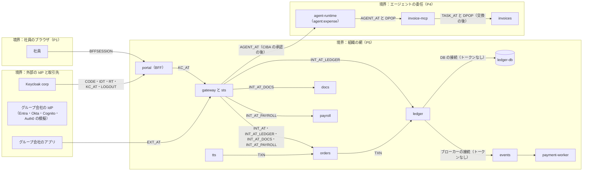
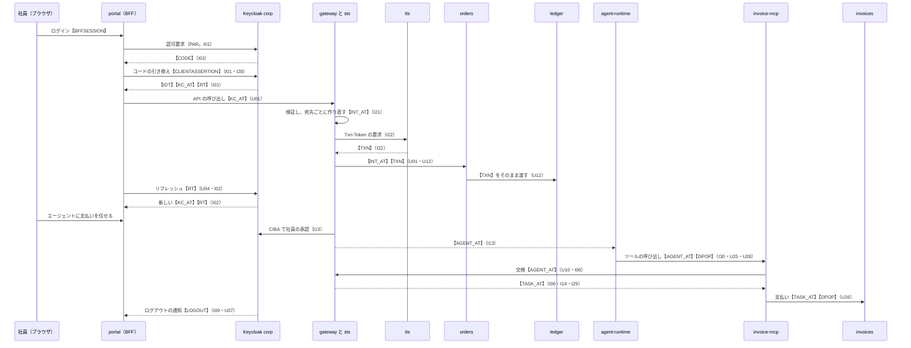

<!-- template_version: 0.3.0 -->
# 設計書（Full）記入例：シナリオ B　社内業務システム＋AI エージェントの委任（Keycloak 26.8 と模擬の 4 IdP）

> **記入例です。推奨ではありません。** ケーススタディ（jwt-claims-casestudy@080b8da）のシナリオ B（社内業務システム）に、シナリオ C（AI エージェントの委任）を足した前提での一例で、自組織の判断の代わりに写さないでください。判断の正は同じディレクトリの `claims.yaml`・`token_types.yaml`・`hops.yaml`・`catalog_answers.yaml` と `claim_request_*.md` で、この文書はその読み物です。

- 版：0.3.0（最初の版）。テンプレートは `templates/00_core.md`（0.3.0）。節の番号は 00_core と同じ
- **Lite／Full**：Full。README の 5 問のうち「境界を越えるか」（グループ会社の IdP の AT を入口で受ける）・「委任・トークン交換があるか」（エージェントへの委任、ツールサーバーの交換、入口での作り直し）・「新しい発行者か」（組織の sts と tts）の 3 つが Yes（`catalog_answers.yaml` の `lite_criteria`）
- **使うプロファイル**：社員のブラウザの境界は P1、入口の内側は P5、エージェントがツールを経て請求書の API を呼ぶ経路は P4（2. の図）
- **題材の組み合わせ**：#4 は Full の記入例を P1＋P4＋P5 で求めています。ケーススタディのシナリオ B には委任（P4）が無いため、シナリオ C の委任の部分（エージェント・MCP 風のツールサーバー・請求書の API・DPoP で束縛したタスク単位のトークン）を足しました。`claims.yaml` の `scenario` は `B` で、`tools/casestudy_check.py` は B の判定と照合します。C から来た行（`act`・`authorization_details`・`task_id`・`approval_id`・`cnf` など）で B の判定と違うものは、`templates/casestudy-deviations.yaml` に `kind: carry`（理由「P4 の部分はシナリオ C の判定による」）で載せました。前提の違いは同じファイルの `scenario_premises` にあります
- 生成の区間：`<!-- render:<節>:begin -->`〜`end` の間は `python tools/claim_lint render templates/examples/scenario-b --write` が台帳から書き直します。3.3 の比較の区間（`variant:sender-none`）は `python tools/variant_compare.py templates/examples/scenario-b templates/examples/scenario-b/variants/sender-none.yaml --write templates/examples/scenario-b/design.md` が書き直します。どちらも CI で `--check` します
- 作成方法：本資料は生成AI（Claude）を使って作成し、筆者が確認して公開しています。人による点検は未実施。書き手は LLM なので、記入の時間は人の手間の目安になりません（`templates/README.md` の「記入の目安」）

## 1. CI の結果

<!-- render:ci-result:begin -->
`python tools/claim_lint templates/examples/scenario-b --also-scan templates/examples/scenario-b/design.md`（profile full）：**error 0、warn 7、info 28**（claims 46・token_types 24・catalog_events 62）。OK

| 規則 | 重大度 | 対象 | 内容 |
| --- | --- | --- | --- |
| `R3` | info | `idp` | IdP keycloak の一覧（keycloak-settings・keycloak-grant-types）とカタログの差集合は 0 件 |
| `R3b` | warn | `I12` | keycloak のこの発行で プロトコルマッパー が呼ばれるかは unknown（カタログ）。独自クレーム C-tenant-id・C-user-id・C-roles・C-department・C-employee-id・C-idp・C-v が載ることを確かめて hook_checked に書く |
| `R3b` | info | `I13` | hook_invoked unknown：書き手が確かめた（CIBA を受けるのは sts で、Keycloak のマッパーは関与しない。クライアント portal の Capability config で OIDC CIBA Grant が OFF であることを設計書の 3. で確かめる） |
| `R3b` | info | `I14` | hook_invoked unknown：書き手が確かめた（authorization_details を書くのは sts で、Keycloak は RAR を発行しない（Keycloak 26.8 の RAR への対応はカタログで未確認の V33。この設計では使わない）） |
| `R3b` | warn | `I25` | keycloak のこの発行で プロトコルマッパー が呼ばれるかは unknown（カタログ）。独自クレーム C-tenant-id・C-user-id・C-roles・C-department・C-employee-id・C-idp・C-v が載ることを確かめて hook_checked に書く |
| `R3b` | warn | `I26` | keycloak のこの発行で プロトコルマッパー が呼ばれるかは unknown（カタログ）。独自クレーム C-tenant-id・C-user-id・C-roles・C-department・C-employee-id・C-idp・C-v が載ることを確かめて hook_checked に書く |
| `R3b` | info | `I29` | hook_invoked unknown：書き手が確かめた（束縛するのは sts で、Keycloak のマッパーは関与しない。KC_AT に cnf が付かないことは、portal が DPoP の proof を送らないことで確かめる（Keycloak は proof が送られれば束縛する。カタログの I29）） |
| `R6` | info | `pairwise` | 2 因子の組 60 個をすべて検討した（主体 2・発行イベント 14） |
| `R8` | info | `KC_AT` | 最悪 1522 バイト（ヘッダーの行で 1544）／上限 8192（nginx-large-client-header-buffers）= 19% |
| `R8` | info | `EXT_AT` | 最悪 1150 バイト（ヘッダーの行で 1172）／上限 8192（nginx-large-client-header-buffers）= 14% |
| `R8` | info | `INT_AT` | 最悪 951 バイト（ヘッダーの行で 4045）／上限 16384（nodejs-max-http-header-size）= 25% |
| `R8` | info | `INT_AT_LEDGER` | 最悪 974 バイト（ヘッダーの行で 4068）／上限 16384（nodejs-max-http-header-size）= 25% |
| `R8` | info | `INT_AT_DOCS` | 最悪 910 バイト（ヘッダーの行で 4004）／上限 16384（nodejs-max-http-header-size）= 24% |
| `R8` | info | `INT_AT_PAYROLL` | 最悪 916 バイト（ヘッダーの行で 4010）／上限 16384（nodejs-max-http-header-size）= 24% |
| `R8` | info | `AGENT_AT` | 最悪 1302 バイト（ヘッダーの行で 4389）／上限 16384（nodejs-max-http-header-size）= 27% |
| `R8` | info | `TASK_AT` | 最悪 1674 バイト（ヘッダーの行で 4761）／上限 16384（nodejs-max-http-header-size）= 29% |
| `R8` | info | `DPOP` | 最悪 841 バイト（ヘッダーの行で 2904）／上限 16384（nodejs-max-http-header-size）= 18% |
| `R8` | info | `C-scope` | KC_AT・AGENT_AT・TASK_AT の両方に載る（重複の候補） |
| `R8` | info | `C-act` | AGENT_AT・TASK_AT の両方に載る（重複の候補） |
| `R8` | info | `C-cnf` | AGENT_AT・TASK_AT の両方に載る（重複の候補） |
| `R8` | info | `C-sid` | KC_AT・IDT・LOGOUT・INT_AT_LEDGER の両方に載る（重複の候補） |
| `R8` | info | `C-tenant-id` | KC_AT・INT_AT・INT_AT_LEDGER・INT_AT_DOCS・INT_AT_PAYROLL・AGENT_AT・TASK_AT の両方に載る（重複の候補） |
| `R8` | info | `C-user-id` | KC_AT・INT_AT・INT_AT_LEDGER・INT_AT_DOCS・INT_AT_PAYROLL・AGENT_AT・TASK_AT の両方に載る（重複の候補） |
| `R8` | info | `C-roles` | KC_AT・INT_AT の両方に載る（重複の候補） |
| `R8` | info | `C-department` | KC_AT・INT_AT_DOCS の両方に載る（重複の候補） |
| `R8` | info | `C-employee-id` | KC_AT・INT_AT_PAYROLL の両方に載る（重複の候補） |
| `R8` | info | `C-idp` | KC_AT・INT_AT の両方に載る（重複の候補） |
| `R8` | info | `C-task-id` | AGENT_AT・TASK_AT の両方に載る（重複の候補） |
| `L1b` | warn | `C-req-wl` | 未登録の名前 req_wl は草案（draft-ietf-oauth-transaction-tokens-11 §9.2）が定める名前。登録の前なので、草案の版（spec_version）と、登録・改名されたときの見直しの条件を確かめる |
| `L1b` | warn | `C-tctx` | 未登録の名前 tctx は草案（draft-ietf-oauth-transaction-tokens-11 §9.2.3）が定める名前。登録の前なので、草案の版（spec_version）と、登録・改名されたときの見直しの条件を確かめる |
| `L1b` | info | `C-typ-claim` | IdP が既定で出す私的名 typ（名前空間なし・未登録）。名前を決めたのは IdP で、受け手は読まない（consumers が空）ので error にしない。読む受け手を足すなら組織の名前空間に写す |
| `L2` | info | `idp` | IdP keycloak の、書き換えを許さないクレームの一覧が tools/claim_lint/idp_reserved.yaml にない。L2 は確かめていない（IdP モジュール #4 で手で確かめる） |
| `L18` | warn | `C-employee-id` | 廃止予定（deprecated、sunset_on 2027-03-31）のクレームを読む受け手：gateway・payroll |
| `L27` | info | `token_type KC_AT` | at+jwt の REQUIRED の client_id（RFC 9068 §2.2）が無いことを、台帳の却下の行で逸脱として記録している |
| `L62` | warn | `E-token-exchange.2` | 発行方式の選択（E-token-exchange）から要るもの：交換のホップ（kind は exchange）で、aud・scope・寿命・独自クレームを上流より広げない（下流ほど絞る）（templates/registry/issuance_effects.yaml） |

R8 KC_AT：ヘッダー 86・ペイロード 797・署名 256 バイト（ceil(4/3*86) + ceil(4/3*797) + ceil(4/3*256) + 2 = 115 + 1063 + 342 + 2 = 1522; + 7 (Bearer) = 1529）。nginx-large-client-header-buffers 1544／8192 バイト

R8 EXT_AT：ヘッダー 129・ペイロード 475・署名 256 バイト（ceil(4/3*129) + ceil(4/3*475) + ceil(4/3*256) + 2 = 172 + 634 + 342 + 2 = 1150; + 7 (Bearer) = 1157）。nginx-large-client-header-buffers 1172／8192 バイト

R8 INT_AT：ヘッダー 72・ペイロード 575・署名 64 バイト（ceil(4/3*72) + ceil(4/3*575) + ceil(4/3*64) + 2 = 96 + 767 + 86 + 2 = 951; + 7 (Bearer) = 958）。nodejs-max-http-header-size 4045／16384 バイト

R8 INT_AT_LEDGER：ヘッダー 72・ペイロード 592・署名 64 バイト（ceil(4/3*72) + ceil(4/3*592) + ceil(4/3*64) + 2 = 96 + 790 + 86 + 2 = 974; + 7 (Bearer) = 981）。nodejs-max-http-header-size 4068／16384 バイト

R8 INT_AT_DOCS：ヘッダー 72・ペイロード 544・署名 64 バイト（ceil(4/3*72) + ceil(4/3*544) + ceil(4/3*64) + 2 = 96 + 726 + 86 + 2 = 910; + 7 (Bearer) = 917）。nodejs-max-http-header-size 4004／16384 バイト

R8 INT_AT_PAYROLL：ヘッダー 72・ペイロード 549・署名 64 バイト（ceil(4/3*72) + ceil(4/3*549) + ceil(4/3*64) + 2 = 96 + 732 + 86 + 2 = 916; + 7 (Bearer) = 923）。nodejs-max-http-header-size 4010／16384 バイト

R8 AGENT_AT：ヘッダー 61・ペイロード 849・署名 64 バイト（ceil(4/3*61) + ceil(4/3*849) + ceil(4/3*64) + 2 = 82 + 1132 + 86 + 2 = 1302）。nodejs-max-http-header-size 4389／16384 バイト

R8 TASK_AT：ヘッダー 61・ペイロード 1128・署名 64 バイト（ceil(4/3*61) + ceil(4/3*1128) + ceil(4/3*64) + 2 = 82 + 1504 + 86 + 2 = 1674）。nodejs-max-http-header-size 4761／16384 バイト

R8 DPOP：ヘッダー 221・ペイロード 343・署名 64 バイト（ceil(4/3*221) + ceil(4/3*343) + ceil(4/3*64) + 2 = 295 + 458 + 86 + 2 = 841）。nodejs-max-http-header-size 2904／16384 バイト
<!-- render:ci-result:end -->

## 2. 範囲と信頼の境界

範囲は、社員がブラウザで使う社内ポータル（`portal`、BFF）、グループ会社のアプリ、入口（`gateway`。外部のトークンを検証し、内部トークンを作る `sts` を兼ねる）、Txn-Token のサービス（`tts`）、社内の API（`orders`・`ledger`・`docs`・`payroll`）、経理の DB（`ledger-db`）、メッセージブローカー（`events`）とワーカー（`payment-worker`）、エージェントの実行基盤（`agent-runtime`）、ツールサーバー（`invoice-mcp`）、請求書の API（`invoices`）です。IdP は Keycloak 26.8 のレルム corp（実物）と、Entra ID・Okta・Cognito・Auth0 の形を再現した模擬（グループ会社の IdP。入口だけが読む）です。

| 境界 | 使うプロファイル | 中の部品 | 境界を越えるトークン（目録の ID） | 範囲の外にしたものと前提 |
| --- | --- | --- | --- | --- |
| 社員のブラウザ | P1 | ブラウザ | BFFSESSION（Cookie だけ。AT・RT・IDT はブラウザに出さない）、CODE（認可コード。1 回限り） | ネイティブアプリ（P2、#21）。社員はブラウザだけで使う前提。モバイルの業務アプリを出すときに見直す |
| 外部の IdP と取引先 | P5 の入口 | Keycloak corp、模擬の 4 IdP、グループ会社のアプリ | KC_AT・EXT_AT（入口までで止める）、LOGOUT | 取引先の API（P6、#21）。外の組織へトークンを出さない前提。取引先と API で連携するときに見直す |
| 組織の網 | P5 | portal・gateway・sts・tts・orders・ledger・docs・payroll・ledger-db・events・payment-worker | INT_AT 系（宛先ごとに 1 つ）、TXN | 夜間バッチ（M2M だけの P3、#21）。この例では扱わない |
| エージェントの委任 | P4 | agent-runtime・invoice-mcp・invoices | AGENT_AT・TASK_AT（どちらも DPoP で束縛）、DPOP | エージェントの実行基盤を組織の外に置く構成。置くときは 4. の送信者制約と 12. を見直す |

### 2.1 主体の種類

| 主体 | 種類 | 表すクレーム（台帳の ID） | 利用者のトークンと区別する手段 |
| --- | --- | --- | --- |
| 社員 | 利用者 | `C-sub`・`C-user-id`（IdP をまたいで同じ人を指す組織の ID） | — |
| グループ会社の社員 | 利用者 | 入口が EXT_AT の IdP ごとの不変の ID（Entra の oid＋tid、Okta の uid、Cognito・Auth0 の sub）から `C-user-id` を作る | `C-idp` に元の IdP |
| エージェント（agent:expense） | ワークロード | `C-act`（最も外側の `act.sub`）、`C-client-id` | AGENT_AT・TASK_AT の `sub` は社員のまま、実行者は `act`。利用者のトークンを借りない（ケーススタディ C12） |
| ツールサーバー（invoice-mcp） | ワークロード | TASK_AT の最も外側の `act.sub` | 交換で `act` が入れ子になる（深さは 3 まで） |
| 社内のサービス・ワーカー | ワークロード | 通信の層の ID（mTLS の X.509-SVID）。Txn-Token を求めたのは `C-req-wl` | トークンのクレームでは代えない（6. の q-peer） |

### 2.2 システムの権限

| 場面 | 主体とトークン（目録の ID） | クレームで示すこと（台帳の ID） | 確かめ方 |
| --- | --- | --- | --- |
| 支払いの通知の処理 | payment-worker 自身（mTLS の証明書。利用者のトークンを持たない） | イベントには主体の間接参照（ハッシュした `user_id`）と `txn` だけ | ワーカーは期限の切れたトークンで下流を呼ばない（H13） |
| エージェントの支払い | AGENT_AT → TASK_AT（委任。`sub` は社員、`act` はエージェントとツール） | `C-act`・`C-approval-id`・`C-authorization-details` | invoices が承認の DB と金額・相手先を照合する（C5〜C7） |
| 運用者の操作・緊急時の特権 | この例の範囲外 | — | 運用者の横断作業を足すときに、委任のトークン（`act` に運用者）として設計する |

## 3. 既定から外れた点

| 外れた点 | 既定 | この設計の値 | 書いた台帳の行の ID | 見直しの条件 |
| --- | --- | --- | --- | --- |
| 送信者制約 | none | dpop（エージェントの経路だけ） | `issuance_profile.sender_constraint`、`C-cnf`、目録の DPOP・AGENT_AT・TASK_AT | 下の 3.3 と 12. |
| クライアント認証 | client_secret_basic | private_key_jwt | `issuance_profile.client_auth`、目録の CLIENTASSERTION | 秘密鍵の管理が負担になったとき |
| grant | 認可コード＋PKCE、refresh | ＋token exchange（ツールサーバー）、CIBA（エージェントへの委任の承認） | `issuance_profile.grants` | エージェントの委任をやめたとき |
| 要求の保護 | なし | PAR・RAR・resource indicators | `issuance_profile.request_protection` | — |
| 入口での作り直し | 入口なし（シナリオ A） | 入口で外部の AT を検証し、宛先ごとに内部トークンを作る | 目録の INT_AT 系、`hops.yaml` の H4〜H8 | — |
| 廃止予定のクレーム | 廃止予定の行なし | `C-employee-id` を `deprecated`（期日 2027-03-31） | `C-employee-id` | 9.3 |
| ケーススタディの判定 | B の判定 | C の判定の行を足した（carry 21 件ほか） | `templates/casestudy-deviations.yaml` | ケーススタディの固定を上げるとき |

### 3.1 重点と見送り

| 区分 | 項目 | 効果と費用（未検証の点を含む） | 見直しの条件 | 台帳の行の ID |
| --- | --- | --- | --- | --- |
| 重点 | 入口での正規化とヘッダーの除去 | ケーススタディ B で、B7（入口の迂回）・B4〜B6（偽のヘッダー）を防いだ。入口の交換は p50 682 µs | サービスに入口を通らない経路ができたとき | 目録の INT_AT 系、H2〜H8 |
| 重点 | 重要な操作の鮮度確認（ledger） | B11・B12 を防いだ。費用はイントロスペクション p50 8.9 ms・ディレクトリ参照 p50 50.7 ms（ケーススタディの測定） | 経理の操作の件数が増え、遅れが問題になったとき | `C-department`・`C-sid`、INT_AT_LEDGER の `db_lookup` |
| 重点 | 宛先に束縛した交換・承認の束縛・タスク単位の短命トークン・深さの規則 | ケーススタディ C で C3〜C15 を防いだ | エージェントの種類が増えたとき | `C-act`・`C-authorization-details`・`C-approval-id`、AGENT_AT・TASK_AT |
| 重点（B では見送り） | 送信者制約（エージェントの経路だけ DPoP） | DPoP の証明は 498 バイト、作成と検証 p50 約 0.1 ms（ケーススタディの測定）。盗用を防ぐ効果は測っていない（B23 は見送った場合の代償の実測） | エージェントの実行基盤を組織の外に置くとき | `C-cnf`、DPOP |
| 見送り | JWE | B の判定どおり見送り（JWS 670 バイトが JWE で 1345 バイト） | トークンが社外へ渡るとき | 目録の `jwe` |
| 見送り | 社員の経路（KC_AT・INT_AT）の送信者制約 | BFF とサービスの間だけで運ぶ | 盗用の兆候が出たとき | `issuance_profile` の注記 |

### 3.2 共通の基準

| 基準 | 満たすか | 満たさないときの理由と、回した先 |
| --- | --- | --- |
| 受け入れの検証（alg・iss・aud・exp・typ） | 満たす | — |
| 必須の欠落は拒否（IdP の差は入口で正規化してから） | 満たす。groups の超過は入口がディレクトリを引いて解決してから必須を確かめる（B9 の誤拒否を避ける） | — |
| 型の固定・不変の ID・組織の名前空間 | 満たす（`C-employee-id` は文字列。B22） | — |
| ログにトークン全文と個人情報を残さない | 満たす（目録の `log_policy`） | — |

### 3.3 送信者制約を「DPoP」にした場合と「なし」にした場合

発行方式の選択がクレームの設計に効くことを、この記入例で確かめました（#4 の「発行方式の選択」）。下の表は、記入例（DPoP）と、`variants/sender-none.yaml`（送信者制約を none にした変種。差分だけを持つ）を当てたものの比較で、`tools/variant_compare.py` が生成します。

<!-- variant:sender-none:begin -->
変種 `sender-none`：送信者制約を none にする（ケーススタディ B の「送信者制約は見送り」と同じ）。AGENT_AT・TASK_AT は Bearer になり、DPoP の proof と cnf の行は要らなくなる。クライアントは機密のままなので、公開クライアントの RT の要件（E-public-no-sender-constraint）は成り立たない

生成：`python tools/variant_compare.py templates/examples/scenario-b templates/examples/scenario-b/variants/sender-none.yaml --write <設計書>`。左が記入例、右が変種。手で直さない。

**発行方式の選択（issuance_profile）**

| 項目 | 記入例 | 変種 |
| --- | --- | --- |
| sender_constraint | dpop | none |

**発行方式から導かれる要件（`templates/registry/issuance_effects.yaml`。render の簡易な読み取りで、検査の正は L62）**

| 要件 | 記入例 | 変種 | 中身 |
| --- | --- | --- | --- |
| E-dpop.1 | 満たす | （条件が成り立たない） | AT に cnf.jkt（DPoP の公開鍵の JWK Thumbprint）を載せる |
| E-dpop.2 | 満たす | （条件が成り立たない） | AT の受け手すべてが DPoP proof の htm・htu・iat を照合し（RFC 9449 §4.3）、AT… |
| E-dpop.3 | 満たす | （条件が成り立たない） | トークン目録で DPoP proof（typ は dpop+jwt）を採用し、jti の再送を拒む期間を決める |
| E-dpop.4 | 満たす | （条件が成り立たない） | サイズの予算に cnf を含める（AT に載るので R8 の計算に入る） |
| E-dpop.5 | 満たす | （条件が成り立たない） | Authorization ヘッダーの方式は DPoP（Bearer ではない） |

**トークン目録（token_types。理由・注記の文の違いは省いた）**

| ID | 列 | 記入例 | 変種 |
| --- | --- | --- | --- |
| AGENT_AT | required_claims | [iss, sub, aud, exp, iat, jti, client_id, scope, act, cnf, 'https://c… | −cnf |
| AGENT_AT | sender_constraint | dpop | none |
| AGENT_AT | transport | authorization_dpop | authorization_bearer |
| TASK_AT | required_claims | [iss, sub, aud, exp, iat, jti, client_id, scope, act, cnf, authorizat… | −cnf |
| TASK_AT | sender_constraint | dpop | none |
| TASK_AT | transport | authorization_dpop | authorization_bearer |
| DPOP | decision | 採用 | 却下 |
| DPOP | （ほかの 25 列） | `purpose`・`issuer`・`aud`・`holder`・`typ`・`alg_allowlist`・`issuers`・`max_clock_skew`・`max_lifetime`・`lifetime_refs`・`lifetime_set_by`・`refresh`・`revocation`・`jti_policy`・`stored_at`・`transport`・`visible_to`・`jwe`・`log_policy`・`key_rotation`・`unknown_kid`・`jwks_cache_ttl`・`key_source`・`signing_key_scope`・`size` | （却下の行には書かない） |

**台帳（claims。理由・注記・意味の文の違いは省いた）**

| ID | 列 | 記入例 | 変種 |
| --- | --- | --- | --- |
| C-iat | carried_in | [KC_AT, IDT, LOGOUT, EXT_AT, INT_AT, INT_AT_LEDGER, INT_AT_DOCS, INT_… | −DPOP |
| C-jti | carried_in | [KC_AT, LOGOUT, EXT_AT, INT_AT, INT_AT_LEDGER, INT_AT_DOCS, INT_AT_PA… | −DPOP |
| C-cnf | decision | 採用 | 却下 |
| C-cnf | carried_in | [AGENT_AT, TASK_AT] | （なし） |
| C-cnf | rejection_kind | （なし） | 不要 |
| C-dpop-htm | decision | 採用 | 却下 |
| C-dpop-htm | carried_in | [DPOP] | （なし） |
| C-dpop-htm | rejection_kind | （なし） | 不要 |
| C-dpop-htu | decision | 採用 | 却下 |
| C-dpop-htu | carried_in | [DPOP] | （なし） |
| C-dpop-htu | rejection_kind | （なし） | 不要 |
| C-dpop-ath | decision | 採用 | 却下 |
| C-dpop-ath | carried_in | [DPOP] | （なし） |
| C-dpop-ath | rejection_kind | （なし） | 不要 |
| C-dpop-nonce | decision | 採用 | 却下 |
| C-dpop-nonce | carried_in | [DPOP] | （なし） |
| C-dpop-nonce | rejection_kind | （なし） | 不要 |

**ホップ（hops。注記の違いは省いた）**

| ID | 列 | 記入例 | 変種 |
| --- | --- | --- | --- |
| H14 | validates.checks | [署名（sts の JWKS、ES256 だけ）, aud が invoice-mcp だけ（受け取ったトークンを上流に渡さない）, DP… | −DPoP の proof の htm・htu・iat・jti・ath と、cnf.jkt と proof の鍵の拇印 |
| H15 | validates.checks | [署名（sts の JWKS）, aud が invoices だけ, DPoP の proof と cnf.jkt（invoice-mc… | −DPoP の proof と cnf.jkt（invoice-mcp の鍵） |

**カタログへの回答と問い（catalog_answers。注記の違いは省いた）**

| イベント・問い | 列 | 記入例 | 変種 |
| --- | --- | --- | --- |
| I29 | answer | 該当 | 対象外 |
| I29 | token_types | [AGENT_AT, TASK_AT] | （なし） |
| I29 | hook_checked | 束縛するのは sts で、Keycloak のマッパーは関与しない。KC_AT に cnf が付かないことは、portal が DPoP … | （なし） |
| I29 | assumption | （なし） | 変種：送信者制約を付けない。AGENT_AT・TASK_AT は組織の網の中の部品だけが持つ（目録の DPOP は却下） |
| I29 | breaks_when | （なし） | エージェントの実行基盤を組織の外に置くとき、またはトークンの盗用の兆候が出たとき |
| I30 | answer | 該当 | 対象外 |
| I30 | token_types | [DPOP] | （なし） |
| I30 | assumption | （なし） | 変種：DPoP の proof を作らない（目録の DPOP は却下） |
| I30 | breaks_when | （なし） | 送信者制約を DPoP にするとき（記入例の既定の設計） |
| U25 | token_types | [AGENT_AT, DPOP] | −DPOP |
| U26 | answer | 該当 | 対象外 |
| U26 | token_types | [AGENT_AT, TASK_AT, DPOP] | （なし） |
| U26 | assumption | （なし） | 変種：送信者制約つきのトークンを使わない。受け手は Bearer として検証する |
| U26 | breaks_when | （なし） | 送信者制約を DPoP か mTLS にするとき |
| q-holder | questions.needed | True | False |

**claim_lint**：記入例 error 0・warn 7・info 28、変種 error 0・warn 7・info 25（どちらも profile full。この表は、いまのリポジトリの規則での結果）

| 規則 | 重大度 | 対象 | 出る側 | 内容 |
| --- | --- | --- | --- | --- |
| R3b | info | I29 | 記入例だけ | hook_invoked unknown：書き手が確かめた（束縛するのは sts で、Keycloak のマッパーは関与しない。KC_AT に cnf が付かないことは、port… |
| R8 | info | C-cnf | 記入例だけ | AGENT_AT・TASK_AT の両方に載る（重複の候補） |
| R8 | info | DPOP | 記入例だけ | 最悪 841 バイト（ヘッダーの行で 2904）／上限 16384（nodejs-max-http-header-size）= 18% |
| R6 | info | pairwise | 両方（中身が変わった） | 2 因子の組 60 個をすべて検討した（主体 2・発行イベント 14） → 2 因子の組 54 個をすべて検討した（主体 2・発行イベント 12） |
| R8 | info | AGENT_AT | 両方（中身が変わった） | 最悪 1302 バイト（ヘッダーの行で 4389）／上限 16384（nodejs-max-http-header-s… → 最悪 1221 バイト（ヘッダーの行で 4315）／上限 16384（nodejs-max-http-header-s… |
| R8 | info | TASK_AT | 両方（中身が変わった） | 最悪 1674 バイト（ヘッダーの行で 4761）／上限 16384（nodejs-max-http-header-s… → 最悪 1593 バイト（ヘッダーの行で 4687）／上限 16384（nodejs-max-http-header-s… |

規則が確かめた箇所の数（指摘が無くても、選択で検査の対象が変わる）：L11 24 → 23、L15 3 → 0、L17 13 → 12、L1a 38 → 33、L1b 38 → 33、L21 170 → 161、L23 17 → 16、L25 13 → 12、L3 20 → 19、L31 20 → 19、L4 38 → 33、L6 141 → 133、L62 10 → 5、L68 38 → 33、L7 205 → 201
<!-- variant:sender-none:end -->

読み方：DPoP をやめると、台帳では `C-cnf` と DPoP の proof の 4 行（`C-dpop-htm`・`C-dpop-htu`・`C-dpop-ath`・`C-dpop-nonce`）が却下に変わり、目録では DPOP の行が却下、AGENT_AT・TASK_AT の運び方が Bearer になり、`required_claims` から `cnf` が外れます。カタログへの回答では、送信者制約のイベント（I29・I30・U26）が対象外になり、問い「誰が持つべきか」（q-holder）が不要になります。lint では、DPoP の proof の R8 の行と `cnf` の重複の候補が消え、AT のサイズが約 80 バイト減ります。

## 4. 発行方式の選択

<!-- render:issuance-profile:begin -->
`token_types.yaml` の `issuance_profile`。既定の組み合わせから外れた点の理由は、手で書く節（既定から外れた点）に書く。

| 項目 | 選択 | 理由 | 根拠 |
| --- | --- | --- | --- |
| クライアントの種類 | 機密（`confidential`） | クライアントは 2 種類あり、どちらもサーバーで動く機密クライアント。社員のポータルは BFF（portal のサーバーがトークンを持ち、ブラウザには Cookie だけ）、エージェントの実行基盤（agent-runtime）はサーバーのワークロード。どちらも公開クライアントではない。 台帳 v1 のスキーマは設計書ごとに issuance_profile が 1 つなので、2 種類のクライアントの違い（ポータルの AT は Bearer、エージェントの トークンは DPoP）は、この 1 つの選択と、トークン種別ごとの sender_constraint・transport で表した（#3 への指摘。design.md の 12.） | `slide:p06-flow-browser-to-db` `slide:p10-agent-identity` |
| クライアント認証 | `private_key_jwt` | portal・agent-runtime・invoice-mcp は、登録した公開鍵（jwks_uri）で署名した assertion でクライアント認証する。共有の秘密を 配らないので、エージェントの実行基盤のような数の増えるワークロードでも、秘密の配布と漏れの面を持たない（目録の CLIENTASSERTION） | [RFC 7523 §2.2](https://www.rfc-editor.org/rfc/rfc7523#section-2.2) [OpenID Connect Core 1.0 §9](https://openid.net/specs/openid-connect-core-1_0.html#ClientAuthentication) |
| grant | 認可コード＋PKCE（`authorization_code_pkce`）、リフレッシュ（`refresh_token`）、トークン交換（`token_exchange`）、`ciba` | 社員のログインは認可コード＋PKCE（Keycloak corp）。エージェントへの委任は、エージェントの実行基盤が組織のトークン発行サービス（sts）に CIBA で求め、社員がポータルで承認してから AGENT_AT が出る（エージェントに承認を判断させない）。ツールサーバー invoice-mcp は、受け取った AGENT_AT を上流に渡さず、トークン交換（RFC 8693）で invoices 宛ての TASK_AT を得る。ROPC・implicit は使わない | [RFC 9700 §2.1.1](https://www.rfc-editor.org/rfc/rfc9700#section-2.1.1) [RFC 8693 §2.1](https://www.rfc-editor.org/rfc/rfc8693#section-2.1) [OpenID Connect Client-Initiated Backchannel Authentication Flow - Core 1.0 §7](https://openid.net/specs/openid-client-initiated-backchannel-authentication-core-1_0.html) `slide:p10-human-approval-evidence` `slide:p10-mcp-authorization` |
| 送信者制約 | DPoP（`dpop`） | エージェントの実行基盤とツールサーバーに渡るトークン（AGENT_AT・TASK_AT）は、組織の外のモデルの出力に応じて動く部品が持つので、 漏れたトークンの再送（ケーススタディ B23 の型）を鍵の所持で止める。ケーススタディ C の判定（CLM-0429・CLM-0431：タスク単位のトークンを 実行基盤の DPoP の鍵で束縛）に合わせた。ポータルの KC_AT と内部の INT_AT は BFF とサービスの間だけを通るので Bearer のまま （トークン種別ごとの sender_constraint）。none にした場合の比較は design.md の 4. | [RFC 9449 §1](https://www.rfc-editor.org/rfc/rfc9449#section-1) `slide:p08-rotation` |
| AT の形式 | JWT（`jwt`） | 受け手（orders・ledger・docs・payroll・invoice-mcp・invoices）がローカルで検証する。剥奪をすぐ効かせたい経理・管理の操作だけ、ledger が Keycloak のセッションを引き直す（INT_AT_LEDGER の revocation の db_lookup） | [RFC 9068 §2.1](https://www.rfc-editor.org/rfc/rfc9068#section-2.1) `slide:p01-self-contained-vs-reference` |
| RT の方式 | ローテーション（`rotation`） | RT は portal の BFF だけが持つ。レルム corp の Revoke Refresh Token を有効にしてローテーションする（ケーススタディのレルムの設定）。 古い RT の再利用で系列を失効させるか（再利用の検知）は確かめていない（レルムの設定は、ケーススタディの実験環境 jwt-claims-casestudy@080b8da の kc/import/corp.json の revokeRefreshToken: true と同じ）。エージェントには RT を出さない（タスクごとに CIBA で取り直す） | [RFC 9700 §4.14.2](https://www.rfc-editor.org/rfc/rfc9700#section-4.14.2) |
| 要求の保護 | `par`、`rar`、`resource_indicators` | ポータルの認可要求は PAR で URL から外す。エージェントへの委任の要求（CIBA）と交換では、支払いの承認の内容を RAR の authorization_details で運ぶ。宛先は resource indicators で絞る（ポータルは使う API だけ、エージェントは invoice-mcp だけ、交換は invoices だけ） | [RFC 9126 §1](https://www.rfc-editor.org/rfc/rfc9126#section-1) [RFC 9396 §2](https://www.rfc-editor.org/rfc/rfc9396#section-2) [RFC 8707 §2](https://www.rfc-editor.org/rfc/rfc8707#section-2) `slide:p09-url-browser` |
| 適合のプロファイル | なし（`none`） | 社内の業務システムで、FAPI などの規制の対象ではない。支払いは社内の請求書の API までで、外部の金融機関の API を呼ばない | — |

選択から導かれる要件（`templates/registry/issuance_effects.yaml`）：条件が成り立つ行は 3 件／全 13 件。**次の表は検査ではない。** render が `check` を簡易に読み取った表示で、検査の正は `tools/claim_lint/RULES.md` の L62〜L64（#6）。「満たしている行」は、要件の場所にある台帳の行。

| 行 | 要件 | 台帳で必要になるもの | 簡易な読み取り（正は L62） | 満たしている行 | 規則 |
| --- | --- | --- | --- | --- | --- |
| `E-dpop` | `E-dpop.1` | AT に cnf.jkt（DPoP の公開鍵の JWK Thumbprint）を載せる | 満たす | `C-cnf` | `L62`・`L15` |
| `E-dpop` | `E-dpop.2` | AT の受け手すべてが DPoP proof の htm・htu・iat を照合し（RFC 9449 §4.3）、AT と一緒に出された proof では ath も照合する（§4.3。保護リソースへの要求のとき）。jti は再送の拒否に使う（§11.1。受け手が jti を覚えておく） | 満たす | `C-cnf` | `L62`・`L15` |
| `E-dpop` | `E-dpop.3` | トークン目録で DPoP proof（typ は dpop+jwt）を採用し、jti の再送を拒む期間を決める | 満たす | `DPOP` | `L62`・`L15` |
| `E-dpop` | `E-dpop.4` | サイズの予算に cnf を含める（AT に載るので R8 の計算に入る） | 満たす | `C-cnf` | `L62`・`L15` |
| `E-dpop` | `E-dpop.5` | Authorization ヘッダーの方式は DPoP（Bearer ではない） | 満たす | `AGENT_AT`・`TASK_AT` | `L62`・`L15` |
| `E-token-exchange` | `E-token-exchange.1` | 委任なら act（最も外側が今の代理者）、交換を許す相手を事前に示すなら may_act を台帳に置く | 満たす | `C-act` | `L62`・`L16` |
| `E-token-exchange` | `E-token-exchange.2` | 交換のホップ（kind は exchange）で、aud・scope・寿命・独自クレームを上流より広げない（下流ほど絞る） | 満たさない | — | `L62`・`L16` |
| `E-rar` | `E-rar.1` | authorization_details の type の語彙を value_vocabulary で定め、持ち主を決める | 満たす | `C-authorization-details` | `L62`・`L16` |
| `E-rar` | `E-rar.2` | 宛先ごとに絞って入れる（ホップの authorization_details） | 満たす | `H15` | `L62`・`L16` |
| `E-rar` | `E-rar.3` | 配列の上限（max_items）と 1 件の上限（max_bytes）を決める | 満たす | `C-authorization-details` | `L62`・`L16` |
<!-- render:issuance-profile:end -->

## 5. トークン目録

<!-- render:token-inventory:begin -->
`token_types.yaml` の 24 行（却下 7）。種類の名前は `templates/catalog/token_kinds.yaml`。

| ID | 種類 | 採否 | 発行 → 宛先（aud） | 持ち手 | 形式 | 寿命 | 保存場所 | 運び方 | 読める相手 | JWE | 理由 |
| --- | --- | --- | --- | --- | --- | --- | --- | --- | --- | --- | --- |
| `BFFSESSION` | セッション（IdP のセッション session_idp と、RP・BFF のセッション session_rp の 2 層） | 採用 | portal（BFF） → — | ブラウザ（HttpOnly・Secure・SameSite=Lax の Cookie） | opaque | idle 1800 秒、最大 36000 秒 | ブラウザ | Cookie | `browser`・`bff` | — | ブラウザはポータルの BFF のセッションの Cookie だけを持つ。トークンをブラウザに置かない |
| `SSO` | セッション（IdP のセッション session_idp と、RP・BFF のセッション session_rp の 2 層） | 採用 | Keycloak（レルム corp） → — | Keycloak（ブラウザには Keycloak の Cookie） | opaque | idle 1800 秒、最大 36000 秒 | IdP | Cookie | `browser`・`idp` | — | Keycloak のレルム corp の SSO セッション。SSO Session Max を 36000 秒に設定する |
| `CODE` | 認可コード | 既定どおり | Keycloak（レルム corp） → — | ブラウザを経由して portal へ | opaque | 60 秒 | なし | リダイレクトの query | `browser`・`bff`・`idp` | — | 認可コード＋PKCE（S256）の流れで Keycloak が出す。PAR で認可要求を先に送るので、URL に載るのは request_uri とコードだけ |
| `IDT` | ID トークン | 採用 | Keycloak（レルム corp） → portal | portal のサーバー。ブラウザには渡さない | jwt（JWT、RS256） | 300 秒（時計のずれ 30 秒） | BFF のサーバー | トークンの応答 | `bff`・`idp` | なし | portal がログインを確かめ、画面の表示名とメールを得る。Back-Channel Logout の sid を BFF のセッションと結びつける |
| `RT` | リフレッシュトークン | 採用 | Keycloak（レルム corp） → Keycloak（レルム corp 自身） | portal のサーバー | opaque | idle 1800 秒、最大 36000 秒 | BFF のサーバー | トークンの応答 | `bff`・`idp` | — | KC_AT を 300 秒にしたまま、SSO セッションの間は社員に再ログインさせない |
| `LOGOUT` | ログアウトトークン（Back-Channel Logout の Logout Token） | 採用 | Keycloak（レルム corp） → portal | portal のサーバー（Back-Channel Logout の受け口） | jwt（logout+jwt、RS256） | 120 秒（時計のずれ 30 秒） | なし | バックチャネルの POST | `idp`・`bff` | なし | 社員の無効化・セッションの削除を、portal の BFF のセッションに 0 秒で反映する。シナリオ B は退職・異動の直後の古いトークンでの操作 （ケーススタディ B11・B12）を重点にしており、次のリフレッシュの失敗を待つ（最大 330 秒）のでは遅い |
| `KC_AT` | アクセストークン | 採用 | Keycloak（レルム corp） → orders・ledger・docs・payroll | portal のサーバー | jwt（at+jwt、RS256） | 300 秒（時計のずれ 30 秒） | BFF のサーバー | Authorization: Bearer | `bff`・`gateway` | なし | 社員がポータルから社内の API を呼ぶ。入口（gateway）が検証し、API ごとの内部トークン（INT_AT）に作り替える |
| `EXT_AT` | アクセストークン | 採用 | グループ会社の IdP（Entra ID・Okta・Cognito・Auth0） → api://corp-gateway | グループ会社のアプリ | jwt（IdP ごと（Entra は JWT、Okta は application/okta-internal-at+jwt、Cognito はヘッダーに無く token_use で見分ける、Auth0 は at+jwt）、RS256） | 5400 秒（時計のずれ 30 秒） | RP のサーバー | Authorization: Bearer | `client`・`gateway` | なし | グループ会社の社員は、各社の IdP（Entra ID・Okta・Cognito・Auth0。この例では形を再現した模擬）でログインしたアプリから入口に AT を送る。 入口だけが IdP ごとの規則で検証し、組織の内部トークン（INT_AT）に作り替える。内側のサービスは EXT_AT を受けない |
| `INT_AT` | 内部トークン（入口で外部のトークンを検証し、作り直したもの） | 採用 | 入口（gateway）のトークン発行サービス（sts） → orders | 入口（gateway）。受け手の API は検証だけ | jwt（corp-internal+jwt、ES256） | 300 秒（時計のずれ 30 秒） | サービスのメモリ | Authorization: Bearer | `gateway`・`api` | なし | orders 宛て。KC_AT（H4）とグループ会社の EXT_AT（H8）の両方から作る。入口で外部のトークン（KC_AT・EXT_AT）を検証し、API ごとに宛先を 1 つに絞った内部トークンに作り直す。内側のサービスは IdP の違いを知らずに、組織の形だけを読む |
| `INT_AT_LEDGER` | 内部トークン（入口で外部のトークンを検証し、作り直したもの） | 採用 | 入口（gateway）のトークン発行サービス（sts） → ledger | 入口（gateway）。受け手の API は検証だけ | jwt（corp-internal+jwt、ES256） | 300 秒（時計のずれ 30 秒） | サービスのメモリ | Authorization: Bearer | `gateway`・`api` | なし | ledger 宛て。社員（KC_AT）だけから作る。sid は経理の操作のたびに Keycloak のセッションを引き直すために写す。入口で外部のトークン（KC_AT・EXT_AT）を検証し、API ごとに宛先を 1 つに絞った内部トークンに作り直す。内側のサービスは IdP の違いを知らずに、組織の形だけを読む |
| `INT_AT_DOCS` | 内部トークン（入口で外部のトークンを検証し、作り直したもの） | 採用 | 入口（gateway）のトークン発行サービス（sts） → docs | 入口（gateway）。受け手の API は検証だけ | jwt（corp-internal+jwt、ES256） | 300 秒（時計のずれ 30 秒） | サービスのメモリ | Authorization: Bearer | `gateway`・`api` | なし | docs 宛て。部署が欠けていれば拒否する（Okta のフックの打ち切りで消えた場合。ケーススタディ B15）。入口で外部のトークン（KC_AT・EXT_AT）を検証し、API ごとに宛先を 1 つに絞った内部トークンに作り直す。内側のサービスは IdP の違いを知らずに、組織の形だけを読む |
| `INT_AT_PAYROLL` | 内部トークン（入口で外部のトークンを検証し、作り直したもの） | 採用 | 入口（gateway）のトークン発行サービス（sts） → payroll | 入口（gateway）。受け手の API は検証だけ | jwt（corp-internal+jwt、ES256） | 300 秒（時計のずれ 30 秒） | サービスのメモリ | Authorization: Bearer | `gateway`・`api` | なし | payroll 宛て。社員番号（廃止予定の C-employee-id）は payroll 宛てにだけ載せる。入口で外部のトークン（KC_AT・EXT_AT）を検証し、API ごとに宛先を 1 つに絞った内部トークンに作り直す。内側のサービスは IdP の違いを知らずに、組織の形だけを読む |
| `TXN` | Transaction Token（Txn-Token） | 採用 | 内部の Txn-Token のサービス（tts） → https://corp.example.com | 呼び出しの連鎖の各サービス（orders・ledger） | jwt（txntoken+jwt、ES256） | 300 秒（時計のずれ 30 秒） | サービスのメモリ | Txn-Token のヘッダー | `api`・`gateway` | なし | orders が ledger を社員の文脈で呼ぶとき、呼び出しの連鎖全体で同じ取引の文脈（txn・誰の権限で・どのワークロードが求めたか）を改変せずに運ぶ。内部の AT を下流へ渡さない |
| `AGENT_AT` | アクセストークン | 採用 | 組織のトークン発行サービス（sts） → invoice-mcp | エージェントの実行基盤（agent-runtime） | jwt（at+jwt、ES256） | 300 秒（時計のずれ 30 秒） | サービスのメモリ | Authorization: DPoP | `client`・`api` | なし | 社員が承認したタスクの間だけ、エージェント agent:expense が社員の代わりにツール invoice-mcp を呼ぶ。sub は社員、act と client_id は エージェント（エージェント自身の ID で、社員のトークンを借りない。ケーススタディ C12）。宛先は invoice-mcp だけ（C13） |
| `TASK_AT` | アクセストークン | 採用 | 組織のトークン発行サービス（sts） → invoices | ツールサーバー（invoice-mcp） | jwt（at+jwt、ES256） | 300 秒（時計のずれ 30 秒） | サービスのメモリ | Authorization: DPoP | `api` | なし | invoice-mcp は受け取った AGENT_AT を上流に渡さず（ケーススタディ C2）、交換で invoices 宛ての 1 件のタスクだけのトークンを得る。 act の最も外側が今の行為者（invoice-mcp）、その内側が agent:expense。支払いは承認の内容（authorization_details の金額・相手先・対象）と 承認の ID で束縛する（C5〜C7） |
| `DPOP` | DPoP の proof | 採用 | 鍵を持つクライアント（agent-runtime・invoice-mcp） → （aud は無い。htm・htu で要求に束縛する） | agent-runtime・invoice-mcp（要求ごとに作る） | jwt（dpop+jwt、ES256） | 60 秒（時計のずれ 30 秒） | なし | Authorization: DPoP | `client`・`api`・`idp` | なし | AGENT_AT・TASK_AT を鍵に束縛し、要求ごとに鍵の所持を示す（issuance_profile.sender_constraint） |
| `CLIENTASSERTION` | クライアントの assertion（private_key_jwt・client_secret_jwt） | 採用 | portal・agent-runtime・invoice-mcp（クライアント自身） → https://idp.example.com/realms/corp・https://sts.corp.example.com | 各クライアント（要求ごとに作る） | jwt（client-authentication+jwt、ES256） | 60 秒（時計のずれ 30 秒） | なし | フォームの本文 | `client`・`idp` | なし | portal・agent-runtime・invoice-mcp のクライアント認証を private_key_jwt にした（issuance_profile.client_auth） |
| `IDJAG` | ID-JAG（Identity Assertion JWT Authorization Grant） | 却下 | — | — | jwt | — | — | — | — | — | ドメインをまたぐ SSO 済みの利用者のトークンを受けない。グループ会社の IdP は、入口が EXT_AT を検証して作り直す |
| `JAR` | 署名つきの認可要求（JAR の Request Object） | 却下 | — | — | jwt | — | — | — | — | — | 認可要求は PAR で送る。要求の完全性は PAR の端点でのクライアント認証で守り、Request Object に署名しない |
| `JARM` | 署名つきの認可応答（JARM） | 却下 | — | — | jwt | — | — | — | — | — | 認可応答を JWT にしない。応答は portal のサーバーが PKCE と state で確かめる |
| `WORKLOADJWT` | 汎用の JWT（ワークロードの ID のトークン・アサーショングラントに出す JWT など） | 却下 | — | — | jwt | — | — | — | — | — | サービス・ワーカーの通信相手は mTLS（SPIFFE の X.509-SVID）で確かめ、ワークロードの ID のトークン（JWT-SVID）やアサーショングラントの JWT を使わない |
| `SET` | Security Event Token（SET。SSF・CAEP の通知） | 却下 | — | — | jwt | — | — | — | — | — | SSF・CAEP の SET を受けない。IdP のセッションの終了は Back-Channel Logout（LOGOUT）で受け、重要な操作は ledger が都度引き直す |
| `STATUSLIST` | 状態リストのトークン（Token Status List） | 却下 | — | — | jwt | — | — | — | — | — | 状態リストを出さない。トークンの寿命は 300 秒で、即時の剥奪が要る操作は引き直す |
| `INTROSPECTIONJWT` | JWT 形式のイントロスペクションの応答 | 却下 | — | — | jwt | — | — | — | — | — | イントロスペクションを使わない（at_format は jwt）。重要な操作の鮮度は Keycloak の管理 API でセッションと部署を引き直す |
<!-- render:token-inventory:end -->

### 5.1 寿命の上限の方針

| 種類 | 組織の上限（秒） | 例外を認める手順（承認者・記録先） | 例外にした種別（目録の ID と `lifetime_exception`） |
| --- | --- | --- | --- |
| アクセストークン・内部トークン・Txn-Token | 300 | 例外は認めない | なし |
| グループ会社の AT（EXT_AT） | 組織では決められない（各 IdP の既定。Entra は 60〜90 分） | 入口で受けるだけで、内側には持ち込まない。内部トークンの寿命は EXT_AT の残りの寿命以下にする | EXT_AT（`lifetime_exception` に理由） |
| ID トークン | 300 | — | なし |
| RT・セッション | idle 1800・最大 36000 | セキュリティの担当が承認し、台帳の PR に記録する | なし |
| DPoP の proof・クライアントの assertion | 60 | — | なし |

## 6. 問い × 仕組み

`act`（誰が代理して実行しているか）、Txn-Token（どのワークロードが求めたか・どの取引か）、ワークロードの ID（直接の通信相手は誰か）は、別々の問いの行にしました（#4 の完了基準）。

| ユースケース | 問い（ID） | 要るか | 仕組み（台帳の行の ID か、クレームでない仕組み） | 不要の理由・照合する場所 |
| --- | --- | --- | --- | --- |
| 社員が注文・経理・文書・給与を見る | 誰の権限で（q-sub） | 要る | `C-sub`（INT_AT 系） | 各 API |
| 同上 | 誰が代理して実行しているか（q-actor） | 不要 | — | 社員本人の操作で、代理がない |
| 同上 | どのワークロードが Txn-Token を求めたか（q-req-wl） | 要る | `C-req-wl`（TXN） | orders・ledger が、求めたのが gateway かを照合 |
| 同上 | 直接の通信相手は誰か（q-peer） | 要る | mTLS の X.509-SVID（通信の層） | 各サービス・ブローカー。トークンのクレームでは代えない |
| 同上 | どこを経由したか（q-via） | 不要 | — | 経路は txn で監査ログを相関させて追う |
| 同上 | どの取引か（q-txn） | 要る | `C-txn`・`C-tctx`（TXN） | 監査の相関だけ。認可には使わない |
| 同上 | 誰が利用者か（q-user） | 要る | `C-user-id`（IdP をまたぐ不変の ID） | 各 API。payroll は移行中（9.3） |
| 同上 | どのエージェント・クライアントか（q-agent） | 要る | `C-client-id`（INT_AT）・`C-azp`（KC_AT・IDT） | gateway |
| 同上 | 何が承認されたか（q-authorized） | 要る | `C-roles`・`C-acr`（経理の操作） | orders・ledger |
| 同上 | どのリソース向けか（q-resource） | 要る | `C-aud`（宛先ごとに 1 つ） | 各 API |
| 同上 | 誰が持つべきか（q-holder） | 不要 | — | KC_AT・INT_AT は BFF とサービスの間だけで運ぶ（3.1 の見送り） |
| エージェントが社員の代わりに請求書を払う | 誰の権限で（q-sub） | 要る | `C-sub`（AGENT_AT・TASK_AT。社員のまま。交換で差し替えさせない。C15） | invoice-mcp・invoices |
| 同上 | 誰が代理して実行しているか（q-actor） | 要る | `C-act`（最も外側の `act.sub`）。入れ子の内側の `act` は過去の行為者で、答えに使わない（C4） | invoices が呼び出し元と照合 |
| 同上 | どのワークロードが Txn-Token を求めたか（q-req-wl） | 不要 | — | エージェントの経路では Txn-Token を使わない（呼び出しごとに交換する） |
| 同上 | 直接の通信相手は誰か（q-peer） | 要る | mTLS（invoice-mcp と invoices の間） | `act` とは別に確かめる |
| 同上 | どこを経由したか（q-via） | 不要 | — | `act` の連鎖は監査の情報としてだけ残す |
| 同上 | どの取引か（q-txn） | 要る | `C-task-id`（タスクの ID） | 監査の相関 |
| 同上 | 誰が利用者か（q-user） | 要る | `C-user-id` | invoices が請求書の持ち主と照合（C3） |
| 同上 | どのエージェント・クライアントか（q-agent） | 要る | `C-client-id`・`C-act` | invoice-mcp |
| 同上 | 何が承認されたか（q-authorized） | 要る | `C-authorization-details`（金額・相手先・対象）・`C-approval-id`・`C-scope` | invoices が承認の DB と本文を照合（C5〜C7） |
| 同上 | どのリソース向けか（q-resource） | 要る | `C-aud`（AGENT_AT は invoice-mcp だけ、TASK_AT は invoices だけ） | 受け取ったトークンを上流に渡さない（C2・C13） |
| 同上 | 誰が持つべきか（q-holder） | 要る | `C-cnf`（`cnf.jkt`、DPoP） | invoice-mcp・invoices が proof と照合 |

確かめ用の生成の表（台帳の `answers`・`does_not_answer` から）：

<!-- render:question-mechanism:begin -->
`templates/registry/questions.yaml` の問いごとに、台帳の `answers`・`does_not_answer` を引いた。「不要」の理由は台帳に列がないので、手で書く表に書く。

| ID | 問い | 問いの一覧の仕組み | 答える台帳の行（answers） | 答えに使わない行（does_not_answer） | 照合する場所 |
| --- | --- | --- | --- | --- | --- |
| `q-sub` | 誰の権限で | `sub` | `sub` | `act` | `gateway`・`orders`・`invoices`・`invoice-mcp`・`ledger`・`docs`・`portal`・`payment-worker` |
| `q-actor` | 誰が代理して実行しているか | `act` | `act` | `sub`・`authorization_details`・`txn`・`req_wl` | `invoice-mcp`・`invoices` |
| `q-req-wl` | どのワークロードが Txn-Token を求めたか | `req_wl` | `req_wl` | `act`・`txn` | `ledger`・`payment-worker` |
| `q-peer` | 直接の通信相手は誰か | `mTLS の相手の ID（SPIFFE の X.509-SVID など）` | — | `act`・`req_wl` | — |
| `q-via` | どこを経由したか | `経由を示す別の属性（AWS FAS の aws:CalledVia に当たるもの）`・`ネストした act` | — | — | — |
| `q-txn` | どの取引か | `txn` | `txn`・`tctx` | `act` | `ledger`・`payment-worker` |
| `q-user` | 誰が利用者か | `iss と sub の組` | `iss`・`user_id` | `client_id` | `gateway`・`orders`・`ledger`・`docs`・`payroll`・`invoice-mcp`・`invoices`・`portal`・`payment-worker` |
| `q-agent` | どのエージェント・クライアントか | `client_id`・`azp`・`act.sub`・`req_wl` | `client_id` | `sub` | `gateway`・`orders`・`invoice-mcp`・`invoices` |
| `q-authorized` | 何が承認されたか | `scope`・`authorization_details`・`acr・amr・auth_time` | `scope`・`authorization_details`・`acr`・`roles`・`approval_id` | `tctx` | `gateway`・`invoice-mcp`・`invoices`・`ledger`・`portal`・`orders` |
| `q-resource` | どのリソース向けか | `aud`・`resource（RFC 8707）` | `aud` | `scope` | `gateway`・`orders`・`ledger`・`docs`・`payroll`・`invoice-mcp`・`invoices`・`portal`・`payment-worker` |
| `q-holder` | 誰が持つべきか | `cnf` | `cnf` | — | `invoice-mcp`・`invoices` |
| `q-iss` | 誰が発行したか、信頼する発行者か（pending） | `iss（許可リストと完全一致）、iss ごとの鍵` | — | — | — |
| `q-typ` | どの種類・目的のトークンか（pending） | `ヘッダーの typ（at+jwt・txntoken+jwt・logout+jwt など）` | — | — | — |
| `q-auth-strength` | どの強さで、いつ認証されたか（pending） | `acr・amr・auth_time` | — | — | — |
| `q-still-valid` | 今も有効か（pending） | `exp、失効の手段（イントロスペクション・状態リスト・SSF/CAEP・Back-Channel Logout）、剥奪が反映されるまでに許す時間` | — | — | — |
<!-- render:question-mechanism:end -->

## 7. シーケンス図

矢印に、カタログのイベント ID と目録の ID（【】）を付けました。

イベント ID の意味は `templates/catalog/`（`issue_events.yaml`・`use_events.yaml`）と `catalog_answers.yaml` の回答にあります。

## 8. ホップごとの表

規則：下流は `aud`・`scope`・寿命・独自クレームのどれでも上流を超えない。超える場合は `narrowing_exception` に理由を書く。`upstream` を置いたホップ（H2・H4〜H7・H10〜H13）は、#6 の L16 が確かめ、指摘は 0 件です。

`upstream` を置いていないホップとその理由：

| ホップ | 理由 | 代わりに確かめること |
| --- | --- | --- |
| H3（EXT_AT） | 外部の IdP が起点 | 入口で IdP ごとに検証する |
| H8（グループ会社の社員の INT_AT） | 組織のクレームは入口が IdP ごとの規則で書く起点で、外部の AT とクレームの集合で比べられない | 入口が aud を呼び出し先の 1 つに、寿命を 300 秒以下かつ EXT_AT の残りの寿命以下にする |
| H9（TXN） | Txn-Token の aud は信頼ドメインで、INT_AT の aud（リソース）と集合で比べられない | 寿命は INT_AT と同じ 300 秒を上限にする |
| H14（AGENT_AT） | 上流はトークンではなく社員の承認（CIBA） | sts が承認の範囲で発行する |
| H15（TASK_AT） | AGENT_AT の aud（invoice-mcp）を invoices に替える交換で、L16 の集合の比べ方では「aud が広がった」になる。承認から足す `C-approval-id`・`authorization_details` も「上流に無い独自クレーム」になる | sts が scope を AGENT_AT の scope とタスクの範囲の積に絞り、寿命を 300 秒以下にし、`sub` を差し替えさせない（C14・C15）。12. と、#6 への指摘 |

<!-- render:hop-table:begin -->
`hops.yaml` の宣言。トークンのないホップの「運ぶトークン」は —。

| ホップ | 種類 | 運ぶトークン | aud | scope | 寿命 | 運ぶ独自クレーム | 交換するサービス | 検証 | 検証・照合すること |
| --- | --- | --- | --- | --- | --- | --- | --- | --- | --- |
| H1 ブラウザ → portal（BFF） | `browser` | `BFFSESSION` | — | — | 36000 秒 | — | — | `local` | Cookie のセッション ID を BFF のセッションの表で引く idle 1800 秒と絶対的な上限 36000 秒 Back-Channel Logout で消したセッションを拒む |
| H2 portal（BFF のサーバー） → gateway（入口） | `entry` | `KC_AT` | `orders`・`ledger`・`docs`・`payroll` | `orders.read`・`ledger.read`・`docs.read`・`payslip.read` | 300 秒 | `tenant_id`・`user_id`・`roles`・`department`・`employee_id`・`idp`・`v` | — | `local` | 署名（レルム corp の JWKS、RS256 だけ） iss が https://idp.example.com/realms/corp と完全に一致 aud に呼び出し先の API が含まれる exp・iat（ずれ 30 秒） ヘッダーの typ が at+jwt required_claims azp が portal クライアントが付けた x-user-* のヘッダーを大文字小文字・アンダースコア・重複を含めて捨てる |
| H3 グループ会社のアプリ → gateway（入口） | `entry` | `EXT_AT` | `api://corp-gateway` | — | 5400 秒 | — | — | `local` | IdP ごとの iss の許可リスト（Entra は tid を置き換えた完全な iss） IdP ごとの jwks_uri の鍵だけ IdP ごとの種類の確認（Entra の idtyp、Okta の typ、Cognito の token_use: access、Auth0 の typ） aud（Cognito は aud が無いので client_id が登録したアプリ） 利用者のキーは不変の ID（Entra は tid＋oid、Okta は uid、Cognito・Auth0 は sub） groups の超過（_claim_names）はディレクトリで引き直す |
| H4 gateway（入口） → orders | `reissue` | `INT_AT` | `orders` | `orders.read` | 300 秒 | `tenant_id`・`user_id`・`roles`・`idp`・`v` | gateway（sts） | `local` | 署名（sts の JWKS、ES256 だけ） iss が https://sts.corp.example.com aud が orders だけ ヘッダーの typ が corp-internal+jwt exp・iat（ずれ 30 秒） required_claims 通信相手が gateway（mTLS の SPIFFE ID） |
| H5 gateway（入口） → ledger | `reissue` | `INT_AT_LEDGER` | `ledger` | `ledger.read` | 300 秒 | `tenant_id`・`user_id`・`v` | gateway（sts） | `local` | 署名（sts の JWKS） aud が ledger だけ ヘッダーの typ が corp-internal+jwt required_claims 経理の操作のたびに sid の Keycloak のセッションと現在の部署を引き直す（ケーススタディ B11・B12） |
| H6 gateway（入口） → docs | `reissue` | `INT_AT_DOCS` | `docs` | `docs.read` | 300 秒 | `tenant_id`・`user_id`・`department`・`v` | gateway（sts） | `local` | 署名（sts の JWKS） aud が docs だけ ヘッダーの typ が corp-internal+jwt required_claims 部署が欠けていれば拒否する（Okta のフックの打ち切りで消えた場合。ケーススタディ B15） |
| H7 gateway（入口） → payroll（社員番号をキーにする旧システム） | `reissue` | `INT_AT_PAYROLL` | `payroll` | `payslip.read` | 300 秒 | `tenant_id`・`user_id`・`employee_id`・`v` | gateway（sts） | `local` | 署名（sts の JWKS） aud が payroll だけ ヘッダーの typ が corp-internal+jwt 社員番号は文字列で、数値なら拒否する（ケーススタディ B22） |
| H8 gateway（入口） → orders | `reissue` | `INT_AT` | `orders` | `orders.read` | 300 秒 | `tenant_id`・`user_id`・`roles`・`idp`・`v` | gateway（sts） | `local` | 署名（sts の JWKS） aud が orders だけ ヘッダーの typ が corp-internal+jwt required_claims |
| H9 gateway（入口） → orders | `service` | `TXN` | `https://corp.example.com` | `orders.read` | 300 秒 | — | tts | `local` | 署名（tts の JWKS） ヘッダーの typ が txntoken+jwt aud が信頼ドメイン txn・sub・req_wl がある Txn-Token ヘッダーで受け、Authorization では受けない |
| H10 orders → ledger | `service` | `TXN` | `https://corp.example.com` | `orders.read` | 300 秒 | — | — | `local` | 署名（tts の JWKS） txn が監査ログで H9 と同じ 呼び出し元のサービス（mTLS の SPIFFE ID）を orders と確かめ、呼び出し元と社員（sub）をそれぞれ認可する |
| H11 ledger → ledger-db（Postgres） | `db_connection` | — | — | — | — | `tenant_id`・`user_id` | — | `none` | RLS（ENABLE と FORCE）のポリシーで、行の部署と current_setting('app.department', true) を比べる 監査の列に current_setting('app.user_id', true) を書く 文脈が未設定なら 0 行 |
| H12 ledger → events（メッセージブローカー） | `broker_connection` | — | — | — | — | — | — | `none` | 接続は ledger のワークロードの ID（mTLS の X.509-SVID）で認証する メッセージには主体の間接参照（ハッシュした user_id）と txn と approval の ID だけを入れ、トークンを入れない |
| H13 events（メッセージブローカー） → payment-worker | `broker_connection` | — | — | — | — | — | — | `none` | payment-worker は自分のワークロードの ID（mTLS）で受ける 処理の前に approval の ID の記録が有効かを引く（利用者のトークンは持たない） |
| H14 agent-runtime（エージェント agent:expense） → invoice-mcp | `service` | `AGENT_AT` | `invoice-mcp` | `invoices.read`・`invoices.pay` | 300 秒 | `tenant_id`・`user_id`・`task_id`・`v` | — | `local` | 署名（sts の JWKS、ES256 だけ） aud が invoice-mcp だけ（受け取ったトークンを上流に渡さない） DPoP の proof の htm・htu・iat・jti・ath と、cnf.jkt と proof の鍵の拇印 最も外側の act.sub が呼び出し元のエージェント（client_id と一致） act の深さが 3 以下 |
| H15 invoice-mcp → invoices（請求書の API） | `exchange` | `TASK_AT` | `invoices` | `invoices.pay` | 300 秒 | `tenant_id`・`user_id`・`task_id`・`approval_id`・`v` | sts | `local` | 署名（sts の JWKS） aud が invoices だけ DPoP の proof と cnf.jkt（invoice-mcp の鍵） 最も外側の act.sub が invoice-mcp で、その内側が agent:expense authorization_details の金額・相手先・対象（identifier）と要求の本文が一致 approval の ID の記録が有効 sub と請求書の持ち主が一致（ケーススタディ C3・C15） |
<!-- render:hop-table:end -->

矢印ごとの表：

<!-- render:arrow-table:begin -->
ホップの受け手（`to`）が `enforced_at` で確かめるクレームを、ホップのトークン（トークンのないホップでは `custom_claims`）から引いた。トークンのあるホップの書き手は `authoritative_writer`。トークンのないホップでは、値を書くのは送り手（`from`）なので、書き手の列には送り手と、台帳の `integrity_until`（書き先と、署名の保護が外れる境界）を出す。

| ホップ | トークン | 確かめるクレーム | 書き手 | 確かめること | aud | 寿命 |
| --- | --- | --- | --- | --- | --- | --- |
| `H1` | `BFFSESSION` | — | — | — | — | 36000 秒 |
| `H2` | `KC_AT` | `iss` | ② Keycloak（レルム corp）と外部の IdP ③ 入口の STS（gateway） ④ TTS | KC_AT・EXT_AT の iss を入口の許可リスト（5 つ）と完全一致で比べ、鍵はその iss のメタデータの jwks_uri からだけ取る。Entra の iss はテンプレート形式を受けず、固定のテナント ID の値だけ | `orders`・`ledger`・`docs`・`payroll` | 300 秒 |
| `H2` | `KC_AT` | `sub` | ② Keycloak（basic スコープの sub マッパー）と外部の IdP ③ 入口の STS（対応表で組織の利用者 ID に置き換える） | 文字列であること。IdP ごとの不変の ID（Entra は tid と oid、Okta は uid）で対応表を引き、ログイン名・メールは使わない（ケーススタディ B13） | `orders`・`ledger`・`docs`・`payroll` | 300 秒 |
| `H2` | `KC_AT` | `aud` | ② Keycloak（Audience マッパー）と外部の IdP ③ 入口の STS（resource indicator の値） ④ TTS（信頼ドメイン） | KC_AT・EXT_AT の aud に入口の宛先が含まれる。Cognito の AT は aud がないので client_id を許可リストと照合する（ケーススタディ B16） | `orders`・`ledger`・`docs`・`payroll` | 300 秒 |
| `H2` | `KC_AT` | `exp` | ② Keycloak（レルムの寿命の設定）と外部の IdP ③ 入口の STS ④ TTS | 必須。exp を過ぎたら拒否（ずれ 30 秒まで） | `orders`・`ledger`・`docs`・`payroll` | 300 秒 |
| `H2` | `KC_AT` | `iat` | ② Keycloak と外部の IdP ③ 入口の STS ④ TTS ⑥ DPoP の proof を作るクライアント | 未来の iat（ずれ 30 秒を超える）を拒否 | `orders`・`ledger`・`docs`・`payroll` | 300 秒 |
| `H2` | `KC_AT` | `jti` | ② Keycloak と外部の IdP ③ 入口の STS ④ TTS ⑥ DPoP の proof を作るクライアント | 必須。ログには jti だけを記録する | `orders`・`ledger`・`docs`・`payroll` | 300 秒 |
| `H2` | `KC_AT` | `azp` | ② Keycloak と外部の IdP | KC_AT の azp が portal、EXT_AT の azp が許可したクライアント。値を INT_AT の client_id に写す | `orders`・`ledger`・`docs`・`payroll` | 300 秒 |
| `H2` | `KC_AT` | `scope` | ② Keycloak（クライアントスコープ） ⑥ 入口の STS（CIBA の同意・交換で絞る） | KC_AT の scope に openid があること（ほかは読まない） | `orders`・`ledger`・`docs`・`payroll` | 300 秒 |
| `H2` | `KC_AT` | `acr` | ① Keycloak と外部の IdP ③ 入口の STS（組織の語彙に正規化） | 対応表で組織の語彙に写す | `orders`・`ledger`・`docs`・`payroll` | 300 秒 |
| `H2` | `KC_AT` | `auth_time` | ① Keycloak（basic スコープ） ③ 入口の STS（KC_AT の値を写す） | KC_AT の値を INT_AT に写す | `orders`・`ledger`・`docs`・`payroll` | 300 秒 |
| `H2` | `KC_AT` | `sid` | ① Keycloak（セッション） ③ 入口の STS（KC_AT の値を写す） | KC_AT の値を INT_AT に写す | `orders`・`ledger`・`docs`・`payroll` | 300 秒 |
| `H2` | `KC_AT` | `https://claims.example.com/.tenant_id` | ② Keycloak（Hardcoded claim マッパー） ③ 入口の STS | KC_AT の値が corp。EXT_AT からは読まず、STS が corp を書く | `orders`・`ledger`・`docs`・`payroll` | 300 秒 |
| `H2` | `KC_AT` | `https://claims.example.com/.user_id` | ② Keycloak（User Attribute マッパー） ③ 入口の STS（対応表） | 対応表に無い利用者を拒否 | `orders`・`ledger`・`docs`・`payroll` | 300 秒 |
| `H2` | `KC_AT` | `https://claims.example.com/.roles` | ② Keycloak（User Realm Role マッパー。Full scope allowed はオフ） ③ 入口の STS（対応表） | 対応表で 4 つの語彙に写す。超過はディレクトリを引いて解決する。クライアントが送った X-User-Role などのヘッダーを、大文字小文字・アンダースコア・重複を含めて捨てる（B4・B5・B6） | `orders`・`ledger`・`docs`・`payroll` | 300 秒 |
| `H2` | `KC_AT` | `https://claims.example.com/.department` | ② Keycloak（User Attribute マッパー） ③ 入口の STS（KC_AT の値を写す。外部の IdP の利用者は人事の台帳から引く） | 文字列であること。無ければ拒否（Okta のフックの打ち切りで消えた場合。B15） | `orders`・`ledger`・`docs`・`payroll` | 300 秒 |
| `H2` | `KC_AT` | `https://claims.example.com/.employee_id` | ② Keycloak（User Attribute マッパー。JSON の型は String に固定） ③ 入口の STS（payroll 宛てだけに写す） | 文字列であること（数値なら拒否。2^53 を超える数値の誤読を防ぐ。ケーススタディ B22）。payroll 宛ての INT_AT だけに写す | `orders`・`ledger`・`docs`・`payroll` | 300 秒 |
| `H2` | `KC_AT` | `https://claims.example.com/.v` | ② Keycloak（Hardcoded claim マッパー） ③ 入口の STS | 知っている版（"1"）か | `orders`・`ledger`・`docs`・`payroll` | 300 秒 |
| `H3` | `EXT_AT` | `iss` | ② Keycloak（レルム corp）と外部の IdP ③ 入口の STS（gateway） ④ TTS | KC_AT・EXT_AT の iss を入口の許可リスト（5 つ）と完全一致で比べ、鍵はその iss のメタデータの jwks_uri からだけ取る。Entra の iss はテンプレート形式を受けず、固定のテナント ID の値だけ | `api://corp-gateway` | 5400 秒 |
| `H3` | `EXT_AT` | `sub` | ② Keycloak（basic スコープの sub マッパー）と外部の IdP ③ 入口の STS（対応表で組織の利用者 ID に置き換える） | 文字列であること。IdP ごとの不変の ID（Entra は tid と oid、Okta は uid）で対応表を引き、ログイン名・メールは使わない（ケーススタディ B13） | `api://corp-gateway` | 5400 秒 |
| `H3` | `EXT_AT` | `aud` | ② Keycloak（Audience マッパー）と外部の IdP ③ 入口の STS（resource indicator の値） ④ TTS（信頼ドメイン） | KC_AT・EXT_AT の aud に入口の宛先が含まれる。Cognito の AT は aud がないので client_id を許可リストと照合する（ケーススタディ B16） | `api://corp-gateway` | 5400 秒 |
| `H3` | `EXT_AT` | `exp` | ② Keycloak（レルムの寿命の設定）と外部の IdP ③ 入口の STS ④ TTS | 必須。exp を過ぎたら拒否（ずれ 30 秒まで） | `api://corp-gateway` | 5400 秒 |
| `H3` | `EXT_AT` | `iat` | ② Keycloak と外部の IdP ③ 入口の STS ④ TTS ⑥ DPoP の proof を作るクライアント | 未来の iat（ずれ 30 秒を超える）を拒否 | `api://corp-gateway` | 5400 秒 |
| `H3` | `EXT_AT` | `nbf` | ② 外部の IdP | あれば、nbf より前（ずれ 30 秒を超える）の AT を拒否 | `api://corp-gateway` | 5400 秒 |
| `H3` | `EXT_AT` | `jti` | ② Keycloak と外部の IdP ③ 入口の STS ④ TTS ⑥ DPoP の proof を作るクライアント | 必須。ログには jti だけを記録する | `api://corp-gateway` | 5400 秒 |
| `H3` | `EXT_AT` | `client_id` | ② 外部の IdP ③ 入口の STS（クライアント認証の結果） | Cognito の AT の client_id が許可リストのクライアント（ケーススタディ B16） | `api://corp-gateway` | 5400 秒 |
| `H3` | `EXT_AT` | `azp` | ② Keycloak と外部の IdP | KC_AT の azp が portal、EXT_AT の azp が許可したクライアント。値を INT_AT の client_id に写す | `api://corp-gateway` | 5400 秒 |
| `H3` | `EXT_AT` | `acr` | ① Keycloak と外部の IdP ③ 入口の STS（組織の語彙に正規化） | 対応表で組織の語彙に写す | `api://corp-gateway` | 5400 秒 |
| `H4` | `INT_AT` | `iss` | ② Keycloak（レルム corp）と外部の IdP ③ 入口の STS（gateway） ④ TTS | INT_AT の iss が STS と完全一致。外部の IdP・Keycloak の iss のトークンは受けない（ケーススタディ B7） | `orders` | 300 秒 |
| `H4` | `INT_AT` | `sub` | ② Keycloak（basic スコープの sub マッパー）と外部の IdP ③ 入口の STS（対応表で組織の利用者 ID に置き換える） | 文字列であること。注文の持ち主の列と照合する（BOLA） | `orders` | 300 秒 |
| `H4` | `INT_AT` | `aud` | ② Keycloak（Audience マッパー）と外部の IdP ③ 入口の STS（resource indicator の値） ④ TTS（信頼ドメイン） | INT_AT の aud が orders だけ（文字列と配列の両方の形を受け、要素が 1 つで orders であること） | `orders` | 300 秒 |
| `H4` | `INT_AT` | `exp` | ② Keycloak（レルムの寿命の設定）と外部の IdP ③ 入口の STS ④ TTS | 必須。exp − iat ≤ 300 で、exp を過ぎたら拒否 | `orders` | 300 秒 |
| `H4` | `INT_AT` | `iat` | ② Keycloak と外部の IdP ③ 入口の STS ④ TTS ⑥ DPoP の proof を作るクライアント | exp − iat ≤ 300 | `orders` | 300 秒 |
| `H4` | `INT_AT` | `client_id` | ② 外部の IdP ③ 入口の STS（クライアント認証の結果） | 必須。記録する（呼び出し元のクライアントの監査） | `orders` | 300 秒 |
| `H4` | `INT_AT` | `https://claims.example.com/.tenant_id` | ② Keycloak（Hardcoded claim マッパー） ③ 入口の STS | corp であること（配列なら拒否） | `orders` | 300 秒 |
| `H4` | `INT_AT` | `https://claims.example.com/.user_id` | ② Keycloak（User Attribute マッパー） ③ 入口の STS（対応表） | 文字列であること。注文の持ち主と照合する | `orders` | 300 秒 |
| `H4` | `INT_AT` | `https://claims.example.com/.roles` | ② Keycloak（User Realm Role マッパー。Full scope allowed はオフ） ③ 入口の STS（対応表） | 配列であること。4 件を超えたら拒否。語彙の外の値は無視。管理の操作は Keycloak の利用者のロールを引き直す | `orders` | 300 秒 |
| `H4` | `INT_AT` | `https://claims.example.com/.idp` | ② Keycloak（Hardcoded claim マッパー。値 keycloak） ③ 入口の STS（iss から決める） | 必須（無ければ拒否）。値は監査のログに記録するだけで、認可には使わない | `orders` | 300 秒 |
| `H4` | `INT_AT` | `https://claims.example.com/.v` | ② Keycloak（Hardcoded claim マッパー） ③ 入口の STS | 知っている版か | `orders` | 300 秒 |
| `H5` | `INT_AT_LEDGER` | `iss` | ② Keycloak（レルム corp）と外部の IdP ③ 入口の STS（gateway） ④ TTS | INT_AT の iss が STS と完全一致。TXN の iss が TTS と完全一致 | `ledger` | 300 秒 |
| `H5` | `INT_AT_LEDGER` | `sub` | ② Keycloak（basic スコープの sub マッパー）と外部の IdP ③ 入口の STS（対応表で組織の利用者 ID に置き換える） | 文字列であること。TXN の sub と INT_AT の sub が一致すること | `ledger` | 300 秒 |
| `H5` | `INT_AT_LEDGER` | `aud` | ② Keycloak（Audience マッパー）と外部の IdP ③ 入口の STS（resource indicator の値） ④ TTS（信頼ドメイン） | INT_AT の aud が ledger だけ。TXN の aud が信頼ドメイン | `ledger` | 300 秒 |
| `H5` | `INT_AT_LEDGER` | `exp` | ② Keycloak（レルムの寿命の設定）と外部の IdP ③ 入口の STS ④ TTS | 必須。exp を過ぎたら拒否 | `ledger` | 300 秒 |
| `H5` | `INT_AT_LEDGER` | `iat` | ② Keycloak と外部の IdP ③ 入口の STS ④ TTS ⑥ DPoP の proof を作るクライアント | exp − iat ≤ 300 | `ledger` | 300 秒 |
| `H5` | `INT_AT_LEDGER` | `acr` | ① Keycloak と外部の IdP ③ 入口の STS（組織の語彙に正規化） | mfa でなければ 401 と WWW-Authenticate の insufficient_user_authentication（RFC 9470） | `ledger` | 300 秒 |
| `H5` | `INT_AT_LEDGER` | `auth_time` | ① Keycloak（basic スコープ） ③ 入口の STS（KC_AT の値を写す） | 今 − auth_time ≤ 900 でなければ insufficient_user_authentication（max_age 900） | `ledger` | 300 秒 |
| `H5` | `INT_AT_LEDGER` | `sid` | ① Keycloak（セッション） ③ 入口の STS（KC_AT の値を写す） | 重要な操作のたびに Keycloak のセッションの一覧にこの sid があるかを引く（無ければ拒否。B12） | `ledger` | 300 秒 |
| `H5` | `INT_AT_LEDGER` | `https://claims.example.com/.tenant_id` | ② Keycloak（Hardcoded claim マッパー） ③ 入口の STS | corp であること | `ledger` | 300 秒 |
| `H5` | `INT_AT_LEDGER` | `https://claims.example.com/.user_id` | ② Keycloak（User Attribute マッパー） ③ 入口の STS（対応表） | 文字列であること。監査に記録する | `ledger` | 300 秒 |
| `H5` | `INT_AT_LEDGER` | `https://claims.example.com/.v` | ② Keycloak（Hardcoded claim マッパー） ③ 入口の STS | 知っている版か | `ledger` | 300 秒 |
| `H6` | `INT_AT_DOCS` | `iss` | ② Keycloak（レルム corp）と外部の IdP ③ 入口の STS（gateway） ④ TTS | INT_AT の iss が STS と完全一致 | `docs` | 300 秒 |
| `H6` | `INT_AT_DOCS` | `sub` | ② Keycloak（basic スコープの sub マッパー）と外部の IdP ③ 入口の STS（対応表で組織の利用者 ID に置き換える） | 文字列であること | `docs` | 300 秒 |
| `H6` | `INT_AT_DOCS` | `aud` | ② Keycloak（Audience マッパー）と外部の IdP ③ 入口の STS（resource indicator の値） ④ TTS（信頼ドメイン） | INT_AT の aud が docs だけ | `docs` | 300 秒 |
| `H6` | `INT_AT_DOCS` | `exp` | ② Keycloak（レルムの寿命の設定）と外部の IdP ③ 入口の STS ④ TTS | 必須。exp を過ぎたら拒否 | `docs` | 300 秒 |
| `H6` | `INT_AT_DOCS` | `iat` | ② Keycloak と外部の IdP ③ 入口の STS ④ TTS ⑥ DPoP の proof を作るクライアント | exp − iat ≤ 300 | `docs` | 300 秒 |
| `H6` | `INT_AT_DOCS` | `https://claims.example.com/.tenant_id` | ② Keycloak（Hardcoded claim マッパー） ③ 入口の STS | corp であること | `docs` | 300 秒 |
| `H6` | `INT_AT_DOCS` | `https://claims.example.com/.user_id` | ② Keycloak（User Attribute マッパー） ③ 入口の STS（対応表） | 文字列であること | `docs` | 300 秒 |
| `H6` | `INT_AT_DOCS` | `https://claims.example.com/.department` | ② Keycloak（User Attribute マッパー） ③ 入口の STS（KC_AT の値を写す。外部の IdP の利用者は人事の台帳から引く） | sales か finance であること | `docs` | 300 秒 |
| `H6` | `INT_AT_DOCS` | `https://claims.example.com/.v` | ② Keycloak（Hardcoded claim マッパー） ③ 入口の STS | 知っている版か | `docs` | 300 秒 |
| `H7` | `INT_AT_PAYROLL` | `iss` | ② Keycloak（レルム corp）と外部の IdP ③ 入口の STS（gateway） ④ TTS | INT_AT の iss が STS と完全一致 | `payroll` | 300 秒 |
| `H7` | `INT_AT_PAYROLL` | `aud` | ② Keycloak（Audience マッパー）と外部の IdP ③ 入口の STS（resource indicator の値） ④ TTS（信頼ドメイン） | INT_AT の aud が payroll だけ | `payroll` | 300 秒 |
| `H7` | `INT_AT_PAYROLL` | `exp` | ② Keycloak（レルムの寿命の設定）と外部の IdP ③ 入口の STS ④ TTS | 必須。exp を過ぎたら拒否 | `payroll` | 300 秒 |
| `H7` | `INT_AT_PAYROLL` | `iat` | ② Keycloak と外部の IdP ③ 入口の STS ④ TTS ⑥ DPoP の proof を作るクライアント | exp − iat ≤ 300 | `payroll` | 300 秒 |
| `H7` | `INT_AT_PAYROLL` | `https://claims.example.com/.tenant_id` | ② Keycloak（Hardcoded claim マッパー） ③ 入口の STS | corp であること | `payroll` | 300 秒 |
| `H7` | `INT_AT_PAYROLL` | `https://claims.example.com/.user_id` | ② Keycloak（User Attribute マッパー） ③ 入口の STS（対応表） | 文字列であること。payroll は移行の後、社員番号でなくこの値で給与明細を引く（C-employee-id の移行先） | `payroll` | 300 秒 |
| `H7` | `INT_AT_PAYROLL` | `https://claims.example.com/.employee_id` | ② Keycloak（User Attribute マッパー。JSON の型は String に固定） ③ 入口の STS（payroll 宛てだけに写す） | 文字列であること。数字だけで 20 文字以下 | `payroll` | 300 秒 |
| `H7` | `INT_AT_PAYROLL` | `https://claims.example.com/.v` | ② Keycloak（Hardcoded claim マッパー） ③ 入口の STS | 知っている版か | `payroll` | 300 秒 |
| `H8` | `INT_AT` | `iss` | ② Keycloak（レルム corp）と外部の IdP ③ 入口の STS（gateway） ④ TTS | INT_AT の iss が STS と完全一致。外部の IdP・Keycloak の iss のトークンは受けない（ケーススタディ B7） | `orders` | 300 秒 |
| `H8` | `INT_AT` | `sub` | ② Keycloak（basic スコープの sub マッパー）と外部の IdP ③ 入口の STS（対応表で組織の利用者 ID に置き換える） | 文字列であること。注文の持ち主の列と照合する（BOLA） | `orders` | 300 秒 |
| `H8` | `INT_AT` | `aud` | ② Keycloak（Audience マッパー）と外部の IdP ③ 入口の STS（resource indicator の値） ④ TTS（信頼ドメイン） | INT_AT の aud が orders だけ（文字列と配列の両方の形を受け、要素が 1 つで orders であること） | `orders` | 300 秒 |
| `H8` | `INT_AT` | `exp` | ② Keycloak（レルムの寿命の設定）と外部の IdP ③ 入口の STS ④ TTS | 必須。exp − iat ≤ 300 で、exp を過ぎたら拒否 | `orders` | 300 秒 |
| `H8` | `INT_AT` | `iat` | ② Keycloak と外部の IdP ③ 入口の STS ④ TTS ⑥ DPoP の proof を作るクライアント | exp − iat ≤ 300 | `orders` | 300 秒 |
| `H8` | `INT_AT` | `client_id` | ② 外部の IdP ③ 入口の STS（クライアント認証の結果） | 必須。記録する（呼び出し元のクライアントの監査） | `orders` | 300 秒 |
| `H8` | `INT_AT` | `https://claims.example.com/.tenant_id` | ② Keycloak（Hardcoded claim マッパー） ③ 入口の STS | corp であること（配列なら拒否） | `orders` | 300 秒 |
| `H8` | `INT_AT` | `https://claims.example.com/.user_id` | ② Keycloak（User Attribute マッパー） ③ 入口の STS（対応表） | 文字列であること。注文の持ち主と照合する | `orders` | 300 秒 |
| `H8` | `INT_AT` | `https://claims.example.com/.roles` | ② Keycloak（User Realm Role マッパー。Full scope allowed はオフ） ③ 入口の STS（対応表） | 配列であること。4 件を超えたら拒否。語彙の外の値は無視。管理の操作は Keycloak の利用者のロールを引き直す | `orders` | 300 秒 |
| `H8` | `INT_AT` | `https://claims.example.com/.idp` | ② Keycloak（Hardcoded claim マッパー。値 keycloak） ③ 入口の STS（iss から決める） | 必須（無ければ拒否）。値は監査のログに記録するだけで、認可には使わない | `orders` | 300 秒 |
| `H8` | `INT_AT` | `https://claims.example.com/.v` | ② Keycloak（Hardcoded claim マッパー） ③ 入口の STS | 知っている版か | `orders` | 300 秒 |
| `H9` | `TXN` | `iss` | ② Keycloak（レルム corp）と外部の IdP ③ 入口の STS（gateway） ④ TTS | INT_AT の iss が STS と完全一致。外部の IdP・Keycloak の iss のトークンは受けない（ケーススタディ B7） | `https://corp.example.com` | 300 秒 |
| `H9` | `TXN` | `sub` | ② Keycloak（basic スコープの sub マッパー）と外部の IdP ③ 入口の STS（対応表で組織の利用者 ID に置き換える） | 文字列であること。注文の持ち主の列と照合する（BOLA） | `https://corp.example.com` | 300 秒 |
| `H9` | `TXN` | `aud` | ② Keycloak（Audience マッパー）と外部の IdP ③ 入口の STS（resource indicator の値） ④ TTS（信頼ドメイン） | INT_AT の aud が orders だけ（文字列と配列の両方の形を受け、要素が 1 つで orders であること） | `https://corp.example.com` | 300 秒 |
| `H9` | `TXN` | `exp` | ② Keycloak（レルムの寿命の設定）と外部の IdP ③ 入口の STS ④ TTS | 必須。exp − iat ≤ 300 で、exp を過ぎたら拒否 | `https://corp.example.com` | 300 秒 |
| `H9` | `TXN` | `iat` | ② Keycloak と外部の IdP ③ 入口の STS ④ TTS ⑥ DPoP の proof を作るクライアント | exp − iat ≤ 300 | `https://corp.example.com` | 300 秒 |
| `H10` | `TXN` | `iss` | ② Keycloak（レルム corp）と外部の IdP ③ 入口の STS（gateway） ④ TTS | INT_AT の iss が STS と完全一致。TXN の iss が TTS と完全一致 | `https://corp.example.com` | 300 秒 |
| `H10` | `TXN` | `sub` | ② Keycloak（basic スコープの sub マッパー）と外部の IdP ③ 入口の STS（対応表で組織の利用者 ID に置き換える） | 文字列であること。TXN の sub と INT_AT の sub が一致すること | `https://corp.example.com` | 300 秒 |
| `H10` | `TXN` | `aud` | ② Keycloak（Audience マッパー）と外部の IdP ③ 入口の STS（resource indicator の値） ④ TTS（信頼ドメイン） | INT_AT の aud が ledger だけ。TXN の aud が信頼ドメイン | `https://corp.example.com` | 300 秒 |
| `H10` | `TXN` | `exp` | ② Keycloak（レルムの寿命の設定）と外部の IdP ③ 入口の STS ④ TTS | 必須。exp を過ぎたら拒否 | `https://corp.example.com` | 300 秒 |
| `H10` | `TXN` | `iat` | ② Keycloak と外部の IdP ③ 入口の STS ④ TTS ⑥ DPoP の proof を作るクライアント | exp − iat ≤ 300 | `https://corp.example.com` | 300 秒 |
| `H10` | `TXN` | `txn` | ④ TTS | 必須。監査のログに記録する | `https://corp.example.com` | 300 秒 |
| `H10` | `TXN` | `req_wl` | ④ TTS（要求したワークロードの mTLS の相手の ID） | 入口の SPIFFE ID であること。監査に記録する | `https://corp.example.com` | 300 秒 |
| `H10` | `TXN` | `tctx` | ④ TTS（入口の経路の表） | tctx の operation が、要求の操作（ledger.read・ledger.post）と一致する | `https://corp.example.com` | 300 秒 |
| `H11` | — | `https://claims.example.com/.tenant_id` | ledger（トークンなし） | corp であること | — | — |
| `H11` | — | `https://claims.example.com/.user_id` | ledger（トークンなし） | 文字列であること。監査に記録する | — | — |
| `H12` | — | — | — | — | — | — |
| `H13` | — | — | — | — | — | — |
| `H14` | `AGENT_AT` | `iss` | ② Keycloak（レルム corp）と外部の IdP ③ 入口の STS（gateway） ④ TTS | AGENT_AT の iss が STS と完全一致 | `invoice-mcp` | 300 秒 |
| `H14` | `AGENT_AT` | `sub` | ② Keycloak（basic スコープの sub マッパー）と外部の IdP ③ 入口の STS（対応表で組織の利用者 ID に置き換える） | AGENT_AT の sub を交換の subject に使い、交換の前後で sub が変わっていないこと | `invoice-mcp` | 300 秒 |
| `H14` | `AGENT_AT` | `aud` | ② Keycloak（Audience マッパー）と外部の IdP ③ 入口の STS（resource indicator の値） ④ TTS（信頼ドメイン） | AGENT_AT の aud が invoice-mcp だけ。自分宛てでないトークンは受けず、受けたトークンを上流に渡さない（ケーススタディ C2・C13） | `invoice-mcp` | 300 秒 |
| `H14` | `AGENT_AT` | `exp` | ② Keycloak（レルムの寿命の設定）と外部の IdP ③ 入口の STS ④ TTS | 必須。exp を過ぎたら拒否 | `invoice-mcp` | 300 秒 |
| `H14` | `AGENT_AT` | `iat` | ② Keycloak と外部の IdP ③ 入口の STS ④ TTS ⑥ DPoP の proof を作るクライアント | DPoP の proof の iat が今から ±60 秒の中（RFC 9449 §11.1 の受け入れる期間） | `invoice-mcp` | 300 秒 |
| `H14` | `AGENT_AT` | `jti` | ② Keycloak と外部の IdP ③ 入口の STS ④ TTS ⑥ DPoP の proof を作るクライアント | DPoP の proof の jti を 90 秒（受け入れる期間 60 秒＋ずれ 30 秒）記録し、同じ jti を拒否する | `invoice-mcp` | 300 秒 |
| `H14` | `AGENT_AT` | `client_id` | ② 外部の IdP ③ 入口の STS（クライアント認証の結果） | AGENT_AT の client_id が act.sub と同じエージェント | `invoice-mcp` | 300 秒 |
| `H14` | `AGENT_AT` | `scope` | ② Keycloak（クライアントスコープ） ⑥ 入口の STS（CIBA の同意・交換で絞る） | 呼ばれたツールに要る scope が AGENT_AT にあること。足りなければ WWW-Authenticate で要る scope を示す | `invoice-mcp` | 300 秒 |
| `H14` | `AGENT_AT` | `act` | ⑥ 入口の STS（CIBA の委任・トークン交換） | 最も外側の act.sub が agent:expense で、直接の通信相手（mTLS の相手の ID）と一致する | `invoice-mcp` | 300 秒 |
| `H14` | `AGENT_AT` | `cnf` | ⑥ 入口の STS（トークンの要求に付いた DPoP の proof の鍵） | Authorization が DPoP で、DPoP の proof の公開鍵の拇印が cnf.jkt と一致する。proof の htm・htu・iat・ath を照合し、jti を受け入れる期間の間覚えて再送を拒否する（RFC 9449 §4.3・§11.1） | `invoice-mcp` | 300 秒 |
| `H14` | `AGENT_AT` | `https://claims.example.com/.tenant_id` | ② Keycloak（Hardcoded claim マッパー） ③ 入口の STS | corp であること | `invoice-mcp` | 300 秒 |
| `H14` | `AGENT_AT` | `https://claims.example.com/.user_id` | ② Keycloak（User Attribute マッパー） ③ 入口の STS（対応表） | 文字列であること | `invoice-mcp` | 300 秒 |
| `H14` | `AGENT_AT` | `https://claims.example.com/.v` | ② Keycloak（Hardcoded claim マッパー） ③ 入口の STS | 知っている版か | `invoice-mcp` | 300 秒 |
| `H14` | `AGENT_AT` | `https://claims.example.com/.task_id` | ⑥ 入口の STS（CIBA の委任のとき） | 文字列であること。監査に記録し、交換の要求に同じ値が引き継がれること | `invoice-mcp` | 300 秒 |
| `H15` | `TASK_AT` | `iss` | ② Keycloak（レルム corp）と外部の IdP ③ 入口の STS（gateway） ④ TTS | TASK_AT の iss が STS と完全一致 | `invoices` | 300 秒 |
| `H15` | `TASK_AT` | `sub` | ② Keycloak（basic スコープの sub マッパー）と外部の IdP ③ 入口の STS（対応表で組織の利用者 ID に置き換える） | TASK_AT の sub が請求書の持ち主と一致し、承認の記録の持ち主とも一致する（ケーススタディ C3・C15） | `invoices` | 300 秒 |
| `H15` | `TASK_AT` | `aud` | ② Keycloak（Audience マッパー）と外部の IdP ③ 入口の STS（resource indicator の値） ④ TTS（信頼ドメイン） | TASK_AT の aud が invoices だけ（2 つ以上なら拒否） | `invoices` | 300 秒 |
| `H15` | `TASK_AT` | `exp` | ② Keycloak（レルムの寿命の設定）と外部の IdP ③ 入口の STS ④ TTS | 必須。exp を過ぎたら拒否 | `invoices` | 300 秒 |
| `H15` | `TASK_AT` | `iat` | ② Keycloak と外部の IdP ③ 入口の STS ④ TTS ⑥ DPoP の proof を作るクライアント | DPoP の proof の iat が今から ±60 秒の中 | `invoices` | 300 秒 |
| `H15` | `TASK_AT` | `jti` | ② Keycloak と外部の IdP ③ 入口の STS ④ TTS ⑥ DPoP の proof を作るクライアント | DPoP の proof の jti を 90 秒記録し、同じ jti を拒否する | `invoices` | 300 秒 |
| `H15` | `TASK_AT` | `client_id` | ② 外部の IdP ③ 入口の STS（クライアント認証の結果） | TASK_AT の client_id が直接の通信相手（mTLS の相手の ID）と一致する | `invoices` | 300 秒 |
| `H15` | `TASK_AT` | `scope` | ② Keycloak（クライアントスコープ） ⑥ 入口の STS（CIBA の同意・交換で絞る） | 操作（read・pay・refund）に要る scope が TASK_AT にあること（ケーススタディ C14） | `invoices` | 300 秒 |
| `H15` | `TASK_AT` | `act` | ⑥ 入口の STS（CIBA の委任・トークン交換） | 最も外側の act.sub が invoice-mcp で、直接の通信相手と一致する。委任の連鎖の深さが 3 以下（組織の規則。ケーススタディ C10）。act の方針表で、その代理者に許した操作だけ（C4） | `invoices` | 300 秒 |
| `H15` | `TASK_AT` | `cnf` | ⑥ 入口の STS（トークンの要求に付いた DPoP の proof の鍵） | Authorization が DPoP で、DPoP の proof の公開鍵の拇印が cnf.jkt と一致する。proof の htm・htu・iat・ath を照合し、jti を受け入れる期間の間覚えて再送を拒否する（RFC 9449 §4.3・§11.1） | `invoices` | 300 秒 |
| `H15` | `TASK_AT` | `authorization_details` | ⑥ 入口の STS（承認の記録から） | type が https://claims.example.com/rar/payment で、identifier・instructedAmount・creditorAccount が要求の本文と一致する（C5・C6）。C-approval-id の記録が有効か、支払いの前に承認の DB を引く（C7） | `invoices` | 300 秒 |
| `H15` | `TASK_AT` | `https://claims.example.com/.tenant_id` | ② Keycloak（Hardcoded claim マッパー） ③ 入口の STS | corp であること | `invoices` | 300 秒 |
| `H15` | `TASK_AT` | `https://claims.example.com/.user_id` | ② Keycloak（User Attribute マッパー） ③ 入口の STS（対応表） | 文字列であること。請求書の持ち主と照合する | `invoices` | 300 秒 |
| `H15` | `TASK_AT` | `https://claims.example.com/.v` | ② Keycloak（Hardcoded claim マッパー） ③ 入口の STS | 知っている版か | `invoices` | 300 秒 |
| `H15` | `TASK_AT` | `https://claims.example.com/.task_id` | ⑥ 入口の STS（CIBA の委任のとき） | 文字列であること。監査に記録する | `invoices` | 300 秒 |
| `H15` | `TASK_AT` | `https://claims.example.com/.approval_id` | ⑥ 入口の STS（承認の記録から） | 承認の DB に記録があり、持ち主が sub、内容が authorization_details と一致すること（C5・C6・C7） | `invoices` | 300 秒 |
<!-- render:arrow-table:end -->

## 9. ライフサイクル表

### 9.1 トークン・セッション・接続

| 層・種別（目録の ID） | 寿命（idle／最大） | リフレッシュ | RT のローテーションと再利用の検知 | 失効の手段 | 剥奪が届くまでの秒数 | 長時間の処理での扱い |
| --- | --- | --- | --- | --- | --- | --- |
| BFFSESSION | 1800／36000 | 操作で idle を延ばす | — | セッションの削除、Back-Channel Logout（LOGOUT） | 0 | — |
| SSO（Keycloak） | 1800／36000 | 利用で idle を延ばす | — | RP-Initiated Logout、セッションの削除 | 0 | — |
| RT | 1800／36000 | — | ローテーションする（Revoke Refresh Token）。再利用の検知は確かめていない（unverified） | ログアウト、セッションの削除、失効の端点 | 0 | — |
| KC_AT | —／300 | portal が期限の前に RT で取り直す。リフレッシュでマッパーが再実行され、部署・ロールが反映される（ケーススタディの実測） | — | exp まで、リフレッシュの失敗 | 330 | 入口の内側に持ち込まない |
| EXT_AT | —／5400（各 IdP の既定） | グループ会社のアプリが取り直す | — | exp まで | 5430 | 入口の内側に持ち込まない。内部トークンの寿命を残りの寿命以下にする |
| INT_AT 系 | —／300 | 入口が要求ごとに作る（同じ KC_AT の間、宛先ごとに 60 秒まで再利用） | — | exp まで。ledger 宛ては、重要な操作のたびに部署とセッションを引き直す（遅れ 0） | 330（ledger の重要な操作は 0） | 非同期の処理に渡さない |
| TXN | —／300 | 入口が要求ごとに取る | — | exp まで | 330 | 期限の後に下流を呼ぶ処理を持たない。非同期の処理には `txn` の値だけを写す |
| AGENT_AT | —／300 | RT を出さない。タスクが 300 秒を超えるなら CIBA で取り直し、sts が委任の取り消しを確かめる | — | exp まで、委任の取り消し（sts の DB） | 0（交換・取り直しのとき）、最悪 330 | タスクの間だけ |
| TASK_AT | —／300 | 呼び出しごとに交換する | — | exp まで、承認の DB（invoices が支払いの前に引く） | 0（承認）、最悪 330 | 1 回の呼び出しだけに使う |
| DPOP・CLIENTASSERTION | —／60 | 要求ごとに作る | — | 1 回限り（`jti` の再送を拒む） | — | — |

#### DB・ブローカーの接続の層

| 接続（ホップの ID） | 接続の最大寿命 | 開くときに使うトークン（目録の ID）と寿命 | 剥奪を開いた接続に届かせる手段 |
| --- | --- | --- | --- |
| ledger → ledger-db（H11） | 1800 秒（プールの最大） | トークンを使わない（サービスの資格情報）。社員の INT_AT_LEDGER は 300 秒 | 接続の寿命がトークンより長いので、社員のクレームを接続ではなく取引ごとに `set_config`（第 3 引数 true）で注入する。部署は DB の側で社員の表から引く |
| ledger → events（H12） | 3600 秒（X.509-SVID の寿命で張り直す） | トークンを使わない（mTLS） | トークンの値を運ばない。Kafka の `connections.max.reauth.ms`（既定 0）は SASL の接続にだけ効くので、mTLS では証明書の入れ替えで張り直す（筆者の提案） |
| events → payment-worker（H13） | 3600 秒 | トークンを使わない | ワーカーは利用者のトークンを持たない |

確かめ用の生成の表：

<!-- render:lifecycle:begin -->
slide:p08-four-lifetimes の 4 層を、台帳の列から引いた（`templates/registry/README.md` の 6.）。長時間の処理と剥奪の反映の書き方は、手で書くライフサイクル表に書く。

2. の `volatility` は「値が変わってから反映されるまでに許す秒数」（`templates/registry/README.md` の 3.）で、0 は即時の反映が要ること、`never` はトークンの寿命の間に値が変わらないことを表す。載るトークンの受け入れの最大（寿命＋時計のずれ）がこれを超える行に「超える」と出し、目録の `revocation` のうち遅れが許容以内の手段（`exp_only` を除く）を並べる。その手段がこのクレームの変化に効くかは機械では読まないので、台帳の `on_revoke` で確かめる。検査の正は L5（#6）で、この表は検査ではない。

**1. トークンの寿命**

| トークン | 寿命 | 時計のずれ | 寿命を変えられる主体 | ホップでの寿命 |
| --- | --- | --- | --- | --- |
| `CODE` | 60 秒 | — | — | — |
| `IDT` | 300 秒 | 30 秒 | `platform` | — |
| `LOGOUT` | 120 秒 | 30 秒 | `platform` | — |
| `KC_AT` | 300 秒 | 30 秒 | `platform` | H2 300 秒 |
| `EXT_AT` | 5400 秒 | 30 秒 | `platform` | H3 5400 秒 |
| `INT_AT` | 300 秒 | 30 秒 | `platform` | H4 300 秒 H8 300 秒 |
| `INT_AT_LEDGER` | 300 秒 | 30 秒 | `platform` | H5 300 秒 |
| `INT_AT_DOCS` | 300 秒 | 30 秒 | `platform` | H6 300 秒 |
| `INT_AT_PAYROLL` | 300 秒 | 30 秒 | `platform` | H7 300 秒 |
| `TXN` | 300 秒 | 30 秒 | `platform` | H9 300 秒 H10 300 秒 |
| `AGENT_AT` | 300 秒 | 30 秒 | `platform` | H14 300 秒 |
| `TASK_AT` | 300 秒 | 30 秒 | `platform` | H15 300 秒 |
| `DPOP` | 60 秒 | 30 秒 | `platform` | — |
| `CLIENTASSERTION` | 60 秒 | 30 秒 | `platform` | — |

**2. クレームの値の鮮度（受け手のいる行）**

| クレーム | 載るトークン | 受け入れの最大 | 反映までに許す秒数 | 反映の遅れ | 再計算 | 受け入れの最大と許容 | 許容以内の失効の手段（目録） | 剥奪・停止のとき（台帳） |
| --- | --- | --- | --- | --- | --- | --- | --- | --- |
| `iss` | `KC_AT`・`IDT`・`LOGOUT`・`EXT_AT`・`INT_AT`・`INT_AT_LEDGER`・`INT_AT_DOCS`・`INT_AT_PAYROLL`・`TXN`・`AGENT_AT`・`TASK_AT` | 5430 秒 | `never` | 0 秒 | `login`・`refresh`・`exchange`・`reissue` | 寿命の間に変わらない（never） | — | 値は変わらない。発行者をやめたら、受け手の許可リストから外す |
| `sub` | `KC_AT`・`IDT`・`EXT_AT`・`INT_AT`・`INT_AT_LEDGER`・`INT_AT_DOCS`・`INT_AT_PAYROLL`・`TXN`・`AGENT_AT`・`TASK_AT` | 5430 秒 | `never` | 0 秒 | `login`・`refresh`・`exchange`・`reissue` | 寿命の間に変わらない（never） | — | 利用者を無効にしたら、新しい発行は止まる。発行済みのトークンは寿命まで残る（ライフサイクル表） |
| `aud` | `KC_AT`・`IDT`・`LOGOUT`・`EXT_AT`・`INT_AT`・`INT_AT_LEDGER`・`INT_AT_DOCS`・`INT_AT_PAYROLL`・`TXN`・`AGENT_AT`・`TASK_AT` | 5430 秒 | `never` | 0 秒 | `login`・`refresh`・`exchange`・`reissue` | 寿命の間に変わらない（never） | — | 値は変わらない |
| `exp` | `KC_AT`・`IDT`・`LOGOUT`・`EXT_AT`・`INT_AT`・`INT_AT_LEDGER`・`INT_AT_DOCS`・`INT_AT_PAYROLL`・`TXN`・`AGENT_AT`・`TASK_AT` | 5430 秒 | `never` | 0 秒 | `login`・`refresh`・`exchange`・`reissue` | 寿命の間に変わらない（never） | — | 該当なし |
| `iat` | `KC_AT`・`IDT`・`LOGOUT`・`EXT_AT`・`INT_AT`・`INT_AT_LEDGER`・`INT_AT_DOCS`・`INT_AT_PAYROLL`・`TXN`・`AGENT_AT`・`TASK_AT`・`DPOP` | 5430 秒 | `never` | 0 秒 | `login`・`refresh`・`exchange`・`reissue` | 寿命の間に変わらない（never） | — | 該当なし |
| `nbf` | `EXT_AT` | 5430 秒 | `never` | 0 秒 | `login`・`refresh` | 寿命の間に変わらない（never） | — | 該当なし |
| `jti` | `KC_AT`・`LOGOUT`・`EXT_AT`・`INT_AT`・`INT_AT_LEDGER`・`INT_AT_DOCS`・`INT_AT_PAYROLL`・`TXN`・`AGENT_AT`・`TASK_AT`・`DPOP` | 5430 秒 | `never` | 0 秒 | `login`・`refresh`・`exchange`・`reissue` | 寿命の間に変わらない（never） | — | 該当なし |
| `client_id` | `EXT_AT`・`INT_AT`・`INT_AT_LEDGER`・`INT_AT_DOCS`・`INT_AT_PAYROLL`・`AGENT_AT`・`TASK_AT` | 5430 秒 | `never` | 0 秒 | `exchange`・`reissue` | 寿命の間に変わらない（never） | — | クライアントを無効にしたら新しい発行が止まる |
| `azp` | `KC_AT`・`IDT`・`EXT_AT` | 5430 秒 | `never` | 0 秒 | `login`・`refresh` | 寿命の間に変わらない（never） | — | 該当なし |
| `scope` | `KC_AT`・`AGENT_AT`・`TASK_AT` | 330 秒 | `never` | 0 秒 | `login`・`refresh`・`exchange` | 寿命の間に変わらない（never） | — | 寿命（300 秒）の間は変わらない。タスクの範囲を変えるときは交換し直す |
| `act` | `AGENT_AT`・`TASK_AT` | 330 秒 | `never` | 0 秒 | `exchange` | 寿命の間に変わらない（never） | — | 委任を取り消したら、STS は交換を断る。発行済みの AGENT_AT・TASK_AT は寿命（300 秒）まで残る（ケーススタディ C9） |
| `cnf` | `AGENT_AT`・`TASK_AT` | 330 秒 | `never` | 0 秒 | `exchange` | 寿命の間に変わらない（never） | — | 該当なし |
| `htm` | `DPOP` | 90 秒 | `never` | 0 秒 | `never` | 寿命の間に変わらない（never） | — | 該当なし |
| `htu` | `DPOP` | 90 秒 | `never` | 0 秒 | `never` | 寿命の間に変わらない（never） | — | 該当なし |
| `ath` | `DPOP` | 90 秒 | `never` | 0 秒 | `never` | 寿命の間に変わらない（never） | — | 該当なし |
| `authorization_details` | `TASK_AT` | 330 秒 | `never` | 0 秒 | `exchange` | 寿命の間に変わらない（never） | — | 承認を取り消したら交換を断る。発行済みの TASK_AT は寿命（300 秒）まで残るので、invoices は支払いの前に承認の記録の状態を引く |
| `txn` | `TXN` | 330 秒 | `never` | 0 秒 | `reissue` | 寿命の間に変わらない（never） | — | 該当なし |
| `req_wl` | `TXN` | 330 秒 | `never` | 0 秒 | `reissue` | 寿命の間に変わらない（never） | — | 該当なし |
| `tctx` | `TXN` | 330 秒 | `never` | 0 秒 | `reissue` | 寿命の間に変わらない（never） | — | 該当なし |
| `acr` | `KC_AT`・`IDT`・`EXT_AT`・`INT_AT_LEDGER` | 5430 秒 | `never` | 0 秒 | `login` | 寿命の間に変わらない（never） | — | 該当なし（リフレッシュではログインの値を保つ） |
| `auth_time` | `KC_AT`・`IDT`・`INT_AT_LEDGER` | 330 秒 | `never` | 0 秒 | `login` | 寿命の間に変わらない（never） | — | 該当なし |
| `sid` | `KC_AT`・`IDT`・`LOGOUT`・`INT_AT_LEDGER` | 330 秒 | `never` | 0 秒 | `login` | 寿命の間に変わらない（never） | — | 値は変わらない（セッションごとに一意）。変わるのはセッションの有無で、ログアウトで Keycloak のセッションが消える。ledger は重要な操作のたびにセッションの有無を引き直す（遅れ 0 秒。INT_AT の revocation の db_lookup）。orders・docs は寿命（受け入れの上限 330 秒）まで残るのを許す |
| `nonce` | `IDT` | 330 秒 | `never` | 0 秒 | `login` | 寿命の間に変わらない（never） | — | 該当なし |
| `nonce` | `DPOP` | 90 秒 | `never` | 0 秒 | `never` | 寿命の間に変わらない（never） | — | 該当なし |
| `events` | `LOGOUT` | 150 秒 | `never` | 0 秒 | `never` | 寿命の間に変わらない（never） | — | 該当なし |
| `name` | `IDT` | 330 秒 | 86400 秒 | 36000 秒 | `login`・`refresh` | — | — | 表示だけなので、次のリフレッシュかログインで直る |
| `email` | `IDT` | 330 秒 | 86400 秒 | 36000 秒 | `login`・`refresh` | — | — | 表示だけなので、次のリフレッシュかログインで直る |
| `email_verified` | `IDT` | 330 秒 | 86400 秒 | 36000 秒 | `login`・`refresh` | — | — | 表示だけ |
| `https://claims.example.com/.tenant_id` | `KC_AT`・`INT_AT`・`INT_AT_LEDGER`・`INT_AT_DOCS`・`INT_AT_PAYROLL`・`AGENT_AT`・`TASK_AT` | 330 秒 | `never` | 0 秒 | `login`・`refresh`・`exchange`・`reissue` | 寿命の間に変わらない（never） | — | 値は変わらない |
| `https://claims.example.com/.user_id` | `KC_AT`・`INT_AT`・`INT_AT_LEDGER`・`INT_AT_DOCS`・`INT_AT_PAYROLL`・`AGENT_AT`・`TASK_AT` | 330 秒 | `never` | 0 秒 | `login`・`refresh`・`exchange`・`reissue` | 寿命の間に変わらない（never） | — | 退職で対応表から外すと新しい発行が止まる。発行済みのトークンは寿命まで残る |
| `https://claims.example.com/.roles` | `KC_AT`・`INT_AT` | 330 秒 | 330 秒 | 330 秒 | `login`・`refresh`・`reissue` | — | — | ロールを外しても、INT_AT の受け入れの上限（330 秒）の間は残る。管理の操作では、orders が Keycloak の利用者のロールを引き直す（ケーススタディの freshness） |
| `https://claims.example.com/.department` | `KC_AT`・`INT_AT_DOCS` | 330 秒 | 330 秒 | 330 秒 | `login`・`refresh`・`reissue` | — | — | 異動しても INT_AT の受け入れの上限（330 秒）の間は残る。docs はこれを許す。ledger は操作のたびに引き直すので古い値を使わない（INT_AT の revocation の db_lookup） |
| `https://claims.example.com/.employee_id` | `KC_AT`・`INT_AT_PAYROLL` | 330 秒 | `never` | 0 秒 | `login`・`refresh`・`reissue` | 寿命の間に変わらない（never） | — | 値は変わらない |
| `https://claims.example.com/.idp` | `KC_AT`・`INT_AT` | 330 秒 | `never` | 0 秒 | `login`・`refresh`・`reissue` | 寿命の間に変わらない（never） | — | 値は変わらない |
| `https://claims.example.com/.v` | `KC_AT`・`INT_AT`・`INT_AT_LEDGER`・`INT_AT_DOCS`・`INT_AT_PAYROLL`・`AGENT_AT`・`TASK_AT` | 330 秒 | `never` | 0 秒 | `login`・`refresh`・`exchange`・`reissue` | 寿命の間に変わらない（never） | — | 該当なし |
| `https://claims.example.com/.task_id` | `AGENT_AT`・`TASK_AT` | 330 秒 | `never` | 0 秒 | `exchange` | 寿命の間に変わらない（never） | — | タスクを取り消したら交換を断る。発行済みのトークンは寿命（300 秒）まで残る（C9。交換のたびに取り消しを確かめる） |
| `https://claims.example.com/.approval_id` | `TASK_AT` | 330 秒 | 0 秒 | 0 秒 | `exchange` | 超える（TASK_AT 330 秒 > 許容 0 秒） | TASK_AT：DB の確認（0 秒） | 承認の取り消しは即時に反映が要る（volatility 0）。TASK_AT の受け入れの上限（300 秒＋ずれ 30 秒）はこれより長いので、トークンの値に頼らず、invoices が支払いの前に承認の DB で記録の状態を引いて拒否する（遅れ 0 秒。TASK_AT の revocation の db_lookup）。鮮度の表（design.md の 9.2）の「問い合わせに切り替える」の行 |

**3. セッションと RT の寿命**

| セッション・RT・接続 | idle | 最大 | ローテーション | 再利用の検知 | 失効の手段（遅れ） |
| --- | --- | --- | --- | --- | --- |
| `BFFSESSION` | 1800 秒 | 36000 秒 | — | — | セッションの削除（0 秒） Back-Channel Logout（0 秒） |
| `SSO` | 1800 秒 | 36000 秒 | — | — | RP-Initiated Logout（0 秒） セッションの削除（0 秒） |
| `RT` | 1800 秒 | 36000 秒 | あり | `unverified` | RP-Initiated Logout（0 秒） セッションの削除（0 秒） 失効の端点（0 秒） |
| `H11（db_connection）` | — | 1800 秒 | — | — | — |
| `H12（broker_connection）` | — | 3600 秒 | — | — | — |
| `H13（broker_connection）` | — | 3600 秒 | — | — | — |

**4. クレームの定義の寿命**

| クレーム | 状態 | 廃止の期限 | 持ち主 | 変更を決める者 |
| --- | --- | --- | --- | --- |
| `iss` | `active` | — | 社内 ID 基盤チーム | IETF（RFC 7519） |
| `sub` | `active` | — | 社内 ID 基盤チーム | IETF（RFC 7519） |
| `aud` | `active` | — | 社内 ID 基盤チーム | IETF（RFC 7519） |
| `exp` | `active` | — | 社内 ID 基盤チーム | IETF（RFC 7519） |
| `iat` | `active` | — | 社内 ID 基盤チーム | IETF（RFC 7519） |
| `nbf` | `active` | — | 社内 ID 基盤チーム | IETF（RFC 7519） |
| `jti` | `active` | — | 社内 ID 基盤チーム | IETF（RFC 7519） |
| `client_id` | `active` | — | 社内 ID 基盤チーム | IETF（RFC 8693） |
| `azp` | `active` | — | 社内 ID 基盤チーム | OpenID Foundation（OpenID Connect Core 1.0） |
| `scope` | `active` | — | 社内 ID 基盤チーム | IETF（RFC 8693） |
| `act` | `active` | — | 社内 ID 基盤チーム | IETF（RFC 8693） |
| `cnf` | `active` | — | 社内 ID 基盤チーム | IETF（RFC 7800） |
| `htm` | `active` | — | 社内 ID 基盤チーム | IETF（RFC 9449） |
| `htu` | `active` | — | 社内 ID 基盤チーム | IETF（RFC 9449） |
| `ath` | `active` | — | 社内 ID 基盤チーム | IETF（RFC 9449） |
| `authorization_details` | `active` | — | 経理部（承認の記録の持ち主） | IETF（RFC 9396） |
| `txn` | `active` | — | 社内 ID 基盤チーム | IETF（draft-ietf-oauth-transaction-tokens-11） |
| `req_wl` | `active` | — | 社内 ID 基盤チーム | IETF（draft-ietf-oauth-transaction-tokens-11） |
| `tctx` | `active` | — | 社内 ID 基盤チーム | IETF（draft-ietf-oauth-transaction-tokens-11） |
| `acr` | `active` | — | 社内 ID 基盤チーム | OpenID Foundation（OpenID Connect Core 1.0） |
| `auth_time` | `active` | — | 社内 ID 基盤チーム | OpenID Foundation（OpenID Connect Core 1.0） |
| `sid` | `active` | — | 社内 ID 基盤チーム | OpenID Foundation（OpenID Connect Front-Channel Logout 1.0） |
| `nonce` | `active` | — | 社内 ID 基盤チーム | OpenID Foundation（OpenID Connect Core 1.0） |
| `nonce` | `active` | — | 社内 ID 基盤チーム | IETF（RFC 9449） |
| `events` | `active` | — | 社内 ID 基盤チーム | IETF（RFC 8417） |
| `name` | `active` | — | 人事部 | OpenID Foundation（OpenID Connect Core 1.0） |
| `email` | `active` | — | 人事部 | OpenID Foundation（OpenID Connect Core 1.0） |
| `email_verified` | `active` | — | 社内 ID 基盤チーム | OpenID Foundation（OpenID Connect Core 1.0） |
| `typ` | `active` | — | 社内 ID 基盤チーム | — |
| `https://claims.example.com/.tenant_id` | `active` | — | 社内 ID 基盤チーム | 社内 ID 基盤チーム |
| `https://claims.example.com/.user_id` | `active` | — | 人事部 | 社内 ID 基盤チーム |
| `https://claims.example.com/.roles` | `active` | — | 社内 ID 基盤チーム | 社内 ID 基盤チーム |
| `https://claims.example.com/.department` | `active` | — | 人事部 | 社内 ID 基盤チーム |
| `https://claims.example.com/.employee_id` | `deprecated` | 2027-03-31 | 人事部 | 社内 ID 基盤チーム |
| `https://claims.example.com/.idp` | `active` | — | 社内 ID 基盤チーム | 社内 ID 基盤チーム |
| `https://claims.example.com/.v` | `active` | — | 社内 ID 基盤チーム | 社内 ID 基盤チーム |
| `https://claims.example.com/.task_id` | `active` | — | 社内 ID 基盤チーム | 社内 ID 基盤チーム |
| `https://claims.example.com/.approval_id` | `active` | — | 経理部（承認の記録の持ち主） | 社内 ID 基盤チーム |

名前空間 `https://claims.example.com/` の構造の版：C-v
<!-- render:lifecycle:end -->

### 9.2 クレームの鮮度の表（寿命が許容を超える行の対策）

生成の表（上の区間）で「超える」と出た行と、その対策です。

| クレーム（台帳の ID） | 反映までに許す秒数 | 載る種別と受け入れの上限（秒） | 対策 | 対策を書いた台帳・目録の列 |
| --- | --- | --- | --- | --- |
| `C-approval-id` | 0（承認の取り消しは即時） | TASK_AT、330 | 問い合わせに切り替える：invoices が支払いの前に承認の DB で記録の状態を引いて拒否する | `C-approval-id` の `on_revoke`・`enforced_at`、TASK_AT の `revocation`（db_lookup、遅れ 0） |
| `C-roles` | 330 | INT_AT、330 | 許容と同じなので超えない。管理の操作だけは orders が Keycloak のロールを引き直す | `C-roles` の `on_revoke` |
| `C-department` | 330 | INT_AT_DOCS、330 | 超えない（docs は 330 秒の遅れを許す）。ledger は部署をトークンから読まず、操作のたびに引き直す（B11） | `C-department` の `on_revoke`、INT_AT_LEDGER の `revocation` |
| `C-sid` | never（値は変わらない。変わるのはセッションの有無） | INT_AT_LEDGER、330 | ledger は重要な操作のたびにセッションの有無を引き直す（B12） | `C-sid` の `on_revoke` |
| `C-name`・`C-email` | 86400 | IDT、330 | 超えない（表示だけ） | — |

外部の IdP の属性は、入口がグループ会社の EXT_AT を受けるたびに読み直す（取り込みは毎回。初回だけの取り込みはしない）。

### 9.3 クレームの定義の寿命

| クレーム（台帳の ID） | 状態と期日 | 代わりの行 | 受け手ごとの移行の状況 | 並行発行の期間と、古い形式を読むのをやめる時点 |
| --- | --- | --- | --- | --- |
| `C-employee-id`（組織の `employee_id`） | `deprecated`、`sunset_on: 2027-03-31` | `C-user-id` | payroll：移行中（期日 2027-03-31）。gateway：未着手（payroll の移行の後に、INT_AT_PAYROLL へ写すのをやめる） | 移行の間は KC_AT に両方を載せる（並行発行）。gateway が写すのをやめた後、最後に出した INT_AT_PAYROLL の受け入れの上限（330 秒）が過ぎてから、payroll は `employee_id` を読むのをやめる。その後、台帳の `status` を `sunset` にし、Keycloak のマッパーを消す |

読む受け手がいるあいだ、#6 の L18 が warning を出します（意図どおり。1. の CI の結果）。

## 10. 判断の行

<!-- render:decision-rows:begin -->
`claims.yaml` の 46 行（採用 34・既定どおり 4・却下 8）。根拠 ID は `refs`、裏付けは `evidence`（ケーススタディの実測など）。

| ID | 候補 | 採否 | 代わりの行 | 理由 | 前提 | 根拠 ID | 裏付け | 見直しの条件 |
| --- | --- | --- | --- | --- | --- | --- | --- | --- |
| `C-iss` | `iss` | 採用 | — | 受け手ごとに受け入れる iss を 1 つに固定する。内側のサービスは STS の iss だけ、入口は Keycloak と外部の IdP の iss だけを受ける。iss と鍵の組で検証し、別の発行者の鍵で署名した偽の iss を拒否する | 外部の IdP の発行者は、入口の許可リストにある 4 つ（Entra は 1 つの顧客テナントに固定）だけ | [RFC 9068 §4](https://www.rfc-editor.org/rfc/rfc9068#section-4) `slide:p00-incident-signature-valid` `slide:p03-absorb-idp-differences` | jwt-claims-casestudy@080b8da:B7 jwt-claims-casestudy@080b8da:B10 jwt-claims-casestudy@080b8da:G9 jwt-claims-casestudy@080b8da:G10 | 新しい IdP か、Entra の別のテナントを受け入れるとき |
| `C-sub` | `sub` | 採用 | — | 委任のトークン（AGENT_AT・TASK_AT）でも sub は利用者のまま保ち、エージェントは act に書く。受け手は sub で請求書の持ち主と照合し、交換で sub を差し替えたトークンを拒否する（ケーススタディ C15） | 入口が IdP ごとの不変の ID（Keycloak の sub、Entra の tid と oid、Okta の uid、Cognito・Auth0 の sub）から組織の利用者 ID を引く対応表を持つ | [RFC 8693 §4.1](https://www.rfc-editor.org/rfc/rfc8693#section-4.1) `slide:p05-one-request-carries` `slide:p04-immutable-identifiers` | jwt-claims-casestudy@080b8da:B13 jwt-claims-casestudy@080b8da:B14 jwt-claims-casestudy@080b8da:C3 jwt-claims-casestudy@080b8da:C15 | 同じ人が 2 つの IdP で別の利用者として現れ、名寄せの規則が要るとき |
| `C-aud` | `aud` | 採用 | — | ホップごとに宛先を 1 つに絞り、受け取ったトークンを別の宛先へ転送させない（ケーススタディ B3・C2・C13）。外部の IdP の宛先の表し方の違い（Cognito は aud がない）は入口で吸収する | STS は resource indicator の値を 1 つだけ受け、その値を aud に書く | [RFC 8707 §2](https://www.rfc-editor.org/rfc/rfc8707#section-2) `slide:p06-narrow-downstream` `slide:p10-mcp-authorization` | jwt-claims-casestudy@080b8da:B3 jwt-claims-casestudy@080b8da:B16 jwt-claims-casestudy@080b8da:C2 jwt-claims-casestudy@080b8da:C13 | 1 つのトークンで 2 つ以上のサービスを呼ぶ設計にするとき |
| `C-exp` | `exp` | 採用 | — | 種別ごとの寿命（どれも 300 秒以下）を強制する。剥奪が反映されるまでの上限がこの値で決まる | 受け手の時計は NTP で合わせ、ずれは 30 秒まで | [RFC 9068 §2.2](https://www.rfc-editor.org/rfc/rfc9068#section-2.2) `slide:p08-token-types-lifetimes` | jwt-claims-casestudy@080b8da:G6 jwt-claims-casestudy@080b8da:G7 | 種別の寿命を変えるとき |
| `C-iat` | `iat` | 採用 | — | 寿命の検査（exp − iat）と、DPoP の proof の受け入れる期間（作ってから 60 秒まで）を決める | 時計のずれは 30 秒まで | [RFC 9068 §2.2](https://www.rfc-editor.org/rfc/rfc9068#section-2.2) [RFC 9449 §4.3](https://www.rfc-editor.org/rfc/rfc9449#section-4.3) | jwt-claims-casestudy@080b8da:G7 | DPoP の proof の受け入れる期間を変えるとき |
| `C-nbf` | `nbf` | 既定どおり | — | 外部の IdP が出すものを入口で検証する。組織のトークンには載せない（入口の作り直しで落とす） | — | [RFC 7519 §4.1.5](https://www.rfc-editor.org/rfc/rfc7519#section-4.1.5) | — | — |
| `C-jti` | `jti` | 採用 | — | ログでトークンを指す唯一の値（トークン全文の代わりに記録する）。DPoP の proof では、同じ jti の proof の再送を受け入れる期間の間拒否する（slide:p01-client-made-jwts） | DPoP の proof の jti の記録は、受け入れる期間（60 秒）＋ずれの間だけ持てば足りる | [RFC 9068 §2.2](https://www.rfc-editor.org/rfc/rfc9068#section-2.2) [RFC 9449 §11.1](https://www.rfc-editor.org/rfc/rfc9449#section-11.1) | — | DPoP の受け手を水平に増やし、jti の記録を共有しなければならなくなったとき |
| `C-client-id` | `client_id` | 採用 | — | STS が書くトークンでは RFC 9068 の REQUIRED に合わせて必ず出す。外部の IdP（Auth0・Cognito）の AT では、入口が許可したクライアントかを確かめる（Cognito は aud の代わり） | クライアントの ID は STS のクライアントの登録で一意 | [RFC 9068 §2.2](https://www.rfc-editor.org/rfc/rfc9068#section-2.2) `slide:p10-four-questions` | jwt-claims-casestudy@080b8da:B16 jwt-claims-casestudy@080b8da:C4 | 動的なクライアント登録を受け入れるとき |
| `C-azp` | `azp` | 既定どおり | — | Keycloak・外部の IdP が出すものを、入口が呼び出し元のクライアントの確認に読む。組織のトークンには client_id に写す | — | `slide:p03-confusing-differences` | — | — |
| `C-scope` | `scope` | 採用 | — | エージェントのタスクの範囲を、交換のたびに上流以下に絞る（返金の範囲を求めても与えない。ケーススタディ C14）。KC_AT では入口だけが読む | STS の交換は、要求された scope と subject_token の scope の積だけを出す | [RFC 9068 §2.2.3](https://www.rfc-editor.org/rfc/rfc9068#section-2.2.3) `slide:p10-per-tool-scopes` `slide:p05-scope-vs-role` | jwt-claims-casestudy@080b8da:C14 | エージェントのツールを増やすとき（語彙と max_items を見直す） |
| `C-act` | `act` | 採用 | — | 受け手は「今の代理者」を最も外側の act.sub で読み、直接の通信相手（mTLS の相手の ID）と一致するかを確かめる。過去の代理者（管理コンソールなど）の権限で動かさない（ケーススタディ C4） | STS だけが act を書き、交換のたびに今の代理者を外側に足す | [RFC 8693 §4.1](https://www.rfc-editor.org/rfc/rfc8693#section-4.1) `slide:p05-one-request-carries` `slide:p10-agent-identity` | jwt-claims-casestudy@080b8da:C4 jwt-claims-casestudy@080b8da:C10 jwt-claims-casestudy@080b8da:C12 | Keycloak の標準トークン交換に移す（Keycloak 26.8 の標準トークン交換は act を出さない。ケーススタディの実測）とき |
| `C-cnf` | `cnf` | 採用 | — | エージェントの実行基盤とツールが持つ DPoP の鍵にトークンを束縛し、漏れたトークンを別の端末から使えないようにする（ケーススタディ B23 の見送りの代償を、P4 の部分では払わない） | agent-runtime と invoice-mcp は、鍵を取り出せない保管（HSM など）で DPoP の鍵を持つ | [RFC 9449 §6.1](https://www.rfc-editor.org/rfc/rfc9449#section-6.1) `slide:p08-rotation` | jwt-claims-casestudy@080b8da:B23 | 送信者制約を「なし」にするとき（variants/sender-none.yaml の比較） |
| `C-dpop-htm` | `htm` | 採用 | — | proof を別のメソッドの要求に使い回させない | DPoP を使う（C-cnf と同じ） | [RFC 9449 §4.3](https://www.rfc-editor.org/rfc/rfc9449#section-4.3) | — | 送信者制約を「なし」にするとき |
| `C-dpop-htu` | `htu` | 採用 | — | proof を別の宛先の要求に使い回させない | 入口で URI を書き換えない（書き換えるなら受け手が元の URI を知る手段が要る） | [RFC 9449 §4.3](https://www.rfc-editor.org/rfc/rfc9449#section-4.3) | — | invoice-mcp・invoices の前に URI を書き換える部品を置くとき |
| `C-dpop-ath` | `ath` | 採用 | — | proof を、別の AT と組み合わせて使わせない | 資源サーバー（invoice-mcp・invoices）への要求の proof には必ず付ける。トークン端点（STS）への proof には付かない | [RFC 9449 §4.3](https://www.rfc-editor.org/rfc/rfc9449#section-4.3) | — | 送信者制約を「なし」にするとき |
| `C-authorization-details` | `authorization_details` | 採用 | — | invoices が、要求の本文の金額・相手先・請求書を承認の内容と照合する。違えば拒否する（ケーススタディ C5・C6・C7） | 承認は CIBA で本人に確かめ、STS が承認の記録から書く。エージェントは承認の有無を判断しない | [RFC 9396 §2](https://www.rfc-editor.org/rfc/rfc9396#section-2) `slide:p10-human-approval-evidence` | jwt-claims-casestudy@080b8da:C5 jwt-claims-casestudy@080b8da:C6 jwt-claims-casestudy@080b8da:C7 jwt-claims-casestudy@080b8da:C8 | 1 つのタスクで複数の支払いを承認するとき（max_items を見直す） |
| `C-txn` | `txn` | 採用 | — | 入口からサービス・キュー・ワーカーまで同じ ID で監査を相関させる。認可には使わない | TTS は入口の要求ごとに新しい txn を付け、サービス間の伝搬では改変しない | [draft-ietf-oauth-transaction-tokens-11 §9.2](https://www.ietf.org/archive/id/draft-ietf-oauth-transaction-tokens-11.txt) `slide:p06-transaction-tokens` `slide:p06-audit-trail` | — | Transaction Tokens の草案の版が変わったとき（RFC になったとき） |
| `C-req-wl` | `req_wl` | 採用 | — | どの入口が取引を始めたかを、伝搬の途中で書き換えずに残す（監査の相関）。直接の通信相手は mTLS の相手の ID で別に確かめる | TXN を求めてよいワークロードは入口だけ（TTS の許可リスト） | [draft-ietf-oauth-transaction-tokens-11 §9.2](https://www.ietf.org/archive/id/draft-ietf-oauth-transaction-tokens-11.txt) `slide:p05-one-request-carries` | — | Transaction Tokens の草案の版が変わったとき。入口以外に TXN を求めさせるとき |
| `C-tctx` | `tctx` | 採用 | — | 下流のサービスが、要求の本文の操作が取引の文脈と同じかを照合する（入口で決めた操作から外れた呼び出しを拒否する） | operation の語彙は入口の経路の表で決まる | [draft-ietf-oauth-transaction-tokens-11 §9.2](https://www.ietf.org/archive/id/draft-ietf-oauth-transaction-tokens-11.txt) `slide:p04-split-by-writer` | — | Transaction Tokens の草案の版が変わったとき。tctx に項目を足すとき |
| `C-acr` | `acr` | 採用 | — | 経理の台帳（ledger）の操作は mfa を求める。足りなければ追加認証を求める | 各 IdP の acr・amr から組織の語彙への対応表を入口が持つ | [RFC 9470 §3](https://www.rfc-editor.org/rfc/rfc9470#section-3) `slide:p06-step-up-approval` | — | IdP を足すか、IdP が acr の値を変えたとき |
| `C-auth-time` | `auth_time` | 採用 | — | 経理の台帳の操作は、認証から 900 秒以内を求める（max_age） | リフレッシュでは認証の時刻を変えない（Keycloak の挙動） | [RFC 9470 §3](https://www.rfc-editor.org/rfc/rfc9470#section-3) `slide:p02-auth-strength-session` | — | 経理の操作の max_age を変えるとき |
| `C-sid` | `sid` | 採用 | — | 経理・管理の操作で、ログアウトの後に残った INT_AT を拒否するため、ledger が Keycloak のセッションの有無をこの値で引く（ケーススタディ B12）。portal はログアウトトークンの sid で自分のセッションを終える | ledger は Keycloak の管理 API（セッションの一覧）を、読み取り専用のサービスアカウントで引ける | [OpenID Connect Back-Channel Logout 1.0 §2.4](https://openid.net/specs/openid-connect-backchannel-1_0.html#LogoutToken) `slide:p08-logout` | jwt-claims-casestudy@080b8da:B12 jwt-claims-casestudy@080b8da:keycloak.logout_introspection | Keycloak のセッションの引き直しが遅すぎる（p95 が 100 ms を超える）とき。SSF・CAEP の受信に替えるとき |
| `C-nonce` | `nonce` | 採用 | — | IDT の再送（別のログインの応答の流用）を拒否する。ログアウトトークンには nonce があってはならない（あれば拒否）。DPoP の proof の nonce は別の行（C-dpop-nonce） | portal は認可要求ごとに新しい nonce を作り、セッションに保つ | [OpenID Connect Core 1.0 §3.1.3.7](https://openid.net/specs/openid-connect-core-1_0.html#IDTokenValidation) [OpenID Connect Back-Channel Logout 1.0 §2.4](https://openid.net/specs/openid-connect-backchannel-1_0.html#LogoutToken) | — | portal の認可要求の作り方を変えるとき |
| `C-dpop-nonce` | `nonce` | 採用 | — | サーバーが決めた値で、proof の作り置き（先に作って後で使う）を拒否する | invoice-mcp・invoices は DPoP-Nonce を返す。最初の要求の proof には nonce が無く、サーバーが use_dpop_nonce で求める | [RFC 9449 §8](https://www.rfc-editor.org/rfc/rfc9449#section-8) | — | DPoP-Nonce を使わないことにしたとき |
| `C-events` | `events` | 採用 | — | ログアウトトークンを、ほかの用途の JWT と取り違えずに受ける | Keycloak がクライアント portal に Back-Channel Logout を送る設定にする | [OpenID Connect Back-Channel Logout 1.0 §2.6](https://openid.net/specs/openid-connect-backchannel-1_0.html#Validation) | — | — |
| `C-name` | `name` | 採用 | — | ポータルのログイン後の画面に表示する。AT・INT_AT には載せない | 表示名は社員本人にだけ見せる | `slide:p09-do-not-carry` | — | — |
| `C-email` | `email` | 採用 | — | ポータルの画面に表示する。照合には使わない | 外部の IdP のメール（模擬の Entra・Okta・Cognito）は入口で読まない | `slide:p04-immutable-identifiers` | jwt-claims-casestudy@080b8da:B13 | — |
| `C-email-verified` | `email_verified` | 既定どおり | — | Keycloak が email スコープで email と一緒に出す。portal は表示にだけ使う | — | `slide:p02-registered-claims` | — | — |
| `C-typ-claim` | `typ` | 既定どおり | — | Keycloak が外せないクレームとして出す。誰も読まない | — | [Keycloak Server Administration Guide（26.8.2）「Using lightweight access token」](https://www.keycloak.org/docs/latest/server_admin/#_using_lightweight_access_token) | — | — |
| `C-tenant-id` | `https://claims.example.com/.tenant_id` | 採用 | — | ケーススタディの共通の基準に合わせ、すべての組織のトークンに載せる。受け手は corp 以外を拒否し、将来グループ会社をテナントとして分けるときに型を変えずに済むようにする | 社内システムのテナントは corp だけ | `slide:p04-namespace-object-example` `slide:p05-multitenancy` | jwt-claims-casestudy@080b8da:G12 jwt-claims-casestudy@080b8da:G13 | グループ会社を別のテナントとして扱うとき（マルチテナントの設計になり、M_multitenancy の判断が要る） |
| `C-user-id` | `https://claims.example.com/.user_id` | 採用 | — | 入口が IdP ごとの不変の ID から引いた組織の ID を、すべての受け手が同じ読み方で使う。各サービスが IdP ごとの sub の形を知らずに済む（ケーススタディ B13・B14） | 入口の対応表は人事の社員の台帳から作り、退職者の ID を再利用しない | `slide:p11-translation-layer` `slide:p03-absorb-idp-differences` | jwt-claims-casestudy@080b8da:B13 jwt-claims-casestudy@080b8da:B14 | 人事の台帳を替えるとき（ID の振り方が変わる） |
| `C-roles` | `https://claims.example.com/.roles` | 採用 | — | orders が管理・編集の操作を粗く絞る。IdP ごとのロールの位置（realm_access・groups・cognito:groups・Auth0 の名前空間）の違いを入口で吸収する | groups が超過で消えた Entra のトークンは、入口がディレクトリを引いて解決する（ケーススタディ B8・B9） | `slide:p05-coarse-fine-layers` `slide:p03-absorb-idp-differences` | jwt-claims-casestudy@080b8da:B4 jwt-claims-casestudy@080b8da:B8 jwt-claims-casestudy@080b8da:B9 jwt-claims-casestudy@080b8da:B18 jwt-claims-casestudy@080b8da:B19 jwt-claims-casestudy@080b8da:B20 | ロールを足すとき（max_items と R8 を見直す） |
| `C-department` | `https://claims.example.com/.department` | 採用 | — | docs が部門で文書の閲覧を絞る。経理の台帳（ledger）は、トークンの値ではなく、操作のたびに Keycloak の利用者の属性を引き直した値で判断する（異動の直後の古い値を使わない。ケーススタディ B11） | 異動は人事の台帳から 1 時間ごとに Keycloak へ同期される | `slide:p08-stale-claims` `slide:p04-token-is-snapshot` | jwt-claims-casestudy@080b8da:B11 jwt-claims-casestudy@080b8da:B15 jwt-claims-casestudy@080b8da:keycloak.refresh_reevaluation | docs でも異動の即時の反映が要るとき（問い合わせに切り替える） |
| `C-employee-id` | `https://claims.example.com/.employee_id` | 採用 | `C-user-id` | payroll が社員番号でしか給与明細を引けない間だけ、payroll 宛ての INT_AT に限って載せる。payroll が user_id で引けるように直したら廃止する（廃止予定。sunset_on まで） | payroll の改修は 2027-03-31 までに終わる | `slide:p04-type` `slide:p11-change-procedure` | jwt-claims-casestudy@080b8da:B22 | payroll の改修が遅れ、sunset_on を延ばすとき（延ばす理由と新しい期日を台帳に書く） |
| `C-idp` | `https://claims.example.com/.idp` | 採用 | — | 監査で、どの IdP の利用者がどの操作をしたかを追う。orders は IdP ごとの不具合の調査に記録する。認可には使わない | 元の IdP の種類は入口が iss から決める | `slide:p06-audit-trail` | — | IdP の種類で操作を分ける要件が出たとき（認可に使うなら usage を見直す） |
| `C-v` | `https://claims.example.com/.v` | 採用 | — | 名前空間の中の構造を変えるときに、受け手が古い構造と区別する（C-employee-id の廃止では版を上げない。項目を消すだけで、残る項目の意味は変わらないため） | 構造を変えるときは受け手を先に直し、発行者を後に変える | `slide:p04-namespace-object-example` `slide:p11-change-procedure` | — | 名前空間の中の項目の型・形を変えるとき |
| `C-task-id` | `https://claims.example.com/.task_id` | 採用 | — | タスク単位の短命のトークンと、監査の記録を相関させる。タスクを取り消したら、STS はそのタスクの交換を断る（ケーススタディ C9） | 1 つのタスクは 1 つの利用者と 1 つのエージェントに属する | `slide:p10-per-tool-scopes` `slide:p10-delegation-chain-depth` | jwt-claims-casestudy@080b8da:C9 | 複数の利用者が 1 つのタスクを共有するとき |
| `C-approval-id` | `https://claims.example.com/.approval_id` | 採用 | — | invoices が支払いの前に承認の記録を引き、authorization_details と照合する。存在しない承認の ID を本文に書いた支払いを拒否する（C7）。監査で承認と支払いを相関させる | 承認の記録は STS の承認の DB にあり、invoices が読める | `slide:p10-human-approval-evidence` `slide:p06-audit-trail` | jwt-claims-casestudy@080b8da:C7 jwt-claims-casestudy@080b8da:C8 | 承認を別の仕組み（ワークフローの製品）に移すとき |
| `C-kc-client-id` | `client_id` | 却下（IdP が出さない） | `C-azp` | Keycloak 26.8 の AT（認可コードの発行）は client_id を出さず azp を出す。KC_AT はヘッダーで at+jwt を名乗るのに RFC 9068 §2.2 の REQUIRED の client_id を欠く。KC_AT を読むのは入口だけで、入口は azp を読む | シナリオ A の 2026-11-22 の見本の AT（Keycloak 26.8.0）に client_id が無かった。シナリオ B のレルム corp でも同じ挙動とみなす（確かめていない） | [RFC 9068 §2.2](https://www.rfc-editor.org/rfc/rfc9068#section-2.2) | — | KC_AT を入口以外の受け手が読むとき |
| `C-realm-access` | `realm_access` | 却下（代替あり） | `C-roles` | Keycloak の形のロールを入口にも読ませない。Keycloak の User Realm Role マッパーで組織の名前空間の roles に出し、入口はそれを読む。外すとロールの位置の違いを 1 つ減らせる | クライアント portal に roles スコープを付けない | `slide:p03-absorb-idp-differences` | — | Keycloak のクライアントロールを使うとき |
| `C-preferred-username` | `preferred_username` | 却下（禁止） | `C-user-id` | 変わりうる名前で、識別にも認可にも使えない（Okta の AT の sub がログイン名だった例と同じ誤り。ケーススタディ B13） | portal に profile スコープの preferred_username マッパーを付けない | `slide:p04-immutable-identifiers` | — | — |
| `C-upn` | `upn` | 却下（禁止） | `C-user-id` | Entra の upn は変わりうるログイン名。入口は tid と oid で対応表を引く | 入口の対応表は tid と oid で作る | `slide:p03-entra-oid-tid` | — | — |
| `C-cognito-custom-role` | `custom:role` | 却下（禁止） | `C-roles` | Cognito の custom:<名前> の属性は利用者本人が書き換えられる設定がありうる。認可に使うと本人が管理者を名乗れる（ケーススタディ B18） | 入口は Cognito の cognito:groups だけをロールの入力にする | `slide:p03-cognito-pre-token-hook` `slide:p04-split-by-writer` | — | — |
| `C-may-act` | `may_act` | 却下（代替あり） | `C-act` | 交換の可否は、subject_token の may_act ではなく、STS の委任の記録（利用者がどのエージェントに委任したか）とツールの方針表で決める。KC_AT は may_act を出さず、STS の外の発行者に委任の許可を書かせない | 委任の記録は STS が持ち、CIBA で本人が承認したものだけを入れる | [RFC 8693 §4.4](https://www.rfc-editor.org/rfc/rfc8693#section-4.4) `slide:p02-delegation-client` | — | STS の外の発行者が出したトークンを交換の subject_token に受けるとき |
| `C-rctx` | `rctx` | 却下（不要） | — | 要求時点の環境の値（接続元の IP など）で操作を分ける要件がない。載せると古くなる値をサービス間に流すことになる | 接続元の条件は入口だけで判断する | `slide:p06-access-context` | — | 下流のサービスが接続元の条件で判断する要件が出たとき |
| `C-rfc-roles` | `roles` | 却下（代替あり） | `C-roles` | 最上位の roles（RFC 9068 §2.2.3.1）は IdP ごとに意味と語彙が違う（Auth0 では予約名で黙って外れる。ケーススタディ B20）。組織の名前空間の roles に正規化して載せる | 入口が全 IdP のロールを組織の語彙に写す | `slide:p03-auth0-namespace` | — | — |
<!-- render:decision-rows:end -->

<!-- render:data-sources:begin -->
載せる行（採用・既定どおり）の `source_system`・`authoritative_writer`・発行の契機。

| ID | クレーム | データ源 | 書き手（段階） | 発行の契機 | 再計算 | 反映までに許す秒数 | 反映の遅れ |
| --- | --- | --- | --- | --- | --- | --- | --- |
| `C-iss` | `iss` | 各発行者の設定（Keycloak のレルムの Frontend URL、STS・TTS の設定） | ② Keycloak（レルム corp）と外部の IdP（設定できる主体：platform） ③ 入口の STS（gateway）（設定できる主体：platform） ④ TTS（設定できる主体：platform） | `I01`・`I02`・`I06`・`I09`・`I13`・`I21`・`I22` | `login`・`refresh`・`exchange`・`reissue` | `never` | 0 秒 |
| `C-sub` | `sub` | Keycloak のユーザー（レルム corp）と、入口の利用者の対応表（人事の社員の台帳から作る） | ② Keycloak（basic スコープの sub マッパー）と外部の IdP（設定できる主体：platform） ③ 入口の STS（対応表で組織の利用者 ID に置き換える）（設定できる主体：platform） | `I01`・`I02`・`I06`・`I13`・`I21`・`I22` | `login`・`refresh`・`exchange`・`reissue` | `never` | 0 秒 |
| `C-aud` | `aud` | Keycloak のクライアントのマッパーの設定、STS の宛先の表 | ② Keycloak（Audience マッパー）と外部の IdP（設定できる主体：platform） ③ 入口の STS（resource indicator の値）（設定できる主体：platform） ④ TTS（信頼ドメイン）（設定できる主体：platform） | `I01`・`I02`・`I06`・`I09`・`I13`・`I21`・`I22` | `login`・`refresh`・`exchange`・`reissue` | `never` | 0 秒 |
| `C-exp` | `exp` | 各発行者の寿命の設定 | ② Keycloak（レルムの寿命の設定）と外部の IdP（設定できる主体：platform） ③ 入口の STS（設定できる主体：platform） ④ TTS（設定できる主体：platform） | `I01`・`I02`・`I06`・`I09`・`I13`・`I21`・`I22` | `login`・`refresh`・`exchange`・`reissue` | `never` | 0 秒 |
| `C-iat` | `iat` | 発行者・クライアントの時計 | ② Keycloak と外部の IdP（設定できる主体：platform） ③ 入口の STS（設定できる主体：platform） ④ TTS（設定できる主体：platform） ⑥ DPoP の proof を作るクライアント（設定できる主体：client） | `I01`・`I02`・`I06`・`I09`・`I13`・`I21`・`I22`・`I30` | `login`・`refresh`・`exchange`・`reissue` | `never` | 0 秒 |
| `C-nbf` | `nbf` | 外部の IdP の発行の処理 | ② 外部の IdP（設定できる主体：platform） | `I01` | `login`・`refresh` | `never` | 0 秒 |
| `C-jti` | `jti` | 発行者・クライアントの乱数 | ② Keycloak と外部の IdP（設定できる主体：platform） ③ 入口の STS（設定できる主体：platform） ④ TTS（設定できる主体：platform） ⑥ DPoP の proof を作るクライアント（設定できる主体：client） | `I01`・`I02`・`I06`・`I09`・`I13`・`I21`・`I22`・`I30` | `login`・`refresh`・`exchange`・`reissue` | `never` | 0 秒 |
| `C-client-id` | `client_id` | STS のクライアントの登録 | ② 外部の IdP（設定できる主体：platform） ③ 入口の STS（クライアント認証の結果）（設定できる主体：platform） | `I01`・`I06`・`I13`・`I21` | `exchange`・`reissue` | `never` | 0 秒 |
| `C-azp` | `azp` | IdP のクライアントの登録 | ② Keycloak と外部の IdP（設定できる主体：platform） | `I01`・`I02` | `login`・`refresh` | `never` | 0 秒 |
| `C-scope` | `scope` | STS のクライアントごとの許可（エージェント・ツールの登録） | ② Keycloak（クライアントスコープ）（設定できる主体：platform） ⑥ 入口の STS（CIBA の同意・交換で絞る）（設定できる主体：platform） | `I01`・`I02`・`I06`・`I13` | `login`・`refresh`・`exchange` | `never` | 0 秒 |
| `C-act` | `act` | STS の委任の記録（利用者がエージェントに与えた委任） | ⑥ 入口の STS（CIBA の委任・トークン交換）（設定できる主体：platform） | `I06`・`I13` | `exchange` | `never` | 0 秒 |
| `C-cnf` | `cnf` | トークンの要求に付いた DPoP の proof の公開鍵 | ⑥ 入口の STS（トークンの要求に付いた DPoP の proof の鍵）（設定できる主体：platform） | `I06`・`I13`・`I29` | `exchange` | `never` | 0 秒 |
| `C-dpop-htm` | `htm` | クライアントの要求 | ⑥ DPoP の proof を作るクライアント（設定できる主体：client） | `I30` | `never` | `never` | 0 秒 |
| `C-dpop-htu` | `htu` | クライアントの要求 | ⑥ DPoP の proof を作るクライアント（設定できる主体：client） | `I30` | `never` | `never` | 0 秒 |
| `C-dpop-ath` | `ath` | クライアントが持つ AT | ⑥ DPoP の proof を作るクライアント（設定できる主体：client） | `I30` | `never` | `never` | 0 秒 |
| `C-authorization-details` | `authorization_details` | 承認の記録（STS の承認の DB） | ⑥ 入口の STS（承認の記録から）（設定できる主体：platform） | `I06`・`I14` | `exchange` | `never` | 0 秒 |
| `C-txn` | `txn` | TTS の乱数 | ④ TTS（設定できる主体：platform） | `I22` | `reissue` | `never` | 0 秒 |
| `C-req-wl` | `req_wl` | TTS に接続したワークロードの mTLS の証明書（SPIFFE の X.509-SVID） | ④ TTS（要求したワークロードの mTLS の相手の ID）（設定できる主体：platform） | `I22` | `reissue` | `never` | 0 秒 |
| `C-tctx` | `tctx` | TTS の経路と操作の表 | ④ TTS（入口の経路の表）（設定できる主体：platform） | `I22` | `reissue` | `never` | 0 秒 |
| `C-acr` | `acr` | IdP の認証の記録 | ① Keycloak と外部の IdP（設定できる主体：platform） ③ 入口の STS（組織の語彙に正規化）（設定できる主体：platform） | `I01`・`I02`・`I21` | `login` | `never` | 0 秒 |
| `C-auth-time` | `auth_time` | Keycloak の認証のセッション | ① Keycloak（basic スコープ）（設定できる主体：platform） ③ 入口の STS（KC_AT の値を写す）（設定できる主体：platform） | `I01`・`I02`・`I21` | `login` | `never` | 0 秒 |
| `C-sid` | `sid` | Keycloak のセッション | ① Keycloak（セッション）（設定できる主体：platform） ③ 入口の STS（KC_AT の値を写す）（設定できる主体：platform） | `I01`・`I02`・`I09`・`I21` | `login` | `never` | 0 秒 |
| `C-nonce` | `nonce` | portal が作った認可要求の nonce | ① Keycloak（要求の nonce を写す）（設定できる主体：platform） | `I01` | `login` | `never` | 0 秒 |
| `C-dpop-nonce` | `nonce` | 資源サーバーが返した DPoP-Nonce | ⑥ DPoP の proof を作るクライアント（サーバーが渡した値を写す）（設定できる主体：client） | `I30` | `never` | `never` | 0 秒 |
| `C-events` | `events` | Keycloak のログアウトの処理 | ① Keycloak（設定できる主体：platform） | `I09` | `never` | `never` | 0 秒 |
| `C-name` | `name` | 人事の社員の台帳（Keycloak のユーザーに同期） | ② Keycloak（profile スコープの full name マッパー）（設定できる主体：platform） | `I01`・`I02` | `login`・`refresh` | 86400 秒 | 36000 秒 |
| `C-email` | `email` | 人事の社員の台帳 | ② Keycloak（email スコープ）（設定できる主体：platform） | `I01`・`I02` | `login`・`refresh` | 86400 秒 | 36000 秒 |
| `C-email-verified` | `email_verified` | Keycloak のユーザー | ② Keycloak（email スコープ）（設定できる主体：platform） | `I01`・`I02` | `login`・`refresh` | 86400 秒 | 36000 秒 |
| `C-typ-claim` | `typ` | Keycloak | ② Keycloak（設定できる主体：platform） | `I01`・`I02` | — | `never` | 0 秒 |
| `C-tenant-id` | `https://claims.example.com/.tenant_id` | 台帳（このファイル）と STS の設定 | ② Keycloak（Hardcoded claim マッパー）（設定できる主体：platform） ③ 入口の STS（設定できる主体：platform） | `I01`・`I02`・`I06`・`I13`・`I21` | `login`・`refresh`・`exchange`・`reissue` | `never` | 0 秒 |
| `C-user-id` | `https://claims.example.com/.user_id` | 人事の社員の台帳 | ② Keycloak（User Attribute マッパー）（設定できる主体：platform） ③ 入口の STS（対応表）（設定できる主体：platform） | `I01`・`I02`・`I06`・`I13`・`I21` | `login`・`refresh`・`exchange`・`reissue` | `never` | 0 秒 |
| `C-roles` | `https://claims.example.com/.roles` | Keycloak のレルムロールと、外部の IdP のグループ（ディレクトリ） | ② Keycloak（User Realm Role マッパー。Full scope allowed はオフ）（設定できる主体：platform） ③ 入口の STS（対応表）（設定できる主体：platform） | `I01`・`I02`・`I21` | `login`・`refresh`・`reissue` | 330 秒 | 330 秒 |
| `C-department` | `https://claims.example.com/.department` | 人事の社員の台帳 | ② Keycloak（User Attribute マッパー）（設定できる主体：platform） ③ 入口の STS（KC_AT の値を写す。外部の IdP の利用者は人事の台帳から引く）（設定できる主体：platform） | `I01`・`I02`・`I21` | `login`・`refresh`・`reissue` | 330 秒 | 330 秒 |
| `C-employee-id` | `https://claims.example.com/.employee_id` | 人事の社員の台帳 | ② Keycloak（User Attribute マッパー。JSON の型は String に固定）（設定できる主体：platform） ③ 入口の STS（payroll 宛てだけに写す）（設定できる主体：platform） | `I01`・`I02`・`I21` | `login`・`refresh`・`reissue` | `never` | 0 秒 |
| `C-idp` | `https://claims.example.com/.idp` | 入口の IdP の許可リスト | ② Keycloak（Hardcoded claim マッパー。値 keycloak）（設定できる主体：platform） ③ 入口の STS（iss から決める）（設定できる主体：platform） | `I01`・`I02`・`I21` | `login`・`refresh`・`reissue` | `never` | 0 秒 |
| `C-v` | `https://claims.example.com/.v` | 台帳（このファイル） | ② Keycloak（Hardcoded claim マッパー）（設定できる主体：platform） ③ 入口の STS（設定できる主体：platform） | `I01`・`I02`・`I06`・`I13`・`I21` | `login`・`refresh`・`exchange`・`reissue` | `never` | 0 秒 |
| `C-task-id` | `https://claims.example.com/.task_id` | STS の委任の記録 | ⑥ 入口の STS（CIBA の委任のとき）（設定できる主体：platform） | `I06`・`I13` | `exchange` | `never` | 0 秒 |
| `C-approval-id` | `https://claims.example.com/.approval_id` | 承認の記録（STS の承認の DB） | ⑥ 入口の STS（承認の記録から）（設定できる主体：platform） | `I06`・`I14` | `exchange` | 0 秒 | 0 秒 |
<!-- render:data-sources:end -->

## 11. カタログへの回答

<!-- render:catalog-summary:begin -->
`catalog_answers.yaml`：全 62 件（発行 34・利用 28）のうち 62 件に回答。該当 31 件、**対象外 31 件／全 62 件（50%）**。

**該当**

| イベント | 名前 | トークン | メモ |
| --- | --- | --- | --- |
| `I01` | 認可コード＋PKCE での対話ログイン（AT・ID トークン・RT・認可コードの発行。PAR を含む） | `KC_AT`・`IDT`・`RT`・`CODE`・`SSO`・`BFFSESSION`・`CLIENTASSERTION` | 社員のログイン（認可コード＋PKCE、PAR、private_key_jwt）。マッパーで組織の名前空間を KC_AT に足す |
| `I02` | リフレッシュトークンでの再発行（ローテーションを含む） | `KC_AT`・`IDT`・`RT`・`CLIENTASSERTION` | portal の KC_AT の取り直し。マッパーが再実行されるので、部署・ロールの変更はリフレッシュで反映される |
| `I06` | トークン交換（RFC 8693。委任・なりすまし・エージェントの委任）での発行 | `TASK_AT` | invoice-mcp が AGENT_AT を subject_token にして sts で交換する（Keycloak の交換は使わない）。Keycloak のクライアントの Standard Token Exchange は OFF のまま |
| `I09` | Back-Channel Logout のログアウトトークンの発行 | `LOGOUT` | Keycloak が portal の Backchannel logout URL にログアウトトークンを送る。portal は sid で BFF のセッションを消す |
| `I12` | 追加認証（step-up。RFC 9470）での発行 | `KC_AT`・`IDT`・`SSO` | 経理の操作の前に portal が acr_values を付けて追加認証を求める。acr は入口が INT_AT に写し、ledger が照合する |
| `I13` | CIBA（別の端末での承認）での発行 | `AGENT_AT`・`CLIENTASSERTION` | エージェントの実行基盤が sts に CIBA を求め、社員がポータルで承認した後に AGENT_AT が出る |
| `I14` | 承認・同意の内容（RAR の authorization_details）を載せた発行 | `TASK_AT` | 支払いの承認の内容を authorization_details に載せる（sts が承認の記録から写す） |
| `I21` | 入口での作り直し（外部のトークンを検証して内部トークンを出す。phantom token・Passport・ext_authz） | `INT_AT`・`INT_AT_LEDGER`・`INT_AT_DOCS`・`INT_AT_PAYROLL` | 入口が KC_AT・EXT_AT を検証し、API ごとに宛先 1 つの INT_AT を作る（H4〜H8） |
| `I22` | Txn-Token の発行と作り直し（Transaction Token Service） | `TXN` | 入口が tts から Txn-Token を取り、orders から ledger へ改変せずに渡す（H9・H10） |
| `I25` | サインアップ・招待・初回ログインでの発行 | `KC_AT`・`IDT`・`RT`・`SSO`・`BFFSESSION` | 新しい社員の初回ログイン。I01 と同じ中身を見込む |
| `I26` | 資格情報の変更（パスワードの変更・リセット、MFA の登録）の後の発行 | `KC_AT`・`IDT`・`RT`・`SSO` | パスワードの変更・リセットの後のログイン。ほかの端末のセッションは既定で残る |
| `I28` | クライアントの assertion の作成（private_key_jwt・client_secret_jwt でのクライアント認証） | `CLIENTASSERTION` | portal・agent-runtime・invoice-mcp の private_key_jwt のクライアント認証 |
| `I29` | 送信者制約つきの発行（DPoP・mTLS で AT・RT を鍵に束縛する。cnf） | `AGENT_AT`・`TASK_AT` | sts が DPoP の proof の鍵で AGENT_AT・TASK_AT を束縛する（cnf.jkt）。Keycloak の KC_AT は束縛しない |
| `I30` | DPoP の proof の作成 | `DPOP` | agent-runtime・invoice-mcp が要求ごとに proof を作る |
| `U01` | API が Authorization ヘッダーの Bearer で AT を受けて検証する | `KC_AT`・`EXT_AT`・`INT_AT`・`INT_AT_LEDGER`・`INT_AT_DOCS`・`INT_AT_PAYROLL`・`AGENT_AT`・`TASK_AT` | 入口が KC_AT・EXT_AT を、API が INT_AT を、invoice-mcp・invoices が AGENT_AT・TASK_AT を検証する（AGENT_AT・TASK_AT は Authorization: DPoP） |
| `U02` | API がテナントを決め、DB の文脈（SET LOCAL など）を設定して行を絞る（RLS・接続プール） | `INT_AT_LEDGER` | ledger が取引ごとに set_config（第 3 引数 true）で user_id を DB の文脈に設定し、RLS で部署の行に絞る（H11） |
| `U03` | RP（BFF・クライアント）がログインの応答で ID トークンを検証し、読む | `IDT` | portal がログインの応答で IDT を検証し、nonce を照合する |
| `U04` | BFF・クライアントがリフレッシュトークンを提示して AT を取り直す | `RT`・`KC_AT` | portal が RT で KC_AT を取り直す（ローテーション） |
| `U06` | RP が利用者のログアウトを IdP に送る（RP-Initiated Logout） | `SSO`・`IDT` | portal が RP-Initiated Logout を送り、id_token_hint に IDT を付ける |
| `U07` | RP が Back-Channel Logout のログアウトトークンを受けて検証する | `LOGOUT` | portal がログアウトトークンを検証し（iss・aud・iat・jti・events・sid、nonce が無いこと）、sid の一致するセッションを消す |
| `U09` | 受け手が未知の kid を見て JWKS を取り直す（署名鍵のローテーションと JWKS のキャッシュ） | `KC_AT`・`EXT_AT`・`INT_AT`・`INT_AT_LEDGER`・`INT_AT_DOCS`・`INT_AT_PAYROLL`・`TXN`・`AGENT_AT`・`TASK_AT`・`LOGOUT`・`IDT` | 受け手は iss ごとに JWKS を 3600 秒キャッシュし、未知の kid の取り直しは 300 秒に 1 回まで、負のキャッシュは 300 秒 |
| `U10` | 受け手が AT をトークン交換の subject_token として提示する | `AGENT_AT` | invoice-mcp が AGENT_AT を subject_token として sts に提示する（I06） |
| `U12` | サービス間で文脈を伝搬する（Txn-Token・mTLS・SPIFFE） | `TXN` | orders から ledger へ Txn-Token を改変せずに渡し、通信相手は mTLS で確かめる |
| `U13` | 非同期の処理（キュー・イベント・ワークフロー）で主体を引き継ぐ | — | ledger が支払いのイベントを events に出し、payment-worker が受ける。メッセージには主体の間接参照（ハッシュした user_id）と txn と approval の ID だけを入れ、トークンを入れない（H12・H13） |
| `U14` | ログ・監査・トレースにクレームを残す | — | 監査ログに、誰の権限で（sub）・誰が実行したか（act・req_wl・mTLS の相手）・何の承認で（approval の ID）・どの取引か（txn）を別々の項目で残す。トークンの全文は残さない（jti だけ） |
| `U15` | クライアント・運用者が失効のエンドポイント（RFC 7009）や管理の操作でトークン・セッションを失効させる | `RT`・`SSO` | 社員の退職・異動で、portal が RFC 7009 の失効の端点に RT を送り、管理者がセッションを消す |
| `U21` | 判断や検証の結果をキャッシュする | — | 入口は同じ KC_AT の間、aud ごとの INT_AT を 60 秒までキャッシュしてよい（INT_AT の寿命と KC_AT の exp を超えない）。認可の判定の結果はキャッシュしない |
| `U22` | ブラウザ・URL にトークンを置く・通す | `CODE` | URL に載るのは認可コードと PAR の request_uri だけ。トークンは URL に置かない |
| `U25` | エージェントがツール（MCP のサーバー）を呼ぶ | `AGENT_AT`・`DPOP` | エージェントが invoice-mcp を呼ぶ。invoice-mcp は自分宛ての AGENT_AT だけを受け、上流に渡さない（ケーススタディ C2・C13） |
| `U26` | 送信者制約つきのトークンを使う（DPoP の proof・mTLS の証明書と cnf を照合する） | `AGENT_AT`・`TASK_AT`・`DPOP` | invoice-mcp・invoices が DPoP の proof（htm・htu・iat・jti・ath）と cnf.jkt を照合し、jti の再送を拒む |
| `U27` | 受け手が拒否して再挑戦を求める（WWW-Authenticate、insufficient_user_authentication） | `KC_AT`・`AGENT_AT` | ledger は acr が足りなければ insufficient_user_authentication を返す。invoice-mcp は scope が足りなければ WWW-Authenticate で必要な scope を示す（タスクの範囲を超える昇格は CIBA の承認から） |

**対象外**

| イベント | 名前 | 起きない前提 | 前提が崩れる条件 |
| --- | --- | --- | --- |
| `I03` | 軽量アクセストークン（Keycloak の lightweight access token）での発行 | クライアント portal に軽量アクセストークンの executor を適用しない。入口は KC_AT の組織の名前空間を必須にしており、軽量にすると落ちる（ケーススタディの実測：組織の名前空間も落ちる） | KC_AT の大きさを減らすために軽量アクセストークンを使うとき。その場合は組織の名前空間のマッパーで Add to lightweight access token を ON にし、R8 を計算し直す |
| `I04` | Resource Owner Password Credentials（ROPC）など、トークンエンドポイントに利用者の資格情報を直接送る発行 | クライアントの Direct Access Grants を OFF にする。RFC 9700 §2.4 が ROPC を使わないよう求めている | ROPC でしかログインできない旧い社内ツールをつなぐとき |
| `I05` | Client Credentials（サービスアカウント・M2M）での発行 | Keycloak から client credentials の AT を出さない。ワーカー・サービスの通信相手は mTLS で確かめ、トークンを使わない（WORKLOADJWT は却下） | サービスが社員の文脈なしに別の API を呼ぶ要件（夜間の集計など）が出たとき。その場合は利用者のクレームを載せない AT を別の種別にする |
| `I07` | Device Authorization Grant（RFC 8628。入力の限られた端末）での発行 | ブラウザの無い端末からのログインがない（社員はポータルのブラウザだけ） | CLI・会議室の端末など、入力の限られた端末のクライアントを足すとき |
| `I08` | オフラインアクセス（offline_access スコープ）でのオフラインの RT の発行 | クライアント portal から offline_access のスコープを外し、既定のロール（default-roles-corp）の offline_access も外す。Keycloak の既定ではクライアントに任意のスコープとして付き、既定のロールにも入る（カタログの I08） | 社員がログインしていない間に、portal やエージェントが社員の権限で処理を続ける要件が出たとき（その場合は委任の CIBA を繰り返す形を先に検討する） |
| `I10` | implicit・hybrid（フロントチャネルでトークンを返す応答）での発行 | クライアントの Implicit Flow を OFF のままにし、portal が認可コード（I01）でトークンを受ける（RFC 9700 §2.1.2） | portal を通さずに、ブラウザだけで動くクライアントをつなぐとき |
| `I11` | サイレント再認証（prompt=none）・SSO セッションの再利用での発行 | portal は prompt=none でトークンを取り直さない。KC_AT の取り直しは RT（I02）だけで行う | portal のセッションが切れた後に、社員の操作なしに SSO で再ログインさせる要件が出たとき |
| `I15` | JWT のアサーショングラント（RFC 7523。ドメインをまたぐ JWT、ワークロードの JWT）での発行 | JWT のアサーショングラント（RFC 7523 §2.1）を受けない。グループ会社の IdP の AT は入口で検証し、交換しない | グループ会社のサービスが、自社の JWT を示して組織の API のトークンを求める連携を受け入れるとき |
| `I16` | ID-JAG（ドメインをまたぐ、SSO 済みの利用者の認可グラント）の発行と、それを使った AT の発行 | グループ会社の IdP から ID-JAG で組織の API を呼ぶ連携がない（目録の IDJAG は却下） | グループ会社や SaaS から ID-JAG で組織の API・エージェントを呼ぶ連携を受け入れるとき |
| `I17` | 外部の IdP を経由したログイン（ブローカー）と、初回の取り込み（JIT プロビジョニング） | Keycloak のブローカー（外部の IdP でのログイン）を使わない。グループ会社の社員は各社の IdP の AT を入口に直接示す（EXT_AT） | グループ会社の社員にもポータルを使わせ、Keycloak のブローカーで各社の IdP にログインさせるとき |
| `I18` | アカウントの名寄せ・リンク（既存の利用者と外部の ID を結びつけた後の発行） | アカウントの名寄せ・リンクをしない。グループ会社の社員は入口が IdP ごとの不変の ID（tid＋oid・uid・sub）で C-user-id を作る | 同じ社員が corp とグループ会社の両方の ID を持ち、1 人として扱う必要が出たとき |
| `I19` | 管理者・運用者の代理操作（Keycloak の Impersonate、break-glass）での発行 | Keycloak の Impersonate を使わない（管理者のロールに impersonation を付けない）。運用者の横断作業と break-glass はこの例の範囲外 | 運用者が社員の代わりに操作する手続き（問い合わせ対応など）を足すとき。その場合は委任のトークン（sub は社員、act は運用者）で行う |
| `I20` | ワークロードの ID の発行（Kubernetes のサービスアカウントのトークン、CI の OIDC、SPIFFE の JWT-SVID） | ワークロードの ID はトークン（JWT-SVID）ではなく mTLS の X.509-SVID で示す（目録の WORKLOADJWT は却下） | TLS を終端する部品を通す経路ができ、通信相手をトークンで示す必要が出たとき |
| `I23` | 共有シグナル（SET。SSF・CAEP）の発行 | SSF・CAEP の SET を受けない（目録の SET は却下）。セッションの終了は Back-Channel Logout で受ける | グループ会社の IdP（Entra ID など）でのリスクの検知やセッションの剥奪を、入口に届ける必要が出たとき |
| `I24` | テナント・組織の切り替えに伴う再発行 | テナントは corp だけで、組織の切り替えがない。グループ会社の所属は EXT_AT の tid で決まり、社員が切り替えない | グループ会社の社員が複数の会社の業務を切り替えて行う要件が出たとき |
| `I27` | 状態リスト（Token Status List）の発行と、トークンへの status の埋め込み | 状態リストを出さない（目録の STATUSLIST は却下）。トークンは 300 秒で、即時の剥奪が要る操作は引き直す | エージェントの長時間のタスクなど、寿命の長いトークンを出し、受け手に失効を届ける仕組みが要るようになったとき |
| `I31` | 署名つきの認可要求（JAR の Request Object）の作成 | 認可要求は PAR で送り、Request Object に署名しない（目録の JAR は却下） | 認可要求の署名を求める規則（FAPI 2.0 の Message Signing など）の対象になったとき |
| `I32` | 署名つきの認可応答（JARM）の発行 | 認可応答を JWT にしない（目録の JARM は却下）。応答は portal のサーバーが PKCE と state で確かめる | 認可応答の改ざんを防ぐ必要が出たとき（FAPI 2.0 の Message Signing など） |
| `I33` | JWT 形式のイントロスペクションの応答（RFC 9701）の発行 | イントロスペクションを使わない（at_format は jwt）。重要な操作の鮮度は Keycloak の管理 API で引き直す | イントロスペクションを使い、AS の判断を否認できない形で残す必要が出たとき |
| `I34` | OID4VCI の Pre-Authorized Code での発行（検証可能な資格情報の発行のための AT） | 検証可能な資格情報（OID4VCI）を発行しない。社員証のデジタル化はこの例の範囲外（ガイドの範囲外） | 社員証などの検証可能な資格情報を Keycloak の oid4vc-vci で発行するとき |
| `U05` | 受け手がトークンイントロスペクションで有効性とクレームを問い合わせる | イントロスペクションを使わない。重要な操作の鮮度は、ledger が Keycloak の管理 API でセッション（sid）と部署を引き直して確かめる（ケーススタディ B11・B12） | 受け手の全体で剥奪を即時に反映する必要が出たとき、または不透明なトークンに替えるとき |
| `U08` | クライアントが AT で UserInfo を呼ぶ | portal は UserInfo を呼ばない。表示名とメールは IDT から得る | IDT に載せない属性（電話番号など）を画面に出す必要が出たとき |
| `U11` | 入口が外部のトークンを検証し、ヘッダーに転記して内側へ渡す | 入口は外部のトークンをヘッダーに転記せず、INT_AT に作り直す。クライアントが付けた x-user-* のヘッダーは、大文字小文字・アンダースコア・重複を含めて捨てる（ケーススタディ B4〜B6） | 入口の内側に、トークンを検証できずヘッダーだけを読む旧いサービスをつなぐとき。その場合は forwarded_headers に strip_inbound と written_only_by を宣言する |
| `U16` | 受け手が状態リスト（Token Status List）で失効を確かめる | 状態リストを確かめない（目録の STATUSLIST は却下） | 状態リストを出す発行者（グループ会社の IdP など）のトークンを受けるとき |
| `U17` | 受け手が SET（SSF・CAEP）を受けて、トークンを拒み、セッションを終える | SET を受けない（目録の SET は却下）。セッションの終了は Back-Channel Logout（U07）で受ける | グループ会社の IdP のリスクの検知やセッションの剥奪を、入口に届ける必要が出たとき |
| `U18` | RP が Front-Channel Logout の要求（iframe の iss・sid）を受けてセッションを終える | Front-Channel Logout を使わない。Back-Channel Logout（U07）だけで受ける | サーバーから到達できない RP（ブラウザだけのアプリ）をつなぐとき |
| `U19` | 応答・Webhook を署名して返す・受ける（RFC 9421） | 応答・Webhook を署名しない。支払いのイベントは組織の網の中のブローカー（mTLS）だけを通る | 支払いの結果を取引先・グループ会社に Webhook で返すようになったとき |
| `U20` | 取引先の API（信頼ドメインをまたぐ）を呼ぶ | 取引先の API を呼ばない。invoices は社内の API で、支払いの実行は社内の会計の手続きで行う | 支払いを外部の銀行・取引先の API で実行するようになったとき（FAPI など規制の対象になるかも見直す） |
| `U23` | 長時間の接続（WebSocket・gRPC のストリーム・SSE）で、途中でトークンの期限が切れる | 長時間の接続（WebSocket・gRPC のストリーム）を使わない。エージェントとツールの呼び出しは要求ごと | エージェントとツールサーバーの間を SSE などの長い接続にするとき（MCP の transport を替えるとき） |
| `U24` | クラウドの STS で JWT を使って資格情報を得る（AssumeRoleWithWebIdentity など） | クラウドの STS で JWT を資格情報に替えない。DB とブローカーにはサービスの資格情報と mTLS で接続する | ledger-db や events をクラウドのマネージドサービスに移し、ワークロードの ID の連携で接続するとき |
| `U28` | 分析基盤・データウェアハウスにクレームを複製する | クレームを分析基盤に複製しない。監査ログは監査の基盤だけに置く | 業務の分析のために、ログやイベントを分析基盤に写すようになったとき（C-user-id はハッシュにする） |
<!-- render:catalog-summary:end -->

## 12. 書き手が自信のない点

| 点 | 確かめていないこと | 確かめ方の案 | 関係する台帳・目録の ID |
| --- | --- | --- | --- |
| 発行方式の選択が 1 つ | 台帳 v1 の `issuance_profile` は設計書に 1 つで、社員の BFF（送信者制約なし）とエージェントの実行基盤（DPoP）の 2 つのクライアントを書き分けられない。この例は DPoP と書き、社員の経路の値は目録の行の `sender_constraint` で表した | #3 に、クライアントごとの発行方式を書ける形を提案する | `issuance_profile`、KC_AT・AGENT_AT |
| H15 の交換を L16 で確かめていない | aud を替える交換と、承認から足すクレームを、L16 の集合の比べ方では「広げた」と判定するため、`upstream` を置いていない（8.） | #6 に、宛先を 1 つに替える交換と、制限を足すクレームの扱いを提案する | H15、`C-approval-id`、`C-authorization-details` |
| Txn-Token の `req_wl`・`tctx` | 草案のクレームで IANA に登録されていない。#6 の L1b は、最初は「未登録の名前」として error にした。草案が定める名前は組織の名前空間に移せないので、この PR で L1b を「草案の節を `registered_ref` に書き、`spec_version` に同じ版があれば warn」に直した（`tools/claim_lint/RULES.md`）。規則の変更として #6 で確かめてほしい | 草案が RFC になったら、登録名と節で `registered_ref` を書き直す | `C-req-wl`・`C-tctx` |
| Keycloak corp の AT の `client_id` | シナリオ A の見本（2026-11-22）で `client_id` が無かったことから、corp でも無いとした（`C-kc-client-id` は却下）。corp では確かめていない | corp で AT を発行して確かめる | `C-kc-client-id`、`C-azp` |
| 組織の名前空間を出すマッパー | corp のレルムで、User Attribute のマッパーが `https://claims.example.com/` の中に値を出すことを測っていない | Client Scopes の Evaluate で確かめる | `C-department`・`C-employee-id` |
| RT の再利用の検知 | Keycloak で古い RT を使ったときに系列を失効させるかを確かめていない | 実行テスト（#8） | RT の `rt_rotation` |
| CIBA の流れ | AGENT_AT を出すまでの CIBA の承認（binding_message・結果の受け取り方）を実測していない（ケーススタディ C は模擬の発行サービス） | P4 の `human-approval` の欄を埋めて実装で確かめる | AGENT_AT、I13 |
| ASVS の項目 | 台帳に書いた ASVS 5.0.0 の項目（9.2.1・9.2.4・10.3.1・10.3.2）のうち、10.3.2 のほかは一次資料で確かめていない | ASVS 5.0.0 の本文で確かめる | 台帳の `asvs_ids` |
| ledger の引き直しの遅れ | ledger の Keycloak のセッションの引き直しの p95 は目標で、測っていない | 負荷の試験 | INT_AT_LEDGER |

## 13. 前の版との差分

| 版 | 変えたこと | 台帳の行の ID | PR |
| --- | --- | --- | --- |
| 0.3.0 | 最初の版（#4 の Full の記入例） | 全行 | #4 の 2 つ目の PR |

## 付録

### A. 運用で測る指標

| 指標 | 周期 | 持ち主 | しきい値と、超えたときの対応 |
| --- | --- | --- | --- |
| 発行側の検査用スキーマ（`schemas/*.issuer.schema.json`）での不一致の件数 | 発行の設定を変えるたび | 基盤チーム | 1 件でも出たら設定の変更を戻す |
| INT_AT の `aud`・`typ` の検証失敗の件数 | 日次 | 各 API の持ち主 | 前週の 2 倍を超えたら入口の設定を確かめる |
| 委任の深さが 3 に達した件数 | 週次 | エージェントの持ち主 | 増えたら委任の設計を見直す |

### B. 追加認証

| 操作 | 求める `acr`・`max_age` | 照合する受け手 | 足りないときの扱い |
| --- | --- | --- | --- |
| 経理の操作（ledger） | 組織の語彙の MFA の値（入口が各 IdP の `acr`・`amr` から正規化）、`auth_time` から 900 秒以内 | ledger | `insufficient_user_authentication`（RFC 9470 §3）で追加の認証を求める |

### C. 結果・応答の完全性

| 結果・応答 | 方式 | 署名する部分と必須のパラメータ |
| --- | --- | --- |
| invoices の支払いの結果 | 参照型（invoice-mcp が支払いの ID で状態を取りに行く） | — |
| 支払いの通知（events） | ブローカーの mTLS と、イベントの中の `txn` | — |
