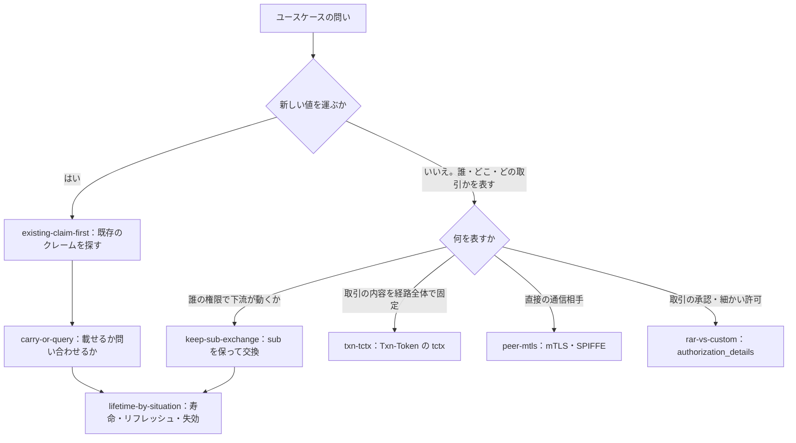

<!-- template_version: 0.4.0 -->
# 判断の木：ユースケースから仕組みを選ぶ

レビュアーが「この設計の仕組みは、ユースケースの問いに合っているか」を確かめるための木です。設計書の 6. 問い × 仕組み（`template:00_core#question-mechanism`）の各行について、ユースケースの問いから木をたどり、設計書が選んだ仕組みと比べます。違っていれば、指摘の種別は「目的と仕組みの不一致」で、**どの問いの取り違えか**（下の節の ID）を書きます（[report_template.md](report_template.md)）。

- 作成方法：本資料は生成AI（Claude）を使って作成し、筆者が確認して公開しています。人による点検は未実施
- 木の分け方は筆者の提案です（各節の仕組みの根拠は仕様と指針にある）

## 0. 始め方

1. 設計書の 6.（問い × 仕組み）の表を開き、ユースケースごとに「要る」とした問い（`templates/registry/questions.yaml` の ID）を書き出す
2. 問いごとに、下の節を 1 つ選ぶ（問いの ID と節の対応は各節の「当たる問い」）
3. 節の「選ぶ仕組み」と、設計書が選んだ仕組み（台帳の行・クレームでない仕組み）を比べる
4. 違えば指摘にする。種別は「目的と仕組みの不一致」、取り違えた問いは節の ID（例：`keep-sub-exchange` を `act` だけで答えた）

根拠：template:00_core#question-mechanism、templates/registry/questions.yaml

## 1. 既存のクレームを先に探す（existing-claim-first）

- 当たる問い：新しい値を運ぶすべての問い
- 問い：その用途のクレームが、登録簿・既存の仕様の構造・IdP の文書・組織の台帳にあるか（slide:p02-claims-by-purpose の 16 の用途の地図）
- 選ぶ仕組み：あれば既存のもの（`cnf`・`txn`・`verified_claims`・`roles` など）。無ければ組織の名前空間で、追加前の 25 問に答える
- 照合は誰が：台帳の持ち主（定義の段）
- 取り違えの例：`device_key` を独自に作る（`cnf` で表せる）、`user_roles` を作る（`roles` で表せる）
- 対比表：`review:contrasts/name-vs-identifier#misuse`
- 観点書：`q-registered-synonym`・`q-reuse-standard-structure`・`pa-03`

根拠：slide:p02-check-before-creating、slide:p02-claims-by-purpose、slide:p02-keys-events-identity-assurance

## 2. 載せるか、問い合わせるか（carry-or-query）

- 当たる問い：受け手が判断に使う値（`q-authorized`・`q-user` の属性など）
- 問い：4 つの問いのすべてに「はい」か
  1. 認可に使うか
  2. 寿命の間に変わらないか（変わっても許せるか）
  3. 小さいか（件数・長さの上限の中か）
  4. 全受け手が要るか
- 選ぶ仕組み：すべて「はい」なら載せ、台帳に登録する。1 つでも「いいえ」なら、問い合わせる（PDP・イントロスペクション・データ層の照合）か、要る受け手のトークンだけに載せる
- 照合は誰が：受け手（問い合わせるなら、どの受け手が問い合わせるかを書く）
- 取り違えの例：異動で変わる部署を寿命の長いトークンに載せて対策を書かない、グループを全部載せる
- 対比表：`review:contrasts/carry-vs-query#misuse`
- 観点書：`dc-01`・`ap-2-1`・`ap-2-2`・`q-freshness-mitigation`

根拠：slide:p04-carry-or-query、template:modules/M_authz_pdp#carry-or-query
<!-- req:p04-carry-or-query.R5 -->

## 3. 下流が利用者の権限で動く必要があるか → `sub` を保って交換する（keep-sub-exchange）

- 当たる問い：誰の権限で（`q-sub`）、誰が代理して実行しているか（`q-actor`）
- 問い：下流の処理は、利用者の権限で判断されるべきか（利用者の操作の続きか）
- 選ぶ仕組み：
  - はい → トークン交換で、`sub`＝利用者、`act`＝仲介するサービス・ワーカー・エージェントのトークンを、宛先ごと・分単位で作り直す。期限切れの後の呼び出しや非同期の処理でも、ワーカーが自分のワークロード ID で交換し、可否はそのたびに AS が承認の記録と利用者の状態から決める
  - いいえ（利用者の文脈が要らない処理）→ サービス自身の ID（client credentials）で動かし、利用者の `sub` を捏造しない
- 照合は誰が：交換を受ける AS（作り直してよいか）と、下流の受け手（`act` を確かめて記録する）
- 取り違えの例：仲介サービスの広い権限で下流を呼ぶ（代理の混乱）、利用者の RT をジョブに保持する、`act` だけで「誰の権限か」にも答える
- 対比表：`review:contrasts/act-txn-workload#misuse`
- 観点書：`q-original-principal`・`q-long-running`・`q-agent-delegation-claims`・`q-system-actor-no-fake-sub`

根拠：slide:p06-validation-split、slide:p08-async-processing、slide:p08-downstream-after-expiry、RFC 8693 §4.1
<!-- req:p06-validation-split.R6 req:p08-async-processing.R4 req:p08-downstream-after-expiry.R3 -->

## 4. 取引の内容を経路全体で固定したいか → Txn-Token の `tctx`（txn-tctx）

- 当たる問い：どの取引か（`q-txn`）、どのワークロードが Txn-Token を求めたか（`q-req-wl`）
- 問い：1 つの呼び出しの連鎖の中で、取引の内容（金額・対象・操作）を途中で変えられないようにしたいか
- 選ぶ仕組み：はい → 入口（または内部で始まる処理）が TTS から Txn-Token を得て、`tctx` に取引の内容、`txn` に相関 ID を入れ、専用の `Txn-Token` ヘッダーで改変せずに渡す。**照合は受け手が行う**（仕様は照合の規則を書かないので、照合する項目を台帳に書く）
- 照合は誰が：受け手（`tctx` の項目を、自分が実行する操作と照合する）
- 取り違えの例：`tctx` を書いたが誰も照合しない、`act` で取引を表す、Txn-Token を AT として送る、`req_wl` を直接の通信相手とみなす
- 対比表：`review:contrasts/act-txn-workload#misuse`
- 観点書：`q-txn-scope-fixed`・`cf-06`

根拠：slide:p06-transaction-tokens、draft-ietf-oauth-transaction-tokens-11 §12.2、template:profiles/P5_internal_propagation#txn-token

## 5. 直接の通信相手を確かめたいか → mTLS・SPIFFE（peer-mtls）

- 当たる問い：直接の通信相手は誰か（`q-peer`）
- 問い：この呼び出しを、今つながっている相手（ワークロード）として確かめたいか
- 選ぶ仕組み：はい → mTLS（クライアント証明書）・SPIFFE の SVID など、通信の層の仕組み。**トークンのクレーム（`act`・`req_wl`・`client_id`）では代えられない**（トークンは転送できるので、持ってきた者が直接の相手とは限らない）。入口で TLS を終端するなら、証明書を渡すヘッダーを入口だけが書けるようにする
- 照合は誰が：接続を受ける側（TLS の終端）と、その結果を受け取る受け手
- 取り違えの例：`req_wl` や `act.sub` で直接の相手を確かめたことにする
- 対比表：`review:contrasts/act-txn-workload#misuse`
- 観点書：`q-authorize-service-and-user`

根拠：slide:p05-one-request-carries、RFC 8705 §2

## 6. 取引の承認・細かい許可を表したいか → `authorization_details`（rar-vs-custom）

- 当たる問い：何が承認されたか（`q-authorized`）
- 問い：取引の単位の許可（金額・対象・操作）を、トークンで受け手に伝えたいか
- 選ぶ仕組み：
  - 取引の承認なら、まず RFC 9396 の `authorization_details`（`type` は自分が管理する URI）で表せるかを検討する。独自の権限オブジェクトは、表せないときだけ作り、理由を台帳に書く
  - 同じ API では `scope` と `authorization_details` の一方を使う
  - 宛先ごとに、その宛先の `type` だけに絞る
  - オブジェクトごとの細かい許可は、トークンでなく PDP に置く
- 照合は誰が：受け手（承認 ID・取引の内容を照合する）
- 取り違えの例：承認をロールで代用する、独自の `permissions` オブジェクトを作る
- 対比表：`review:contrasts/scope-vs-role#misuse`
- 観点書：`q-scope-semantics`・`q-rar-per-audience`・`q-approval-from-as`

根拠：slide:p02-scope、RFC 9396 §2、slide:p05-coarse-fine-layers
<!-- req:p02-scope.R3 -->

## 7. 寿命・リフレッシュ・失効を状況で選ぶ（lifetime-by-situation）

- 当たる問い：まだ有効か（`q-still-valid`）
- 問い：**数字より先に**「剥奪をどれだけ早く効かせたいか」を決めたか。次に、クライアントと処理の種類はどれか

| 状況 | 寿命 | リフレッシュ | 失効 |
| --- | --- | --- | --- |
| 一般の Web・SPA（公開クライアント） | AT は 1 時間以内 | ローテーション＋再利用検知、または送信者制約 | SSF・CAEP、ログアウトで RT を失効 |
| FAPI 対象の機密クライアント | AT は短命・送信者制約 | ローテーションしない | RS が失効状態を確かめる |
| 剥奪をすぐ効かせたい操作 | 短命＋都度判定 | 再計算されるかを確かめる | イントロスペクション・PDP |
| サービス間のワークロード | できるだけ短く | RT は持たないか、できるだけ短く | ID・鍵の廃止で止める |
| 長時間ジョブ・非同期処理 | 分単位で都度取り直す | 利用者の RT を持たない | 取り直しの時点で AS が拒否 |

- 照合は誰が：受け手（期限・失効の状態）と AS（取り直しの可否）
- 取り違えの例：機密クライアントの設計に、公開クライアント向けのローテーションの根拠を引く（シナリオ A の A16）、剥奪を急ぐ操作を自己完結の AT だけで判断する
- 対比表：`review:contrasts/four-lifetimes#misuse`
- 観点書：`q-lifetime-rationale`・`q-rt-policy-by-client`・`q-revocation-delivery`・`q-long-running`

根拠：slide:p08-decision-table、slide:p08-rotation、RFC 9700 §4.14.2、NIST IR 8587 §5.3.1.1
<!-- req:p08-decision-table.R1 req:p08-decision-table.R2 req:p08-decision-table.R3 req:p08-decision-table.R4 req:p08-decision-table.R5 req:p08-decision-table.R6 -->
